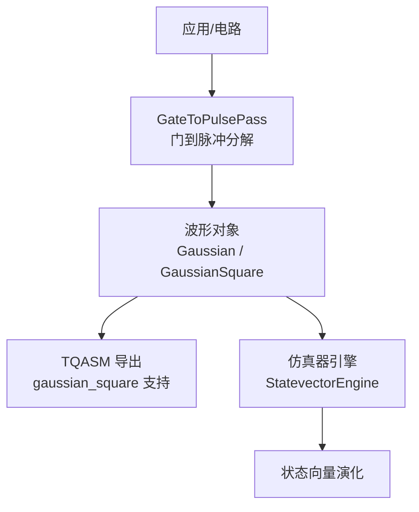
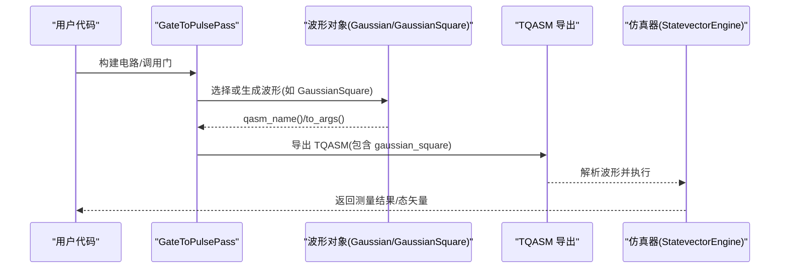
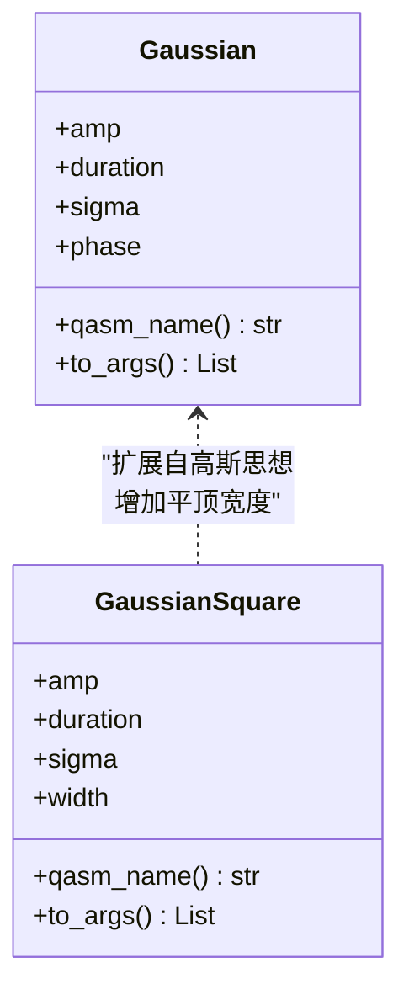
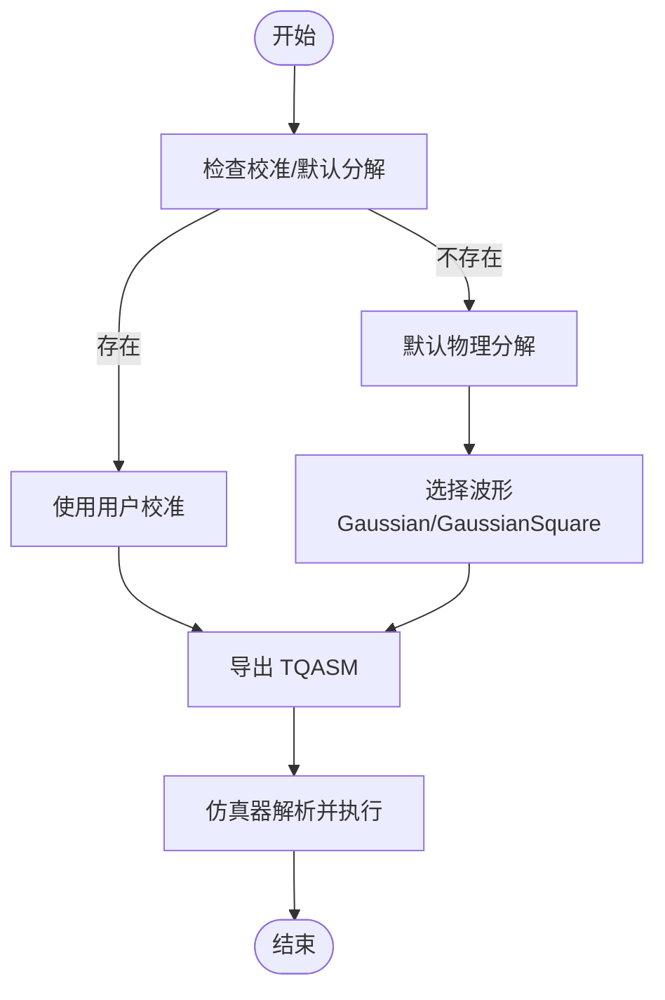
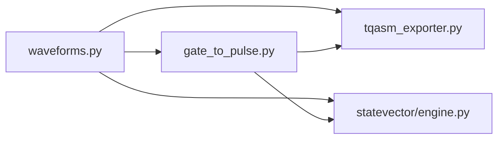

# 高斯波形族

<cite>
**本文引用的文件**
- [waveforms.py](file://src/tyxonq/waveforms.py)
- [gate_to_pulse.py](file://src/tyxonq/compiler/pulse_compiler/native/gate_to_pulse.py)
- [tqasm_exporter.py](file://src/tyxonq/compiler/pulse_compiler/native/tqasm_exporter.py)
- [statevector/engine.py](file://src/tyxonq/devices/simulators/statevector/engine.py)
- [pulse_waveforms.py](file://examples/pulse_waveforms.py)
- [advanced_waveforms.rst](file://docs/source/user_guide/pulse/advanced_waveforms.rst)
- [pulse_advanced_waveforms.rst](file://docs/source/tutorials/advanced/pulse_advanced_waveforms.rst)
</cite>

## 目录
1. [简介](#简介)
2. [项目结构](#项目结构)
3. [核心组件](#核心组件)
4. [架构总览](#架构总览)
5. [详细组件分析](#详细组件分析)
6. [依赖关系分析](#依赖关系分析)
7. [性能考量](#性能考量)
8. [故障排查指南](#故障排查指南)
9. [结论](#结论)
10. [附录](#附录)

## 简介
本文件聚焦 TyxonQ 中的高斯波形族，系统阐述 Gaussian 与 GaussianSquare 两类波形的数学原理、参数配置（振幅、持续时间、标准差、相位等）、使用场景与最佳实践。重点解释 GaussianSquare 相比普通 Gaussian 的优势：通过引入平顶结构，在保持平滑边缘的同时提供更稳定的有效驱动区间，从而有助于提升量子门保真度并抑制频谱泄漏。文档同时给出完整的代码示例路径，说明如何在 TyxonQ 中创建和配置这两种波形，并讨论其在不同硬件平台上的表现与调优方法。

## 项目结构
TyxonQ 的波形定义集中在统一的模块中，并通过编译器与仿真器集成到脉冲执行链路。关键位置如下：
- 波形数据类定义：src/tyxonq/waveforms.py
- 门到脉冲编译：src/tyxonq/compiler/pulse_compiler/native/gate_to_pulse.py
- TQASM 导出（含 gaussian_square）：src/tyxonq/compiler/pulse_compiler/native/tqasm_exporter.py
- 仿真器对波形的解析与映射：src/tyxonq/devices/simulators/statevector/engine.py
- 示例与教程：examples/pulse_waveforms.py、docs/source/... 下的用户指南与教程

图表来源
- [gate_to_pulse.py:1-200](file://src/tyxonq/compiler/pulse_compiler/native/gate_to_pulse.py#L1-L200)
- [waveforms.py:19-39](file://src/tyxonq/waveforms.py#L19-L39)
- [tqasm_exporter.py:600-680](file://src/tyxonq/compiler/pulse_compiler/native/tqasm_exporter.py#L600-L680)
- [statevector/engine.py:950-990](file://src/tyxonq/devices/simulators/statevector/engine.py#L950-L990)

章节来源
- [waveforms.py:1-157](file://src/tyxonq/waveforms.py#L1-L157)
- [gate_to_pulse.py:1-200](file://src/tyxonq/compiler/pulse_compiler/native/gate_to_pulse.py#L1-L200)
- [tqasm_exporter.py:600-680](file://src/tyxonq/compiler/pulse_compiler/native/tqasm_exporter.py#L600-L680)
- [statevector/engine.py:950-990](file://src/tyxonq/devices/simulators/statevector/engine.py#L950-L990)

## 核心组件
- Gaussian：标准高斯包络，适用于单量子比特旋转等基本操作，具备平滑上升/下降沿，降低高频分量。
- GaussianSquare：在高斯基础上增加平顶宽度参数，形成“平滑过渡 + 平坦顶部”的结构，有利于提高门操作的稳定性与保真度。

两者均提供：
- qasm_name()：用于序列化/导出的波形名称
- to_args()：返回序列化所需参数列表

章节来源
- [waveforms.py:19-39](file://src/tyxonq/waveforms.py#L19-L39)

## 架构总览
TyxonQ 将波形作为可序列化的数据类，贯穿“电路 → 脉冲编译 → 仿真/硬件执行”的全链路。GaussianSquare 在 TQASM 导出中被显式支持，并在仿真器中映射为对应的波形类。

图表来源
- [gate_to_pulse.py:1-200](file://src/tyxonq/compiler/pulse_compiler/native/gate_to_pulse.py#L1-L200)
- [tqasm_exporter.py:600-680](file://src/tyxonq/compiler/pulse_compiler/native/tqasm_exporter.py#L600-L680)
- [statevector/engine.py:950-990](file://src/tyxonq/devices/simulators/statevector/engine.py#L950-L990)

## 详细组件分析

### Gaussian 波形
- 数学原理
  - 包络函数采用高斯分布形式，具有连续且无限可微的光滑特性，能有效抑制高频分量，减少频谱泄漏。
  - 典型参数：振幅 amp、持续时间 duration、标准差 sigma、相位 phase。
- 参数说明
  - amp：控制脉冲强度，影响旋转角度与 Rabi 频率匹配。
  - duration：脉冲总时长，决定时间域能量积分与门速度。
  - sigma：高斯宽度，越大越平缓但门时间更长；越小则更尖锐但频谱展宽更大。
  - phase：相位偏移（弧度），用于实现 X/Y/Z 等不同轴旋转。
- 使用场景
  - 单量子比特基本旋转（X/Y/H/T 等）。
  - 需要快速门操作且对频谱泄漏要求不极端苛刻的场景。
- 优势与局限
  - 优势：实现简单、计算开销低、平滑边缘。
  - 局限：无平顶区，有效驱动区间不如带平顶的波形稳定；在强耦合或多量子比特系统中可能面临更高的串扰风险。

章节来源
- [waveforms.py:19-28](file://src/tyxonq/waveforms.py#L19-L28)
- [pulse_waveforms.py:40-108](file://examples/pulse_waveforms.py#L40-L108)

### GaussianSquare 波形
- 数学原理
  - 在高斯包络基础上引入平顶宽度 width，形成三段结构：平滑上升段 → 恒定幅度的平顶段 → 平滑下降段。
  - 平顶段提供稳定的有效驱动区间，有助于提高门操作的鲁棒性与保真度。
- 参数说明
  - amp：振幅。
  - duration：总持续时间。
  - sigma：高斯过渡区的宽度参数，控制上升/下降的平滑程度。
  - width：平顶宽度，必须小于 duration；通常取 duration 的 0.5–0.8 比例以获得较好的有效驱动与频谱折衷。
- 使用场景
  - 对门保真度要求较高的单/双量子比特门。
  - 多量子比特系统中需要抑制频谱泄漏与串扰的场景（例如交叉共振 CR 门）。
- 优势与局限
  - 优势：平顶结构增强有效驱动稳定性，结合平滑边缘降低高频泄漏；在仿真与理论层面有助于提升保真度。
  - 局限：需要额外参数 width 调优；过宽的平顶可能延长门时间，需权衡速度与保真度。

章节来源
- [waveforms.py:30-39](file://src/tyxonq/waveforms.py#L30-L39)
- [tqasm_exporter.py:600-680](file://src/tyxonq/compiler/pulse_compiler/native/tqasm_exporter.py#L600-L680)
- [statevector/engine.py:950-990](file://src/tyxonq/devices/simulators/statevector/engine.py#L950-L990)

### 高斯波形族类图

图表来源
- [waveforms.py:19-39](file://src/tyxonq/waveforms.py#L19-L39)

### 门到脉冲流程（含 GaussianSquare）

图表来源
- [gate_to_pulse.py:1-200](file://src/tyxonq/compiler/pulse_compiler/native/gate_to_pulse.py#L1-L200)
- [tqasm_exporter.py:600-680](file://src/tyxonq/compiler/pulse_compiler/native/tqasm_exporter.py#L600-L680)
- [statevector/engine.py:950-990](file://src/tyxonq/devices/simulators/statevector/engine.py#L950-L990)

## 依赖关系分析
- 波形模块 waveforms.py 提供统一的数据类接口，被编译器与仿真器复用。
- GateToPulsePass 负责将抽象门转换为具体脉冲波形，优先使用用户校准，否则回退到默认物理分解。
- TQASM 导出器明确支持 gaussian_square，确保跨平台/云执行的兼容性。
- StatevectorEngine 将字符串波形名映射到具体类，便于仿真执行。

图表来源
- [waveforms.py:1-157](file://src/tyxonq/waveforms.py#L1-L157)
- [gate_to_pulse.py:1-200](file://src/tyxonq/compiler/pulse_compiler/native/gate_to_pulse.py#L1-L200)
- [tqasm_exporter.py:600-680](file://src/tyxonq/compiler/pulse_compiler/native/tqasm_exporter.py#L600-L680)
- [statevector/engine.py:950-990](file://src/tyxonq/devices/simulators/statevector/engine.py#L950-L990)

章节来源
- [waveforms.py:1-157](file://src/tyxonq/waveforms.py#L1-L157)
- [gate_to_pulse.py:1-200](file://src/tyxonq/compiler/pulse_compiler/native/gate_to_pulse.py#L1-L200)
- [tqasm_exporter.py:600-680](file://src/tyxonq/compiler/pulse_compiler/native/tqasm_exporter.py#L600-L680)
- [statevector/engine.py:950-990](file://src/tyxonq/devices/simulators/statevector/engine.py#L950-L990)

## 性能考量
- 频谱泄漏抑制
  - Gaussian：平滑包络天然抑制高频分量，适合一般单量子比特门。
  - GaussianSquare：在保持平滑边缘的同时提供平顶区，有助于稳定有效驱动，理论上可降低泄漏并提升保真度。
- 门保真度与速度折衷
  - 增大 sigma 使边缘更平滑但门时间增长；减小 sigma 加速但频谱展宽增加。
  - 调整 width 以平衡有效驱动长度与门时间；经验上 width/duration 约 0.5–0.8 较常用。
- 硬件平台差异
  - 不同硬件的带宽、传输线滤波、AWG 能力会影响实际波形形状与保真度。
  - 建议在仿真器中进行初步优化，再在真实硬件上进行门表征与串扰测试验证。

章节来源
- [pulse_waveforms.py:115-169](file://examples/pulse_waveforms.py#L115-L169)
- [advanced_waveforms.rst:169-241](file://docs/source/user_guide/pulse/advanced_waveforms.rst#L169-L241)
- [pulse_advanced_waveforms.rst:18-16](file://docs/source/tutorials/advanced/pulse_advanced_waveforms.rst#L18-L16)

## 故障排查指南
- 问题：GaussianSquare 的 width 设置不当导致保真度下降
  - 现象：有效驱动不足或门时间过长
  - 解决：扫描 width/duration 比例（如 0.5、0.6、0.7、0.8），先在仿真器评估，再在硬件上验证
- 问题：期望的频谱泄漏抑制未观察到
  - 原因：硬件带宽限制、传输线滤波、量子比特响应非理想性
  - 解决：在真实硬件上进行两量子比特串扰测试，对比 Gaussian 与 GaussianSquare 的实际效果
- 问题：旧代码无法识别新波形类型
  - 原因：旧版本未包含新波形映射
  - 解决：升级至支持新波形的版本，并确保仿真器与导出器更新

章节来源
- [advanced_waveforms.rst:369-425](file://docs/source/user_guide/pulse/advanced_waveforms.rst#L369-L425)
- [pulse_advanced_waveforms.rst:562-613](file://docs/source/tutorials/advanced/pulse_advanced_waveforms.rst#L562-L613)

## 结论
- Gaussian 是基础且高效的平滑包络，适用于大多数单量子比特门。
- GaussianSquare 通过引入平顶结构，在保持平滑边缘的同时提供更稳定的有效驱动区间，有助于提升门保真度并抑制频谱泄漏，尤其适合对保真度与串扰敏感的应用。
- 建议在实际部署前，先在仿真器中完成参数扫描与优化，再在真实硬件上进行门表征与串扰验证，以确保理论与实际的契合。

## 附录

### 代码示例与参考路径
- 创建与使用 Gaussian/GaussianSquare 的综合示例
  - 示例入口与多种波形对比：[pulse_waveforms.py](file://examples/pulse_waveforms.py)
- 波形数据类定义
  - 波形类与参数：[waveforms.py](file://src/tyxonq/waveforms.py)
- 门到脉冲编译与默认分解
  - 门到脉冲转换逻辑：[gate_to_pulse.py](file://src/tyxonq/compiler/pulse_compiler/native/gate_to_pulse.py)
- TQASM 导出（含 gaussian_square）
  - 导出器中对 gaussian_square 的支持：[tqasm_exporter.py](file://src/tyxonq/compiler/pulse_compiler/native/tqasm_exporter.py)
- 仿真器波形映射
  - 仿真器对 gaussian_square 的解析与映射：[statevector/engine.py](file://src/tyxonq/devices/simulators/statevector/engine.py)

章节来源
- [pulse_waveforms.py:1-578](file://examples/pulse_waveforms.py#L1-L578)
- [waveforms.py:1-157](file://src/tyxonq/waveforms.py#L1-L157)
- [gate_to_pulse.py:1-200](file://src/tyxonq/compiler/pulse_compiler/native/gate_to_pulse.py#L1-L200)
- [tqasm_exporter.py:600-680](file://src/tyxonq/compiler/pulse_compiler/native/tqasm_exporter.py#L600-L680)
- [statevector/engine.py:950-990](file://src/tyxonq/devices/simulators/statevector/engine.py#L950-L990)