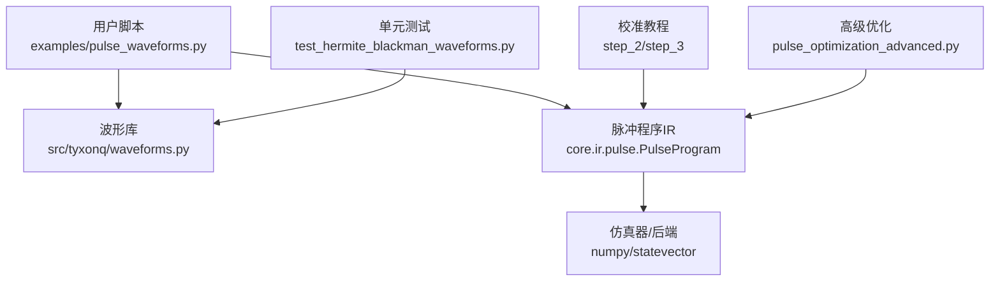
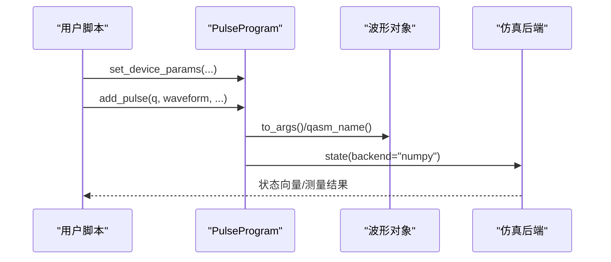
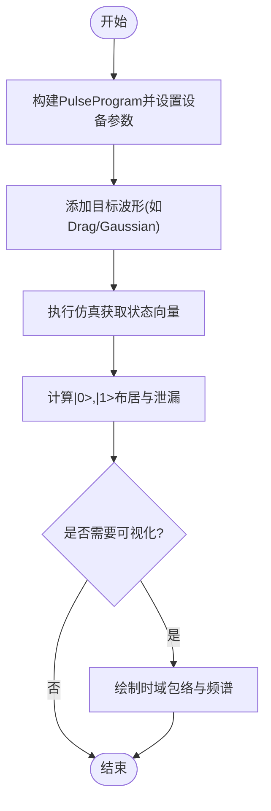
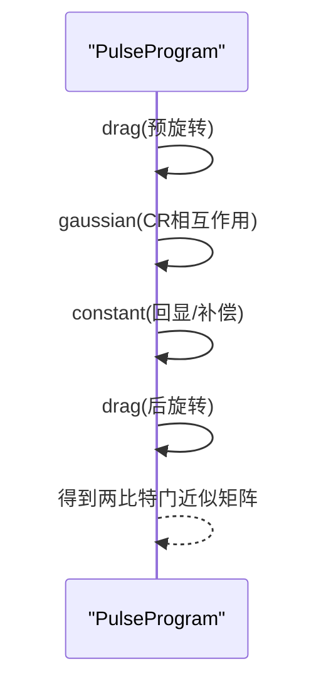
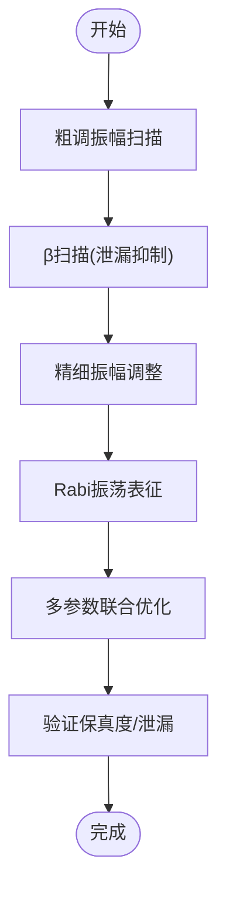
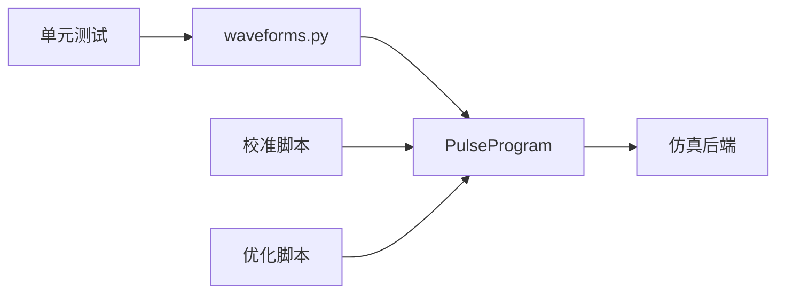

# 波形设计示例

<cite>
**本文引用的文件**
- [waveforms.py](file://src/tyxonq/waveforms.py)
- [pulse_waveforms.py](file://examples/pulse_waveforms.py)
- [step_2_single_qubit_coarse_tuning.py](file://examples/pulse_calibration_tutorial/step_2_single_qubit_coarse_tuning.py)
- [step_3_single_qubit_fine_tuning.py](file://examples/pulse_calibration_tutorial/step_3_single_qubit_fine_tuning.py)
- [pulse_optimization_advanced.py](file://examples/pulse_optimization_advanced.py)
- [test_hermite_blackman_waveforms.py](file://tests_core_module/test_hermite_blackman_waveforms.py)
</cite>

## 目录
1. [简介](#简介)
2. [项目结构](#项目结构)
3. [核心组件](#核心组件)
4. [架构总览](#架构总览)
5. [详细组件分析](#详细组件分析)
6. [依赖关系分析](#依赖关系分析)
7. [性能考量](#性能考量)
8. [故障排查指南](#故障排查指南)
9. [结论](#结论)
10. [附录](#附录)

## 简介
本文件面向使用 TyxonQ 进行量子脉冲波形设计与优化的工程师与研究人员，系统梳理并演示 Gaussian、Drag、Square（Constant）、Cosine、Hermite、BlackmanSquare 等波形的数学原理、参数配置与优化技巧。文档通过代码级示例展示如何在时域和频域可视化不同波形，解释波形选择对单/双量子比特门保真度的影响，并提供振幅扫描、持续时间优化、DRAG 系数调优等实用方法，帮助在实际硬件上选择合适的波形参数。

## 项目结构
围绕波形设计的核心资源分布在以下位置：
- 波形定义与接口：src/tyxonq/waveforms.py
- 综合示例与可视化：examples/pulse_waveforms.py
- 校准流程与参数扫描：examples/pulse_calibration_tutorial/step_2_single_qubit_coarse_tuning.py、step_3_single_qubit_fine_tuning.py
- 高级优化方法：examples/pulse_optimization_advanced.py
- 新波形测试与对比：tests_core_module/test_hermite_blackman_waveforms.py

**图表来源**
- [pulse_waveforms.py:1-578](file://examples/pulse_waveforms.py#L1-L578)
- [waveforms.py:1-157](file://src/tyxonq/waveforms.py#L1-L157)
- [step_2_single_qubit_coarse_tuning.py:1-356](file://examples/pulse_calibration_tutorial/step_2_single_qubit_coarse_tuning.py#L1-L356)
- [step_3_single_qubit_fine_tuning.py:1-306](file://examples/pulse_calibration_tutorial/step_3_single_qubit_fine_tuning.py#L1-L306)
- [pulse_optimization_advanced.py:1-582](file://examples/pulse_optimization_advanced.py#L1-L582)
- [test_hermite_blackman_waveforms.py:1-474](file://tests_core_module/test_hermite_blackman_waveforms.py#L1-L474)

**章节来源**
- [waveforms.py:1-157](file://src/tyxonq/waveforms.py#L1-L157)
- [pulse_waveforms.py:1-578](file://examples/pulse_waveforms.py#L1-L578)

## 核心组件
- 波形数据类：Gaussian、GaussianSquare、Drag、Constant、Sine、Cosine、CosineDrag、Flattop、Hermite、BlackmanSquare。每个波形提供统一的 qasm_name() 与 to_args() 接口，便于序列化与编译。
- 脉冲程序 IR：PulseProgram 用于构建、设置设备参数、添加脉冲并执行仿真或下发到硬件。
- 校准与优化：提供从粗调到精细调优的完整流程，包括振幅扫描、β（DRAG）扫描、Rabi 表征与多参数优化。

**章节来源**
- [waveforms.py:19-157](file://src/tyxonq/waveforms.py#L19-L157)
- [pulse_waveforms.py:144-169](file://examples/pulse_waveforms.py#L144-L169)
- [step_2_single_qubit_coarse_tuning.py:151-201](file://examples/pulse_calibration_tutorial/step_2_single_qubit_coarse_tuning.py#L151-L201)
- [step_3_single_qubit_fine_tuning.py:67-121](file://examples/pulse_calibration_tutorial/step_3_single_qubit_fine_tuning.py#L67-L121)

## 架构总览
下图展示了从用户脚本到波形实现、再到仿真执行的典型调用链。

**图表来源**
- [pulse_waveforms.py:144-169](file://examples/pulse_waveforms.py#L144-L169)
- [waveforms.py:25-28](file://src/tyxonq/waveforms.py#L25-L28)

## 详细组件分析

### 波形类型与数学特性
- Constant（Square）：矩形包络，上升沿陡峭，频谱旁瓣高，易泄漏到非计算能级。适合快速开关但保真度受限。
- Gaussian：平滑包络，降低高频分量，减少泄漏；sigma 控制边缘缓急，通常 sigma ≈ duration/4。
- Drag（DRAG）：在 I/Q 通道加入导数项以抑制 |1⟩→|2⟩ 泄漏。参数 β 控制导数强度，需结合失谐与非谐性优化。
- Cosine/CosineDrag：余弦调制或带相位控制的 DRAG，适用于特定硬件或需要相位灵活性的场景。
- Hermite：基于概率论 Hermite 多项式的平滑包络，具有更低的频谱泄漏，适合高精度门。
- BlackmanSquare：Blackman 窗 + 平顶，极低的旁瓣电平，减少频谱泄漏与串扰，width 控制平顶宽度。

上述波形均提供统一接口，便于在 PulseProgram 中复用与序列化。

**章节来源**
- [waveforms.py:19-157](file://src/tyxonq/waveforms.py#L19-L157)
- [test_hermite_blackman_waveforms.py:27-120](file://tests_core_module/test_hermite_blackman_waveforms.py#L27-L120)
- [test_hermite_blackman_waveforms.py:122-246](file://tests_core_module/test_hermite_blackman_waveforms.py#L122-L246)

### 单量子比特门实现与可视化
- X/H/Y 门可通过不同幅度和相位的 DRAG/Gaussian 脉冲实现。示例展示了 π 与 π/√2 旋转的实现思路与结果评估。
- 时域可视化：通过采样波形观察包络形状、上升/下降沿平滑度。
- 频域可视化：利用 FFT 观察主瓣宽度与旁瓣电平，评估泄漏风险。

**图表来源**
- [pulse_waveforms.py:176-229](file://examples/pulse_waveforms.py#L176-L229)
- [pulse_waveforms.py:144-169](file://examples/pulse_waveforms.py#L144-L169)

**章节来源**
- [pulse_waveforms.py:176-229](file://examples/pulse_waveforms.py#L176-L229)

### 双量子比特门分解与序列
- CX/iSWAP/SWAP 通过 CR 序列或 CX 链实现。示例展示了如何组合多个单比特旋转与相互作用脉冲完成两比特门。
- 注意：iSWAP 与 SWAP 物理序列相同，相对相位由软件处理。

**图表来源**
- [pulse_waveforms.py:247-315](file://examples/pulse_waveforms.py#L247-L315)

**章节来源**
- [pulse_waveforms.py:247-315](file://examples/pulse_waveforms.py#L247-L315)

### 参数优化与校准流程
- 振幅扫描：固定时长与包络，扫描幅度寻找最佳 π 旋转点。
- β（DRAG）扫描：固定振幅与时长，扫描 β 最小化泄漏。
- Rabi 表征：固定振幅，扫描时长绘制 Rabi 振荡曲线，提取 Rabi 频率并精确校准旋转角。
- 多参数优化：同时优化振幅、时长、β，采用网格搜索+梯度下降策略。

**图表来源**
- [step_2_single_qubit_coarse_tuning.py:151-201](file://examples/pulse_calibration_tutorial/step_2_single_qubit_coarse_tuning.py#L151-L201)
- [step_2_single_qubit_coarse_tuning.py:237-295](file://examples/pulse_calibration_tutorial/step_2_single_qubit_coarse_tuning.py#L237-L295)
- [step_3_single_qubit_fine_tuning.py:67-121](file://examples/pulse_calibration_tutorial/step_3_single_qubit_fine_tuning.py#L67-L121)
- [step_3_single_qubit_fine_tuning.py:154-209](file://examples/pulse_calibration_tutorial/step_3_single_qubit_fine_tuning.py#L154-L209)
- [pulse_optimization_advanced.py:409-453](file://examples/pulse_optimization_advanced.py#L409-L453)

**章节来源**
- [step_2_single_qubit_coarse_tuning.py:151-295](file://examples/pulse_calibration_tutorial/step_2_single_qubit_coarse_tuning.py#L151-L295)
- [step_3_single_qubit_fine_tuning.py:67-209](file://examples/pulse_calibration_tutorial/step_3_single_qubit_fine_tuning.py#L67-L209)
- [pulse_optimization_advanced.py:409-453](file://examples/pulse_optimization_advanced.py#L409-L453)

### 波形选择与保真度影响
- 不同包络对频谱分布的影响直接决定泄漏与串扰水平。
- DRAG 通过导数项抑制 |1⟩→|2⟩ 跃迁，提升保真度；β 过大可能引入额外误差。
- Hermite 与 BlackmanSquare 提供更优的频谱抑制，适合高精度门。
- 实际硬件上需结合器件的非谐性、带宽限制与噪声谱密度进行参数选择。

**章节来源**
- [pulse_waveforms.py:483-544](file://examples/pulse_waveforms.py#L483-L544)
- [test_hermite_blackman_waveforms.py:363-404](file://tests_core_module/test_hermite_blackman_waveforms.py#L363-L404)

## 依赖关系分析
- 波形模块为纯数据类，无外部运行时依赖，便于在不同后端间复用。
- PulseProgram 负责将波形转换为可执行的脉冲序列，并与仿真器/硬件驱动交互。
- 校准与优化脚本依赖波形模块与 PulseProgram，形成“参数→波形→仿真→指标”的闭环。

**图表来源**
- [waveforms.py:1-157](file://src/tyxonq/waveforms.py#L1-L157)
- [pulse_waveforms.py:1-578](file://examples/pulse_waveforms.py#L1-L578)
- [step_2_single_qubit_coarse_tuning.py:1-356](file://examples/pulse_calibration_tutorial/step_2_single_qubit_coarse_tuning.py#L1-L356)
- [step_3_single_qubit_fine_tuning.py:1-306](file://examples/pulse_calibration_tutorial/step_3_single_qubit_fine_tuning.py#L1-L306)
- [pulse_optimization_advanced.py:1-582](file://examples/pulse_optimization_advanced.py#L1-L582)
- [test_hermite_blackman_waveforms.py:1-474](file://tests_core_module/test_hermite_blackman_waveforms.py#L1-L474)

**章节来源**
- [waveforms.py:1-157](file://src/tyxonq/waveforms.py#L1-L157)
- [pulse_waveforms.py:1-578](file://examples/pulse_waveforms.py#L1-L578)

## 性能考量
- 包络平滑度与频谱泄漏：越平滑的包络（Gaussian、Hermite、Blackman）旁瓣越低，泄漏越小，但上升时间更长。
- DRAG 系数 β：需根据非谐性与驱动带宽优化；过小泄漏抑制不足，过大会引入相位误差。
- 持续时间与保真度权衡：较长脉冲更抗噪但受 T1/T2 限制；较短脉冲更快但更易受带宽限制与噪声影响。
- 多参数优化建议：先网格搜索粗定位，再用梯度法精细优化；约束参数范围避免物理不可行解。

[本节为通用指导，不直接分析具体文件]

## 故障排查指南
- 波形采样异常：检查采样点是否在有效区间内；确保 duration、sigma、width 合理且为正。
- 保真度低：检查振幅是否达到目标旋转角；确认 β 是否合适；评估频谱泄漏与硬件带宽匹配。
- 泄漏过高：尝试增大 β 或改用 Hermite/BlackmanSquare；缩短上升沿或增加平滑度。
- 优化不收敛：缩小搜索范围、增加初始点数量、结合 PSR/AutoGrad 梯度信息。

**章节来源**
- [test_hermite_blackman_waveforms.py:61-86](file://tests_core_module/test_hermite_blackman_waveforms.py#L61-L86)
- [test_hermite_blackman_waveforms.py:153-205](file://tests_core_module/test_hermite_blackman_waveforms.py#L153-L205)
- [pulse_optimization_advanced.py:460-548](file://examples/pulse_optimization_advanced.py#L460-L548)

## 结论
TyxonQ 提供了丰富的波形原语与完整的校准优化流程。通过合理选择包络（Gaussian/DRAG/Hermite/BlackmanSquare）并系统性地调节振幅、时长与 β，可在保证速度的同时显著提升门保真度。建议在真实硬件上结合器件特性（非谐性、带宽、噪声谱）进行端到端优化，并以 Rabi 表征与频谱分析作为关键诊断手段。

[本节为总结性内容，不直接分析具体文件]

## 附录

### 常用波形参数与推荐实践
- Gaussian：duration≈160ns，sigma≈40ns，起始 β=0；若泄漏明显则切换至 DRAG。
- DRAG：β 初值 0.1–0.3，依据非谐性微调；振幅通过 Rabi 扫描确定。
- Hermite：order 2–3，phase 按需设置；适合高精度门与低泄漏需求。
- BlackmanSquare：width≈0.5–0.8×duration；适合对频谱泄漏敏感的场景。

**章节来源**
- [pulse_waveforms.py:483-544](file://examples/pulse_waveforms.py#L483-L544)
- [waveforms.py:104-157](file://src/tyxonq/waveforms.py#L104-L157)

### 可视化与评估要点
- 时域：观察包络平滑度、对称性与峰值不超过幅度限制。
- 频域：关注主瓣宽度与旁瓣电平；旁瓣越低，泄漏与串扰越小。
- 指标：|1⟩ 布居、泄漏率、估计保真度；Rabi 频率用于精确校准。

**章节来源**
- [pulse_waveforms.py:144-169](file://examples/pulse_waveforms.py#L144-L169)
- [step_3_single_qubit_fine_tuning.py:154-209](file://examples/pulse_calibration_tutorial/step_3_single_qubit_fine_tuning.py#L154-L209)