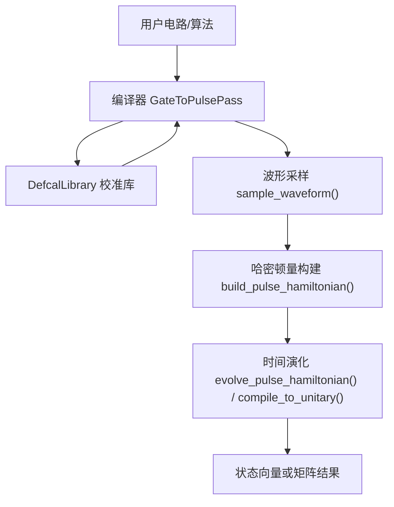
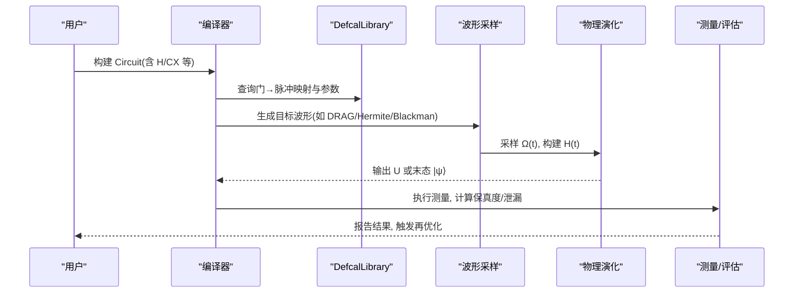
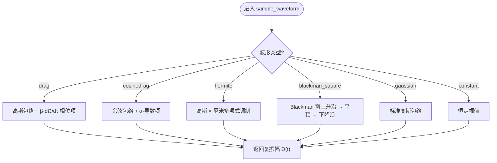
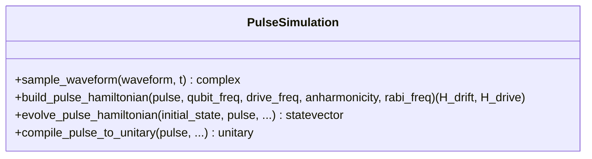
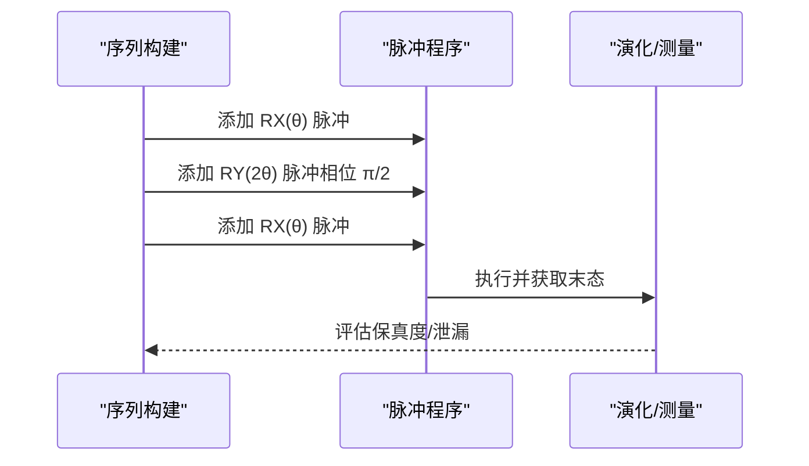
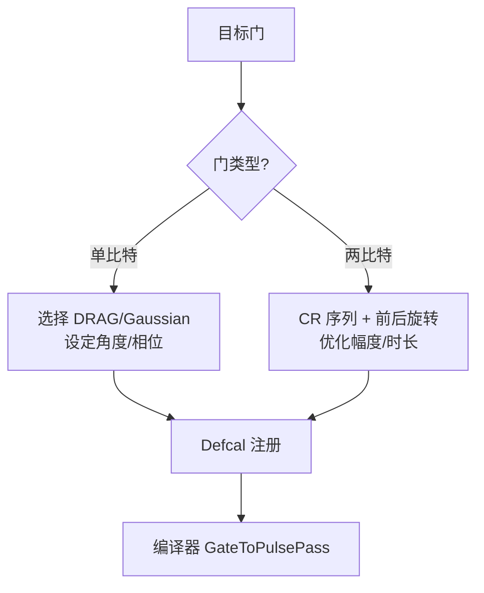
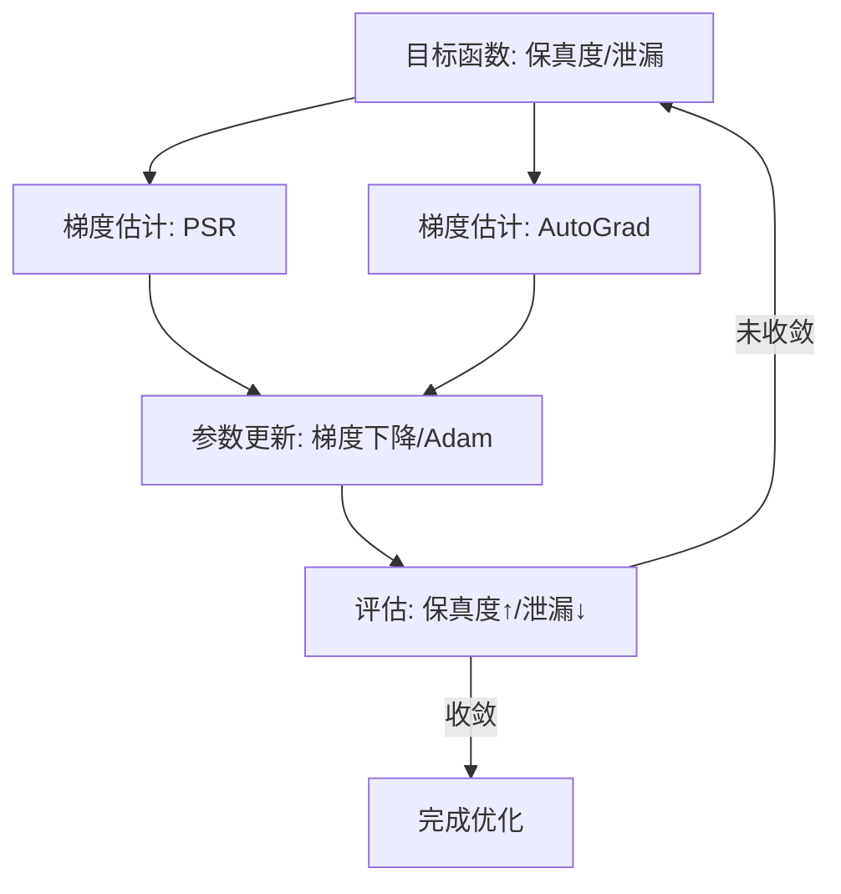
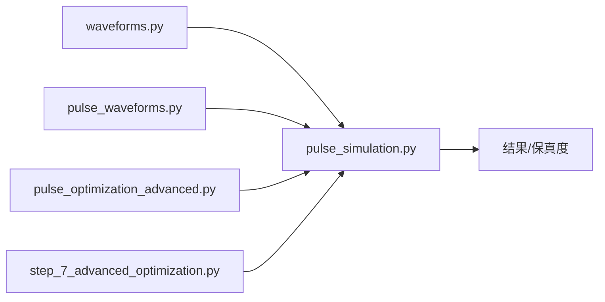

# 高级脉冲整形技术

<cite>
**本文引用的文件**
- [waveforms.py](file://src/tyxonq/waveforms.py)
- [pulse_simulation.py](file://src/tyxonq/libs/quantum_library/pulse_simulation.py)
- [pulse_waveforms.py](file://examples/pulse_waveforms.py)
- [pulse_optimization_advanced.py](file://examples/pulse_optimization_advanced.py)
- [step_7_advanced_optimization.py](file://examples/pulse_calibration_tutorial/step_7_advanced_optimization.py)
- [pulse_advanced_waveforms.rst](file://docs/source/tutorials/advanced/pulse_advanced_waveforms.rst)
</cite>

## 目录
1. [简介](#简介)
2. [项目结构](#项目结构)
3. [核心组件](#核心组件)
4. [架构总览](#架构总览)
5. [详细组件分析](#详细组件分析)
6. [依赖关系分析](#依赖关系分析)
7. [性能考量](#性能考量)
8. [故障排查指南](#故障排查指南)
9. [结论](#结论)
10. [附录：代码示例与最佳实践](#附录代码示例与最佳实践)

## 简介
本文件面向需要实现高保真、鲁棒量子门控制的工程师与研究者，系统梳理并深入讲解以下前沿主题：
- 复合脉冲（如 BB1、CORPSE）思想与在 TyxonQ 中的序列构建方式
- 导数调制脉冲（DRAG）原理与实现细节
- 门特定脉冲整形（不同门使用不同波形与参数）
- 鲁棒控制：对失谐、幅度误差的容忍性与噪声抑制策略
- 最优控制理论与机器学习在脉冲优化中的潜力
- 硬件实现挑战与验证方法（仿真到真实设备的闭环流程）

TyxonQ 提供了从波形定义、物理演化模拟、自动微分优化到校准库（Defcal）集成的完整工具链，便于将理论设计快速落地到实际设备。

## 项目结构
围绕“脉冲整形”的关键模块分布如下：
- 波形定义层：统一的数据类描述各类包络（Gaussian、Drag、Hermite、BlackmanSquare 等）
- 物理仿真层：基于旋转波近似的时间相关哈密顿量演化，支持多后端与自动微分
- 示例与教程：覆盖单/双比特门、波形对比、优化流程、高级整形技巧与部署建议
- 校准集成：通过 DefcalLibrary 将优化后的脉冲参数嵌入编译流程，提升端到端保真度

图表来源
- [pulse_waveforms.py:176-230](file://examples/pulse_waveforms.py#L176-L230)
- [pulse_simulation.py:297-383](file://src/tyxonq/libs/quantum_library/pulse_simulation.py#L297-L383)
- [pulse_simulation.py:386-524](file://src/tyxonq/libs/quantum_library/pulse_simulation.py#L386-L524)
- [step_7_advanced_optimization.py:160-249](file://examples/pulse_calibration_tutorial/step_7_advanced_optimization.py#L160-L249)

章节来源
- [pulse_waveforms.py:1-578](file://examples/pulse_waveforms.py#L1-L578)
- [pulse_simulation.py:1-800](file://src/tyxonq/libs/quantum_library/pulse_simulation.py#L1-L800)
- [step_7_advanced_optimization.py:1-361](file://examples/pulse_calibration_tutorial/step_7_advanced_optimization.py#L1-L361)

## 核心组件
- 波形数据类：提供标准化接口 qasm_name()/to_args()，便于序列化与跨平台传输
- 波形采样器：按时间采样 I/Q 包络，支持 DRAG、CosineDrag、Hermite、Blackman 等
- 物理演化引擎：基于 RWA 构造 H(t)，数值积分求解薛定谔方程，支持 T1/T2 退相干
- 优化与校准：参数扫描、梯度法（PSR/AutoGrad）、Defcal 库注入编译器

章节来源
- [waveforms.py:1-157](file://src/tyxonq/waveforms.py#L1-L157)
- [pulse_simulation.py:44-294](file://src/tyxonq/libs/quantum_library/pulse_simulation.py#L44-L294)
- [pulse_simulation.py:297-524](file://src/tyxonq/libs/quantum_library/pulse_simulation.py#L297-L524)
- [pulse_optimization_advanced.py:46-203](file://examples/pulse_optimization_advanced.py#L46-L203)
- [step_7_advanced_optimization.py:160-249](file://examples/pulse_calibration_tutorial/step_7_advanced_optimization.py#L160-L249)

## 架构总览
下图展示从“逻辑门”到“物理脉冲”再到“测量结果”的端到端链路，以及优化与校准如何介入该链路。

图表来源
- [step_7_advanced_optimization.py:160-249](file://examples/pulse_calibration_tutorial/step_7_advanced_optimization.py#L160-L249)
- [pulse_simulation.py:297-524](file://src/tyxonq/libs/quantum_library/pulse_simulation.py#L297-L524)
- [pulse_waveforms.py:176-230](file://examples/pulse_waveforms.py#L176-L230)

## 详细组件分析

### 波形定义与采样
- 支持的波形类型包括 Constant、Gaussian、Drag、Sine、Cosine、Flattop、Hermite、BlackmanSquare 等，均提供统一的 to_args() 与 qasm_name() 接口，便于导出与复用。
- 采样器根据波形类型计算复包络 Ω(t)，其中：
  - DRAG 引入导数项以抑制向 |2⟩ 的泄漏
  - CosineDrag 采用余弦包络加导数修正
  - Hermite 用厄米多项式调制高斯包络，改善频谱旁瓣
  - BlackmanSquare 采用 Blackman 窗+平顶，获得极低的频谱旁瓣

图表来源
- [pulse_simulation.py:96-294](file://src/tyxonq/libs/quantum_library/pulse_simulation.py#L96-L294)
- [waveforms.py:19-157](file://src/tyxonq/waveforms.py#L19-L157)

章节来源
- [waveforms.py:1-157](file://src/tyxonq/waveforms.py#L1-L157)
- [pulse_simulation.py:44-294](file://src/tyxonq/libs/quantum_library/pulse_simulation.py#L44-L294)

### 物理演化与门合成
- 在旋转波近似下，驱动哈密顿量为 H_drive(t) = Re[Ω(t)]σ_x + Im[Ω(t)]σ_y，漂移项为失谐 Δ 引起的 σ_z 项。
- 通过数值积分（RK45 或可微 Euler）求解 iℏ d|ψ⟩/dt = H(t)|ψ⟩，得到末态或等效幺正矩阵。
- 支持 T1/T2 退相干后处理，便于评估噪声影响。

图表来源
- [pulse_simulation.py:297-524](file://src/tyxonq/libs/quantum_library/pulse_simulation.py#L297-L524)
- [pulse_simulation.py:527-700](file://src/tyxonq/libs/quantum_library/pulse_simulation.py#L527-L700)

章节来源
- [pulse_simulation.py:297-700](file://src/tyxonq/libs/quantum_library/pulse_simulation.py#L297-L700)

### 复合脉冲与鲁棒控制
- 复合脉冲思想：通过多个子脉冲的相位与幅度编排，使整体对参数误差（如失谐、幅度偏差）一阶或高阶不敏感。典型思路包括 BB1、CORPSE 等。
- 在 TyxonQ 中，可通过顺序叠加多个 DRAG/Gaussian 脉冲，配合相位偏移构建复合序列，用于提高单比特门的鲁棒性。
- 导数调制（DRAG）本身即是一种鲁棒控制手段，能有效抑制非谐振跃迁导致的泄漏。

图表来源
- [pulse_waveforms.py:406-470](file://examples/pulse_waveforms.py#L406-L470)

章节来源
- [pulse_waveforms.py:406-470](file://examples/pulse_waveforms.py#L406-L470)

### 门特定脉冲整形
- 不同门适合不同波形与参数：
  - X/Y/Z：DRAG 或 Gaussian；Z 可用虚拟 Z（无物理脉冲）
  - H：π/√2 角度的 DRAG 或定制包络
  - CX/iSWAP/SWAP：通过 CR 序列与前后旋转组合实现
- 通过 DefcalLibrary 将每类门的最优波形与参数注册到编译器，编译时自动选择。

图表来源
- [pulse_waveforms.py:176-322](file://examples/pulse_waveforms.py#L176-L322)
- [step_7_advanced_optimization.py:160-249](file://examples/pulse_calibration_tutorial/step_7_advanced_optimization.py#L160-L249)

章节来源
- [pulse_waveforms.py:176-322](file://examples/pulse_waveforms.py#L176-L322)
- [step_7_advanced_optimization.py:160-249](file://examples/pulse_calibration_tutorial/step_7_advanced_optimization.py#L160-L249)

### 最优控制与机器学习潜力
- 参数平移规则（Parameter Shift Rule）可在任意量子电路上估计梯度，适用于脉冲参数优化。
- 自动微分（AutoGrad）在多参数场景更高效，结合 PyTorch 后端可实现端到端可微的脉冲优化。
- 机器学习方向：可将波形参数作为网络权重，利用强化学习或贝叶斯优化搜索更优波形形状与序列编排。

图表来源
- [pulse_optimization_advanced.py:46-203](file://examples/pulse_optimization_advanced.py#L46-L203)
- [pulse_optimization_advanced.py:210-270](file://examples/pulse_optimization_advanced.py#L210-L270)

章节来源
- [pulse_optimization_advanced.py:46-203](file://examples/pulse_optimization_advanced.py#L46-L203)
- [pulse_optimization_advanced.py:210-270](file://examples/pulse_optimization_advanced.py#L210-L270)

### 硬件实现挑战与解决方案
- 挑战：
  - 传输线与电子学带宽限制导致波形畸变
  - 频率漂移与耦合串扰
  - 仿真与真实设备间的保真度差距
- 解决方案：
  - 先仿真筛选波形与参数（StatevectorEngine），再进行真实设备表征
  - 使用 Blackman/Hermite 等低旁瓣波形降低串扰
  - 建立 Defcal 库，持续监控与重标定

章节来源
- [pulse_advanced_waveforms.rst:669-746](file://docs/source/tutorials/advanced/pulse_advanced_waveforms.rst#L669-L746)
- [pulse_advanced_waveforms.rst:564-645](file://docs/source/tutorials/advanced/pulse_advanced_waveforms.rst#L564-L645)

## 依赖关系分析
- 波形定义（waveforms.py）被采样器（pulse_simulation.py）消费，后者构建哈密顿量并演化。
- 示例（pulse_waveforms.py、pulse_optimization_advanced.py）演示如何使用这些能力进行门实现与优化。
- 校准集成（step_7_advanced_optimization.py）将优化结果注入编译器，形成闭环。

图表来源
- [waveforms.py:1-157](file://src/tyxonq/waveforms.py#L1-L157)
- [pulse_simulation.py:44-524](file://src/tyxonq/libs/quantum_library/pulse_simulation.py#L44-L524)
- [pulse_waveforms.py:176-322](file://examples/pulse_waveforms.py#L176-L322)
- [pulse_optimization_advanced.py:46-203](file://examples/pulse_optimization_advanced.py#L46-L203)
- [step_7_advanced_optimization.py:160-249](file://examples/pulse_calibration_tutorial/step_7_advanced_optimization.py#L160-L249)

章节来源
- [waveforms.py:1-157](file://src/tyxonq/waveforms.py#L1-L157)
- [pulse_simulation.py:44-524](file://src/tyxonq/libs/quantum_library/pulse_simulation.py#L44-L524)
- [pulse_waveforms.py:176-322](file://examples/pulse_waveforms.py#L176-L322)
- [pulse_optimization_advanced.py:46-203](file://examples/pulse_optimization_advanced.py#L46-L203)
- [step_7_advanced_optimization.py:160-249](file://examples/pulse_calibration_tutorial/step_7_advanced_optimization.py#L160-L249)

## 性能考量
- 波形选择：
  - 高频分离（>300 MHz）：Gaussian 通常足够
  - 中等分离（100–300 MHz）：Hermite 在仿真中显示改进
  - 紧密耦合（<100 MHz）：Blackman 理论上具备最优旁瓣抑制
- 演化精度：RK45 积分精度高但耗时；PyTorch 可微 Euler 更适合优化循环
- 噪声建模：T1/T2 后处理可用于快速评估，密度矩阵引擎用于更严格混合态分析
- 优化效率：网格搜索粗调 + 梯度细调是常用策略

章节来源
- [pulse_advanced_waveforms.rst:669-746](file://docs/source/tutorials/advanced/pulse_advanced_waveforms.rst#L669-L746)
- [pulse_simulation.py:527-700](file://src/tyxonq/libs/quantum_library/pulse_simulation.py#L527-L700)
- [pulse_optimization_advanced.py:388-453](file://examples/pulse_optimization_advanced.py#L388-L453)

## 故障排查指南
- 保真度低于预期：
  - 检查波形是否超出设备带宽（过陡边沿导致失真）
  - 确认 DRAG β 是否合适（过大可能过度抑制）
  - 核对 qubit_freq/drive_freq 失谐设置
- 泄漏偏高：
  - 尝试 Hermite/Blackman 以降低旁瓣
  - 调整脉冲时长与幅度，避免过快旋转
- 优化不收敛：
  - 改用更稳健的优化器（Adam）
  - 扩大搜索空间或使用多起点网格搜索
  - 确保目标函数对参数连续可微（优先 AutoGrad）

章节来源
- [pulse_waveforms.py:329-400](file://examples/pulse_waveforms.py#L329-L400)
- [pulse_optimization_advanced.py:460-548](file://examples/pulse_optimization_advanced.py#L460-L548)
- [pulse_advanced_waveforms.rst:564-645](file://docs/source/tutorials/advanced/pulse_advanced_waveforms.rst#L564-L645)

## 结论
TyxonQ 提供了从波形定义、物理演化、优化到校准集成的全栈能力，能够支撑从基础 DRAG 到复杂复合脉冲与最优控制的设计与落地。通过仿真先行、硬件表征验证、Defcal 注入编译器的闭环流程，可显著提升门保真度与系统鲁棒性。未来可进一步探索机器学习驱动的波形搜索与在线自适应校准。

## 附录：代码示例与最佳实践
- 复合脉冲序列构建（相位调制与时间重排）
  - 参考路径：[复合脉冲示例:406-470](file://examples/pulse_waveforms.py#L406-L470)
- 导数调制脉冲（DRAG）与波形对比
  - 参考路径：[波形类型与比较:40-169](file://examples/pulse_waveforms.py#L40-L169)
- 门特定整形（单/双比特）
  - 参考路径：[单比特门实现:176-230](file://examples/pulse_waveforms.py#L176-L230)、[双比特分解:237-322](file://examples/pulse_waveforms.py#L237-L322)
- 最优控制与自动微分
  - 参考路径：[参数平移规则:46-114](file://examples/pulse_optimization_advanced.py#L46-L114)、[AutoGrad 集成:121-203](file://examples/pulse_optimization_advanced.py#L121-L203)
- 校准与编译集成（Defcal）
  - 参考路径：[Defcal 工作流与效果:160-249](file://examples/pulse_calibration_tutorial/step_7_advanced_optimization.py#L160-L249)
- 高级波形（Hermite/Blackman）与部署建议
  - 参考路径：[高级波形教程:1-763](file://docs/source/tutorials/advanced/pulse_advanced_waveforms.rst#L1-L763)