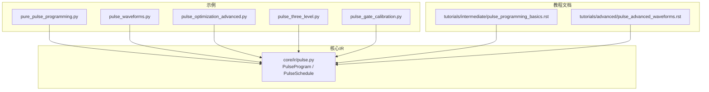
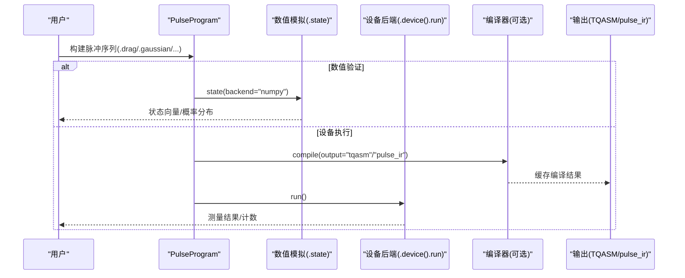
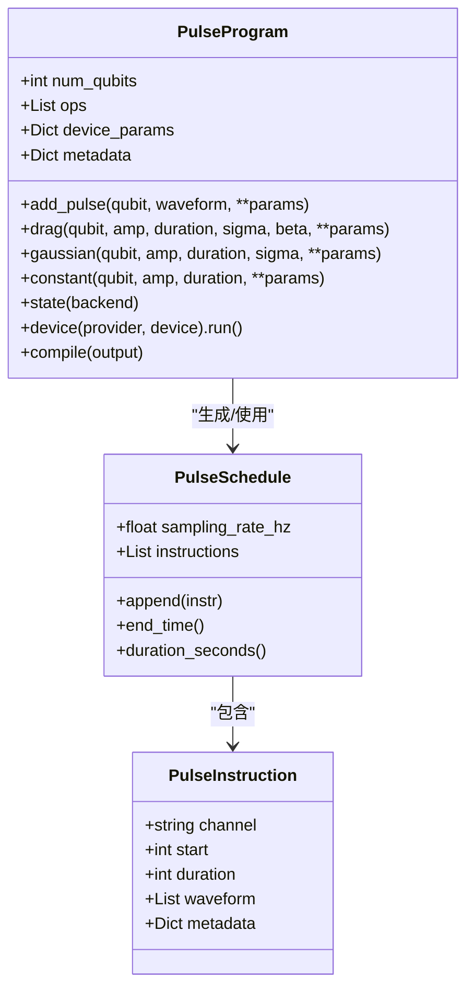
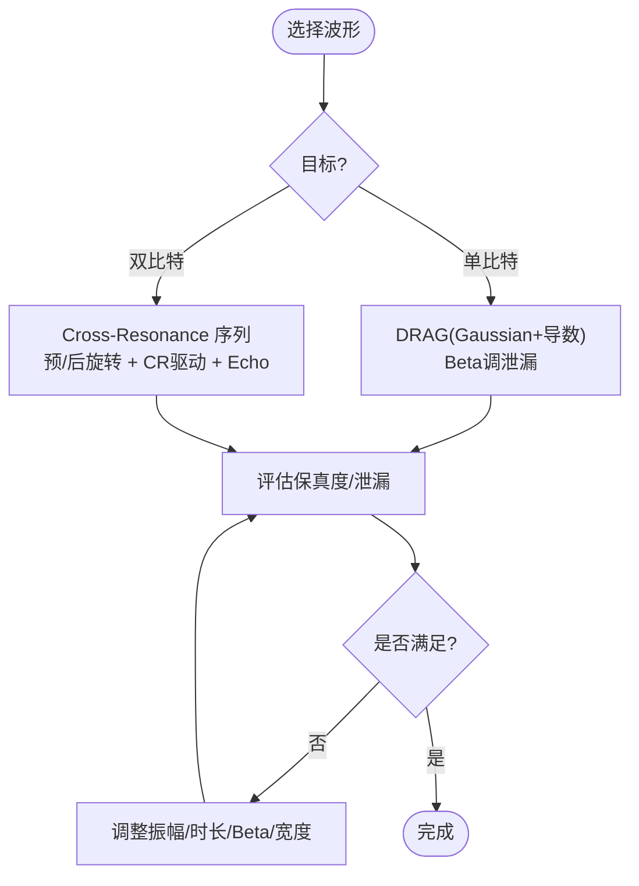
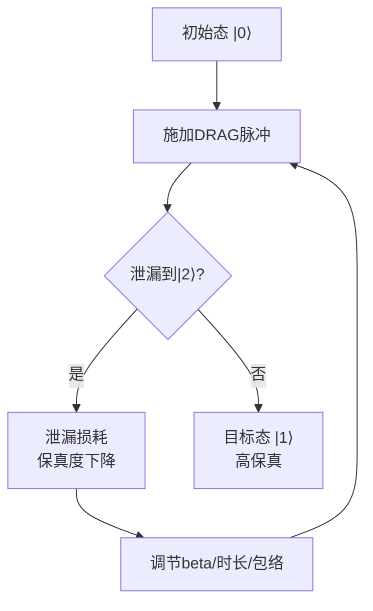
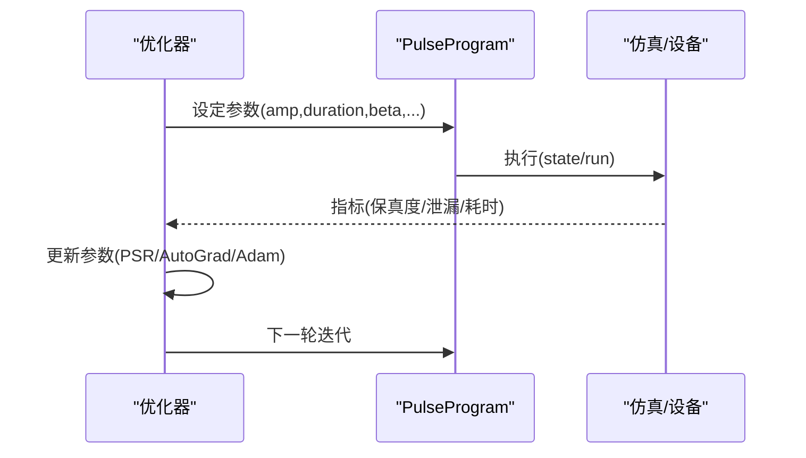
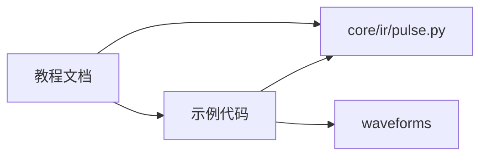

# 纯脉冲编程示例

<cite>
**本文引用的文件**
- [examples/pure_pulse_programming.py](file://examples/pure_pulse_programming.py)
- [examples/pulse_waveforms.py](file://examples/pulse_waveforms.py)
- [examples/pulse_optimization_advanced.py](file://examples/pulse_optimization_advanced.py)
- [examples/pulse_three_level.py](file://examples/pulse_three_level.py)
- [examples/pulse_gate_calibration.py](file://examples/pulse_gate_calibration.py)
- [src/tyxonq/core/ir/pulse.py](file://src/tyxonq/core/ir/pulse.py)
- [docs/source/tutorials/intermediate/pulse_programming_basics.rst](file://docs/source/tutorials/intermediate/pulse_programming_basics.rst)
- [docs/source/tutorials/advanced/pulse_advanced_waveforms.rst](file://docs/source/tutorials/advanced/pulse_advanced_waveforms.rst)
</cite>

## 目录
1. [简介](#简介)
2. [项目结构](#项目结构)
3. [核心组件](#核心组件)
4. [架构总览](#架构总览)
5. [详细组件分析](#详细组件分析)
6. [依赖关系分析](#依赖关系分析)
7. [性能考虑](#性能考虑)
8. [故障排查指南](#故障排查指南)
9. [结论](#结论)
10. [附录](#附录)

## 简介
本文件面向需要绕过门级抽象、直接进行量子脉冲编程的读者，系统介绍 TyxonQ 的“纯脉冲编程”（Mode B）能力。内容涵盖：何时选择纯脉冲编程、与门级编程相比的优势与局限；如何设计并优化复杂脉冲序列（多通道、时序控制、相位调制、幅度调制）；高级示例（自定义量子门、优化脉冲形状、缩短执行时间）；以及如何调试验证脉冲程序并将其集成到更大的量子计算任务中。

## 项目结构
TyxonQ 在示例与文档中提供了完整的纯脉冲编程路径：
- 示例层：提供从基础波形到高级优化的端到端示例
- 核心 IR：PulseProgram/PulseSchedule 等低层表示
- 教程文档：讲解双模式、双路径、双格式以及 TQASM/OpenQASM 导出

图表来源
- [examples/pure_pulse_programming.py:1-459](file://examples/pure_pulse_programming.py#L1-L459)
- [src/tyxonq/core/ir/pulse.py:71-138](file://src/tyxonq/core/ir/pulse.py#L71-L138)
- [docs/source/tutorials/intermediate/pulse_programming_basics.rst:11-27](file://docs/source/tutorials/intermediate/pulse_programming_basics.rst#L11-L27)

章节来源
- [examples/pure_pulse_programming.py:1-459](file://examples/pure_pulse_programming.py#L1-L459)
- [docs/source/tutorials/intermediate/pulse_programming_basics.rst:11-27](file://docs/source/tutorials/intermediate/pulse_programming_basics.rst#L11-L27)

## 核心组件
- PulseProgram：高层纯脉冲编程接口，提供链式 API（如 .drag/.gaussian/.constant），支持数值模拟 .state() 与设备执行 .device().run()，并可缓存编译结果以加速重复运行。
- PulseSchedule/PulseInstruction：底层调度与指令表示，用于跨后端的时间与采样率无关的调度。
- Waveforms：多种包络（Constant/Gaussian/DRAG/Hermite/BlackmanSquare/CosineDrag），用于抑制泄漏、降低频谱旁瓣、实现不同门操作。
- 教程与示例：覆盖单/双量子比特门分解、TQASM/OpenQASM 导出、三能级泄漏建模、参数优化与校准流程。

章节来源
- [src/tyxonq/core/ir/pulse.py:71-138](file://src/tyxonq/core/ir/pulse.py#L71-L138)
- [examples/pulse_waveforms.py:1-578](file://examples/pulse_waveforms.py#L1-L578)
- [docs/source/tutorials/intermediate/pulse_programming_basics.rst:28-58](file://docs/source/tutorials/intermediate/pulse_programming_basics.rst#L28-L58)

## 架构总览
TyxonQ 提供“双模式、双路径、双格式”的脉冲编程体系：
- 双模式：Mode A（门电路自动编译为脉冲）、Mode B（直接脉冲编程）
- 双路径：硬件仿真路径（Gate→Pulse→TQASM→云端/真机）与数值路径（Hamiltonian→脉冲仿真→本地演化）
- 双格式：pulse_ir（保留 homebrew_s2 对象，支持 autograd）与 tqasm（云兼容）

图表来源
- [examples/pure_pulse_programming.py:83-119](file://examples/pure_pulse_programming.py#L83-L119)
- [docs/source/tutorials/intermediate/pulse_programming_basics.rst:11-27](file://docs/source/tutorials/intermediate/pulse_programming_basics.rst#L11-L27)

## 详细组件分析

### 组件A：PulseProgram 与链式API
- 设计要点
  - 与 Circuit 对齐的链式 API：.drag/.gaussian/.constant 等返回自身，便于串联
  - 独立执行：不依赖 Circuit，可直接 .device().run() 或 .state()
  - 编译缓存：显式 .compile() 会真正执行并缓存 TQASM/pulse_ir，避免重复开销
- 典型用法
  - 设置设备参数（qubit_freq、anharmonicity、T1/T2）
  - 添加 DRAG/Gaussian/Constant 脉冲
  - 数值模拟或直接设备执行
  - 可选转换为 Circuit 用于调试

图表来源
- [src/tyxonq/core/ir/pulse.py:8-68](file://src/tyxonq/core/ir/pulse.py#L8-L68)
- [src/tyxonq/core/ir/pulse.py:71-138](file://src/tyxonq/core/ir/pulse.py#L71-L138)

章节来源
- [src/tyxonq/core/ir/pulse.py:71-138](file://src/tyxonq/core/ir/pulse.py#L71-L138)
- [examples/pure_pulse_programming.py:39-81](file://examples/pure_pulse_programming.py#L39-L81)

### 组件B：波形库与门实现
- 可用波形：Constant、Gaussian、DRAG、Hermite、BlackmanSquare、CosineDrag
- 作用与取舍
  - Constant：快速但频谱旁瓣高、易泄漏
  - Gaussian：平滑、旁瓣较低
  - DRAG：通过导数项抑制向 |2⟩ 泄漏（beta 控制强度）
  - Hermite/Blackman：更优频谱特性，适合多比特串扰敏感场景
- 单/双量子比特门
  - 单比特：DRAG 实现 X/Y/RX/RY；Z 用 Virtual-Z（零时）
  - 双比特：CX 通过 Cross-Resonance 序列（预旋转+CR驱动+回波+后旋转）；iSWAP/SWAP 可由 CX 链构成

图表来源
- [examples/pulse_waveforms.py:40-108](file://examples/pulse_waveforms.py#L40-L108)
- [examples/pulse_waveforms.py:176-322](file://examples/pulse_waveforms.py#L176-L322)
- [docs/source/tutorials/intermediate/pulse_programming_basics.rst:59-207](file://docs/source/tutorials/intermediate/pulse_programming_basics.rst#L59-L207)

章节来源
- [examples/pulse_waveforms.py:1-578](file://examples/pulse_waveforms.py#L1-L578)
- [docs/source/tutorials/intermediate/pulse_programming_basics.rst:59-207](file://docs/source/tutorials/intermediate/pulse_programming_basics.rst#L59-L207)

### 组件C：三能级系统与泄漏抑制
- 物理模型：真实量子比特存在 |2⟩ 能级，负非谐性使 |2⟩ 更难激发；不当脉冲会导致泄漏，降低保真度
- DRAG 的作用：通过导数项抑制 |0⟩→|2⟩ 跃迁；beta 越大抑制越强，需权衡计算复杂度与保真度
- 仿真对比：两能级理想 vs 三能级现实，可量化泄漏对保真度的影响

图表来源
- [examples/pulse_three_level.py:49-108](file://examples/pulse_three_level.py#L49-L108)
- [examples/pulse_three_level.py:115-172](file://examples/pulse_three_level.py#L115-L172)
- [examples/pulse_three_level.py:179-235](file://examples/pulse_three_level.py#L179-L235)

章节来源
- [examples/pulse_three_level.py:1-551](file://examples/pulse_three_level.py#L1-L551)

### 组件D：参数优化与校准工作流
- 梯度估计：参数平移法（PSR）与自动微分（AutoGrad）
- 优化目标：最大化保真度、最小化泄漏、缩短门时间
- 常见策略：网格搜索粗调 → 梯度下降精调；约束物理边界（振幅、时长、beta）
- 校准实践：单比特 DRAG beta 调优、Virtual-Z 帧更新、CX 参数（耦合强度、CR幅度、时长）优化

图表来源
- [examples/pulse_optimization_advanced.py:46-114](file://examples/pulse_optimization_advanced.py#L46-L114)
- [examples/pulse_optimization_advanced.py:210-270](file://examples/pulse_optimization_advanced.py#L210-L270)
- [examples/pulse_gate_calibration.py:43-99](file://examples/pulse_gate_calibration.py#L43-L99)

章节来源
- [examples/pulse_optimization_advanced.py:1-582](file://examples/pulse_optimization_advanced.py#L1-L582)
- [examples/pulse_gate_calibration.py:1-200](file://examples/pulse_gate_calibration.py#L1-L200)

### 组件E：TQASM/OpenQASM 导出与云端提交
- 导出格式：TQASM 0.2（内联 defcal）与 OpenQASM 3 + OpenPulse（云兼容）
- 云端提交：支持 gate circuit + use_pulse()、智能推断、纯脉冲编程三种模式
- 最佳实践：始终先本地验证，再提交云端；使用 inline_pulses=True 保证自包含

章节来源
- [docs/source/tutorials/intermediate/pulse_programming_basics.rst:208-270](file://docs/source/tutorials/intermediate/pulse_programming_basics.rst#L208-L270)
- [docs/source/tutorials/intermediate/pulse_programming_basics.rst:380-447](file://docs/source/tutorials/intermediate/pulse_programming_basics.rst#L380-L447)

## 依赖关系分析
- 示例与核心 IR 的耦合
  - 所有示例均基于 PulseProgram 构建脉冲序列，并通过 .state() 或 .device().run() 执行
  - 波形库 waveforms 提供包络定义，被各示例复用
- 教程与实现的映射
  - 教程文档解释双模式/双路径/双格式，并在示例中得到体现
  - 高级波形教程给出理论依据与仿真指导，需在真实硬件上验证

图表来源
- [examples/pure_pulse_programming.py:29-33](file://examples/pure_pulse_programming.py#L29-L33)
- [docs/source/tutorials/intermediate/pulse_programming_basics.rst:11-27](file://docs/source/tutorials/intermediate/pulse_programming_basics.rst#L11-L27)

章节来源
- [examples/pure_pulse_programming.py:1-459](file://examples/pure_pulse_programming.py#L1-L459)
- [docs/source/tutorials/intermediate/pulse_programming_basics.rst:11-27](file://docs/source/tutorials/intermediate/pulse_programming_basics.rst#L11-L27)

## 性能考虑
- 波形选择对保真度与泄漏的影响显著：DRAG 通常优于 Gaussian，Blackman/Hermite 在多比特串扰场景中更优
- 门时间与保真度权衡：更长脉冲可降低误差但增加退相干风险；需结合 T1/T2 优化
- 编译缓存：显式 .compile() 可缓存 TQASM/pulse_ir，减少重复编译开销
- 三能级仿真：更接近真实硬件，有助于提前发现泄漏问题

[本节为通用性能讨论，无需特定文件引用]

## 故障排查指南
- 常见问题
  - 保真度不达标：检查 DRAG beta、振幅、时长；尝试更平滑包络（Gaussian/Blackman）
  - 泄漏过高：增大 beta 或使用高阶校正（Hermite/Blackman）
  - 云端执行失败：确保 inline_pulses=True；确认设备参数正确
  - 数值模拟与设备结果不一致：先用三能级仿真评估泄漏，再在设备上验证
- 建议步骤
  - 先在本地 .state() 验证，再 .device().run()
  - 使用 .compile() 缓存中间产物，定位瓶颈
  - 逐步放宽约束，观察性能变化，定位敏感参数

章节来源
- [examples/pure_pulse_programming.py:83-119](file://examples/pure_pulse_programming.py#L83-L119)
- [examples/pulse_waveforms.py:329-399](file://examples/pulse_waveforms.py#L329-L399)
- [docs/source/tutorials/intermediate/pulse_programming_basics.rst:480-527](file://docs/source/tutorials/intermediate/pulse_programming_basics.rst#L480-L527)

## 结论
纯脉冲编程绕开门级抽象，直接操控物理实现，适用于需要极致保真度、泄漏抑制、噪声鲁棒性与硬件原生部署的场景。TyxonQ 提供一致的链式 API、数值与设备双路径、以及 TQASM/OpenQASM 双格式导出，配合三能级仿真与参数优化工作流，可高效设计与验证复杂脉冲序列。建议在关键场景下优先采用 DRAG/Blackman/Hermite 等先进包络，并结合 Virtual-Z、Cross-Resonance 等技术实现高性能量子门。

[本节为总结性内容，无需特定文件引用]

## 附录
- 何时选择纯脉冲编程
  - 需要定制脉冲形状以抑制泄漏或降低串扰
  - 需要硬件原生部署与细粒度时序控制
  - 需要梯度优化脉冲参数以实现最优控制
- 与门级编程对比
  - 优势：更高保真度、更强噪声鲁棒性、可定制算法（脉冲 VQE/QAOA）
  - 局限：开发成本高、需深入硬件知识、调试更复杂
- 高级技术清单
  - 多通道脉冲与并行调度
  - 相位调制（Virtual-Z、frame update）
  - 幅度调制（振幅扫描、包络整形）
  - 时序控制（CR 序列、Echo、预/后旋转）
  - 优化方法（PSR、AutoGrad、Adam、网格搜索）
- 调试与验证
  - 三能级仿真评估泄漏
  - 本地 .state() 验证后再 .device().run()
  - 使用 .compile() 缓存并导出 TQASM 进行比对
- 集成到更大任务
  - 将优化后的脉冲程序嵌入 VQE/QAOA/Dynamics 等算法
  - 通过 use_pulse()/inline_pulses=True 提交云端
  - 持续监控漂移并定期重校准

[本节为补充信息，无需特定文件引用]