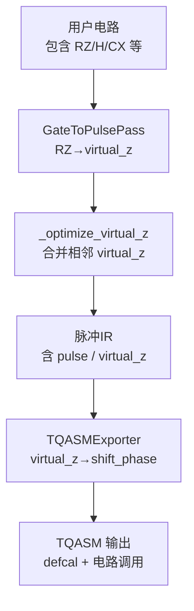
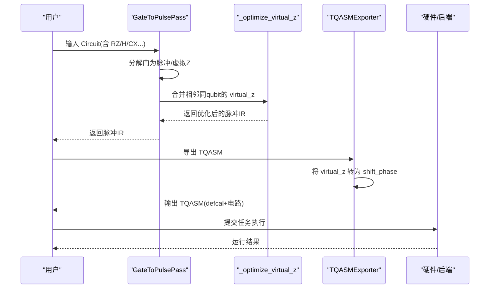
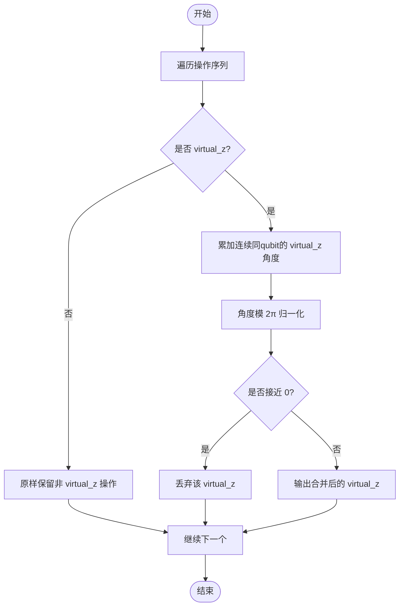
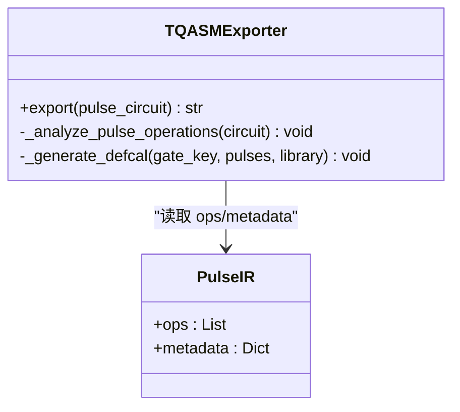

# Virtual-Z门优化

<cite>
**本文引用的文件**
- [gate_to_pulse.py](file://src/tyxonq/compiler/pulse_compiler/native/gate_to_pulse.py)
- [tqasm_exporter.py](file://src/tyxonq/compiler/pulse_compiler/native/tqasm_exporter.py)
- [test_virtual_z_optimization.py](file://tests_core_module/test_virtual_z_optimization.py)
- [pulse_gate_calibration.py](file://examples/pulse_gate_calibration.py)
- [pulse_virtual_z_optimization.rst](file://docs/source/tutorials/advanced/pulse_virtual_z_optimization.rst)
</cite>

## 目录
1. [简介](#简介)
2. [项目结构](#项目结构)
3. [核心组件](#核心组件)
4. [架构总览](#架构总览)
5. [详细组件分析](#详细组件分析)
6. [依赖关系分析](#依赖关系分析)
7. [性能考量](#性能考量)
8. [故障排查指南](#故障排查指南)
9. [结论](#结论)
10. [附录](#附录)

## 简介
本文件系统性阐述 TyxonQ 中的 Virtual-Z 门优化：通过相位帧更新实现零时间的 Z 旋转，无需物理脉冲；在编译阶段自动识别并合并相邻 RZ 门；对比传统 RZ 与 Virtual-Z 的时间开销；说明 TQASM 导出中 shift_phase 指令的实现细节；并结合示例与测试展示其在实际硬件上的执行效果。

## 项目结构
围绕 Virtual-Z 优化的关键代码分布在以下模块：
- 脉冲编译与优化：GateToPulsePass（RZ→Virtual-Z 转换、相邻合并）
- TQASM 导出：TQASMExporter（将 Virtual-Z 导出为 shift_phase）
- 教程与示例：演示用法、时间对比与导出验证
- 单元测试：覆盖合并、归一化、跨量子比特边界等场景

图表来源
- [gate_to_pulse.py:64-115](file://src/tyxonq/compiler/pulse_compiler/native/gate_to_pulse.py#L64-L115)
- [gate_to_pulse.py:278-312](file://src/tyxonq/compiler/pulse_compiler/native/gate_to_pulse.py#L278-L312)
- [gate_to_pulse.py:833-908](file://src/tyxonq/compiler/pulse_compiler/native/gate_to_pulse.py#L833-L908)
- [tqasm_exporter.py:344-399](file://src/tyxonq/compiler/pulse_compiler/native/tqasm_exporter.py#L344-L399)
- [tqasm_exporter.py:501-591](file://src/tyxonq/compiler/pulse_compiler/native/tqasm_exporter.py#L501-L591)

章节来源
- [gate_to_pulse.py:64-115](file://src/tyxonq/compiler/pulse_compiler/native/gate_to_pulse.py#L64-L115)
- [tqasm_exporter.py:344-399](file://src/tyxonq/compiler/pulse_compiler/native/tqasm_exporter.py#L344-L399)

## 核心组件
- GateToPulsePass
  - 负责将标准门分解为脉冲序列，其中 RZ/Z 被转换为 virtual_z（无物理脉冲）。
  - 在 execute_plan 末尾调用 _optimize_virtual_z，对相邻同量子比特的 virtual_z 进行合并与角度归一化。
- TQASMExporter
  - 将脉冲 IR 导出为 TQASM 0.2/OpenQASM 3 + OpenPulse。
  - 遇到 virtual_z 时生成 shift_phase(frame, -angle) 指令，表示相位帧更新。
- 教程与示例
  - 提供端到端使用方式、时间对比与 TQASM 验证。
- 单元测试
  - 覆盖空列表、单操作、合并、跨量子比特不合并、角度归一化、零角过滤、负角处理等。

章节来源
- [gate_to_pulse.py:278-312](file://src/tyxonq/compiler/pulse_compiler/native/gate_to_pulse.py#L278-L312)
- [gate_to_pulse.py:833-908](file://src/tyxonq/compiler/pulse_compiler/native/gate_to_pulse.py#L833-L908)
- [tqasm_exporter.py:501-591](file://src/tyxonq/compiler/pulse_compiler/native/tqasm_exporter.py#L501-L591)
- [test_virtual_z_optimization.py:29-214](file://tests_core_module/test_virtual_z_optimization.py#L29-L214)
- [pulse_gate_calibration.py:102-160](file://examples/pulse_gate_calibration.py#L102-L160)

## 架构总览
下图展示了从电路到 TQASM 的完整流程，突出 Virtual-Z 的生成、合并与导出。

图表来源
- [gate_to_pulse.py:64-115](file://src/tyxonq/compiler/pulse_compiler/native/gate_to_pulse.py#L64-L115)
- [gate_to_pulse.py:833-908](file://src/tyxonq/compiler/pulse_compiler/native/gate_to_pulse.py#L833-L908)
- [tqasm_exporter.py:344-399](file://src/tyxonq/compiler/pulse_compiler/native/tqasm_exporter.py#L344-L399)
- [tqasm_exporter.py:501-591](file://src/tyxonq/compiler/pulse_compiler/native/tqasm_exporter.py#L501-L591)

## 详细组件分析

### Virtual-Z 原理与实现
- 物理原理
  - 在旋转参考系中，Z 旋转等价于相位帧更新，不需要物理微波脉冲，因此时间为 0。
  - 同一量子比特上连续的 RZ 可交换且可叠加：RZ(θ1)·RZ(θ2)=RZ(θ1+θ2)。
- 编译期实现
  - RZ/Z 被转换为 virtual_z 操作，仅携带 qubit 与 angle。
  - 随后由 _optimize_virtual_z 扫描并合并相邻同 qubit 的 virtual_z，角度模 2π 归一化，并过滤零角。
- 复杂度
  - 单次线性扫描 O(N)，N 为操作数；空间 O(1) 额外（不计输出）。

图表来源
- [gate_to_pulse.py:833-908](file://src/tyxonq/compiler/pulse_compiler/native/gate_to_pulse.py#L833-L908)

章节来源
- [gate_to_pulse.py:278-312](file://src/tyxonq/compiler/pulse_compiler/native/gate_to_pulse.py#L278-L312)
- [gate_to_pulse.py:833-908](file://src/tyxonq/compiler/pulse_compiler/native/gate_to_pulse.py#L833-L908)

### 与传统 RZ 的时间开销对比
- 传统 RZ（若以物理脉冲实现）
  - 典型持续时间约百纳秒级（例如 ~160 ns），伴随能耗与误差累积。
- Virtual-Z
  - 零时间、零能耗，仅软件层面更新相位帧。
- 示例对比
  - 在 H-RZ-H 电路中，RZ 被优化为 Virtual-Z，总时间仅由两个 H 门贡献。

章节来源
- [pulse_gate_calibration.py:102-160](file://examples/pulse_gate_calibration.py#L102-L160)
- [pulse_virtual_z_optimization.rst:44-95](file://docs/source/tutorials/advanced/pulse_virtual_z_optimization.rst#L44-L95)

### TQASM 导出中 shift_phase 的实现
- 触发点
  - 当分析到 virtual_z 操作时，导出器为其所在量子比特帧生成 shift_phase(frame, -angle)。
- 语义
  - 负号用于匹配旋转方向约定；frame 由设备参数中的端口与频率声明。
- 输出位置
  - 在 defcal 定义体内生成 shift_phase 语句，随 gate 调用一起下发至后端。

图表来源
- [tqasm_exporter.py:344-399](file://src/tyxonq/compiler/pulse_compiler/native/tqasm_exporter.py#L344-L399)
- [tqasm_exporter.py:501-591](file://src/tyxonq/compiler/pulse_compiler/native/tqasm_exporter.py#L501-L591)

章节来源
- [tqasm_exporter.py:344-399](file://src/tyxonq/compiler/pulse_compiler/native/tqasm_exporter.py#L344-L399)
- [tqasm_exporter.py:501-591](file://src/tyxonq/compiler/pulse_compiler/native/tqasm_exporter.py#L501-L591)

### 在 TyxonQ 中的使用与自动优化
- 构建电路
  - 直接添加 RZ/H/CX 等操作，无需手动合并或规避 overhead。
- 编译为脉冲
  - 使用 GateToPulsePass 的 execute_plan(mode="pulse_only") 即可得到脉冲 IR。
  - 优化在内部自动执行，无需额外配置。
- 导出 TQASM
  - 使用 TQASMExporter 将脉冲 IR 导出为 TQASM，其中 Virtual-Z 体现为 shift_phase。

章节来源
- [pulse_gate_calibration.py:102-160](file://examples/pulse_gate_calibration.py#L102-L160)
- [pulse_virtual_z_optimization.rst:96-135](file://docs/source/tutorials/advanced/pulse_virtual_z_optimization.rst#L96-L135)

### 单元测试与边界条件
- 基本合并
  - 同一 qubit 相邻 virtual_z 会被合并为一个，角度相加后模 2π。
- 链断裂
  - 遇到非 virtual_z（如 pulse）会中断合并链，后续 virtual_z 独立存在。
- 跨量子比特
  - 不同 qubit 的 virtual_z 不会合并。
- 角度归一化与零角过滤
  - 角度归一到 [0, 2π)，接近 0 的 virtual_z 被剔除。
- 负角与大角
  - 支持负角相消与大角累加后的归一化。

章节来源
- [test_virtual_z_optimization.py:29-214](file://tests_core_module/test_virtual_z_optimization.py#L29-L214)

## 依赖关系分析
- GateToPulsePass 依赖
  - 波形库（可选）用于其他门的脉冲分解；RZ 路径不依赖波形库。
  - 在 execute_plan 末尾统一调用 _optimize_virtual_z。
- TQASMExporter 依赖
  - 解析脉冲 IR 的 ops 与 metadata，生成 frame/port/defcal。
  - 对 virtual_z 生成 shift_phase 指令。

图表来源
- [gate_to_pulse.py:64-115](file://src/tyxonq/compiler/pulse_compiler/native/gate_to_pulse.py#L64-L115)
- [tqasm_exporter.py:129-233](file://src/tyxonq/compiler/pulse_compiler/native/tqasm_exporter.py#L129-L233)

章节来源
- [gate_to_pulse.py:64-115](file://src/tyxonq/compiler/pulse_compiler/native/gate_to_pulse.py#L64-L115)
- [tqasm_exporter.py:129-233](file://src/tyxonq/compiler/pulse_compiler/native/tqasm_exporter.py#L129-L233)

## 性能考量
- 时间收益
  - 将多个 RZ 合并为单个 Virtual-Z，减少相位跟踪次数，降低调度与执行开销。
- 保真度与误差
  - 避免不必要的物理脉冲，减少误差源；但需注意与其他门之间的相对相位顺序保持不变。
- 适用场景
  - 大量单比特旋转的参数化电路（如 VQE/QAOA）、 Trotter 演化、变分算法等。
- 注意事项
  - 不同量子比特间的 virtual_z 不会合并；遇到非 virtual_z 会打断合并链。
  - 角度归一化确保数值稳定性，零角自动剔除。

[本节为通用指导，不直接分析具体文件]

## 故障排查指南
- 现象：期望合并但未合并
  - 检查是否存在非 virtual_z 操作打断链（如 pulse/barrier）。
  - 确认是否为同一量子比特。
- 现象：导出的 TQASM 未出现 shift_phase
  - 确认输入 IR 中包含 virtual_z 操作。
  - 检查导出模式与版本设置是否正确。
- 现象：角度异常
  - 确认角度已归一化到 [0, 2π)，并过滤了接近 0 的值。
- 调试建议
  - 打印中间 IR 的 ops，统计 virtual_z 数量与角度。
  - 使用单元测试用例作为对照，逐步缩小问题范围。

章节来源
- [test_virtual_z_optimization.py:29-214](file://tests_core_module/test_virtual_z_optimization.py#L29-L214)
- [tqasm_exporter.py:344-399](file://src/tyxonq/compiler/pulse_compiler/native/tqasm_exporter.py#L344-L399)

## 结论
TyxonQ 的 Virtual-Z 优化通过“相位帧更新”实现零时间 Z 旋转，并在编译期自动合并相邻 RZ，显著降低相位跟踪与执行开销。TQASM 导出将 virtual_z 映射为 shift_phase，便于在硬件后端正确执行。该优化透明易用，适用于大规模参数化电路与变分算法，能提升整体效率与保真度。

[本节为总结性内容，不直接分析具体文件]

## 附录
- 快速上手
  - 构建含 RZ 的电路 → 使用 GateToPulsePass 编译为脉冲 IR → 使用 TQASMExporter 导出 TQASM → 查看 shift_phase 指令。
- 参考文档
  - 教程：脉冲编译中的 Virtual-Z 优化
  - 示例：Virtual-Z 门的时间对比与 TQASM 验证
  - 测试：覆盖合并、归一化、跨 qubit 等边界情况

章节来源
- [pulse_virtual_z_optimization.rst:96-135](file://docs/source/tutorials/advanced/pulse_virtual_z_optimization.rst#L96-L135)
- [pulse_gate_calibration.py:102-160](file://examples/pulse_gate_calibration.py#L102-L160)
- [test_virtual_z_optimization.py:29-214](file://tests_core_module/test_virtual_z_optimization.py#L29-L214)