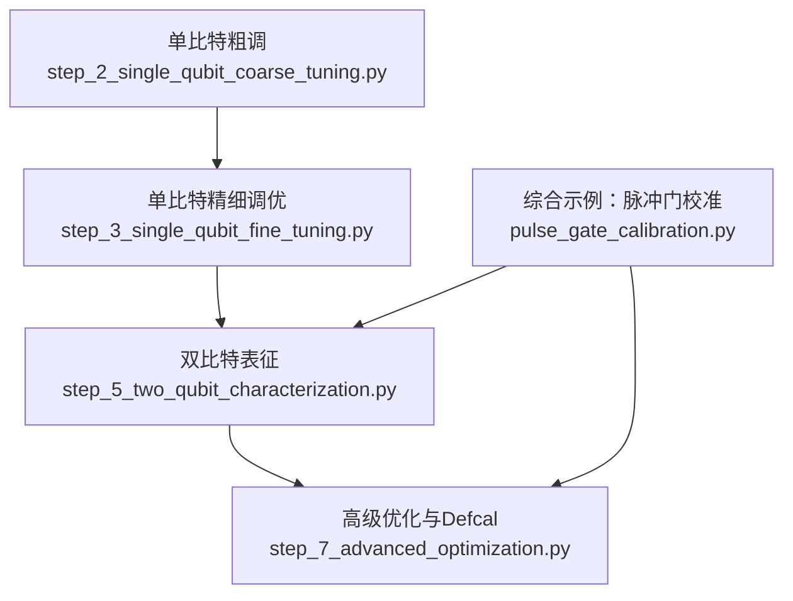
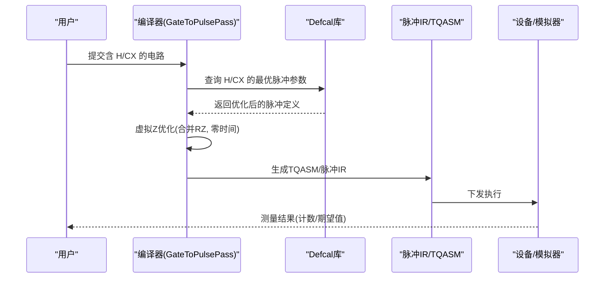
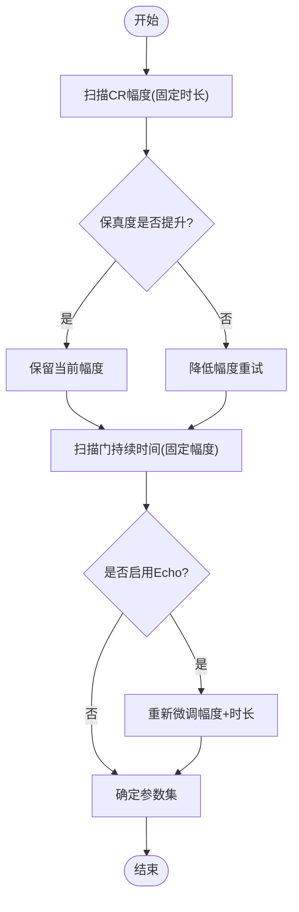
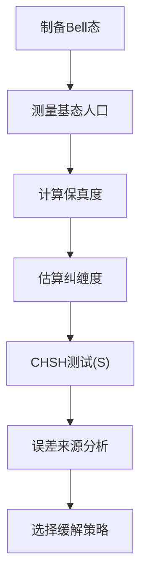
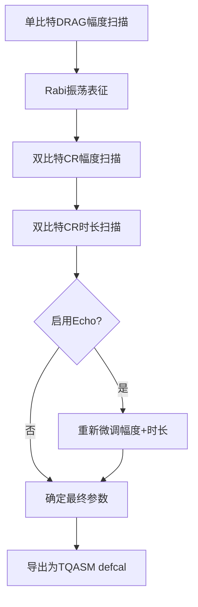
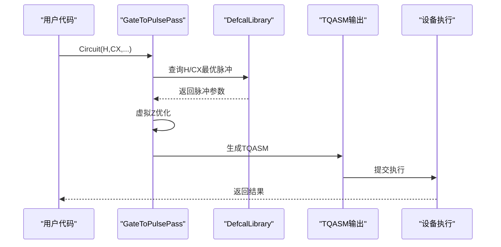
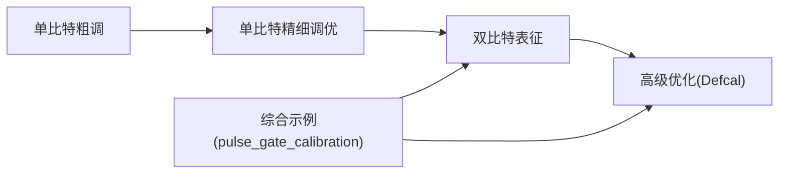

# 两量子比特门校准

<cite>
**本文引用的文件**
- [examples/pulse_gate_calibration.py](file://examples/pulse_gate_calibration.py)
- [examples/pulse_calibration_tutorial/step_5_two_qubit_characterization.py](file://examples/pulse_calibration_tutorial/step_5_two_qubit_characterization.py)
- [examples/pulse_calibration_tutorial/step_7_advanced_optimization.py](file://examples/pulse_calibration_tutorial/step_7_advanced_optimization.py)
- [examples/pulse_calibration_tutorial/step_2_single_qubit_coarse_tuning.py](file://examples/pulse_calibration_tutorial/step_2_single_qubit_coarse_tuning.py)
- [examples/pulse_calibration_tutorial/step_3_single_qubit_fine_tuning.py](file://examples/pulse_calibration_tutorial/step_3_single_qubit_fine_tuning.py)
</cite>

## 目录
1. [简介](#简介)
2. [项目结构](#项目结构)
3. [核心组件](#核心组件)
4. [架构总览](#架构总览)
5. [详细组件分析](#详细组件分析)
6. [依赖关系分析](#依赖关系分析)
7. [性能考量](#性能考量)
8. [故障排查指南](#故障排查指南)
9. [结论](#结论)
10. [附录](#附录)

## 简介
本文件面向需要在超导量子处理器上实现并优化两量子比特门的工程师与研究人员，重点围绕 Cross-Resonance（CR）技术的 CX 门实现与调优展开。内容涵盖：
- 如何通过调整 CR 幅度、耦合强度、门持续时间等参数提升双量子比特门保真度；
- 使用 Bell 态制备进行标准参数与优化参数的对比验证；
- Echo 脉冲的作用与配置方法，以及速度与保真度的权衡；
- 完整的参数扫描与优化流程示例，便于在模拟器或真实硬件上复现。

## 项目结构
本项目提供了从单比特到双比特的完整脉冲级校准教程与示例脚本，关键路径如下：
- 单比特粗调与精细调优：用于建立可靠的单比特旋转基准；
- 双比特表征：通过 Bell 态与 CHSH 测试评估纠缠质量；
- 高级优化：引入 Defcal（校准定义）将优化后的脉冲嵌入编译流程，并在云端工作流中复用。

图表来源
- [examples/pulse_calibration_tutorial/step_2_single_qubit_coarse_tuning.py:1-356](file://examples/pulse_calibration_tutorial/step_2_single_qubit_coarse_tuning.py#L1-L356)
- [examples/pulse_calibration_tutorial/step_3_single_qubit_fine_tuning.py:1-306](file://examples/pulse_calibration_tutorial/step_3_single_qubit_fine_tuning.py#L1-L306)
- [examples/pulse_calibration_tutorial/step_5_two_qubit_characterization.py:1-381](file://examples/pulse_calibration_tutorial/step_5_two_qubit_characterization.py#L1-L381)
- [examples/pulse_calibration_tutorial/step_7_advanced_optimization.py:1-361](file://examples/pulse_calibration_tutorial/step_7_advanced_optimization.py#L1-L361)
- [examples/pulse_gate_calibration.py:1-400](file://examples/pulse_gate_calibration.py#L1-L400)

章节来源
- [examples/pulse_calibration_tutorial/step_2_single_qubit_coarse_tuning.py:1-356](file://examples/pulse_calibration_tutorial/step_2_single_qubit_coarse_tuning.py#L1-L356)
- [examples/pulse_calibration_tutorial/step_3_single_qubit_fine_tuning.py:1-306](file://examples/pulse_calibration_tutorial/step_3_single_qubit_fine_tuning.py#L1-L306)
- [examples/pulse_calibration_tutorial/step_5_two_qubit_characterization.py:1-381](file://examples/pulse_calibration_tutorial/step_5_two_qubit_characterization.py#L1-L381)
- [examples/pulse_calibration_tutorial/step_7_advanced_optimization.py:1-361](file://examples/pulse_calibration_tutorial/step_7_advanced_optimization.py#L1-L361)
- [examples/pulse_gate_calibration.py:1-400](file://examples/pulse_gate_calibration.py#L1-L400)

## 核心组件
- 单比特门校准（X/H/RZ）：通过 DRAG 脉冲与 Rabi 表征确定精确的振幅、时长与 β 参数，确保单比特旋转的高保真度。
- 双比特门（CX via CR）：利用控制比特对目标比特的交叉共振驱动，配合前后旋转与可选 Echo 序列，实现受控非门。
- 参数扫描与优化：系统性地扫描 CR 幅度、耦合强度、门持续时间等，以最大化 Bell 态保真度或最小化误差。
- Defcal 集成：将优化得到的脉冲参数固化为 defcal，使编译器在生成 TQASM 时自动应用最优脉冲，提升端到端性能。

章节来源
- [examples/pulse_gate_calibration.py:43-223](file://examples/pulse_gate_calibration.py#L43-L223)
- [examples/pulse_calibration_tutorial/step_5_two_qubit_characterization.py:70-164](file://examples/pulse_calibration_tutorial/step_5_two_qubit_characterization.py#L70-L164)
- [examples/pulse_calibration_tutorial/step_7_advanced_optimization.py:147-249](file://examples/pulse_calibration_tutorial/step_7_advanced_optimization.py#L147-L249)

## 架构总览
下图展示了从用户电路到脉冲执行的关键环节，包括 GateToPulsePass 编译、Defcal 库查询、虚拟 Z 优化与设备执行。

图表来源
- [examples/pulse_calibration_tutorial/step_7_advanced_optimization.py:75-145](file://examples/pulse_calibration_tutorial/step_7_advanced_optimization.py#L75-L145)
- [examples/pulse_gate_calibration.py:280-327](file://examples/pulse_gate_calibration.py#L280-L327)

## 详细组件分析

### 双量子比特门（CX via Cross-Resonance）
- 原理要点：
  - 控制比特施加 CR 驱动，产生条件相位演化，结合前后单比特旋转合成 CX；
  - 可通过调节 CR 幅度、耦合强度与门持续时间来平衡速度与保真度；
  - 加入 Echo 脉冲可抑制 ZZ 串扰与低频噪声，提高保真度。
- 参数影响：
  - CR 幅度增大通常加快有效相互作用，但过强可能引入泄漏与非线性误差；
  - 耦合强度增强可缩短所需门时间，但需避免过度串扰；
  - 门持续时间越短，退相干影响越小，但需保证足够积分以获得目标幺正。
- 实践建议：
  - 先固定时长扫描幅度，再固定幅度扫描时长，找到局部最优；
  - 开启 Echo 后重新微调幅度与时长的组合；
  - 使用 Bell 态保真度作为主要指标，辅以 CHSH 违反度评估纠缠质量。

图表来源
- [examples/pulse_gate_calibration.py:163-223](file://examples/pulse_gate_calibration.py#L163-L223)
- [examples/pulse_gate_calibration.py:225-277](file://examples/pulse_gate_calibration.py#L225-L277)

章节来源
- [examples/pulse_gate_calibration.py:163-223](file://examples/pulse_gate_calibration.py#L163-L223)
- [examples/pulse_gate_calibration.py:225-277](file://examples/pulse_gate_calibration.py#L225-L277)

### Bell 态制备与保真度评估
- 四个 Bell 态的制备方法：
  - |Φ+⟩ = H(q0) → CX(q0,q1)
  - |Φ-⟩ = RZ(π)·H(q0) → CX(q0,q1)
  - |Ψ+⟩ = H(q0) → CX(q0,q1) → X(q1)
  - |Ψ-⟩ = RZ(π)·H(q0) → CX(q0,q1) → X(q1)
- 保真度与纠缠度量：
  - 通过测量各基态人口估计保真度；
  - 使用并发度或纠缠熵评估纠缠质量；
  - 通过 CHSH 不等式检验量子关联强度（S > 2 表明量子性）。
- 错误来源分析：
  - 脉冲参数偏差、ZZ 串扰、T1/T2 退相干、泄漏到 |2⟩ 等；
  - 针对每类误差提出缓解策略（如 Echo、DRAG、更稳定的频率等）。

图表来源
- [examples/pulse_calibration_tutorial/step_5_two_qubit_characterization.py:70-164](file://examples/pulse_calibration_tutorial/step_5_two_qubit_characterization.py#L70-L164)
- [examples/pulse_calibration_tutorial/step_5_two_qubit_characterization.py:221-260](file://examples/pulse_calibration_tutorial/step_5_two_qubit_characterization.py#L221-L260)
- [examples/pulse_calibration_tutorial/step_5_two_qubit_characterization.py:261-317](file://examples/pulse_calibration_tutorial/step_5_two_qubit_characterization.py#L261-L317)

章节来源
- [examples/pulse_calibration_tutorial/step_5_two_qubit_characterization.py:70-164](file://examples/pulse_calibration_tutorial/step_5_two_qubit_characterization.py#L70-L164)
- [examples/pulse_calibration_tutorial/step_5_two_qubit_characterization.py:221-260](file://examples/pulse_calibration_tutorial/step_5_two_qubit_characterization.py#L221-L260)
- [examples/pulse_calibration_tutorial/step_5_two_qubit_characterization.py:261-317](file://examples/pulse_calibration_tutorial/step_5_two_qubit_characterization.py#L261-L317)

### Echo 脉冲的作用与配置
- 作用：
  - 在 CR 驱动期间对目标比特施加自旋回波，抵消静态 ZZ 串扰与低频相位漂移；
  - 有助于在较短门时间内维持高保真度。
- 配置方法：
  - 在双比特门参数中启用 Echo（例如 cr_echo=True），随后重新扫描幅度与时长的组合；
  - 若存在显著失谐或串扰，可在 Echo 基础上进一步微调前后旋转角度。
- 速度-保真度权衡：
  - 更快的门（更短持续时间）减少退相干影响，但需要更强的 CR 幅度；
  - 过强的幅度可能导致泄漏或非理想耦合，需结合 Echo 与 DRAG 抑制误差。

章节来源
- [examples/pulse_gate_calibration.py:182-204](file://examples/pulse_gate_calibration.py#L182-L204)
- [examples/pulse_calibration_tutorial/step_5_two_qubit_characterization.py:276-302](file://examples/pulse_calibration_tutorial/step_5_two_qubit_characterization.py#L276-L302)

### 参数扫描与优化流程示例
- 单比特 DRAG 幅度扫描：
  - 固定时长与 σ，扫描幅度，寻找使 |1⟩ 人口接近 1 且泄漏最小的点；
  - 基于 Rabi 振荡曲线精确定位 π/2 与 π 旋转对应的时长。
- 双比特 CR 参数扫描：
  - 固定门持续时间，扫描 CR 幅度，评估 Bell 态保真度；
  - 固定幅度，扫描门持续时间，寻找速度与保真度的最佳折衷；
  - 启用 Echo 后重复上述扫描，得到更稳健的参数集。
- 导出为 Defcal：
  - 将优化后的脉冲参数写入 TQASM defcal，供编译器在后续任务中直接调用。

图表来源
- [examples/pulse_gate_calibration.py:225-277](file://examples/pulse_gate_calibration.py#L225-L277)
- [examples/pulse_gate_calibration.py:280-327](file://examples/pulse_gate_calibration.py#L280-L327)
- [examples/pulse_calibration_tutorial/step_3_single_qubit_fine_tuning.py:123-210](file://examples/pulse_calibration_tutorial/step_3_single_qubit_fine_tuning.py#L123-L210)

章节来源
- [examples/pulse_gate_calibration.py:225-277](file://examples/pulse_gate_calibration.py#L225-L277)
- [examples/pulse_gate_calibration.py:280-327](file://examples/pulse_gate_calibration.py#L280-L327)
- [examples/pulse_calibration_tutorial/step_3_single_qubit_fine_tuning.py:123-210](file://examples/pulse_calibration_tutorial/step_3_single_qubit_fine_tuning.py#L123-L210)

### Defcal 集成与编译流程
- Defcal 的本质：将“逻辑门”映射到“物理脉冲”的定义集合；
- 编译流程：
  - GateToPulsePass 遇到 H/CX 时查询 Defcal 库获取最优脉冲；
  - 虚拟 Z 优化将连续 RZ 合并为帧更新，不增加物理时间；
  - 生成 TQASM/脉冲 IR 并提交到设备执行。
- 效果对比：
  - 无 Defcal：通用脉冲导致保真度较低；
  - 有 Defcal：使用优化脉冲显著提升保真度，支持 VQE/QAOA 等算法。

图表来源
- [examples/pulse_calibration_tutorial/step_7_advanced_optimization.py:75-145](file://examples/pulse_calibration_tutorial/step_7_advanced_optimization.py#L75-L145)
- [examples/pulse_calibration_tutorial/step_7_advanced_optimization.py:147-249](file://examples/pulse_calibration_tutorial/step_7_advanced_optimization.py#L147-L249)

章节来源
- [examples/pulse_calibration_tutorial/step_7_advanced_optimization.py:75-145](file://examples/pulse_calibration_tutorial/step_7_advanced_optimization.py#L75-L145)
- [examples/pulse_calibration_tutorial/step_7_advanced_optimization.py:147-249](file://examples/pulse_calibration_tutorial/step_7_advanced_optimization.py#L147-L249)

## 依赖关系分析
- 模块内聚与耦合：
  - 单比特校准为双比特校准提供可靠的基础；
  - 双比特表征依赖单比特旋转精度与 CR 参数设置；
  - Defcal 集成贯穿编译阶段，将实验优化结果固化到软件栈。
- 外部依赖与集成点：
  - 编译器（GateToPulsePass）与 Defcal 库交互；
  - 设备/模拟器执行 TQASM/脉冲 IR；
  - 云平台工作流可复用已优化的 defcal 文件。

图表来源
- [examples/pulse_calibration_tutorial/step_2_single_qubit_coarse_tuning.py:1-356](file://examples/pulse_calibration_tutorial/step_2_single_qubit_coarse_tuning.py#L1-L356)
- [examples/pulse_calibration_tutorial/step_3_single_qubit_fine_tuning.py:1-306](file://examples/pulse_calibration_tutorial/step_3_single_qubit_fine_tuning.py#L1-L306)
- [examples/pulse_calibration_tutorial/step_5_two_qubit_characterization.py:1-381](file://examples/pulse_calibration_tutorial/step_5_two_qubit_characterization.py#L1-L381)
- [examples/pulse_calibration_tutorial/step_7_advanced_optimization.py:1-361](file://examples/pulse_calibration_tutorial/step_7_advanced_optimization.py#L1-L361)
- [examples/pulse_gate_calibration.py:1-400](file://examples/pulse_gate_calibration.py#L1-L400)

章节来源
- [examples/pulse_calibration_tutorial/step_2_single_qubit_coarse_tuning.py:1-356](file://examples/pulse_calibration_tutorial/step_2_single_qubit_coarse_tuning.py#L1-L356)
- [examples/pulse_calibration_tutorial/step_3_single_qubit_fine_tuning.py:1-306](file://examples/pulse_calibration_tutorial/step_3_single_qubit_fine_tuning.py#L1-L306)
- [examples/pulse_calibration_tutorial/step_5_two_qubit_characterization.py:1-381](file://examples/pulse_calibration_tutorial/step_5_two_qubit_characterization.py#L1-L381)
- [examples/pulse_calibration_tutorial/step_7_advanced_optimization.py:1-361](file://examples/pulse_calibration_tutorial/step_7_advanced_optimization.py#L1-L361)
- [examples/pulse_gate_calibration.py:1-400](file://examples/pulse_gate_calibration.py#L1-L400)

## 性能考量
- 速度与保真度权衡：
  - 缩短门持续时间可降低退相干影响，但需要更强的 CR 幅度；
  - 过强幅度可能引发泄漏与非线性误差，需结合 Echo 与 DRAG 抑制。
- 串扰与噪声：
  - ZZ 串扰可通过 Echo 缓解；
  - 频率稳定性与相位噪声影响相位保真度，建议使用更稳定的本地振荡器或锁相方案。
- 泄漏抑制：
  - DRAG β 参数可有效抑制向 |2⟩ 的泄漏；
  - 在双比特门中，适当的前后旋转角度可减少非对角项带来的误差。

[本节提供一般性指导，无需特定文件引用]

## 故障排查指南
- 保真度低于预期：
  - 检查 CR 幅度与时长的组合是否处于合理范围；
  - 确认 Echo 是否启用，并重新微调；
  - 评估 T1/T2 对门时间的限制，必要时缩短门时长。
- 纠缠度不足：
  - 通过 CHSH 测试定位问题（S ≤ 2 表示未展现量子关联）；
  - 检查单比特旋转精度（Rabi 表征）与双比特门时序对齐。
- 泄漏严重：
  - 调整 DRAG β，观察泄漏率变化；
  - 降低 CR 幅度或延长门时间以减少非线性效应。

章节来源
- [examples/pulse_calibration_tutorial/step_5_two_qubit_characterization.py:261-317](file://examples/pulse_calibration_tutorial/step_5_two_qubit_characterization.py#L261-L317)
- [examples/pulse_gate_calibration.py:43-99](file://examples/pulse_gate_calibration.py#L43-L99)

## 结论
- 通过系统的单比特校准与双比特 CR 参数扫描，可以在 TyxonQ 框架下实现高保真度的两量子比特门；
- Echo 脉冲在抑制串扰与相位噪声方面具有显著效果；
- Defcal 集成将实验优化结果固化为可复用的编译期资源，显著提升端到端性能；
- 建议在每次硬件状态变化后重新执行参数扫描与优化流程，以保持最佳性能。

[本节总结性内容，无需特定文件引用]

## 附录
- 快速参考：
  - 单比特 DRAG 参数：振幅、时长、σ、β；
  - 双比特 CR 参数：幅度、耦合强度、门持续时间、Echo 开关；
  - 评估指标：Bell 态保真度、CHSH 违反度、泄漏率。
- 推荐流程：
  - 单比特粗调 → 单比特精细调优 → 双比特 CR 扫描 → Echo 微调 → Defcal 导出 → 云端部署。

[本节为补充信息，无需特定文件引用]