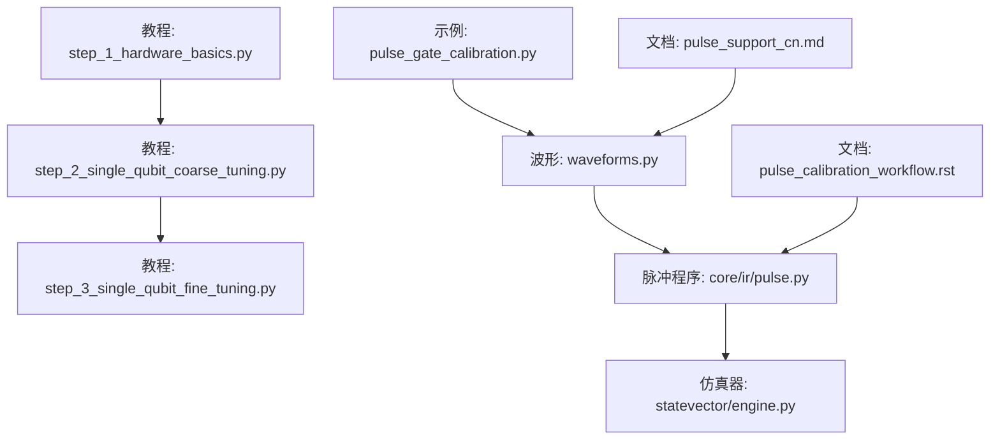
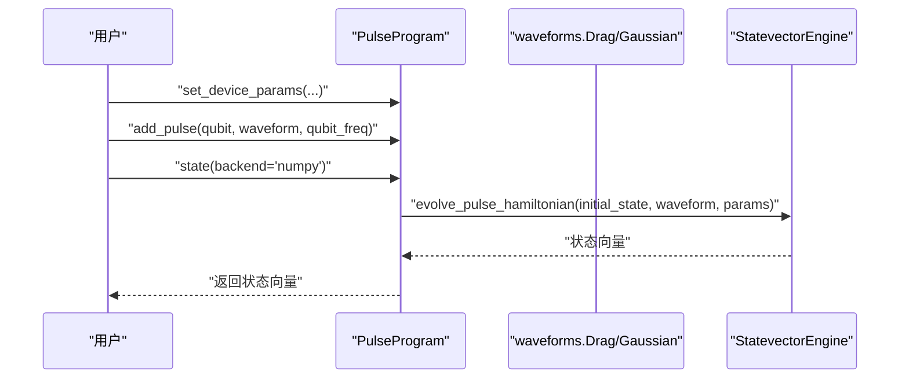
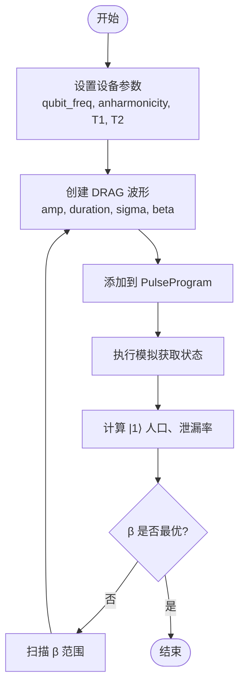
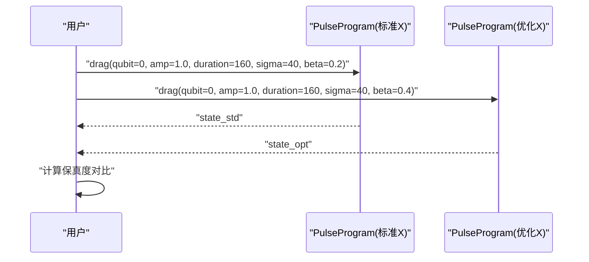
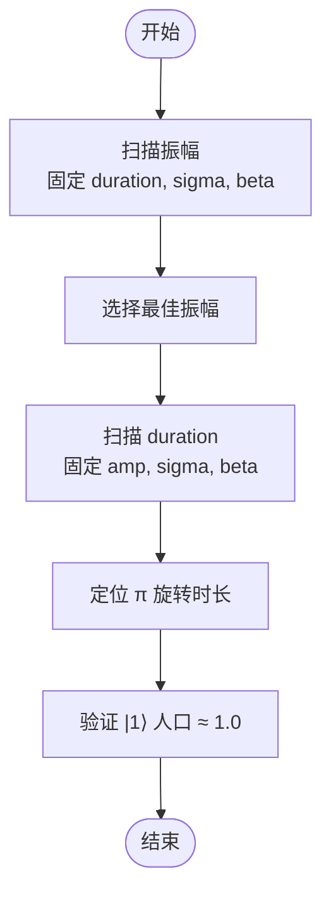
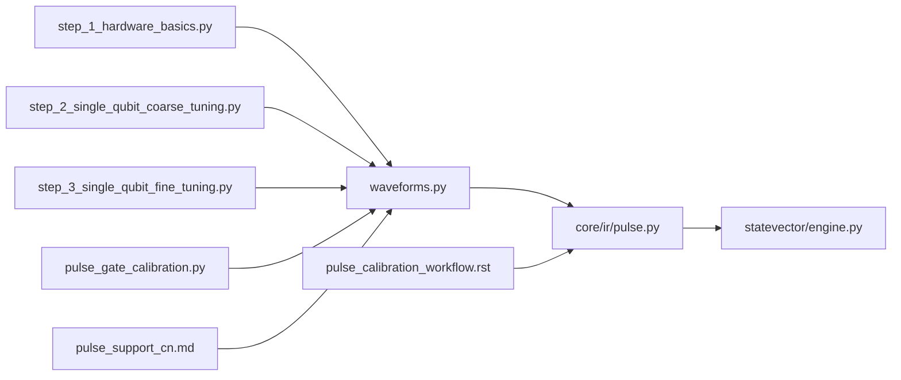

# 单量子比特校准

<cite>
**本文引用的文件**
- [examples/pulse_calibration_tutorial/step_1_hardware_basics.py](file://examples/pulse_calibration_tutorial/step_1_hardware_basics.py)
- [examples/pulse_calibration_tutorial/step_2_single_qubit_coarse_tuning.py](file://examples/pulse_calibration_tutorial/step_2_single_qubit_coarse_tuning.py)
- [examples/pulse_calibration_tutorial/step_3_single_qubit_fine_tuning.py](file://examples/pulse_calibration_tutorial/step_3_single_qubit_fine_tuning.py)
- [examples/pulse_gate_calibration.py](file://examples/pulse_gate_calibration.py)
- [src/tyxonq/waveforms.py](file://src/tyxonq/waveforms.py)
- [src/tyxonq/core/ir/pulse.py](file://src/tyxonq/core/ir/pulse.py)
- [src/tyxonq/devices/simulators/statevector/engine.py](file://src/tyxonq/devices/simulators/statevector/engine.py)
- [docs/source/tutorials/advanced/pulse_calibration_workflow.rst](file://docs/source/tutorials/advanced/pulse_calibration_workflow.rst)
- [docs/pulse_support_cn.md](file://docs/pulse_support_cn.md)
</cite>

## 目录
1. [简介](#简介)
2. [项目结构](#项目结构)
3. [核心组件](#核心组件)
4. [架构总览](#架构总览)
5. [详细组件分析](#详细组件分析)
6. [依赖关系分析](#依赖关系分析)
7. [性能考量](#性能考量)
8. [故障排查指南](#故障排查指南)
9. [结论](#结论)
10. [附录](#附录)

## 简介
本文件面向使用 TyxonQ 进行单量子比特脉冲校准的工程师与研究人员，聚焦 DRAG 脉冲的 β 参数调优，解释如何通过调整 DRAG 系数抑制向 |2⟩ 态的泄漏，并演示标准 X 门与优化 X 门的对比实现，展示保真度提升效果。文档涵盖幅度校准、持续时间优化、相位校正等关键步骤，提供完整的代码示例路径，说明如何使用 PulseProgram 完成单量子比特门校准，以及如何评估校准结果的质量指标（如保真度、泄漏率、Rabi 频率准确度等）。

## 项目结构
围绕单量子比特校准，仓库提供了从硬件基础到精细优化的完整教程与示例：
- 教程入口与流程：step_1/2/3 逐步引导从硬件参数理解、粗调到精细优化与 Rabi 表征。
- 示例脚本：pulse_gate_calibration.py 提供标准与优化 X 门对比、参数扫描、导出 defcal 等实用流程。
- 波形定义：waveforms.py 定义了 Drag、Gaussian 等波形类，包含 beta、phase 等参数。
- 脉冲程序执行：core/ir/pulse.py 中的 PulseProgram 负责添加脉冲、设置设备参数、执行模拟或提交到后端。
- 仿真器支持：statevector/engine.py 将波形映射为具体实现，驱动状态演化。
- 文档参考：pulse_calibration_workflow.rst 与 pulse_support_cn.md 提供校准工作流与波形参数约束说明。

图表来源
- [examples/pulse_calibration_tutorial/step_1_hardware_basics.py:143-382](file://examples/pulse_calibration_tutorial/step_1_hardware_basics.py#L143-L382)
- [examples/pulse_calibration_tutorial/step_2_single_qubit_coarse_tuning.py:121-302](file://examples/pulse_calibration_tutorial/step_2_single_qubit_coarse_tuning.py#L121-L302)
- [examples/pulse_calibration_tutorial/step_3_single_qubit_fine_tuning.py:67-170](file://examples/pulse_calibration_tutorial/step_3_single_qubit_fine_tuning.py#L67-L170)
- [examples/pulse_gate_calibration.py:43-99](file://examples/pulse_gate_calibration.py#L43-L99)
- [src/tyxonq/waveforms.py:41-51](file://src/tyxonq/waveforms.py#L41-L51)
- [src/tyxonq/core/ir/pulse.py:310-324](file://src/tyxonq/core/ir/pulse.py#L310-L324)
- [src/tyxonq/devices/simulators/statevector/engine.py:953-986](file://src/tyxonq/devices/simulators/statevector/engine.py#L953-L986)
- [docs/source/tutorials/advanced/pulse_calibration_workflow.rst:740-789](file://docs/source/tutorials/advanced/pulse_calibration_workflow.rst#L740-L789)
- [docs/pulse_support_cn.md:216-250](file://docs/pulse_support_cn.md#L216-L250)

章节来源
- [examples/pulse_calibration_tutorial/step_1_hardware_basics.py:143-382](file://examples/pulse_calibration_tutorial/step_1_hardware_basics.py#L143-L382)
- [examples/pulse_calibration_tutorial/step_2_single_qubit_coarse_tuning.py:121-302](file://examples/pulse_calibration_tutorial/step_2_single_qubit_coarse_tuning.py#L121-L302)
- [examples/pulse_calibration_tutorial/step_3_single_qubit_fine_tuning.py:67-170](file://examples/pulse_calibration_tutorial/step_3_single_qubit_fine_tuning.py#L67-L170)
- [examples/pulse_gate_calibration.py:43-99](file://examples/pulse_gate_calibration.py#L43-L99)
- [src/tyxonq/waveforms.py:41-51](file://src/tyxonq/waveforms.py#L41-L51)
- [src/tyxonq/core/ir/pulse.py:310-324](file://src/tyxonq/core/ir/pulse.py#L310-L324)
- [src/tyxonq/devices/simulators/statevector/engine.py:953-986](file://src/tyxonq/devices/simulators/statevector/engine.py#L953-L986)
- [docs/source/tutorials/advanced/pulse_calibration_workflow.rst:740-789](file://docs/source/tutorials/advanced/pulse_calibration_workflow.rst#L740-L789)
- [docs/pulse_support_cn.md:216-250](file://docs/pulse_support_cn.md#L216-L250)

## 核心组件
- 波形定义（Drag/Gaussian）：通过 waveforms.Drag 和 waveforms.Gaussian 创建脉冲包络，Drag 包含 β 参数用于抑制泄漏。
- 脉冲程序（PulseProgram）：负责设置设备参数（qubit_freq、anharmonicity、T1/T2）、添加脉冲、执行模拟或提交运行。
- 仿真器（StatevectorEngine）：将波形字典映射为具体波形类，驱动哈密顿量演化计算状态向量。
- 教程与示例：step_1/2/3 提供从硬件基础到精细优化的完整流程；pulse_gate_calibration.py 提供标准与优化 X 门对比及参数扫描。

章节来源
- [src/tyxonq/waveforms.py:41-51](file://src/tyxonq/waveforms.py#L41-L51)
- [src/tyxonq/core/ir/pulse.py:310-324](file://src/tyxonq/core/ir/pulse.py#L310-L324)
- [src/tyxonq/devices/simulators/statevector/engine.py:953-986](file://src/tyxonq/devices/simulators/statevector/engine.py#L953-L986)
- [examples/pulse_calibration_tutorial/step_1_hardware_basics.py:143-382](file://examples/pulse_calibration_tutorial/step_1_hardware_basics.py#L143-L382)
- [examples/pulse_calibration_tutorial/step_2_single_qubit_coarse_tuning.py:121-302](file://examples/pulse_calibration_tutorial/step_2_single_qubit_coarse_tuning.py#L121-L302)
- [examples/pulse_calibration_tutorial/step_3_single_qubit_fine_tuning.py:67-170](file://examples/pulse_calibration_tutorial/step_3_single_qubit_fine_tuning.py#L67-L170)
- [examples/pulse_gate_calibration.py:43-99](file://examples/pulse_gate_calibration.py#L43-L99)

## 架构总览
下图展示了从用户编写脉冲程序到仿真器执行演化的整体数据流与控制流，包括波形选择、设备参数设置、脉冲添加与状态获取。

图表来源
- [src/tyxonq/core/ir/pulse.py:557-586](file://src/tyxonq/core/ir/pulse.py#L557-L586)
- [src/tyxonq/devices/simulators/statevector/engine.py:953-986](file://src/tyxonq/devices/simulators/statevector/engine.py#L953-L986)

章节来源
- [src/tyxonq/core/ir/pulse.py:557-586](file://src/tyxonq/core/ir/pulse.py#L557-L586)
- [src/tyxonq/devices/simulators/statevector/engine.py:953-986](file://src/tyxonq/devices/simulators/statevector/engine.py#L953-L986)

## 详细组件分析

### DRAG 脉冲与 β 参数调优
DRAG 通过在正交分量加入包络导数项来抑制向 |2⟩ 态的泄漏。β 越大，泄漏抑制越强，但需找到最优值以避免引入额外误差。教程中通过固定振幅与时长，扫描 β 并比较泄漏率，从而确定最优 β。

图表来源
- [examples/pulse_calibration_tutorial/step_2_single_qubit_coarse_tuning.py:237-302](file://examples/pulse_calibration_tutorial/step_2_single_qubit_coarse_tuning.py#L237-L302)
- [src/tyxonq/waveforms.py:41-51](file://src/tyxonq/waveforms.py#L41-L51)

章节来源
- [examples/pulse_calibration_tutorial/step_2_single_qubit_coarse_tuning.py:237-302](file://examples/pulse_calibration_tutorial/step_2_single_qubit_coarse_tuning.py#L237-L302)
- [src/tyxonq/waveforms.py:41-51](file://src/tyxonq/waveforms.py#L41-L51)

### 标准 X 门与优化 X 门对比
示例展示了两种 X 门实现：标准 X 门（β=0.2）与优化 X 门（β=0.4），通过比较目标态 |1⟩ 的分量与保真度，体现 β 增大对泄漏抑制的效果。

图表来源
- [examples/pulse_gate_calibration.py:57-99](file://examples/pulse_gate_calibration.py#L57-L99)

章节来源
- [examples/pulse_gate_calibration.py:57-99](file://examples/pulse_gate_calibration.py#L57-L99)

### 幅度校准与持续时间优化
- 幅度校准：在固定时长下扫描振幅，寻找使 |1⟩ 人口接近 1.0 的最佳振幅。
- 持续时间优化：基于 Rabi 频率与目标旋转角计算所需时长，或通过 Rabi 扫描定位 π 旋转点。

图表来源
- [examples/pulse_calibration_tutorial/step_2_single_qubit_coarse_tuning.py:134-201](file://examples/pulse_calibration_tutorial/step_2_single_qubit_coarse_tuning.py#L134-L201)
- [examples/pulse_calibration_tutorial/step_3_single_qubit_fine_tuning.py:143-209](file://examples/pulse_calibration_tutorial/step_3_single_qubit_fine_tuning.py#L143-L209)

章节来源
- [examples/pulse_calibration_tutorial/step_2_single_qubit_coarse_tuning.py:134-201](file://examples/pulse_calibration_tutorial/step_2_single_qubit_coarse_tuning.py#L134-L201)
- [examples/pulse_calibration_tutorial/step_3_single_qubit_fine_tuning.py:143-209](file://examples/pulse_calibration_tutorial/step_3_single_qubit_fine_tuning.py#L143-L209)

### 相位校正
DRAG 波形支持 phase 参数，可用于相位帧更新或补偿相位偏差。在 PulseProgram 中添加脉冲时可通过波形的 phase 属性控制初始相位。

章节来源
- [src/tyxonq/waveforms.py:41-51](file://src/tyxonq/waveforms.py#L41-L51)

### 使用 PulseProgram 进行单量子比特门校准
典型流程：
- 设置设备参数：qubit_freq、anharmonicity、T1、T2。
- 创建波形：waveforms.Drag 或 waveforms.Gaussian。
- 添加脉冲：prog.add_pulse(qubit, waveform, qubit_freq)。
- 执行模拟：prog.state(backend="numpy") 获取状态向量。
- 评估指标：计算 |1⟩ 人口、泄漏率、保真度。

章节来源
- [examples/pulse_calibration_tutorial/step_1_hardware_basics.py:333-382](file://examples/pulse_calibration_tutorial/step_1_hardware_basics.py#L333-L382)
- [src/tyxonq/core/ir/pulse.py:310-324](file://src/tyxonq/core/ir/pulse.py#L310-L324)

### 校准结果质量指标评估
- 保真度：目标态与实际态的内积平方，衡量门实现的准确性。
- 泄漏率：1 - (|0⟩ 人口 + |1⟩ 人口)，反映向 |2⟩ 态的泄漏程度。
- Rabi 频率准确度：通过 Rabi 扫描推断旋转角，评估振幅与时长的匹配度。
- 门时间：确保门时间远小于 T1/T2，减少退相干影响。

章节来源
- [examples/pulse_calibration_tutorial/step_1_hardware_basics.py:394-479](file://examples/pulse_calibration_tutorial/step_1_hardware_basics.py#L394-L479)
- [examples/pulse_calibration_tutorial/step_3_single_qubit_fine_tuning.py:85-121](file://examples/pulse_calibration_tutorial/step_3_single_qubit_fine_tuning.py#L85-L121)

## 依赖关系分析
- 教程脚本依赖 waveforms 模块定义波形，依赖 PulseProgram 构建与执行脉冲序列。
- PulseProgram 依赖仿真器引擎进行状态演化，引擎将波形字典映射为具体波形类。
- 文档提供校准工作流与波形参数约束，指导实际调参过程。

图表来源
- [examples/pulse_calibration_tutorial/step_1_hardware_basics.py:143-382](file://examples/pulse_calibration_tutorial/step_1_hardware_basics.py#L143-L382)
- [examples/pulse_calibration_tutorial/step_2_single_qubit_coarse_tuning.py:121-302](file://examples/pulse_calibration_tutorial/step_2_single_qubit_coarse_tuning.py#L121-L302)
- [examples/pulse_calibration_tutorial/step_3_single_qubit_fine_tuning.py:67-170](file://examples/pulse_calibration_tutorial/step_3_single_qubit_fine_tuning.py#L67-L170)
- [examples/pulse_gate_calibration.py:43-99](file://examples/pulse_gate_calibration.py#L43-L99)
- [src/tyxonq/waveforms.py:41-51](file://src/tyxonq/waveforms.py#L41-L51)
- [src/tyxonq/core/ir/pulse.py:310-324](file://src/tyxonq/core/ir/pulse.py#L310-L324)
- [src/tyxonq/devices/simulators/statevector/engine.py:953-986](file://src/tyxonq/devices/simulators/statevector/engine.py#L953-L986)
- [docs/source/tutorials/advanced/pulse_calibration_workflow.rst:740-789](file://docs/source/tutorials/advanced/pulse_calibration_workflow.rst#L740-L789)
- [docs/pulse_support_cn.md:216-250](file://docs/pulse_support_cn.md#L216-L250)

章节来源
- [examples/pulse_calibration_tutorial/step_1_hardware_basics.py:143-382](file://examples/pulse_calibration_tutorial/step_1_hardware_basics.py#L143-L382)
- [examples/pulse_calibration_tutorial/step_2_single_qubit_coarse_tuning.py:121-302](file://examples/pulse_calibration_tutorial/step_2_single_qubit_coarse_tuning.py#L121-L302)
- [examples/pulse_calibration_tutorial/step_3_single_qubit_fine_tuning.py:67-170](file://examples/pulse_calibration_tutorial/step_3_single_qubit_fine_tuning.py#L67-L170)
- [examples/pulse_gate_calibration.py:43-99](file://examples/pulse_gate_calibration.py#L43-L99)
- [src/tyxonq/waveforms.py:41-51](file://src/tyxonq/waveforms.py#L41-L51)
- [src/tyxonq/core/ir/pulse.py:310-324](file://src/tyxonq/core/ir/pulse.py#L310-L324)
- [src/tyxonq/devices/simulators/statevector/engine.py:953-986](file://src/tyxonq/devices/simulators/statevector/engine.py#L953-L986)
- [docs/source/tutorials/advanced/pulse_calibration_workflow.rst:740-789](file://docs/source/tutorials/advanced/pulse_calibration_workflow.rst#L740-L789)
- [docs/pulse_support_cn.md:216-250](file://docs/pulse_support_cn.md#L216-L250)

## 性能考量
- 门时间与相干时间：确保门时间远小于 T1/T2，以减少退相干影响。
- 泄漏抑制：通过 DRAG β 优化降低向 |2⟩ 态的泄漏，提高保真度。
- 参数鲁棒性：在实际硬件上测试参数鲁棒性，避免过度拟合仿真结果。
- 频谱旁瓣：选择合适包络（如 Gaussian、BlackmanSquare）减少频谱泄漏与串扰。

[本节为通用指导，不直接分析具体文件]

## 故障排查指南
- 泄漏率高：检查 β 是否最优，尝试更宽的 β 扫描范围；确认 anharmonicity 设置正确。
- 保真度低：验证振幅与时长是否匹配目标旋转角；检查 T1/T2 设置是否符合实际硬件。
- 相位偏差：使用 phase 参数进行相位校正；检查驱动频率与 qubit_freq 是否一致。
- 仿真与硬件差异：在真实硬件上进行保真度表征，对比仿真预测与实际测量。

章节来源
- [examples/pulse_calibration_tutorial/step_2_single_qubit_coarse_tuning.py:237-302](file://examples/pulse_calibration_tutorial/step_2_single_qubit_coarse_tuning.py#L237-L302)
- [examples/pulse_calibration_tutorial/step_3_single_qubit_fine_tuning.py:85-121](file://examples/pulse_calibration_tutorial/step_3_single_qubit_fine_tuning.py#L85-L121)
- [docs/source/tutorials/advanced/pulse_calibration_workflow.rst:333-391](file://docs/source/tutorials/advanced/pulse_calibration_workflow.rst#L333-L391)

## 结论
通过系统化的单量子比特脉冲校准流程，结合 DRAG β 参数调优、幅度与持续时间优化以及相位校正，可以显著提升单量子比特门的保真度并抑制向 |2⟩ 态的泄漏。TyxonQ 提供的 PulseProgram 与波形模块简化了校准流程，配合仿真器与教程示例，为用户提供了从理论到实践的完整工具链。建议在仿真阶段完成参数搜索，再在真实硬件上进行验证与微调，以获得高保真度的量子操作。

[本节为总结性内容，不直接分析具体文件]

## 附录
- 波形参数约束：Drag 波形的 amp、duration、sigma、beta 参数约束请参考文档。
- 校准工作流：参考 pulse_calibration_workflow.rst 中的七步校准流程，从硬件基础到系统集成。

章节来源
- [docs/pulse_support_cn.md:216-250](file://docs/pulse_support_cn.md#L216-L250)
- [docs/source/tutorials/advanced/pulse_calibration_workflow.rst:740-789](file://docs/source/tutorials/advanced/pulse_calibration_workflow.rst#L740-L789)