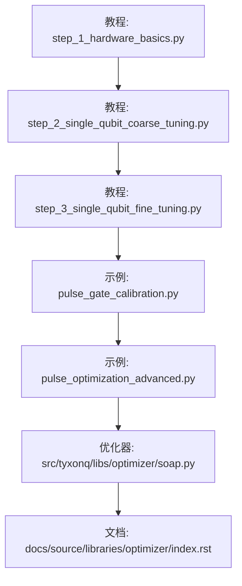
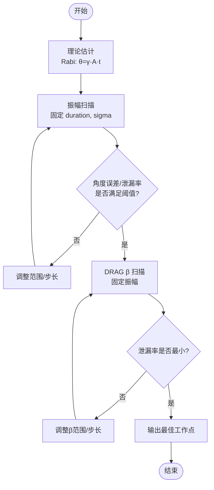
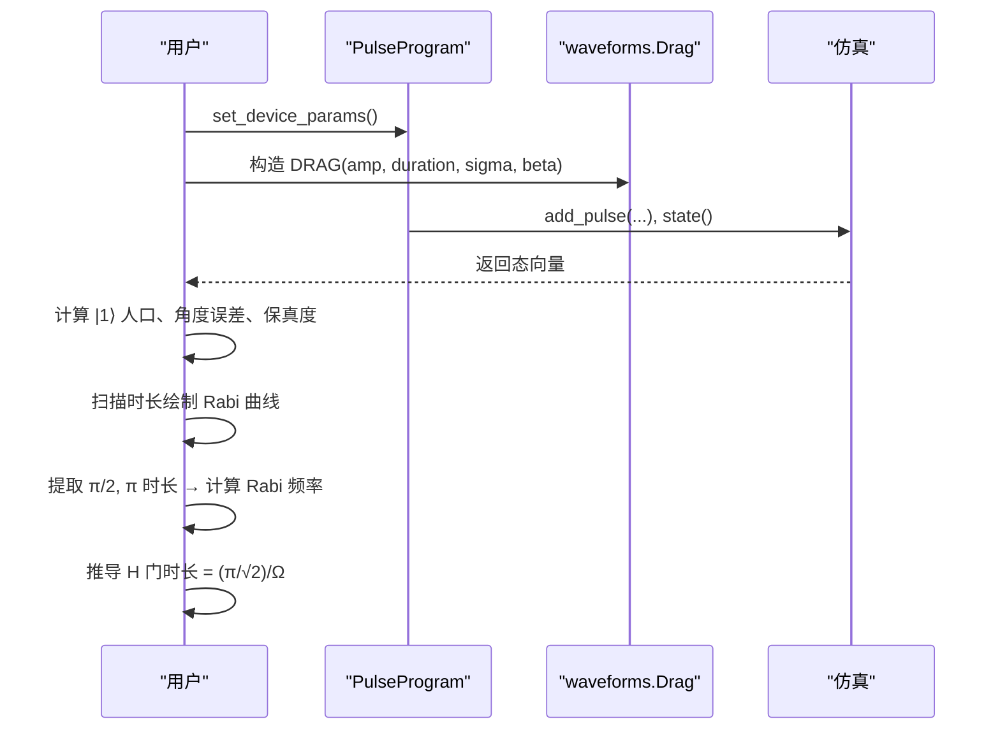
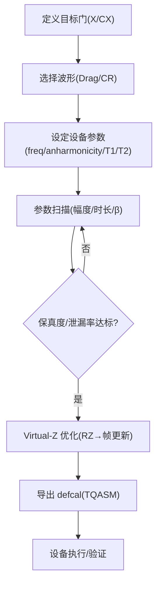
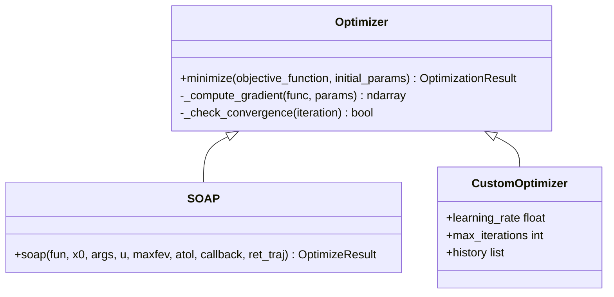
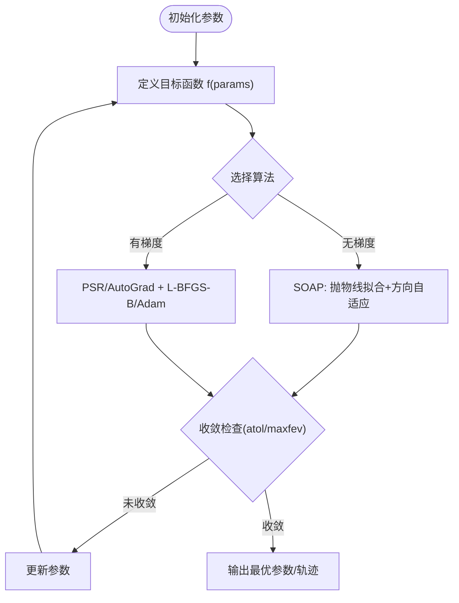
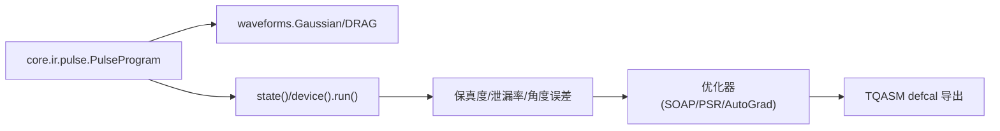

# 参数扫描与优化

<cite>
**本文引用的文件**
- [examples/pulse_calibration_tutorial/step_1_hardware_basics.py](file://examples/pulse_calibration_tutorial/step_1_hardware_basics.py)
- [examples/pulse_calibration_tutorial/step_2_single_qubit_coarse_tuning.py](file://examples/pulse_calibration_tutorial/step_2_single_qubit_coarse_tuning.py)
- [examples/pulse_calibration_tutorial/step_3_single_qubit_fine_tuning.py](file://examples/pulse_calibration_tutorial/step_3_single_qubit_fine_tuning.py)
- [examples/pulse_gate_calibration.py](file://examples/pulse_gate_calibration.py)
- [examples/pulse_optimization_advanced.py](file://examples/pulse_optimization_advanced.py)
- [src/tyxonq/libs/optimizer/soap.py](file://src/tyxonq/libs/optimizer/soap.py)
- [docs/source/libraries/optimizer/index.rst](file://docs/source/libraries/optimizer/index.rst)
</cite>

## 目录
1. [简介](#简介)
2. [项目结构](#项目结构)
3. [核心组件](#核心组件)
4. [架构总览](#架构总览)
5. [详细组件分析](#详细组件分析)
6. [依赖关系分析](#依赖关系分析)
7. [性能考量](#性能考量)
8. [故障排查指南](#故障排查指南)
9. [结论](#结论)
10. [附录：完整示例与可视化建议](#附录完整示例与可视化建议)

## 简介
本文件面向“脉冲参数扫描与优化”的完整工作流，覆盖幅度扫描、持续时间扫描、频率扫描等策略；展示自动化校准脚本的关键实现（目标函数定义、搜索算法选择、收敛条件设置）；提供多参数联合优化的实践路径，并给出结果分析与可视化的建议。内容基于仓库中的教程与示例代码，确保可复现与可落地。

## 项目结构
围绕脉冲校准与优化，仓库提供了循序渐进的教程与通用示例：
- 教程系列：从硬件基础到单比特粗调、精细调优、高级优化与云端部署
- 通用示例：脉冲门校准、高级梯度优化、参数扫描与导出
- 优化器库：无梯度优化器 SOAP，适用于含噪声的目标函数



图表来源
- [examples/pulse_calibration_tutorial/step_1_hardware_basics.py:153-192](file://examples/pulse_calibration_tutorial/step_1_hardware_basics.py#L153-L192)
- [examples/pulse_calibration_tutorial/step_2_single_qubit_coarse_tuning.py:121-216](file://examples/pulse_calibration_tutorial/step_2_single_qubit_coarse_tuning.py#L121-L216)
- [examples/pulse_calibration_tutorial/step_3_single_qubit_fine_tuning.py:123-210](file://examples/pulse_calibration_tutorial/step_3_single_qubit_fine_tuning.py#L123-L210)
- [examples/pulse_gate_calibration.py:225-277](file://examples/pulse_gate_calibration.py#L225-L277)
- [examples/pulse_optimization_advanced.py:384-453](file://examples/pulse_optimization_advanced.py#L384-L453)
- [src/tyxonq/libs/optimizer/soap.py:154-250](file://src/tyxonq/libs/optimizer/soap.py#L154-L250)
- [docs/source/libraries/optimizer/index.rst:122-168](file://docs/source/libraries/optimizer/index.rst#L122-L168)

章节来源
- [examples/pulse_calibration_tutorial/step_1_hardware_basics.py:153-192](file://examples/pulse_calibration_tutorial/step_1_hardware_basics.py#L153-L192)
- [examples/pulse_calibration_tutorial/step_2_single_qubit_coarse_tuning.py:121-216](file://examples/pulse_calibration_tutorial/step_2_single_qubit_coarse_tuning.py#L121-L216)
- [examples/pulse_calibration_tutorial/step_3_single_qubit_fine_tuning.py:123-210](file://examples/pulse_calibration_tutorial/step_3_single_qubit_fine_tuning.py#L123-L210)
- [examples/pulse_gate_calibration.py:225-277](file://examples/pulse_gate_calibration.py#L225-L277)
- [examples/pulse_optimization_advanced.py:384-453](file://examples/pulse_optimization_advanced.py#L384-L453)
- [src/tyxonq/libs/optimizer/soap.py:154-250](file://src/tyxonq/libs/optimizer/soap.py#L154-L250)
- [docs/source/libraries/optimizer/index.rst:122-168](file://docs/source/libraries/optimizer/index.rst#L122-L168)

## 核心组件
- 脉冲程序与波形：使用 PulseProgram 与 waveforms（Gaussian、DRAG 等）构建单/双比特门脉冲序列，并通过设备参数（频率、非谐性、T1/T2）驱动仿真或设备执行。
- 扫描与评估：通过固定其他参数、逐点扫描单一参数（如振幅、时长、β），计算保真度、泄漏率、旋转角误差等指标，定位最佳工作点。
- 优化器：SOAP 无梯度优化器，适合含噪声的目标函数，支持最大函数评估次数、绝对容差、回调记录轨迹等。
- 校准导出：将优化后的门参数以 TQASM defcal 形式导出，便于在真实设备上复用。

章节来源
- [examples/pulse_calibration_tutorial/step_1_hardware_basics.py:333-382](file://examples/pulse_calibration_tutorial/step_1_hardware_basics.py#L333-L382)
- [examples/pulse_calibration_tutorial/step_2_single_qubit_coarse_tuning.py:149-216](file://examples/pulse_calibration_tutorial/step_2_single_qubit_coarse_tuning.py#L149-L216)
- [examples/pulse_gate_calibration.py:225-277](file://examples/pulse_gate_calibration.py#L225-L277)
- [src/tyxonq/libs/optimizer/soap.py:154-250](file://src/tyxonq/libs/optimizer/soap.py#L154-L250)

## 架构总览
下图展示了从“硬件参数设定”到“扫描/优化”再到“结果导出”的整体流程，以及关键模块之间的交互。

```mermaid
sequenceDiagram
participant User as "用户"
participant HW as "硬件参数(频率/非谐性/T1/T2)"
participant PP as "PulseProgram"
participant WF as "waveforms(Gaussian/DRAG)"
participant SIM as "仿真/设备运行"
participant OPT as "优化器(SOAP)"
participant EXP as "导出(TQASM defcal)"
User->>HW : 读取或设定 qubit_freq, anharmonicity, T1, T2
User->>PP : 创建程序并 set_device_params()
User->>WF : 构造脉冲(amp/duration/sigma/beta)
PP->>SIM : add_pulse(...) 后 state()/run()
SIM-->>User : 返回态/计数/保真度/泄漏率
User->>OPT : 定义目标函数(如 1 - fidelity)
OPT->>SIM : 多次调用目标函数(含噪声容忍)
OPT-->>User : 最优参数/轨迹/收敛信息
User->>EXP : 将最优参数写入 defcal 并导出
```

图表来源
- [examples/pulse_calibration_tutorial/step_1_hardware_basics.py:333-382](file://examples/pulse_calibration_tutorial/step_1_hardware_basics.py#L333-L382)
- [examples/pulse_calibration_tutorial/step_2_single_qubit_coarse_tuning.py:149-216](file://examples/pulse_calibration_tutorial/step_2_single_qubit_coarse_tuning.py#L149-L216)
- [examples/pulse_gate_calibration.py:225-277](file://examples/pulse_gate_calibration.py#L225-L277)
- [src/tyxonq/libs/optimizer/soap.py:154-250](file://src/tyxonq/libs/optimizer/soap.py#L154-L250)

## 详细组件分析

### 单比特门粗调：振幅扫描与 DRAG β 扫描
- 目标：找到能产生接近 π 旋转的工作点，并抑制泄漏到 |2⟩。
- 方法：
  - 理论估计：根据 Rabi 公式估算所需振幅或时长，缩小扫描范围。
  - 振幅扫描：固定时长与 σ，扫描振幅，评估 |1⟩ 人口、角度误差、泄漏率，选取最小角度误差的点。
  - DRAG β 扫描：固定振幅，扫描 β，评估泄漏率变化，选取泄漏最小的 β。
- 关键点：
  - 合理选择 σ ≈ duration/4，避免过尖锐边缘导致泄漏。
  - 评价标准：角度误差 < 阈值、泄漏率 < 阈值、|1⟩ 人口接近 1。



图表来源
- [examples/pulse_calibration_tutorial/step_2_single_qubit_coarse_tuning.py:121-216](file://examples/pulse_calibration_tutorial/step_2_single_qubit_coarse_tuning.py#L121-L216)
- [examples/pulse_calibration_tutorial/step_2_single_qubit_coarse_tuning.py:217-302](file://examples/pulse_calibration_tutorial/step_2_single_qubit_coarse_tuning.py#L217-L302)

章节来源
- [examples/pulse_calibration_tutorial/step_2_single_qubit_coarse_tuning.py:121-302](file://examples/pulse_calibration_tutorial/step_2_single_qubit_coarse_tuning.py#L121-L302)

### 单比特门精细调优：Rabi 表征与 H 门推导
- 目标：精确校准旋转角，达到高保真度（>99%）。
- 方法：
  - 精细振幅扫描：在粗调附近窄范围细扫，评估保真度与泄漏率。
  - Rabi 振荡测量：固定振幅，扫描时长，提取 π/2 与 π 对应的时长，反推 Rabi 频率。
  - H 门时长推导：利用已测得的 Rabi 频率计算 π/√2 所需的时长。
- 关键点：
  - 通过 Rabi 曲线验证实际 Rabi 频率与理论一致。
  - 保真度估计需考虑泄漏与目标态重叠。



图表来源
- [examples/pulse_calibration_tutorial/step_3_single_qubit_fine_tuning.py:67-121](file://examples/pulse_calibration_tutorial/step_3_single_qubit_fine_tuning.py#L67-L121)
- [examples/pulse_calibration_tutorial/step_3_single_qubit_fine_tuning.py:143-210](file://examples/pulse_calibration_tutorial/step_3_single_qubit_fine_tuning.py#L143-L210)
- [examples/pulse_calibration_tutorial/step_3_single_qubit_fine_tuning.py:224-259](file://examples/pulse_calibration_tutorial/step_3_single_qubit_fine_tuning.py#L224-L259)

章节来源
- [examples/pulse_calibration_tutorial/step_3_single_qubit_fine_tuning.py:67-259](file://examples/pulse_calibration_tutorial/step_3_single_qubit_fine_tuning.py#L67-L259)

### 脉冲门校准与参数扫描（通用示例）
- 功能：演示自定义 X 门校准、Virtual-Z 门、CX 门优化、幅度扫描与 defcal 导出。
- 要点：
  - 幅度扫描：固定 duration、sigma、beta，扫描 amp，评估保真度，选择最优。
  - Virtual-Z：RZ 通过相位帧更新实现，零物理时间，减少门开销。
  - CX 优化：调节 CR 幅度、耦合强度、门时间，平衡保真度与速度。
  - 导出：将优化后的 defcal 保存为 TQASM 供设备使用。



图表来源
- [examples/pulse_gate_calibration.py:43-99](file://examples/pulse_gate_calibration.py#L43-L99)
- [examples/pulse_gate_calibration.py:102-160](file://examples/pulse_gate_calibration.py#L102-L160)
- [examples/pulse_gate_calibration.py:163-222](file://examples/pulse_gate_calibration.py#L163-L222)
- [examples/pulse_gate_calibration.py:225-277](file://examples/pulse_gate_calibration.py#L225-L277)
- [examples/pulse_gate_calibration.py:280-327](file://examples/pulse_gate_calibration.py#L280-L327)

章节来源
- [examples/pulse_gate_calibration.py:43-327](file://examples/pulse_gate_calibration.py#L43-L327)

### 高级优化：梯度方法与多参数联合优化
- 方法：
  - 参数平移法（PSR）：通过 ±Δ 评估估计梯度，适用于任意量子电路。
  - 自动微分（AutoGrad）：借助后端（JAX/PyTorch）直接获取梯度，高效且数值稳定。
  - 网格搜索 + 局部优化：先粗搜再精调，结合 Adam/L-BFGS-B 等。
- 多参数联合优化：同时优化振幅、时长、β，采用三层策略（网格→局部→梯度）。



图表来源
- [src/tyxonq/libs/optimizer/soap.py:8-152](file://src/tyxonq/libs/optimizer/soap.py#L8-L152)
- [docs/source/libraries/optimizer/index.rst:290-350](file://docs/source/libraries/optimizer/index.rst#L290-L350)

章节来源
- [examples/pulse_optimization_advanced.py:46-114](file://examples/pulse_optimization_advanced.py#L46-L114)
- [examples/pulse_optimization_advanced.py:121-203](file://examples/pulse_optimization_advanced.py#L121-L203)
- [examples/pulse_optimization_advanced.py:384-453](file://examples/pulse_optimization_advanced.py#L384-L453)
- [src/tyxonq/libs/optimizer/soap.py:154-250](file://src/tyxonq/libs/optimizer/soap.py#L154-L250)
- [docs/source/libraries/optimizer/index.rst:290-350](file://docs/source/libraries/optimizer/index.rst#L290-L350)

### 自动化校准脚本：目标函数、搜索算法、收敛条件
- 目标函数：通常定义为 1 - fidelity 或 leakage，以便最小化。
- 搜索算法：
  - 无梯度：SOAP（适合含噪声目标函数，鲁棒性强）。
  - 有梯度：PSR/AutoGrad + L-BFGS-B/Adam。
- 收敛条件：
  - 最大函数评估次数（maxfev）。
  - 绝对容差（atol）：最近窗口内平均改进小于阈值即停止。
  - 回调函数：记录轨迹用于分析。



图表来源
- [src/tyxonq/libs/optimizer/soap.py:154-250](file://src/tyxonq/libs/optimizer/soap.py#L154-L250)
- [docs/source/libraries/optimizer/index.rst:122-168](file://docs/source/libraries/optimizer/index.rst#L122-L168)

章节来源
- [src/tyxonq/libs/optimizer/soap.py:154-250](file://src/tyxonq/libs/optimizer/soap.py#L154-L250)
- [docs/source/libraries/optimizer/index.rst:122-168](file://docs/source/libraries/optimizer/index.rst#L122-L168)

## 依赖关系分析
- 教程与示例依赖 TyxonQ 的核心 IR（PulseProgram）、波形状（waveforms）与编译器（compile）接口。
- 优化器依赖 SciPy 的 OptimizeResult 接口，兼容 scipy.optimize.minimize。
- 校准导出依赖 TQASM defcal 规范，便于跨平台复用。



图表来源
- [examples/pulse_calibration_tutorial/step_1_hardware_basics.py:333-382](file://examples/pulse_calibration_tutorial/step_1_hardware_basics.py#L333-L382)
- [examples/pulse_gate_calibration.py:225-277](file://examples/pulse_gate_calibration.py#L225-L277)
- [src/tyxonq/libs/optimizer/soap.py:154-250](file://src/tyxonq/libs/optimizer/soap.py#L154-L250)

章节来源
- [examples/pulse_calibration_tutorial/step_1_hardware_basics.py:333-382](file://examples/pulse_calibration_tutorial/step_1_hardware_basics.py#L333-L382)
- [examples/pulse_gate_calibration.py:225-277](file://examples/pulse_gate_calibration.py#L225-L277)
- [src/tyxonq/libs/optimizer/soap.py:154-250](file://src/tyxonq/libs/optimizer/soap.py#L154-L250)

## 性能考量
- 扫描粒度与成本：网格搜索随维度指数增长，建议先粗后精，或使用自适应方向（如 SOAP）。
- 噪声容忍：量子测量存在 shot noise，优先选择对噪声鲁棒的无梯度优化器（SOAP）。
- 门时间与相干时间：确保门时间远小于 T1/T2，避免退相干影响。
- 泄漏抑制：DRAG β 是关键，过大反而增加错误，需精细扫描。
- 虚拟 Z：尽量用 Virtual-Z 替代物理 RZ，节省时间且不引入额外误差。

[本节为通用指导，不直接分析具体文件]

## 故障排查指南
- 扫描不收敛：
  - 检查 atol 是否过紧或过松；适当放宽或收紧。
  - 增大 maxfev 或调整初始步长 u。
- 保真度低：
  - 确认设备参数（qubit_freq、anharmonicity、T1/T2）与实际一致。
  - 检查脉冲包络（σ）是否合适，避免边缘尖锐。
  - 验证泄漏率，必要时调整 β。
- 结果不可复现：
  - 固定随机种子与测量 shots。
  - 记录每次扫描的参数与指标，便于回溯。

章节来源
- [src/tyxonq/libs/optimizer/soap.py:154-250](file://src/tyxonq/libs/optimizer/soap.py#L154-L250)
- [examples/pulse_calibration_tutorial/step_2_single_qubit_coarse_tuning.py:149-216](file://examples/pulse_calibration_tutorial/step_2_single_qubit_coarse_tuning.py#L149-L216)

## 结论
通过系统性的参数扫描与优化，可以在 TyxonQ 中高效地寻找最优脉冲设置。教程与示例覆盖了从粗调到精细调优、从单比特到双比特、从无梯度到有梯度的完整路径。结合 SOAP 优化器与 defcal 导出，可实现端到端的自动化校准与部署。

[本节为总结，不直接分析具体文件]

## 附录：完整示例与可视化建议
- 幅度扫描：参考 [examples/pulse_gate_calibration.py:225-277](file://examples/pulse_gate_calibration.py#L225-L277)，固定 duration、sigma、β，扫描 amp，绘制保真度曲线。
- 持续时间扫描：参考 [examples/pulse_calibration_tutorial/step_3_single_qubit_fine_tuning.py:143-210](file://examples/pulse_calibration_tutorial/step_3_single_qubit_fine_tuning.py#L143-L210)，固定振幅，扫描 duration，绘制 Rabi 曲线。
- 频率扫描：在双比特门（如 CX）中，可通过调节驱动频率与耦合强度，观察保真度变化（见 [examples/pulse_gate_calibration.py:163-222](file://examples/pulse_gate_calibration.py#L163-L222)）。
- 多参数联合优化：参考 [examples/pulse_optimization_advanced.py:384-453](file://examples/pulse_optimization_advanced.py#L384-L453)，采用网格搜索 + 局部优化。
- 可视化建议：
  - 二维热力图：横轴为 amplitude，纵轴为 duration，颜色表示保真度。
  - 一维曲线：duration vs. |1⟩ 人口（Rabi 曲线）。
  - 优化轨迹：plot 参数随迭代的变化（ret_traj=True）。

[本节为实践建议，不直接分析具体文件]