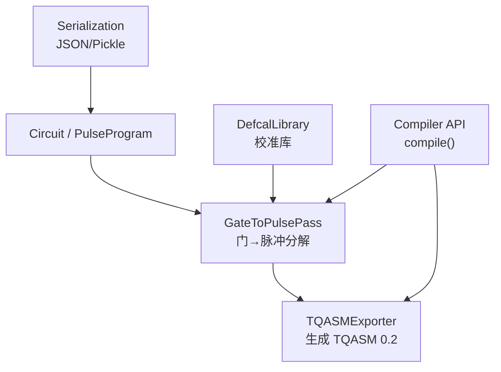
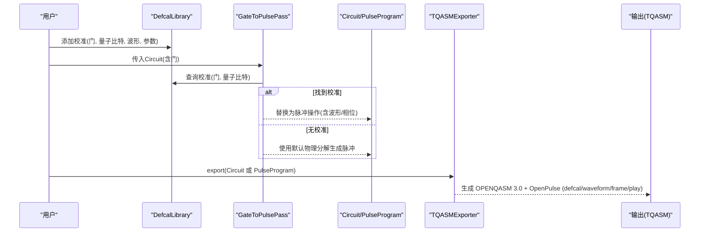
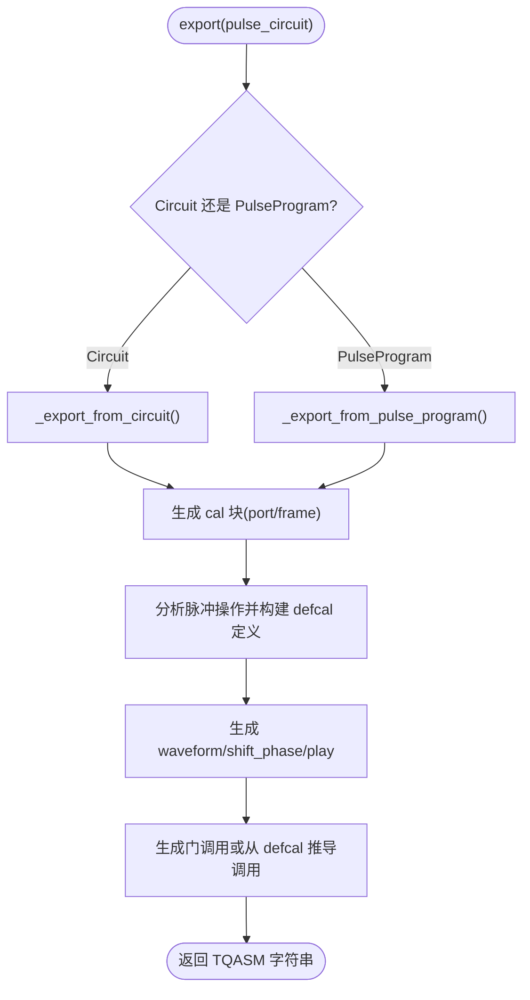
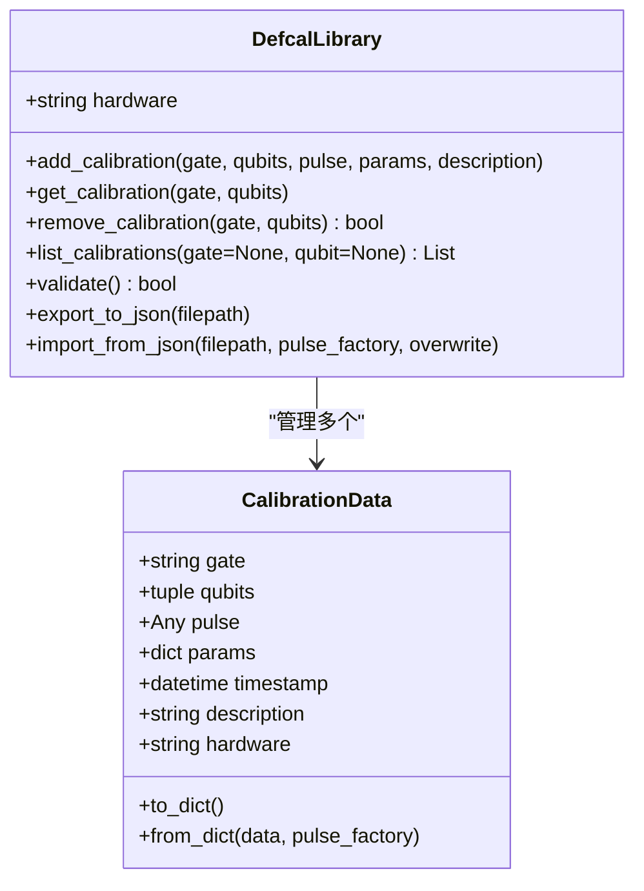
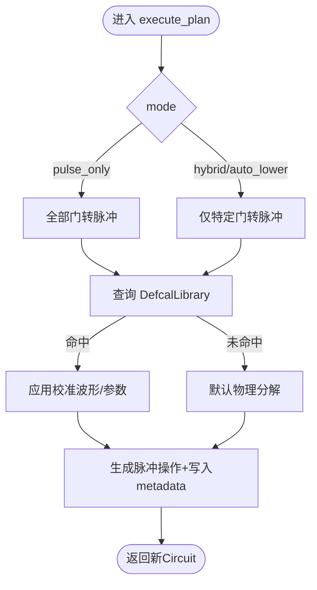
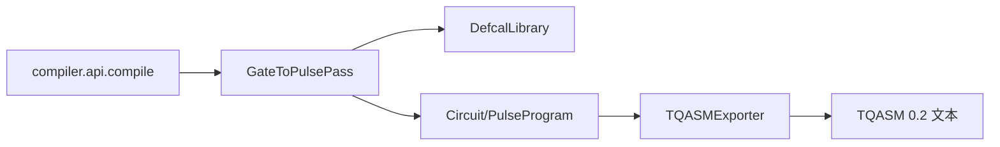

# 校准结果导出

<cite>
**本文引用的文件**
- [tqasm_exporter.py](file://src/tyxonq/compiler/pulse_compiler/native/tqasm_exporter.py)
- [defcal_library.py](file://src/tyxonq/compiler/pulse_compiler/defcal_library.py)
- [gate_to_pulse.py](file://src/tyxonq/compiler/pulse_compiler/native/gate_to_pulse.py)
- [serialization.py](file://src/tyxonq/compiler/pulse_compiler/serialization.py)
- [pulse.py](file://src/tyxonq/core/ir/pulse.py)
- [api.py](file://src/tyxonq/compiler/api.py)
- [test_tqasm_defcal_export.py](file://tests_core_module/test_tqasm_defcal_export.py)
- [defcal_workflow_complete.py](file://examples/defcal_workflow_complete.py)
</cite>

## 目录
1. [简介](#简介)
2. [项目结构](#项目结构)
3. [核心组件](#核心组件)
4. [架构总览](#架构总览)
5. [详细组件分析](#详细组件分析)
6. [依赖关系分析](#依赖关系分析)
7. [性能与兼容性](#性能与兼容性)
8. [故障排查指南](#故障排查指南)
9. [结论](#结论)
10. [附录：使用示例与平台加载](#附录使用示例与平台加载)

## 简介
本文件面向“将优化后的门校准结果导出为 TQASM defcal 格式，以便在真实硬件上直接执行”的目标。内容涵盖：
- defcal 语法规范、参数嵌入方式、文件格式要求
- 从 Python 对象到 TQASM 字符串的完整转换流程
- 实际使用示例与在 TyxonQ 云平台或其他支持 OpenPulse 的平台上的加载使用方法
- 版本兼容性与向后兼容策略

## 项目结构
围绕校准导出，关键代码位于脉冲编译器与导出器中：
- 校准库：管理硬件相关的门级校准数据（波形、参数、元信息）
- 门到脉冲分解：将逻辑门转换为脉冲序列，优先使用用户校准
- TQASM 导出器：将脉冲 IR 或 PulseProgram 输出为符合 OpenQASM 3 + OpenPulse 的 TQASM 0.2 文本
- 序列化：用于保存/恢复脉冲电路与校准库（JSON/Pickle）
- API 编排：统一入口，根据设备与模式选择输出格式

图表来源
- [tqasm_exporter.py:24-128](file://src/tyxonq/compiler/pulse_compiler/native/tqasm_exporter.py#L24-L128)
- [gate_to_pulse.py:38-115](file://src/tyxonq/compiler/pulse_compiler/native/gate_to_pulse.py#L38-L115)
- [defcal_library.py:153-205](file://src/tyxonq/compiler/pulse_compiler/defcal_library.py#L153-L205)
- [serialization.py:26-87](file://src/tyxonq/compiler/pulse_compiler/serialization.py#L26-L87)
- [api.py:149-180](file://src/tyxonq/compiler/api.py#L149-L180)

章节来源
- [tqasm_exporter.py:24-128](file://src/tyxonq/compiler/pulse_compiler/native/tqasm_exporter.py#L24-L128)
- [gate_to_pulse.py:38-115](file://src/tyxonq/compiler/pulse_compiler/native/gate_to_pulse.py#L38-L115)
- [defcal_library.py:153-205](file://src/tyxonq/compiler/pulse_compiler/defcal_library.py#L153-L205)
- [serialization.py:26-87](file://src/tyxonq/compiler/pulse_compiler/serialization.py#L26-L87)
- [api.py:149-180](file://src/tyxonq/compiler/api.py#L149-L180)

## 核心组件
- DefcalLibrary：存储和管理单/双量子比特门的校准数据（波形、参数、时间戳、硬件标识），支持 JSON 导入/导出与校验。
- GateToPulsePass：将逻辑门转为脉冲序列；优先查询 DefcalLibrary，否则回退到默认物理分解。
- TQASMExporter：将 Circuit（含脉冲操作）或 PulseProgram 导出为 TQASM 0.2（OpenQASM 3 + OpenPulse），包含 defcalgrammar、cal、defcal、waveform、frame、play、shift_phase 等。
- Serialization：提供脉冲电路的 JSON/Pickle 序列化与反序列化，便于跨进程/云端传输与持久化。
- Compiler API：统一编译入口，自动识别脉冲模式并选择输出格式（如 tyxonq_homebrew_tqasm 或 openqasm3）。

章节来源
- [defcal_library.py:39-151](file://src/tyxonq/compiler/pulse_compiler/defcal_library.py#L39-L151)
- [gate_to_pulse.py:38-193](file://src/tyxonq/compiler/pulse_compiler/native/gate_to_pulse.py#L38-L193)
- [tqasm_exporter.py:24-128](file://src/tyxonq/compiler/pulse_compiler/native/tqasm_exporter.py#L24-L128)
- [serialization.py:26-87](file://src/tyxonq/compiler/pulse_compiler/serialization.py#L26-L87)
- [api.py:149-180](file://src/tyxonq/compiler/api.py#L149-L180)

## 架构总览
下图展示从校准入库到 TQASM 导出的端到端流程：

图表来源
- [defcal_library.py:206-260](file://src/tyxonq/compiler/pulse_compiler/defcal_library.py#L206-L260)
- [gate_to_pulse.py:137-193](file://src/tyxonq/compiler/pulse_compiler/native/gate_to_pulse.py#L137-L193)
- [tqasm_exporter.py:129-233](file://src/tyxonq/compiler/pulse_compiler/native/tqasm_exporter.py#L129-L233)

## 详细组件分析

### TQASM 导出器（TQASMExporter）
- 支持两种版本风格：
  - openqasm3：标准 OpenQASM 3.0 + OpenPulse（qubit[n] q;）
  - tyxonq_homebrew_tqasm：homebrew_s2 特殊格式（qreg q[n];）
- 输入类型：
  - Circuit（含 pulse/pulse_inline/virtual_z 等操作）
  - PulseProgram（纯脉冲编程）
- 输出结构：
  - 头部：版本声明与 defcalgrammar "openpulse"
  - 量子比特声明
  - cal 块：extern port、frame = newframe(...)
  - defcal 定义：按门签名生成 defcal h $0 / defcal cx $0, $1 等
  - 波形定义：drag/gaussian/constant/gaussian_square
  - 指令：play(frame, waveform)、shift_phase(frame, angle)
  - 电路调用：h q[0]; 或 cx q[0], q[1];（混合模式下保留原门调用）

图表来源
- [tqasm_exporter.py:129-233](file://src/tyxonq/compiler/pulse_compiler/native/tqasm_exporter.py#L129-L233)
- [tqasm_exporter.py:235-295](file://src/tyxonq/compiler/pulse_compiler/native/tqasm_exporter.py#L235-L295)
- [tqasm_exporter.py:465-591](file://src/tyxonq/compiler/pulse_compiler/native/tqasm_exporter.py#L465-L591)
- [tqasm_exporter.py:593-681](file://src/tyxonq/compiler/pulse_compiler/native/tqasm_exporter.py#L593-L681)

章节来源
- [tqasm_exporter.py:24-128](file://src/tyxonq/compiler/pulse_compiler/native/tqasm_exporter.py#L24-L128)
- [tqasm_exporter.py:129-233](file://src/tyxonq/compiler/pulse_compiler/native/tqasm_exporter.py#L129-L233)
- [tqasm_exporter.py:235-295](file://src/tyxonq/compiler/pulse_compiler/native/tqasm_exporter.py#L235-L295)
- [tqasm_exporter.py:465-591](file://src/tyxonq/compiler/pulse_compiler/native/tqasm_exporter.py#L465-L591)
- [tqasm_exporter.py:593-681](file://src/tyxonq/compiler/pulse_compiler/native/tqasm_exporter.py#L593-L681)

### 校准库（DefcalLibrary）
- 数据结构 CalibrationData：记录 gate、qubits、pulse、params、timestamp、description、hardware
- 主要能力：
  - add_calibration/get_calibration/remove_calibration/list_calibrations/has_calibration
  - validate：校验所有条目完整性
  - export_to_json/import_from_json：跨会话复用与部署
- 向后兼容：
  - import 时检查 version 字段，对非 1.0 给出警告
  - hardware 不匹配时发出警告，允许继续导入

图表来源
- [defcal_library.py:39-151](file://src/tyxonq/compiler/pulse_compiler/defcal_library.py#L39-L151)
- [defcal_library.py:153-205](file://src/tyxonq/compiler/pulse_compiler/defcal_library.py#L153-L205)
- [defcal_library.py:206-260](file://src/tyxonq/compiler/pulse_compiler/defcal_library.py#L206-L260)
- [defcal_library.py:422-512](file://src/tyxonq/compiler/pulse_compiler/defcal_library.py#L422-L512)

章节来源
- [defcal_library.py:39-151](file://src/tyxonq/compiler/pulse_compiler/defcal_library.py#L39-L151)
- [defcal_library.py:153-205](file://src/tyxonq/compiler/pulse_compiler/defcal_library.py#L153-L205)
- [defcal_library.py:206-260](file://src/tyxonq/compiler/pulse_compiler/defcal_library.py#L206-L260)
- [defcal_library.py:422-512](file://src/tyxonq/compiler/pulse_compiler/defcal_library.py#L422-L512)

### 门到脉冲分解（GateToPulsePass）
- 优先级：
  1) 用户校准（DefcalLibrary）
  2) 电路元数据中的历史校准
  3) 默认物理分解（Rabi驱动、交叉共振等）
- 支持门：单比特（X/Y/Z/H/S/T/RX/RY/RZ/U3）、双比特（CX/CZ/SWAP/iSWAP）
- 输出：将门替换为脉冲操作，并将波形存入 circuit.metadata["pulse_library"]

图表来源
- [gate_to_pulse.py:64-115](file://src/tyxonq/compiler/pulse_compiler/native/gate_to_pulse.py#L64-L115)
- [gate_to_pulse.py:117-193](file://src/tyxonq/compiler/pulse_compiler/native/gate_to_pulse.py#L117-L193)

章节来源
- [gate_to_pulse.py:64-115](file://src/tyxonq/compiler/pulse_compiler/native/gate_to_pulse.py#L64-L115)
- [gate_to_pulse.py:117-193](file://src/tyxonq/compiler/pulse_compiler/native/gate_to_pulse.py#L117-L193)

### 序列化（Serialization）
- JSON：人类可读，适合配置/调试/跨语言；波形序列化为 {"type","args","class"}
- Pickle：保留 Python 对象，适合同版本 Python 间快速传递
- 工具函数：save/load 便捷接口

章节来源
- [serialization.py:26-87](file://src/tyxonq/compiler/pulse_compiler/serialization.py#L26-L87)
- [serialization.py:90-132](file://src/tyxonq/compiler/pulse_compiler/serialization.py#L90-L132)
- [serialization.py:135-191](file://src/tyxonq/compiler/pulse_compiler/serialization.py#L135-L191)
- [serialization.py:196-239](file://src/tyxonq/compiler/pulse_compiler/serialization.py#L196-L239)

### 脉冲程序（PulseProgram）
- 与 Circuit 平级的抽象，支持链式 API 与 .device().run()/.state()
- ops 格式：[(qubit, waveform, params), ...]
- 可直接被 TQASMExporter 处理，无需先转为 Circuit

章节来源
- [pulse.py:72-138](file://src/tyxonq/core/ir/pulse.py#L72-L138)
- [pulse.py:154-269](file://src/tyxonq/core/ir/pulse.py#L154-L269)

## 依赖关系分析
- TQASMExporter 依赖：
  - 输入：Circuit（含 pulse/pulse_inline/virtual_z）或 PulseProgram
  - 内部：解析 device_params（qubit_freq 等）生成 cal 块；解析 pulse_library 生成 waveform
  - 输出：TQASM 0.2 文本
- GateToPulsePass 依赖：
  - DefcalLibrary（可选）用于优先使用用户校准
  - 设备参数（qubit_freq、anharmonicity 等）用于默认分解
- Compiler API 负责路由：
  - 检测是否脉冲编译模式
  - 针对 homebrew_s2 设备自动选择 tyxonq_homebrew_tqasm 输出
  - 其他情况保持用户设置或默认

图表来源
- [api.py:149-180](file://src/tyxonq/compiler/api.py#L149-L180)
- [gate_to_pulse.py:64-115](file://src/tyxonq/compiler/pulse_compiler/native/gate_to_pulse.py#L64-L115)
- [tqasm_exporter.py:129-233](file://src/tyxonq/compiler/pulse_compiler/native/tqasm_exporter.py#L129-L233)

章节来源
- [api.py:149-180](file://src/tyxonq/compiler/api.py#L149-L180)
- [gate_to_pulse.py:64-115](file://src/tyxonq/compiler/pulse_compiler/native/gate_to_pulse.py#L64-L115)
- [tqasm_exporter.py:129-233](file://src/tyxonq/compiler/pulse_compiler/native/tqasm_exporter.py#L129-L233)

## 性能与兼容性
- 性能要点
  - 优先使用用户校准可显著减少分解开销并提升保真度
  - 在混合模式下保留测量/屏障等非脉冲门，降低不必要的转换
  - 通过 metadata["pulse_library"] 缓存波形，避免重复生成
- 兼容性
  - 版本声明：OPENQASM 3.0 或 TQASM 0.2（homebrew_s2 专用）
  - 语法：defcalgrammar "openpulse"，物理量子比特 $0/$1，frame/port 声明
  - 波形单位：dt（设备时钟周期），复数幅度 a+0.0im
  - 校准库版本：import 时对非 1.0 版本给出警告；hardware 不匹配时提示但允许继续

章节来源
- [tqasm_exporter.py:93-128](file://src/tyxonq/compiler/pulse_compiler/native/tqasm_exporter.py#L93-L128)
- [tqasm_exporter.py:171-179](file://src/tyxonq/compiler/pulse_compiler/native/tqasm_exporter.py#L171-L179)
- [tqasm_exporter.py:593-681](file://src/tyxonq/compiler/pulse_compiler/native/tqasm_exporter.py#L593-L681)
- [defcal_library.py:484-512](file://src/tyxonq/compiler/pulse_compiler/defcal_library.py#L484-L512)

## 故障排查指南
- 常见问题
  - 未生成 defcal：确认已启用 pulse_only 或 hybrid 模式，且存在 pulse/pulse_inline 操作
  - 缺少 frame/port：确保 device_params 中包含 qubit_freq，或在 cal 块中显式声明
  - 波形未内联：如需云端提交/序列化，设置 inline_pulses=True 以完全内联波形
  - 校准库版本不兼容：import 时会警告，建议升级或适配
- 定位方法
  - 检查 compile 返回值中的 compiled_source 是否包含关键字段（OPENQASM 3.0、defcalgrammar、cal、defcal、waveform、play）
  - 使用测试用例断言验证输出结构

章节来源
- [test_tqasm_defcal_export.py:32-75](file://tests_core_module/test_tqasm_defcal_export.py#L32-L75)
- [test_tqasm_defcal_export.py:153-222](file://tests_core_module/test_tqasm_defcal_export.py#L153-L222)

## 结论
TyxonQ 提供了完整的校准结果导出链路：从 DefcalLibrary 管理硬件校准，经 GateToPulsePass 转换为脉冲序列，再由 TQASMExporter 输出为符合 OpenQASM 3 + OpenPulse 的 TQASM 0.2 文本。该格式可直接在支持 OpenPulse 的真实硬件或云平台执行，具备清晰的语法规范、完善的参数嵌入机制与良好的版本兼容性。

## 附录：使用示例与平台加载

### 端到端导出流程（Python → TQASM）
- 步骤概览
  1) 创建或加载 DefcalLibrary，添加校准（门、量子比特、波形、参数）
  2) 构建 Circuit 或使用 PulseProgram
  3) 使用 GateToPulsePass 进行门到脉冲分解（优先使用校准）
  4) 通过 TQASMExporter 导出 TQASM 0.2（openqasm3 或 tyxonq_homebrew_tqasm）
  5) 保存/传输 TQASM 文本，供硬件或云平台执行

- 参考实现路径
  - 完整工作流示例：[defcal_workflow_complete.py](file://examples/defcal_workflow_complete.py)
  - 导出语法验证测试：[test_tqasm_defcal_export.py](file://tests_core_module/test_tqasm_defcal_export.py)

章节来源
- [defcal_workflow_complete.py:1-530](file://examples/defcal_workflow_complete.py#L1-L530)
- [test_tqasm_defcal_export.py:1-275](file://tests_core_module/test_tqasm_defcal_export.py#L1-L275)

### defcal 语法规范与参数嵌入
- 版本与语法
  - 版本声明：OPENQASM 3.0 或 TQASM 0.2（homebrew_s2）
  - 语法选择：defcalgrammar "openpulse"
- 环境与帧
  - cal { extern port dN; frame dN_frame = newframe(dN, freq, phase); }
- 门校准定义
  - defcal h $0 { waveform wf = drag(...); play(d0_frame, wf); shift_phase(...); }
  - 双比特：defcal cx $0, $1 { ... }
- 波形与单位
  - drag/gaussian/constant/gaussian_square
  - 时长单位 dt（设备时钟周期），幅度为复数 a+0.0im
- 指令
  - play(frame, waveform)
  - shift_phase(frame, angle)

章节来源
- [tqasm_exporter.py:171-179](file://src/tyxonq/compiler/pulse_compiler/native/tqasm_exporter.py#L171-L179)
- [tqasm_exporter.py:465-499](file://src/tyxonq/compiler/pulse_compiler/native/tqasm_exporter.py#L465-L499)
- [tqasm_exporter.py:501-591](file://src/tyxonq/compiler/pulse_compiler/native/tqasm_exporter.py#L501-L591)
- [tqasm_exporter.py:593-681](file://src/tyxonq/compiler/pulse_compiler/native/tqasm_exporter.py#L593-L681)

### 在 TyxonQ 云平台或其他平台加载与执行
- 平台要求
  - 支持 OpenQASM 3 + OpenPulse 的接收端（能解析 defcalgrammar "openpulse"、cal、defcal、waveform、play）
- 加载方式
  - 将 TQASM 文本作为任务提交载荷（具体 API 由平台提供）
  - 若平台使用 TyxonQ 运行时，可通过 .device(provider="...").run() 直接执行
- 注意事项
  - 确保端口/频率与目标设备一致（cal 块中的 port/frequency）
  - 若平台限制波形类型，需保证仅使用支持的波形（drag/gaussian/constant）

章节来源
- [tqasm_exporter.py:24-91](file://src/tyxonq/compiler/pulse_compiler/native/tqasm_exporter.py#L24-L91)
- [tqasm_exporter.py:593-681](file://src/tyxonq/compiler/pulse_compiler/native/tqasm_exporter.py#L593-L681)

### 版本兼容性与向后兼容策略
- 校准库
  - 导入时检查 version，非 1.0 给出警告
  - hardware 不一致时提示但允许继续导入
- TQASM 输出
  - 支持两种版本风格：openqasm3（标准）与 tyxonq_homebrew_tqasm（homebrew_s2 专用）
  - 通过 API 自动选择合适输出（例如 homebrew_s2 设备默认 tyxonq_homebrew_tqasm）

章节来源
- [defcal_library.py:484-512](file://src/tyxonq/compiler/pulse_compiler/defcal_library.py#L484-L512)
- [api.py:149-180](file://src/tyxonq/compiler/api.py#L149-L180)
- [tqasm_exporter.py:93-128](file://src/tyxonq/compiler/pulse_compiler/native/tqasm_exporter.py#L93-L128)