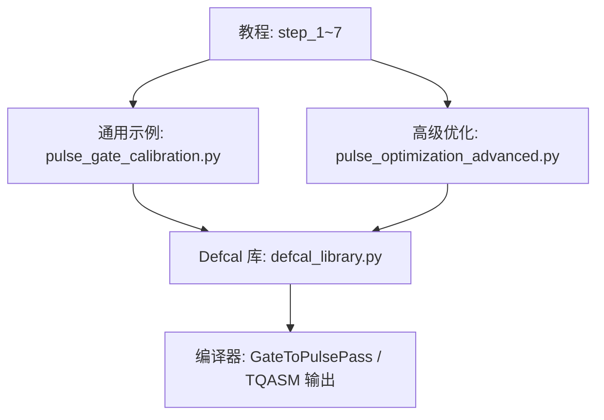
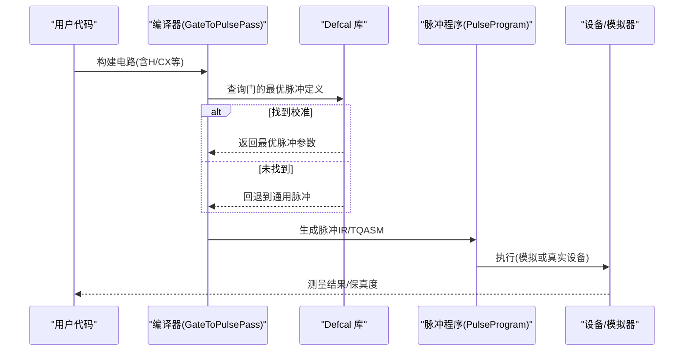
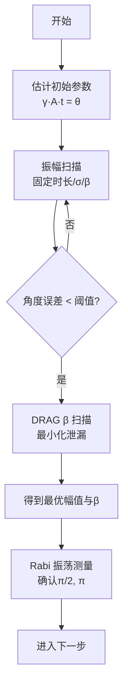
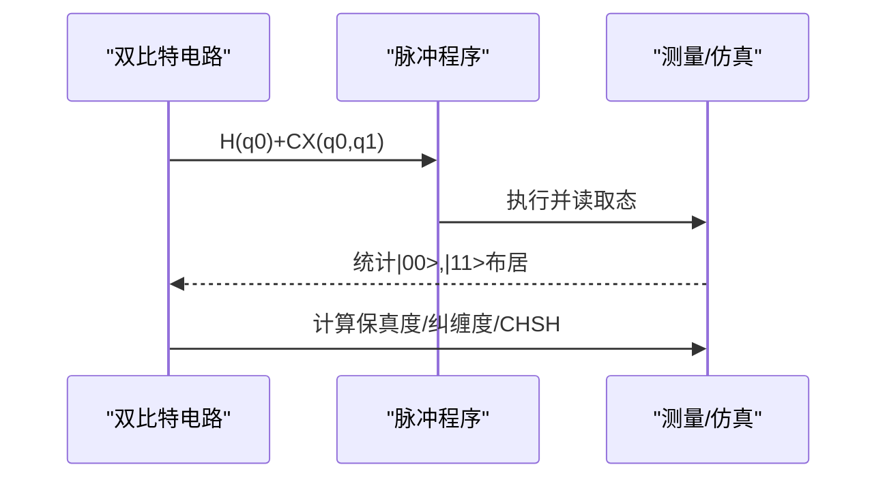
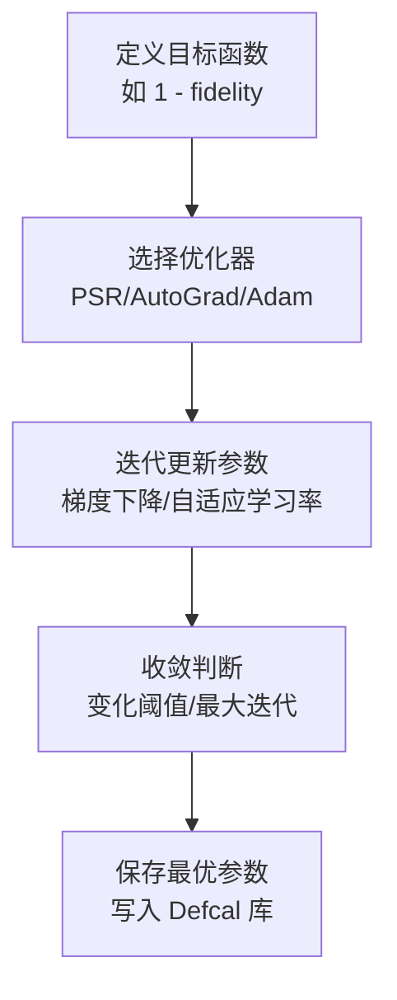
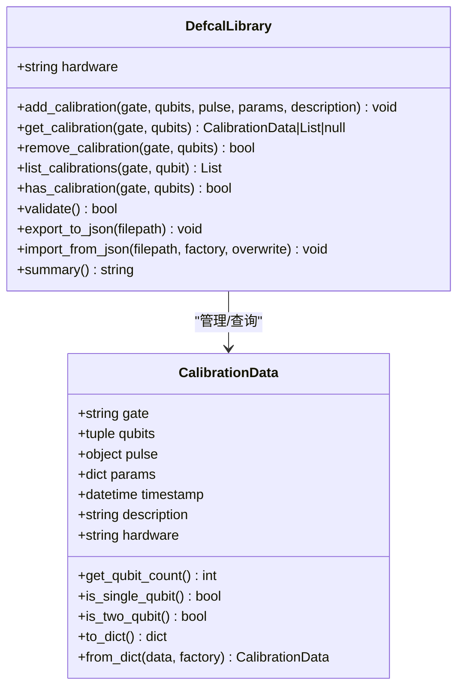
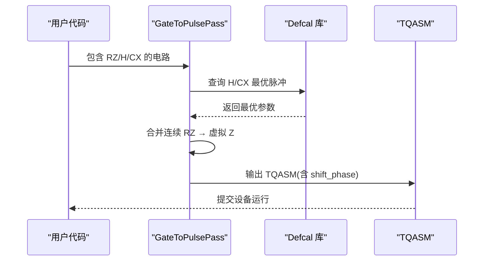
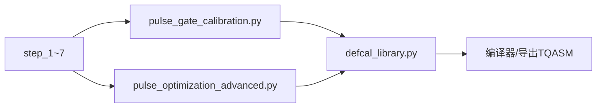

# 脉冲校准示例

<cite>
**本文引用的文件**
- [step_1_hardware_basics.py](file://examples/pulse_calibration_tutorial/step_1_hardware_basics.py)
- [step_2_single_qubit_coarse_tuning.py](file://examples/pulse_calibration_tutorial/step_2_single_qubit_coarse_tuning.py)
- [step_3_single_qubit_fine_tuning.py](file://examples/pulse_calibration_tutorial/step_3_single_qubit_fine_tuning.py)
- [step_5_two_qubit_characterization.py](file://examples/pulse_calibration_tutorial/step_5_two_qubit_characterization.py)
- [step_7_advanced_optimization.py](file://examples/pulse_calibration_tutorial/step_7_advanced_optimization.py)
- [pulse_gate_calibration.py](file://examples/pulse_gate_calibration.py)
- [pulse_optimization_advanced.py](file://examples/pulse_optimization_advanced.py)
- [defcal_library.py](file://src/tyxonq/compiler/pulse_compiler/defcal_library.py)
</cite>

## 目录
1. [简介](#简介)
2. [项目结构](#项目结构)
3. [核心组件](#核心组件)
4. [架构总览](#架构总览)
5. [详细组件分析](#详细组件分析)
6. [依赖关系分析](#依赖关系分析)
7. [性能考量](#性能考量)
8. [故障排查指南](#故障排查指南)
9. [结论](#结论)
10. [附录](#附录)

## 简介
本文件面向需要掌握“脉冲级校准”的工程师与研究者，系统讲解在 TyxonQ 中如何进行单量子比特门、两量子比特门的校准与优化，涵盖频率调谐、幅度校准、DRAG 泄漏抑制、Rabi 表征、Bell 态保真度评估、CHSH 验证、以及 Defcal（校准定义）库的构建与编译期应用。文档同时提供自动化脚本思路：参数扫描、数据拟合、最优参数提取、质量指标监控与长期稳定性处理策略。

## 项目结构
TyxonQ 提供了完整的教程式校准脚本与底层 Defcal 库实现，便于从零开始完成端到端的校准流程：
- 教程脚本位于 examples/pulse_calibration_tutorial，按步骤组织，从硬件基础到高级优化。
- 通用校准示例位于 examples/pulse_gate_calibration.py 与 examples/pulse_optimization_advanced.py，演示参数扫描、自动微分、多参数优化等。
- 校准库实现位于 src/tyxonq/compiler/pulse_compiler/defcal_library.py，用于管理、查询、导出导入校准数据。

图表来源
- [step_1_hardware_basics.py:1-516](file://examples/pulse_calibration_tutorial/step_1_hardware_basics.py#L1-L516)
- [step_2_single_qubit_coarse_tuning.py:1-356](file://examples/pulse_calibration_tutorial/step_2_single_qubit_coarse_tuning.py#L1-L356)
- [step_3_single_qubit_fine_tuning.py:1-306](file://examples/pulse_calibration_tutorial/step_3_single_qubit_fine_tuning.py#L1-L306)
- [step_5_two_qubit_characterization.py:1-381](file://examples/pulse_calibration_tutorial/step_5_two_qubit_characterization.py#L1-L381)
- [step_7_advanced_optimization.py:1-361](file://examples/pulse_calibration_tutorial/step_7_advanced_optimization.py#L1-L361)
- [pulse_gate_calibration.py:1-400](file://examples/pulse_gate_calibration.py#L1-L400)
- [pulse_optimization_advanced.py:1-582](file://examples/pulse_optimization_advanced.py#L1-L582)
- [defcal_library.py:1-565](file://src/tyxonq/compiler/pulse_compiler/defcal_library.py#L1-L565)

章节来源
- [step_1_hardware_basics.py:1-516](file://examples/pulse_calibration_tutorial/step_1_hardware_basics.py#L1-L516)
- [pulse_gate_calibration.py:1-400](file://examples/pulse_gate_calibration.py#L1-L400)
- [defcal_library.py:1-565](file://src/tyxonq/compiler/pulse_compiler/defcal_library.py#L1-L565)

## 核心组件
- 教程工作流（Step 1–7）：覆盖硬件基础、单比特粗调/细调、双比特表征、高级优化与云端部署。
- 通用校准示例：演示 DRAG β 调参、Virtual-Z、CX 优化、参数扫描、TQASM defcal 导出。
- 高级优化示例：参数平移法（PSR）、AutoGrad、单/双比特门优化、波形搜索、多参数联合优化。
- Defcal 库：统一存储、查询、校验、导出/导入校准数据，支撑编译器选择最优脉冲实现。

章节来源
- [step_1_hardware_basics.py:1-516](file://examples/pulse_calibration_tutorial/step_1_hardware_basics.py#L1-L516)
- [step_2_single_qubit_coarse_tuning.py:1-356](file://examples/pulse_calibration_tutorial/step_2_single_qubit_coarse_tuning.py#L1-L356)
- [step_3_single_qubit_fine_tuning.py:1-306](file://examples/pulse_calibration_tutorial/step_3_single_qubit_fine_tuning.py#L1-L306)
- [step_5_two_qubit_characterization.py:1-381](file://examples/pulse_calibration_tutorial/step_5_two_qubit_characterization.py#L1-L381)
- [step_7_advanced_optimization.py:1-361](file://examples/pulse_calibration_tutorial/step_7_advanced_optimization.py#L1-L361)
- [pulse_gate_calibration.py:1-400](file://examples/pulse_gate_calibration.py#L1-L400)
- [pulse_optimization_advanced.py:1-582](file://examples/pulse_optimization_advanced.py#L1-L582)
- [defcal_library.py:1-565](file://src/tyxonq/compiler/pulse_compiler/defcal_library.py#L1-L565)

## 架构总览
下图展示从用户逻辑到脉冲执行的关键路径，以及 Defcal 库在其中的作用。

图表来源
- [step_7_advanced_optimization.py:147-249](file://examples/pulse_calibration_tutorial/step_7_advanced_optimization.py#L147-L249)
- [defcal_library.py:153-303](file://src/tyxonq/compiler/pulse_compiler/defcal_library.py#L153-L303)
- [pulse_gate_calibration.py:280-327](file://examples/pulse_gate_calibration.py#L280-L327)

## 详细组件分析

### 为什么需要脉冲校准？它对保真度的重要性
- 脉冲级控制能精确调节旋转角、相位、包络形状与泄漏抑制，从而显著提升门保真度。
- 无校准时，通用脉冲往往导致保真度不足（例如 Bell 态制备失败率高），无法支撑 VQE/QAOA 等算法。
- 通过校准将“逻辑门”映射为“硬件最优脉冲”，是获得高保真度、可重复计算的前提。

章节来源
- [step_7_advanced_optimization.py:28-67](file://examples/pulse_calibration_tutorial/step_7_advanced_optimization.py#L28-L67)
- [step_7_advanced_optimization.py:255-307](file://examples/pulse_calibration_tutorial/step_7_advanced_optimization.py#L255-L307)

### 单量子比特校准：频率调谐、幅度校准、DRAG 泄漏抑制
- 频率调谐：基于三能级模型与 Rabi 理论估计初始振幅/时长，再进行精细扫描。
- 幅度校准：固定时长与包络，扫描振幅以最大化 |1⟩ 布居；进一步用 Rabi 振荡曲线精确定位 π/2、π 点。
- DRAG 优化：调整 β 抑制泄漏到 |2⟩，结合保真度与泄漏率综合评估。

图表来源
- [step_2_single_qubit_coarse_tuning.py:50-120](file://examples/pulse_calibration_tutorial/step_2_single_qubit_coarse_tuning.py#L50-L120)
- [step_2_single_qubit_coarse_tuning.py:121-216](file://examples/pulse_calibration_tutorial/step_2_single_qubit_coarse_tuning.py#L121-L216)
- [step_2_single_qubit_coarse_tuning.py:217-303](file://examples/pulse_calibration_tutorial/step_2_single_qubit_coarse_tuning.py#L217-L303)
- [step_3_single_qubit_fine_tuning.py:29-122](file://examples/pulse_calibration_tutorial/step_3_single_qubit_fine_tuning.py#L29-L122)
- [step_3_single_qubit_fine_tuning.py:123-210](file://examples/pulse_calibration_tutorial/step_3_single_qubit_fine_tuning.py#L123-L210)

章节来源
- [step_1_hardware_basics.py:147-393](file://examples/pulse_calibration_tutorial/step_1_hardware_basics.py#L147-L393)
- [step_2_single_qubit_coarse_tuning.py:50-303](file://examples/pulse_calibration_tutorial/step_2_single_qubit_coarse_tuning.py#L50-L303)
- [step_3_single_qubit_fine_tuning.py:29-210](file://examples/pulse_calibration_tutorial/step_3_single_qubit_fine_tuning.py#L29-L210)

### 两量子比特门校准：Cross-Resonance (CR) 与 Bell 态表征
- CR 参数优化：调整耦合强度、CR 幅度、门时长，平衡保真度与速度。
- Bell 态保真度：制备四个 Bell 态并评估保真度、纠缠度与 CHSH 违反度。
- 错误来源分析：脉冲偏差、ZZ 串扰、T1/T2、泄漏等，指导后续优化方向。

图表来源
- [step_5_two_qubit_characterization.py:69-163](file://examples/pulse_calibration_tutorial/step_5_two_qubit_characterization.py#L69-L163)
- [step_5_two_qubit_characterization.py:221-260](file://examples/pulse_calibration_tutorial/step_5_two_qubit_characterization.py#L221-L260)
- [pulse_gate_calibration.py:163-222](file://examples/pulse_gate_calibration.py#L163-L222)

章节来源
- [step_5_two_qubit_characterization.py:69-381](file://examples/pulse_calibration_tutorial/step_5_two_qubit_characterization.py#L69-L381)
- [pulse_gate_calibration.py:163-222](file://examples/pulse_gate_calibration.py#L163-L222)

### 自动化校准脚本：参数扫描、数据拟合、最优参数提取
- 参数扫描：对振幅、时长、β 进行网格/步进扫描，记录保真度与泄漏率。
- 数据拟合：利用 Rabi 曲线拟合 π/2、π 点，估算 Rabi 频率。
- 最优参数提取：选择使目标函数（如保真度最大或误差最小）的参数组合。

图表来源
- [pulse_optimization_advanced.py:46-114](file://examples/pulse_optimization_advanced.py#L46-L114)
- [pulse_optimization_advanced.py:121-203](file://examples/pulse_optimization_advanced.py#L121-L203)
- [pulse_optimization_advanced.py:210-270](file://examples/pulse_optimization_advanced.py#L210-L270)
- [pulse_optimization_advanced.py:277-327](file://examples/pulse_optimization_advanced.py#L277-L327)
- [pulse_optimization_advanced.py:334-453](file://examples/pulse_optimization_advanced.py#L334-L453)

章节来源
- [pulse_gate_calibration.py:225-277](file://examples/pulse_gate_calibration.py#L225-L277)
- [pulse_optimization_advanced.py:46-453](file://examples/pulse_optimization_advanced.py#L46-L453)

### Defcal 库：校准数据的结构化存储与编译期应用
- 数据结构：CalibrationData 封装门名、目标量子比特、脉冲对象、参数、时间戳、描述、硬件标识。
- 功能：添加/查询/删除/列出/校验/导出导入 JSON；支持按门或量子比特过滤。
- 编译集成：GateToPulsePass 在编译阶段查询 Defcal 库，选择最优脉冲实现，否则回退通用脉冲。

图表来源
- [defcal_library.py:39-151](file://src/tyxonq/compiler/pulse_compiler/defcal_library.py#L39-L151)
- [defcal_library.py:153-565](file://src/tyxonq/compiler/pulse_compiler/defcal_library.py#L153-L565)

章节来源
- [defcal_library.py:39-565](file://src/tyxonq/compiler/pulse_compiler/defcal_library.py#L39-L565)
- [step_7_advanced_optimization.py:147-249](file://examples/pulse_calibration_tutorial/step_7_advanced_optimization.py#L147-L249)

### 虚拟 Z 优化与编译流程
- Virtual-Z：Z 旋转通过相位帧更新实现，零物理时间，减少门开销与误差。
- 编译流程：用户代码 → 编译器查询 Defcal → 虚拟 Z 优化 → 生成 TQASM → 设备执行。

图表来源
- [pulse_gate_calibration.py:102-160](file://examples/pulse_gate_calibration.py#L102-L160)
- [step_7_advanced_optimization.py:75-145](file://examples/pulse_calibration_tutorial/step_7_advanced_optimization.py#L75-L145)

章节来源
- [pulse_gate_calibration.py:102-160](file://examples/pulse_gate_calibration.py#L102-L160)
- [step_7_advanced_optimization.py:75-145](file://examples/pulse_calibration_tutorial/step_7_advanced_optimization.py#L75-L145)

## 依赖关系分析
- 教程脚本依赖 TyxonQ 的 Circuit、waveforms、PulseProgram 与编译 API。
- 通用校准示例依赖 PulseProgram、waveforms、compile API，演示参数扫描与 TQASM 导出。
- 高级优化示例引入 PSR、AutoGrad、多参数优化方法。
- Defcal 库被编译器在 GateToPulsePass 阶段调用，决定最终脉冲实现。

图表来源
- [step_1_hardware_basics.py:1-516](file://examples/pulse_calibration_tutorial/step_1_hardware_basics.py#L1-L516)
- [pulse_gate_calibration.py:1-400](file://examples/pulse_gate_calibration.py#L1-L400)
- [pulse_optimization_advanced.py:1-582](file://examples/pulse_optimization_advanced.py#L1-L582)
- [defcal_library.py:1-565](file://src/tyxonq/compiler/pulse_compiler/defcal_library.py#L1-L565)

章节来源
- [step_1_hardware_basics.py:1-516](file://examples/pulse_calibration_tutorial/step_1_hardware_basics.py#L1-L516)
- [pulse_gate_calibration.py:1-400](file://examples/pulse_gate_calibration.py#L1-L400)
- [pulse_optimization_advanced.py:1-582](file://examples/pulse_optimization_advanced.py#L1-L582)
- [defcal_library.py:1-565](file://src/tyxonq/compiler/pulse_compiler/defcal_library.py#L1-L565)

## 性能考量
- 门时间与相干时间：确保门持续时间远小于 T1/T2，避免噪声累积。
- 泄漏抑制：DRAG β 的选择需权衡泄漏抑制与额外误差。
- 双比特门速度-保真度权衡：更强的 CR 幅度可缩短门时间但可能引入串扰。
- 优化效率：优先使用 AutoGrad 或 Adam 等高阶优化器，减少评估次数。
- 长期稳定性：定期重校准，跟踪温度漂移与硬件老化。

[本节为通用指导，不直接分析具体文件]

## 故障排查指南
- 保真度低：检查振幅/时长是否偏离最优；重新进行 Rabi 表征；验证 DRAG β 是否合适。
- 泄漏率高：增大 β 或使用更平滑包络；检查频率失谐与非谐性设置。
- 双比特门不稳定：检查 ZZ 串扰；尝试回声脉冲或交错驱动；评估耦合强度与门时长。
- 编译问题：确认 Defcal 库已正确加载；检查门名与量子比特索引匹配；必要时回退通用脉冲。
- 云端执行失败：核对 TQASM 格式与设备能力；检查 token/权限；逐步缩小电路规模定位问题。

章节来源
- [step_5_two_qubit_characterization.py:261-325](file://examples/pulse_calibration_tutorial/step_5_two_qubit_characterization.py#L261-L325)
- [pulse_gate_calibration.py:280-327](file://examples/pulse_gate_calibration.py#L280-L327)
- [step_7_advanced_optimization.py:147-249](file://examples/pulse_calibration_tutorial/step_7_advanced_optimization.py#L147-L249)

## 结论
通过 TyxonQ 提供的教程与工具链，可以系统化地完成从单比特到双比特的脉冲级校准与优化。关键要点包括：
- 先粗调再细调，结合 Rabi 表征精确定位旋转角。
- 使用 DRAG 抑制泄漏，并通过参数扫描与优化器寻找最优参数。
- 将校准结果存入 Defcal 库，让编译器在运行时自动选择最优脉冲。
- 通过 Bell 态保真度与 CHSH 测试评估双比特门质量。
- 建立自动化校准流程，持续监控质量指标，应对温度漂移与长期稳定性挑战。

[本节为总结，不直接分析具体文件]

## 附录
- 推荐实践顺序：
  1) 硬件基础与参数理解（step_1）
  2) 单比特粗调（step_2）
  3) 单比特细调与 Rabi 表征（step_3）
  4) 双比特表征与质量评估（step_5）
  5) 高级优化与 Defcal 集成（step_7）
  6) 自动化校准脚本（pulse_gate_calibration.py、pulse_optimization_advanced.py）
- 质量指标建议：
  - 单比特门保真度 > 99.9%
  - 泄漏率 < 0.1%
  - 双比特门保真度 > 99%（视硬件而定）
  - CHSH 违反度 > 2.5（强纠缠）
- 长期稳定性：
  - 周期性重校准（温度漂移、器件老化）
  - 记录校准历史与元数据（timestamp、hardware）
  - 监控趋势，触发告警与自动重校准

[本节为补充信息，不直接分析具体文件]