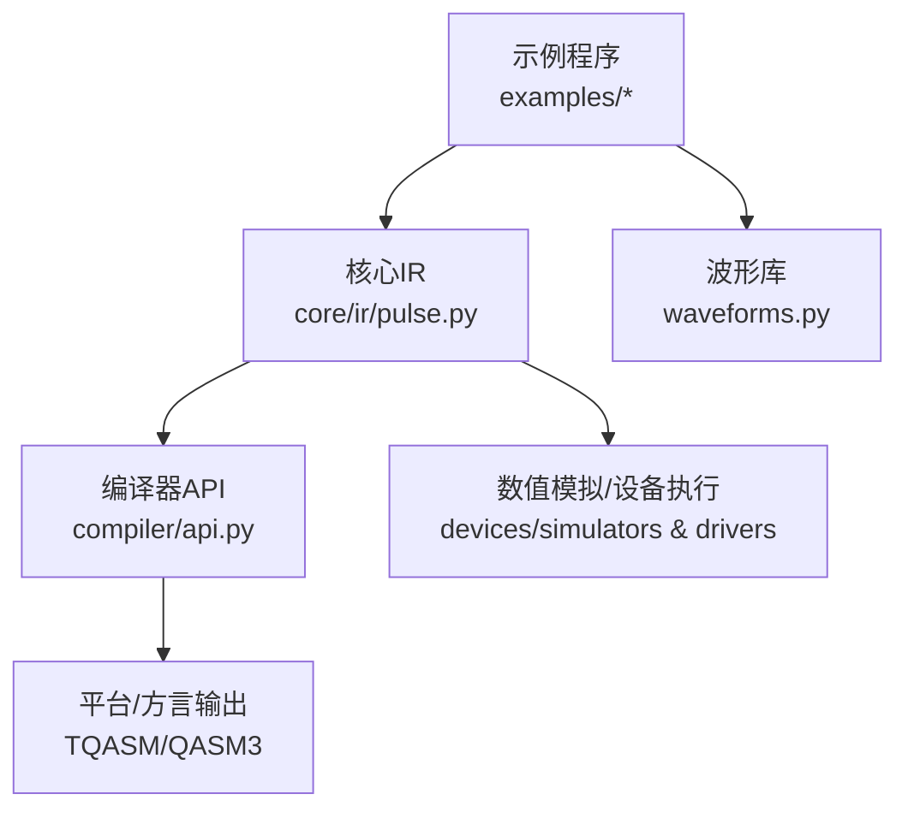
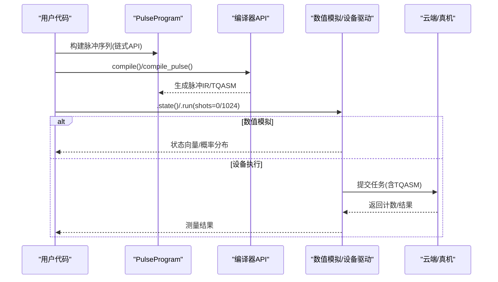
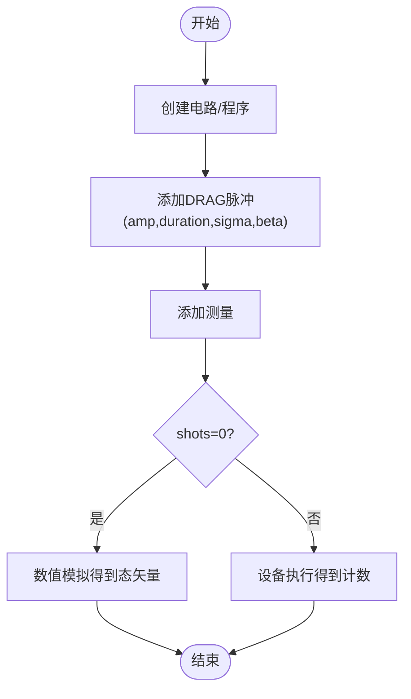
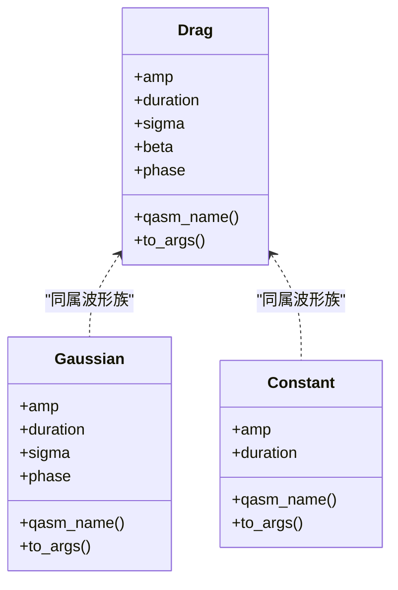
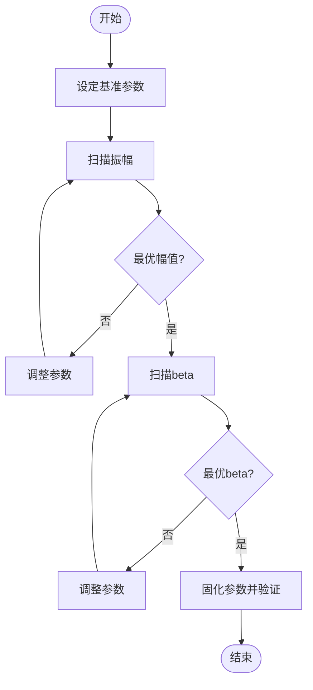
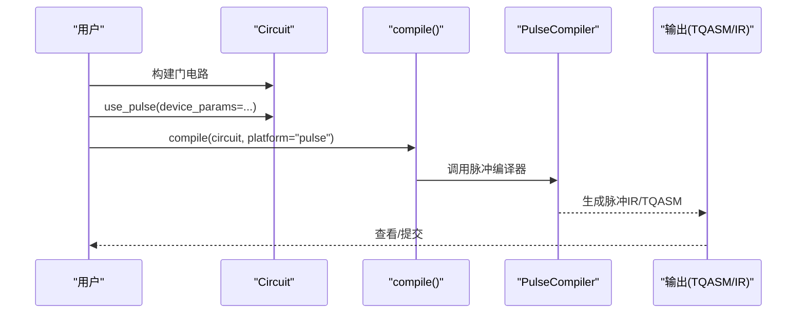
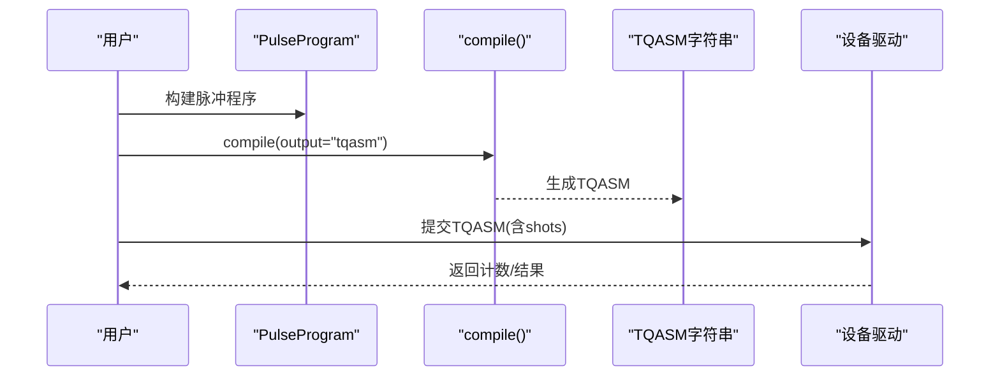
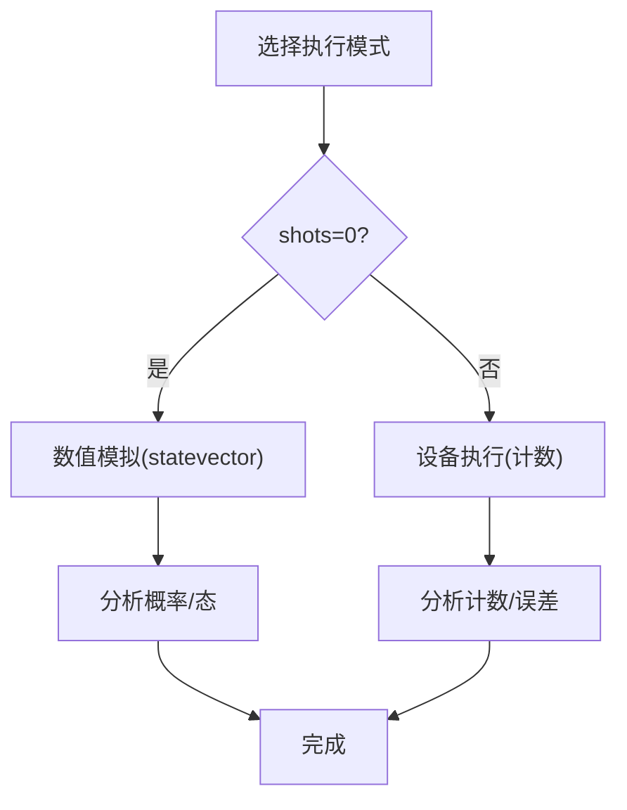
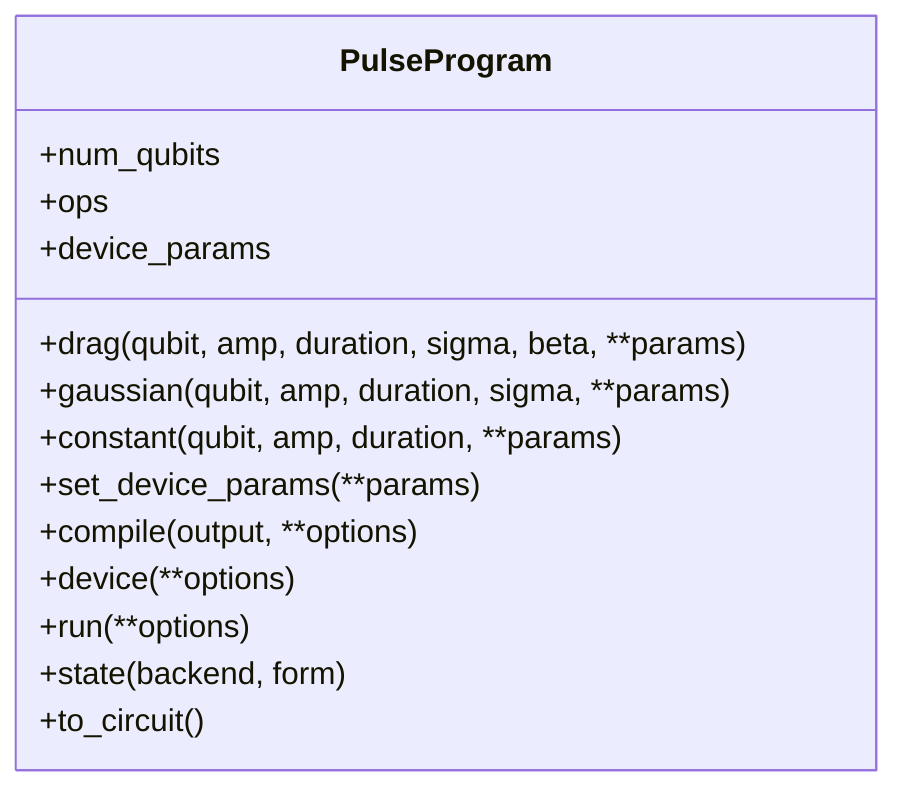
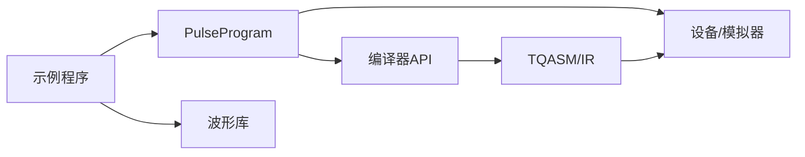

# 脉冲编程基础教程

<cite>
**本文引用的文件**
- [pulse_basic_tutorial.py](file://examples/pulse_basic_tutorial.py)
- [pure_pulse_programming.py](file://examples/pure_pulse_programming.py)
- [pulse_waveforms.py](file://examples/pulse_waveforms.py)
- [waveforms.py](file://src/tyxonq/waveforms.py)
- [pulse.py](file://src/tyxonq/core/ir/pulse.py)
- [api.py](file://src/tyxonq/compiler/api.py)
- [index.rst](file://docs/source/tutorials/beginner/index.rst)
</cite>

## 目录
1. [简介](#简介)
2. [项目结构](#项目结构)
3. [核心组件](#核心组件)
4. [架构总览](#架构总览)
5. [详细组件分析](#详细组件分析)
6. [依赖关系分析](#依赖关系分析)
7. [性能考虑](#性能考虑)
8. [故障排查指南](#故障排查指南)
9. [结论](#结论)
10. [附录](#附录)

## 简介
本教程面向初学者，系统讲解 TyxonQ 的脉冲级量子控制与编程。你将学到：
- 什么是脉冲以及关键参数（振幅、持续时间、频率、相位）的含义与作用
- 如何创建第一个脉冲电路并执行理想仿真与现实采样
- 如何使用高斯 DRAG 波形实现 X 门操作
- 如何进行参数扫描、门到脉冲转换、TQASM 导出等核心工作流
- 从“Hello World”到真实硬件部署的完整路径

本教程基于仓库中的示例与核心模块，提供循序渐进的步骤说明和可视化图示，帮助快速上手脉冲编程。

## 项目结构
TyxonQ 将脉冲编程能力分布在多个层次：
- 用户示例：演示从入门到进阶的完整流程
- 核心 IR：PulseProgram、PulseSchedule、PulseInstruction 等数据结构
- 波形库：Gaussian、Drag、Constant、Hermite、BlackmanSquare 等
- 编译器：统一编译入口 compile() 与脉冲专用 compile_pulse()
- 设备与后端：数值模拟与云端/真机执行

图表来源
- [pulse_basic_tutorial.py:1-407](file://examples/pulse_basic_tutorial.py#L1-L407)
- [pure_pulse_programming.py:1-459](file://examples/pure_pulse_programming.py#L1-L459)
- [waveforms.py:1-157](file://src/tyxonq/waveforms.py#L1-L157)
- [pulse.py:71-655](file://src/tyxonq/core/ir/pulse.py#L71-L655)
- [api.py:39-465](file://src/tyxonq/compiler/api.py#L39-L465)

章节来源
- [pulse_basic_tutorial.py:1-407](file://examples/pulse_basic_tutorial.py#L1-L407)
- [pure_pulse_programming.py:1-459](file://examples/pure_pulse_programming.py#L1-L459)
- [waveforms.py:1-157](file://src/tyxonq/waveforms.py#L1-L157)
- [pulse.py:71-655](file://src/tyxonq/core/ir/pulse.py#L71-L655)
- [api.py:39-465](file://src/tyxonq/compiler/api.py#L39-L465)

## 核心组件
- 脉冲程序 IR：PulseProgram 提供链式 API（drag/gaussian/constant），支持数值模拟 .state() 与设备执行 .run()，并可编译为 TQASM 或脉冲 IR
- 波形定义：Gaussian、Drag、Constant、CosineDrag、Hermite、BlackmanSquare 等，封装了参数与序列化方法
- 编译器：compile() 统一入口，自动识别脉冲模式；compile_pulse() 专用于 PulseProgram 编译，支持输出 TQASM/OpenQASM3
- 示例教程：从 Hello World、参数扫描、门到脉冲、TQASM 导出到执行模式对比

章节来源
- [pulse.py:71-655](file://src/tyxonq/core/ir/pulse.py#L71-L655)
- [waveforms.py:1-157](file://src/tyxonq/waveforms.py#L1-L157)
- [api.py:39-465](file://src/tyxonq/compiler/api.py#L39-L465)
- [pulse_basic_tutorial.py:1-407](file://examples/pulse_basic_tutorial.py#L1-L407)

## 架构总览
下图展示了从高层电路到低层脉冲再到执行的完整链路，包括两种编程模式（A：门电路自动编译；B：纯脉冲直接控制）。

图表来源
- [pulse.py:360-493](file://src/tyxonq/core/ir/pulse.py#L360-L493)
- [api.py:39-465](file://src/tyxonq/compiler/api.py#L39-L465)
- [pulse_basic_tutorial.py:220-275](file://examples/pulse_basic_tutorial.py#L220-L275)

## 详细组件分析

### 脉冲与参数：振幅、持续时间、频率、相位
- 振幅（amp）：决定旋转角度与 Rabi 频率，影响门保真度与速度
- 持续时间（duration）：以纳秒为单位，越长越接近绝热但易受退相干影响
- 频率（qubit_freq/drive_freq）：载波频率与失谐设置，影响选择性
- 相位（phase）：控制旋转轴与相对相位，Z 旋转常通过 Virtual-Z（帧更新）零时间实现

章节来源
- [pulse_basic_tutorial.py:41-66](file://examples/pulse_basic_tutorial.py#L41-L66)
- [pulse_waveforms.py:182-228](file://examples/pulse_waveforms.py#L182-L228)
- [pulse_gate_calibration.py:102-160](file://examples/pulse_gate_calibration.py#L102-L160)

### 创建第一个脉冲电路（Hello World）
- 使用 Circuit 或 PulseProgram 创建单量子比特电路
- 应用 DRAG 脉冲实现近似 π 旋转（X 门）
- 添加测量并执行：shots=0 获取态矢量；shots>0 进行采样统计

图表来源
- [pulse_basic_tutorial.py:32-96](file://examples/pulse_basic_tutorial.py#L32-L96)
- [pulse_basic_tutorial.py:277-347](file://examples/pulse_basic_tutorial.py#L277-L347)

章节来源
- [pulse_basic_tutorial.py:32-96](file://examples/pulse_basic_tutorial.py#L32-L96)
- [pulse_basic_tutorial.py:277-347](file://examples/pulse_basic_tutorial.py#L277-L347)

### 高斯 DRAG 波形与 X 门
- DRAG 在 Gaussian 基础上加入导数项抑制泄漏到 |2⟩ 能级
- 典型参数：sigma 控制包络宽度，beta 控制泄漏抑制强度
- 通过调节 amp/duration 实现 π 旋转，配合 beta 提升保真度

图表来源
- [waveforms.py:19-60](file://src/tyxonq/waveforms.py#L19-L60)
- [waveforms.py:41-51](file://src/tyxonq/waveforms.py#L41-L51)

章节来源
- [waveforms.py:19-60](file://src/tyxonq/waveforms.py#L19-L60)
- [pulse_waveforms.py:133-168](file://examples/pulse_waveforms.py#L133-L168)

### 参数扫描与优化
- 幅度扫描：固定 duration/sigma/beta，变化 amp 观察 |1⟩ 布居，定位 π 旋转最佳点
- Beta 扫描：固定其他参数，变化 beta 评估泄漏与保真度权衡
- 自动化：结合数值模拟快速迭代，再上设备微调

图表来源
- [pulse_waveforms.py:329-399](file://examples/pulse_waveforms.py#L329-L399)
- [pulse_gate_calibration.py:43-99](file://examples/pulse_gate_calibration.py#L43-L99)

章节来源
- [pulse_waveforms.py:329-399](file://examples/pulse_waveforms.py#L329-L399)
- [pulse_gate_calibration.py:43-99](file://examples/pulse_gate_calibration.py#L43-L99)

### 门到脉冲转换
- 高层 Circuit 可通过 use_pulse() 切换至脉冲编译模式
- 编译器自动分解 H/X/Y/CX 等为脉冲序列（如 CX 由 Cross-Resonance 序列构成）
- 可指定 device_params（qubit_freq、anharmonicity 等）以获得更真实的物理映射

图表来源
- [api.py:39-291](file://src/tyxonq/compiler/api.py#L39-L291)
- [pulse_waveforms.py:237-322](file://examples/pulse_waveforms.py#L237-L322)

章节来源
- [api.py:39-291](file://src/tyxonq/compiler/api.py#L39-L291)
- [pulse_waveforms.py:237-322](file://examples/pulse_waveforms.py#L237-L322)

### TQASM 导出与云端提交
- 使用 compile(output="tqasm") 或 PulseProgram.compile(output="tqasm") 导出 TQASM
- TQASM 包含版本声明、量子比特声明、defcal 块、内联脉冲、测量与经典操作
- 可直接提交到云端/真机执行，或在本地调试

图表来源
- [pulse_basic_tutorial.py:220-275](file://examples/pulse_basic_tutorial.py#L220-L275)
- [api.py:343-465](file://src/tyxonq/compiler/api.py#L343-L465)

章节来源
- [pulse_basic_tutorial.py:220-275](file://examples/pulse_basic_tutorial.py#L220-L275)
- [api.py:343-465](file://src/tyxonq/compiler/api.py#L343-L465)

### 执行模式：理想仿真 vs 现实采样
- 理想仿真：shots=0，返回精确态矢量，适合算法开发与调试
- 现实采样：shots>0，返回计数分布，模拟真实硬件噪声与统计波动
- 建议：先用理想仿真验证逻辑，再用现实采样评估鲁棒性

图表来源
- [pulse_basic_tutorial.py:277-347](file://examples/pulse_basic_tutorial.py#L277-L347)

章节来源
- [pulse_basic_tutorial.py:277-347](file://examples/pulse_basic_tutorial.py#L277-L347)

### 纯脉冲编程（Mode B）与链式 API
- 使用 PulseProgram 直接添加脉冲，不经过门抽象
- 链式 API：prog.drag(...).gaussian(...).constant(...)
- 直接执行：prog.device().run() 或 prog.state()
- 可选转换为 Circuit 用于调试（不推荐生产使用）

图表来源
- [pulse.py:71-655](file://src/tyxonq/core/ir/pulse.py#L71-L655)

章节来源
- [pure_pulse_programming.py:39-208](file://examples/pure_pulse_programming.py#L39-L208)
- [pulse.py:154-324](file://src/tyxonq/core/ir/pulse.py#L154-L324)

## 依赖关系分析
- 示例依赖核心 IR 与波形库，并通过编译器 API 进行转换与导出
- 编译器根据是否检测到脉冲操作自动切换到脉冲编译路径
- 设备执行路径支持数值模拟与云端/真机提交

图表来源
- [api.py:100-291](file://src/tyxonq/compiler/api.py#L100-L291)
- [pulse.py:360-493](file://src/tyxonq/core/ir/pulse.py#L360-L493)

章节来源
- [api.py:100-291](file://src/tyxonq/compiler/api.py#L100-L291)
- [pulse.py:360-493](file://src/tyxonq/core/ir/pulse.py#L360-L493)

## 性能考虑
- 脉冲时长与保真度权衡：较短的门更快但更易受噪声影响；较长更绝热但增加退相干风险
- DRAG 的 beta 越大泄漏抑制越强，但可能引入额外计算开销
- 选择合适的波形：DRAG 通用性好；Hermite/BlackmanSquare 在特定硬件上可获得更佳频谱特性
- 数值模拟 vs 设备执行：先用 shots=0 快速验证，再用 shots>0 评估统计误差

[本节为通用指导，无需具体文件引用]

## 故障排查指南
- 导入错误：确保安装正确与环境一致
- 运行错误：检查 qubit 索引范围、device_params 是否匹配目标设备
- 编译警告：缺少 device_params 时会自动补足默认测试参数，建议显式提供真实设备参数
- 执行差异：理想仿真与采样结果存在统计波动，适当增大 shots 提高稳定性

章节来源
- [index.rst:468-529](file://docs/source/tutorials/beginner/index.rst#L468-L529)
- [api.py:247-262](file://src/tyxonq/compiler/api.py#L247-L262)

## 结论
通过本教程，你已掌握：
- 脉冲的基本概念与关键参数
- 使用 DRAG 波形实现 X 门
- 参数扫描与优化方法
- 门到脉冲的自动转换与 TQASM 导出
- 理想仿真与现实采样的执行模式
- 纯脉冲编程的链式 API 与直接执行路径

下一步可探索：
- 更多波形类型与高级脉冲整形
- 双量子比特门的脉冲分解与优化
- 云端提交与真实硬件校准流程

[本节为总结，无需具体文件引用]

## 附录
- 快速参考：常用波形与参数
  - Gaussian：amp, duration, sigma, phase
  - Drag：amp, duration, sigma, beta, phase
  - Constant：amp, duration
  - CosineDrag：amp, duration, phase, alpha
  - Hermite：amp, duration, order, phase
  - BlackmanSquare：amp, duration, width, phase

章节来源
- [waveforms.py:19-157](file://src/tyxonq/waveforms.py#L19-L157)