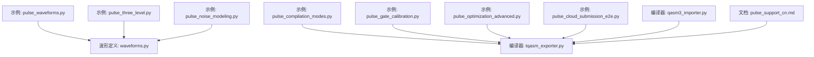
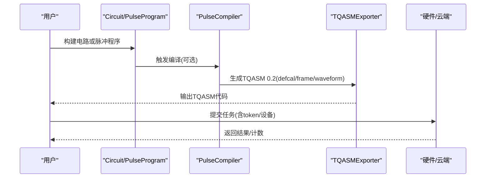
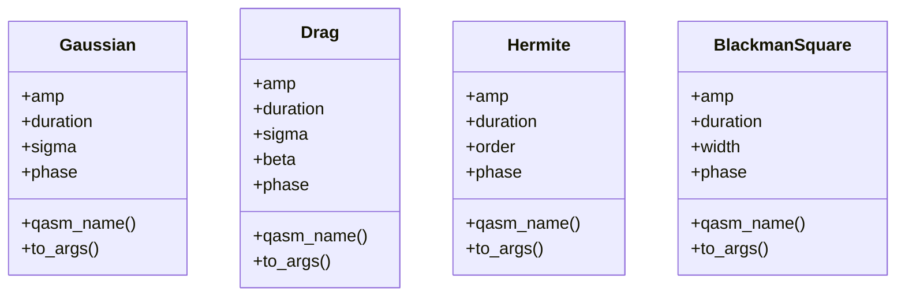
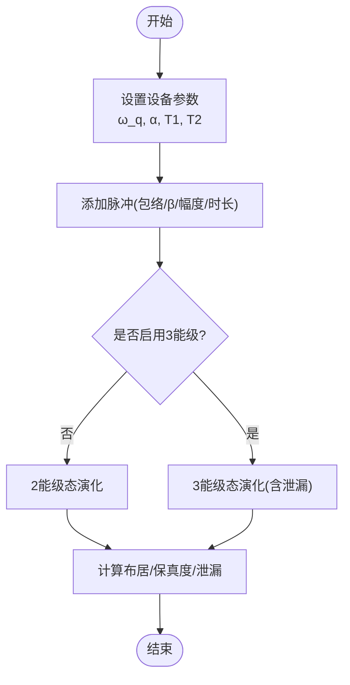
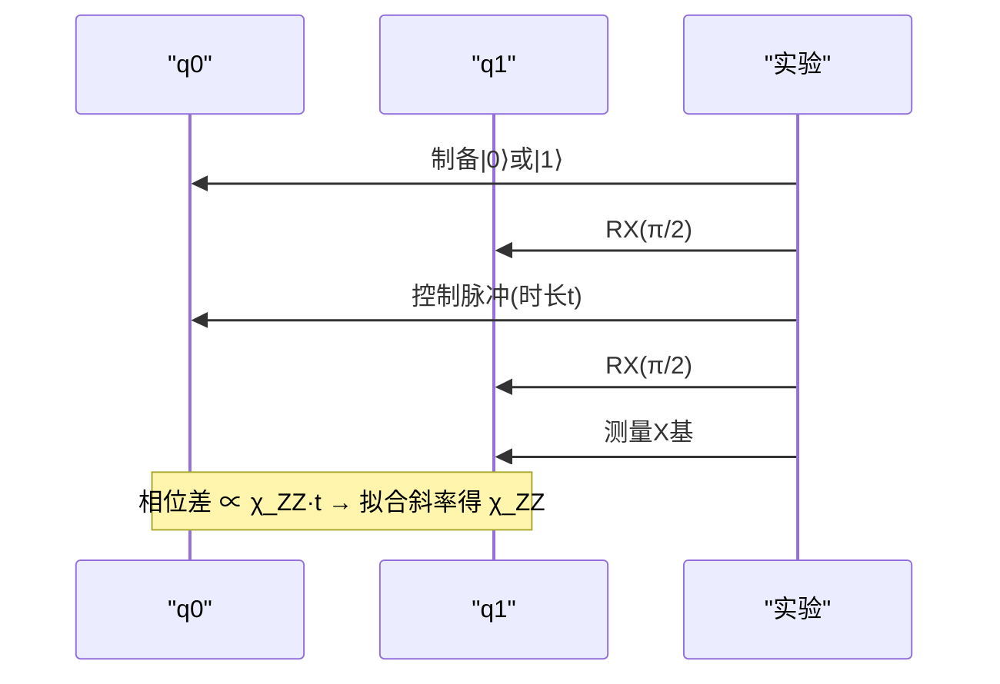
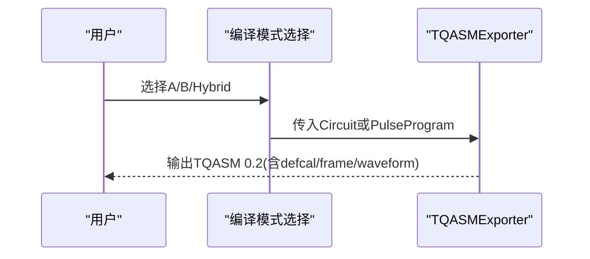
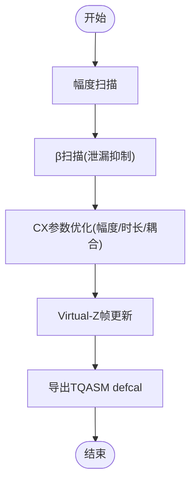
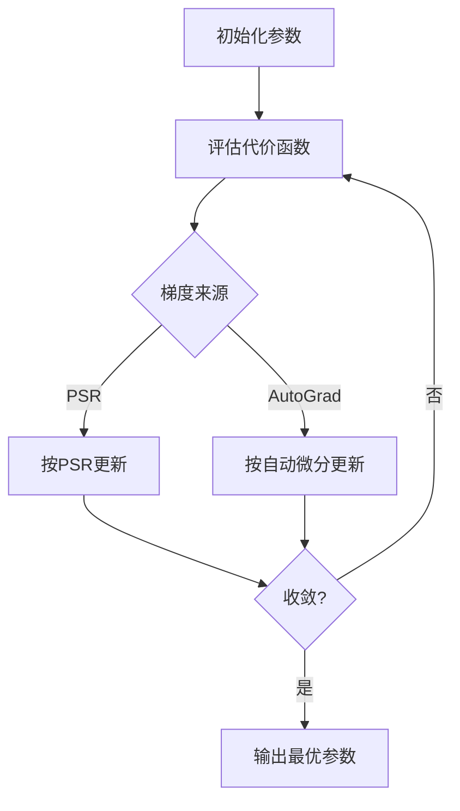
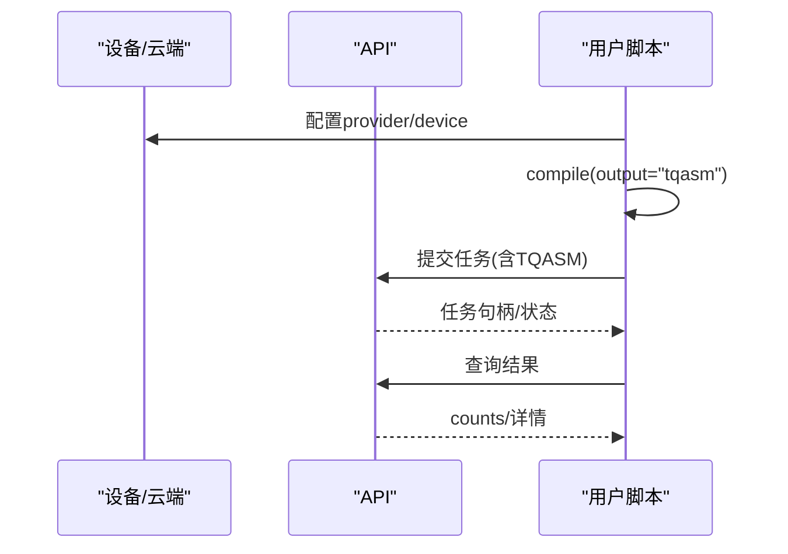
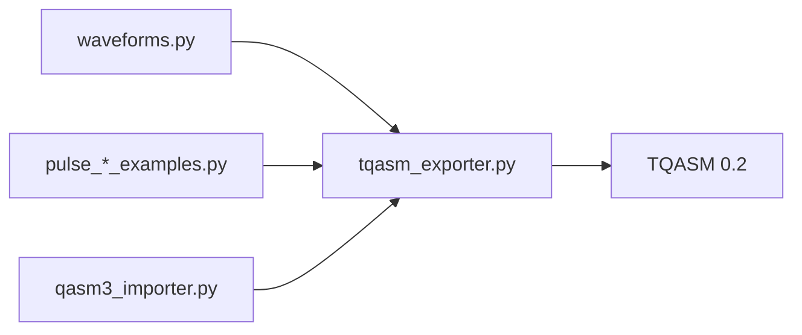

# 脉冲编程示例

<cite>
**本文引用的文件**
- [examples/pulse_waveforms.py](file://examples/pulse_waveforms.py)
- [examples/pulse_three_level.py](file://examples/pulse_three_level.py)
- [examples/pulse_noise_modeling.py](file://examples/pulse_noise_modeling.py)
- [examples/pulse_compilation_modes.py](file://examples/pulse_compilation_modes.py)
- [examples/pulse_gate_calibration.py](file://examples/pulse_gate_calibration.py)
- [examples/pulse_optimization_advanced.py](file://examples/pulse_optimization_advanced.py)
- [examples/pulse_cloud_submission_e2e.py](file://examples/pulse_cloud_submission_e2e.py)
- [src/tyxonq/waveforms.py](file://src/tyxonq/waveforms.py)
- [src/tyxonq/compiler/pulse_compiler/native/tqasm_exporter.py](file://src/tyxonq/compiler/pulse_compiler/native/tqasm_exporter.py)
- [src/tyxonq/compiler/pulse_compiler/native/qasm3_importer.py](file://src/tyxonq/compiler/pulse_compiler/native/qasm3_importer.py)
- [docs/pulse_support_cn.md](file://docs/pulse_support_cn.md)
</cite>

## 目录
1. [简介](#简介)
2. [项目结构](#项目结构)
3. [核心组件](#核心组件)
4. [架构总览](#架构总览)
5. [详细组件分析](#详细组件分析)
6. [依赖关系分析](#依赖关系分析)
7. [性能考量](#性能考量)
8. [故障排查指南](#故障排查指南)
9. [结论](#结论)
10. [附录](#附录)

## 简介
本文件面向从门级到脉冲级的量子控制编程，系统讲解 TyxonQ 的脉冲波形设计（DRAG、Gaussian、Hermite、BlackmanSquare 等）、三能级系统操作、脉冲校准流程、噪声建模与 ZZ 串扰、TQASM 格式与编译链路、硬件优化策略，以及云端端到端提交与误差缓解实践。文档以仓库中的示例与编译器实现为依据，提供可操作的流程图、时序图与类图，帮助读者在真实硬件上执行并优化脉冲级程序。

## 项目结构
围绕脉冲编程的核心文件组织如下：
- 示例层：覆盖波形库、三能级仿真、噪声建模、编译模式、校准与优化、云端提交等完整工作流
- 波形定义：统一的波形数据类与参数接口
- 编译器层：TQASM 导出器与 QASM3/OpenPulse 导入器，支撑门到脉冲的编译与反导
- 文档层：TQASM 语法与使用指南

图表来源
- [examples/pulse_waveforms.py:1-578](file://examples/pulse_waveforms.py#L1-L578)
- [src/tyxonq/waveforms.py:1-157](file://src/tyxonq/waveforms.py#L1-L157)
- [src/tyxonq/compiler/pulse_compiler/native/tqasm_exporter.py:1-733](file://src/tyxonq/compiler/pulse_compiler/native/tqasm_exporter.py#L1-L733)
- [src/tyxonq/compiler/pulse_compiler/native/qasm3_importer.py:1-396](file://src/tyxonq/compiler/pulse_compiler/native/qasm3_importer.py#L1-L396)
- [docs/pulse_support_cn.md:1-619](file://docs/pulse_support_cn.md#L1-L619)

章节来源
- [examples/pulse_waveforms.py:1-578](file://examples/pulse_waveforms.py#L1-L578)
- [examples/pulse_three_level.py:1-551](file://examples/pulse_three_level.py#L1-L551)
- [examples/pulse_noise_modeling.py:1-591](file://examples/pulse_noise_modeling.py#L1-L591)
- [examples/pulse_compilation_modes.py:1-461](file://examples/pulse_compilation_modes.py#L1-L461)
- [examples/pulse_gate_calibration.py:1-400](file://examples/pulse_gate_calibration.py#L1-L400)
- [examples/pulse_optimization_advanced.py:1-582](file://examples/pulse_optimization_advanced.py#L1-L582)
- [examples/pulse_cloud_submission_e2e.py:1-793](file://examples/pulse_cloud_submission_e2e.py#L1-L793)
- [src/tyxonq/waveforms.py:1-157](file://src/tyxonq/waveforms.py#L1-L157)
- [src/tyxonq/compiler/pulse_compiler/native/tqasm_exporter.py:1-733](file://src/tyxonq/compiler/pulse_compiler/native/tqasm_exporter.py#L1-L733)
- [src/tyxonq/compiler/pulse_compiler/native/qasm3_importer.py:1-396](file://src/tyxonq/compiler/pulse_compiler/native/qasm3_importer.py#L1-L396)
- [docs/pulse_support_cn.md:1-619](file://docs/pulse_support_cn.md#L1-L619)

## 核心组件
- 波形库：提供 Gaussian、Drag、Constant、Sine、Cosine、CosineDrag、Flattop、Hermite、BlackmanSquare 等波形数据类，统一参数与序列化接口
- 脉冲程序 IR：PulseProgram 用于构建、调度与执行脉冲序列；支持设备参数设置与状态演化
- 编译器：TQASMExporter 将 Circuit/PulseProgram 导出为 TQASM 0.2（OpenQASM 3 + OpenPulse），支持 defcal、frame、waveform、play、shift_phase 等
- 导入器：QASM3Importer 解析 QASM3 + OpenPulse 源，重建帧与 defcal 信息，便于回读与复用
- 示例与工作流：覆盖波形对比、三能级泄漏抑制、噪声与 ZZ 串扰、编译模式选择、校准与优化、云端端到端提交

章节来源
- [src/tyxonq/waveforms.py:1-157](file://src/tyxonq/waveforms.py#L1-L157)
- [src/tyxonq/compiler/pulse_compiler/native/tqasm_exporter.py:1-733](file://src/tyxonq/compiler/pulse_compiler/native/tqasm_exporter.py#L1-L733)
- [src/tyxonq/compiler/pulse_compiler/native/qasm3_importer.py:1-396](file://src/tyxonq/compiler/pulse_compiler/native/qasm3_importer.py#L1-L396)
- [examples/pulse_waveforms.py:1-578](file://examples/pulse_waveforms.py#L1-L578)
- [examples/pulse_three_level.py:1-551](file://examples/pulse_three_level.py#L1-L551)
- [examples/pulse_noise_modeling.py:1-591](file://examples/pulse_noise_modeling.py#L1-L591)
- [examples/pulse_compilation_modes.py:1-461](file://examples/pulse_compilation_modes.py#L1-L461)
- [examples/pulse_gate_calibration.py:1-400](file://examples/pulse_gate_calibration.py#L1-L400)
- [examples/pulse_optimization_advanced.py:1-582](file://examples/pulse_optimization_advanced.py#L1-L582)
- [examples/pulse_cloud_submission_e2e.py:1-793](file://examples/pulse_cloud_submission_e2e.py#L1-L793)

## 架构总览
TyxonQ 的脉冲编程链路包含“门级 → 脉冲级 → 硬件”的三段式编译与执行：

图表来源
- [examples/pulse_compilation_modes.py:1-461](file://examples/pulse_compilation_modes.py#L1-L461)
- [src/tyxonq/compiler/pulse_compiler/native/tqasm_exporter.py:1-733](file://src/tyxonq/compiler/pulse_compiler/native/tqasm_exporter.py#L1-L733)
- [examples/pulse_cloud_submission_e2e.py:1-793](file://examples/pulse_cloud_submission_e2e.py#L1-L793)

## 详细组件分析

### 波形设计与比较（DRAG、Gaussian、Hermite、BlackmanSquare）
- 波形类型与参数：通过数据类暴露 amp/duration/sigma/beta/phase/order/width 等参数，并提供 qasm_name 与 to_args 用于序列化
- 包络特性：Constant 快速但频谱旁瓣高；Gaussian 平滑降低泄漏；DRAG 引入导数项抑制 |2⟩ 泄漏；Hermite/BlackmanSquare 提供更优频谱特性
- 单/双比特门实现：单比特用 DRAG/Gaussian；两比特常用 Cross-Resonance 序列或 iSWAP/SWAP 分解链

图表来源
- [src/tyxonq/waveforms.py:1-157](file://src/tyxonq/waveforms.py#L1-L157)

章节来源
- [examples/pulse_waveforms.py:1-578](file://examples/pulse_waveforms.py#L1-L578)
- [src/tyxonq/waveforms.py:1-157](file://src/tyxonq/waveforms.py#L1-L157)

### 三能级系统与泄漏抑制
- 物理模型：|0⟩→|1⟩ 频率 ω_q，|1⟩→|2⟩ 频率 ω_q+α（α 通常为负），T1/T2 表征退相干
- 泄漏影响：非理想包络导致 |2⟩ 布居，降低保真度；DRAG β 调节可显著抑制泄漏
- 仿真与对比：2 能级 vs 3 能级仿真，评估不同包络与 β 的效果

图表来源
- [examples/pulse_three_level.py:1-551](file://examples/pulse_three_level.py#L1-L551)

章节来源
- [examples/pulse_three_level.py:1-551](file://examples/pulse_three_level.py#L1-L551)

### 噪声建模与 ZZ 串扰
- 噪声源：T1/T2、测量误差、AC Stark 频移、ZZ 耦合（χ_ZZ）
- 测量协议：准备 q0 为 |0⟩/|1⟩，对 q1 施加 π/2 脉冲与控制脉冲，读取相位差提取 χ_ZZ
- 算法影响：Bell 态概率偏移、VQE/QAOA 相位误差累积
- 缓解策略：频率失谐、ZZ 抵消、复合门、后处理校正、布局与时序优化

图表来源
- [examples/pulse_noise_modeling.py:1-591](file://examples/pulse_noise_modeling.py#L1-L591)

章节来源
- [examples/pulse_noise_modeling.py:1-591](file://examples/pulse_noise_modeling.py#L1-L591)

### 脉冲编译模式与 TQASM 格式
- 三种模式：
  - Mode A：门电路自动编译为脉冲（适合算法开发）
  - Mode B：直接脉冲编程（适合校准与优化）
  - Hybrid：混合门与内联脉冲（选择性优化）
- TQASM 0.2：基于 OpenQASM 3 + OpenPulse，支持 defcal、frame、waveform、play、shift_phase 等
- 导出器能力：同时支持 Circuit 与 PulseProgram 输入，生成兼容硬件的 defcal 定义

图表来源
- [examples/pulse_compilation_modes.py:1-461](file://examples/pulse_compilation_modes.py#L1-L461)
- [src/tyxonq/compiler/pulse_compiler/native/tqasm_exporter.py:1-733](file://src/tyxonq/compiler/pulse_compiler/native/tqasm_exporter.py#L1-L733)

章节来源
- [examples/pulse_compilation_modes.py:1-461](file://examples/pulse_compilation_modes.py#L1-L461)
- [src/tyxonq/compiler/pulse_compiler/native/tqasm_exporter.py:1-733](file://src/tyxonq/compiler/pulse_compiler/native/tqasm_exporter.py#L1-L733)
- [docs/pulse_support_cn.md:1-619](file://docs/pulse_support_cn.md#L1-L619)

### 门级到脉冲级的校准流程
- 单比特校准：DRAG β 扫描、幅度扫描，目标最大化 |1⟩ 布居/保真度
- Virtual-Z：RZ 通过相位帧更新实现零时间门，节省门时间
- 双比特 CX：Cross-Resonance 参数优化（幅度、时长、耦合强度、Echo）
- 导出校准：将优化后的 defcal 导出为 TQASM，供硬件加载

图表来源
- [examples/pulse_gate_calibration.py:1-400](file://examples/pulse_gate_calibration.py#L1-L400)

章节来源
- [examples/pulse_gate_calibration.py:1-400](file://examples/pulse_gate_calibration.py#L1-L400)

### 高级优化与梯度方法
- 参数平移规则（PSR）：适用于任意量子电路的梯度估计
- 自动微分（AutoGrad）：一次反向传播求多参量梯度，数值更稳定
- 多参量优化：网格搜索 + 梯度下降组合，兼顾全局探索与局部收敛
- 目标函数：保真度、泄漏、误差范数等

图表来源
- [examples/pulse_optimization_advanced.py:1-582](file://examples/pulse_optimization_advanced.py#L1-L582)

章节来源
- [examples/pulse_optimization_advanced.py:1-582](file://examples/pulse_optimization_advanced.py#L1-L582)

### 云端端到端提交与验证
- 三模式提交：显式 use_pulse、智能推断、直接 PulseProgram
- 关键步骤：设置 Token、编译为 TQASM、校验格式、提交任务、获取结果
- 限制说明：当前硬件仅支持单比特脉冲 defcal 自定义，双比特门由硬件预定义

图表来源
- [examples/pulse_cloud_submission_e2e.py:1-793](file://examples/pulse_cloud_submission_e2e.py#L1-L793)

章节来源
- [examples/pulse_cloud_submission_e2e.py:1-793](file://examples/pulse_cloud_submission_e2e.py#L1-L793)

## 依赖关系分析
- 示例依赖波形库与脉冲IR，并通过编译器生成 TQASM
- 编译器依赖波形数据类与设备参数，输出标准 TQASM 0.2
- 导入器与导出器互为逆过程，便于校准文件的复用与迁移

图表来源
- [src/tyxonq/waveforms.py:1-157](file://src/tyxonq/waveforms.py#L1-L157)
- [src/tyxonq/compiler/pulse_compiler/native/tqasm_exporter.py:1-733](file://src/tyxonq/compiler/pulse_compiler/native/tqasm_exporter.py#L1-L733)
- [src/tyxonq/compiler/pulse_compiler/native/qasm3_importer.py:1-396](file://src/tyxonq/compiler/pulse_compiler/native/qasm3_importer.py#L1-L396)

章节来源
- [src/tyxonq/waveforms.py:1-157](file://src/tyxonq/waveforms.py#L1-L157)
- [src/tyxonq/compiler/pulse_compiler/native/tqasm_exporter.py:1-733](file://src/tyxonq/compiler/pulse_compiler/native/tqasm_exporter.py#L1-L733)
- [src/tyxonq/compiler/pulse_compiler/native/qasm3_importer.py:1-396](file://src/tyxonq/compiler/pulse_compiler/native/qasm3_importer.py#L1-L396)

## 性能考量
- 波形选择：优先 DRAG（泄漏抑制），必要时尝试 Hermite/BlackmanSquare 以获得更佳频谱特性
- 门时间权衡：更短的门更快但更易受噪声影响；更长更绝热但增加退相干
- 三能级仿真：评估泄漏与保真度，指导 β 与包络选择
- 编译模式：Mode A 便捷、Mode B 精细控制、Hybrid 折中
- 云端提交：确保 inline_pulses=True 生成完整 defcal，避免符号引用导致无法执行

[本节为通用指导，不直接分析具体文件]

## 故障排查指南
- TQASM 格式校验：检查版本声明、cal 块、frame 声明、defcal 定义、waveform/play 指令
- 云端提交失败：确认 Token 已设置、设备可用、TQASM 符合硬件约束（当前仅支持单比特自定义 defcal）
- 模拟与真机差异：关注 T1/T2、测量误差、泄漏与 ZZ 串扰；使用三能级仿真与噪声建模定位问题
- 校准不收敛：缩小参数范围、结合网格搜索与梯度下降、验证目标函数与梯度来源

章节来源
- [examples/pulse_cloud_submission_e2e.py:642-664](file://examples/pulse_cloud_submission_e2e.py#L642-L664)
- [examples/pulse_noise_modeling.py:1-591](file://examples/pulse_noise_modeling.py#L1-L591)
- [examples/pulse_three_level.py:1-551](file://examples/pulse_three_level.py#L1-L551)

## 结论
TyxonQ 提供了从门级到脉冲级的完整工具链：丰富的波形库、三能级仿真、噪声与串扰建模、灵活的编译模式、标准的 TQASM 0.2 输出与云端端到端提交。通过系统化的校准与优化流程，可在真实硬件上实现高保真、低泄漏的量子控制。建议从简单波形与单比特校准起步，逐步扩展到双比特门与复杂算法，并结合噪声建模与误差缓解提升最终性能。

[本节为总结性内容，不直接分析具体文件]

## 附录
- TQASM 0.2 语法要点：OPENQASM 3.0 或 TQASM 0.2 版本声明、defcalgrammar "openpulse"、frame/newframe、waveform/play/shift_phase
- 波形参数参考：各波形的数学表达式、参数约束与应用场景
- 推荐工作流：先 Mode A 原型，再 Mode B 校准优化，最后云端提交与验证

章节来源
- [docs/pulse_support_cn.md:1-619](file://docs/pulse_support_cn.md#L1-L619)
- [src/tyxonq/compiler/pulse_compiler/native/tqasm_exporter.py:1-733](file://src/tyxonq/compiler/pulse_compiler/native/tqasm_exporter.py#L1-L733)