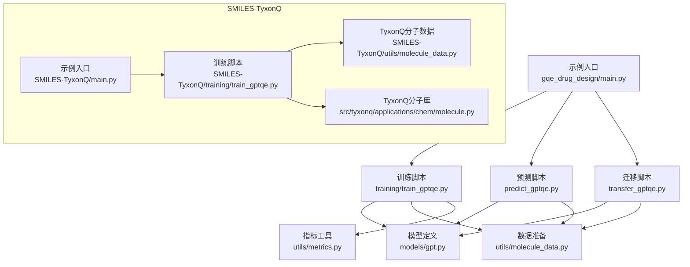
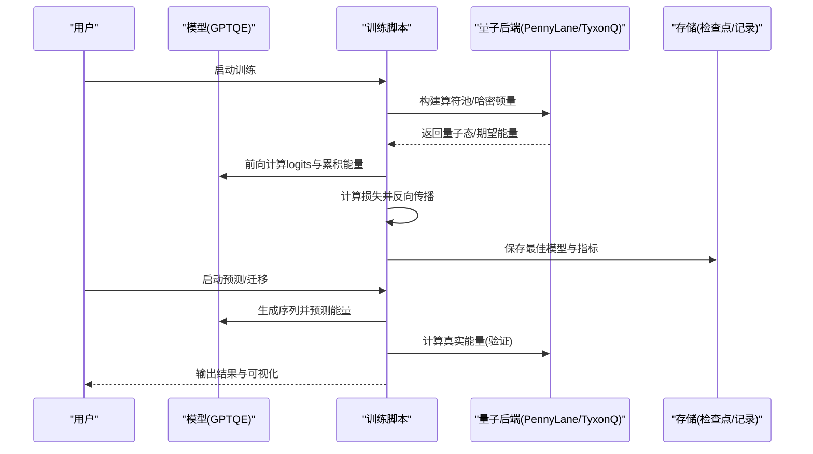
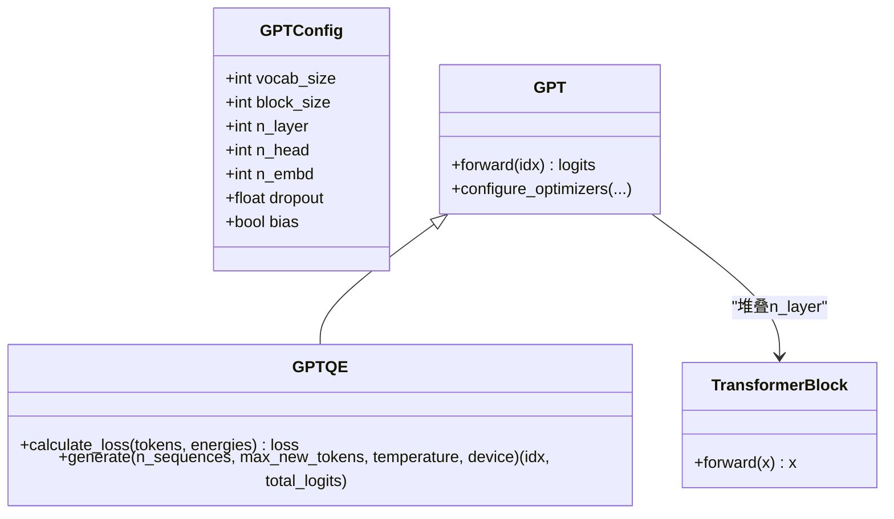
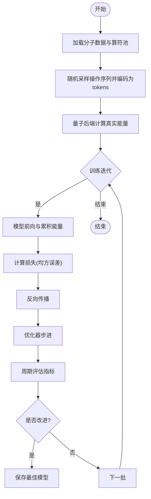
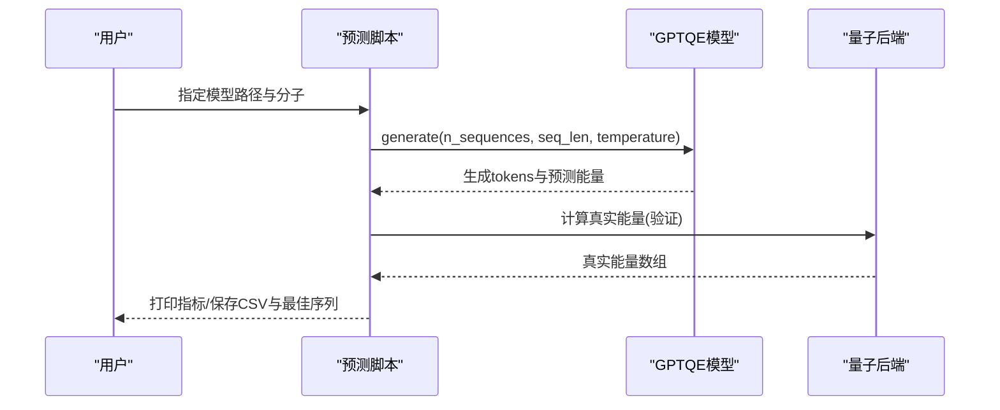
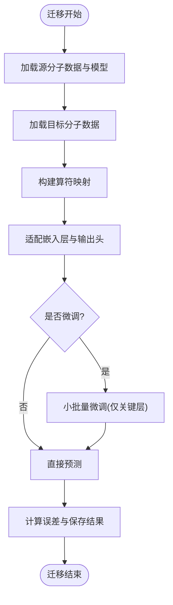
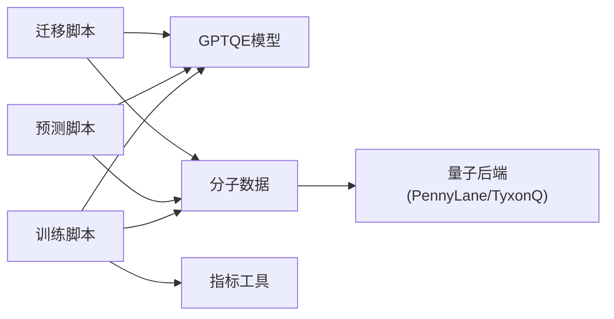

# 药物设计示例

<cite>
**本文引用的文件**
- [README.md](file://examples/gqe_drug_design/README.md)
- [main.py](file://examples/gqe_drug_design/main.py)
- [gpt.py](file://examples/gqe_drug_design/models/gpt.py)
- [transformer_block.py](file://examples/gqe_drug_design/models/transformer_block.py)
- [train_gptqe.py](file://examples/gqe_drug_design/training/train_gptqe.py)
- [predict_gptqe.py](file://examples/gqe_drug_design/predict_gptqe.py)
- [transfer_gptqe.py](file://examples/gqe_drug_design/transfer_gptqe.py)
- [molecule_data.py](file://examples/gqe_drug_design/utils/molecule_data.py)
- [metrics.py](file://examples/gqe_drug_design/utils/metrics.py)
- [Readme.md](file://examples/SMILES-TyxonQ/Readme.md)
- [main.py](file://examples/SMILES-TyxonQ/main.py)
- [gpt.py](file://examples/SMILES-TyxonQ/models/gpt.py)
- [train_gptqe.py](file://examples/SMILES-TyxonQ/training/train_gptqe.py)
- [molecule_data.py](file://examples/SMILES-TyxonQ/utils/molecule_data.py)
- [molecule.py](file://src/tyxonq/applications/chem/molecule.py)
</cite>

## 目录
1. [简介](#简介)
2. [项目结构](#项目结构)
3. [核心组件](#核心组件)
4. [架构总览](#架构总览)
5. [详细组件分析](#详细组件分析)
6. [依赖关系分析](#依赖关系分析)
7. [性能考量](#性能考量)
8. [故障排查指南](#故障排查指南)
9. [结论](#结论)
10. [附录](#附录)

## 简介
本示例展示基于量子计算的AI药物设计工作流，围绕“生成式量子本征求解器（GQE）+ Transformer”的范式，完成从分子数据构建、模型训练、能量预测到虚拟筛选与迁移学习的完整流程。该工作流将分子算符序列视为“文本”，通过Transformer学习其分布并预测累积能量；同时结合量子化学后端（PennyLane或TyxonQ）计算真实能量作为监督信号，实现端到端的量子增强生成模型训练与推理。

主要能力包括：
- GPT-QE模型训练：以UCC单双激发算符池为词表，训练Transformer预测操作序列的累积能量。
- 分子生成与性质预测：自回归生成算符序列，并输出预测能量，用于快速筛选低能构型。
- 虚拟筛选：在目标分子上批量生成候选序列，评估能量并挑选最优解。
- 迁移学习：在不同分子间进行算符映射与权重适配，支持零样本/微调两种模式。

## 项目结构
仓库提供两套可运行的示例：
- gqe_drug_design：基于PennyLane的数据与电路仿真，适合快速验证。
- SMILES-TyxonQ：基于TyxonQ的分子与电路库重写版本，便于与TyxonQ生态集成。

图表来源
- [main.py:1-8](file://examples/gqe_drug_design/main.py#L1-L8)
- [train_gptqe.py:32-238](file://examples/gqe_drug_design/training/train_gptqe.py#L32-L238)
- [predict_gptqe.py:70-166](file://examples/gqe_drug_design/predict_gptqe.py#L70-L166)
- [transfer_gptqe.py:128-291](file://examples/gqe_drug_design/transfer_gptqe.py#L128-L291)
- [gpt.py:16-92](file://examples/gqe_drug_design/models/gpt.py#L16-L92)
- [molecule_data.py:18-43](file://examples/gqe_drug_design/utils/molecule_data.py#L18-L43)
- [molecule.py:109-188](file://src/tyxonq/applications/chem/molecule.py#L109-L188)

章节来源
- [README.md:1-21](file://examples/gqe_drug_design/README.md#L1-L21)
- [Readme.md:8-49](file://examples/SMILES-TyxonQ/Readme.md#L8-L49)

## 核心组件
- 模型与训练
  - GPT/GPTQE：基于Transformer的自回归模型，扩展了损失函数以直接拟合累积能量，并提供温度采样生成序列。
  - TransformerBlock：多头注意力+前馈网络的标准块，配合LayerNorm与残差连接。
  - 训练循环：使用AdamW优化器，按批次更新参数，定期评估MAE/RMSE/MAPE/解释方差等指标，保存最佳模型。
- 数据与量子后端
  - PennyLane版：加载qchem数据集，构造UCC算符池，用量子节点计算期望能量。
  - TyxonQ版：通过TyxonQ分子库与UCC电路构建器生成稀疏哈密顿量与状态向量，计算能量。
- 预测与迁移
  - 预测：加载预训练模型，生成序列并对比真实能量，输出统计与CSV结果。
  - 迁移：构建源/目标分子算符映射，适配嵌入层与输出头，可选微调关键层后预测。

章节来源
- [gpt.py:16-92](file://examples/gqe_drug_design/models/gpt.py#L16-L92)
- [transformer_block.py:3-26](file://examples/gqe_drug_design/models/transformer_block.py#L3-L26)
- [train_gptqe.py:32-238](file://examples/gqe_drug_design/training/train_gptqe.py#L32-L238)
- [molecule_data.py:18-43](file://examples/gqe_drug_design/utils/molecule_data.py#L18-L43)
- [molecule_data.py:55-104](file://examples/SMILES-TyxonQ/utils/molecule_data.py#L55-L104)
- [molecule.py:109-188](file://src/tyxonq/applications/chem/molecule.py#L109-L188)

## 架构总览
下图展示了从数据准备到训练、预测与迁移的整体流程，以及量子后端在其中的作用。

图表来源
- [train_gptqe.py:32-238](file://examples/gqe_drug_design/training/train_gptqe.py#L32-L238)
- [predict_gptqe.py:70-166](file://examples/gqe_drug_design/predict_gptqe.py#L70-L166)
- [transfer_gptqe.py:128-291](file://examples/gqe_drug_design/transfer_gptqe.py#L128-L291)
- [molecule_data.py:18-43](file://examples/gqe_drug_design/utils/molecule_data.py#L18-L43)
- [molecule_data.py:55-104](file://examples/SMILES-TyxonQ/utils/molecule_data.py#L55-L104)

## 详细组件分析

### GPT/QE模型与Transformer块
- GPT配置与初始化：词表大小、块长度、层数、头数、嵌入维度、Dropout等。
- 前向过程：词嵌入+位置编码→多层Transformer块→归一化→线性头输出logits。
- 损失函数：对下一token掩码后的logits求和得到累积能量，与标签能量的均方误差。
- 生成过程：自回归采样，温度控制多样性，累计logits作为预测能量。
- TransformerBlock：LayerNorm→多头注意力→残差→LayerNorm→前馈网络→残差。

图表来源
- [gpt.py:6-92](file://examples/gqe_drug_design/models/gpt.py#L6-L92)
- [transformer_block.py:3-26](file://examples/gqe_drug_design/models/transformer_block.py#L3-L26)

章节来源
- [gpt.py:16-92](file://examples/gqe_drug_design/models/gpt.py#L16-L92)
- [transformer_block.py:3-26](file://examples/gqe_drug_design/models/transformer_block.py#L3-L26)

### 训练流程与量子能量计算
- 数据准备：根据分子名称加载数据集或TyxonQ分子对象，构造UCC单双激发算符池与时间参数网格。
- 量子能量：对每个操作序列执行量子线路，计算哈密顿量的期望值作为真实能量。
- 训练循环：分批次计算损失、反向传播、优化器步进；周期性评估指标并保存最佳模型。
- 监控与记录：使用实验跟踪工具记录损失、指标与样本预测。

图表来源
- [train_gptqe.py:32-238](file://examples/gqe_drug_design/training/train_gptqe.py#L32-L238)
- [molecule_data.py:18-43](file://examples/gqe_drug_design/utils/molecule_data.py#L18-L43)
- [molecule_data.py:55-104](file://examples/SMILES-TyxonQ/utils/molecule_data.py#L55-L104)

章节来源
- [train_gptqe.py:32-238](file://examples/gqe_drug_design/training/train_gptqe.py#L32-L238)
- [metrics.py:1-16](file://examples/gqe_drug_design/utils/metrics.py#L1-L16)

### 预测与虚拟筛选
- 加载预训练模型与对应分子数据，设置词表大小与超参。
- 生成N条序列，得到预测能量；同时用量子后端计算真实能量用于对比。
- 输出MAE/RMSE，保存预测结果CSV与最佳序列详情。

图表来源
- [predict_gptqe.py:70-166](file://examples/gqe_drug_design/predict_gptqe.py#L70-L166)
- [molecule_data.py:18-43](file://examples/gqe_drug_design/utils/molecule_data.py#L18-L43)

章节来源
- [predict_gptqe.py:70-166](file://examples/gqe_drug_design/predict_gptqe.py#L70-L166)

### 迁移学习与算符映射
- 算符映射：基于字符串相似度等方法建立源/目标分子算符索引映射。
- 权重适配：调整嵌入层与输出头的维度，保留已学知识。
- 可选微调：冻结大部分参数，仅训练嵌入与头部，用小规模目标数据微调。
- 预测与评估：在目标分子上生成序列并计算误差，保存结果与可选微调模型。

图表来源
- [transfer_gptqe.py:26-127](file://examples/gqe_drug_design/transfer_gptqe.py#L26-L127)
- [transfer_gptqe.py:128-291](file://examples/gqe_drug_design/transfer_gptqe.py#L128-L291)

章节来源
- [transfer_gptqe.py:26-127](file://examples/gqe_drug_design/transfer_gptqe.py#L26-L127)
- [transfer_gptqe.py:128-291](file://examples/gqe_drug_design/transfer_gptqe.py#L128-L291)

### SMILES-TyxonQ重写要点
- 分子数据：使用TyxonQ分子库与UCCSD构建稀疏哈密顿量，替代PennyLane数据集。
- 电路仿真：通过TyxonQ的UCC电路构建器生成状态向量并计算能量。
- 兼容性：保持训练/预测接口一致，确保收敛曲线等价。

章节来源
- [Readme.md:8-49](file://examples/SMILES-TyxonQ/Readme.md#L8-L49)
- [train_gptqe.py:15-43](file://examples/SMILES-TyxonQ/training/train_gptqe.py#L15-L43)
- [molecule_data.py:55-104](file://examples/SMILES-TyxonQ/utils/molecule_data.py#L55-L104)
- [molecule.py:109-188](file://src/tyxonq/applications/chem/molecule.py#L109-L188)

## 依赖关系分析
- 模块耦合
  - 训练脚本依赖模型定义、数据准备与指标工具。
  - 预测与迁移脚本复用同一模型与数据接口，降低重复实现。
  - 量子后端抽象使PennyLane与TyxonQ可互换，提升可移植性。
- 外部依赖
  - PyTorch用于深度学习框架。
  - PennyLane或TyxonQ用于量子计算与电路仿真。
  - NumPy/Pandas用于数据处理与日志记录。
  - 实验跟踪工具用于训练监控。

图表来源
- [train_gptqe.py:32-238](file://examples/gqe_drug_design/training/train_gptqe.py#L32-L238)
- [predict_gptqe.py:70-166](file://examples/gqe_drug_design/predict_gptqe.py#L70-L166)
- [transfer_gptqe.py:128-291](file://examples/gqe_drug_design/transfer_gptqe.py#L128-L291)
- [molecule_data.py:18-43](file://examples/gqe_drug_design/utils/molecule_data.py#L18-L43)

章节来源
- [train_gptqe.py:32-238](file://examples/gqe_drug_design/training/train_gptqe.py#L32-L238)
- [predict_gptqe.py:70-166](file://examples/gqe_drug_design/predict_gptqe.py#L70-L166)
- [transfer_gptqe.py:128-291](file://examples/gqe_drug_design/transfer_gptqe.py#L128-L291)

## 性能考量
- 训练效率
  - 批次切分与GPU加速：训练脚本将数据分批处理，利用CUDA设备加速。
  - 评估频率：每固定步数进行评估与保存，平衡精度与开销。
- 量子计算成本
  - 算符池规模与序列长度直接影响量子电路复杂度；合理选择时间参数网格与池大小可降低开销。
  - 使用TyxonQ的UCC电路构建器可获得高效的状态向量计算。
- 生成质量与多样性
  - 温度参数控制采样多样性；较低温度更稳定，较高温度更具探索性。
- 迁移学习
  - 算符映射质量影响迁移效果；必要时引入轨道相似性或门参数相似度策略。
  - 微调阶段仅训练关键层可减少过拟合风险并提高泛化能力。

[本节为通用指导，不直接分析具体文件]

## 故障排查指南
- 设备与环境
  - CUDA可见设备设置：确保环境变量正确配置，避免多卡冲突。
  - 内存不足：减小batch size或序列长度，或切换至CPU调试。
- 数据与后端
  - 分子名称不存在：确认支持的分子列表，避免未知名称导致异常。
  - 量子后端错误：检查PennyLane/TyxonQ安装与版本兼容性。
- 训练问题
  - 损失不下降：检查学习率、权重衰减与Dropout设置；确认数据与标签对齐。
  - 指标异常：核对能量计算与累积logits的维度与顺序。
- 迁移学习
  - 映射失败：若相似度匹配不佳，可引入更精细的轨道/参数相似度策略。
  - 微调不收敛：降低学习率或减少微调轮数，确保仅训练必要参数。

章节来源
- [main.py:1-8](file://examples/gqe_drug_design/main.py#L1-L8)
- [molecule_data.py:18-43](file://examples/gqe_drug_design/utils/molecule_data.py#L18-L43)
- [molecule_data.py:55-104](file://examples/SMILES-TyxonQ/utils/molecule_data.py#L55-L104)
- [train_gptqe.py:32-238](file://examples/gqe_drug_design/training/train_gptqe.py#L32-L238)

## 结论
本示例展示了从分子数据构建、量子能量标注到Transformer驱动的生成式量子本征求解器的完整闭环。通过算符序列的“文本化”表示与累积能量损失，模型能够学习量子化学中的复杂关联，并在不同分子间进行知识迁移。结合TyxonQ的高效量子计算能力，该工作流显著提升了新药发现中候选化合物筛选的效率与成功率，为量子增强的AI药物设计提供了实用范式。

[本节为总结性内容，不直接分析具体文件]

## 附录
- 快速上手
  - 训练：运行主入口脚本，修改分子名称与超参，观察训练曲线与指标。
  - 预测：加载最佳检查点，指定分子与生成参数，获取预测结果与最佳序列。
  - 迁移：选择源/目标分子，决定是否微调，评估迁移效果。
- 扩展建议
  - 引入更多分子描述符与性质预测任务（如带隙、偶极矩）。
  - 结合主动学习策略，迭代优化模型与数据选择。
  - 探索更复杂的算符映射与元学习以提升跨分子泛化能力。

[本节为补充信息，不直接分析具体文件]