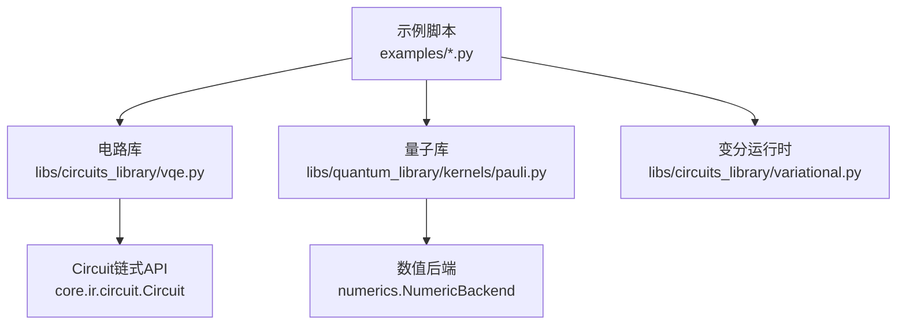
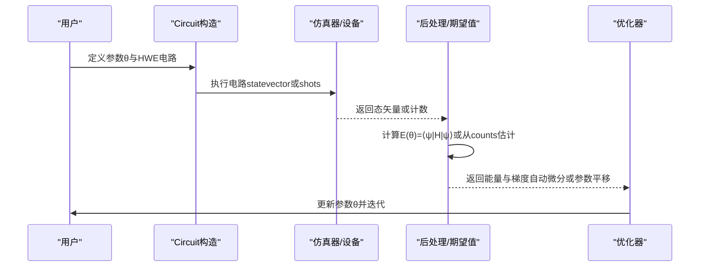
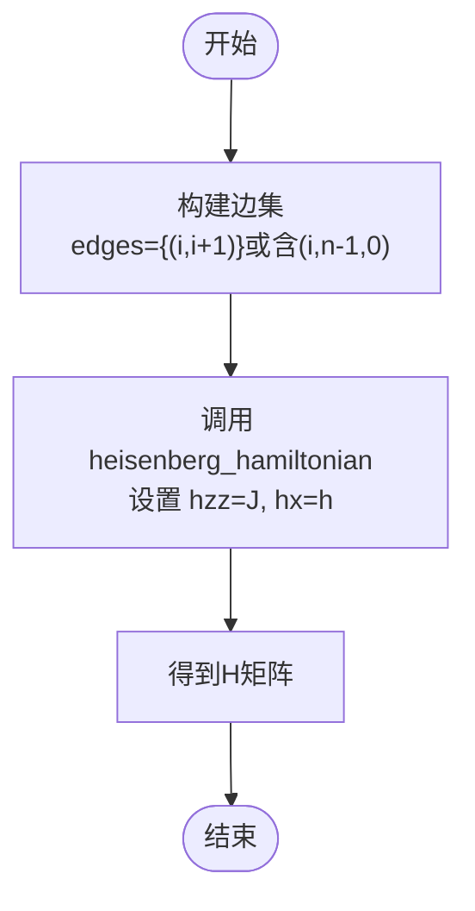
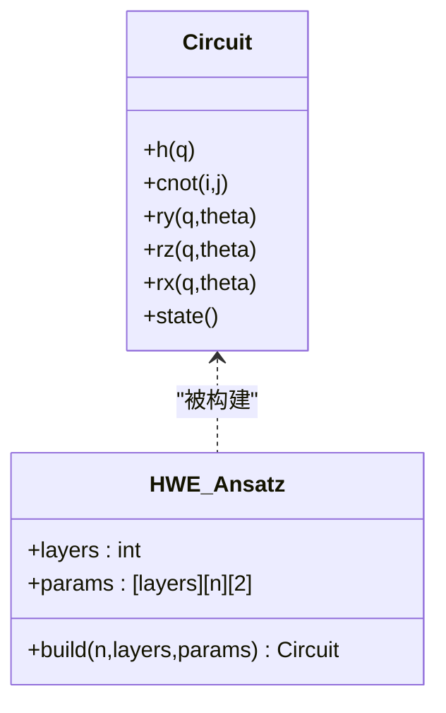
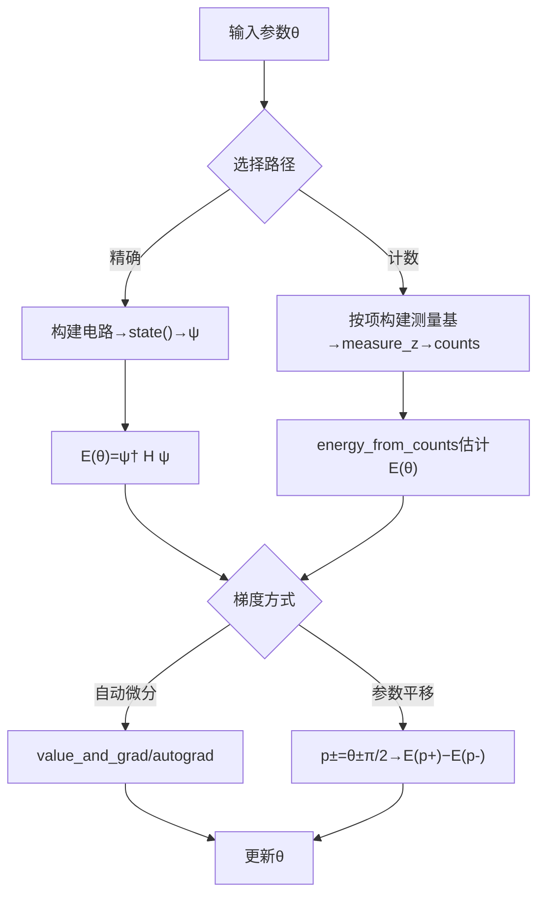
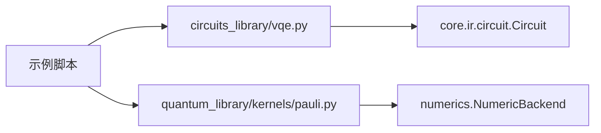

# VQE基础概念

<cite>
**本文引用的文件**
- [examples/vqe_simple_hamiltonian.py](file://examples/vqe_simple_hamiltonian.py)
- [examples/vqetfim_benchmark.py](file://examples/vqetfim_benchmark.py)
- [examples/vqe_extra.py](file://examples/vqe_extra.py)
- [src/tyxonq/libs/circuits_library/vqe.py](file://src/tyxonq/libs/circuits_library/vqe.py)
- [src/tyxonq/libs/quantum_library/kernels/pauli.py](file://src/tyxonq/libs/quantum_library/kernels/pauli.py)
- [src/tyxonq/libs/circuits_library/variational.py](file://src/tyxonq/libs/circuits_library/variational.py)
</cite>

## 目录
1. [简介](#简介)
2. [项目结构](#项目结构)
3. [核心组件](#核心组件)
4. [架构总览](#架构总览)
5. [详细组件分析](#详细组件分析)
6. [依赖关系分析](#依赖关系分析)
7. [性能考量](#性能考量)
8. [故障排查指南](#故障排查指南)
9. [结论](#结论)
10. [附录：从零实现VQE的完整流程](#附录从零实现vqe的完整流程)

## 简介
本文件面向TyxonQ中的变分量子本征求解器（VQE），系统阐述其基础概念与工程实践，重点包括：
- 变分原理与能量期望值计算
- 横向场伊辛模型（TFIM）的物理背景与哈密顿量构建
- 硬件高效的变分电路设计原则（初始叠加态、纠缠层、旋转层）
- 在TyxonQ中从零开始实现一个基本VQE程序的完整流程（配置参数、哈密顿量构建、电路设计、优化循环）

## 项目结构
围绕VQE，仓库提供了从“示例脚本”到“库函数”的多层实现：
- 示例脚本：展示端到端VQE流程、不同评估路径（计数统计 vs 精确态矢量）、以及参数平移梯度等
- 电路库：提供硬件高效变分电路（HWE）操作序列、基于计数的能量估计、参数平移梯度
- 量子库：提供Pauli算符与海森堡型哈密顿量构建工具（支持TFIM）
- 变分运行时：提供变分动力学（VQD/p-VQD）的参考实现，便于理解变分思想在不同任务中的统一性

**图示来源**
- [examples/vqe_simple_hamiltonian.py:1-273](file://examples/vqe_simple_hamiltonian.py#L1-L273)
- [src/tyxonq/libs/circuits_library/vqe.py:1-153](file://src/tyxonq/libs/circuits_library/vqe.py#L1-L153)
- [src/tyxonq/libs/quantum_library/kernels/pauli.py:1-175](file://src/tyxonq/libs/quantum_library/kernels/pauli.py#L1-L175)
- [src/tyxonq/libs/circuits_library/variational.py:1-254](file://src/tyxonq/libs/circuits_library/variational.py#L1-L254)

**章节来源**
- [examples/vqe_simple_hamiltonian.py:1-273](file://examples/vqe_simple_hamiltonian.py#L1-L273)
- [examples/vqetfim_benchmark.py:1-124](file://examples/vqetfim_benchmark.py#L1-L124)
- [examples/vqe_extra.py:1-196](file://examples/vqe_extra.py#L1-L196)
- [src/tyxonq/libs/circuits_library/vqe.py:1-153](file://src/tyxonq/libs/circuits_library/vqe.py#L1-L153)
- [src/tyxonq/libs/quantum_library/kernels/pauli.py:1-175](file://src/tyxonq/libs/quantum_library/kernels/pauli.py#L1-L175)
- [src/tyxonq/libs/circuits_library/variational.py:1-254](file://src/tyxonq/libs/circuits_library/variational.py#L1-L254)

## 核心组件
- 变分原理与能量期望值
  - 目标：最小化能量期望值 E(θ) = ⟨ψ(θ)|H|ψ(θ)⟩，通过经典优化器更新参数 θ
  - 在TyxonQ中，既可通过状态向量直接计算期望值，也可通过测量计数与基变换后统计估计
- 硬件高效变分电路（HWE）
  - 典型结构：初始叠加态 → 重复若干层“纠缠层 + 旋转层”
  - 纠缠层常用CNOT链或RXX等双量子比特门；旋转层在各量子比特上施加单量子比特旋转（如RX、RZ）
- TFIM哈密顿量
  - H = -J Σ Z_i Z_{i+1} - h Σ X_i
  - 使用heisenberg_hamiltonian接口，设置hzz=J、hx=h，其余为0即可
- 梯度与优化
  - 自动微分（数值后端+PyTorch/JAX等）或参数平移法（适用于真实设备/有限采样）
  - 优化器可使用简单梯度下降、Adam或更高级方法

**章节来源**
- [examples/vqe_simple_hamiltonian.py:53-153](file://examples/vqe_simple_hamiltonian.py#L53-L153)
- [src/tyxonq/libs/circuits_library/vqe.py:23-153](file://src/tyxonq/libs/circuits_library/vqe.py#L23-L153)
- [src/tyxonq/libs/quantum_library/kernels/pauli.py:121-172](file://src/tyxonq/libs/quantum_library/kernels/pauli.py#L121-L172)

## 架构总览
下图展示了TyxonQ中VQE的典型数据流与控制流：从哈密顿量构建、变分电路生成、期望值计算到参数更新。

**图示来源**
- [examples/vqe_simple_hamiltonian.py:130-224](file://examples/vqe_simple_hamiltonian.py#L130-L224)
- [examples/vqe_extra.py:22-66](file://examples/vqe_extra.py#L22-L66)
- [src/tyxonq/libs/circuits_library/vqe.py:44-153](file://src/tyxonq/libs/circuits_library/vqe.py#L44-L153)

## 详细组件分析

### 横向场伊辛模型（TFIM）与哈密顿量构建
- 物理背景
  - 一维自旋链，最近邻相互作用项 -J Σ Z_i Z_{i+1} 驱动铁磁序
  - 横向场项 -h Σ X_i 驱动顺磁相
  - 当h≈J时出现量子临界点，是检验VQE算法的经典基准
- 构建方法
  - 使用heisenberg_hamiltonian(num_qubits, edges, hzz=J, hx=h, ...)
  - 对于周期性边界条件，edges包含首尾相连的对

**图示来源**
- [src/tyxonq/libs/quantum_library/kernels/pauli.py:121-172](file://src/tyxonq/libs/quantum_library/kernels/pauli.py#L121-L172)
- [examples/vqe_simple_hamiltonian.py:55-82](file://examples/vqe_simple_hamiltonian.py#L55-L82)

**章节来源**
- [examples/vqe_simple_hamiltonian.py:55-82](file://examples/vqe_simple_hamiltonian.py#L55-L82)
- [src/tyxonq/libs/quantum_library/kernels/pauli.py:121-172](file://src/tyxonq/libs/quantum_library/kernels/pauli.py#L121-L172)

### 硬件高效变分电路（HWE）设计
- 设计原则
  - 初始叠加态：对全零态施加Hadamard，获得均匀叠加，利于探索希尔伯特空间
  - 纠缠层：CNOT链或RXX等双量子比特门，引入多体关联
  - 旋转层：在每个量子比特上施加RX/RZ等单量子比特旋转，提供可训练自由度
- TyxonQ中的两种常见实现
  - 直接Circuit API：逐门添加CX、RY、RZ等
  - 电路库抽象：build_hwe_ansatz_ops生成ops列表，便于统一处理与编译

**图示来源**
- [examples/vqe_simple_hamiltonian.py:87-125](file://examples/vqe_simple_hamiltonian.py#L87-L125)
- [src/tyxonq/libs/circuits_library/vqe.py:23-41](file://src/tyxonq/libs/circuits_library/vqe.py#L23-L41)

**章节来源**
- [examples/vqe_simple_hamiltonian.py:87-125](file://examples/vqe_simple_hamiltonian.py#L87-L125)
- [src/tyxonq/libs/circuits_library/vqe.py:23-41](file://src/tyxonq/libs/circuits_library/vqe.py#L23-L41)

### 能量期望值计算与梯度
- 期望值计算
  - 精确路径：获取态矢量ψ，计算 ψ† H ψ
  - 计数路径：在X基下加H门后进行Z测量，统计counts并估计⟨X⟩；Z项直接在Z基测量
- 梯度计算
  - 自动微分：使用数值后端（如PyTorch）的value_and_grad或autograd
  - 参数平移：对每个可微参数±π/2偏移，分别计算能量后差分

**图示来源**
- [examples/vqe_simple_hamiltonian.py:130-224](file://examples/vqe_simple_hamiltonian.py#L130-L224)
- [examples/vqe_extra.py:22-66](file://examples/vqe_extra.py#L22-L66)
- [src/tyxonq/libs/circuits_library/vqe.py:44-153](file://src/tyxonq/libs/circuits_library/vqe.py#L44-L153)

**章节来源**
- [examples/vqe_simple_hamiltonian.py:130-224](file://examples/vqe_simple_hamiltonian.py#L130-L224)
- [examples/vqe_extra.py:22-66](file://examples/vqe_extra.py#L22-L66)
- [src/tyxonq/libs/circuits_library/vqe.py:44-153](file://src/tyxonq/libs/circuits_library/vqe.py#L44-L153)

### 变分运行时（VQD/p-VQD）参考
- 虽然本节聚焦VQE，但仓库中的VariationalRuntime展示了变分思想的通用框架：以变分态族逼近真实演化或基态，通过求解线性方程或最小化损失来更新参数
- 该实现有助于理解变分方法在不同任务（动力学、基态搜索）中的共性

**章节来源**
- [src/tyxonq/libs/circuits_library/variational.py:153-254](file://src/tyxonq/libs/circuits_library/variational.py#L153-L254)

## 依赖关系分析
- 示例脚本依赖电路库与量子库提供的工具函数
- 电路库依赖Circuit IR与设备执行链，解耦于具体数值后端
- 量子库提供与后端无关的Pauli/Hamiltonian构建，内部通过NumericBackend适配不同后端

**图示来源**
- [examples/vqe_simple_hamiltonian.py:1-273](file://examples/vqe_simple_hamiltonian.py#L1-L273)
- [src/tyxonq/libs/circuits_library/vqe.py:1-153](file://src/tyxonq/libs/circuits_library/vqe.py#L1-L153)
- [src/tyxonq/libs/quantum_library/kernels/pauli.py:1-175](file://src/tyxonq/libs/quantum_library/kernels/pauli.py#L1-L175)

**章节来源**
- [examples/vqe_simple_hamiltonian.py:1-273](file://examples/vqe_simple_hamiltonian.py#L1-L273)
- [src/tyxonq/libs/circuits_library/vqe.py:1-153](file://src/tyxonq/libs/circuits_library/vqe.py#L1-L153)
- [src/tyxonq/libs/quantum_library/kernels/pauli.py:1-175](file://src/tyxonq/libs/quantum_library/kernels/pauli.py#L1-L175)

## 性能考量
- 精确路径（态矢量）通常更快且无统计噪声，适合小规模系统与快速原型验证
- 计数路径更接近真实设备行为，受限于shots数带来的统计误差与额外开销
- 参数平移法每步需多次电路执行，成本较高；自动微分在仿真环境下更高效
- 建议：先用精确路径调试，再切换到计数路径进行噪声与shots影响评估

[本节为一般性指导，不直接分析具体文件]

## 故障排查指南
- 能量不收敛或震荡
  - 检查学习率是否过大；尝试减小学习率或使用更稳健的优化器
  - 确认电路表达能力足够（增加层数或调整纠缠结构）
- 计数路径结果波动大
  - 增大shots数以降低统计噪声
  - 确保测量基变换正确（X项前加H门）
- 梯度为零或无效
  - 若使用参数平移，确认仅对可微参数（如RX/RZ）应用移位规则
  - 若使用自动微分，确认后端已启用梯度追踪

**章节来源**
- [examples/vqe_extra.py:51-66](file://examples/vqe_extra.py#L51-L66)
- [src/tyxonq/libs/circuits_library/vqe.py:68-130](file://src/tyxonq/libs/circuits_library/vqe.py#L68-L130)

## 结论
TyxonQ为VQE提供了清晰的分层实现：从示例脚本的端到端演示，到电路库的硬件高效变分电路与能量估计，再到量子库的哈密顿量构建工具。借助这些组件，用户可以快速搭建并调试VQE程序，并在仿真与近似真实设备的计数路径之间灵活切换。结合自动微分与参数平移两种梯度策略，能够覆盖从研究原型到设备部署的多种场景。

[本节为总结性内容，不直接分析具体文件]

## 附录：从零实现VQE的完整流程
以下流程整合了TyxonQ中的关键步骤，涵盖配置、哈密顿量构建、电路设计、期望值计算与优化循环。为避免泄露具体代码，此处以“步骤+引用路径”的形式给出。

- 步骤1：配置参数
  - 设置量子比特数N_QUBITS、层数N_LAYERS、学习率LEARNING_RATE、迭代次数N_EPOCHS、TFIM参数J与h
  - 参考路径：[examples/vqe_simple_hamiltonian.py:41-50](file://examples/vqe_simple_hamiltonian.py#L41-L50)

- 步骤2：构建TFIM哈密顿量
  - 使用heisenberg_hamiltonian，设置hzz=J、hx=h，其他耦合与场为0
  - 参考路径：[examples/vqe_simple_hamiltonian.py:55-82](file://examples/vqe_simple_hamiltonian.py#L55-L82)
  - 底层实现：[src/tyxonq/libs/quantum_library/kernels/pauli.py:121-172](file://src/tyxonq/libs/quantum_library/kernels/pauli.py#L121-L172)

- 步骤3：设计硬件高效变分电路
  - 初始叠加态：对所有量子比特施加Hadamard
  - 纠缠层：CNOT链（可加周期性边界）
  - 旋转层：在每个量子比特上施加RY与RZ
  - 参考路径：[examples/vqe_simple_hamiltonian.py:87-125](file://examples/vqe_simple_hamiltonian.py#L87-L125)
  - 电路库抽象（ops列表）：[src/tyxonq/libs/circuits_library/vqe.py:23-41](file://src/tyxonq/libs/circuits_library/vqe.py#L23-L41)

- 步骤4：计算能量期望值
  - 精确路径：获取态矢量ψ，计算ψ† H ψ
  - 计数路径：对X项加H门后进行Z测量，统计counts并用energy_from_counts估计
  - 参考路径：
    - 精确路径：[examples/vqe_simple_hamiltonian.py:130-153](file://examples/vqe_simple_hamiltonian.py#L130-L153)
    - 计数路径：[examples/vqe_extra.py:22-48](file://examples/vqe_extra.py#L22-L48)
    - 计数能量估计：[src/tyxonq/libs/circuits_library/vqe.py:44-66](file://src/tyxonq/libs/circuits_library/vqe.py#L44-L66)

- 步骤5：梯度计算与优化循环
  - 自动微分：使用数值后端的value_and_grad或PyTorch autograd
  - 参数平移：对RX/RZ参数±π/2偏移，计算能量差作为梯度
  - 参考路径：
    - 自动微分：[examples/vqe_simple_hamiltonian.py:181-224](file://examples/vqe_simple_hamiltonian.py#L181-L224)
    - 参数平移：[examples/vqe_extra.py:51-66](file://examples/vqe_extra.py#L51-L66)
    - 参数布局与移位规则：[src/tyxonq/libs/circuits_library/vqe.py:68-82](file://src/tyxonq/libs/circuits_library/vqe.py#L68-L82)

- 步骤6：运行与评估
  - 记录每次迭代的能量与误差，对比精确对角化的基态能量
  - 参考路径：[examples/vqe_simple_hamiltonian.py:172-232](file://examples/vqe_simple_hamiltonian.py#L172-L232)

- 可选：比较不同评估路径的性能
  - 计数路径 vs 精确路径的时间与精度对比
  - 参考路径：[examples/vqetfim_benchmark.py:1-124](file://examples/vqetfim_benchmark.py#L1-L124)

**章节来源**
- [examples/vqe_simple_hamiltonian.py:41-232](file://examples/vqe_simple_hamiltonian.py#L41-L232)
- [examples/vqe_extra.py:22-66](file://examples/vqe_extra.py#L22-L66)
- [examples/vqetfim_benchmark.py:1-124](file://examples/vqetfim_benchmark.py#L1-L124)
- [src/tyxonq/libs/circuits_library/vqe.py:23-153](file://src/tyxonq/libs/circuits_library/vqe.py#L23-L153)
- [src/tyxonq/libs/quantum_library/kernels/pauli.py:121-172](file://src/tyxonq/libs/quantum_library/kernels/pauli.py#L121-L172)