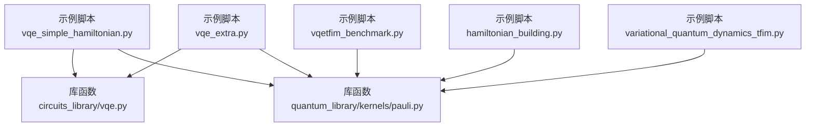
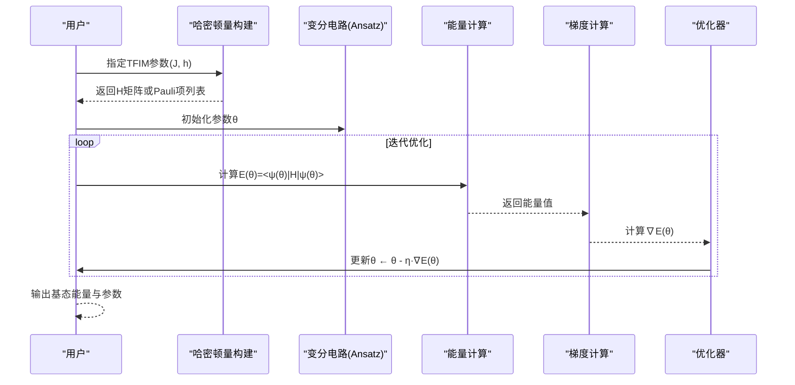
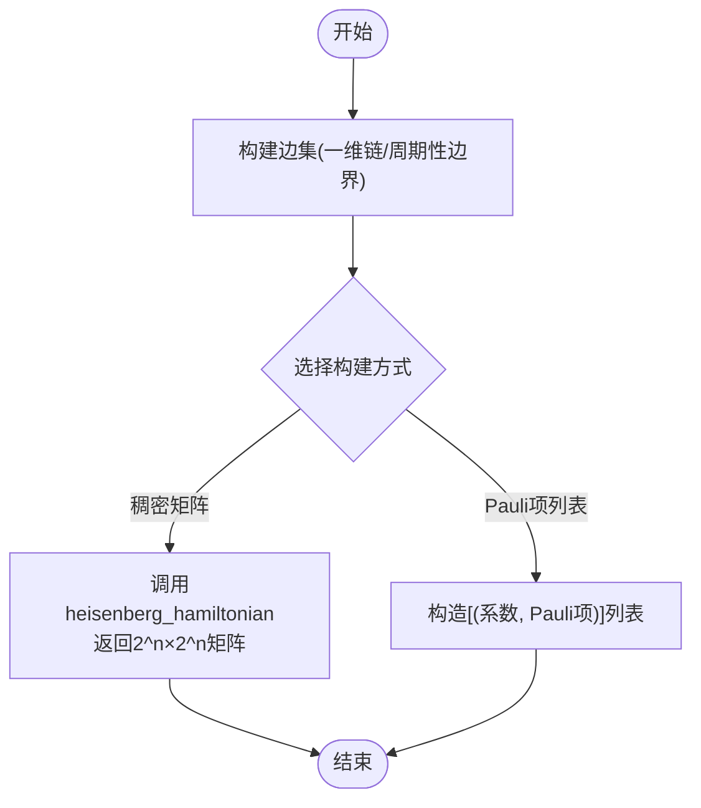
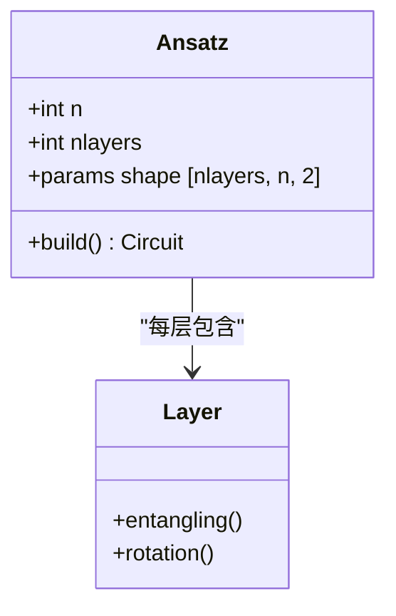
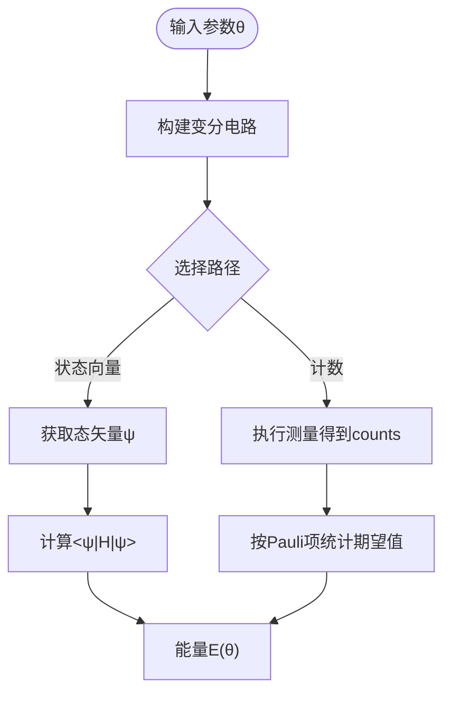
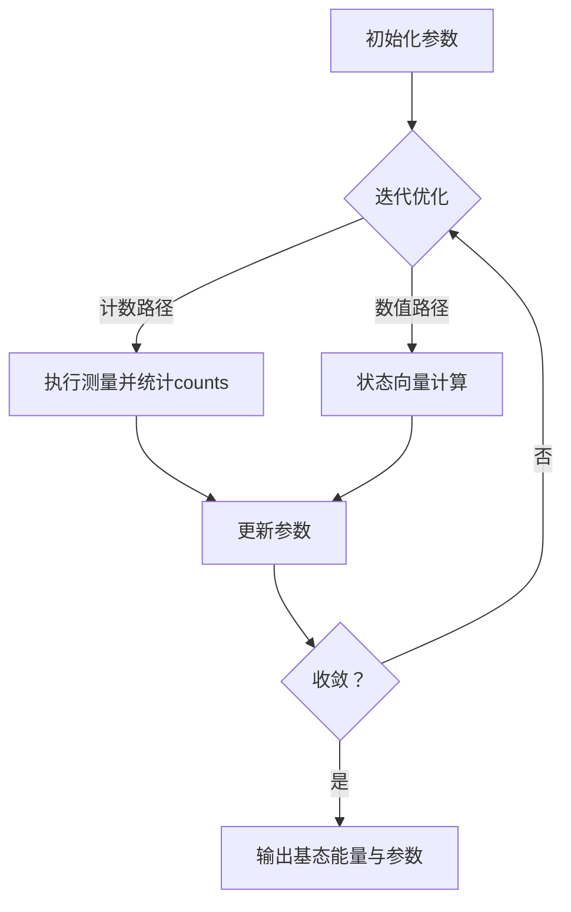
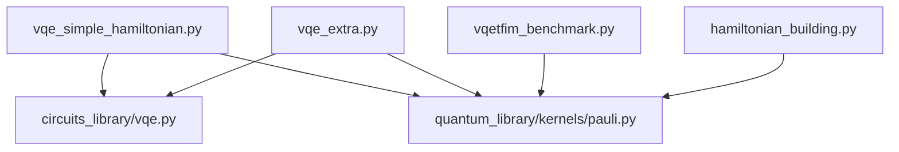

# VQE算法示例

<cite>
**本文引用的文件**
- [examples/vqe_simple_hamiltonian.py](file://examples/vqe_simple_hamiltonian.py)
- [examples/vqetfim_benchmark.py](file://examples/vqetfim_benchmark.py)
- [examples/vqe_extra.py](file://examples/vqe_extra.py)
- [src/tyxonq/libs/circuits_library/vqe.py](file://src/tyxonq/libs/circuits_library/vqe.py)
- [src/tyxonq/libs/quantum_library/kernels/pauli.py](file://src/tyxonq/libs/quantum_library/kernels/pauli.py)
- [examples/hamiltonian_building.py](file://examples/hamiltonian_building.py)
- [examples/variational_quantum_dynamics_tfim.py](file://examples/variational_quantum_dynamics_tfim.py)
</cite>

## 目录
1. [简介](#简介)
2. [项目结构](#项目结构)
3. [核心组件](#核心组件)
4. [架构总览](#架构总览)
5. [详细组件分析](#详细组件分析)
6. [依赖关系分析](#依赖关系分析)
7. [性能考量](#性能考量)
8. [故障排查指南](#故障排查指南)
9. [结论](#结论)
10. [附录](#附录)

## 简介
本示例文档围绕TyxonQ中的变分量子本征求解器（VQE）展开，重点讲解横向场伊辛模型（TFIM）的完整实现。内容涵盖：
- VQE基本原理与能量期望值计算
- 哈密顿量构建方法（Pauli项、Heisenberg/Hamiltonian builder）
- 硬件高效的变分电路设计（HWE ansatz、RXX/RZ等）
- 使用PyTorch自动微分进行参数优化
- 梯度下降优化策略与收敛性分析
- 结果分析方法与误差评估

本指南既适合初学者快速上手，也可为进阶用户提供深入的技术细节与扩展思路。

## 项目结构
本仓库中与VQE和TFIM相关的代码主要分布在以下位置：
- 示例脚本：examples/vqe_simple_hamiltonian.py、examples/vqetfim_benchmark.py、examples/vqe_extra.py、examples/hamiltonian_building.py、examples/variational_quantum_dynamics_tfim.py
- 库函数：src/tyxonq/libs/circuits_library/vqe.py（通用VQE工具）、src/tyxonq/libs/quantum_library/kernels/pauli.py（Pauli算符与哈密顿量构建）



图表来源
- [examples/vqe_simple_hamiltonian.py:1-273](file://examples/vqe_simple_hamiltonian.py#L1-L273)
- [src/tyxonq/libs/circuits_library/vqe.py:1-153](file://src/tyxonq/libs/circuits_library/vqe.py#L1-L153)
- [src/tyxonq/libs/quantum_library/kernels/pauli.py:121-172](file://src/tyxonq/libs/quantum_library/kernels/pauli.py#L121-L172)

章节来源
- [examples/vqe_simple_hamiltonian.py:1-273](file://examples/vqe_simple_hamiltonian.py#L1-L273)
- [examples/vqetfim_benchmark.py:1-124](file://examples/vqetfim_benchmark.py#L1-L124)
- [examples/vqe_extra.py:1-196](file://examples/vqe_extra.py#L1-L196)
- [src/tyxonq/libs/circuits_library/vqe.py:1-153](file://src/tyxonq/libs/circuits_library/vqe.py#L1-L153)
- [src/tyxonq/libs/quantum_library/kernels/pauli.py:121-172](file://src/tyxonq/libs/quantum_library/kernels/pauli.py#L121-L172)
- [examples/hamiltonian_building.py:1-94](file://examples/hamiltonian_building.py#L1-L94)
- [examples/variational_quantum_dynamics_tfim.py:1-450](file://examples/variational_quantum_dynamics_tfim.py#L1-L450)

## 核心组件
- 哈密顿量构建
  - 通过heisenberg_hamiltonian构建TFIM的稠密矩阵形式，支持ZZ耦合与横向X场。
  - 也可用轻量化的“Pauli项列表”表示哈密顿量，便于基于计数的期望值估计。
- 变分电路（Ansatz）
  - 硬件高效ansatz（HWE）：CNOT链或RXX纠缠层 + 单比特旋转（RX/RZ或RY/RZ）。
  - 针对TFIM的RXX+RZ方案在示例中用于counts路径与数值路径对比。
- 能量期望值计算
  - 状态向量路径：直接计算<ψ|H|ψ>。
  - 计数路径：测量后根据比特串统计各Pauli项期望值并求和。
- 梯度与优化
  - 参数平移法（Parameter Shift）用于计数路径梯度。
  - PyTorch自动微分用于状态向量路径的端到端优化。
  - 简单梯度下降或Adam优化器。

章节来源
- [src/tyxonq/libs/quantum_library/kernels/pauli.py:121-172](file://src/tyxonq/libs/quantum_library/kernels/pauli.py#L121-L172)
- [src/tyxonq/libs/circuits_library/vqe.py:23-41](file://src/tyxonq/libs/circuits_library/vqe.py#L23-L41)
- [examples/vqe_simple_hamiltonian.py:87-125](file://examples/vqe_simple_hamiltonian.py#L87-L125)
- [examples/vqe_extra.py:71-131](file://examples/vqe_extra.py#L71-L131)
- [examples/vqetfim_benchmark.py:21-34](file://examples/vqetfim_benchmark.py#L21-L34)

## 架构总览
下图展示了VQE在TyxonQ中的典型数据流与控制流：从哈密顿量构建、变分电路生成、能量期望值计算到梯度更新与收敛判断。



图表来源
- [examples/vqe_simple_hamiltonian.py:130-232](file://examples/vqe_simple_hamiltonian.py#L130-L232)
- [examples/vqe_extra.py:105-168](file://examples/vqe_extra.py#L105-L168)
- [src/tyxonq/libs/circuits_library/vqe.py:85-130](file://src/tyxonq/libs/circuits_library/vqe.py#L85-L130)

## 详细组件分析

### 组件A：TFIM哈密顿量构建
- 目标：构建H = -J Σ Z_i Z_{i+1} - h Σ X_i的矩阵或Pauli项列表。
- 方法：
  - 稠密矩阵：使用heisenberg_hamiltonian，传入边集与系数hzz、hx等。
  - 轻量项列表：以[(系数, [(算符, 量子位), ...]), ...]形式表达，便于计数路径的能量估计。
- 复杂度：稠密矩阵维度为2^n×2^n，适用于小系统；项列表方式更灵活且易于扩展到更大系统。



图表来源
- [src/tyxonq/libs/quantum_library/kernels/pauli.py:121-172](file://src/tyxonq/libs/quantum_library/kernels/pauli.py#L121-L172)
- [examples/hamiltonian_building.py:18-28](file://examples/hamiltonian_building.py#L18-L28)

章节来源
- [src/tyxonq/libs/quantum_library/kernels/pauli.py:121-172](file://src/tyxonq/libs/quantum_library/kernels/pauli.py#L121-L172)
- [examples/hamiltonian_building.py:18-28](file://examples/hamiltonian_building.py#L18-L28)

### 组件B：硬件高效变分电路（HWE Ansatz）
- 结构：
  - 初始叠加层（如Hadamard）
  - 重复多层：纠缠层（CNOT链或RXX）+ 旋转层（RY/RZ或RX/RZ）
- 目的：在保证可训练性的同时提供足够的表达能力，适配硬件拓扑与噪声特性。
- 示例：
  - RXX+RZ方案用于TFIM的counts路径与数值路径对比。
  - CNOT+RY/RZ方案用于稠密矩阵路径的能量计算。



图表来源
- [examples/vqe_simple_hamiltonian.py:87-125](file://examples/vqe_simple_hamiltonian.py#L87-L125)
- [examples/vqetfim_benchmark.py:21-34](file://examples/vqetfim_benchmark.py#L21-L34)
- [src/tyxonq/libs/circuits_library/vqe.py:23-41](file://src/tyxonq/libs/circuits_library/vqe.py#L23-L41)

章节来源
- [examples/vqe_simple_hamiltonian.py:87-125](file://examples/vqe_simple_hamiltonian.py#L87-L125)
- [examples/vqetfim_benchmark.py:21-34](file://examples/vqetfim_benchmark.py#L21-L34)
- [src/tyxonq/libs/circuits_library/vqe.py:23-41](file://src/tyxonq/libs/circuits_library/vqe.py#L23-L41)

### 组件C：能量期望值计算
- 状态向量路径：
  - 通过state()获取态矢量，然后计算<ψ|H|ψ>。
  - 优点：无采样噪声，速度快；缺点：内存随n指数增长。
- 计数路径：
  - 对每个Pauli项进行基变换（如X→H）后测量Z基，统计期望值并加权求和。
  - 优点：适用于真实设备；缺点：存在采样噪声，需多次shots。



图表来源
- [examples/vqe_simple_hamiltonian.py:130-152](file://examples/vqe_simple_hamiltonian.py#L130-L152)
- [examples/vqe_extra.py:22-48](file://examples/vqe_extra.py#L22-L48)
- [src/tyxonq/libs/circuits_library/vqe.py:44-65](file://src/tyxonq/libs/circuits_library/vqe.py#L44-L65)

章节来源
- [examples/vqe_simple_hamiltonian.py:130-152](file://examples/vqe_simple_hamiltonian.py#L130-L152)
- [examples/vqe_extra.py:22-48](file://examples/vqe_extra.py#L22-L48)
- [src/tyxonq/libs/circuits_library/vqe.py:44-65](file://src/tyxonq/libs/circuits_library/vqe.py#L44-L65)

### 组件D：梯度计算与优化策略
- 参数平移法（Parameter Shift）：
  - 对RX/RZ门施加±π/2的参数偏移，分别计算能量差得到梯度。
  - 适用于计数路径，无需访问内部态矢量。
- PyTorch自动微分：
  - 在状态向量路径中，将量子操作封装为可微分计算图，利用torch.autograd计算梯度。
  - 可使用Adam等优化器进行端到端训练。
- 优化策略：
  - 学习率调度、早停、正则化（方差最小化）等。
  - 对于噪声环境，可采用鲁棒优化或误差缓解技术。

```mermaid
sequenceDiagram
participant P as "参数θ"
participant PS as "参数平移"
participant EV as "能量评估"
participant GR as "梯度聚合"
participant OPT as "优化器"
P->>PS : 生成θ±s
PS->>EV : 计算E(θ+s), E(θ-s)
EV-->>GR : 返回能量值
GR->>OPT : 计算梯度∇E(θ)
OPT->>P : 更新θ ← θ - η·∇E(θ)
```

图表来源
- [src/tyxonq/libs/circuits_library/vqe.py:85-130](file://src/tyxonq/libs/circuits_library/vqe.py#L85-L130)
- [examples/vqe_extra.py:51-66](file://examples/vqe_extra.py#L51-L66)
- [examples/vqe_extra.py:134-168](file://examples/vqe_extra.py#L134-L168)

章节来源
- [src/tyxonq/libs/circuits_library/vqe.py:85-130](file://src/tyxonq/libs/circuits_library/vqe.py#L85-L130)
- [examples/vqe_extra.py:51-66](file://examples/vqe_extra.py#L51-L66)
- [examples/vqe_extra.py:134-168](file://examples/vqe_extra.py#L134-L168)

### 组件E：TFIM基准与收敛性分析
- 基准测试：
  - 对比counts路径与精确数值路径的性能与精度。
  - 记录每步耗时与收敛速度。
- 收敛性分析：
  - 观察能量历史曲线，判断是否达到基态能量。
  - 比较与精确对角化的误差，评估ansatz表达能力与优化效果。



图表来源
- [examples/vqetfim_benchmark.py:37-103](file://examples/vqetfim_benchmark.py#L37-L103)
- [examples/vqe_simple_hamiltonian.py:157-232](file://examples/vqe_simple_hamiltonian.py#L157-L232)

章节来源
- [examples/vqetfim_benchmark.py:37-103](file://examples/vqetfim_benchmark.py#L37-L103)
- [examples/vqe_simple_hamiltonian.py:157-232](file://examples/vqe_simple_hamiltonian.py#L157-L232)

## 依赖关系分析
- 模块耦合：
  - 示例脚本依赖库函数（circuits_library/vqe.py、quantum_library/kernels/pauli.py）。
  - 库函数之间低耦合，便于替换后端（NumPy/PyTorch）与设备（模拟器/真实设备）。
- 外部依赖：
  - NumPy用于线性代数与矩阵运算。
  - PyTorch用于自动微分与优化器。
  - SciPy用于精确演化对比（可选）。



图表来源
- [examples/vqe_simple_hamiltonian.py:1-273](file://examples/vqe_simple_hamiltonian.py#L1-L273)
- [examples/vqe_extra.py:1-196](file://examples/vqe_extra.py#L1-L196)
- [examples/vqetfim_benchmark.py:1-124](file://examples/vqetfim_benchmark.py#L1-L124)
- [examples/hamiltonian_building.py:1-94](file://examples/hamiltonian_building.py#L1-L94)

章节来源
- [examples/vqe_simple_hamiltonian.py:1-273](file://examples/vqe_simple_hamiltonian.py#L1-L273)
- [examples/vqe_extra.py:1-196](file://examples/vqe_extra.py#L1-L196)
- [examples/vqetfim_benchmark.py:1-124](file://examples/vqetfim_benchmark.py#L1-L124)
- [examples/hamiltonian_building.py:1-94](file://examples/hamiltonian_building.py#L1-L94)

## 性能考量
- 状态向量路径：
  - 优势：无采样噪声，计算速度快。
  - 限制：内存占用随量子位数指数增长，仅适用于小规模系统。
- 计数路径：
  - 优势：可扩展至真实设备，支持大规模系统。
  - 限制：需要大量shots以降低统计噪声，单次评估耗时较长。
- 优化建议：
  - 选择合适的ansatz深度与参数初始化策略。
  - 使用自适应学习率或高级优化器（如Adam、L-BFGS）。
  - 结合误差缓解技术（如读出误差校正）提升精度。

## 故障排查指南
- 常见问题：
  - 能量不收敛：检查ansatz表达能力、学习率设置、梯度计算是否正确。
  - 内存溢出：减少量子位数或改用计数路径。
  - 采样噪声过大：增加shots数量或使用平滑处理。
- 调试技巧：
  - 打印每一步的能量与梯度范数，监控优化过程。
  - 对比不同ansatz与优化器的表现。
  - 使用小规模系统验证实现正确性。

## 结论
本示例文档系统介绍了TyxonQ中VQE算法的实现与应用，重点展示了TFIM模型的哈密顿量构建、变分电路设计、能量期望值计算与优化策略。通过状态向量路径与计数路径的对比，读者可以理解不同方法的优缺点与适用场景。建议在实际应用中结合具体硬件特性与问题规模，选择合适的ansatz与优化策略，以获得更好的收敛性与精度。

## 附录
- 参考实现路径：
  - 哈密顿量构建：[src/tyxonq/libs/quantum_library/kernels/pauli.py:121-172](file://src/tyxonq/libs/quantum_library/kernels/pauli.py#L121-L172)
  - 变分电路：[examples/vqe_simple_hamiltonian.py:87-125](file://examples/vqe_simple_hamiltonian.py#L87-L125)
  - 能量计算：[examples/vqe_simple_hamiltonian.py:130-152](file://examples/vqe_simple_hamiltonian.py#L130-L152)
  - 梯度优化：[examples/vqe_extra.py:105-168](file://examples/vqe_extra.py#L105-L168)
- 扩展阅读：
  - 变分量子动力学（VQD）：[examples/variational_quantum_dynamics_tfim.py:1-450](file://examples/variational_quantum_dynamics_tfim.py#L1-L450)
  - 哈密顿量构建基准：[examples/hamiltonian_building.py:1-94](file://examples/hamiltonian_building.py#L1-L94)