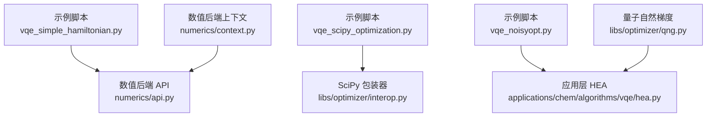
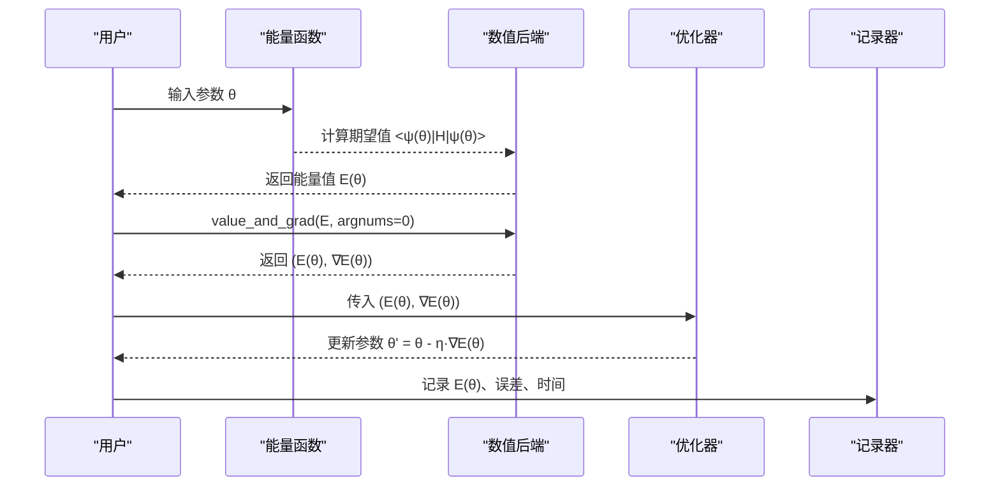
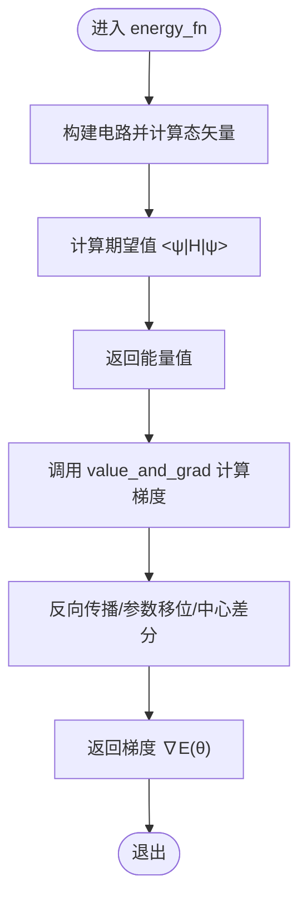
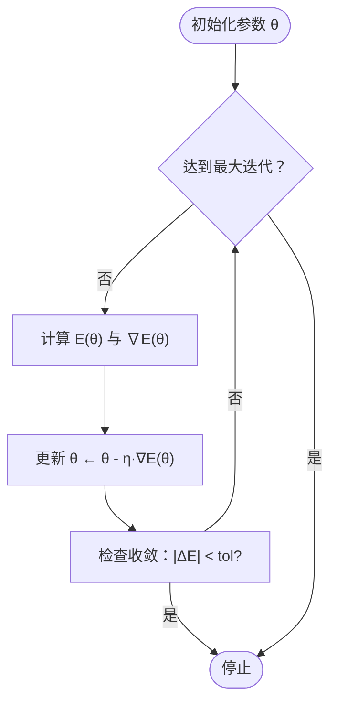
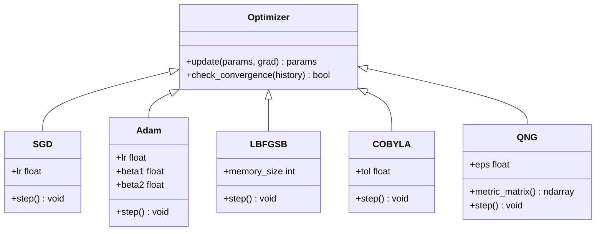
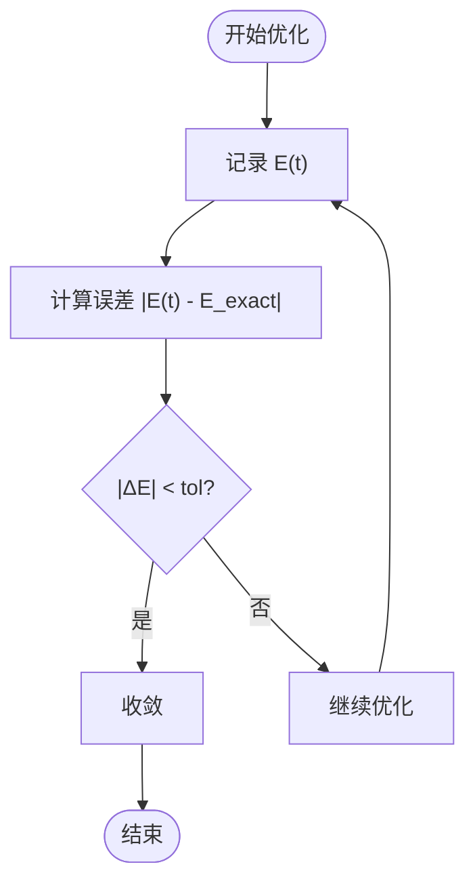
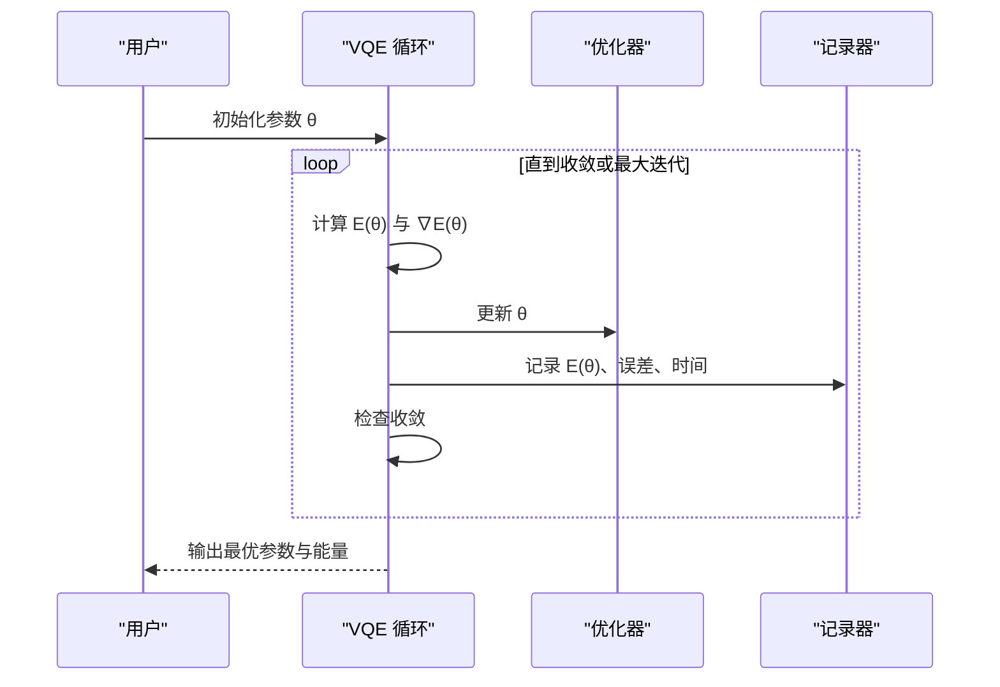
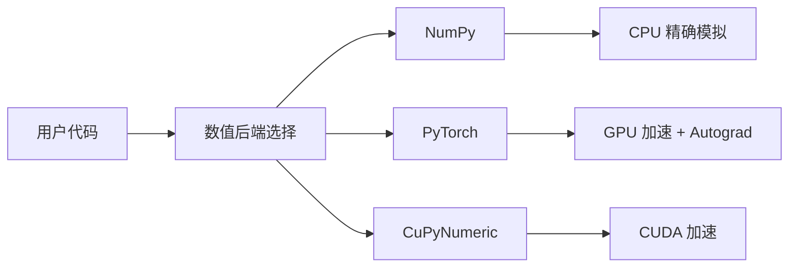
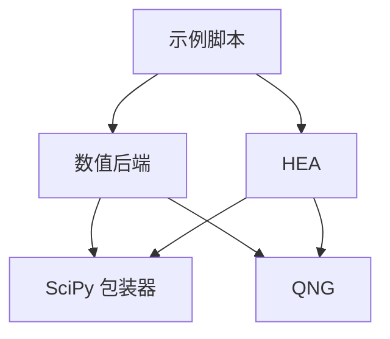

# 优化策略

<cite>
**本文引用的文件**
- [vqe_simple_hamiltonian.py](file://examples/vqe_simple_hamiltonian.py)
- [vqe_scipy_optimization.py](file://examples/vqe_scipy_optimization.py)
- [vqe_noisyopt.py](file://examples/vqe_noisyopt.py)
- [api.py](file://src/tyxonq/numerics/api.py)
- [context.py](file://src/tyxonq/numerics/context.py)
- [interop.py](file://src/tyxonq/libs/optimizer/interop.py)
- [qng.py](file://src/tyxonq/libs/optimizer/qng.py)
- [hea.py](file://src/tyxonq/applications/chem/algorithms/vqe/hea.py)
</cite>

## 目录
1. [简介](#简介)
2. [项目结构](#项目结构)
3. [核心组件](#核心组件)
4. [架构总览](#架构总览)
5. [详细组件分析](#详细组件分析)
6. [依赖关系分析](#依赖关系分析)
7. [性能考量](#性能考量)
8. [故障排查指南](#故障排查指南)
9. [结论](#结论)
10. [附录](#附录)

## 简介
本文件系统性阐述 TyxonQ 中 VQE（变分量子本征求解器）的优化策略，覆盖自动微分在 VQE 中的应用、梯度计算方法、梯度下降与多种优化器的实现细节、能量收敛性分析方法、完整优化循环示例以及数值后端选择对优化性能的影响。文档面向不同技术背景的读者，既提供高层概览，也给出代码级流程与图示，帮助快速理解与实践。

## 项目结构
围绕 VQE 优化的关键代码分布在以下位置：
- 示例脚本：展示从零开始的 VQE 优化循环、SciPy 集成、有限采样噪声下的优化等
- 数值后端：统一的数组与自动微分接口，支持 NumPy、PyTorch、CuPyNumeric
- 优化器工具：SciPy 包装器、量子自然梯度（QNG）计算
- 应用层算法：HEA（硬件高效 Ansatz）封装了能量评估、梯度计算与 SciPy 优化流程

图表来源
- [vqe_simple_hamiltonian.py:180-212](file://examples/vqe_simple_hamiltonian.py#L180-L212)
- [api.py:179-252](file://src/tyxonq/numerics/api.py#L179-L252)
- [interop.py:9-30](file://src/tyxonq/libs/optimizer/interop.py#L9-L30)
- [context.py:18-50](file://src/tyxonq/numerics/context.py#L18-L50)
- [qng.py:74-106](file://src/tyxonq/libs/optimizer/qng.py#L74-L106)
- [hea.py:268-337](file://src/tyxonq/applications/chem/algorithms/vqe/hea.py#L268-L337)

章节来源
- [vqe_simple_hamiltonian.py:1-273](file://examples/vqe_simple_hamiltonian.py#L1-L273)
- [vqe_scipy_optimization.py:1-465](file://examples/vqe_scipy_optimization.py#L1-L465)
- [vqe_noisyopt.py:1-289](file://examples/vqe_noisyopt.py#L1-L289)
- [api.py:1-255](file://src/tyxonq/numerics/api.py#L1-L255)
- [context.py:1-53](file://src/tyxonq/numerics/context.py#L1-L53)
- [interop.py:1-36](file://src/tyxonq/libs/optimizer/interop.py#L1-L36)
- [qng.py:1-114](file://src/tyxonq/libs/optimizer/qng.py#L1-L114)
- [hea.py:1-851](file://src/tyxonq/applications/chem/algorithms/vqe/hea.py#L1-L851)

## 核心组件
- 自动微分与 value_and_grad：通过数值后端的 value_and_grad 将能量函数包装为同时返回能量值与梯度的可调用对象，用于参数更新
- 优化器集成：
  - 自定义梯度下降（学习率、收敛判据、参数更新）
  - SciPy 优化器（COBYLA、L-BFGS-B）通过包装器适配 TyxonQ 函数签名
  - 量子自然梯度（QNG）利用中心差分计算度量矩阵，用于自然梯度优化
- 数值后端：统一抽象 ArrayBackend，支持切换 NumPy、PyTorch、CuPyNumeric；提供 vmap 向量化与自动微分桥接
- 应用层 HEA：封装电路构建、能量与梯度计算、SciPy 优化流程，并支持设备/数值两种运行路径

章节来源
- [vqe_simple_hamiltonian.py:180-212](file://examples/vqe_simple_hamiltonian.py#L180-L212)
- [vqe_scipy_optimization.py:217-337](file://examples/vqe_scipy_optimization.py#L217-L337)
- [qng.py:74-106](file://src/tyxonq/libs/optimizer/qng.py#L74-L106)
- [api.py:179-252](file://src/tyxonq/numerics/api.py#L179-L252)
- [hea.py:268-337](file://src/tyxonq/applications/chem/algorithms/vqe/hea.py#L268-L337)

## 架构总览
VQE 优化在 TyxonQ 中的整体数据流如下：
- 用户定义能量函数（基于电路期望值）
- 使用数值后端的 value_and_grad 获取梯度（或采用参数移位/有限差分）
- 选择优化器（SGD、Adam、L-BFGS-B、COBYLA、QNG）进行参数更新
- 监控能量历史、误差与收敛判断
- 根据后端特性（NumPy/PyTorch/CuPyNumeric）调整性能与精度

图表来源
- [vqe_simple_hamiltonian.py:180-212](file://examples/vqe_simple_hamiltonian.py#L180-L212)
- [api.py:179-252](file://src/tyxonq/numerics/api.py#L179-L252)
- [vqe_scipy_optimization.py:217-337](file://examples/vqe_scipy_optimization.py#L217-L337)

## 详细组件分析

### 自动微分与 value_and_grad 的工作原理
- 作用：将能量函数包装为可同时返回能量值与梯度的函数，避免手动推导梯度
- 工作方式：
  - 通过数值后端提供的自动微分能力（如 PyTorch 的 autograd）或数值方法（如参数移位、中心差分）计算梯度
  - 在示例中，value_and_grad 被用于直接数值路径，结合 statevector 精确期望值，得到稳定梯度
- 适用场景：
  - 精确模拟（statevector）时，自动微分效率高且准确
  - 有限采样（counts）时，通常采用参数移位或数值差分以兼容采样噪声

图表来源
- [vqe_simple_hamiltonian.py:180-212](file://examples/vqe_simple_hamiltonian.py#L180-L212)
- [vqe_noisyopt.py:156-172](file://examples/vqe_noisyopt.py#L156-L172)

章节来源
- [vqe_simple_hamiltonian.py:180-212](file://examples/vqe_simple_hamiltonian.py#L180-L212)
- [vqe_noisyopt.py:156-172](file://examples/vqe_noisyopt.py#L156-L172)

### 梯度下降优化实现细节
- 学习率选择：
  - 示例中使用固定学习率（如 0.02），可通过调度器（如指数衰减）动态调整
  - 在 Adam 场景中，默认学习率常设为 1e-2，配合指数衰减提升稳定性
- 收敛判据：
  - 能量变化阈值（如 |E(t) - E(t-1)| < tol）连续若干步满足则停止
  - 最大迭代次数作为兜底条件
- 参数更新策略：
  - 简单梯度下降：θ ← θ - η·∇E(θ)
  - Adam：自适应学习率，结合动量与二阶矩估计
  - L-BFGS-B：拟牛顿法，利用历史梯度信息加速收敛
  - COBYLA：无梯度约束优化，适合噪声环境

图表来源
- [vqe_simple_hamiltonian.py:205-223](file://examples/vqe_simple_hamiltonian.py#L205-L223)
- [vqe_scipy_optimization.py:268-337](file://examples/vqe_scipy_optimization.py#L268-L337)
- [vqe_noisyopt.py:217-231](file://examples/vqe_noisyopt.py#L217-L231)

章节来源
- [vqe_simple_hamiltonian.py:205-223](file://examples/vqe_simple_hamiltonian.py#L205-L223)
- [vqe_scipy_optimization.py:268-337](file://examples/vqe_scipy_optimization.py#L268-L337)
- [vqe_noisyopt.py:217-231](file://examples/vqe_noisyopt.py#L217-L231)

### 优化器选项与适用场景
- SGD（简单梯度下降）：
  - 优点：实现简单，内存占用低
  - 缺点：易陷入局部极小，对学习率敏感
  - 适用：小规模问题、教学演示
- Adam：
  - 优点：自适应学习率，鲁棒性强
  - 缺点：可能过拟合，需调参
  - 适用：大多数 VQE 问题，尤其含噪声时
- L-BFGS-B：
  - 优点：利用历史梯度，收敛快
  - 缺点：需要梯度，内存占用较高
  - 适用：精确模拟或小规模系统
- COBYLA：
  - 优点：无梯度，对噪声鲁棒
  - 缺点：收敛较慢
  - 适用：真实设备或高噪声环境
- QNG（量子自然梯度）：
  - 优点：考虑量子几何，收敛更稳健
  - 缺点：计算度量矩阵成本高
  - 适用：高精度需求、中等规模系统

图表来源
- [vqe_scipy_optimization.py:217-337](file://examples/vqe_scipy_optimization.py#L217-L337)
- [vqe_noisyopt.py:217-231](file://examples/vqe_noisyopt.py#L217-L231)
- [qng.py:74-106](file://src/tyxonq/libs/optimizer/qng.py#L74-L106)

章节来源
- [vqe_scipy_optimization.py:217-337](file://examples/vqe_scipy_optimization.py#L217-L337)
- [vqe_noisyopt.py:217-231](file://examples/vqe_noisyopt.py#L217-L231)
- [qng.py:74-106](file://src/tyxonq/libs/optimizer/qng.py#L74-L106)

### 能量收敛性分析方法
- 能量历史跟踪：
  - 记录每步能量值，绘制收敛曲线
  - 用于诊断优化过程是否稳定
- 误差计算：
  - 绝对误差：|E(θ) - E_exact|
  - 相对误差：|E(θ) - E_exact| / |E_exact| × 100%
- 收敛判断标准：
  - 能量变化阈值：|E(t) - E(t-1)| < tol
  - 连续多步不改善则停止
  - 最大迭代次数兜底

图表来源
- [vqe_simple_hamiltonian.py:205-232](file://examples/vqe_simple_hamiltonian.py#L205-L232)
- [vqe_scipy_optimization.py:268-337](file://examples/vqe_scipy_optimization.py#L268-L337)

章节来源
- [vqe_simple_hamiltonian.py:205-232](file://examples/vqe_simple_hamiltonian.py#L205-L232)
- [vqe_scipy_optimization.py:268-337](file://examples/vqe_scipy_optimization.py#L268-L337)

### 完整优化循环实现示例
- 监控训练过程：
  - 打印每步能量、误差、耗时
  - 记录能量历史用于后续分析
- 调整超参数：
  - 学习率、迭代次数、收敛阈值
  - 使用调度器动态调整学习率
- 处理异常情况：
  - 捕获异常并回退到更稳健的优化器
  - 限制最大迭代次数防止无限循环

图表来源
- [vqe_simple_hamiltonian.py:205-232](file://examples/vqe_simple_hamiltonian.py#L205-L232)
- [vqe_scipy_optimization.py:268-337](file://examples/vqe_scipy_optimization.py#L268-L337)
- [vqe_noisyopt.py:217-231](file://examples/vqe_noisyopt.py#L217-L231)

章节来源
- [vqe_simple_hamiltonian.py:205-232](file://examples/vqe_simple_hamiltonian.py#L205-L232)
- [vqe_scipy_optimization.py:268-337](file://examples/vqe_scipy_optimization.py#L268-L337)
- [vqe_noisyopt.py:217-231](file://examples/vqe_noisyopt.py#L217-L231)

### 数值后端的选择对优化性能的影响
- NumPy：
  - 优点：稳定、易用，适合 CPU 精确模拟
  - 缺点：无 GPU 加速，大规模问题较慢
- PyTorch：
  - 优点：GPU 加速、自动微分强大
  - 缺点：需处理类型转换与兼容性
- CuPyNumeric：
  - 优点：CUDA 加速，适合大规模数值计算
  - 缺点：依赖安装复杂，生态不如 PyTorch

图表来源
- [api.py:179-252](file://src/tyxonq/numerics/api.py#L179-L252)
- [context.py:18-50](file://src/tyxonq/numerics/context.py#L18-L50)

章节来源
- [api.py:179-252](file://src/tyxonq/numerics/api.py#L179-L252)
- [context.py:18-50](file://src/tyxonq/numerics/context.py#L18-L50)

## 依赖关系分析
- 示例脚本依赖数值后端与应用层 HEA
- 数值后端提供统一接口，屏蔽底层实现差异
- 优化器工具提供 SciPy 包装与 QNG 计算
- HEA 封装电路、能量、梯度与优化流程

图表来源
- [vqe_simple_hamiltonian.py:180-212](file://examples/vqe_simple_hamiltonian.py#L180-L212)
- [api.py:179-252](file://src/tyxonq/numerics/api.py#L179-L252)
- [interop.py:9-30](file://src/tyxonq/libs/optimizer/interop.py#L9-L30)
- [qng.py:74-106](file://src/tyxonq/libs/optimizer/qng.py#L74-L106)
- [hea.py:268-337](file://src/tyxonq/applications/chem/algorithms/vqe/hea.py#L268-L337)

章节来源
- [vqe_simple_hamiltonian.py:180-212](file://examples/vqe_simple_hamiltonian.py#L180-L212)
- [api.py:179-252](file://src/tyxonq/numerics/api.py#L179-L252)
- [interop.py:9-30](file://src/tyxonq/libs/optimizer/interop.py#L9-L30)
- [qng.py:74-106](file://src/tyxonq/libs/optimizer/qng.py#L74-L106)
- [hea.py:268-337](file://src/tyxonq/applications/chem/algorithms/vqe/hea.py#L268-L337)

## 性能考量
- 自动微分 vs 参数移位：
  - 自动微分在精确模拟中更高效
  - 参数移位适用于有限采样场景
- 优化器选择：
  - L-BFGS-B 在精确模拟中收敛快
  - COBYLA 在噪声环境下更稳健
- 数值后端：
  - PyTorch 提供 GPU 加速，适合大规模问题
  - NumPy 稳定但速度受限
- 收敛判据：
  - 合理设置阈值与最大迭代次数，平衡精度与效率

[本节提供通用指导，无需特定文件引用]

## 故障排查指南
- 常见问题：
  - 梯度为零或爆炸：检查 ansatz 设计、学习率、数值精度
  - 收敛缓慢：尝试不同优化器或调整超参数
  - 内存不足：减少系统规模或使用更高效的数值后端
- 调试技巧：
  - 打印中间变量（能量、梯度范数）
  - 使用可视化监控收敛曲线
  - 逐步简化问题定位瓶颈

章节来源
- [vqe_simple_hamiltonian.py:205-232](file://examples/vqe_simple_hamiltonian.py#L205-L232)
- [vqe_scipy_optimization.py:268-337](file://examples/vqe_scipy_optimization.py#L268-L337)
- [vqe_noisyopt.py:217-231](file://examples/vqe_noisyopt.py#L217-L231)

## 结论
TyxonQ 的 VQE 优化策略提供了灵活的自动微分、多种优化器与数值后端选择，能够适应从精确模拟到真实设备的多样化场景。通过合理的超参数调整与收敛判据设置，可以在保证精度的同时提升优化效率。建议根据具体问题选择合适的优化器与后端，并结合能量历史跟踪进行监控与调优。

[本节总结内容，无需特定文件引用]

## 附录
- 术语表：
  - VQE：变分量子本征求解器
  - HEA：硬件高效 Ansatz
  - QNG：量子自然梯度
  - 参数移位：一种计算梯度的数值方法
- 参考链接：
  - TyxonQ 文档与示例
  - 相关论文与最佳实践

[本节提供补充信息，无需特定文件引用]