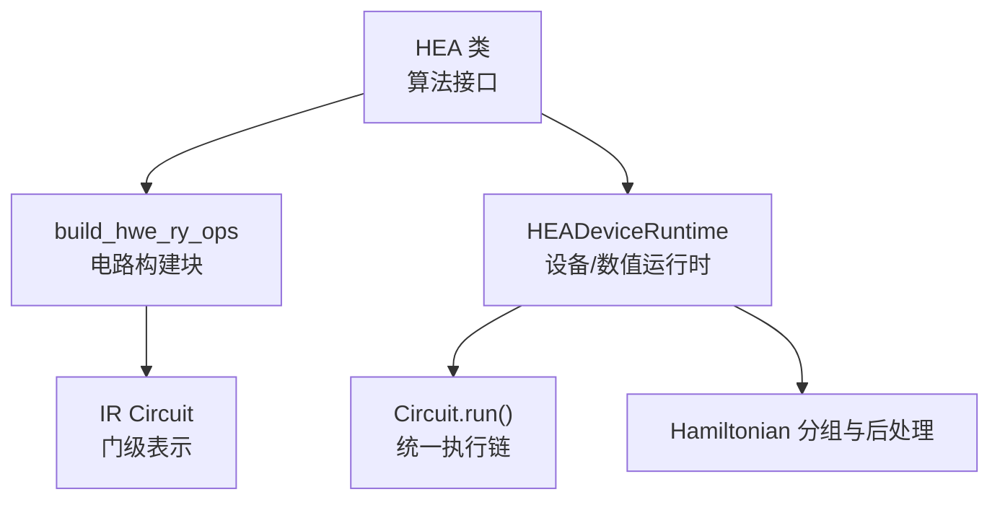
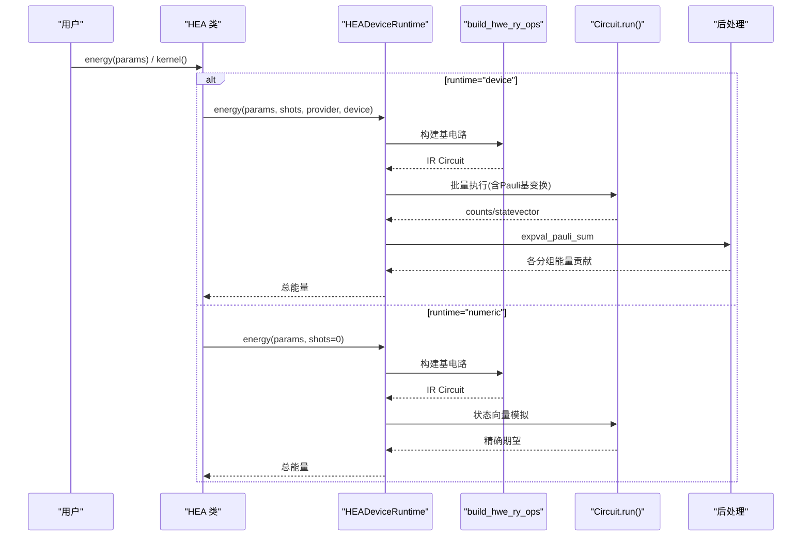
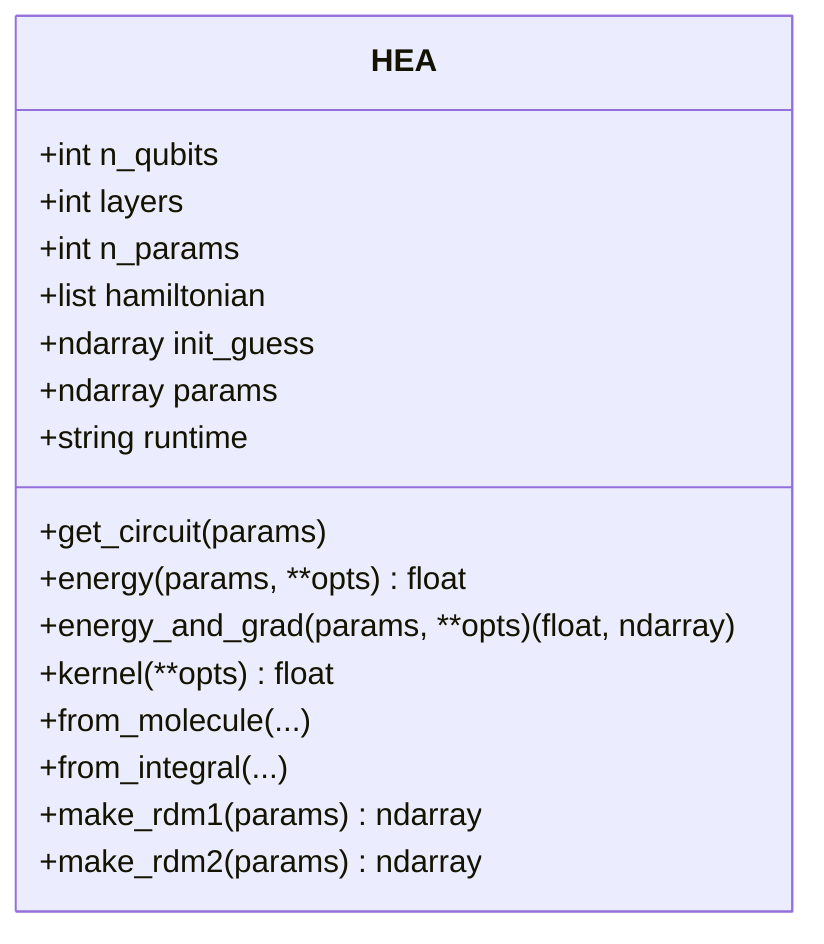
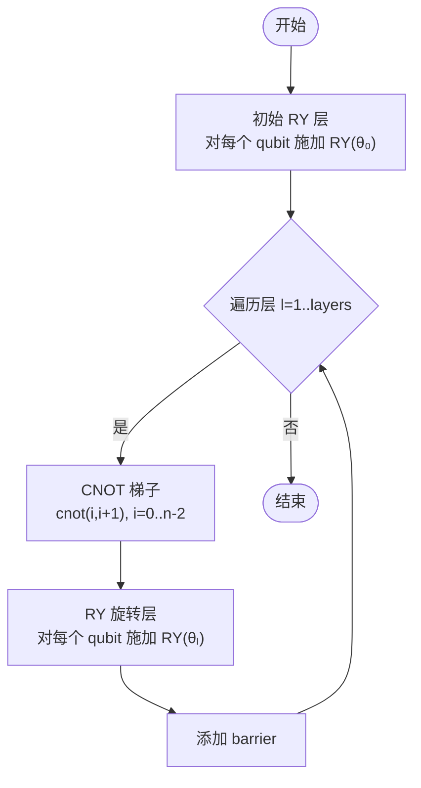
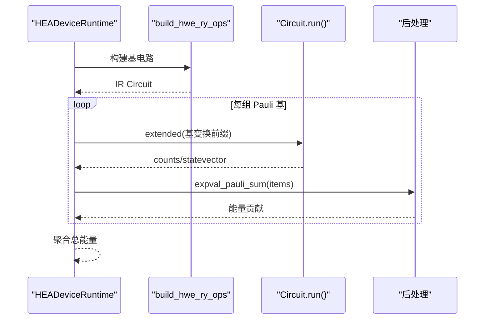
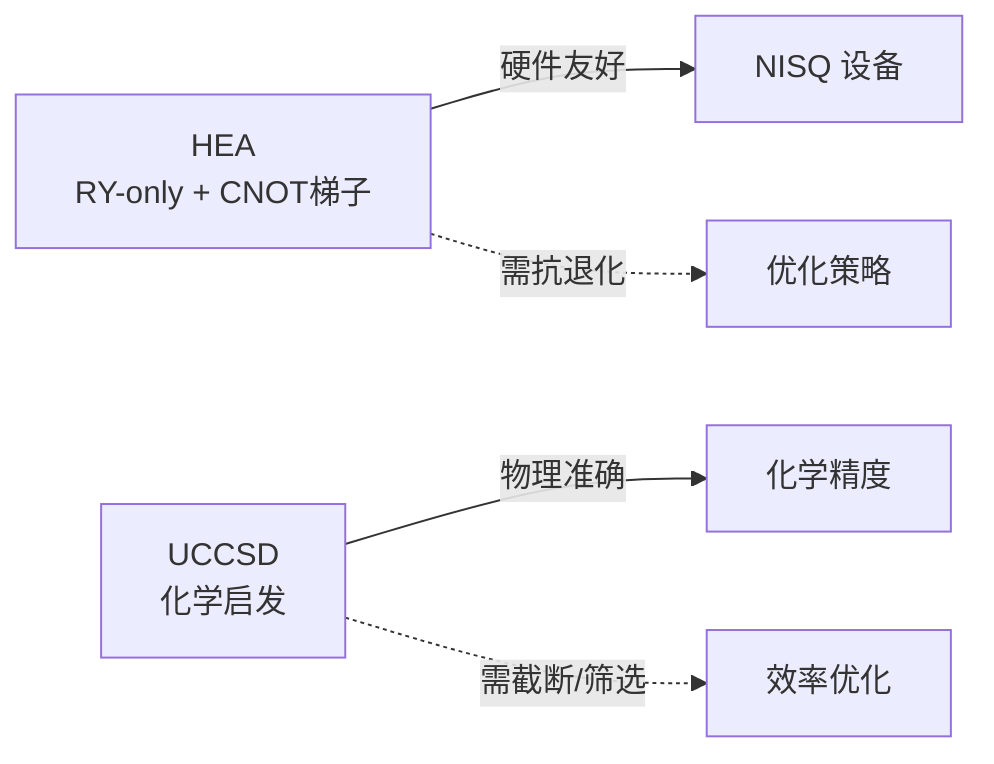
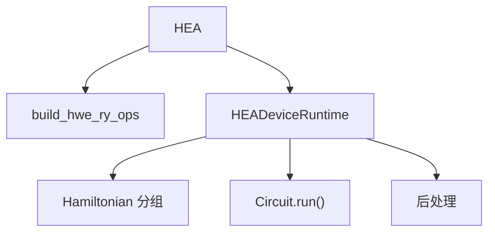

# 变分电路设计

<cite>
**本文引用的文件**
- [hea.py](file://src/tyxonq/applications/chem/algorithms/vqe/hea.py)
- [blocks.py](file://src/tyxonq/libs/circuits_library/blocks.py)
- [hea_device_runtime.py](file://src/tyxonq/applications/chem/algorithms/vqe/runtimes/hea_device_runtime.py)
- [uccsd.py](file://src/tyxonq/applications/chem/algorithms/vqe/uccsd.py)
- [demo_hea_homo_lumo_gap.py](file://examples/demo_hea_homo_lumo_gap.py)
- [cloud_uccsd_hea_demo.py](file://examples/cloud_uccsd_hea_demo.py)
- [barren_plateau_benchmark.py](file://examples/barren_plateau_benchmark.py)
</cite>

## 目录
1. [简介](#简介)
2. [项目结构](#项目结构)
3. [核心组件](#核心组件)
4. [架构总览](#架构总览)
5. [详细组件分析](#详细组件分析)
6. [依赖关系分析](#依赖关系分析)
7. [性能考量](#性能考量)
8. [故障排查指南](#故障排查指南)
9. [结论](#结论)
10. [附录：电路构建与参数初始化示例](#附录电路构建与参数初始化示例)

## 简介
本文件系统性阐述 TyxonQ 中硬件高效变分电路（HEA）的设计原理、实现细节与使用方式。重点包括：
- HEA 的电路结构：初始单量子比特旋转层、CNOT 梯子纠缠层、参数化旋转层，以及层间 barrier 的作用。
- 参数形状与初始化策略：解释 (layers+1)×n_qubits 的参数布局与默认随机初始化。
- 不同变分电路架构对比：HEA 与 UCCSD 的特点、适用场景与优劣。
- 可训练性与梯度：参数平移法（Parameter Shift Rule）在设备路径中的实现，以及针对梯度消失问题的实践建议。
- 完整电路构建流程与定制方法：如何根据问题调整深度、纠缠模式与参数初始化方案。

## 项目结构
TyxonQ 将 HEA 的实现拆分为“算法接口”、“电路构建块”和“运行时执行”三层：
- 算法接口：HEA 类提供从分子或积分构建、能量评估、优化、RDM 计算等高层 API。
- 电路构建块：build_hwe_ry_ops 负责生成 RY-only 的硬件高效 ansatz 电路。
- 运行时执行：HEADeviceRuntime 负责哈密顿量分组、批量电路构建与执行、后处理与能量聚合。

图表来源
- [hea.py:28-230](file://src/tyxonq/applications/chem/algorithms/vqe/hea.py#L28-L230)
- [blocks.py:59-85](file://src/tyxonq/libs/circuits_library/blocks.py#L59-L85)
- [hea_device_runtime.py:21-176](file://src/tyxonq/applications/chem/algorithms/vqe/runtimes/hea_device_runtime.py#L21-L176)

章节来源
- [hea.py:28-230](file://src/tyxonq/applications/chem/algorithms/vqe/hea.py#L28-L230)
- [blocks.py:59-85](file://src/tyxonq/libs/circuits_library/blocks.py#L59-L85)
- [hea_device_runtime.py:21-176](file://src/tyxonq/applications/chem/algorithms/vqe/runtimes/hea_device_runtime.py#L21-L176)

## 核心组件
- HEA 类：封装从分子/积分构建、电路生成、能量与梯度计算、优化与结果输出。支持 device 与 numeric 两种运行路径。
- build_hwe_ry_ops：构造 RY-only 的硬件高效 ansatz，包含初始 RY 层、每层的 CNOT 梯子纠缠与 RY 旋转层，层间插入 barrier。
- HEADeviceRuntime：对哈密顿量进行 Pauli 分组，批量构建并执行扩展电路，通过后处理聚合能量；支持参数平移法梯度。

章节来源
- [hea.py:28-230](file://src/tyxonq/applications/chem/algorithms/vqe/hea.py#L28-L230)
- [blocks.py:59-85](file://src/tyxonq/libs/circuits_library/blocks.py#L59-L85)
- [hea_device_runtime.py:21-176](file://src/tyxonq/applications/chem/algorithms/vqe/runtimes/hea_device_runtime.py#L21-L176)

## 架构总览
下图展示 HEA 在 TyxonQ 中的端到端数据流：从分子/积分到哈密顿量映射，再到电路构建、执行与后处理。

图表来源
- [hea.py:231-266](file://src/tyxonq/applications/chem/algorithms/vqe/hea.py#L231-L266)
- [hea_device_runtime.py:121-176](file://src/tyxonq/applications/chem/algorithms/vqe/runtimes/hea_device_runtime.py#L121-L176)
- [blocks.py:59-85](file://src/tyxonq/libs/circuits_library/blocks.py#L59-L85)

## 详细组件分析

### HEA 类：算法接口与化学集成
- 电路结构：
  - 初始层：对所有量子比特施加 RY 旋转，形成叠加态。
  - 纠缠层：每层先执行 CNOT 梯子（0→1→…→n-1），再对各比特施加 RY 旋转。
  - 层间 barrier：便于可视化与编译控制。
- 参数形状与初始化：
  - 参数总数为 (layers + 1) × n_qubits，按层顺序排列。
  - 默认使用固定种子的随机数生成器初始化，避免零梯度平台。
- 运行路径：
  - device：通过 HEADeviceRuntime 执行，支持模拟器与真机，支持采样噪声。
  - numeric：shots=0 走解析路径，快速且无噪声。
- 优化：
  - 使用 SciPy 最小化，支持 L-BFGS-B（带梯度）与 COBYLA（无梯度）。
  - 自动选择 shots：本地/模拟器默认解析路径，真机默认 2048 shots。
- 化学集成：
  - from_molecule/from_integral：从 PySCF 分子或积分构建，支持 parity/JW/BK 映射。
  - RDM 计算：基于 counts 的期望估计，支持 spin-traced 1-RDM 与 2-RDM。
  - HOMO-LUMO gap：委托给内部 UCC 对象获取轨道信息。

图表来源
- [hea.py:28-230](file://src/tyxonq/applications/chem/algorithms/vqe/hea.py#L28-L230)
- [hea.py:379-494](file://src/tyxonq/applications/chem/algorithms/vqe/hea.py#L379-L494)
- [hea.py:623-705](file://src/tyxonq/applications/chem/algorithms/vqe/hea.py#L623-L705)

章节来源
- [hea.py:28-230](file://src/tyxonq/applications/chem/algorithms/vqe/hea.py#L28-L230)
- [hea.py:379-494](file://src/tyxonq/applications/chem/algorithms/vqe/hea.py#L379-L494)
- [hea.py:623-705](file://src/tyxonq/applications/chem/algorithms/vqe/hea.py#L623-L705)

### 电路构建块：RY-only 硬件高效 ansatz
- 输入参数形状：扁平数组，长度 (layers + 1) × n_qubits，按层展开。
- 电路步骤：
  - 初始 RY 层：对每个量子比特 i 施加 RY(θ₀ᵢ)。
  - 循环 l=1..layers：
    - CNOT 梯子：cnot(i, i+1)，i=0..n-2。
    - RY 旋转层：对每个 qubit i 施加 RY(θₗᵢ)。
    - 添加 barrier。
- 优势：
  - 仅用 RY 与相邻 CNOT，适合 NISQ 设备拓扑。
  - 参数数量可控，易于调节深度与宽度。

图表来源
- [blocks.py:59-85](file://src/tyxonq/libs/circuits_library/blocks.py#L59-L85)

章节来源
- [blocks.py:59-85](file://src/tyxonq/libs/circuits_library/blocks.py#L59-L85)

### 运行时执行：HEADeviceRuntime
- 哈密顿量分组：将 Pauli 项按对易关系分组，减少测量次数。
- 电路构建：
  - 若存在外部模板（如 RealAmplitudes 转换），优先使用该模板。
  - 否则调用 build_hwe_ry_ops 构建 RY-only 电路。
- 执行与后处理：
  - 统一通过 Circuit.run() 提交，支持 simulator/local/真机。
  - 对每组 Pauli 项应用基变换前缀，批量执行并提取能量贡献。
- 梯度：
  - 参数平移法：对每个参数 θ_k，计算 E(θ_k+π/2) 与 E(θ_k−π/2) 的差值的一半作为梯度分量。
  - 支持缓存与批量化以减少重复计算。

图表来源
- [hea_device_runtime.py:21-176](file://src/tyxonq/applications/chem/algorithms/vqe/runtimes/hea_device_runtime.py#L21-L176)

章节来源
- [hea_device_runtime.py:21-176](file://src/tyxonq/applications/chem/algorithms/vqe/runtimes/hea_device_runtime.py#L21-L176)

### 变分电路架构对比：HEA vs UCCSD
- HEA：
  - 优点：结构简单、参数少、硬件友好、易于在 NISQ 设备上运行；适合探索性任务与资源受限场景。
  - 缺点：物理启发较弱，可能面临 barren plateau 风险；需要合理初始化与正则化。
- UCCSD：
  - 优点：基于化学理论，系统性地包含电子相关效应；可通过活性空间与振幅筛选控制复杂度。
  - 缺点：参数较多、电路较深；对设备噪声更敏感；需要较好的初始猜测与收敛策略。

图表来源
- [uccsd.py:18-154](file://src/tyxonq/applications/chem/algorithms/vqe/uccsd.py#L18-L154)
- [hea.py:28-124](file://src/tyxonq/applications/chem/algorithms/vqe/hea.py#L28-L124)

章节来源
- [uccsd.py:18-154](file://src/tyxonq/applications/chem/algorithms/vqe/uccsd.py#L18-L154)
- [hea.py:28-124](file://src/tyxonq/applications/chem/algorithms/vqe/hea.py#L28-L124)

## 依赖关系分析
- HEA 依赖：
  - 电路构建：build_hwe_ry_ops（RY-only ansatz）。
  - 运行时：HEADeviceRuntime（设备/数值路径）。
  - 化学工具：从分子/积分构建哈密顿量，支持多种费米子-量子比特映射。
- 运行时依赖：
  - Hamiltonian 分组与后处理。
  - Circuit.run() 统一执行链，支持多 provider/device。

图表来源
- [hea.py:231-266](file://src/tyxonq/applications/chem/algorithms/vqe/hea.py#L231-L266)
- [hea_device_runtime.py:21-176](file://src/tyxonq/applications/chem/algorithms/vqe/runtimes/hea_device_runtime.py#L21-L176)

章节来源
- [hea.py:231-266](file://src/tyxonq/applications/chem/algorithms/vqe/hea.py#L231-L266)
- [hea_device_runtime.py:21-176](file://src/tyxonq/applications/chem/algorithms/vqe/runtimes/hea_device_runtime.py#L21-L176)

## 性能考量
- 电路深度与纠缠模式：
  - 增加 layers 提升表达能力，但也增加噪声累积与优化难度。
  - CNOT 梯子适用于线性拓扑；对于非连通图，可考虑局部纠缠或重映射。
- 参数初始化：
  - 默认随机初始化避免零梯度；可结合问题先验（如小角度扰动）改善收敛。
- 测量开销：
  - Hamiltonian 分组减少测量次数；batched 执行提升吞吐。
- 梯度计算：
  - 参数平移法在设备路径中可行；注意采样噪声对梯度的影响。
- 退火与正则化：
  - 使用学习率调度、早停、权重衰减等经典优化技巧缓解 barren plateau。

[本节为通用指导，不直接分析具体文件]

## 故障排查指南
- 参数长度不匹配：
  - 现象：传入参数长度不等于 (layers + 1) × n_qubits。
  - 解决：检查 HEA 实例的 layers 与 n_qubits，确保参数形状一致。
- 未携带化学元信息：
  - 现象：RDM 计算报错，提示需要从 from_integral/from_molecule 构建。
  - 解决：使用 from_molecule 或 from_integral 构建 HEA，保留 mapping 与电子数信息。
- 真机执行超时或结果为空：
  - 现象：Circuit.run() 返回空 counts。
  - 解决：设置 wait_async_result=True，等待异步结果就绪；或改用模拟器调试。
- 梯度消失/平坦区域：
  - 现象：优化停滞，梯度范数接近零。
  - 解决：减小电路深度、调整初始化、增加 shots、使用分层训练或自然梯度。

章节来源
- [hea_device_runtime.py:121-176](file://src/tyxonq/applications/chem/algorithms/vqe/runtimes/hea_device_runtime.py#L121-L176)
- [hea.py:623-705](file://src/tyxonq/applications/chem/algorithms/vqe/hea.py#L623-L705)
- [barren_plateau_benchmark.py:1-40](file://examples/barren_plateau_benchmark.py#L1-L40)

## 结论
HEA 在 TyxonQ 中提供了简洁高效的硬件友好型变分电路实现，适用于 NISQ 时代的快速原型与实验。其 RY-only 结构与 CNOT 梯子纠缠模式在保持表达能力的同时降低了对设备的要求。通过与 UCCSD 的对比可见，HEA 更适合资源受限场景，而 UCCSD 则在化学精度上更具优势。实践中，应结合问题特性选择合适的电路深度、纠缠模式与参数初始化策略，并利用 TyxonQ 的统一执行链与后处理管道提升效率与鲁棒性。

[本节为总结性内容，不直接分析具体文件]

## 附录：电路构建与参数初始化示例
以下示例展示如何根据具体问题定制 HEA 电路的深度、纠缠模式与参数初始化方案。为避免泄露具体代码，仅提供路径引用。

- 基本用法与 HOMO-LUMO gap 演示：
  - [demo_hea_homo_lumo_gap.py:11-34](file://examples/demo_hea_homo_lumo_gap.py#L11-L34)
  - [demo_hea_homo_lumo_gap.py:36-69](file://examples/demo_hea_homo_lumo_gap.py#L36-L69)
- 云环境下的 UCCSD 与 HEA 对比：
  - [cloud_uccsd_hea_demo.py:28-50](file://examples/cloud_uccsd_hea_demo.py#L28-L50)
- 梯度消失基准与三种梯度计算方法：
  - [barren_plateau_benchmark.py:1-40](file://examples/barren_plateau_benchmark.py#L1-L40)
  - [barren_plateau_benchmark.py:142-200](file://examples/barren_plateau_benchmark.py#L142-L200)

章节来源
- [demo_hea_homo_lumo_gap.py:11-69](file://examples/demo_hea_homo_lumo_gap.py#L11-L69)
- [cloud_uccsd_hea_demo.py:28-50](file://examples/cloud_uccsd_hea_demo.py#L28-L50)
- [barren_plateau_benchmark.py:1-40](file://examples/barren_plateau_benchmark.py#L1-L40)
- [barren_plateau_benchmark.py:142-200](file://examples/barren_plateau_benchmark.py#L142-L200)