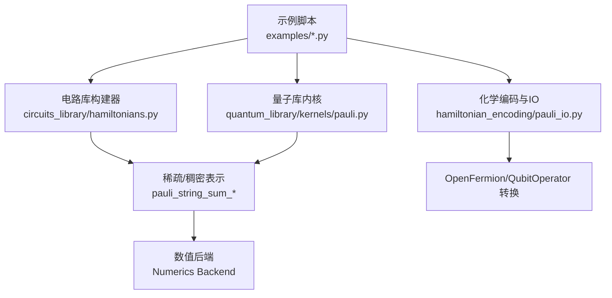
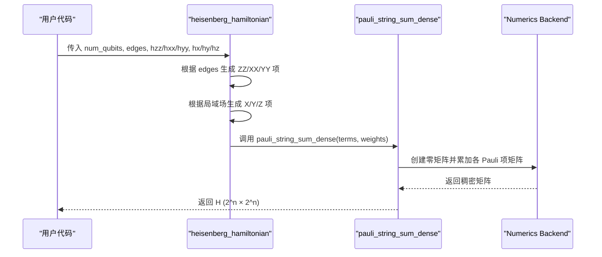
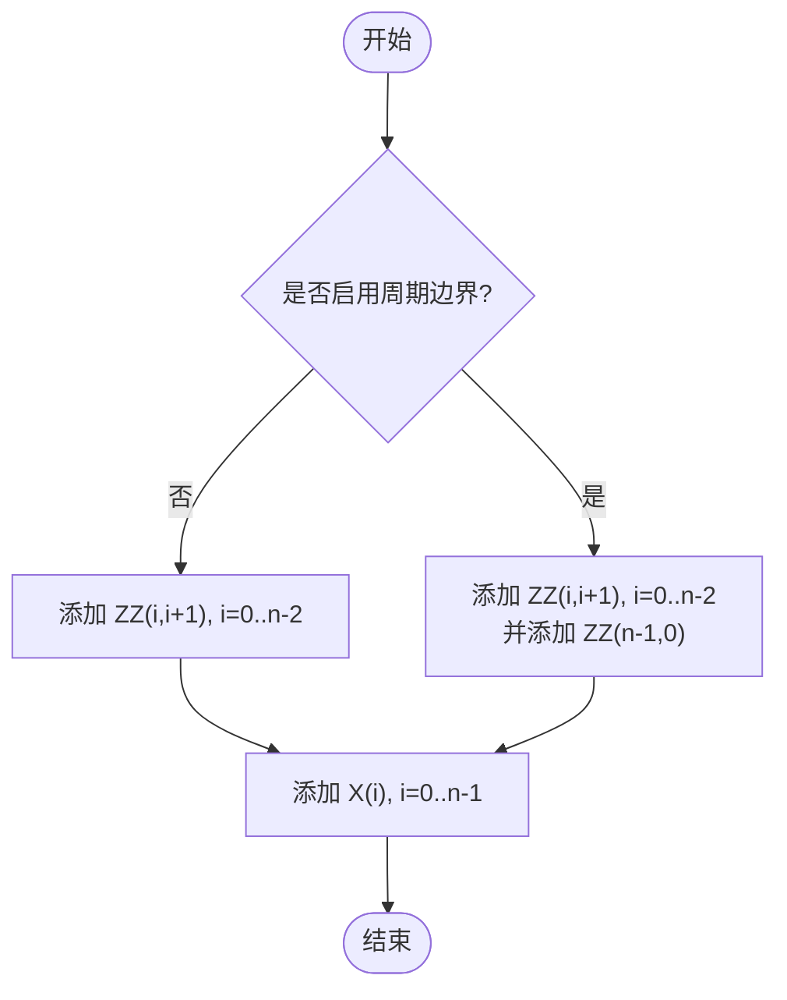
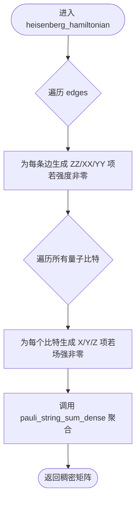
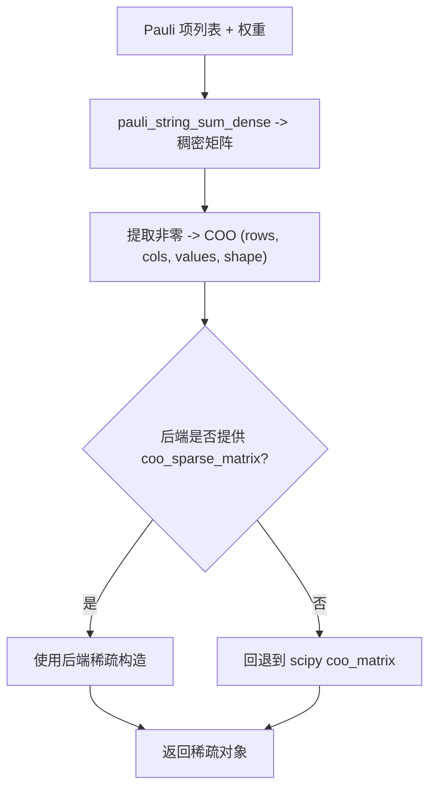
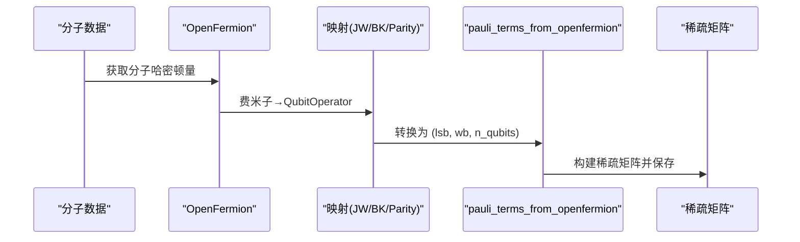
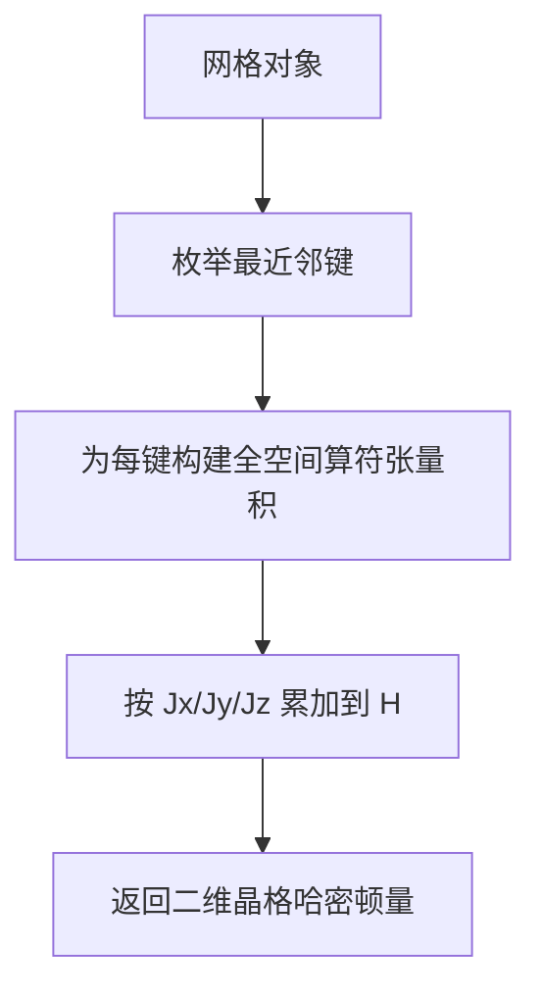
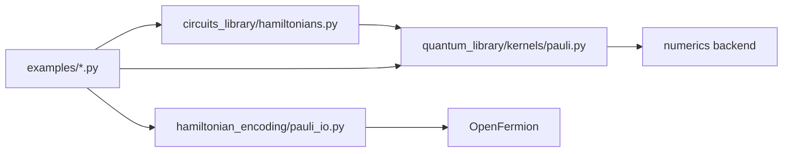

# 哈密顿量构建

<cite>
**本文引用的文件**
- [src/tyxonq/libs/circuits_library/hamiltonians.py](file://src/tyxonq/libs/circuits_library/hamiltonians.py)
- [src/tyxonq/libs/quantum_library/kernels/pauli.py](file://src/tyxonq/libs/quantum_library/kernels/pauli.py)
- [examples/hamiltonian_building.py](file://examples/hamiltonian_building.py)
- [examples/vqe_simple_hamiltonian.py](file://examples/vqe_simple_hamiltonian.py)
- [examples/hchainhamiltonian.py](file://examples/hchainhamiltonian.py)
- [examples/vqe_2d_lattice.py](file://examples/vqe_2d_lattice.py)
- [examples/hamiltonian_time_evolution.py](file://examples/hamiltonian_time_evolution.py)
- [src/tyxonq/libs/hamiltonian_encoding/pauli_io.py](file://src/tyxonq/libs/hamiltonian_encoding/pauli_io.py)
- [src/tyxonq/core/errors.py](file://src/tyxonq/core/errors.py)
</cite>

## 目录
1. [简介](#简介)
2. [项目结构](#项目结构)
3. [核心组件](#核心组件)
4. [架构总览](#架构总览)
5. [详细组件分析](#详细组件分析)
6. [依赖关系分析](#依赖关系分析)
7. [性能与精度考量](#性能与精度考量)
8. [故障排查指南](#故障排查指南)
9. [结论](#结论)
10. [附录：示例与用法索引](#附录示例与用法索引)

## 简介
本文件系统性梳理 TyxonQ 中哈密顿量的构建方法，重点覆盖：
- 使用 Pauli 算符表达各类哈密顿量（自旋模型、海森堡模型、横向场 Ising 模型 TFIM）
- 边连接结构与周期性边界条件（PBC）的处理方式
- heisenberg_hamiltonian 函数的参数化配置（ZZ/XX/YY 耦合强度与横场 hx/hy/hz）
- 从简单自旋模型到复杂分子系统的表示与转换
- 稀疏矩阵表示、数值精度控制与验证方法
- 常见错误定位与调试建议

## 项目结构
TyxonQ 的哈密顿量构建能力分布在多个模块：
- 电路库中的轻量级构建器：用于快速生成 TFIM 等模型的 Pauli 项列表
- 量子库内核：提供 Heisenberg 哈密顿量构造、Pauli 字符串到矩阵转换、稠密/稀疏求和
- 化学应用与编码：将分子哈密顿量映射为 qubit 算符并转换为稀疏格式
- 示例脚本：展示不同物理系统（TFIM、二维晶格、分子链）的构建与使用

图表来源
- [src/tyxonq/libs/circuits_library/hamiltonians.py:17-26](file://src/tyxonq/libs/circuits_library/hamiltonians.py#L17-L26)
- [src/tyxonq/libs/quantum_library/kernels/pauli.py:74-172](file://src/tyxonq/libs/quantum_library/kernels/pauli.py#L74-L172)
- [src/tyxonq/libs/hamiltonian_encoding/pauli_io.py:35-73](file://src/tyxonq/libs/hamiltonian_encoding/pauli_io.py#L35-L73)

章节来源
- [src/tyxonq/libs/circuits_library/hamiltonians.py:1-60](file://src/tyxonq/libs/circuits_library/hamiltonians.py#L1-L60)
- [src/tyxonq/libs/quantum_library/kernels/pauli.py:1-175](file://src/tyxonq/libs/quantum_library/kernels/pauli.py#L1-L175)
- [src/tyxonq/libs/hamiltonian_encoding/pauli_io.py:35-73](file://src/tyxonq/libs/hamiltonian_encoding/pauli_io.py#L35-L73)

## 核心组件
- 轻量级 TFIM 构建器：以 (系数, [(算符, 量子比特), ...]) 形式输出 Pauli 项列表，支持开边界与周期边界
- Heisenberg 哈密顿量构建器：基于边列表与局域场参数，生成稠密矩阵或可转为稀疏表示
- Pauli 字符串工具：将列表编码的 Pauli 串转换为矩阵或 COO 稀疏三元组
- 化学映射与 IO：将 OpenFermion 的费米子算符映射为 QubitOperator，再转成稀疏矩阵

章节来源
- [src/tyxonq/libs/circuits_library/hamiltonians.py:17-26](file://src/tyxonq/libs/circuits_library/hamiltonians.py#L17-L26)
- [src/tyxonq/libs/quantum_library/kernels/pauli.py:74-172](file://src/tyxonq/libs/quantum_library/kernels/pauli.py#L74-L172)
- [src/tyxonq/libs/hamiltonian_encoding/pauli_io.py:35-73](file://src/tyxonq/libs/hamiltonian_encoding/pauli_io.py#L35-L73)

## 架构总览
下图展示了从“用户定义模型”到“可计算矩阵”的关键路径：

图表来源
- [src/tyxonq/libs/quantum_library/kernels/pauli.py:121-172](file://src/tyxonq/libs/quantum_library/kernels/pauli.py#L121-L172)
- [src/tyxonq/libs/quantum_library/kernels/pauli.py:74-87](file://src/tyxonq/libs/quantum_library/kernels/pauli.py#L74-L87)

## 详细组件分析

### TFIM 模型的边连接与周期边界
- 开边界：对 i=0..n-2 添加 ZZ(i,i+1) 项
- 周期边界：额外添加 ZZ(n-1,0) 项
- 横向场：对所有 i 添加 X(i) 项
- 该实现同时存在于电路库与示例脚本中，便于在不同场景复用

图表来源
- [src/tyxonq/libs/circuits_library/hamiltonians.py:17-26](file://src/tyxonq/libs/circuits_library/hamiltonians.py#L17-L26)
- [examples/hamiltonian_building.py:18-28](file://examples/hamiltonian_building.py#L18-L28)

章节来源
- [src/tyxonq/libs/circuits_library/hamiltonians.py:17-26](file://src/tyxonq/libs/circuits_library/hamiltonians.py#L17-L26)
- [examples/hamiltonian_building.py:18-28](file://examples/hamiltonian_building.py#L18-L28)

### heisenberg_hamiltonian 函数详解
- 输入
  - num_qubits: 量子比特数
  - edges: 无向边列表，描述相互作用对
  - hzz/hxx/hyy: 两体耦合强度（ZZ/XX/YY）
  - hz/hx/hy: 单点局域场强度（Z/X/Y）
- 处理逻辑
  - 遍历 edges，按非零强度生成对应 Pauli 项
  - 遍历所有量子比特，按非零场强生成局域项
  - 通过 pauli_string_sum_dense 聚合为稠密矩阵
- 输出
  - 稠密矩阵 H（形状 2^n × 2^n），可直接用于 VQE、对角化等

图表来源
- [src/tyxonq/libs/quantum_library/kernels/pauli.py:121-172](file://src/tyxonq/libs/quantum_library/kernels/pauli.py#L121-L172)
- [src/tyxonq/libs/quantum_library/kernels/pauli.py:74-87](file://src/tyxonq/libs/quantum_library/kernels/pauli.py#L74-L87)

章节来源
- [src/tyxonq/libs/quantum_library/kernels/pauli.py:121-172](file://src/tyxonq/libs/quantum_library/kernels/pauli.py#L121-L172)

### 稀疏矩阵表示与数值精度
- 稀疏表示
  - pauli_string_sum_coo：先构建稠密矩阵，再提取非零元素形成 COO 三元组
  - pauli_io.csc_to_coo：将 CSC 稀疏矩阵转为 COO，并过滤极小虚部/实部；优先使用后端提供的稀疏构造接口，否则回退到 scipy
- 数值精度
  - 默认使用 complex128 类型进行矩阵运算
  - 可通过后端 API 切换数值后端（如 numpy/pytorch/cupynumeric），影响精度与性能
  - 在化学映射中，可选择仅保留实部以减少存储与计算开销

图表来源
- [src/tyxonq/libs/quantum_library/kernels/pauli.py:98-118](file://src/tyxonq/libs/quantum_library/kernels/pauli.py#L98-L118)
- [src/tyxonq/libs/hamiltonian_encoding/pauli_io.py:35-73](file://src/tyxonq/libs/hamiltonian_encoding/pauli_io.py#L35-L73)

章节来源
- [src/tyxonq/libs/quantum_library/kernels/pauli.py:98-118](file://src/tyxonq/libs/quantum_library/kernels/pauli.py#L98-L118)
- [src/tyxonq/libs/hamiltonian_encoding/pauli_io.py:35-73](file://src/tyxonq/libs/hamiltonian_encoding/pauli_io.py#L35-L73)

### 分子系统与复杂哈密顿量
- 从分子哈密顿量出发，经 Jordan-Wigner/Bravyi-Kitaev/Parity/Binary 等映射得到 QubitOperator
- 使用 pauli_terms_from_openfermion 将 QubitOperator 转换为 (lsb, wb, n_qubits) 形式
- 示例脚本演示了将分子哈密顿量保存为稀疏 .npz 文件，便于后续复用

图表来源
- [examples/hchainhamiltonian.py:28-41](file://examples/hchainhamiltonian.py#L28-L41)
- [src/tyxonq/libs/circuits_library/hamiltonians.py:29-59](file://src/tyxonq/libs/circuits_library/hamiltonians.py#L29-L59)
- [src/tyxonq/libs/hamiltonian_encoding/pauli_io.py:62-73](file://src/tyxonq/libs/hamiltonian_encoding/pauli_io.py#L62-L73)

章节来源
- [examples/hchainhamiltonian.py:28-41](file://examples/hchainhamiltonian.py#L28-L41)
- [src/tyxonq/libs/circuits_library/hamiltonians.py:29-59](file://src/tyxonq/libs/circuits_library/hamiltonians.py#L29-L59)
- [src/tyxonq/libs/hamiltonian_encoding/pauli_io.py:62-73](file://src/tyxonq/libs/hamiltonian_encoding/pauli_io.py#L62-L73)

### 二维晶格与自定义拓扑
- 通过网格对象的 nearest_neighbors 枚举最近邻键，逐键叠加 XX/YY/ZZ 项
- 适合研究二维海森堡模型、反铁磁序等

图表来源
- [examples/vqe_2d_lattice.py:80-133](file://examples/vqe_2d_lattice.py#L80-L133)

章节来源
- [examples/vqe_2d_lattice.py:80-133](file://examples/vqe_2d_lattice.py#L80-L133)

### 时间演化与期望值计算
- 支持将 Pauli 项列表与权重组合为稀疏/稠密表示，用于时间演化或期望值计算
- 示例展示了如何构建近邻海森堡链的 Pauli 项与权重

章节来源
- [examples/hamiltonian_time_evolution.py:24-73](file://examples/hamiltonian_time_evolution.py#L24-L73)

## 依赖关系分析
- 电路库构建器依赖轻量数据结构，避免重型数值依赖
- 量子库内核依赖 Numerics Backend 抽象，统一矩阵与张量操作
- 化学编码模块依赖 OpenFermion 生态，完成费米子到量子比特的映射
- 示例脚本串联上述模块，形成端到端工作流

图表来源
- [src/tyxonq/libs/circuits_library/hamiltonians.py:1-14](file://src/tyxonq/libs/circuits_library/hamiltonians.py#L1-L14)
- [src/tyxonq/libs/quantum_library/kernels/pauli.py:1-16](file://src/tyxonq/libs/quantum_library/kernels/pauli.py#L1-L16)
- [src/tyxonq/libs/hamiltonian_encoding/pauli_io.py:35-73](file://src/tyxonq/libs/hamiltonian_encoding/pauli_io.py#L35-L73)

章节来源
- [src/tyxonq/libs/circuits_library/hamiltonians.py:1-14](file://src/tyxonq/libs/circuits_library/hamiltonians.py#L1-L14)
- [src/tyxonq/libs/quantum_library/kernels/pauli.py:1-16](file://src/tyxonq/libs/quantum_library/kernels/pauli.py#L1-L16)
- [src/tyxonq/libs/hamiltonian_encoding/pauli_io.py:35-73](file://src/tyxonq/libs/hamiltonian_encoding/pauli_io.py#L35-L73)

## 性能与精度考量
- 稠密 vs 稀疏
  - 小系统（n ≤ ~12）可使用稠密矩阵直接对角化或期望值计算
  - 大系统建议使用稀疏表示（COO/CSC）以降低内存占用
- 后端选择
  - 通过数值后端切换（numpy/pytorch/cupynumeric）平衡精度与速度
  - 注意复数精度与设备加速（GPU）带来的收益与限制
- 精度控制
  - 默认 complex128；必要时可裁剪极小分量（如 csc_to_coo 中的掩码）
  - 化学映射时可仅保留实部以节省资源（需确认物理意义）

[本节为通用指导，不直接分析具体文件]

## 故障排查指南
- 常见错误
  - 无效 Pauli 编码：当传入非法编码时抛出 ValueError
  - 设备执行失败：超时、连通性等问题会触发 DeviceExecutionError
  - 编译失败：构建计划或导出阶段异常会触发 CompilationError
- 排查建议
  - 检查 edges 与 num_qubits 的一致性（例如 PBC 时首尾相连）
  - 确认耦合强度与场强是否为预期值（零值项会被跳过）
  - 对于稀疏矩阵，检查非零元素是否合理（行/列索引范围）
  - 使用最小可复现示例逐步缩小问题范围

章节来源
- [src/tyxonq/libs/quantum_library/kernels/pauli.py:53-62](file://src/tyxonq/libs/quantum_library/kernels/pauli.py#L53-L62)
- [src/tyxonq/core/errors.py:1-17](file://src/tyxonq/core/errors.py#L1-L17)

## 结论
TyxonQ 提供了从简单自旋模型到复杂分子系统的完整哈密顿量构建链路。通过灵活的边列表与局域场参数，用户可以快速搭建 TFIM、海森堡模型及二维晶格模型；借助 Pauli 字符串工具与稀疏表示，可在不同规模系统中高效计算。结合数值后端与化学映射，既能满足学术研究的高精度需求，也能适配硬件执行的资源约束。

[本节为总结性内容，不直接分析具体文件]

## 附录：示例与用法索引
- TFIM 构建（开/闭边界）
  - [build_tfim_terms:17-26](file://src/tyxonq/libs/circuits_library/hamiltonians.py#L17-L26)
  - [energy_counts_tfim:51-77](file://examples/hamiltonian_building.py#L51-L77)
- Heisenberg 哈密顿量
  - [heisenberg_hamiltonian:121-172](file://src/tyxonq/libs/quantum_library/kernels/pauli.py#L121-L172)
  - [TFIM 作为特例的使用:55-82](file://examples/vqe_simple_hamiltonian.py#L55-L82)
- 二维晶格模型
  - [build_2d_heisenberg_hamiltonian:80-133](file://examples/vqe_2d_lattice.py#L80-L133)
- 分子哈密顿量与稀疏表示
  - [hchainhamiltonian 示例:28-76](file://examples/hchainhamiltonian.py#L28-L76)
  - [csc_to_coo 与 fop/qop 转换:35-73](file://src/tyxonq/libs/hamiltonian_encoding/pauli_io.py#L35-L73)
- 时间演化与期望值
  - [构建 Pauli 项与权重:24-73](file://examples/hamiltonian_time_evolution.py#L24-L73)

[本节为索引，不直接分析具体文件]