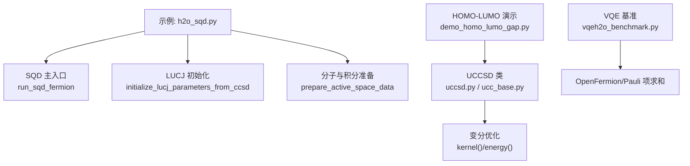
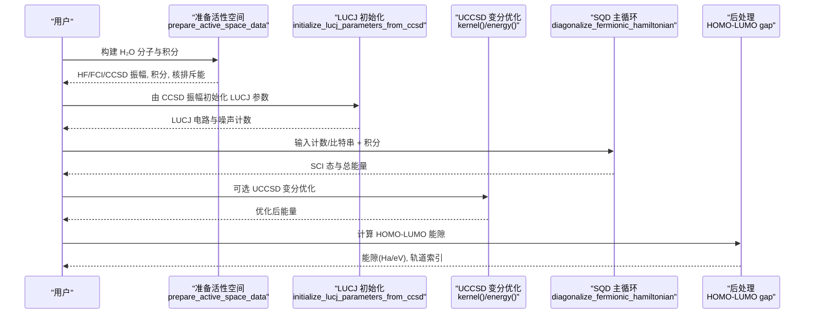
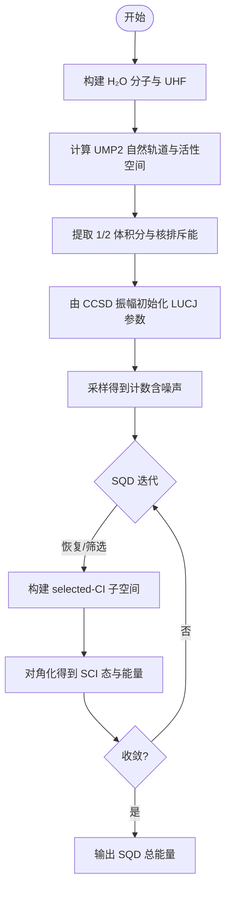
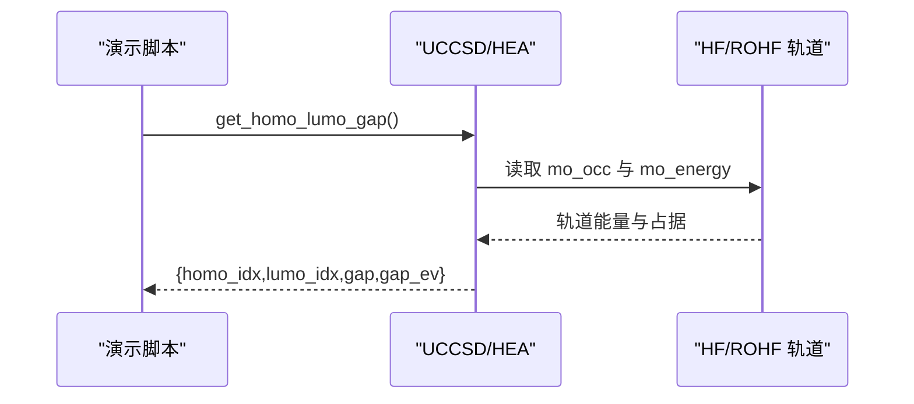
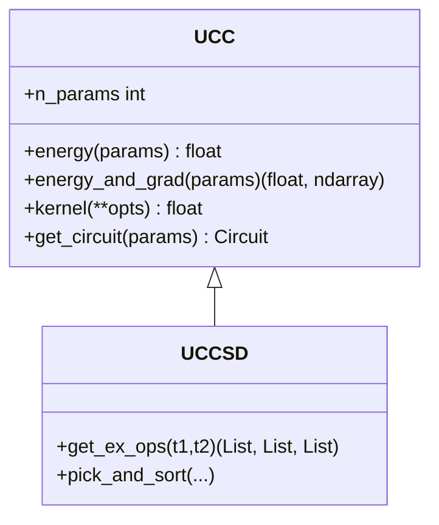
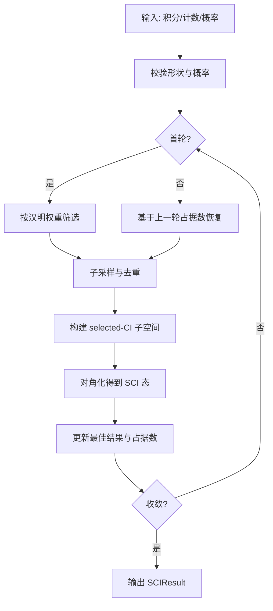
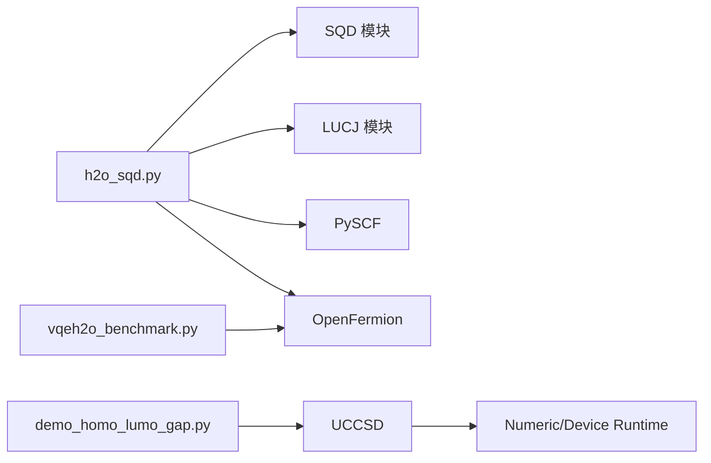

# 分子性质计算

<cite>
**本文引用的文件**
- [h2o_sqd.py](file://examples/h2o_sqd.py)
- [demo_homo_lumo_gap.py](file://examples/demo_homo_lumo_gap.py)
- [vqeh2o_benchmark.py](file://examples/vqeh2o_benchmark.py)
- [ucc_base.py](file://src/tyxonq/applications/chem/algorithms/vqe/ucc_base.py)
- [uccsd.py](file://src/tyxonq/applications/chem/algorithms/vqe/uccsd.py)
- [molecule.py](file://src/tyxonq/applications/chem/molecule.py)
- [sqd_init.py](file://src/tyxonq/applications/chem/algorithms/sqd/__init__.py)
- [sqd_fermion.py](file://src/tyxonq/applications/chem/algorithms/sqd/fermion.py)
- [lucj_init.py](file://src/tyxonq/applications/chem/algorithms/lucj/__init__.py)
</cite>

## 目录
1. [简介](#简介)
2. [项目结构](#项目结构)
3. [核心组件](#核心组件)
4. [架构总览](#架构总览)
5. [详细组件分析](#详细组件分析)
6. [依赖关系分析](#依赖关系分析)
7. [性能考量](#性能考量)
8. [故障排查指南](#故障排查指南)
9. [结论](#结论)
10. [附录](#附录)

## 简介
本文件面向使用 TyxonQ 进行量子化学计算的读者，聚焦水分子（H₂O）的基态能量计算、HOMO-LUMO 能隙分析与分子结构优化。文档以 UCCSD（单元耦合簇单双激发的量子变分形式）与 SQD（基于采样与子空间对角化的选择 CI 算法）为主线，系统讲解：
- 分子波函数构建（HF/ROHF 轨道、活性空间选取）
- 哈密顿量映射（积分到费米子/量子比特算符）
- 变分参数优化（UCCSD 振幅初始化、筛选与 L-BFGS-B 优化）
- SQD 流程（从计数或比特串恢复密度矩阵并迭代收敛）
- HOMO-LUMO 能隙计算（闭壳/开壳、活性空间、与 PySCF 一致性验证）
- 基准测试与传统方法对比（FCI、MP2、CCSD）

为便于理解，文中穿插流程图与时序图，并在每节末尾标注“章节来源”，在图示处标注“图示来源”。

## 项目结构
TyxonQ 的量子化学模块位于 applications/chem 下，围绕 UCC 族算法（UCC/UCCSD/HEA）、SQD、LUCJ、分子定义与哈密顿量构建等组织。示例脚本集中在 examples/ 中，提供端到端可运行的工作流。

**图示来源**
- [h2o_sqd.py:125-336](file://examples/h2o_sqd.py#L125-L336)
- [sqd_fermion.py:111-166](file://src/tyxonq/applications/chem/algorithms/sqd/fermion.py#L111-L166)
- [ucc_base.py:521-581](file://src/tyxonq/applications/chem/algorithms/vqe/ucc_base.py#L521-L581)
- [demo_homo_lumo_gap.py:14-176](file://examples/demo_homo_lumo_gap.py#L14-L176)
- [vqeh2o_benchmark.py:15-63](file://examples/vqeh2o_benchmark.py#L15-L63)

**章节来源**
- [h2o_sqd.py:1-376](file://examples/h2o_sqd.py#L1-L376)
- [ucc_base.py:52-360](file://src/tyxonq/applications/chem/algorithms/vqe/ucc_base.py#L52-L360)
- [uccsd.py:18-355](file://src/tyxonq/applications/chem/algorithms/vqe/uccsd.py#L18-L355)
- [molecule.py:122-132](file://src/tyxonq/applications/chem/molecule.py#L122-L132)
- [sqd_init.py:1-45](file://src/tyxonq/applications/chem/algorithms/sqd/__init__.py#L1-L45)
- [sqd_fermion.py:111-409](file://src/tyxonq/applications/chem/algorithms/sqd/fermion.py#L111-L409)
- [lucj_init.py:1-31](file://src/tyxonq/applications/chem/algorithms/lucj/__init__.py#L1-L31)
- [demo_homo_lumo_gap.py:1-201](file://examples/demo_homo_lumo_gap.py#L1-L201)
- [vqeh2o_benchmark.py:1-163](file://examples/vqeh2o_benchmark.py#L1-L163)

## 核心组件
- UCC/UCCSD：封装分子信息、HF/ROHF 参考态、活性空间、激发算符生成、哈密顿量构建、数值/设备运行、梯度与优化。
- SQD：从量子采样（计数/比特串）恢复有效构型，迭代选择子空间并对角化，输出 SCI 态与能量。
- LUCJ：基于 CCSD 振幅初始化的矩阵元线路，用于快速构造近似波函数与噪声模型下的计数。
- 分子工具：提供 H₂O 等常见分子的几何与基组定义，以及随机积分分子。

关键职责划分：
- 分子与积分：molecule.py 提供水分子；h2o_sqd.py 用 PySCF 计算自然轨道与活性空间积分。
- 哈密顿量映射：通过 OpenFermion 将费米子算符映射为量子比特算符（Jordan-Wigner），或直接使用积分构建。
- 变分优化：UCCSD.kernel() 调用 energy_and_grad()，默认使用 L-BFGS-B 优化。
- SQD 收敛：diagonalize_fermionic_hamiltonian() 内循环执行选择子空间对角化与占据数修复。

**章节来源**
- [ucc_base.py:52-360](file://src/tyxonq/applications/chem/algorithms/vqe/ucc_base.py#L52-L360)
- [uccsd.py:18-355](file://src/tyxonq/applications/chem/algorithms/vqe/uccsd.py#L18-L355)
- [sqd_fermion.py:111-409](file://src/tyxonq/applications/chem/algorithms/sqd/fermion.py#L111-L409)
- [molecule.py:122-132](file://src/tyxonq/applications/chem/molecule.py#L122-L132)

## 架构总览
下图展示水分子 H₂O 的完整计算链路：从分子与积分准备，到 UCCSD 变分优化与 SQD 恢复，再到 HOMO-LUMO 能隙评估与基准对比。

**图示来源**
- [h2o_sqd.py:125-336](file://examples/h2o_sqd.py#L125-L336)
- [sqd_fermion.py:169-339](file://src/tyxonq/applications/chem/algorithms/sqd/fermion.py#L169-L339)
- [ucc_base.py:521-581](file://src/tyxonq/applications/chem/algorithms/vqe/ucc_base.py#L521-L581)
- [demo_homo_lumo_gap.py:14-176](file://examples/demo_homo_lumo_gap.py#L14-L176)

## 详细组件分析

### 水分子 H₂O 基态能量计算（UCCSD + SQD）
- 分子与活性空间：
  - 使用 PySCF 构建 H₂O 几何，计算 UHF，再经 UMP2 自然轨道选择活性空间（默认 CAS(4e,4o)）。
  - 提取 1-体与 2-体积分及核排斥能，供后续 SQD 使用。
- LUCJ 初始化：
  - 基于 CCSD t1/t2 振幅初始化 LUCJ 参数，构建 1 层矩阵元线路。
  - 支持无噪声与 depolarizing 混合噪声两种模式，得到计数分布。
- SQD 恢复：
  - 对每个批次，按左右半区汉明权重筛选或依据上一轮占据数恢复构型。
  - 构建 selected-CI 子空间，调用 PySCF SelectedCI 对角化，更新最佳结果与占据数。
  - 当能量与占据数变化低于阈值时停止。
- 结果汇总：
  - 输出 HF、FCI、LUCJ（无噪/有噪）、SQD 总能量，便于对比。

**图示来源**
- [h2o_sqd.py:94-159](file://examples/h2o_sqd.py#L94-L159)
- [h2o_sqd.py:262-336](file://examples/h2o_sqd.py#L262-L336)
- [sqd_fermion.py:169-339](file://src/tyxonq/applications/chem/algorithms/sqd/fermion.py#L169-L339)

**章节来源**
- [h2o_sqd.py:83-159](file://examples/h2o_sqd.py#L83-L159)
- [h2o_sqd.py:262-336](file://examples/h2o_sqd.py#L262-L336)
- [sqd_fermion.py:111-166](file://src/tyxonq/applications/chem/algorithms/sqd/fermion.py#L111-L166)
- [sqd_fermion.py:169-339](file://src/tyxonq/applications/chem/algorithms/sqd/fermion.py#L169-L339)

### HOMO-LUMO 能隙分析
- 自动识别 HOMO/LUMO：
  - 根据轨道占据数确定最高占据与最低未占轨道，计算能差（Ha 与 eV）。
  - 支持闭壳（RHF）与开壳（ROHF）体系。
- 活性空间与手动指定：
  - 可在活性空间中计算能隙，也可手动指定轨道对。
- 与 PySCF 一致性验证：
  - 直接比较 TyxonQ 与 PySCF 的轨道能量与能隙，确保数值一致。

**图示来源**
- [demo_homo_lumo_gap.py:14-176](file://examples/demo_homo_lumo_gap.py#L14-L176)
- [ucc_base.py:52-360](file://src/tyxonq/applications/chem/algorithms/vqe/ucc_base.py#L52-L360)

**章节来源**
- [demo_homo_lumo_gap.py:14-176](file://examples/demo_homo_lumo_gap.py#L14-L176)
- [ucc_base.py:52-360](file://src/tyxonq/applications/chem/algorithms/vqe/ucc_base.py#L52-L360)

### 分子结构优化（几何优化思路）
- 在 TyxonQ 中，几何优化通常结合外部驱动（如 MD/QM/MM 接口）与量子化学扫描器：
  - 使用 QM 引擎（UCCSD/SQD）计算力与能量，驱动原子坐标更新。
  - 示例中展示了 QM/MM 与 ASE/OpenMM 集成路径，可用于 H₂O 振动与平衡几何搜索。
- 建议流程：
  - 固定电子态（如基态）→ 计算能量与梯度 → 更新几何 → 重复直至收敛。
  - 注意活性空间与基组选择对收敛性与精度的影响。

[本节为概念性说明，不直接分析具体文件]

### 变分参数优化（UCCSD）
- 初始化策略：
  - 支持 mp2/ccsd/fe/zeros 多种初始猜测，自动筛选小振幅激发。
- 优化器：
  - 默认 L-BFGS-B，支持解析梯度（参数平移法）或自由优化。
  - 缓存同一参数的能量与梯度，避免重复采样。
- 运行时：
  - numeric（状态向量/CI 向量）与 device（模拟器/真机）双路径。
  - shots=0 走解析路径，提高优化稳定性。

**图示来源**
- [ucc_base.py:52-360](file://src/tyxonq/applications/chem/algorithms/vqe/ucc_base.py#L52-L360)
- [ucc_base.py:521-581](file://src/tyxonq/applications/chem/algorithms/vqe/ucc_base.py#L521-L581)
- [uccsd.py:18-355](file://src/tyxonq/applications/chem/algorithms/vqe/uccsd.py#L18-L355)

**章节来源**
- [ucc_base.py:52-360](file://src/tyxonq/applications/chem/algorithms/vqe/ucc_base.py#L52-L360)
- [ucc_base.py:521-581](file://src/tyxonq/applications/chem/algorithms/vqe/ucc_base.py#L521-L581)
- [uccsd.py:18-355](file://src/tyxonq/applications/chem/algorithms/vqe/uccsd.py#L18-L355)

### SQD 算法流程（从计数到 SCI 态）
- 输入：1/2 体积分、计数或比特串矩阵、概率数组、目标占据数。
- 步骤：
  - 归一化概率，校验维度与约束。
  - 首轮按汉明权重筛选；后续用上一轮占据数恢复构型。
  - 子采样与去重，构建 selected-CI 子空间。
  - 对角化得到 SCI 态、RDM、能量与占据数。
  - 若能量与占据数稳定则收敛，否则继续迭代。
- 输出：SCIResult（包含总能量、SCIState、轨道占据数等）。

**图示来源**
- [sqd_fermion.py:169-339](file://src/tyxonq/applications/chem/algorithms/sqd/fermion.py#L169-L339)
- [sqd_fermion.py:342-409](file://src/tyxonq/applications/chem/algorithms/sqd/fermion.py#L342-L409)

**章节来源**
- [sqd_fermion.py:111-166](file://src/tyxonq/applications/chem/algorithms/sqd/fermion.py#L111-L166)
- [sqd_fermion.py:169-339](file://src/tyxonq/applications/chem/algorithms/sqd/fermion.py#L169-L339)
- [sqd_fermion.py:342-409](file://src/tyxonq/applications/chem/algorithms/sqd/fermion.py#L342-L409)

### 量子化学基本概念速览
- 分子轨道：HF/ROHF 自洽场求解得到的单粒子轨道，给出轨道能量与占据数。
- 电子相关能：超出 HF 平均场近似的能量修正，CCSD/FCI 等方法逐步逼近精确解。
- 几何优化：寻找势能面上的极小点，使原子受力为零，得到稳定构型。

[本节为概念性说明，不直接分析具体文件]

## 依赖关系分析
- 模块耦合：
  - h2o_sqd.py 依赖 SQD、LUCJ、PySCF 与 OpenFermion。
  - UCCSD 依赖 UCC 基类、哈密顿量构建、运行时（numeric/device）。
  - demo_homo_lumo_gap.py 依赖 UCCSD/HEA 与 molecule 工具。
  - vqeh2o_benchmark.py 依赖 OpenFermion 与 Pauli 项求和实现。
- 外部库：
  - PySCF：HF/MP2/CCSD/FCI、SelectedCI、积分计算。
  - OpenFermion：费米子/量子比特算符转换。
  - NumPy/Torch：数值计算与后端切换。

**图示来源**
- [h2o_sqd.py:23-35](file://examples/h2o_sqd.py#L23-L35)
- [ucc_base.py:20-42](file://src/tyxonq/applications/chem/algorithms/vqe/ucc_base.py#L20-L42)
- [demo_homo_lumo_gap.py:8-11](file://examples/demo_homo_lumo_gap.py#L8-L11)
- [vqeh2o_benchmark.py:15-35](file://examples/vqeh2o_benchmark.py#L15-L35)

**章节来源**
- [h2o_sqd.py:23-35](file://examples/h2o_sqd.py#L23-L35)
- [ucc_base.py:20-42](file://src/tyxonq/applications/chem/algorithms/vqe/ucc_base.py#L20-L42)
- [demo_homo_lumo_gap.py:8-11](file://examples/demo_homo_lumo_gap.py#L8-L11)
- [vqeh2o_benchmark.py:15-35](file://examples/vqeh2o_benchmark.py#L15-L35)

## 性能考量
- 解析路径优先：shots=0 走 analytic numeric 路径，避免采样噪声，提升优化稳定性与速度。
- 梯度缓存：同一参数的能量与梯度缓存，减少重复开销。
- 子空间裁剪：SQD 通过汉明权重筛选与重要构型保留，控制子空间规模。
- 活性空间：合理选择活性空间可显著降低计算成本，同时保持关键相关效应。
- 基准对比：
  - vqeh2o_benchmark.py 展示 Pauli 项求和的性能测量方式，便于评估不同后端与批大小。

[本节提供通用指导，不直接分析具体文件]

## 故障排查指南
- 非有限能量：
  - 检查样本是否包含所需汉明权重的比特串；必要时提供 initial_occupancies 启用恢复。
- 维度不匹配：
  - bitstring_matrix 列数应为 2*norb；概率数量需与样本数一致。
- 自旋对称化限制：
  - symmetrize_spin 要求 alpha/beta 电子数相等。
- 优化失败：
  - 调整 maxiter、ftol/gtol；确认初始猜测与筛选阈值；检查 runtime/shots 设置。
- 能隙异常：
  - 确认轨道占据判断逻辑（闭壳/开壳）；核对活性空间与基组；与 PySCF 结果比对。

**章节来源**
- [sqd_fermion.py:196-226](file://src/tyxonq/applications/chem/algorithms/sqd/fermion.py#L196-L226)
- [sqd_fermion.py:248-271](file://src/tyxonq/applications/chem/algorithms/sqd/fermion.py#L248-L271)
- [ucc_base.py:559-581](file://src/tyxonq/applications/chem/algorithms/vqe/ucc_base.py#L559-L581)
- [demo_homo_lumo_gap.py:136-176](file://examples/demo_homo_lumo_gap.py#L136-L176)

## 结论
TyxonQ 提供了从分子定义、哈密顿量映射、变分优化到采样恢复的一体化量子化学计算框架。通过 UCCSD 与 SQD 的组合，能够在保证精度的同时有效控制计算成本。HOMO-LUMO 能隙计算与基准测试表明，TyxonQ 与 PySCF 的结果高度一致，适用于水分子等中小体系的基态能量与电子结构分析。结合几何优化与 QM/MM 接口，可进一步扩展至更复杂的分子动力学场景。

[本节为总结性内容，不直接分析具体文件]

## 附录
- 常用参数建议：
  - 活性空间：CAS(4e,4o) 对 H₂O 通常足够；更大体系可按化学直觉选择。
  - 初始猜测：mp2/ccsd 优于 zeros，有助于加速收敛。
  - SQD 批大小与迭代次数：根据采样质量与内存限制调节。
- 参考示例：
  - h2o_sqd.py：端到端 H₂O 的 LUCJ+SQD 流程。
  - demo_homo_lumo_gap.py：HOMO-LUMO 能隙的多场景演示。
  - vqeh2o_benchmark.py：Pauli 项求和的性能基准。

[本节为补充信息，不直接分析具体文件]