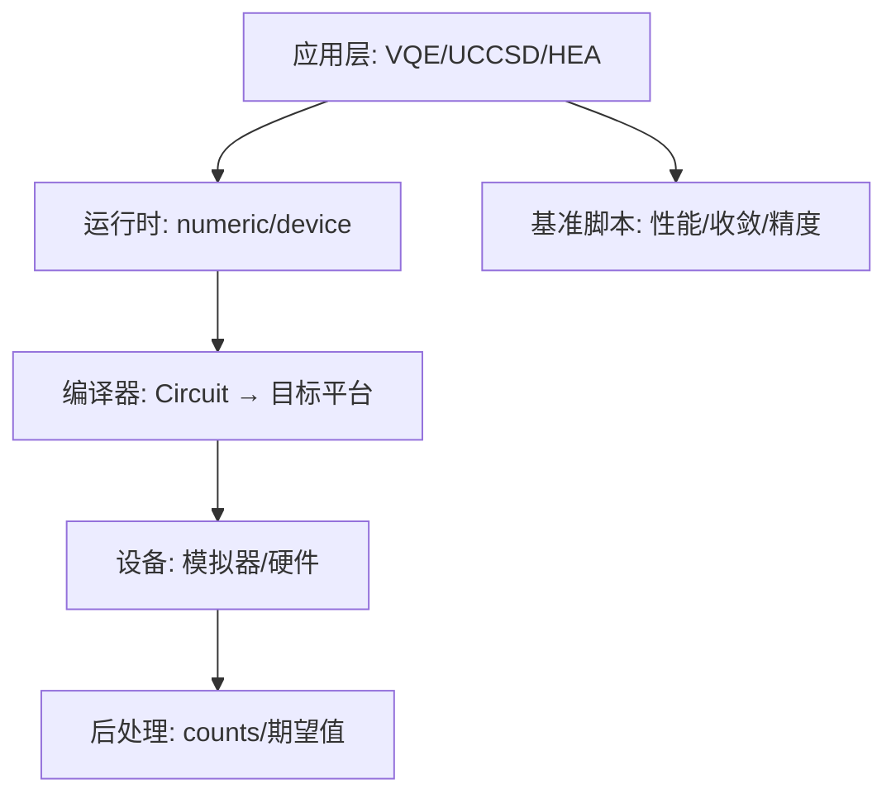
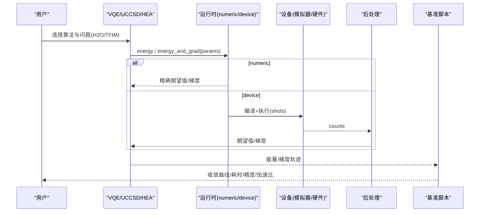
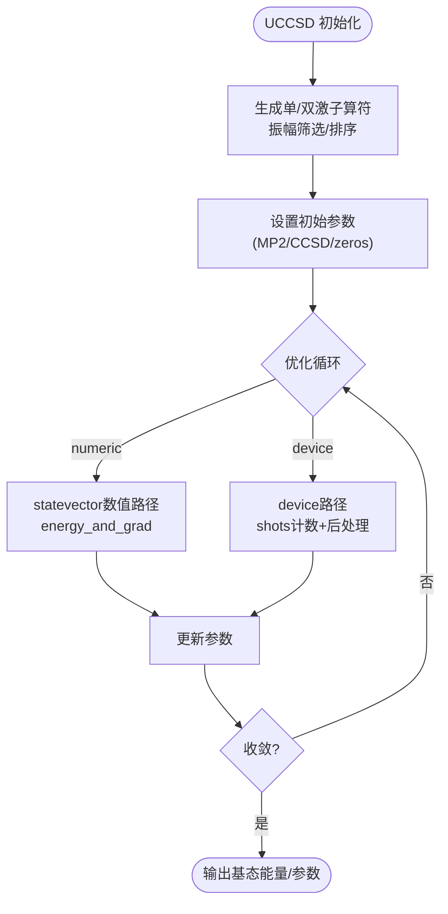
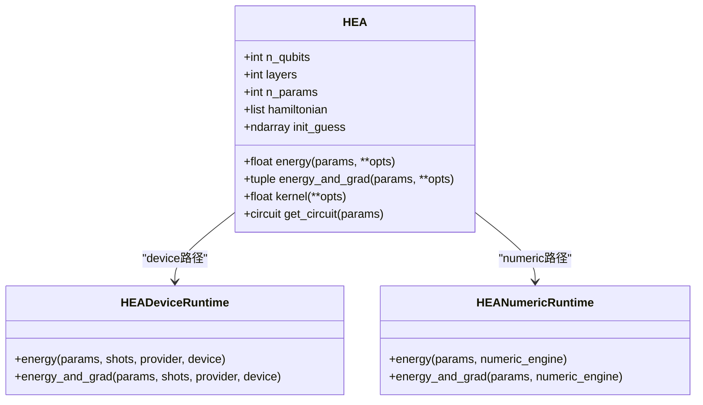
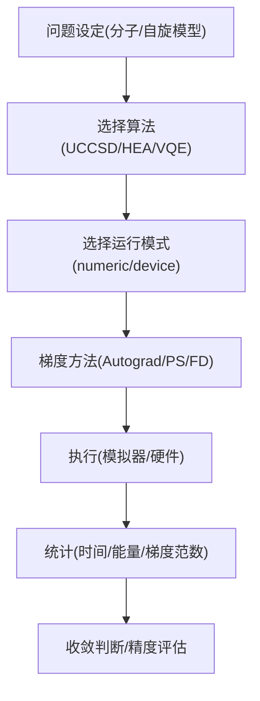
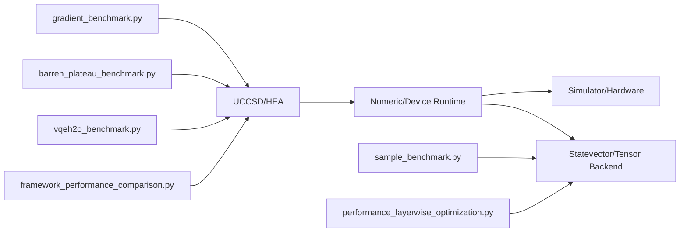

# 基准测试与比较

<cite>
**本文引用的文件**
- [framework_performance_comparison.py](file://examples/framework_performance_comparison.py)
- [vqeh2o_benchmark.py](file://examples/vqeh2o_benchmark.py)
- [vqetfim_benchmark.py](file://examples/vqetfim_benchmark.py)
- [barren_plateau_benchmark.py](file://examples/barren_plateau_benchmark.py)
- [gradient_benchmark.py](file://examples/gradient_benchmark.py)
- [sample_benchmark.py](file://examples/sample_benchmark.py)
- [performance_layerwise_optimization.py](file://examples/performance_layerwise_optimization.py)
- [uccsd.py](file://src/tyxonq/applications/chem/algorithms/vqe/uccsd.py)
- [hea.py](file://src/tyxonq/applications/chem/algorithms/vqe/hea.py)
- [__init__.py](file://src/tyxonq/applications/chem/algorithms/vqe/__init__.py)
</cite>

## 目录
1. [引言](#引言)
2. [项目结构](#项目结构)
3. [核心组件](#核心组件)
4. [架构总览](#架构总览)
5. [详细组件分析](#详细组件分析)
6. [依赖关系分析](#依赖关系分析)
7. [性能考量](#性能考量)
8. [故障排查指南](#故障排查指南)
9. [结论](#结论)
10. [附录](#附录)

## 引言
本文件面向TyxonQ量子化学应用的基准测试与性能比较，聚焦VQE、UCCSD、HEA等算法在不同规模量子系统上的收敛速度、精度与计算资源消耗。文档提供系统性基准框架：指标定义、测试环境配置、结果统计方法，以及与其它量子计算框架（如Qiskit、PennyLane）的性能对比。同时给出针对梯度计算、采样噪声、退相干与JIT编译等关键瓶颈的优化建议。

## 项目结构
仓库包含丰富的基准脚本与算法实现：
- 算法实现位于 src/tyxonq/applications/chem/algorithms/vqe/，包括UCCSD、HEA及其运行时封装。
- 基准示例位于 examples/，涵盖多场景：TFIM/H2O分子VQE、梯度/QFI/Hessian基准、采样后端对比、 barren plateau 现象验证、分层状态计算优化等。
- 通过统一API将“电路构建—编译—设备执行—后处理”串联，支持数值模拟与真机/模拟器两种路径。

**图表来源**
- [uccsd.py:155-265](file://src/tyxonq/applications/chem/algorithms/vqe/uccsd.py#L155-L265)
- [hea.py:125-246](file://src/tyxonq/applications/chem/algorithms/vqe/hea.py#L125-L246)
- [framework_performance_comparison.py:75-408](file://examples/framework_performance_comparison.py#L75-L408)

**章节来源**
- [uccsd.py:155-265](file://src/tyxonq/applications/chem/algorithms/vqe/uccsd.py#L155-L265)
- [hea.py:125-246](file://src/tyxonq/applications/chem/algorithms/vqe/hea.py#L125-L246)
- [framework_performance_comparison.py:75-408](file://examples/framework_performance_comparison.py#L75-L408)

## 核心组件
- UCCSD：基于单双激发的变分量子本征求解器，支持振幅筛选、活性空间、多种初始化策略，兼容device/numeric运行模式。
- HEA：硬件高效 Ansatz，RY-only结构配合CNOT链，支持从分子积分或PySCF分子对象构造，内置参数移位梯度与SciPy优化。
- 运行时：numeric（精确态矢量/张量后端）与device（shots计数/后处理）两条路径；HEA/UCCSD均暴露energy/energy_and_grad接口。
- 基准脚本：覆盖不同问题（TFIM/H2O）、不同梯度方法（autograd/parameter-shift/有限差分）、不同后端（numpy/pytorch/cupynumeric），以及 barren plateau 与分层优化。

**章节来源**
- [uccsd.py:18-154](file://src/tyxonq/applications/chem/algorithms/vqe/uccsd.py#L18-L154)
- [hea.py:28-124](file://src/tyxonq/applications/chem/algorithms/vqe/hea.py#L28-L124)
- [__init__.py:1-49](file://src/tyxonq/applications/chem/algorithms/vqe/__init__.py#L1-L49)

## 架构总览
下图展示从问题建模到性能评估的端到端流程，突出三种TyxonQ执行模式与跨框架对比。

**图表来源**
- [framework_performance_comparison.py:75-408](file://examples/framework_performance_comparison.py#L75-L408)
- [hea.py:231-266](file://src/tyxonq/applications/chem/algorithms/vqe/hea.py#L231-L266)
- [uccsd.py:267-355](file://src/tyxonq/applications/chem/algorithms/vqe/uccsd.py#L267-L355)

## 详细组件分析

### UCCSD 基准与性能
- 算法要点：单双激发算符、振幅筛选、活性空间、MP2/CCSD初始猜测；支持device/numeric运行。
- 基准实践：在H4等小分子上对比NumPy与PyTorch后端步时，使用statevector数值引擎进行能量与梯度计算；可切换runtime以评估不同后端对收敛速度与精度的影响。
- 复杂度与资源：参数数量随激子数增长；筛选与活性空间可降低开销；device路径受shots噪声影响，需更多迭代或更高shots。

**图表来源**
- [uccsd.py:267-355](file://src/tyxonq/applications/chem/algorithms/vqe/uccsd.py#L267-L355)

**章节来源**
- [uccsd.py:18-154](file://src/tyxonq/applications/chem/algorithms/vqe/uccsd.py#L18-L154)
- [uccsd.py:267-355](file://src/tyxonq/applications/chem/algorithms/vqe/uccsd.py#L267-L355)

### HEA 基准与性能
- 电路结构：RY-only + CNOT链，参数数量为 (layers+1)×n_qubits；可从分子积分或PySCF分子对象构造。
- 梯度与优化：默认参数移位法；内部使用SciPy最小化（L-BFGS-B/COBYLA），自动选择shots（模拟器解析路径默认shots=0）。
- 基准实践：在TFIM/H2O等体系上对比三种TyxonQ模式（shot-based、NumPy+value_and_grad、PyTorch+Autograd），并与其他框架（Qiskit/PennyLane）对比。

**图表来源**
- [hea.py:125-246](file://src/tyxonq/applications/chem/algorithms/vqe/hea.py#L125-L246)

**章节来源**
- [hea.py:28-124](file://src/tyxonq/applications/chem/algorithms/vqe/hea.py#L28-L124)
- [hea.py:231-337](file://src/tyxonq/applications/chem/algorithms/vqe/hea.py#L231-L337)

### 基准脚本与指标定义
- 框架对比（framework_performance_comparison.py）：
  - 三种TyxonQ模式：Shot-based（完整编译+设备+后处理）、NumPy+value_and_grad（有限差分）、PyTorch+Autograd（推荐最佳实践）。
  - 对比维度：API风格、执行性能、优化特性（JIT/autograd）、可扩展性。
  - 指标：每步平均时间、总时间、最终能量、相对加速比。
- H2O分子VQE（vqeh2o_benchmark.py）：
  - 直接数值路径：量子库+PyTorch，按基分组测量Pauli项期望，避免构建稠密哈密顿量。
  - 指标：阶段耗时与运行耗时分离，便于识别JIT/编译开销。
- TFIM自旋VQE（vqetfim_benchmark.py）：
  - 对比counts路径（有限shots）与exact路径（态矢量），用于评估采样噪声对收敛的影响。
- Barren Plateau（barren_plateau_benchmark.py）：
  - 三种梯度方法：理想Autograd、Parameter Shift（含shots）、Parameter Shift+噪声；统计梯度方差与理论缩放 O(1/2^(n/2)) 的偏差。
- 梯度基准（gradient_benchmark.py）：
  - TyxonQ counts路径（parameter-shift）与direct state路径（QFI有限差分、Hessian autograd），可选Qiskit对比。
- 采样后端基准（sample_benchmark.py）：
  - 比较numpy/pytorch/cupynumeric后端的采样吞吐与时延。
- 分层状态计算优化（performance_layerwise_optimization.py）：
  - 深度噪声电路下，逐层强制中间状态计算，显著降低JIT编译时间（10-30x），运行略慢（~1.2-1.5x）。

**图表来源**
- [framework_performance_comparison.py:75-408](file://examples/framework_performance_comparison.py#L75-L408)
- [vqeh2o_benchmark.py:1-163](file://examples/vqeh2o_benchmark.py#L1-L163)
- [vqetfim_benchmark.py:1-124](file://examples/vqetfim_benchmark.py#L1-L124)
- [barren_plateau_benchmark.py:142-480](file://examples/barren_plateau_benchmark.py#L142-L480)
- [gradient_benchmark.py:30-320](file://examples/gradient_benchmark.py#L30-L320)
- [sample_benchmark.py:16-91](file://examples/sample_benchmark.py#L16-L91)
- [performance_layerwise_optimization.py:62-184](file://examples/performance_layerwise_optimization.py#L62-L184)

**章节来源**
- [framework_performance_comparison.py:75-408](file://examples/framework_performance_comparison.py#L75-L408)
- [vqeh2o_benchmark.py:1-163](file://examples/vqeh2o_benchmark.py#L1-L163)
- [vqetfim_benchmark.py:1-124](file://examples/vqetfim_benchmark.py#L1-L124)
- [barren_plateau_benchmark.py:142-480](file://examples/barren_plateau_benchmark.py#L142-L480)
- [gradient_benchmark.py:30-320](file://examples/gradient_benchmark.py#L30-L320)
- [sample_benchmark.py:16-91](file://examples/sample_benchmark.py#L16-L91)
- [performance_layerwise_optimization.py:62-184](file://examples/performance_layerwise_optimization.py#L62-L184)

## 依赖关系分析
- 算法与运行时耦合：UCCSD/HEA通过runtimes抽象出device/numeric路径，屏蔽底层差异。
- 基准脚本依赖：
  - framework_performance_comparison.py 依赖TyxonQ API、Qiskit/PennyLane（可选）进行跨框架对比。
  - vqeh2o_benchmark.py 依赖OpenFermion/PySCF获取分子哈密顿量。
  - barren_plateau_benchmark.py 依赖TyxonQ链式API与噪声模型。
  - gradient_benchmark.py 提供QFI/Hessian的数值与autograd实现，并可选Qiskit对比。
- 外部依赖：
  - PySCF/OpenFermion用于分子数据与积分。
  - Qiskit/PennyLane用于交叉验证与对比。

**图表来源**
- [uccsd.py:155-265](file://src/tyxonq/applications/chem/algorithms/vqe/uccsd.py#L155-L265)
- [hea.py:125-246](file://src/tyxonq/applications/chem/algorithms/vqe/hea.py#L125-L246)
- [framework_performance_comparison.py:75-408](file://examples/framework_performance_comparison.py#L75-L408)
- [vqeh2o_benchmark.py:1-163](file://examples/vqeh2o_benchmark.py#L1-L163)
- [barren_plateau_benchmark.py:142-480](file://examples/barren_plateau_benchmark.py#L142-L480)
- [gradient_benchmark.py:30-320](file://examples/gradient_benchmark.py#L30-L320)
- [sample_benchmark.py:16-91](file://examples/sample_benchmark.py#L16-L91)
- [performance_layerwise_optimization.py:62-184](file://examples/performance_layerwise_optimization.py#L62-L184)

**章节来源**
- [uccsd.py:155-265](file://src/tyxonq/applications/chem/algorithms/vqe/uccsd.py#L155-L265)
- [hea.py:125-246](file://src/tyxonq/applications/chem/algorithms/vqe/hea.py#L125-L246)
- [framework_performance_comparison.py:75-408](file://examples/framework_performance_comparison.py#L75-L408)

## 性能考量
- 执行模式选择：
  - 开发调试优先使用numeric路径（无shots噪声、更快收敛）。
  - 真机/模拟器评估使用device路径，合理设置shots与优化器步数。
- 梯度方法：
  - Autograd（PyTorch）最快且稳定，适合数值模拟。
  - Parameter Shift适用于真实设备，注意shots带来的统计误差。
  - 有限差分用于QFI/Hessian等二阶信息，但成本较高。
- 后端与JIT：
  - PyTorch后端通常优于NumPy；Cupy可用于GPU加速（若可用）。
  - 深度噪声电路建议使用分层状态计算以降低JIT编译时间。
- 采样与噪声：
  - 增加shots可减小统计误差，但提高耗时；必要时结合读噪抑制或误差缓解。
  - 噪声模型（退极化/相位阻尼）会改变收敛行为，需在基准中显式报告。
- 指标与统计：
  - 每步平均时间、总时间、最终能量、梯度范数、收敛步数。
  - 多次重复取均值与标准差，剔除首次JIT预热。
  - 与理论值（FCI/经典参考）比较绝对误差与相对误差。

[本节为通用指导，不直接分析具体文件]

## 故障排查指南
- 导入失败或依赖缺失：
  - Qiskit/PennyLane未安装时，相关对比路径将被跳过；确保按需安装。
  - OpenFermion/PySCF用于分子数据，缺失时将无法构建H2O等分子哈密顿量。
- 设备/后端错误：
  - 切换backend时需确认目标后端可用；某些后端可能不支持特定操作。
  - device路径需正确设置provider/device/shots；模拟器默认statevector。
- 收敛异常：
  - 检查学习率、优化器、shots数量与噪声强度。
  - 对于深电路，考虑分层状态计算或更浅的Ansatz。
- 性能瓶颈：
  - JIT编译时间长：采用分层状态计算或减少噪声通道。
  - 采样噪声大：增加shots或使用数值路径验证。

**章节来源**
- [framework_performance_comparison.py:415-575](file://examples/framework_performance_comparison.py#L415-L575)
- [gradient_benchmark.py:189-320](file://examples/gradient_benchmark.py#L189-L320)
- [performance_layerwise_optimization.py:62-184](file://examples/performance_layerwise_optimization.py#L62-L184)

## 结论
- TyxonQ提供统一的VQE/UCCSD/HEA实现与灵活的numeric/device路径，支持从分子到自旋模型的广泛基准。
- 三种执行模式（shot-based、NumPy+value_and_grad、PyTorch+Autograd）覆盖了从真实硬件到最优性能的连续谱。
- 基准脚本系统化地评估了收敛速度、精度与资源消耗，并与Qiskit/PennyLane进行了对比。
- 针对深度噪声电路，分层状态计算显著改善JIT编译时间，是NISQ模拟的重要优化手段。
- 建议在基准报告中明确：问题规模、Ansatz、优化器、shots、噪声模型、后端与JIT开关，以保证结果可复现与可比性。

[本节为总结，不直接分析具体文件]

## 附录
- 常用基准命令与参数：
  - 框架对比：运行framework_performance_comparison.py，调整N_QUBITS/N_LAYERS/N_STEPS/N_SHOTS。
  - H2O分子VQE：运行vqeh2o_benchmark.py，关注stage_s与run_s分离的耗时。
  - TFIM自旋VQE：运行vqetfim_benchmark.py，对比counts_energy与exact_energy。
  - Barren Plateau：运行barren_plateau_benchmark.py，比较Method A/B/C的梯度方差。
  - 梯度基准：运行gradient_benchmark.py，输出JSON结果至gradient_results.data。
  - 采样后端：运行sample_benchmark.py，比较numpy/pytorch/cupynumeric吞吐。
  - 分层优化：运行performance_layerwise_optimization.py，观察编译与运行权衡。

[本节为补充说明，不直接分析具体文件]