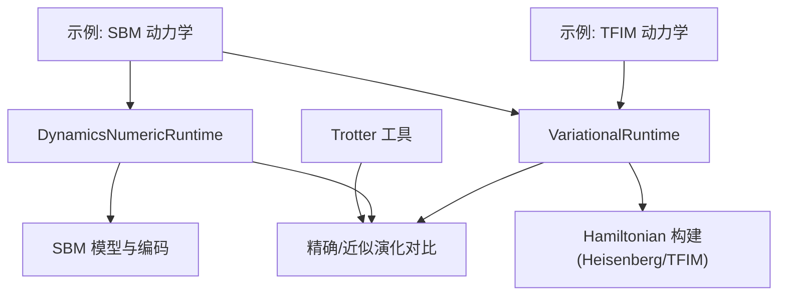
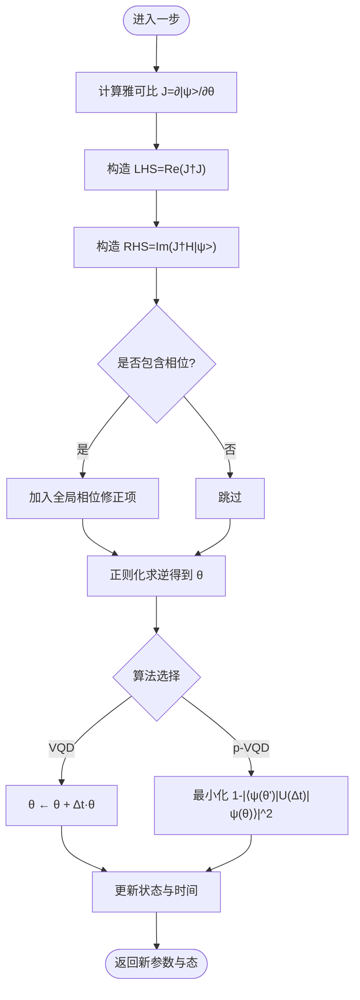
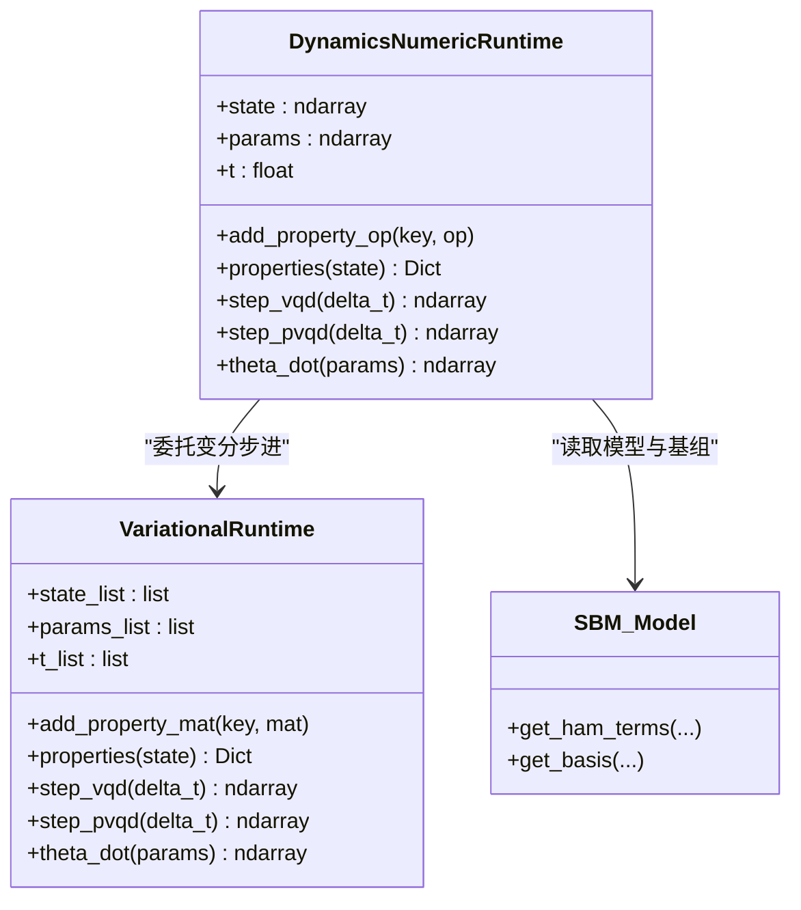
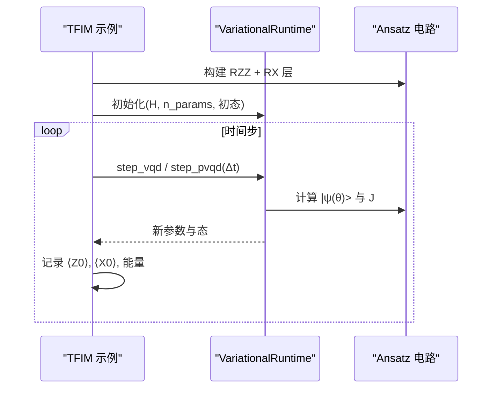
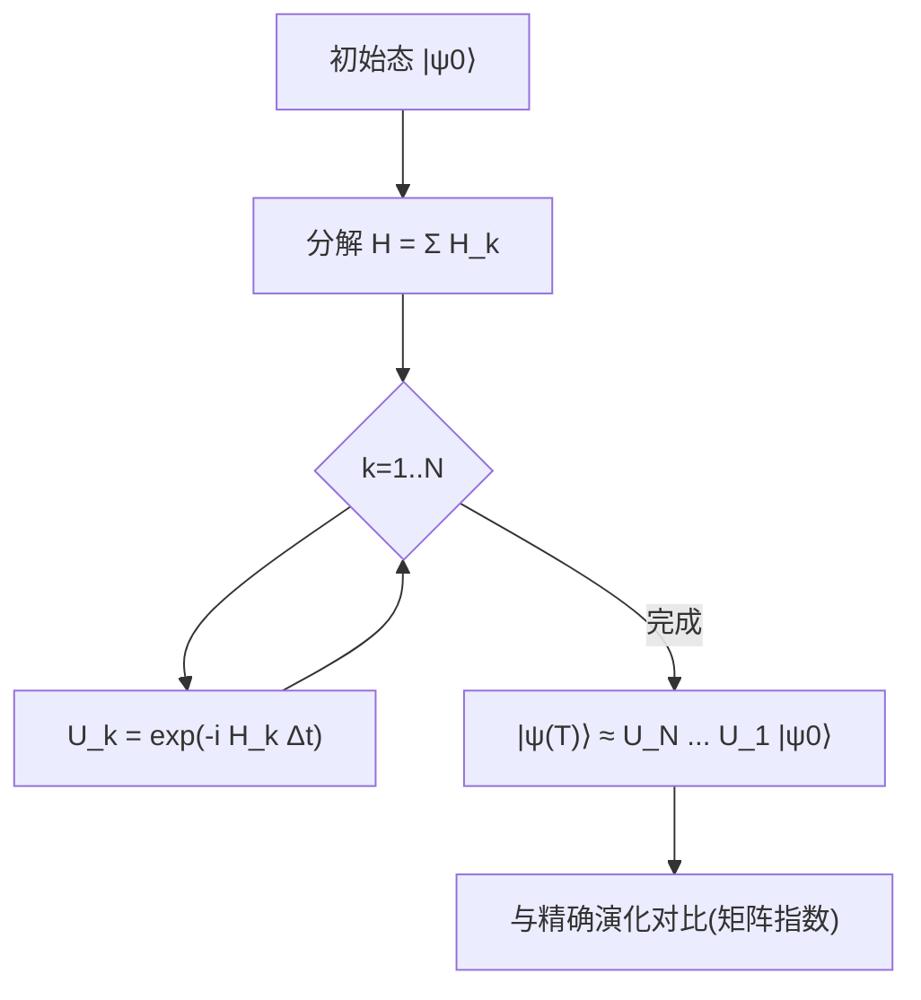
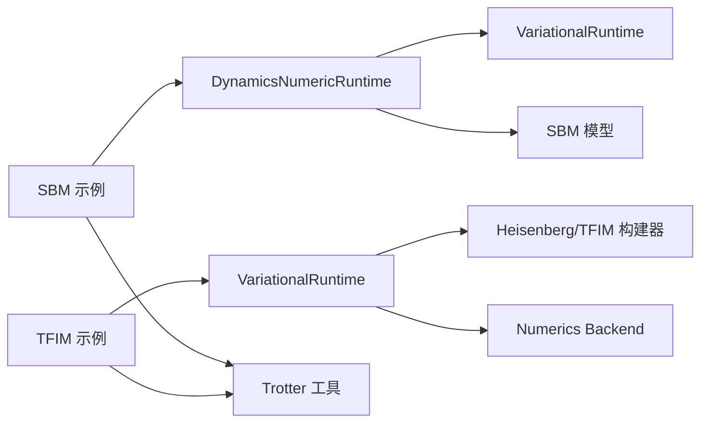

# 量子动力学模拟

<cite>
**本文引用的文件**
- [examples/variational_quantum_dynamics_sbm.py](file://examples/variational_quantum_dynamics_sbm.py)
- [examples/variational_quantum_dynamics_tfim.py](file://examples/variational_quantum_dynamics_tfim.py)
- [src/tyxonq/applications/chem/dynamics/models/sbm.py](file://src/tyxonq/applications/chem/dynamics/models/sbm.py)
- [src/tyxonq/applications/chem/dynamics/evolution.py](file://src/tyxonq/applications/chem/dynamics/evolution.py)
- [src/tyxonq/libs/circuits_library/variational.py](file://src/tyxonq/libs/circuits_library/variational.py)
- [examples/timeevolution_trotter.py](file://examples/timeevolution_trotter.py)
- [examples/hamiltonian_trotter_evolution.py](file://examples/hamiltonian_trotter_evolution.py)
- [tests_mol_valid/test_dynamics.py](file://tests_mol_valid/test_dynamics.py)
</cite>

## 目录
1. [简介](#简介)
2. [项目结构](#项目结构)
3. [核心组件](#核心组件)
4. [架构总览](#架构总览)
5. [详细组件分析](#详细组件分析)
6. [依赖关系分析](#依赖关系分析)
7. [性能考量](#性能考量)
8. [故障排查指南](#故障排查指南)
9. [结论](#结论)
10. [附录](#附录)

## 简介
本文件面向在 TyxonQ 中开展量子动力学模拟的研究与工程实践，重点围绕变分量子动力学（VQD）方法在两类典型模型中的应用：自旋玻色子模型（SBM）与横向场伊辛模型（TFIM）。文档从数学基础出发，系统阐述 Trotter 演化、时间传播算子与量子态演化的原理，并给出完整的实现流程：初始态准备、时间演化算子构建、变分参数更新与可观测量计算。同时提供对动态行为、相变现象与非平衡过程的分析思路与实践建议。

## 项目结构
TyxonQ 将动力学模拟能力分层组织：
- 示例层：以 SBM 与 TFIM 为应用入口，演示 VQD/p-VQD 的端到端流程与可视化对比。
- 运行时层：提供通用变分运行时 VariationalRuntime 与面向化学应用的数值运行时 DynamicsNumericRuntime。
- 模型与编码层：SBM 模型定义与哈密顿量项构造；算符到量子比特基的编码。
- Trotter 工具层：Trotter 电路构建与执行，便于与精确演化进行对照。



图表来源
- [examples/variational_quantum_dynamics_sbm.py:54-116](file://examples/variational_quantum_dynamics_sbm.py#L54-L116)
- [examples/variational_quantum_dynamics_tfim.py:82-175](file://examples/variational_quantum_dynamics_tfim.py#L82-L175)
- [src/tyxonq/applications/chem/dynamics/evolution.py:54-165](file://src/tyxonq/applications/chem/dynamics/evolution.py#L54-L165)
- [src/tyxonq/libs/circuits_library/variational.py:153-254](file://src/tyxonq/libs/circuits_library/variational.py#L153-L254)
- [examples/timeevolution_trotter.py:34-53](file://examples/timeevolution_trotter.py#L34-L53)

章节来源
- [examples/variational_quantum_dynamics_sbm.py:54-116](file://examples/variational_quantum_dynamics_sbm.py#L54-L116)
- [examples/variational_quantum_dynamics_tfim.py:82-175](file://examples/variational_quantum_dynamics_tfim.py#L82-L175)
- [src/tyxonq/applications/chem/dynamics/evolution.py:54-165](file://src/tyxonq/applications/chem/dynamics/evolution.py#L54-L165)
- [src/tyxonq/libs/circuits_library/variational.py:153-254](file://src/tyxonq/libs/circuits_library/variational.py#L153-L254)
- [examples/timeevolution_trotter.py:34-53](file://examples/timeevolution_trotter.py#L34-L53)

## 核心组件
- 变分运行时 VariationalRuntime：基于 McLachlan 变分原理求解参数时间导数，支持 VQD 欧拉步进与 p-VQD 投影优化，维护状态、参数与时间的历史列表，并提供可观测量接口。
- 数值运行时 DynamicsNumericRuntime：面向化学应用，封装 SBM 等模型的哈密顿量编码、稠密矩阵缓存、初态构造与 ansatz 构建，并复用 VariationalRuntime 完成步进步骤。
- SBM 模型：提供自旋-玻色子模型的哈密顿量项与多模谐振子基组构造。
- TFIM 示例：使用 Heisenberg 哈密顿量构建器生成横向场伊辛模型，配合自定义变分电路进行动力学模拟。
- Trotter 工具：通过 build_trotter_circuit 将 Pauli 项分解为可执行的 Trotter 电路，用于精确或近似演化对比。

章节来源
- [src/tyxonq/libs/circuits_library/variational.py:99-150](file://src/tyxonq/libs/circuits_library/variational.py#L99-L150)
- [src/tyxonq/libs/circuits_library/variational.py:153-254](file://src/tyxonq/libs/circuits_library/variational.py#L153-L254)
- [src/tyxonq/applications/chem/dynamics/evolution.py:54-165](file://src/tyxonq/applications/chem/dynamics/evolution.py#L54-L165)
- [src/tyxonq/applications/chem/dynamics/models/sbm.py:6-23](file://src/tyxonq/applications/chem/dynamics/models/sbm.py#L6-L23)
- [examples/variational_quantum_dynamics_tfim.py:88-103](file://examples/variational_quantum_dynamics_tfim.py#L88-L103)
- [examples/timeevolution_trotter.py:34-53](file://examples/timeevolution_trotter.py#L34-L53)

## 架构总览
下图展示了 SBM 与 TFIM 两种动力学路径如何共享底层变分运行时，并通过 Trotter 工具进行对照验证。

```mermaid
sequenceDiagram
participant U as "用户脚本"
participant SBM as "SBM 模型"
participant EN as "DynamicsNumericRuntime"
participant VR as "VariationalRuntime"
participant TR as "Trotter 工具"
participant EX as "精确演化(矩阵指数)"
U->>SBM : 获取哈密顿量项与基组
SBM-->>U : ham_terms, basis
U->>EN : 初始化(编码+稠密H+初态)
EN->>VR : 构建 ansatz_state_fn + 运行步长
loop 每个时间步
U->>EN : step_vqd / step_pvqd(delta_t)
EN->>VR : theta_dot() / 优化损失
VR-->>EN : 新参数与新态
U->>U : 记录可观测量与能量
opt : U->>TR : 构建 Trotter 电路
TR-->>EX : 对比精确演化结果
end
```

图表来源
- [examples/variational_quantum_dynamics_sbm.py:79-156](file://examples/variational_quantum_dynamics_sbm.py#L79-L156)
- [src/tyxonq/applications/chem/dynamics/evolution.py:137-165](file://src/tyxonq/applications/chem/dynamics/evolution.py#L137-L165)
- [src/tyxonq/libs/circuits_library/variational.py:218-252](file://src/tyxonq/libs/circuits_library/variational.py#L218-L252)
- [examples/timeevolution_trotter.py:34-53](file://examples/timeevolution_trotter.py#L34-L53)

## 详细组件分析

### 变分量子动力学（VQD）数学基础与实现
- 目标：在参数化态流形上逼近薛定谔方程 i d|ψ>/dt = H|ψ>，最小化 ||d|ψ>/dt + iH|ψ>||（McLachlan 变分原理）。
- 关键步骤：
  - 计算雅可比矩阵 J = ∂|ψ(θ)>/∂θ。
  - 解正规方程 (Re(J†J)) θ̇ = Im(J†H|ψ>)，可选包含全局相位项。
  - 欧拉步进 θ ← θ + Δt·θ̇（VQD），或通过投影优化最大化 |⟨ψ(θ)|exp(-iHΔt)|ψ(θ)⟩|^2（p-VQD）。
- 代码映射：
  - 雅可比与正则化求逆：[parameter_time_derivative:99-125](file://src/tyxonq/libs/circuits_library/variational.py#L99-L125)。
  - p-VQD 损失函数：[pvqd_loss_function:128-140](file://src/tyxonq/libs/circuits_library/variational.py#L128-L140)。
  - 步长更新与状态维护：[step_vqd / step_pvqd:230-252](file://src/tyxonq/libs/circuits_library/variational.py#L230-L252)。



图表来源
- [src/tyxonq/libs/circuits_library/variational.py:99-150](file://src/tyxonq/libs/circuits_library/variational.py#L99-L150)
- [src/tyxonq/libs/circuits_library/variational.py:218-252](file://src/tyxonq/libs/circuits_library/variational.py#L218-L252)

章节来源
- [src/tyxonq/libs/circuits_library/variational.py:99-150](file://src/tyxonq/libs/circuits_library/variational.py#L99-L150)
- [src/tyxonq/libs/circuits_library/variational.py:218-252](file://src/tyxonq/libs/circuits_library/variational.py#L218-L252)

### 自旋玻色子模型（SBM）动力学
- 模型要点：二能级系统与多个玻色子模式耦合，哈密顿量包含偏置项、隧穿项、模式频率项及耦合项。
- 实现要点：
  - 通过模型模块生成哈密顿量项与基组，并进行量子比特编码。
  - 数值运行时懒加载稠密矩阵项，避免重复开销。
  - 支持添加可观测量（如 ⟨Z⟩、⟨X⟩）并在每步记录。
- 参考路径：
  - SBM 模型与基组：[get_ham_terms / get_basis:6-23](file://src/tyxonq/applications/chem/dynamics/models/sbm.py#L6-L23)
  - 编码与运行时初始化：[DynamicsNumericRuntime.__init__:54-165](file://src/tyxonq/applications/chem/dynamics/evolution.py#L54-L165)
  - 示例驱动流程：[SBM 示例:54-156](file://examples/variational_quantum_dynamics_sbm.py#L54-L156)



图表来源
- [src/tyxonq/applications/chem/dynamics/evolution.py:54-165](file://src/tyxonq/applications/chem/dynamics/evolution.py#L54-L165)
- [src/tyxonq/libs/circuits_library/variational.py:153-254](file://src/tyxonq/libs/circuits_library/variational.py#L153-L254)
- [src/tyxonq/applications/chem/dynamics/models/sbm.py:6-23](file://src/tyxonq/applications/chem/dynamics/models/sbm.py#L6-L23)

章节来源
- [src/tyxonq/applications/chem/dynamics/models/sbm.py:6-23](file://src/tyxonq/applications/chem/dynamics/models/sbm.py#L6-L23)
- [src/tyxonq/applications/chem/dynamics/evolution.py:54-165](file://src/tyxonq/applications/chem/dynamics/evolution.py#L54-L165)
- [examples/variational_quantum_dynamics_sbm.py:54-156](file://examples/variational_quantum_dynamics_sbm.py#L54-L156)

### 横向场伊辛模型（TFIM）动力学
- 模型要点：一维链上的最近邻 ZZ 耦合与横向 X 场，存在量子相变点（h≈J）。
- 实现要点：
  - 使用 Heisenberg 哈密顿量构建器生成 TFIM 的 Pauli 项。
  - 自定义变分电路（RZZ 纠缠 + RX 旋转）作为 ansatz。
  - 通过 VariationalRuntime 直接驱动 VQD/p-VQD 步进。
- 参考路径：
  - TFIM 哈密顿量构建：[heisenberg_hamiltonian:88-103](file://examples/variational_quantum_dynamics_tfim.py#L88-L103)
  - 变分电路与运行时初始化：[ansatz_state_fn / VariationalRuntime:125-175](file://examples/variational_quantum_dynamics_tfim.py#L125-L175)
  - 步进循环与观测：[主循环:220-261](file://examples/variational_quantum_dynamics_tfim.py#L220-L261)



图表来源
- [examples/variational_quantum_dynamics_tfim.py:88-175](file://examples/variational_quantum_dynamics_tfim.py#L88-L175)
- [examples/variational_quantum_dynamics_tfim.py:220-261](file://examples/variational_quantum_dynamics_tfim.py#L220-L261)
- [src/tyxonq/libs/circuits_library/variational.py:218-252](file://src/tyxonq/libs/circuits_library/variational.py#L218-L252)

章节来源
- [examples/variational_quantum_dynamics_tfim.py:88-175](file://examples/variational_quantum_dynamics_tfim.py#L88-L175)
- [examples/variational_quantum_dynamics_tfim.py:220-261](file://examples/variational_quantum_dynamics_tfim.py#L220-L261)
- [src/tyxonq/libs/circuits_library/variational.py:218-252](file://src/tyxonq/libs/circuits_library/variational.py#L218-L252)

### Trotter 演化与时间传播算子
- 数学基础：将 e^{-iHt} 分解为若干非对易项的乘积，U ≈ ∏_k e^{-i H_k Δt}，步数越多越接近精确演化。
- 实现要点：
  - 使用 build_trotter_circuit 将 Pauli 项序列化为电路操作。
  - 可在本地 statevector 模拟器执行，并与精确矩阵指数演化对比。
- 参考路径：
  - Trotter 电路构建与执行：[timeevolution_trotter:34-53](file://examples/timeevolution_trotter.py#L34-L53)
  - 更丰富的 Trotter 示例与收敛性分析：[hamiltonian_trotter_evolution:44-168](file://examples/hamiltonian_trotter_evolution.py#L44-L168)



图表来源
- [examples/timeevolution_trotter.py:34-53](file://examples/timeevolution_trotter.py#L34-L53)
- [examples/hamiltonian_trotter_evolution.py:44-168](file://examples/hamiltonian_trotter_evolution.py#L44-L168)

章节来源
- [examples/timeevolution_trotter.py:34-53](file://examples/timeevolution_trotter.py#L34-L53)
- [examples/hamiltonian_trotter_evolution.py:44-168](file://examples/hamiltonian_trotter_evolution.py#L44-L168)

### 可观测量计算与数据记录
- 在 SBM 示例中，通过 add_property_op 注册 Z、X 等算符，并在每步调用 properties 获取期望值。
- 在 TFIM 示例中，通过 add_property_mat 注册单比特 Z/X 矩阵，同样在每步记录。
- 能量通常通过当前态与哈密顿量的内积计算，用于评估守恒性与精度。

章节来源
- [examples/variational_quantum_dynamics_sbm.py:113-156](file://examples/variational_quantum_dynamics_sbm.py#L113-L156)
- [examples/variational_quantum_dynamics_tfim.py:177-201](file://examples/variational_quantum_dynamics_tfim.py#L177-L201)
- [src/tyxonq/applications/chem/dynamics/evolution.py:186-205](file://src/tyxonq/applications/chem/dynamics/evolution.py#L186-L205)
- [src/tyxonq/libs/circuits_library/variational.py:207-216](file://src/tyxonq/libs/circuits_library/variational.py#L207-L216)

## 依赖关系分析
- 示例依赖运行时：SBM/TFIM 示例分别依赖 DynamicsNumericRuntime 与 VariationalRuntime。
- 运行时依赖模型与编码：DynamicsNumericRuntime 依赖 SBM 模型与算符编码工具。
- 变分运行时依赖数值后端：通过 NumericBackend 进行 JIT 与数组操作。
- Trotter 工具独立于变分运行时，用于对照验证。



图表来源
- [examples/variational_quantum_dynamics_sbm.py:79-156](file://examples/variational_quantum_dynamics_sbm.py#L79-L156)
- [examples/variational_quantum_dynamics_tfim.py:88-175](file://examples/variational_quantum_dynamics_tfim.py#L88-L175)
- [src/tyxonq/applications/chem/dynamics/evolution.py:54-165](file://src/tyxonq/applications/chem/dynamics/evolution.py#L54-L165)
- [src/tyxonq/libs/circuits_library/variational.py:153-254](file://src/tyxonq/libs/circuits_library/variational.py#L153-L254)
- [examples/timeevolution_trotter.py:34-53](file://examples/timeevolution_trotter.py#L34-L53)

章节来源
- [examples/variational_quantum_dynamics_sbm.py:79-156](file://examples/variational_quantum_dynamics_sbm.py#L79-L156)
- [examples/variational_quantum_dynamics_tfim.py:88-175](file://examples/variational_quantum_dynamics_tfim.py#L88-L175)
- [src/tyxonq/applications/chem/dynamics/evolution.py:54-165](file://src/tyxonq/applications/chem/dynamics/evolution.py#L54-L165)
- [src/tyxonq/libs/circuits_library/variational.py:153-254](file://src/tyxonq/libs/circuits_library/variational.py#L153-L254)
- [examples/timeevolution_trotter.py:34-53](file://examples/timeevolution_trotter.py#L34-L53)

## 性能考量
- 稠密矩阵懒加载与缓存：DynamicsNumericRuntime 首次使用时统一构造并缓存各哈密顿量项的稠密矩阵，显著降低重复构造与内存压力。
- 初态构造鲁棒性：优先通过状态向量路径获取初态，失败时回退至电路+StatevectorEngine 路径，提升跨环境稳定性。
- 变分步进的数值稳定性：正则化求逆避免病态矩阵；p-VQD 通过投影优化提高长时间演化稳定性。
- Trotter 步数与误差：增加 Trotter 步数可降低近似误差，但会增加电路深度与计算成本。

章节来源
- [src/tyxonq/applications/chem/dynamics/evolution.py:7-25](file://src/tyxonq/applications/chem/dynamics/evolution.py#L7-L25)
- [src/tyxonq/applications/chem/dynamics/evolution.py:102-124](file://src/tyxonq/applications/chem/dynamics/evolution.py#L102-L124)
- [src/tyxonq/libs/circuits_library/variational.py:92-97](file://src/tyxonq/libs/circuits_library/variational.py#L92-L97)
- [examples/hamiltonian_trotter_evolution.py:171-218](file://examples/hamiltonian_trotter_evolution.py#L171-L218)

## 故障排查指南
- 依赖缺失：SBM 示例依赖 renormalizer，未安装时会提示并跳过。请根据提示安装依赖。
- 后端切换：确保设置合适的后端（numpy/pytorch），以匹配自动微分需求。
- 能量守恒检查：若能量漂移过大，考虑增加变分层数、减小时间步或使用 p-VQD。
- 精确对比不可用：当无法进行矩阵指数精确演化时，示例会降级为仅绘制 VQD 结果。

章节来源
- [examples/variational_quantum_dynamics_sbm.py:32-41](file://examples/variational_quantum_dynamics_sbm.py#L32-L41)
- [examples/variational_quantum_dynamics_sbm.py:168-226](file://examples/variational_quantum_dynamics_sbm.py#L168-L226)
- [examples/variational_quantum_dynamics_tfim.py:313-339](file://examples/variational_quantum_dynamics_tfim.py#L313-L339)

## 结论
TyxonQ 提供了从模型定义、哈密顿量编码、变分运行时到 Trotter 工具的完整量子动力学模拟栈。通过 VQD/p-VQD 与 Trotter 近似的结合，用户可以在 SBM 与 TFIM 等模型中高效地研究非平衡动力学、相变与可观测量演化。实践中应关注能量守恒、保真度与计算资源之间的权衡，并根据问题规模选择合适的算法与参数。

## 附录
- 测试用例参考：SBM 动力学在不同算法下的回归测试，覆盖 vanilla、include_phase、p-VQD 与 trotter 路径。
- 推荐实践：
  - 短时使用 VQD，长时使用 p-VQD 以提高稳定性。
  - 监控能量漂移与保真度，调整层数与时间步。
  - 利用 Trotter 工具进行基准对比，评估近似误差。

章节来源
- [tests_mol_valid/test_dynamics.py:12-66](file://tests_mol_valid/test_dynamics.py#L12-L66)