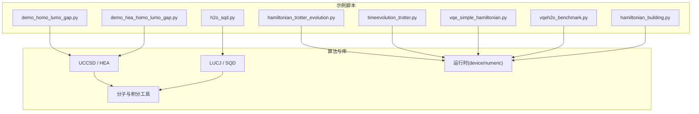
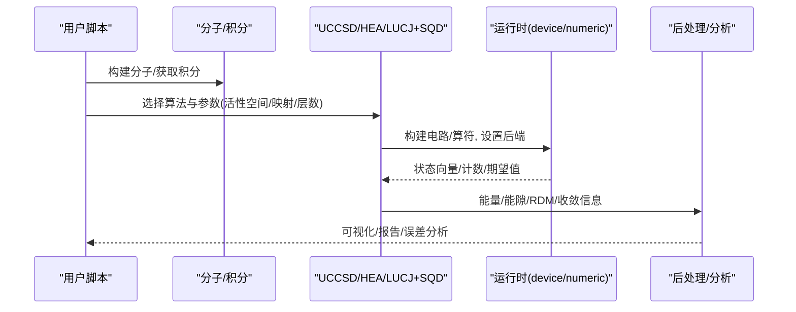
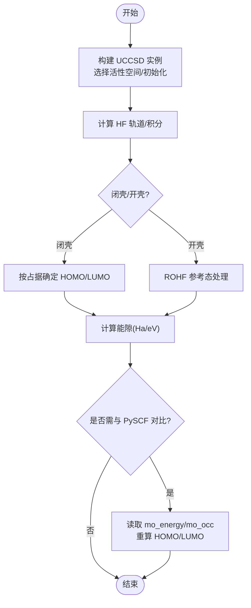
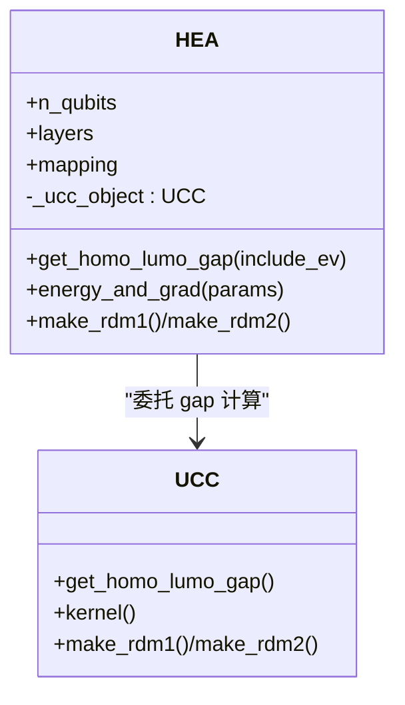
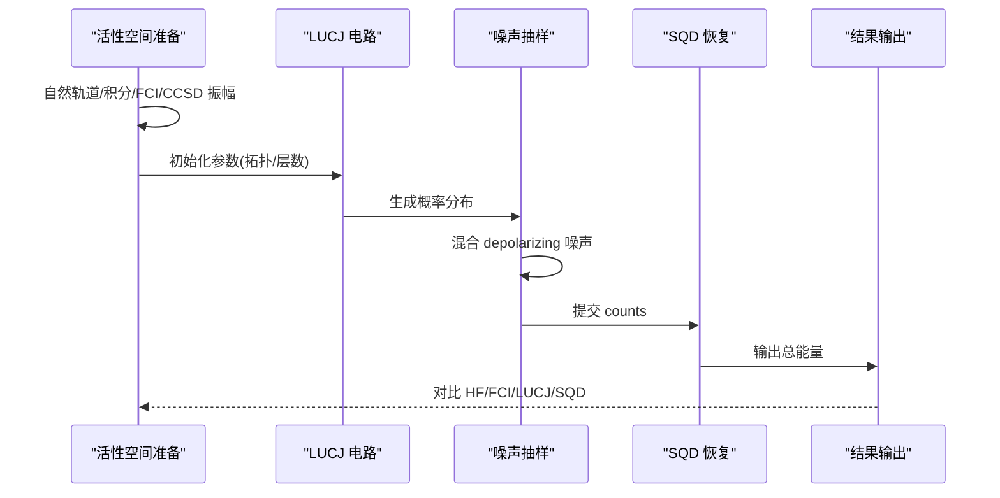
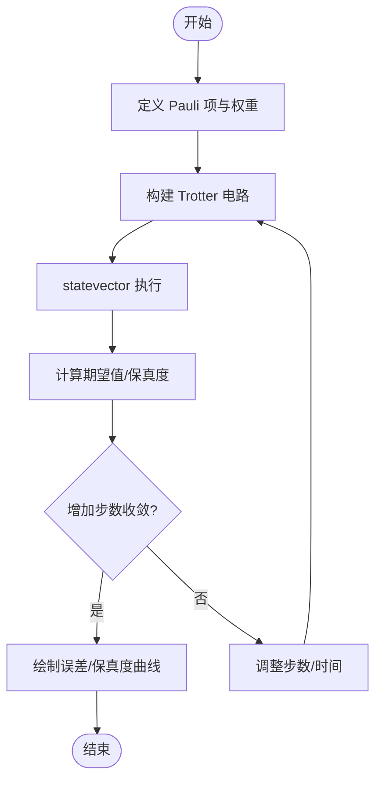
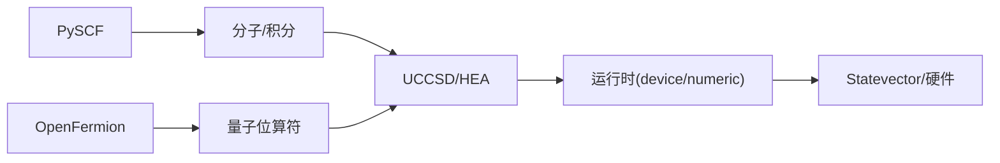

# 量子化学示例

<cite>
**本文引用的文件**
- [demo_homo_lumo_gap.py](file://examples/demo_homo_lumo_gap.py)
- [demo_hea_homo_lumo_gap.py](file://examples/demo_hea_homo_lumo_gap.py)
- [h2o_sqd.py](file://examples/h2o_sqd.py)
- [hamiltonian_trotter_evolution.py](file://examples/hamiltonian_trotter_evolution.py)
- [timeevolution_trotter.py](file://examples/timeevolution_trotter.py)
- [vqe_simple_hamiltonian.py](file://examples/vqe_simple_hamiltonian.py)
- [vqeh2o_benchmark.py](file://examples/vqeh2o_benchmark.py)
- [hamiltonian_building.py](file://examples/hamiltonian_building.py)
- [uccsd.py](file://src/tyxonq/applications/chem/algorithms/vqe/uccsd.py)
- [hea.py](file://src/tyxonq/applications/chem/algorithms/vqe/hea.py)
- [molecule.py](file://src/tyxonq/applications/chem/molecule.py)
</cite>

## 目录
1. [简介](#简介)
2. [项目结构](#项目结构)
3. [核心组件](#核心组件)
4. [架构总览](#架构总览)
5. [详细组件分析](#详细组件分析)
6. [依赖关系分析](#依赖关系分析)
7. [性能考量](#性能考量)
8. [故障排查指南](#故障排查指南)
9. [结论](#结论)
10. [附录](#附录)

## 简介
本文件面向使用 TyxonQ 进行量子化学计算的读者，系统梳理并演示以下典型场景：
- 分子性质计算与 HOMO-LUMO 能隙评估
- 变分量子本征求解器（VQE）在分子基态能量求解中的应用
- Trotter 演化模拟与时间演化算符的近似实现
- 水分子（H₂O）活性空间下的 LUCJ 采样 + SQD 恢复流程
- 从哈密顿量构建到期望值估计、收敛性分析与结果解读

文档以“由浅入深”的方式组织：先给出整体架构与关键概念，再深入到具体算法与代码级流程，最后提供参数配置建议与结果分析方法。所有技术细节均基于仓库中的示例与实现文件，避免凭空臆测。

## 项目结构
TyxonQ 的量子化学能力集中在 applications/chem 模块中，并通过 examples 目录提供端到端可运行的脚本。与本主题直接相关的核心路径包括：
- 算法层：UCCSD、HEA、LUCJ、SQD 等
- 分子与积分：PySCF 集成、预置分子构造
- 运行时：设备运行（device）与数值仿真（numeric）双后端
- 示例脚本：涵盖 VQE、Trotter 演化、HOMO-LUMO 能隙、H₂O 活性空间等



图表来源
- [demo_homo_lumo_gap.py:1-201](file://examples/demo_homo_lumo_gap.py#L1-L201)
- [demo_hea_homo_lumo_gap.py:1-175](file://examples/demo_hea_homo_lumo_gap.py#L1-L175)
- [h2o_sqd.py:1-376](file://examples/h2o_sqd.py#L1-L376)
- [hamiltonian_trotter_evolution.py:1-244](file://examples/hamiltonian_trotter_evolution.py#L1-L244)
- [timeevolution_trotter.py:1-59](file://examples/timeevolution_trotter.py#L1-L59)
- [vqe_simple_hamiltonian.py:1-273](file://examples/vqe_simple_hamiltonian.py#L1-L273)
- [vqeh2o_benchmark.py:1-163](file://examples/vqeh2o_benchmark.py#L1-L163)
- [hamiltonian_building.py:1-94](file://examples/hamiltonian_building.py#L1-L94)

章节来源
- [demo_homo_lumo_gap.py:1-201](file://examples/demo_homo_lumo_gap.py#L1-L201)
- [demo_hea_homo_lumo_gap.py:1-175](file://examples/demo_hea_homo_lumo_gap.py#L1-L175)
- [h2o_sqd.py:1-376](file://examples/h2o_sqd.py#L1-L376)
- [hamiltonian_trotter_evolution.py:1-244](file://examples/hamiltonian_trotter_evolution.py#L1-L244)
- [timeevolution_trotter.py:1-59](file://examples/timeevolution_trotter.py#L1-L59)
- [vqe_simple_hamiltonian.py:1-273](file://examples/vqe_simple_hamiltonian.py#L1-L273)
- [vqeh2o_benchmark.py:1-163](file://examples/vqeh2o_benchmark.py#L1-L163)
- [hamiltonian_building.py:1-94](file://examples/hamiltonian_building.py#L1-L94)

## 核心组件
- UCCSD（单位耦合簇单双激发的量子实现）：通过变分优化最小化能量期望，支持活性空间、振幅筛选、多种初始化策略与设备/数值双后端。
- HEA（硬件高效 Ansatz）：RY-only 交替层结构，适合 NISQ 设备；可从分子或积分构建，支持梯度与 RDM 计算。
- LUCJ/SQD：针对活性空间的采样与经典 Selected CI 恢复，结合自然轨道与 CCSD 振幅初始化，提升噪声环境下的能量估计质量。
- 分子与积分：封装 PySCF Mole，提供常见分子（H₂、H₄、H₂O、NH₃、CH₄ 等）快速构造与积分访问接口。
- 运行时：统一 device（真实设备/模拟器）与 numeric（精确态矢量/张量后端）执行路径，便于对比与调试。

章节来源
- [uccsd.py:18-200](file://src/tyxonq/applications/chem/algorithms/vqe/uccsd.py#L18-L200)
- [hea.py:28-200](file://src/tyxonq/applications/chem/algorithms/vqe/hea.py#L28-L200)
- [molecule.py:14-133](file://src/tyxonq/applications/chem/molecule.py#L14-L133)

## 架构总览
下图展示了从“分子/积分”到“算法（UCCSD/HEA/LUCJ+SQD）”，再到“运行时（device/numeric）”的整体数据流与控制流。



图表来源
- [uccsd.py:18-200](file://src/tyxonq/applications/chem/algorithms/vqe/uccsd.py#L18-L200)
- [hea.py:28-200](file://src/tyxonq/applications/chem/algorithms/vqe/hea.py#L28-L200)
- [h2o_sqd.py:125-336](file://examples/h2o_sqd.py#L125-L336)
- [hamiltonian_trotter_evolution.py:44-168](file://examples/hamiltonian_trotter_evolution.py#L44-L168)

## 详细组件分析

### HOMO-LUMO 能隙计算（UCCSD）
- 功能要点
  - 自动识别闭壳/开壳体系，返回 HOMO/LUMO 轨道索引与能量，以及能隙（Hartree/eV）。
  - 支持活性空间裁剪，减少大规模体系的计算成本。
  - 与 PySCF 原始轨道能量一致，便于验证。
- 典型用法
  - 基本用法：对 H₂ 计算 gap，打印 Hartree 与 eV。
  - 多分子对比：H₂/H₄/H₂O 的 gap 汇总。
  - 开壳体系：ROHF 参考态下的 gap 与轨道占据分析。
  - 手动指定轨道：自定义 HOMO/LUMO 轨道对计算能隙。
  - 活性空间：全空间 vs CAS(4e,4o) 的对比。
  - 一致性验证：与 PySCF 轨道能量比较，误差 < 1e-10 Ha。



图表来源
- [demo_homo_lumo_gap.py:14-176](file://examples/demo_homo_lumo_gap.py#L14-L176)
- [uccsd.py:18-200](file://src/tyxonq/applications/chem/algorithms/vqe/uccsd.py#L18-L200)

章节来源
- [demo_homo_lumo_gap.py:14-176](file://examples/demo_homo_lumo_gap.py#L14-L176)
- [uccsd.py:18-200](file://src/tyxonq/applications/chem/algorithms/vqe/uccsd.py#L18-L200)

### HOMO-LUMO 能隙计算（HEA）
- 功能要点
  - HEA 通过内部委托给 UCC 对象完成 HOMO-LUMO gap 计算，API 与 UCC 保持一致。
  - 支持 include_ev 参数直接输出 eV 单位。
  - 从积分构建的 HEA 不支持 gap 计算（无分子信息），会抛出错误。
- 典型用法
  - 基本用法：对 H₂ 计算 gap，打印详细信息。
  - 与 UCC 对比：相同分子下 HEA 与 UCC 的 gap 一致。
  - 多分子对比：H₂/H₄/H₂O 的 gap 汇总。
  - 架构说明：HEA 内部保存 _ucc_object，调用 get_homo_lumo_gap() 委托。
  - 错误处理：从积分构建时尝试 gap 计算将触发异常。



图表来源
- [demo_hea_homo_lumo_gap.py:11-148](file://examples/demo_hea_homo_lumo_gap.py#L11-L148)
- [hea.py:28-200](file://src/tyxonq/applications/chem/algorithms/vqe/hea.py#L28-L200)

章节来源
- [demo_hea_homo_lumo_gap.py:11-148](file://examples/demo_hea_homo_lumo_gap.py#L11-L148)
- [hea.py:28-200](file://src/tyxonq/applications/chem/algorithms/vqe/hea.py#L28-L200)

### 水分子活性空间：LUCJ 采样 + SQD 恢复
- 目标
  - 在 H₂O 的活性空间（CAS(4e,4o)）内，利用 LUCJ 电路生成初始态，结合噪声模型抽样，再通过经典 SQD（Selected CI）恢复能量。
- 关键步骤
  - 准备活性空间数据：UMP2 自然轨道、FCI 能量、有效积分、CCSD 振幅。
  - 构建 LUCJ 电路：基于拓扑与层数，用 CCSD 振幅初始化参数。
  - 噪声建模：概率混合 depolarizing 噪声，抽样得到 counts。
  - SQD 恢复：对 counts 做 selected-CI，得到总能量。
  - 结果对比：HF、FCI、LUCJ（无噪/有噪）、SQD 能量。
- 参数与配置
  - shots、noise_p、samples_per_batch、num_batches、max_iterations、max_dim、seed 等均可调。
  - 可通过命令行参数控制是否优化初始化参数与最大迭代次数。



图表来源
- [h2o_sqd.py:125-336](file://examples/h2o_sqd.py#L125-L336)

章节来源
- [h2o_sqd.py:125-336](file://examples/h2o_sqd.py#L125-L336)

### Trotter 时间演化模拟
- 目标
  - 演示如何从 Pauli 项构建哈密顿量，使用 Trotter 分解构造时间演化电路，并与精确数值演化对比。
- 关键点
  - 构建简单两比特哈密顿量（如 Z₀Z₁ + X₀）。
  - 使用 build_trotter_circuit 生成 Trotter 电路。
  - 在 statevector 后端执行，计算期望值与保真度。
  - 逐步增加 Trotter 步数以观察收敛性。
- 扩展
  - Heisenberg 链的时间演化示例，展示链式相互作用项的编码与测量。



图表来源
- [hamiltonian_trotter_evolution.py:27-168](file://examples/hamiltonian_trotter_evolution.py#L27-L168)
- [timeevolution_trotter.py:13-54](file://examples/timeevolution_trotter.py#L13-L54)

章节来源
- [hamiltonian_trotter_evolution.py:27-168](file://examples/hamiltonian_trotter_evolution.py#L27-L168)
- [timeevolution_trotter.py:13-54](file://examples/timeevolution_trotter.py#L13-L54)

### VQE 求解 Transverse Field Ising Model（TFIM）
- 目标
  - 使用硬件高效 Ansatz 与自动微分，寻找 TFIM 基态能量，并与精确对角化结果对比。
- 关键点
  - 哈密顿量构建：Heisenberg 构建器特例（仅 ZZ 耦合与横向 X 场）。
  - Ansatz：初始 Hadamard 层 + CNOT 链 + RY/RZ 旋转层。
  - 优化：value_and_grad 自动求导 + 梯度下降。
  - 性能：小尺度（6 qubit, 2 layers）快速收敛，误差 < 1%。
- 扩展
  - 可替换为其他 Hamiltonian（分子体系、晶格模型）。
  - 可尝试不同优化器（Adam、L-BFGS、自然梯度）。

```mermaid
sequenceDiagram
participant VQE as "VQE 主循环"
participant Ans as "Ansatz 电路"
participant H as "哈密顿量"
participant Opt as "优化器"
VQE->>Ans : 构建电路(参数θ)
Ans-->>VQE : 状态向量ψ(θ)
VQE->>H : 计算⟨ψ(θ)|H|ψ(θ)⟩
H-->>VQE : 能量E(θ)
VQE->>Opt : 计算梯度∇E(θ)
Opt-->>VQE : 更新参数θ
VQE->>VQE : 记录历史/收敛判断
```

图表来源
- [vqe_simple_hamiltonian.py:55-255](file://examples/vqe_simple_hamiltonian.py#L55-L255)

章节来源
- [vqe_simple_hamiltonian.py:55-255](file://examples/vqe_simple_hamiltonian.py#L55-L255)

### 分子性质与 H₂O 基准（OpenFermion + 数值路径）
- 目标
  - 使用 OpenFermion 从 PubChem 获取 H₂O 几何，转换为 QubitOperator，并以数值路径（不构建稠密 H）计算期望值，进行性能基准测试。
- 关键点
  - 将 QubitOperator 转为 (lsb, wb) 形式的 Pauli 项列表。
  - 通过分组旋转复用状态，降低重复计算。
  - 使用 PyTorch 后端进行高效张量运算。
- 适用场景
  - 大体系或需要高性能数值评估的场景。

章节来源
- [vqeh2o_benchmark.py:15-163](file://examples/vqeh2o_benchmark.py#L15-L163)

### 哈密顿量构建与计数期望值估计
- 目标
  - 演示以轻量 Pauli 项列表表示哈密顿量，并通过测量计数估计期望值（Z 项直接统计，X 项通过 H 基旋转）。
- 关键点
  - 构建 TFIM 项（ZZ 耦合 + X 局域场）。
  - 一次 shot 统计所有 Z 项，逐比特统计 X 项。
  - 适用于无需稠密矩阵的快速估算。

章节来源
- [hamiltonian_building.py:18-94](file://examples/hamiltonian_building.py#L18-L94)

## 依赖关系分析
- 外部依赖
  - PySCF：分子构建、SCF、积分、MCSCF/CCSD 等经典方法。
  - OpenFermion：费米子/量子位算符转换、变换与编码。
  - NumPy/Torch：数值计算与自动微分。
- 内部依赖
  - algorithms/vqe：UCCSD、HEA 及其运行时。
  - circuits_library：Trotter 电路、块构建。
  - hamiltonian_encoding：费米子到量子位映射、Pauli IO。
  - devices/simulators：statevector 等仿真后端。



图表来源
- [uccsd.py:18-200](file://src/tyxonq/applications/chem/algorithms/vqe/uccsd.py#L18-L200)
- [hea.py:28-200](file://src/tyxonq/applications/chem/algorithms/vqe/hea.py#L28-L200)
- [vqeh2o_benchmark.py:15-163](file://examples/vqeh2o_benchmark.py#L15-L163)

章节来源
- [uccsd.py:18-200](file://src/tyxonq/applications/chem/algorithms/vqe/uccsd.py#L18-L200)
- [hea.py:28-200](file://src/tyxonq/applications/chem/algorithms/vqe/hea.py#L28-L200)
- [vqeh2o_benchmark.py:15-163](file://examples/vqeh2o_benchmark.py#L15-L163)

## 性能考量
- 活性空间与振幅筛选
  - 通过 active_space 与 pick_ex2/epsilon 显著减少参数数量，加速收敛。
- 后端选择
  - numeric 后端（statevector/pytorch）用于高精度与快速原型；device 后端用于真实设备或含噪声仿真。
- Trotter 步数与精度
  - 增加 steps 可提高逼近精度，但代价是电路深度与资源消耗上升。
- 噪声建模
  - 在 LUCJ 采样中加入 depolarizing 噪声，评估鲁棒性与恢复效果。
- 期望值估计
  - 分组旋转复用状态可减少重复计算；计数法适用于稀疏项集。

[本节为通用指导，不直接分析具体文件]

## 故障排查指南
- 从积分构建的 HEA 无法计算 HOMO-LUMO gap
  - 现象：调用 get_homo_lumo_gap() 抛出运行时错误。
  - 原因：缺少分子信息（轨道/占据）。
  - 解决：改用 from_molecule 构建或使用 UCC 对象。
- 非有限能量
  - 现象：检测到 NaN/Inf 能量。
  - 原因：采样/数值不稳定或参数发散。
  - 解决：检查噪声强度、学习率、迭代次数与初始化策略。
- 收敛缓慢或陷入局部极小
  - 现象：能量停滞或震荡。
  - 解决：增大 ansatz 表达能力、更换优化器、调整学习率或引入预热/退火策略。
- 计数统计误差大
  - 现象：期望值波动明显。
  - 解决：增加 shots、合并测量组、使用读误校正或后处理技术。

章节来源
- [demo_hea_homo_lumo_gap.py:126-148](file://examples/demo_hea_homo_lumo_gap.py#L126-L148)
- [h2o_sqd.py:317-329](file://examples/h2o_sqd.py#L317-L329)

## 结论
TyxonQ 提供了完整的量子化学计算链路：从分子与积分构建、算法选择（UCCSD/HEA/LUCJ+SQD）、运行时执行（device/numeric），到结果分析与可视化。示例脚本覆盖了 H₂ 基态能量、H₂O 活性空间性质、Trotter 演化与 VQE 优化等典型场景，既适合入门学习，也具备工程可扩展性。通过合理配置活性空间、噪声模型与优化策略，可在不同硬件与精度需求下取得稳定可靠的化学结果。

[本节为总结性内容，不直接分析具体文件]

## 附录
- 常用参数速查
  - UCCSD：init_method（mp2/ccsd/fe/zeros）、active_space、pick_ex2、epsilon、runtime（device/numeric）。
  - HEA：layers、mapping（parity/jordan-wigner/bravyi-kitaev）、runtime、gradient（param-shift/free）。
  - Trotter：time、steps、num_qubits。
  - LUCJ+SQD：shots、noise_p、samples_per_batch、num_batches、max_iterations、max_dim、seed。
- 结果分析方法
  - 能量收敛曲线、保真度与误差分析、RDM 与轨道占据分析、与经典方法（FCI/CCSD）对比。
- 扩展方向
  - 自适应 ansatz、多目标优化（能量+方差）、误差缓解技术、更大体系与更高精度基组。

[本节为补充信息，不直接分析具体文件]