# 量子化学示例

<cite>
**本文引用的文件**
- [demo_homo_lumo_gap.py](file://examples/demo_homo_lumo_gap.py)
- [demo_hea_homo_lumo_gap.py](file://examples/demo_hea_homo_lumo_gap.py)
- [h2o_sqd.py](file://examples/h2o_sqd.py)
- [hamiltonian_trotter_evolution.py](file://examples/hamiltonian_trotter_evolution.py)
- [timeevolution_trotter.py](file://examples/timeevolution_trotter.py)
- [vqe_simple_hamiltonian.py](file://examples/vqe_simple_hamiltonian.py)
- [vqeh2o_benchmark.py](file://examples/vqeh2o_benchmark.py)
- [hamiltonian_building.py](file://examples/hamiltonian_building.py)
- [ewf_geometry.py](file://examples/ewf_geometry.py)
- [workflow.py](file://examples/SKQD/workflow.py)
- [run_spin_dynamics.py](file://examples/run_spin_dynamics.py)
- [sqd_gpu_benchmark.py](file://examples/sqd_gpu_benchmark.py)
- [uccsd.py](file://src/tyxonq/applications/chem/algorithms/vqe/uccsd.py)
- [hea.py](file://src/tyxonq/applications/chem/algorithms/vqe/hea.py)
- [molecule.py](file://src/tyxonq/applications/chem/molecule.py)
</cite>

## 更新摘要
**变更内容**
- 新增 EWF（嵌入波函数）几何优化功能，支持单点计算、梯度检查和近似几何优化
- 新增 SKQD（分段量子动力学）工作流，包含体系准备、线路采样、SQD后处理及自然轨道第二轮
- 新增自旋链动力学模拟，支持基态制备、Trotter演化、AQC压缩、扰动响应和谱分析
- 新增 SQD GPU基准测试，支持Torch、原生SBD和混合GPU求解器性能对比

## 目录
1. [简介](#简介)
2. [项目结构](#项目结构)
3. [核心组件](#核心组件)
4. [架构总览](#架构总览)
5. [详细组件分析](#详细组件分析)
6. [依赖关系分析](#依赖关系分析)
7. [性能考量](#性能考量)
8. [故障排查指南](#故障排查指南)
9. [结论](#结论)
10. [附录](#附录)

## 简介
本文件面向使用 TyxonQ 进行量子化学计算的读者，系统梳理并演示以下典型场景：
- 分子性质计算与 HOMO-LUMO 能隙评估
- 变分量子本征求解器（VQE）在分子基态能量求解中的应用
- Trotter 演化模拟与时间演化算符的近似实现
- 水分子（H₂O）活性空间下的 LUCJ 采样 + SQD 恢复流程
- **EWF（嵌入波函数）几何优化**：从原子片段到全局密度与能量的完整优化流程
- **SKQD（分段量子动力学）工作流**：多步骤量子动力学模拟与经典后处理
- **自旋链动力学模拟**：基态制备、时间演化、绝热量子压缩和谱分析
- **SQD GPU基准测试**：高性能固定组态空间求解器的性能评估

文档以"由浅入深"的方式组织：先给出整体架构与关键概念，再深入到具体算法与代码级流程，最后提供参数配置建议与结果分析方法。所有技术细节均基于仓库中的示例与实现文件，避免凭空臆测。

## 项目结构
TyxonQ 的量子化学能力集中在 applications/chem 模块中，并通过 examples 目录提供端到端可运行的脚本。与本主题直接相关的核心路径包括：
- 算法层：UCCSD、HEA、LUCJ、SQD、EWF、SKQD 等
- 分子与积分：PySCF 集成、预置分子构造
- 运行时：设备运行（device）与数值仿真（numeric）双后端
- 示例脚本：涵盖 VQE、Trotter 演化、HOMO-LUMO 能隙、H₂O 活性空间、EWF几何优化、SKQD工作流、自旋动力学、GPU基准等

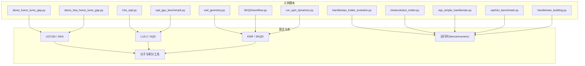

**图表来源**
- [ewf_geometry.py:1-260](file://examples/ewf_geometry.py#L1-L260)
- [workflow.py:1-273](file://examples/SKQD/workflow.py#L1-L273)
- [run_spin_dynamics.py:1-173](file://examples/run_spin_dynamics.py#L1-L173)
- [sqd_gpu_benchmark.py:1-800](file://examples/sqd_gpu_benchmark.py#L1-L800)

## 核心组件
- UCCSD（单位耦合簇单双激发的量子实现）：通过变分优化最小化能量期望，支持活性空间、振幅筛选、多种初始化策略与设备/数值双后端。
- HEA（硬件高效 Ansatz）：RY-only 交替层结构，适合 NISQ 设备；可从分子或积分构建，支持梯度与 RDM 计算。
- LUCJ/SQD：针对活性空间的采样与经典 Selected CI 恢复，结合自然轨道与 CCSD 振幅初始化，提升噪声环境下的能量估计质量。
- **EWF（嵌入波函数）**：原子片段分解与浴轨道构建，支持FCI或LUCJ+SQD片段求解，全局密度组装与近似梯度计算。
- **SKQD（分段量子动力学）**：多时间尺度量子动力学模拟，支持Trotter和SQDRIFT演化方法，自然轨道变基与第二轮优化。
- **自旋链动力学**：Heisenberg模型的时间演化，支持HVA基态制备、AQC线路压缩、扰动响应函数和谱分析。
- **SQD GPU求解器**：高性能固定组态空间对角化，支持Torch、原生SBD和MPI并行，GPU内存监控与性能剖析。
- 分子与积分：封装 PySCF Mole，提供常见分子（H₂、H₄、H₂O、NH₃、CH₄ 等）快速构造与积分访问接口。
- 运行时：统一 device（真实设备/模拟器）与 numeric（精确态矢量/张量后端）执行路径，便于对比与调试。

**章节来源**
- [uccsd.py:18-200](file://src/tyxonq/applications/chem/algorithms/vqe/uccsd.py#L18-L200)
- [hea.py:28-200](file://src/tyxonq/applications/chem/algorithms/vqe/hea.py#L28-L200)
- [ewf_geometry.py:74-175](file://examples/ewf_geometry.py#L74-L175)
- [workflow.py:86-127](file://examples/SKQD/workflow.py#L86-L127)
- [run_spin_dynamics.py:23-24](file://examples/run_spin_dynamics.py#L23-L24)
- [sqd_gpu_benchmark.py:314-371](file://examples/sqd_gpu_benchmark.py#L314-L371)
- [molecule.py:14-133](file://src/tyxonq/applications/chem/molecule.py#L14-L133)

## 架构总览
下图展示了从"分子/积分"到"算法（UCCSD/HEA/LUCJ+SQD/EWF/SKQD）"，再到"运行时（device/numeric）"的整体数据流与控制流。

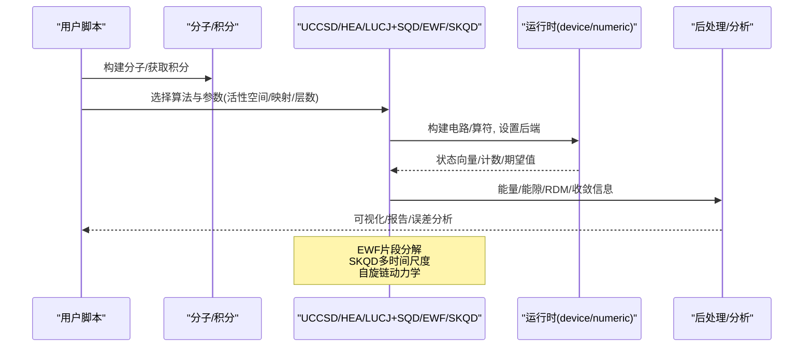

**图表来源**
- [ewf_geometry.py:169-175](file://examples/ewf_geometry.py#L169-L175)
- [workflow.py:130-138](file://examples/SKQD/workflow.py#L130-L138)
- [run_spin_dynamics.py:161-164](file://examples/run_spin_dynamics.py#L161-L164)

## 详细组件分析

### HOMO-LUMO 能隙计算（UCCSD）
- 功能要点
  - 自动识别闭壳/开壳体系，返回 HOMO/LUMO 轨道索引与能量，以及能隙（Hartree/eV）。
  - 支持活性空间裁剪，减少大规模体系的计算成本。
  - 与 PySCF 原始轨道能量一致，便于验证。
- 典型用法
  - 基本用法：对 H₂ 计算 gap，打印 Hartree 与 eV。
  - 多分子对比：H₂/H₄/H₂O 的 gap 汇总。
  - 开壳体系：ROHF 参考态下的 gap 与轨道占据分析。
  - 手动指定轨道：自定义 HOMO/LUMO 轨道对计算能隙。
  - 活性空间：全空间 vs CAS(4e,4o) 的对比。
  - 一致性验证：与 PySCF 轨道能量比较，误差 < 1e-10 Ha。

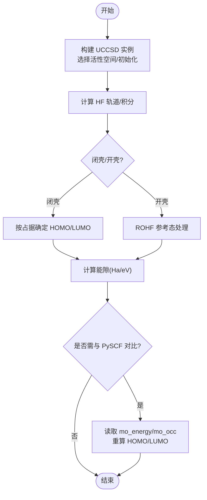

**图表来源**
- [demo_homo_lumo_gap.py:14-176](file://examples/demo_homo_lumo_gap.py#L14-L176)
- [uccsd.py:18-200](file://src/tyxonq/applications/chem/algorithms/vqe/uccsd.py#L18-L200)

**章节来源**
- [demo_homo_lumo_gap.py:14-176](file://examples/demo_homo_lumo_gap.py#L14-L176)
- [uccsd.py:18-200](file://src/tyxonq/applications/chem/algorithms/vqe/uccsd.py#L18-L200)

### HOMO-LUMO 能隙计算（HEA）
- 功能要点
  - HEA 通过内部委托给 UCC 对象完成 HOMO-LUMO gap 计算，API 与 UCC 保持一致。
  - 支持 include_ev 参数直接输出 eV 单位。
  - 从积分构建的 HEA 不支持 gap 计算（无分子信息），会抛出错误。
- 典型用法
  - 基本用法：对 H₂ 计算 gap，打印详细信息。
  - 与 UCC 对比：相同分子下 HEA 与 UCC 的 gap 一致。
  - 多分子对比：H₂/H₄/H₂O 的 gap 汇总。
  - 架构说明：HEA 内部保存 _ucc_object，调用 get_homo_lumo_gap() 委托。
  - 错误处理：从积分构建时尝试 gap 计算将触发异常。

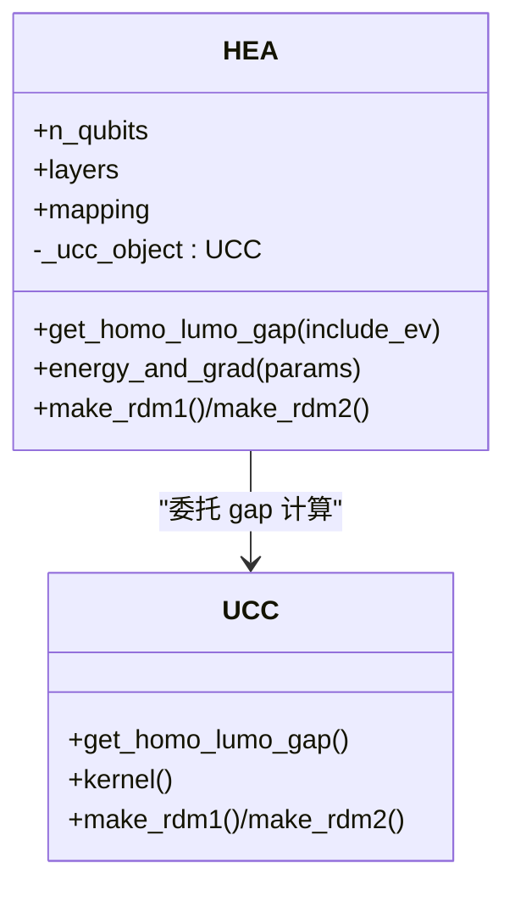

**图表来源**
- [demo_hea_homo_lumo_gap.py:11-148](file://examples/demo_hea_homo_lumo_gap.py#L11-L148)
- [hea.py:28-200](file://src/tyxonq/applications/chem/algorithms/vqe/hea.py#L28-L200)

**章节来源**
- [demo_hea_homo_lumo_gap.py:11-148](file://examples/demo_hea_homo_lumo_gap.py#L11-L148)
- [hea.py:28-200](file://src/tyxonq/applications/chem/algorithms/vqe/hea.py#L28-L200)

### 水分子活性空间：LUCJ 采样 + SQD 恢复
- 目标
  - 在 H₂O 的活性空间（CAS(4e,4o)）内，利用 LUCJ 电路生成初始态，结合噪声模型抽样，再通过经典 SQD（Selected CI）恢复能量。
- 关键步骤
  - 准备活性空间数据：UMP2 自然轨道、FCI 能量、有效积分、CCSD 振幅。
  - 构建 LUCJ 电路：基于拓扑与层数，用 CCSD 振幅初始化参数。
  - 噪声建模：概率混合 depolarizing 噪声，抽样得到 counts。
  - SQD 恢复：对 counts 做 selected-CI，得到总能量。
  - 结果对比：HF、FCI、LUCJ（无噪/有噪）、SQD 能量。
- 参数与配置
  - shots、noise_p、samples_per_batch、num_batches、max_iterations、max_dim、seed 等均可调。
  - 可通过命令行参数控制是否优化初始化参数与最大迭代次数。

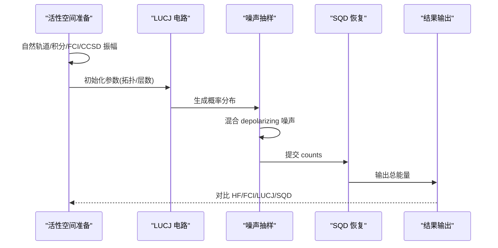

**图表来源**
- [h2o_sqd.py:125-336](file://examples/h2o_sqd.py#L125-L336)

**章节来源**
- [h2o_sqd.py:125-336](file://examples/h2o_sqd.py#L125-L336)

### EWF 几何优化：从片段分解到全局优化
- 目标
  - 实现完整的嵌入波函数（EWF）几何优化流程，支持单点计算、梯度检查和近似几何优化。
- 核心功能
  - **片段分解**：将分子分解为原子片段，构建MP2-BNO浴轨道。
  - **片段求解**：小片段使用FCI，大片段使用LUCJ+SQD，支持CUDA加速。
  - **全局密度**：组装全局密度矩阵，支持不同组装方案（rdm_t_lambda）。
  - **近似梯度**：冻结浴近似下的解析梯度，支持有限差分检查。
  - **几何优化**：集成ASE/Sella优化器，支持约束优化。
- 配置选项
  - profile：small（验证）或paper（论文参数）配置。
  - backend：CPU或CUDA后端，仅加速SQD片段求解。
  - assembly：全局密度组装方案选择。
  - force-sqd：强制所有片段使用LUCJ+SQD而非FCI。

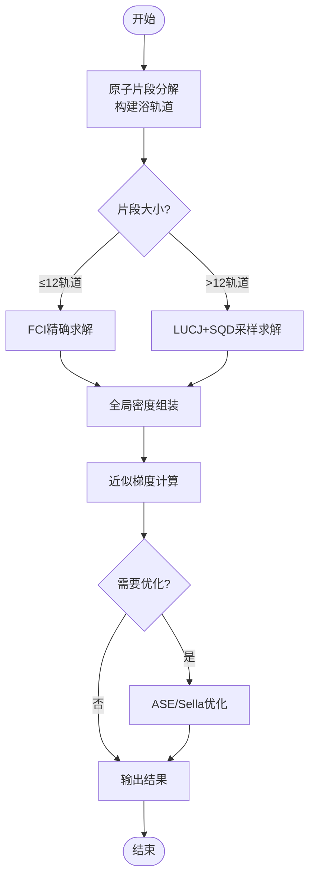

**图表来源**
- [ewf_geometry.py:74-175](file://examples/ewf_geometry.py#L74-L175)
- [ewf_geometry.py:178-199](file://examples/ewf_geometry.py#L178-L199)

**章节来源**
- [ewf_geometry.py:1-260](file://examples/ewf_geometry.py#L1-L260)

### SKQD 工作流：多步骤量子动力学模拟
- 目标
  - 实现分段量子动力学（SKQD）的完整工作流程，支持多时间尺度的量子系统演化。
- 工作流程
  - **prepare**：体系准备，构建问题定义、积分数据和可重载线路。
  - **sample**：线路采样，从态矢量系综生成测量计数。
  - **postprocess**：后处理，执行SQD恢复，计算RDM和相关函数。
  - **rotate**：自然轨道变基，第二轮优化，重新采样新基底。
  - **estimate**：静态成本估算，不执行实际计算。
- 演化方法
  - **trotter**：Trotter-Krylov演化，支持高斯拟合优化。
  - **sqdrift**：SQDRIFT演化，适用于特定哈密顿量形式。
- 数据处理
  - 支持Anderson杂质模型和分子SqDRIFT案例。
  - 自动保存counts、RDM、SCI状态等中间结果。
  - 支持精确FCI验证和严格子空间扩展。

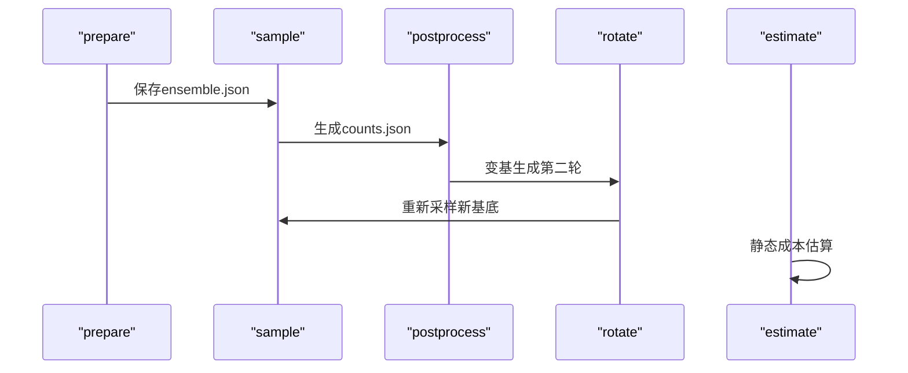

**图表来源**
- [workflow.py:130-229](file://examples/SKQD/workflow.py#L130-L229)

**章节来源**
- [workflow.py:1-273](file://examples/SKQD/workflow.py#L1-L273)

### 自旋链动力学模拟：基态制备到谱分析
- 目标
  - 演示自旋链系统的完整动力学模拟流程，从基态制备到谱函数分析。
- 核心功能
  - **基态制备**：使用HVA（硬件高效Ansatz）和DMRG优化基态。
  - **时间演化**：Trotter演化模拟，支持不同阶数和中心点。
  - **AQC压缩**：绝热量子压缩，减少线路深度和资源消耗。
  - **扰动响应**：计算推迟格林函数和动态结构因子。
  - **谱分析**：动量-频率谱图，支持镜像和截断选项。
- 模拟选项
  - simulator：statevector（精确）或quimb_mps（张量网络）。
  - aqc_options：AQC压缩参数，支持分段优化。
  - ground_state_options：基态优化参数，支持不同初始态。
- 结果输出
  - 响应函数图像、谱图和线路复杂度统计。
  - 保真度、收敛性和资源使用监控。

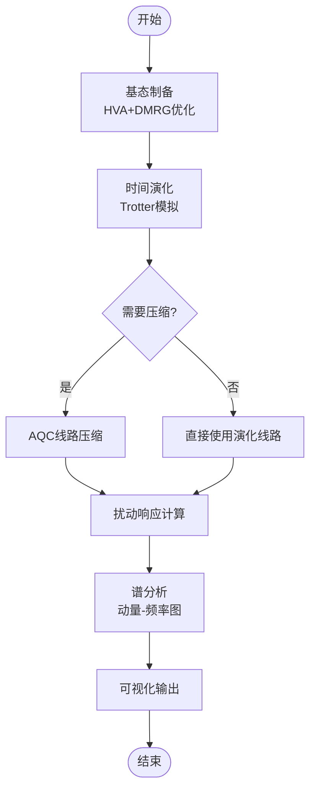

**图表来源**
- [run_spin_dynamics.py:161-164](file://examples/run_spin_dynamics.py#L161-L164)
- [run_spin_dynamics.py:42-120](file://examples/run_spin_dynamics.py#L42-L120)

**章节来源**
- [run_spin_dynamics.py:1-173](file://examples/run_spin_dynamics.py#L1-L173)

### SQD GPU 基准测试：高性能求解器评估
- 目标
  - 对比Torch、原生SBD和混合GPU求解器的性能，提供全面的基准测试结果。
- 求解器类型
  - **Torch后端**：基于PyTorch的Davidson求解器，支持GPU加速。
  - **Native后端**：原生C++实现的SBD求解器，支持MPI并行。
  - **Hybrid模式**：混合GPU/CPU计算，平衡性能和内存使用。
- 性能指标
  - 冷启动时间和稳态吞吐量。
  - GPU内存使用和利用率监控。
  - 收敛性检查和精度验证。
  - 分布式计算扩展性。
- 验证机制
  - CPU复核确保GPU计算正确性。
  - 参考态对比验证能量和RDM精度。
  - 残差范数和收敛标准检查。

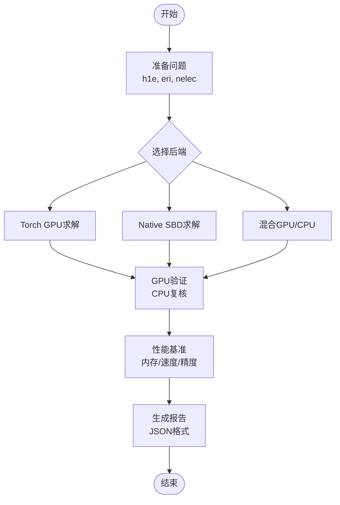

**图表来源**
- [sqd_gpu_benchmark.py:314-371](file://examples/sqd_gpu_benchmark.py#L314-L371)
- [sqd_gpu_benchmark.py:474-568](file://examples/sqd_gpu_benchmark.py#L474-L568)

**章节来源**
- [sqd_gpu_benchmark.py:1-800](file://examples/sqd_gpu_benchmark.py#L1-L800)

### Trotter 时间演化模拟
- 目标
  - 演示如何从 Pauli 项构建哈密顿量，使用 Trotter 分解构造时间演化电路，并与精确数值演化对比。
- 关键点
  - 构建简单两比特哈密顿量（如 Z₀Z₁ + X₀）。
  - 使用 build_trotter_circuit 生成 Trotter 电路。
  - 在 statevector 后端执行，计算期望值与保真度。
  - 逐步增加 Trotter 步数以观察收敛性。
- 扩展
  - Heisenberg 链的时间演化示例，展示链式相互作用项的编码与测量。

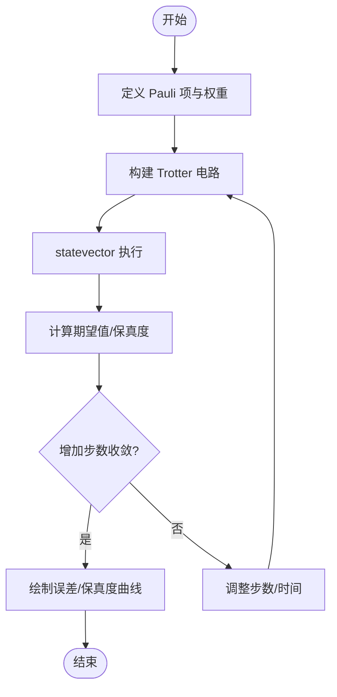

**图表来源**
- [hamiltonian_trotter_evolution.py:27-168](file://examples/hamiltonian_trotter_evolution.py#L27-L168)
- [timeevolution_trotter.py:13-54](file://examples/timeevolution_trotter.py#L13-L54)

**章节来源**
- [hamiltonian_trotter_evolution.py:27-168](file://examples/hamiltonian_trotter_evolution.py#L27-L168)
- [timeevolution_trotter.py:13-54](file://examples/timeevolution_trotter.py#L13-L54)

### VQE 求解 Transverse Field Ising Model（TFIM）
- 目标
  - 使用硬件高效 Ansatz 与自动微分，寻找 TFIM 基态能量，并与精确对角化结果对比。
- 关键点
  - 哈密顿量构建：Heisenberg 构建器特例（仅 ZZ 耦合与横向 X 场）。
  - Ansatz：初始 Hadamard 层 + CNOT 链 + RY/RZ 旋转层。
  - 优化：value_and_grad 自动求导 + 梯度下降。
  - 性能：小尺度（6 qubit, 2 layers）快速收敛，误差 < 1%。
- 扩展
  - 可替换为其他 Hamiltonian（分子体系、晶格模型）。
  - 可尝试不同优化器（Adam、L-BFGS、自然梯度）。

```mermaid
sequenceDiagram
participant VQE as "VQE 主循环"
participant Ans as "Ansatz 电路"
participant H as "哈密顿量"
participant Opt as "优化器"
VQE->>Ans : 构建电路(参数θ)
Ans-->>VQE : 状态向量ψ(θ)
VQE->>H : 计算⟨ψ(θ)|H|ψ(θ)⟩
H-->>VQE : 能量E(θ)
VQE->>Opt : 计算梯度∇E(θ)
Opt-->>VQE : 更新参数θ
VQE->>VQE : 记录历史/收敛判断
```

**图表来源**
- [vqe_simple_hamiltonian.py:55-255](file://examples/vqe_simple_hamiltonian.py#L55-L255)

**章节来源**
- [vqe_simple_hamiltonian.py:55-255](file://examples/vqe_simple_hamiltonian.py#L55-L255)

### 分子性质与 H₂O 基准（OpenFermion + 数值路径）
- 目标
  - 使用 OpenFermion 从 PubChem 获取 H₂O 几何，转换为 QubitOperator，并以数值路径（不构建稠密 H）计算期望值，进行性能基准测试。
- 关键点
  - 将 QubitOperator 转为 (lsb, wb) 形式的 Pauli 项列表。
  - 通过分组旋转复用状态，降低重复计算。
  - 使用 PyTorch 后端进行高效张量运算。
- 适用场景
  - 大体系或需要高性能数值评估的场景。

**章节来源**
- [vqeh2o_benchmark.py:15-163](file://examples/vqeh2o_benchmark.py#L15-L163)

### 哈密顿量构建与计数期望值估计
- 目标
  - 演示以轻量 Pauli 项列表表示哈密顿量，并通过测量计数估计期望值（Z 项直接统计，X 项通过 H 基旋转）。
- 关键点
  - 构建 TFIM 项（ZZ 耦合 + X 局域场）。
  - 一次 shot 统计所有 Z 项，逐比特统计 X 项。
  - 适用于无需稠密矩阵的快速估算。

**章节来源**
- [hamiltonian_building.py:18-94](file://examples/hamiltonian_building.py#L18-L94)

## 依赖关系分析
- 外部依赖
  - PySCF：分子构建、SCF、积分、MCSCF/CCSD 等经典方法。
  - OpenFermion：费米子/量子位算符转换、变换与编码。
  - NumPy/Torch：数值计算与自动微分。
  - **ASE/Sella**：几何优化和分子动力学框架。
  - **Quimb**：张量网络模拟和量子多体物理计算。
  - **PyNVML/nvidia-smi**：GPU内存监控和性能分析。
  - **MPI**：分布式计算和并行求解。
- 内部依赖
  - algorithms/vqe：UCCSD、HEA 及其运行时。
  - algorithms/ewf：嵌入波函数方法和片段求解。
  - algorithms/skqd：分段量子动力学算法。
  - algorithms/sqd：Selected CI求解器和GPU加速。
  - circuits_library：Trotter 电路、块构建。
  - hamiltonian_encoding：费米子到量子位映射、Pauli IO。
  - devices/simulators：statevector 等仿真后端。

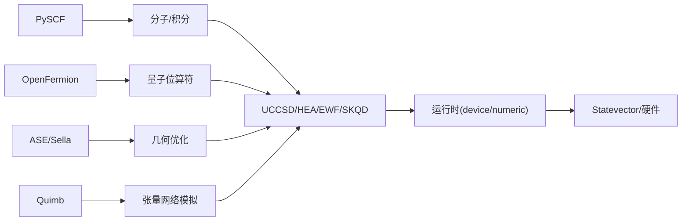

**图表来源**
- [ewf_geometry.py:230-235](file://examples/ewf_geometry.py#L230-L235)
- [run_spin_dynamics.py:23-24](file://examples/run_spin_dynamics.py#L23-L24)
- [sqd_gpu_benchmark.py:69-177](file://examples/sqd_gpu_benchmark.py#L69-L177)

**章节来源**
- [ewf_geometry.py:230-235](file://examples/ewf_geometry.py#L230-L235)
- [run_spin_dynamics.py:23-24](file://examples/run_spin_dynamics.py#L23-L24)
- [sqd_gpu_benchmark.py:69-177](file://examples/sqd_gpu_benchmark.py#L69-L177)

## 性能考量
- 活性空间与振幅筛选
  - 通过 active_space 与 pick_ex2/epsilon 显著减少参数数量，加速收敛。
- 后端选择
  - numeric 后端（statevector/pytorch）用于高精度与快速原型；device 后端用于真实设备或含噪声仿真。
- Trotter 步数与精度
  - 增加 steps 可提高逼近精度，但代价是电路深度与资源消耗上升。
- 噪声建模
  - 在 LUCJ 采样中加入 depolarizing 噪声，评估鲁棒性与恢复效果。
- 期望值估计
  - 分组旋转复用状态可减少重复计算；计数法适用于稀疏项集。
- **EWF性能优化**
  - 片段大小阈值控制FCI与LUCJ+SQD的选择。
  - CUDA加速仅针对SQD片段求解，不加速全局密度或梯度计算。
  - 冻结浴近似减少梯度计算复杂度。
- **SKQD效率提升**
  - 多时间尺度分离，短时间和长时间分别优化。
  - 自然轨道变基提高收敛速度和精度。
  - 高斯拟合优化Trotter演化参数。
- **GPU加速策略**
  - Torch后端利用GPU并行计算Davidson迭代。
  - Native后端支持MPI分布式计算。
  - 混合模式平衡GPU内存和计算负载。
  - 实时GPU内存监控和利用率统计。

## 故障排查指南
- 从积分构建的 HEA 无法计算 HOMO-LUMO gap
  - 现象：调用 get_homo_lumo_gap() 抛出运行时错误。
  - 原因：缺少分子信息（轨道/占据）。
  - 解决：改用 from_molecule 构建或使用 UCC 对象。
- 非有限能量
  - 现象：检测到 NaN/Inf 能量。
  - 原因：采样/数值不稳定或参数发散。
  - 解决：检查噪声强度、学习率、迭代次数与初始化策略。
- 收敛缓慢或陷入局部极小
  - 现象：能量停滞或震荡。
  - 解决：增大 ansatz 表达能力、更换优化器、调整学习率或引入预热/退火策略。
- 计数统计误差大
  - 现象：期望值波动明显。
  - 解决：增加 shots、合并测量组、使用读误校正或后处理技术。
- **EWF几何优化问题**
  - 片段求解失败：检查片段大小是否超过最大qubit限制。
  - 梯度不收敛：确认冻结浴近似的有效性，检查空间变化诊断。
  - 优化器不收敛：调整力阈值和最大步数，检查初始几何合理性。
- **SKQD工作流问题**
  - 采样失败：确认ensemble.json存在且格式正确。
  - 第二轮变基失败：确保第一轮RDM已计算且基底旋转矩阵有效。
  - 成本估算异常：检查输入配置完整性，确认norb和nelec参数。
- **自旋动力学问题**
  - DMRG基态不收敛：增加ground_maxiter或调整max_bond参数。
  - AQC压缩失败：检查fidelity_target是否过于严格。
  - 谱分析异常：确认simulator选择和参数设置。
- **GPU基准测试问题**
  - CUDA设备不可用：检查GPU驱动和CUDA版本兼容性。
  - MPI通信失败：确认mpiexec路径和MPI库版本匹配。
  - 内存不足：减少batch_size或增加max_space参数。
  - 性能异常：检查GPU利用率，确认没有进程抢占。

**章节来源**
- [demo_hea_homo_lumo_gap.py:126-148](file://examples/demo_hea_homo_lumo_gap.py#L126-L148)
- [h2o_sqd.py:317-329](file://examples/h2o_sqd.py#L317-L329)
- [ewf_geometry.py:80-84](file://examples/ewf_geometry.py#L80-L84)
- [workflow.py:116-118](file://examples/SKQD/workflow.py#L116-L118)
- [run_spin_dynamics.py:155-160](file://examples/run_spin_dynamics.py#L155-L160)
- [sqd_gpu_benchmark.py:377-406](file://examples/sqd_gpu_benchmark.py#L377-L406)

## 结论
TyxonQ 提供了完整的量子化学计算链路：从分子与积分构建、算法选择（UCCSD/HEA/LUCJ+SQD/EWF/SKQD）、运行时执行（device/numeric），到结果分析与可视化。新增的EWF几何优化、SKQD工作流、自旋动力学模拟和GPU基准测试功能进一步扩展了平台的能力范围。

示例脚本覆盖了从基础量子化学计算到高级科学应用的完整谱系：H₂ 基态能量、H₂O 活性空间性质、Trotter 演化、VQE 优化、EWF几何优化、SKQD多时间尺度动力学、自旋链谱分析和GPU性能基准。这些功能既适合入门学习，也具备工程可扩展性。

通过合理配置活性空间、噪声模型、优化策略和硬件资源，可在不同精度需求和硬件平台上取得稳定可靠的化学结果。新增的高性能GPU求解器和分布式计算支持使得大规模量子化学计算更加可行和高效。

## 附录
- 常用参数速查
  - UCCSD：init_method（mp2/ccsd/fe/zeros）、active_space、pick_ex2、epsilon、runtime（device/numeric）。
  - HEA：layers、mapping（parity/jordan-wigner/bravyi-kitaev）、runtime、gradient（param-shift/free）。
  - Trotter：time、steps、num_qubits。
  - LUCJ+SQD：shots、noise_p、samples_per_batch、num_batches、max_iterations、max_dim、seed。
  - **EWF**：profile（small/paper）、backend（cpu/cuda）、assembly（rdm_t/rdm_t_lambda）、force-sqd、fci_max_orbitals。
  - **SKQD**：method（trotter/sqdrift）、fit_depth、basis_id、natural_orbital_blocks。
  - **自旋动力学**：simulator（statevector/quimb_mps）、hva_layers、ground_maxiter、aqc_maxiter、segments。
  - **GPU基准**：backend（torch/native/hybrid）、devices、batches、validation（full_cpu/gpu/none）。
- 结果分析方法
  - 能量收敛曲线、保真度与误差分析、RDM 与轨道占据分析、与经典方法（FCI/CCSD）对比。
  - **EWF**：片段能量贡献、全局密度质量、梯度精度验证、优化轨迹分析。
  - **SKQD**：多时间尺度收敛性、自然轨道质量、RDM精度、相关性函数分析。
  - **自旋动力学**：谱函数特征、响应函数形态、线路复杂度统计、保真度监控。
  - **GPU基准**：性能缩放比、内存使用模式、并行效率、精度验证结果。
- 扩展方向
  - 自适应 ansatz、多目标优化（能量+方差）、误差缓解技术、更大体系与更高精度基组。
  - **机器学习辅助**：神经网络势函数、主动学习采样、贝叶斯优化。
  - **量子经典混合**：QM/MM嵌入、多尺度模拟、实时动力学。
  - **高性能计算**：GPU集群、分布式求解、在线学习优化。