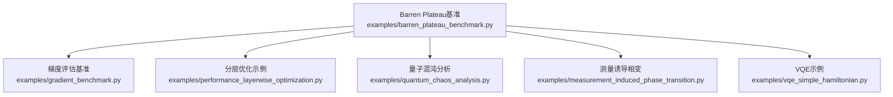
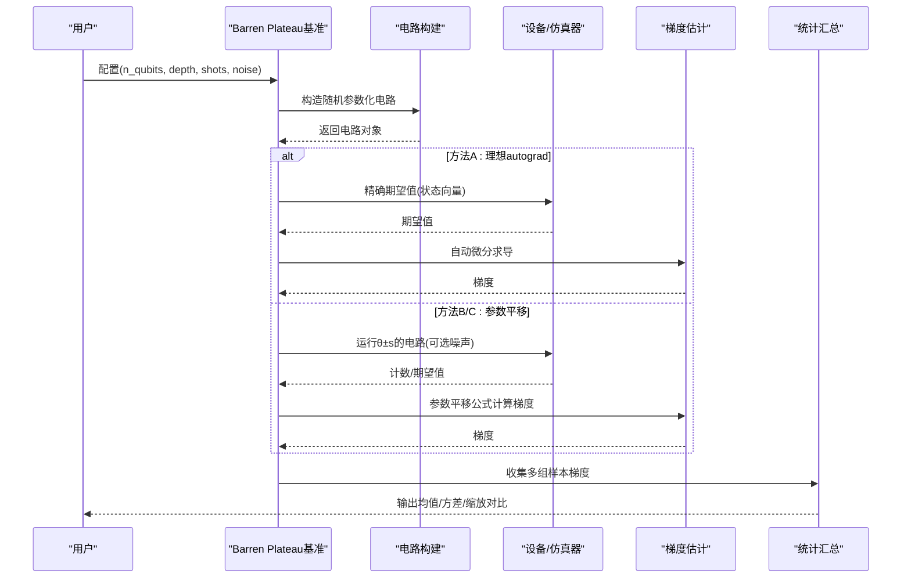
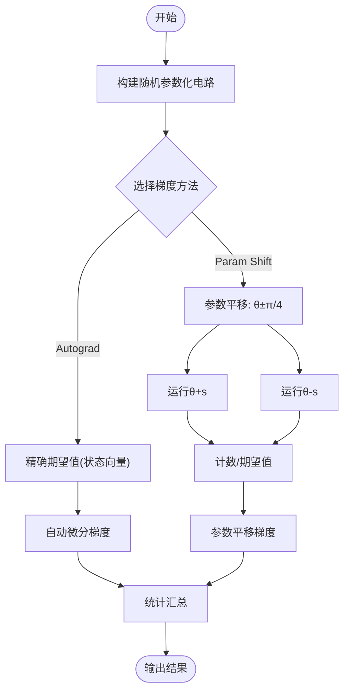
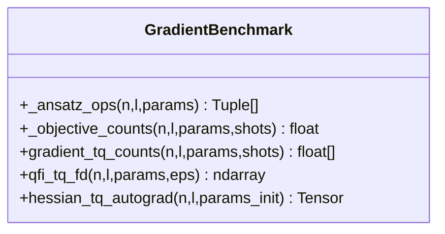
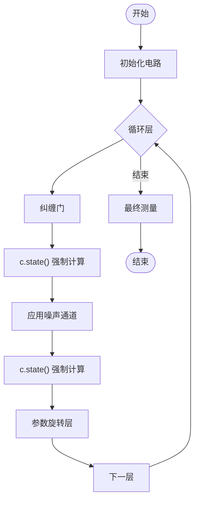
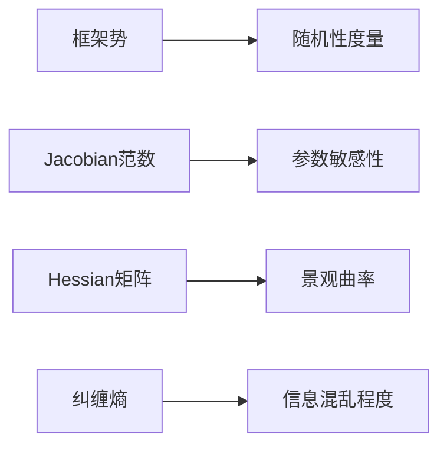
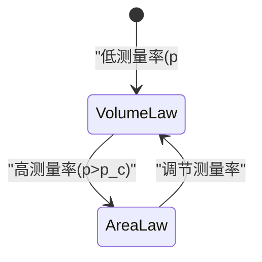
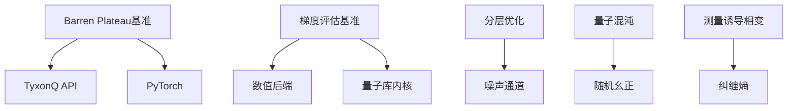

# Barren Plateau现象分析

<cite>
**本文引用的文件**
- [barren_plateau_benchmark.py](file://examples/barren_plateau_benchmark.py)
- [gradient_benchmark.py](file://examples/gradient_benchmark.py)
- [performance_layerwise_optimization.py](file://examples/performance_layerwise_optimization.py)
- [quantum_chaos_analysis.py](file://examples/quantum_chaos_analysis.py)
- [measurement_induced_phase_transition.py](file://examples/measurement_induced_phase_transition.py)
- [vqe_simple_hamiltonian.py](file://examples/vqe_simple_hamiltonian.py)
</cite>

## 目录
1. [引言](#引言)
2. [项目结构](#项目结构)
3. [核心组件](#核心组件)
4. [架构总览](#架构总览)
5. [详细组件分析](#详细组件分析)
6. [依赖关系分析](#依赖关系分析)
7. [性能考量](#性能考量)
8. [故障排查指南](#故障排查指南)
9. [结论](#结论)
10. [附录](#附录)

## 引言
本技术文档围绕变分量子算法中的“ barren plateau（贫瘠高原）”现象展开，系统阐述梯度消失的理论背景、产生机制及其对训练的影响；结合仓库中的基准代码，演示不同电路深度、量子比特数与参数初始化策略对梯度范数的影响；并给出基于随机电路理论的预测方法（含Wigner-Dyson分布与Haar测度相关思想），以及缓解策略（局部哈密顿量、分层训练、参数初始化优化等）。文档同时提供可复现实验的性能基准与分析方法。

## 项目结构
本仓库提供了完整的Barren Plateau基准与相关示例：
- 基准主脚本：三种梯度计算方法的对比与可扩展性分析
- 梯度评估基准：计数路径与状态向量路径的梯度/Hessian/QFI
- 分层优化：深度噪声电路的分层状态计算以改善编译与运行效率
- 量子混沌与复杂性：框架势、Jacobian/Hessian、纠缠熵等指标
- 测量诱导相变：随机幺正与概率测量的竞争，体现随机性与纠缠演化
- VQE示例：硬件高效Ansatz与能量优化流程



图表来源
- [barren_plateau_benchmark.py:1-592](file://examples/barren_plateau_benchmark.py#L1-L592)
- [gradient_benchmark.py:1-200](file://examples/gradient_benchmark.py#L1-L200)
- [performance_layerwise_optimization.py:1-200](file://examples/performance_layerwise_optimization.py#L1-L200)
- [quantum_chaos_analysis.py:1-40](file://examples/quantum_chaos_analysis.py#L1-L40)
- [measurement_induced_phase_transition.py:30-68](file://examples/measurement_induced_phase_transition.py#L30-L68)
- [vqe_simple_hamiltonian.py:1-200](file://examples/vqe_simple_hamiltonian.py#L1-L200)

章节来源
- [barren_plateau_benchmark.py:1-592](file://examples/barren_plateau_benchmark.py#L1-L592)
- [gradient_benchmark.py:1-200](file://examples/gradient_benchmark.py#L1-L200)
- [performance_layerwise_optimization.py:1-200](file://examples/performance_layerwise_optimization.py#L1-L200)
- [quantum_chaos_analysis.py:1-40](file://examples/quantum_chaos_analysis.py#L1-L40)
- [measurement_induced_phase_transition.py:30-68](file://examples/measurement_induced_phase_transition.py#L30-L68)
- [vqe_simple_hamiltonian.py:1-200](file://examples/vqe_simple_hamiltonian.py#L1-L200)

## 核心组件
- 三种梯度计算方法对比
  - 理想自动微分（PyTorch autograd）：理论基线，非硬件可实现
  - 参数平移规则（Parameter Shift）：硬件可实现，受有限采样噪声影响
  - 参数平移+噪声：最接近NISQ设备，包含退极化等噪声模型
- 可扩展性分析
  - 指数衰减验证：梯度标准差随量子比特数增加呈O(1/2^(n/2))趋势
- 分层优化
  - 通过逐层强制状态计算打断计算图，显著降低JIT编译时间
- 量子混沌与复杂性度量
  - 框架势、Jacobian/Hessian范数、纠缠熵用于表征随机性与表达能力
- 测量诱导相变
  - 随机幺正与概率测量竞争导致体积律/面积律相变，体现随机电路特性

章节来源
- [barren_plateau_benchmark.py:142-345](file://examples/barren_plateau_benchmark.py#L142-L345)
- [barren_plateau_benchmark.py:421-517](file://examples/barren_plateau_benchmark.py#L421-L517)
- [performance_layerwise_optimization.py:62-184](file://examples/performance_layerwise_optimization.py#L62-L184)
- [quantum_chaos_analysis.py:134-164](file://examples/quantum_chaos_analysis.py#L134-L164)
- [measurement_induced_phase_transition.py:112-164](file://examples/measurement_induced_phase_transition.py#L112-L164)

## 架构总览
下图展示了Barren Plateau基准的整体数据流与控制流：从随机电路构建、期望值计算到梯度估计与统计汇总。



图表来源
- [barren_plateau_benchmark.py:142-345](file://examples/barren_plateau_benchmark.py#L142-L345)
- [barren_plateau_benchmark.py:421-517](file://examples/barren_plateau_benchmark.py#L421-L517)

## 详细组件分析

### 组件A：Barren Plateau基准（三种梯度方法）
- 目标：量化梯度范数随系统尺寸与深度的变化，验证指数衰减行为
- 关键实现要点
  - 随机电路：初始叠加层 + 随机单比特旋转（RX/RY/RZ选择）+ 相邻CZ纠缠层
  - 观测：前两量子比特的ZZ关联期望值
  - 方法A：使用PyTorch autograd直接求导（理论基线）
  - 方法B：参数平移规则，有限shots计数估计梯度
  - 方法C：在方法B基础上加入退极化噪声，模拟NISQ环境
- 结果指标：梯度均值与标准差，并与理论缩放O(1/2^(n/2))对比



图表来源
- [barren_plateau_benchmark.py:91-139](file://examples/barren_plateau_benchmark.py#L91-L139)
- [barren_plateau_benchmark.py:142-345](file://examples/barren_plateau_benchmark.py#L142-L345)

章节来源
- [barren_plateau_benchmark.py:91-139](file://examples/barren_plateau_benchmark.py#L91-L139)
- [barren_plateau_benchmark.py:142-345](file://examples/barren_plateau_benchmark.py#L142-L345)
- [barren_plateau_benchmark.py:421-517](file://examples/barren_plateau_benchmark.py#L421-L517)

### 组件B：梯度评估基准（计数路径与状态向量路径）
- 计数路径：通过counts计算期望值，并使用参数平移得到梯度
- 状态向量路径：利用数值后端与量子库内核进行QFI（有限差分）与Hessian（自动微分）计算
- 优势：支持跨框架对比（如Qiskit可选路径），便于性能与精度评估



图表来源
- [gradient_benchmark.py:40-112](file://examples/gradient_benchmark.py#L40-L112)
- [gradient_benchmark.py:112-186](file://examples/gradient_benchmark.py#L112-L186)

章节来源
- [gradient_benchmark.py:40-112](file://examples/gradient_benchmark.py#L40-L112)
- [gradient_benchmark.py:112-186](file://examples/gradient_benchmark.py#L112-L186)

### 组件C：分层优化（深度噪声电路）
- 问题：深度电路+噪声通道导致巨大计算图，JIT编译耗时过长
- 方案：每层强制状态计算，打断计算图，显著降低编译时间
- 效果：编译时间加速10-30倍，运行时略慢但可接受



图表来源
- [performance_layerwise_optimization.py:62-184](file://examples/performance_layerwise_optimization.py#L62-L184)

章节来源
- [performance_layerwise_optimization.py:62-184](file://examples/performance_layerwise_optimization.py#L62-L184)

### 组件D：量子混沌与复杂性度量
- 框架势（Frame Potential）：衡量t-设计性质与随机性
- Jacobian/Hessian：灵敏度与曲率分析，辅助理解训练景观
- 纠缠熵：评估随机电路的纠缠增长与信息扩散



图表来源
- [quantum_chaos_analysis.py:134-164](file://examples/quantum_chaos_analysis.py#L134-L164)

章节来源
- [quantum_chaos_analysis.py:134-164](file://examples/quantum_chaos_analysis.py#L134-L164)

### 组件E：测量诱导相变（随机电路理论）
- 随机幺正生成纠缠，概率测量导致态坍缩，二者竞争驱动相变
- 体积律相（p < p_c）：纠缠熵广延；面积律相（p > p_c）：纠缠熵常数
- 与Barren Plateau的关系：强随机性导致梯度指数衰减，测量可改变纠缠结构与可训练性



图表来源
- [measurement_induced_phase_transition.py:30-68](file://examples/measurement_induced_phase_transition.py#L30-L68)
- [measurement_induced_phase_transition.py:112-164](file://examples/measurement_induced_phase_transition.py#L112-L164)

章节来源
- [measurement_induced_phase_transition.py:30-68](file://examples/measurement_induced_phase_transition.py#L30-L68)
- [measurement_induced_phase_transition.py:112-164](file://examples/measurement_induced_phase_transition.py#L112-L164)

### 组件F：VQE示例（硬件高效Ansatz）
- 目标：最小化TFIM哈密顿量的基态能量
- Ansatz：Hadamard初始层 + 重复纠缠层（CNOT ladder）+ 旋转层（RY/RZ）
- 优化：使用value_and_grad与经典优化器迭代更新参数

```mermaid
sequenceDiagram
participant Opt as "优化器"
participant Ans as "Ansatz电路"
participant Ham as "哈密顿量"
participant Eval as "能量计算"
Opt->>Ans : 参数θ
Ans-->>Eval : 状态向量
Eval->>Ham : 计算⟨ψ|H|ψ⟩
Ham-->>Opt : 能量E(θ)
Opt->>Opt : 反向传播更新参数
```

图表来源
- [vqe_simple_hamiltonian.py:87-152](file://examples/vqe_simple_hamiltonian.py#L87-L152)
- [vqe_simple_hamiltonian.py:157-200](file://examples/vqe_simple_hamiltonian.py#L157-L200)

章节来源
- [vqe_simple_hamiltonian.py:87-152](file://examples/vqe_simple_hamiltonian.py#L87-L152)
- [vqe_simple_hamiltonian.py:157-200](file://examples/vqe_simple_hamiltonian.py#L157-L200)

## 依赖关系分析
- 模块耦合
  - 基准脚本依赖TyxonQ电路API、后端设置与噪声模型
  - 梯度评估基准依赖数值后端与量子库内核（状态向量、Pauli算子）
  - 分层优化依赖噪声通道与状态强制计算
  - 量子混沌与测量诱导相变依赖随机幺正生成与熵计算
- 外部依赖
  - PyTorch用于自动微分
  - 可选PennyLane/Qiskit用于交叉验证与对比



图表来源
- [barren_plateau_benchmark.py:42-88](file://examples/barren_plateau_benchmark.py#L42-L88)
- [gradient_benchmark.py:112-186](file://examples/gradient_benchmark.py#L112-L186)
- [performance_layerwise_optimization.py:46-59](file://examples/performance_layerwise_optimization.py#L46-L59)
- [quantum_chaos_analysis.py:28-40](file://examples/quantum_chaos_analysis.py#L28-L40)
- [measurement_induced_phase_transition.py:112-164](file://examples/measurement_induced_phase_transition.py#L112-L164)

章节来源
- [barren_plateau_benchmark.py:42-88](file://examples/barren_plateau_benchmark.py#L42-L88)
- [gradient_benchmark.py:112-186](file://examples/gradient_benchmark.py#L112-L186)
- [performance_layerwise_optimization.py:46-59](file://examples/performance_layerwise_optimization.py#L46-L59)
- [quantum_chaos_analysis.py:28-40](file://examples/quantum_chaos_analysis.py#L28-L40)
- [measurement_induced_phase_transition.py:112-164](file://examples/measurement_induced_phase_transition.py#L112-L164)

## 性能考量
- 编译与运行时间
  - 分层优化可将JIT编译时间缩短10-30倍，适合深度噪声电路
- 采样噪声
  - 有限shots引入统计误差，需权衡shots数量与梯度估计精度
- 内存占用
  - 深度电路全图构建可能导致内存峰值上升，分层计算可降低编译期内存
- 建议
  - 深度>10层或噪声通道较多时优先采用分层优化
  - 对NISQ设备，合理设置shots与噪声模型以贴近真实场景

章节来源
- [performance_layerwise_optimization.py:187-200](file://examples/performance_layerwise_optimization.py#L187-L200)
- [performance_layerwise_optimization.py:295-336](file://examples/performance_layerwise_optimization.py#L295-L336)

## 故障排查指南
- 梯度为NaN或Inf
  - 检查参数范围与数值稳定性，避免过大角度或病态初始化
- 梯度标准差异常小
  - 确认电路是否足够随机（门选择、纠缠层）
  - 检查shots是否过小导致统计噪声掩盖信号
- 编译时间过长
  - 启用分层优化，逐层强制状态计算
- 噪声影响过大
  - 调整噪声强度或shots，观察梯度质量变化

章节来源
- [barren_plateau_benchmark.py:212-345](file://examples/barren_plateau_benchmark.py#L212-L345)
- [performance_layerwise_optimization.py:62-184](file://examples/performance_layerwise_optimization.py#L62-L184)

## 结论
- Barren Plateau是变分量子算法中梯度指数衰减的核心挑战，可通过随机电路理论与实验基准加以验证
- 三种梯度方法对比揭示了硬件约束对梯度估计的影响，参数平移规则是NISQ设备的可行方案
- 分层优化显著提升深度噪声电路的训练效率
- 量子混沌与测量诱导相变提供了理解随机性与可训练性的视角
- 缓解策略包括：使用局部哈密顿量、分层训练、优化参数初始化、合理shots与噪声建模

## 附录

### 理论背景与数学推导要点
- 随机电路与Haar测度
  - 深随机电路趋向于近似Haar随机分布，导致局部可观测量与初态重叠指数小
  - 框架势可作为t-设计度量，衡量逼近Haar的程度
- Wigner-Dyson分布
  - 随机矩阵理论中，能级间距分布呈现Wigner-Dyson形式，反映量子混沌与能级排斥
  - 与梯度消失的关系：强混沌导致参数空间高度平坦，梯度范数指数衰减
- 梯度方差缩放
  - 对于随机电路，梯度方差σ² ~ O(1/2^n)，标准差σ ~ O(1/2^(n/2))
  - 基准脚本通过多组随机样本统计梯度标准差，验证该缩放

章节来源
- [quantum_chaos_analysis.py:134-164](file://examples/quantum_chaos_analysis.py#L134-L164)
- [measurement_induced_phase_transition.py:112-164](file://examples/measurement_induced_phase_transition.py#L112-L164)
- [barren_plateau_benchmark.py:421-517](file://examples/barren_plateau_benchmark.py#L421-L517)

### 基准测试代码与使用方法
- 运行Barren Plateau基准
  - 配置量子比特数、电路深度、shots与噪声开关
  - 比较三种梯度方法的梯度标准差与理论缩放
- 运行梯度评估基准
  - 计数路径：参数平移+shots计数
  - 状态向量路径：QFI（有限差分）与Hessian（自动微分）
- 运行分层优化示例
  - 对比标准方法与分层优化的编译与运行时间

章节来源
- [barren_plateau_benchmark.py:520-592](file://examples/barren_plateau_benchmark.py#L520-L592)
- [gradient_benchmark.py:1-200](file://examples/gradient_benchmark.py#L1-L200)
- [performance_layerwise_optimization.py:187-200](file://examples/performance_layerwise_optimization.py#L187-L200)

### 缓解策略与实践建议
- 局部哈密顿量
  - 使用局域可观测量（如两体关联）而非全局可观测量，减缓梯度衰减
- 分层训练
  - 逐层预训练或逐步加深电路，避免一次性训练过深网络
- 参数初始化优化
  - 小方差初始化或问题启发式初始化，减少初始梯度消失风险
- 噪声与shots管理
  - 合理设置shots与噪声模型，平衡精度与效率

章节来源
- [barren_plateau_benchmark.py:574-592](file://examples/barren_plateau_benchmark.py#L574-L592)
- [performance_layerwise_optimization.py:295-336](file://examples/performance_layerwise_optimization.py#L295-L336)