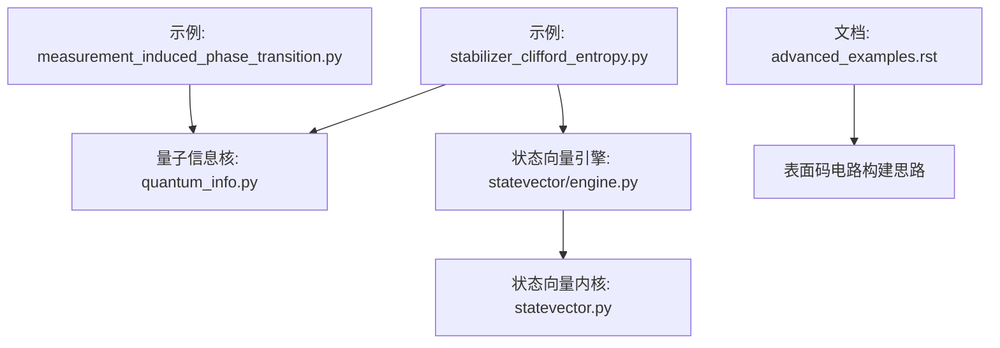
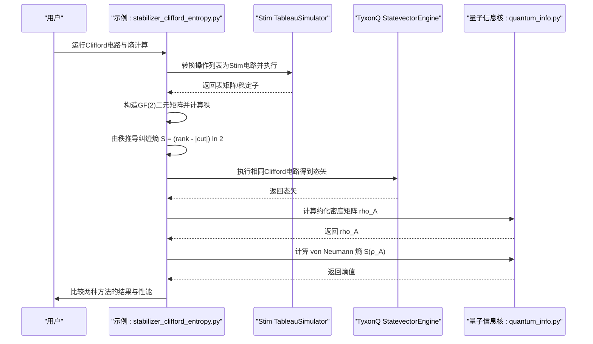
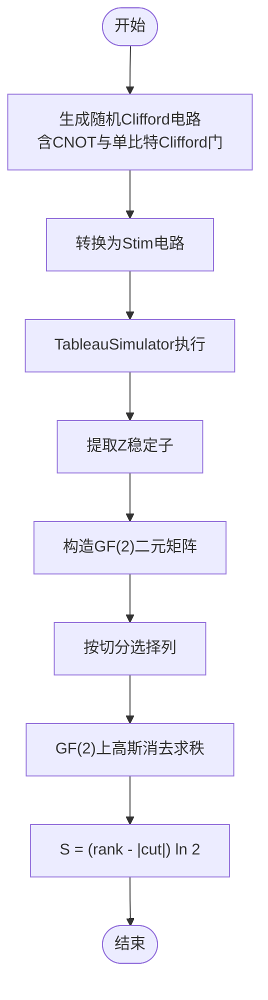
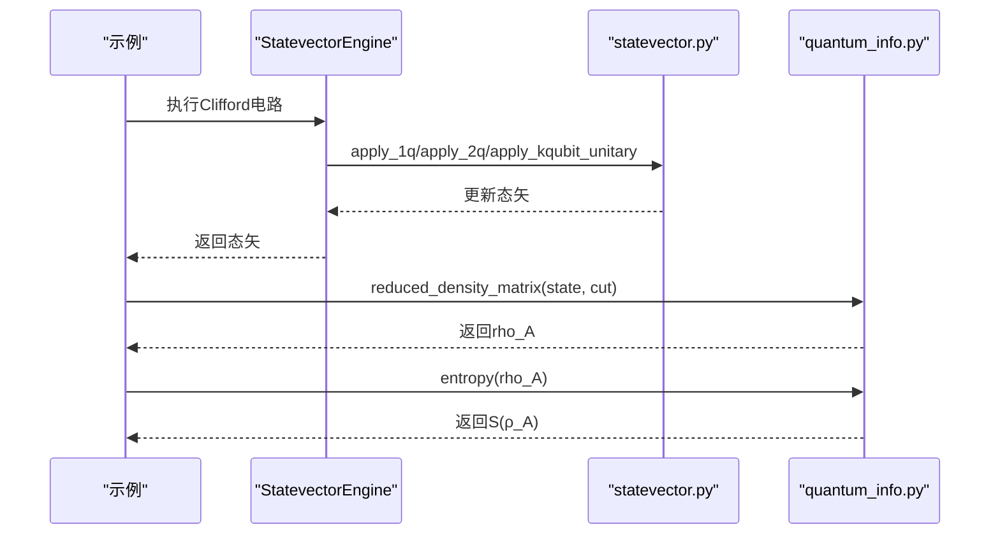
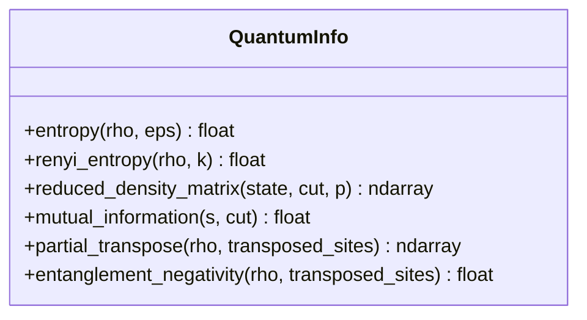
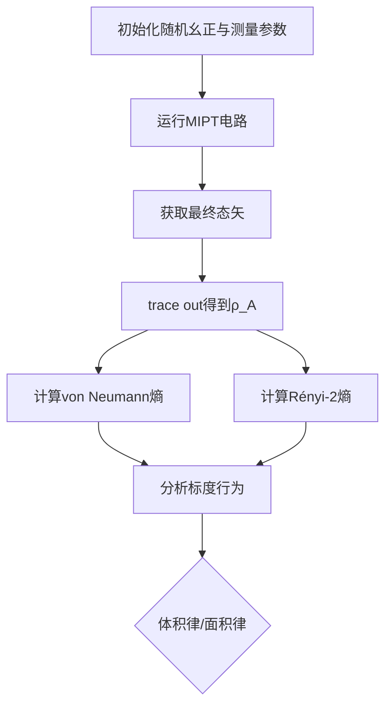
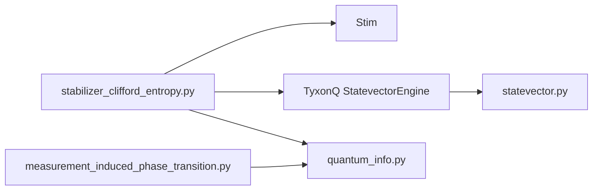

# Stabilizer和Clifford熵计算

<cite>
**本文引用的文件**
- [examples/stabilizer_clifford_entropy.py](file://examples/stabilizer_clifford_entropy.py)
- [src/tyxonq/libs/quantum_library/kernels/quantum_info.py](file://src/tyxonq/libs/quantum_library/kernels/quantum_info.py)
- [src/tyxonq/devices/simulators/statevector/engine.py](file://src/tyxonq/devices/simulators/statevector/engine.py)
- [src/tyxonq/libs/quantum_library/kernels/statevector.py](file://src/tyxonq/libs/quantum_library/kernels/statevector.py)
- [examples/measurement_induced_phase_transition.py](file://examples/measurement_induced_phase_transition.py)
- [docs/source/examples/advanced_examples.rst](file://docs/source/examples/advanced_examples.rst)
</cite>

## 目录
1. [简介](#简介)
2. [项目结构](#项目结构)
3. [核心组件](#核心组件)
4. [架构总览](#架构总览)
5. [详细组件分析](#详细组件分析)
6. [依赖关系分析](#依赖关系分析)
7. [性能考量](#性能考量)
8. [故障排查指南](#故障排查指南)
9. [结论](#结论)
10. [附录](#附录)

## 简介
本技术文档围绕Stabilizer形式体系与Clifford熵计算，系统阐述其在量子纠错与量子信息理论中的关键作用。内容涵盖：
- Stabilizer形式体系的数学结构与生成元表示、对称性操作
- Clifford门模拟优势（Gottesman-Knill定理）与多项式时间可模拟性
- 高效计算Stabilizer态的von Neumann熵、Rényi熵等信息论量
- 在量子纠错码（如表面码）中的应用与拓扑序表征思路
- 基于TyxonQ与Stim的数值实验，展示不同量子态的熵标度行为与临界现象分析

## 项目结构
仓库中与Stabilizer与Clifford熵计算直接相关的代码主要分布在以下位置：
- 示例程序：演示Stabilizer与全态矢方法的对比与熵计算流程
- 量子信息核函数：提供von Neumann熵、Rényi熵、约化密度矩阵等工具
- 状态向量模拟器：实现通用态矢演化，用于基准对比
- 测量诱导相变示例：展示熵在临界现象中的使用
- 高级示例文档：包含表面码电路构建思路

图表来源
- [examples/stabilizer_clifford_entropy.py:168-256](file://examples/stabilizer_clifford_entropy.py#L168-L256)
- [src/tyxonq/libs/quantum_library/kernels/quantum_info.py:18-57](file://src/tyxonq/libs/quantum_library/kernels/quantum_info.py#L18-L57)
- [src/tyxonq/devices/simulators/statevector/engine.py:1-44](file://src/tyxonq/devices/simulators/statevector/engine.py#L1-L44)
- [src/tyxonq/libs/quantum_library/kernels/statevector.py:19-129](file://src/tyxonq/libs/quantum_library/kernels/statevector.py#L19-L129)
- [examples/measurement_induced_phase_transition.py:209-241](file://examples/measurement_induced_phase_transition.py#L209-L241)
- [docs/source/examples/advanced_examples.rst:167-220](file://docs/source/examples/advanced_examples.rst#L167-L220)

章节来源
- [examples/stabilizer_clifford_entropy.py:1-309](file://examples/stabilizer_clifford_entropy.py#L1-L309)
- [src/tyxonq/libs/quantum_library/kernels/quantum_info.py:1-407](file://src/tyxonq/libs/quantum_library/kernels/quantum_info.py#L1-L407)
- [src/tyxonq/devices/simulators/statevector/engine.py:1-44](file://src/tyxonq/devices/simulators/statevector/engine.py#L1-L44)
- [src/tyxonq/libs/quantum_library/kernels/statevector.py:1-200](file://src/tyxonq/libs/quantum_library/kernels/statevector.py#L1-L200)
- [examples/measurement_induced_phase_transition.py:70-314](file://examples/measurement_induced_phase_transition.py#L70-L314)
- [docs/source/examples/advanced_examples.rst:167-220](file://docs/source/examples/advanced_examples.rst#L167-L220)

## 核心组件
- Stabilizer模拟与熵计算（示例）
  - 通过Stim的TableauSimulator执行Clifford电路，提取Z稳定子并构造GF(2)二元矩阵，利用秩计算得到纠缠熵
  - 复杂度：空间O(n²)，每门O(n²)
- 全态矢模拟与熵计算（TyxonQ）
  - 使用StatevectorEngine进行完整态矢演化，计算约化密度矩阵后求von Neumann熵
  - 复杂度：空间O(2^n)，每门O(2^n)
- 量子信息核函数
  - von Neumann熵、Rényi熵、约化密度矩阵、互信息等工具函数，支持纯态与混合态输入
- 测量诱导相变示例
  - 演示在不同测量概率下von Neumann熵与Rényi-2熵的标度行为，识别体积律与面积律相

章节来源
- [examples/stabilizer_clifford_entropy.py:168-256](file://examples/stabilizer_clifford_entropy.py#L168-L256)
- [src/tyxonq/libs/quantum_library/kernels/quantum_info.py:18-57](file://src/tyxonq/libs/quantum_library/kernels/quantum_info.py#L18-L57)
- [examples/measurement_induced_phase_transition.py:209-241](file://examples/measurement_induced_phase_transition.py#L209-L241)

## 架构总览
下图展示了Stabilizer方法与TyxonQ全态矢方法在熵计算上的并行路径，以及它们如何收敛到一致的物理结果。

图表来源
- [examples/stabilizer_clifford_entropy.py:168-256](file://examples/stabilizer_clifford_entropy.py#L168-L256)
- [src/tyxonq/libs/quantum_library/kernels/quantum_info.py:18-57](file://src/tyxonq/libs/quantum_library/kernels/quantum_info.py#L18-L57)
- [src/tyxonq/devices/simulators/statevector/engine.py:1-44](file://src/tyxonq/devices/simulators/statevector/engine.py#L1-L44)

## 详细组件分析

### Stabilizer形式体系与Clifford门模拟
- 数学结构
  - Stabilizer态由一组对易的Pauli算符生成元描述；Clifford门保持Stabilizer群结构不变，可通过更新生成元或表矩阵高效模拟
  - 任意Clifford电路可在多项式时间内用Stabilizer形式体系模拟（Gottesman-Knill定理）
- 实现要点（示例）
  - 使用Stim的TableauSimulator执行Clifford门序列，提取Z稳定子
  - 将Z稳定子编码为GF(2)二元矩阵，按切分选取列构成子矩阵，计算其秩
  - 纠缠熵公式：S = (rank - |cut|) ln 2
- 复杂度优势
  - 空间O(n²)、每门O(n²)，相比全态矢O(2^n)指数级节省内存与时间

图表来源
- [examples/stabilizer_clifford_entropy.py:52-165](file://examples/stabilizer_clifford_entropy.py#L52-L165)

章节来源
- [examples/stabilizer_clifford_entropy.py:52-165](file://examples/stabilizer_clifford_entropy.py#L52-L165)

### 全态矢模拟与熵计算（TyxonQ）
- 状态向量引擎
  - StatevectorEngine维护大小为2^n的复数态矢，逐门应用单位变换
  - 支持期望值、概率、振幅等观测
- 熵计算流程
  - 从态矢构造约化密度矩阵（trace out指定qubits）
  - 使用量子信息核的entropy函数计算von Neumann熵
- 复杂度
  - 空间O(2^n)，每门O(2^n)，适合小规模验证与基准测试

图表来源
- [src/tyxonq/devices/simulators/statevector/engine.py:1-44](file://src/tyxonq/devices/simulators/statevector/engine.py#L1-L44)
- [src/tyxonq/libs/quantum_library/kernels/statevector.py:19-129](file://src/tyxonq/libs/quantum_library/kernels/statevector.py#L19-L129)
- [src/tyxonq/libs/quantum_library/kernels/quantum_info.py:18-57](file://src/tyxonq/libs/quantum_library/kernels/quantum_info.py#L18-L57)

章节来源
- [src/tyxonq/devices/simulators/statevector/engine.py:1-44](file://src/tyxonq/devices/simulators/statevector/engine.py#L1-L44)
- [src/tyxonq/libs/quantum_library/kernels/statevector.py:19-129](file://src/tyxonq/libs/quantum_library/kernels/statevector.py#L19-L129)
- [src/tyxonq/libs/quantum_library/kernels/quantum_info.py:18-57](file://src/tyxonq/libs/quantum_library/kernels/quantum_info.py#L18-L57)

### 量子信息核函数详解
- von Neumann熵
  - 对密度矩阵特征值谱进行归一化与正则化，计算S = -Tr(ρ log ρ)
- Rényi熵
  - 对k阶Rényi熵S_k = (1/(1-k)) log Tr(ρ^k)的实现，k=1时退化为von Neumann熵
- 约化密度矩阵
  - 支持纯态与混合态输入，按切分索引trace out得到子系统A的密度矩阵
- 其他工具
  - 互信息、部分转置、纠缠负性等可用于更丰富的纠缠度量

图表来源
- [src/tyxonq/libs/quantum_library/kernels/quantum_info.py:18-57](file://src/tyxonq/libs/quantum_library/kernels/quantum_info.py#L18-L57)
- [src/tyxonq/libs/quantum_library/kernels/quantum_info.py:233-304](file://src/tyxonq/libs/quantum_library/kernels/quantum_info.py#L233-L304)

章节来源
- [src/tyxonq/libs/quantum_library/kernels/quantum_info.py:18-57](file://src/tyxonq/libs/quantum_library/kernels/quantum_info.py#L18-L57)
- [src/tyxonq/libs/quantum_library/kernels/quantum_info.py:233-304](file://src/tyxonq/libs/quantum_library/kernels/quantum_info.py#L233-L304)

### 测量诱导相变与熵标度行为
- 目标
  - 研究不同测量概率p下的纠缠熵标度，识别体积律与面积律相
- 流程
  - 构建随机幺正层与测量通道，得到最终态矢
  - 计算子系统A的约化密度矩阵，分别求von Neumann熵与Rényi-2熵
  - 观察熵随系统尺寸的变化，判断临界点附近的行为

图表来源
- [examples/measurement_induced_phase_transition.py:209-241](file://examples/measurement_induced_phase_transition.py#L209-L241)

章节来源
- [examples/measurement_induced_phase_transition.py:209-241](file://examples/measurement_induced_phase_transition.py#L209-L241)

### 表面码与拓扑序表征（概念性说明）
- 表面码电路构建思路
  - 数据比特与辅助比特布局，X型与Z型稳定子的测量回路
  - 通过稳定子测量提取错误综合征，结合解码算法进行纠错
- 拓扑序表征
  - 通过长程纠缠与拓扑简并等特性，结合熵的标度与边界项进行分析
- 注意
  - 本节为概念性介绍，具体电路实现请参考文档中的示例片段

章节来源
- [docs/source/examples/advanced_examples.rst:167-220](file://docs/source/examples/advanced_examples.rst#L167-L220)

## 依赖关系分析
- 示例程序依赖
  - Stim库用于Stabilizer模拟
  - TyxonQ的StatevectorEngine与量子信息核函数用于全态矢方法与熵计算
- 模块耦合
  - 量子信息核函数被多个示例复用，提供统一的熵度量接口
  - 状态向量内核提供后端无关的张量运算，确保多后端兼容

图表来源
- [examples/stabilizer_clifford_entropy.py:168-256](file://examples/stabilizer_clifford_entropy.py#L168-L256)
- [examples/measurement_induced_phase_transition.py:209-241](file://examples/measurement_induced_phase_transition.py#L209-L241)
- [src/tyxonq/libs/quantum_library/kernels/quantum_info.py:18-57](file://src/tyxonq/libs/quantum_library/kernels/quantum_info.py#L18-L57)
- [src/tyxonq/devices/simulators/statevector/engine.py:1-44](file://src/tyxonq/devices/simulators/statevector/engine.py#L1-L44)

章节来源
- [examples/stabilizer_clifford_entropy.py:168-256](file://examples/stabilizer_clifford_entropy.py#L168-L256)
- [examples/measurement_induced_phase_transition.py:209-241](file://examples/measurement_induced_phase_transition.py#L209-L241)
- [src/tyxonq/libs/quantum_library/kernels/quantum_info.py:18-57](file://src/tyxonq/libs/quantum_library/kernels/quantum_info.py#L18-L57)
- [src/tyxonq/devices/simulators/statevector/engine.py:1-44](file://src/tyxonq/devices/simulators/statevector/engine.py#L1-L44)

## 性能考量
- 复杂度对比
  - Stabilizer方法：空间O(n²)，每门O(n²)，适合大规模Clifford电路
  - 全态矢方法：空间O(2^n)，每门O(2^n)，适用于小规模精确基准
- 内存估算
  - 示例中n=12时，Stabilizer约KB级，全态矢约MB级
- 加速建议
  - 对于纯Clifford电路优先使用Stabilizer方法
  - 需要非Clifford门或噪声模型时使用全态矢或密度矩阵模拟

[本节提供一般性指导，不直接分析具体文件]

## 故障排查指南
- 常见错误
  - 态矢范数为零：检查初始态准备与门序列是否正确
  - 熵值异常：确认约化密度矩阵归一化与特征值裁剪处理
  - 数值不一致：检查Stabilizer秩计算与GF(2)矩阵构造
- 调试步骤
  - 逐步打印中间结果（稳定子、二元矩阵、秩、rho_A）
  - 使用小系统规模验证逻辑正确性
  - 对比不同后端（numpy/pytorch）的一致性

章节来源
- [examples/stabilizer_clifford_entropy.py:234-256](file://examples/stabilizer_clifford_entropy.py#L234-L256)
- [src/tyxonq/libs/quantum_library/kernels/quantum_info.py:18-57](file://src/tyxonq/libs/quantum_library/kernels/quantum_info.py#L18-L57)

## 结论
- Stabilizer形式体系为Clifford电路提供了高效的模拟与熵计算途径，具备显著的性能优势
- TyxonQ的全态矢方法为通用量子态提供了精确的熵度量工具，适合小规模验证与复杂场景
- 通过测量诱导相变示例，展示了熵在临界现象分析中的强大能力
- 表面码等量子纠错码的构建与分析可借助稳定子理论与熵标度行为进行深入理解

[本节总结性内容，不直接分析具体文件]

## 附录
- 实用参考
  - Gottesman-Knill定理：Clifford电路的多项式时间可模拟性
  - 熵度量：von Neumann熵、Rényi熵、互信息、纠缠负性
- 扩展阅读
  - 表面码电路构建与错误检测
  - 拓扑序与长程纠缠的熵表征

[本节为概念性补充，不直接分析具体文件]