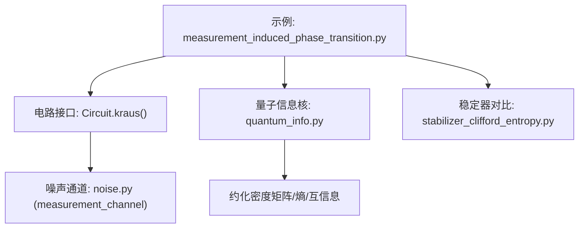
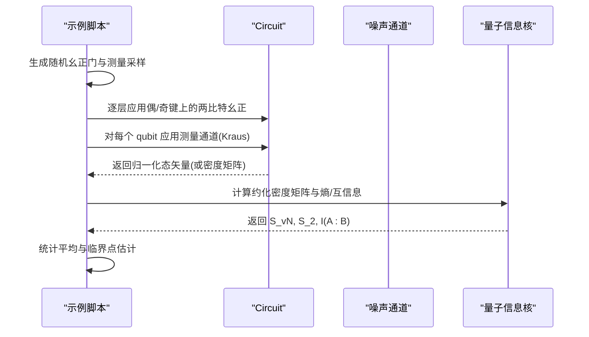
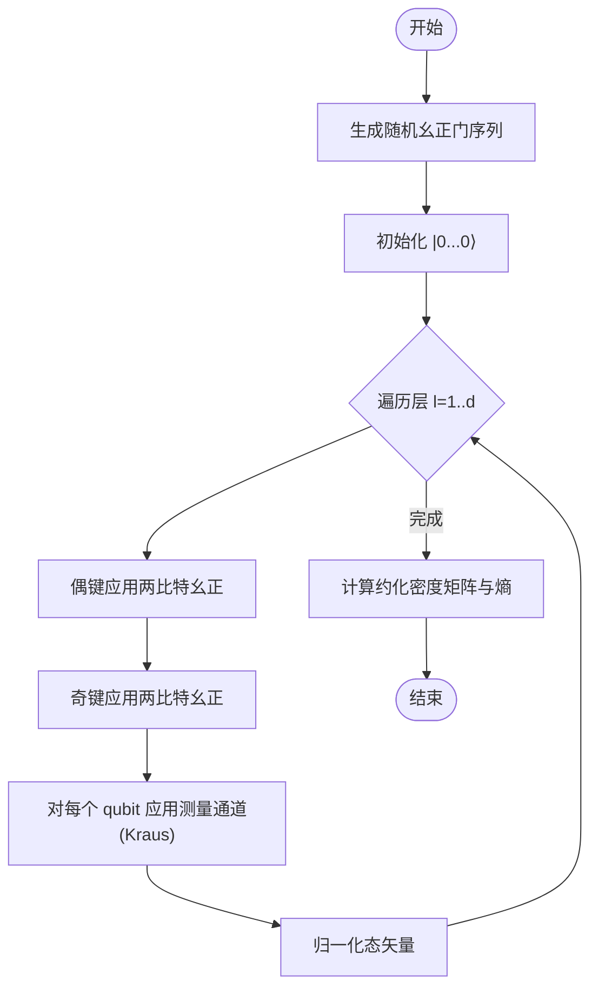
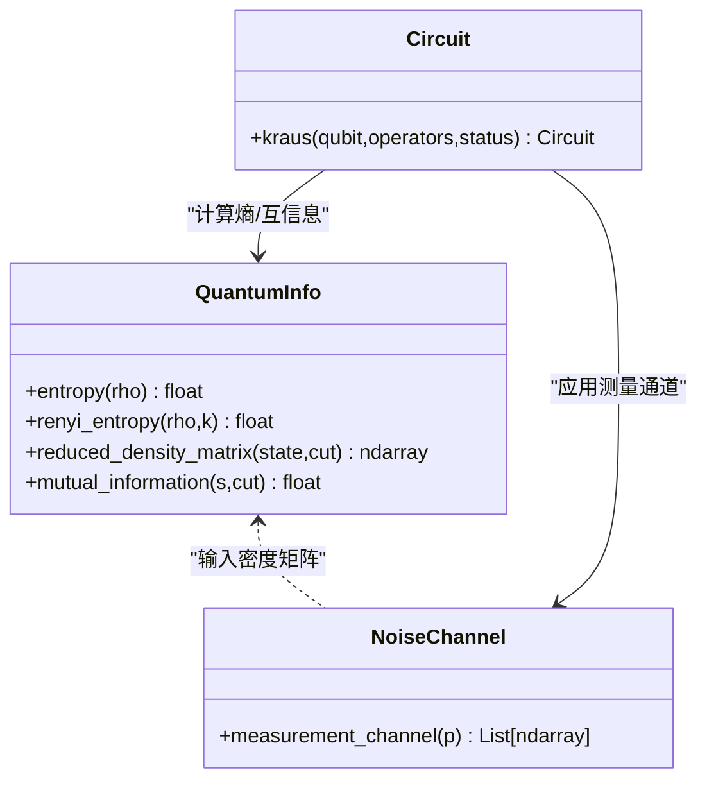
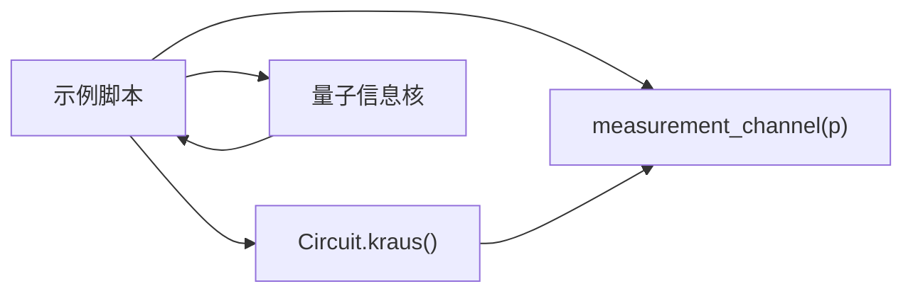

# 测量诱导相变

<cite>
**本文引用的文件**
- [measurement_induced_phase_transition.py](file://examples/measurement_induced_phase_transition.py)
- [quantum_info.py](file://src/tyxonq/libs/quantum_library/kernels/quantum_info.py)
- [noise.py](file://src/tyxonq/libs/quantum_library/noise.py)
- [circuit.py](file://src/tyxonq/core/ir/circuit.py)
- [stabilizer_clifford_entropy.py](file://examples/stabilizer_clifford_entropy.py)
</cite>

## 目录
1. [引言](#引言)
2. [项目结构](#项目结构)
3. [核心组件](#核心组件)
4. [架构总览](#架构总览)
5. [详细组件分析](#详细组件分析)
6. [依赖关系分析](#依赖关系分析)
7. [性能考量](#性能考量)
8. [故障排查指南](#故障排查指南)
9. [结论](#结论)
10. [附录](#附录)

## 引言
本文件面向量子多体物理中的前沿方向——测量诱导相变（Measurement-Induced Phase Transition, MIPT），系统阐述其理论基础、数值模拟方法与临界行为分析，并结合 TyxonQ 框架提供可复现的完整代码路径与实现要点。MIPT 描述的是在含随机幺正演化与概率性测量的监控量子电路中，纠缠熵随测量率 p 从体积律到面积律的相变；该现象体现了纯态到混合态的量子信息重分布与局域化竞争，具有普适临界指数与对数修正等特征。

本文件重点覆盖：
- 理论基础：纯态到混合态的相变、纠缠熵标度律、临界行为与有限尺寸标度
- 数值模拟：构建含测量的随机量子电路、计算纠缠熵与互信息的标度行为
- 临界点识别：有限尺寸标度分析与临界指数提取方法
- 平台实现挑战：噪声影响与纠错需求
- 与经典统计力学相变的类比及量子特性分析

## 项目结构
围绕 MIPT 的研究与实现，仓库提供了端到端的示例与底层工具：
- 示例脚本：演示 MIPT 的电路构建、熵计算与扫描
- 量子信息核：纠缠熵、Rényi 熵、约化密度矩阵、互信息等
- 噪声通道：测量通道、退极化、振幅阻尼、相位阻尼等 Kraus 算子
- 电路接口：通用 Kraus 通道应用，支持状态矢量的随机展开与密度矩阵精确演化
- 稳定器对比：Clifford 电路下稳定器形式的高效熵计算

图表来源
- [measurement_induced_phase_transition.py:112-206](file://examples/measurement_induced_phase_transition.py#L112-L206)
- [circuit.py:1279-1334](file://src/tyxonq/core/ir/circuit.py#L1279-L1334)
- [noise.py:208-252](file://src/tyxonq/libs/quantum_library/noise.py#L208-L252)
- [quantum_info.py:18-57,233-304:18-57](file://src/tyxonq/libs/quantum_library/kernels/quantum_info.py#L18-L57)
- [quantum_info.py:233-304](file://src/tyxonq/libs/quantum_library/kernels/quantum_info.py#L233-L304)
- [stabilizer_clifford_entropy.py:168-256](file://examples/stabilizer_clifford_entropy.py#L168-L256)

章节来源
- [measurement_induced_phase_transition.py:1-90](file://examples/measurement_induced_phase_transition.py#L1-L90)
- [circuit.py:1279-1334](file://src/tyxonq/core/ir/circuit.py#L1279-L1334)
- [noise.py:1-26](file://src/tyxonq/libs/quantum_library/noise.py#L1-L26)
- [quantum_info.py:1-11](file://src/tyxonq/libs/quantum_library/kernels/quantum_info.py#L1-L11)

## 核心组件
- 随机电路与测量通道
  - 使用 Haar 随机两比特幺正门生成纠缠，随后在每个 qubit 上以概率 p 施加 Z 基投影测量（Kraus 表示）
  - 通过 Circuit.kraus 接口将测量通道应用到每个 qubit，并支持状态矢量随机展开（Monte Carlo 轨迹）
- 纠缠熵与互信息
  - 基于约化密度矩阵计算冯·诺依曼熵与 Rényi-2 熵；同时提供互信息 I(A:B) 用于关联长度与临界行为的辅助诊断
- 稳定器对比
  - 对于 Clifford 电路，可用稳定器形式高效计算纠缠熵，验证结果并与全态矢量方法对比

章节来源
- [measurement_induced_phase_transition.py:112-206](file://examples/measurement_induced_phase_transition.py#L112-L206)
- [measurement_induced_phase_transition.py:209-243](file://examples/measurement_induced_phase_transition.py#L209-L243)
- [quantum_info.py:18-57](file://src/tyxonq/libs/quantum_library/kernels/quantum_info.py#L18-L57)
- [quantum_info.py:233-304](file://src/tyxonq/libs/quantum_library/kernels/quantum_info.py#L233-L304)
- [stabilizer_clifford_entropy.py:168-256](file://examples/stabilizer_clifford_entropy.py#L168-L256)

## 架构总览
下图展示了 MIPT 研究在 TyxonQ 中的调用链路与数据流：从示例脚本构造随机幺正与测量通道，到电路执行与熵计算，再到结果统计与临界点估计。

图表来源
- [measurement_induced_phase_transition.py:137-206](file://examples/measurement_induced_phase_transition.py#L137-L206)
- [measurement_induced_phase_transition.py:209-243](file://examples/measurement_induced_phase_transition.py#L209-L243)
- [circuit.py:1279-1334](file://src/tyxonq/core/ir/circuit.py#L1279-L1334)
- [noise.py:208-252](file://src/tyxonq/libs/quantum_library/noise.py#L208-L252)
- [quantum_info.py:233-304](file://src/tyxonq/libs/quantum_library/kernels/quantum_info.py#L233-L304)

## 详细组件分析

### 随机电路与测量通道（MIPT 核心）
- 电路结构
  - 每层包含偶键与奇键上的两比特随机幺正，形成“洗牌”式纠缠增长
  - 每层后对所有 qubit 施加概率性 Z 基测量，参数为测量率 p
- 测量通道
  - 采用 Kraus 算子 {√p|0⟩⟨0|, √p|1⟩⟨1|, √(1-p)I}，对应以概率 p 进行投影测量，或以 1-p 保持恒等
  - 在状态矢量模拟中，通过随机变量选择具体分支，得到单条 Monte Carlo 轨迹；多次重复取平均得到系综平均
- 关键函数与流程
  - 随机幺正生成：Haar 随机两比特幺正，确保 SU(4) 归一化
  - 电路执行：逐层应用偶/奇键幺正，再应用测量通道，最后归一化态矢量
  - 熵计算：对前 n/2 个 qubit 求约化密度矩阵，计算冯·诺依曼熵与 Rényi-2 熵

图表来源
- [measurement_induced_phase_transition.py:112-206](file://examples/measurement_induced_phase_transition.py#L112-L206)
- [noise.py:208-252](file://src/tyxonq/libs/quantum_library/noise.py#L208-L252)
- [circuit.py:1279-1334](file://src/tyxonq/core/ir/circuit.py#L1279-L1334)

章节来源
- [measurement_induced_phase_transition.py:112-206](file://examples/measurement_induced_phase_transition.py#L112-L206)
- [noise.py:208-252](file://src/tyxonq/libs/quantum_library/noise.py#L208-L252)
- [circuit.py:1279-1334](file://src/tyxonq/core/ir/circuit.py#L1279-L1334)

### 纠缠熵与互信息计算
- 约化密度矩阵
  - 对子系统 A（通常为前 n/2 个 qubit）求迹得到 ρ_A
- 熵度量
  - 冯·诺依曼熵 S = -Tr(ρ_A log ρ_A)
  - Rényi-2 熵 S_2 = -log Tr(ρ_A^2)
- 互信息
  - I(A:B) = S(A) + S(B) - S(AB)，用于刻画跨区关联强度，辅助识别临界区域

图表来源
- [quantum_info.py:18-57](file://src/tyxonq/libs/quantum_library/kernels/quantum_info.py#L18-L57)
- [quantum_info.py:233-304](file://src/tyxonq/libs/quantum_library/kernels/quantum_info.py#L233-L304)
- [noise.py:208-252](file://src/tyxonq/libs/quantum_library/noise.py#L208-L252)
- [circuit.py:1279-1334](file://src/tyxonq/core/ir/circuit.py#L1279-L1334)

章节来源
- [quantum_info.py:18-57](file://src/tyxonq/libs/quantum_library/kernels/quantum_info.py#L18-L57)
- [quantum_info.py:233-304](file://src/tyxonq/libs/quantum_library/kernels/quantum_info.py#L233-L304)
- [measurement_induced_phase_transition.py:209-243](file://examples/measurement_induced_phase_transition.py#L209-L243)

### 稳定器形式与效率对比
- 对于仅含 Clifford 门的电路，稳定器形式可在 O(n^2) 空间与时间复杂度内计算纠缠熵，显著优于全态矢量方法的 O(2^n)
- 通过 Stim 与 TyxonQ 的对比，验证两种方法在 Clifford 情形下的数值一致性，展示稳定器形式的优势

章节来源
- [stabilizer_clifford_entropy.py:168-256](file://examples/stabilizer_clifford_entropy.py#L168-L256)

## 依赖关系分析
- 示例脚本依赖
  - 电路接口：Circuit.kraus 用于应用测量通道
  - 噪声通道：measurement_channel 提供 Kraus 算子
  - 量子信息核：约化密度矩阵、熵与互信息计算
- 内部耦合
  - 示例脚本 → 噪声通道 → 电路接口 → 量子信息核
  - 稳定器对比独立于 MIPT 主流程，但共享量子信息核的熵计算接口

图表来源
- [measurement_induced_phase_transition.py:112-206](file://examples/measurement_induced_phase_transition.py#L112-L206)
- [noise.py:208-252](file://src/tyxonq/libs/quantum_library/noise.py#L208-L252)
- [quantum_info.py:233-304](file://src/tyxonq/libs/quantum_library/kernels/quantum_info.py#L233-L304)
- [circuit.py:1279-1334](file://src/tyxonq/core/ir/circuit.py#L1279-L1334)

章节来源
- [measurement_induced_phase_transition.py:112-206](file://examples/measurement_induced_phase_transition.py#L112-L206)
- [noise.py:208-252](file://src/tyxonq/libs/quantum_library/noise.py#L208-L252)
- [quantum_info.py:233-304](file://src/tyxonq/libs/quantum_library/kernels/quantum_info.py#L233-L304)
- [circuit.py:1279-1334](file://src/tyxonq/core/ir/circuit.py#L1279-L1334)

## 性能考量
- 后端与 JIT
  - 使用 PyTorch 后端可获得 JIT 编译加速，首次运行包含编译开销，后续运行显著提速
- 系统规模与深度
  - 示例默认 n_qubits=8、depth=6，便于快速演示；更大规模需权衡内存与时间
- 轨迹数量
  - 蒙特卡洛轨迹越多，统计误差越小，但计算成本线性增加
- 稳定器方法
  - 对 Clifford 电路，稳定器形式在内存与时间上具备指数级优势，适合大规模基准测试

章节来源
- [measurement_induced_phase_transition.py:104-110](file://examples/measurement_induced_phase_transition.py#L104-L110)
- [measurement_induced_phase_transition.py:272-300](file://examples/measurement_induced_phase_transition.py#L272-L300)
- [stabilizer_clifford_entropy.py:168-256](file://examples/stabilizer_clifford_entropy.py#L168-L256)

## 故障排查指南
- 归一化问题
  - 应用 Kraus 通道后需对态矢量进行归一化，避免数值漂移导致熵异常
- 参数范围校验
  - 测量概率 p 必须在 [0,1]；其他噪声通道参数同样需要严格约束
- 随机种子与可重复性
  - 设置随机种子以保证结果可复现；不同轨迹的平均值需足够大以降低统计涨落
- 后端兼容性
  - 注意状态向量在不同后端间的类型转换（如 detach().cpu().numpy()），确保约化密度矩阵计算正确

章节来源
- [measurement_induced_phase_transition.py:203-205](file://examples/measurement_induced_phase_transition.py#L203-L205)
- [noise.py:243-252](file://src/tyxonq/libs/quantum_library/noise.py#L243-L252)
- [circuit.py:1279-1334](file://src/tyxonq/core/ir/circuit.py#L1279-L1334)

## 结论
本文件基于 TyxonQ 框架，系统阐述了 MIPT 的理论背景、数值实现与临界行为分析方法。通过随机幺正与概率测量的竞争，系统在低测量率下呈现体积律纠缠，在高测量率下呈现面积律纠缠，并在临界点附近表现出普适临界行为。结合有限尺寸标度与互信息分析，可有效识别临界点与提取临界指数。此外，稳定器形式为 Clifford 电路提供了高效的熵计算方案，有助于大规模基准与验证。

## 附录

### 理论基础与临界行为
- 纯态到混合态的相变
  - 低测量率：纠缠熵 S ~ L（体积律），量子信息扩散至整个系统
  - 高测量率：纠缠熵 S ~ L^0（面积律），测量局域化信息，仅短程关联
- 临界行为
  - 临界测量率 p_c 分隔两相，关联长度在 p_c 处发散
  - 临界点附近存在对数修正，体现共形不变性与普适类特征
- 与经典统计力学相变的类比
  - 类似 Ising 模型的热相变，序参量可类比纠缠熵密度，控制参数为测量率 p
  - 临界指数与普适类可由有限尺寸标度拟合获得

### 数值模拟步骤与代码路径
- 构建随机电路与测量通道
  - 参考：[measurement_induced_phase_transition.py:112-206](file://examples/measurement_induced_phase_transition.py#L112-L206)
  - 测量通道定义：[noise.py:208-252](file://src/tyxonq/libs/quantum_library/noise.py#L208-L252)
  - 电路接口应用：[circuit.py:1279-1334](file://src/tyxonq/core/ir/circuit.py#L1279-L1334)
- 计算纠缠熵与互信息
  - 熵与约化密度矩阵：[quantum_info.py:18-57](file://src/tyxonq/libs/quantum_library/kernels/quantum_info.py#L18-L57), [quantum_info.py:233-278](file://src/tyxonq/libs/quantum_library/kernels/quantum_info.py#L233-L278)
  - 互信息：[quantum_info.py:281-304](file://src/tyxonq/libs/quantum_library/kernels/quantum_info.py#L281-L304)
- 稳定器对比
  - 参考：[stabilizer_clifford_entropy.py:168-256](file://examples/stabilizer_clifford_entropy.py#L168-L256)

### 临界点识别与有限尺寸标度
- 有限尺寸标度
  - 对多个系统尺寸 L 计算纠缠熵 S(L,p)，在 p_c 附近满足标度形式 S(L,p) ≈ f((p-p_c)L^{1/ν})
  - 通过曲线交叠或导数峰值定位 p_c，并拟合临界指数 ν
- 互信息与关联长度
  - 利用 I(A:B) 的衰减行为估计关联长度 ξ，验证临界点附近的发散趋势
- 代码实践
  - 扫描测量概率并统计平均值与标准差：[measurement_induced_phase_transition.py:317-405](file://examples/measurement_induced_phase_transition.py#L317-L405)

### 平台实现挑战：噪声与纠错
- 噪声影响
  - 退极化、振幅阻尼、相位阻尼等通道会破坏纠缠与临界行为，需在模拟中显式建模
  - ZZ 串扰引起条件相位累积，影响并行门操作与临界点的观测
- 纠错需求
  - 近中期量子设备需引入纠错码与误差缓解技术，以维持长程纠缠与临界行为的可观测性
- 参考通道与哈密顿量
  - 噪声通道：[noise.py:29-205](file://src/tyxonq/libs/quantum_library/noise.py#L29-L205)
  - ZZ 串扰哈密顿量：[noise.py:255-341](file://src/tyxonq/libs/quantum_library/noise.py#L255-L341)