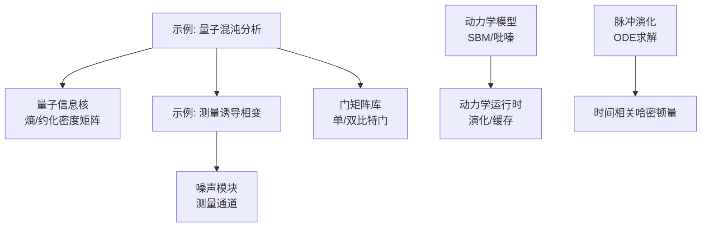
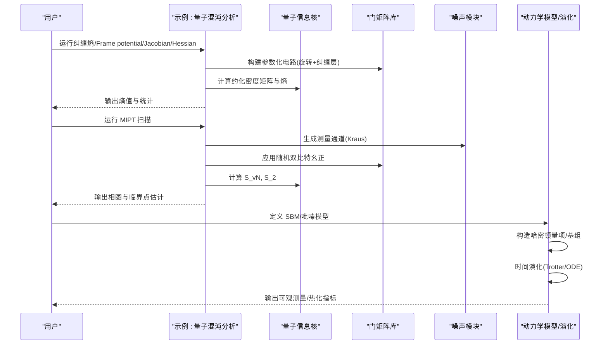
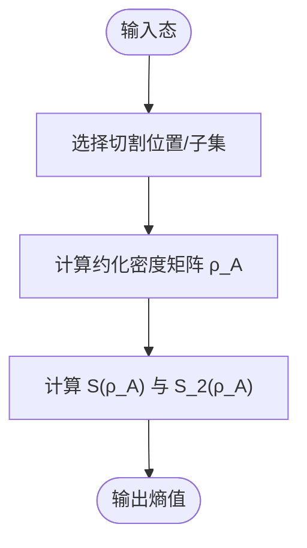
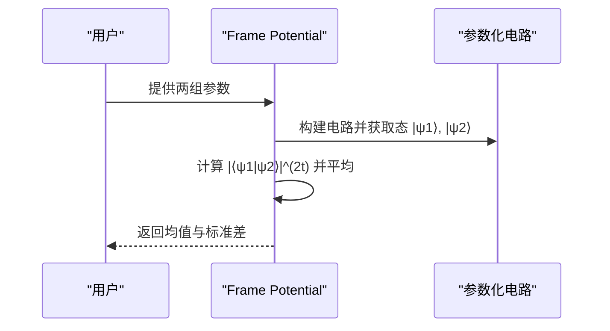
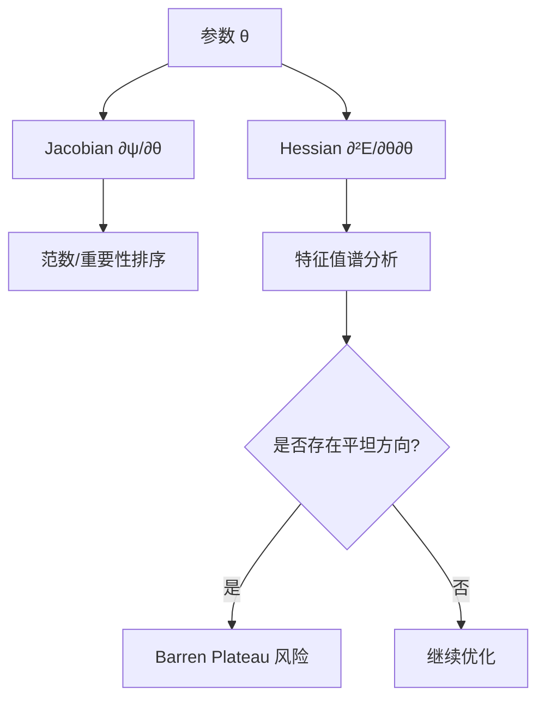
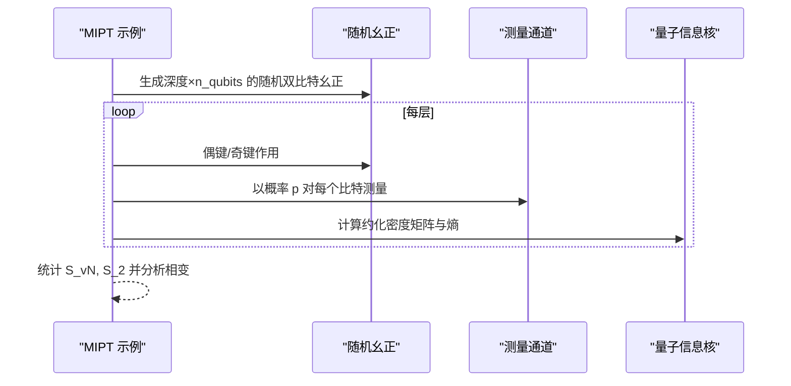
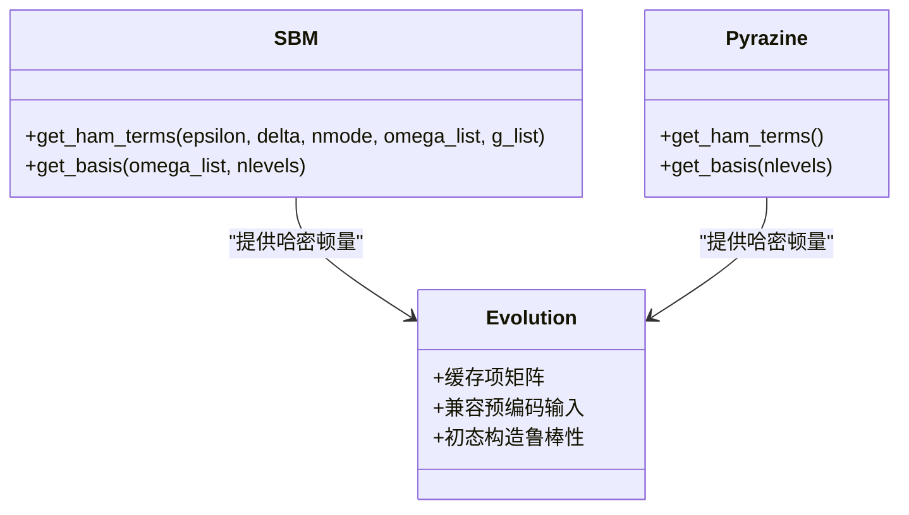
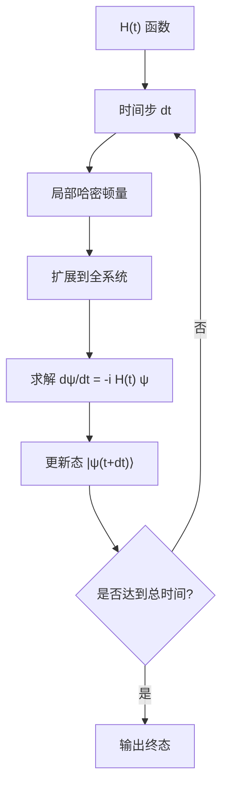
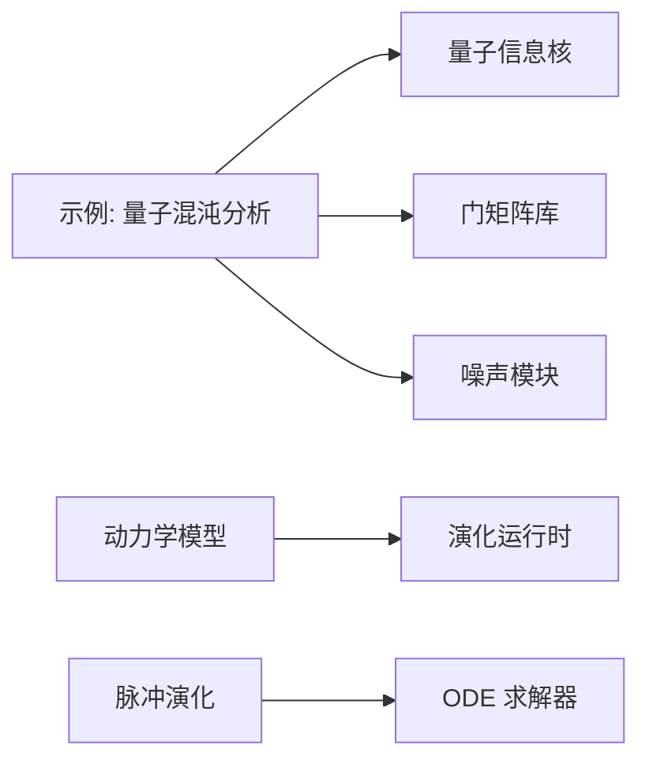

# 量子混沌分析

<cite>
**本文引用的文件**
- [examples/quantum_chaos_analysis.py](file://examples/quantum_chaos_analysis.py)
- [examples/measurement_induced_phase_transition.py](file://examples/measurement_induced_phase_transition.py)
- [src/tyxonq/libs/quantum_library/kernels/quantum_info.py](file://src/tyxonq/libs/quantum_library/kernels/quantum_info.py)
- [src/tyxonq/libs/quantum_library/kernels/gates.py](file://src/tyxonq/libs/quantum_library/kernels/gates.py)
- [src/tyxonq/libs/quantum_library/noise.py](file://src/tyxonq/libs/quantum_library/noise.py)
- [src/tyxonq/applications/chem/dynamics/models/sbm.py](file://src/tyxonq/applications/chem/dynamics/models/sbm.py)
- [src/tyxonq/applications/chem/dynamics/models/pyrazine.py](file://src/tyxonq/applications/chem/dynamics/models/pyrazine.py)
- [src/tyxonq/applications/chem/dynamics/evolution.py](file://src/tyxonq/applications/chem/dynamics/evolution.py)
- [src/tyxonq/libs/quantum_library/pulse_simulation.py](file://src/tyxonq/libs/quantum_library/pulse_simulation.py)
</cite>

## 目录
1. [简介](#简介)
2. [项目结构](#项目结构)
3. [核心组件](#核心组件)
4. [架构总览](#架构总览)
5. [详细组件分析](#详细组件分析)
6. [依赖关系分析](#依赖关系分析)
7. [性能考量](#性能考量)
8. [故障排查指南](#故障排查指南)
9. [结论](#结论)
10. [附录](#附录)

## 简介
本技术文档面向量子混沌分析与复杂性度量，系统阐述在 TyxonQ 框架内如何计算与验证量子系统的混沌特征。内容涵盖：
- 理论框架：能级间距分布（RMT）、Out-of-Time-Order Correlators（OTOC）、纠缠增长、信息 scrambling、量子热化与量子复杂性增长。
- 数值实现：基于示例代码的纠缠熵、Frame potential（t-设计度量）、Jacobian/Hessian 敏感性分析、测量诱导相变（MIPT）等。
- 经典-量子对应：Ehrenfest 时间与 Lyapunov 指数的量子对应思路与限制。
- 应用：量子信息科学中的热化、信息 scrambling、复杂度增长与随机电路模型。
- 实验与分析：提供可复现实验流程、结果解读方法与常见陷阱。

## 项目结构
仓库中与量子混沌相关的核心实现集中在 examples 与 quantum library 模块中：
- 示例脚本：演示纠缠熵、Frame potential、Jacobian/Hessian、优化流程以及 MIPT。
- 量子信息核：熵、约化密度矩阵、互信息等工具函数。
- 噪声与测量通道：用于模拟概率测量与退相干。
- 动力学模型：SBM、吡嗪分子等可用于研究多体混沌与热化。
- 脉冲演化：时间相关哈密顿量下的态演化，支持 ODE 求解。

**图示来源**
- [examples/quantum_chaos_analysis.py:43-131](file://examples/quantum_chaos_analysis.py#L43-L131)
- [examples/measurement_induced_phase_transition.py:112-206](file://examples/measurement_induced_phase_transition.py#L112-L206)
- [src/tyxonq/libs/quantum_library/kernels/quantum_info.py:18-57](file://src/tyxonq/libs/quantum_library/kernels/quantum_info.py#L18-L57)
- [src/tyxonq/libs/quantum_library/kernels/gates.py:19-65](file://src/tyxonq/libs/quantum_library/kernels/gates.py#L19-L65)
- [src/tyxonq/libs/quantum_library/noise.py](file://src/tyxonq/libs/quantum_library/noise.py)
- [src/tyxonq/applications/chem/dynamics/models/sbm.py:6-23](file://src/tyxonq/applications/chem/dynamics/models/sbm.py#L6-L23)
- [src/tyxonq/applications/chem/dynamics/models/pyrazine.py:17-136](file://src/tyxonq/applications/chem/dynamics/models/pyrazine.py#L17-L136)
- [src/tyxonq/applications/chem/dynamics/evolution.py:1-31](file://src/tyxonq/applications/chem/dynamics/evolution.py#L1-L31)
- [src/tyxonq/libs/quantum_library/pulse_simulation.py:462-506](file://src/tyxonq/libs/quantum_library/pulse_simulation.py#L462-L506)

**章节来源**
- [examples/quantum_chaos_analysis.py:1-40](file://examples/quantum_chaos_analysis.py#L1-L40)
- [examples/measurement_induced_phase_transition.py:1-109](file://examples/measurement_induced_phase_transition.py#L1-L109)

## 核心组件
- 纠缠熵与约化密度矩阵：通过约化密度矩阵计算冯·诺依曼熵与 Rényi 熵，评估子系统纠缠程度。
- Frame potential（t-设计度量）：衡量参数化电路生成的幺正集合接近 Haar 随机的程度，反映信息 scrambling 能力。
- Jacobian/Hessian 敏感性分析：量化输出态对参数的敏感度与能量景观曲率，识别 barren plateau 与关键参数。
- 测量诱导相变（MIPT）：在随机幺正与概率测量竞争下，观察纠缠熵从体积律到面积律的相变。
- 动力学模型与演化：SBM、吡嗪分子等多体模型用于研究热化与混沌；支持时间相关哈密顿量的 ODE 演化。

**章节来源**
- [src/tyxonq/libs/quantum_library/kernels/quantum_info.py:18-57](file://src/tyxonq/libs/quantum_library/kernels/quantum_info.py#L18-L57)
- [examples/quantum_chaos_analysis.py:76-131](file://examples/quantum_chaos_analysis.py#L76-L131)
- [examples/quantum_chaos_analysis.py:167-266](file://examples/quantum_chaos_analysis.py#L167-L266)
- [examples/measurement_induced_phase_transition.py:137-243](file://examples/measurement_induced_phase_transition.py#L137-L243)
- [src/tyxonq/applications/chem/dynamics/models/sbm.py:6-23](file://src/tyxonq/applications/chem/dynamics/models/sbm.py#L6-L23)
- [src/tyxonq/applications/chem/dynamics/models/pyrazine.py:17-136](file://src/tyxonq/applications/chem/dynamics/models/pyrazine.py#L17-L136)
- [src/tyxonq/libs/quantum_library/pulse_simulation.py:462-506](file://src/tyxonq/libs/quantum_library/pulse_simulation.py#L462-L506)

## 架构总览
下图展示量子混沌分析在 TyxonQ 中的整体数据流与组件交互：

**图示来源**
- [examples/quantum_chaos_analysis.py:43-131](file://examples/quantum_chaos_analysis.py#L43-L131)
- [examples/measurement_induced_phase_transition.py:112-206](file://examples/measurement_induced_phase_transition.py#L112-L206)
- [src/tyxonq/libs/quantum_library/kernels/quantum_info.py:18-57](file://src/tyxonq/libs/quantum_library/kernels/quantum_info.py#L18-L57)
- [src/tyxonq/libs/quantum_library/kernels/gates.py:19-65](file://src/tyxonq/libs/quantum_library/kernels/gates.py#L19-L65)
- [src/tyxonq/libs/quantum_library/noise.py](file://src/tyxonq/libs/quantum_library/noise.py)
- [src/tyxonq/applications/chem/dynamics/models/sbm.py:6-23](file://src/tyxonq/applications/chem/dynamics/models/sbm.py#L6-L23)
- [src/tyxonq/applications/chem/dynamics/models/pyrazine.py:17-136](file://src/tyxonq/applications/chem/dynamics/models/pyrazine.py#L17-L136)

## 详细组件分析

### 纠缠熵与约化密度矩阵
- 功能：对给定态进行部分求迹得到子系统约化密度矩阵，并计算冯·诺依曼熵与 Rényi 熵，用于表征纠缠强度。
- 关键点：数值稳定性（正则化）、纯态/混合态统一处理、维度缩放。
- 使用路径：示例中先构建参数化电路，再调用约化密度矩阵与熵函数。

**图示来源**
- [examples/quantum_chaos_analysis.py:76-103](file://examples/quantum_chaos_analysis.py#L76-L103)
- [src/tyxonq/libs/quantum_library/kernels/quantum_info.py:18-57](file://src/tyxonq/libs/quantum_library/kernels/quantum_info.py#L18-L57)
- [src/tyxonq/libs/quantum_library/kernels/quantum_info.py:233-278](file://src/tyxonq/libs/quantum_library/kernels/quantum_info.py#L233-L278)

**章节来源**
- [examples/quantum_chaos_analysis.py:76-103](file://examples/quantum_chaos_analysis.py#L76-L103)
- [src/tyxonq/libs/quantum_library/kernels/quantum_info.py:18-57](file://src/tyxonq/libs/quantum_library/kernels/quantum_info.py#L18-L57)

### Frame potential（t-设计度量）
- 功能：通过计算两个随机参数化电路输出的内积幂次均值，评估其接近 Haar 随机的程度。
- 意义：高 t-设计度量的电路具有更强的信息 scrambling 能力，常用于量子优势与随机性验证。
- 实现要点：批量采样、不同 t 值的统计、与理想 Haar 值的对比。

**图示来源**
- [examples/quantum_chaos_analysis.py:106-164](file://examples/quantum_chaos_analysis.py#L106-L164)

**章节来源**
- [examples/quantum_chaos_analysis.py:106-164](file://examples/quantum_chaos_analysis.py#L106-L164)

### Jacobian 与 Hessian 敏感性分析
- Jacobian：量化输出态对参数的局部灵敏度，识别重要参数与敏感区域。
- Hessian：刻画能量景观曲率，帮助诊断 barren plateau（大量近零特征值）。
- 实现要点：自动微分（前向/反向）、特征值统计、扁平方向检测。

**图示来源**
- [examples/quantum_chaos_analysis.py:167-266](file://examples/quantum_chaos_analysis.py#L167-L266)

**章节来源**
- [examples/quantum_chaos_analysis.py:167-266](file://examples/quantum_chaos_analysis.py#L167-L266)

### 测量诱导相变（MIPT）
- 物理背景：随机幺正产生纠缠，概率测量局域化信息；两者竞争导致体积律与面积律纠缠相变。
- 实现流程：生成 Haar 随机双比特幺正 → 交替偶/奇键作用 → 每层概率 Z 基测量 → 计算 S_vN 与 S_2。
- 结果分析：扫描测量概率 p，估计临界点 p_c，比较理论与数值结果。

**图示来源**
- [examples/measurement_induced_phase_transition.py:112-206](file://examples/measurement_induced_phase_transition.py#L112-L206)
- [examples/measurement_induced_phase_transition.py:209-243](file://examples/measurement_induced_phase_transition.py#L209-L243)

**章节来源**
- [examples/measurement_induced_phase_transition.py:112-206](file://examples/measurement_induced_phase_transition.py#L112-L206)
- [examples/measurement_induced_phase_transition.py:209-243](file://examples/measurement_induced_phase_transition.py#L209-L243)

### 动力学模型与时间演化
- SBM（Spin-Boson Model）：自旋与多个谐振子耦合，适合研究耗散与热化。
- 吡嗪分子：双电子态与多振动模耦合，体现复杂多体动力学。
- 演化方法：Trotter 近似或 ODE 求解器（RK45），支持时间相关哈密顿量。

**图示来源**
- [src/tyxonq/applications/chem/dynamics/models/sbm.py:6-23](file://src/tyxonq/applications/chem/dynamics/models/sbm.py#L6-L23)
- [src/tyxonq/applications/chem/dynamics/models/pyrazine.py:17-136](file://src/tyxonq/applications/chem/dynamics/models/pyrazine.py#L17-L136)
- [src/tyxonq/applications/chem/dynamics/evolution.py:1-31](file://src/tyxonq/applications/chem/dynamics/evolution.py#L1-L31)

**章节来源**
- [src/tyxonq/applications/chem/dynamics/models/sbm.py:6-23](file://src/tyxonq/applications/chem/dynamics/models/sbm.py#L6-L23)
- [src/tyxonq/applications/chem/dynamics/models/pyrazine.py:17-136](file://src/tyxonq/applications/chem/dynamics/models/pyrazine.py#L17-L136)
- [src/tyxonq/applications/chem/dynamics/evolution.py:1-31](file://src/tyxonq/applications/chem/dynamics/evolution.py#L1-L31)

### 脉冲演化与时间相关哈密顿量
- 功能：对时间相关哈密顿量进行薛定谔方程数值积分，支持单/多比特扩展。
- 方法：RK45 求解器，逐步推进态矢量；多比特场景通过张量积扩展局部哈密顿量。
- 适用：研究含时驱动下的混沌行为与响应特性。

**图示来源**
- [src/tyxonq/libs/quantum_library/pulse_simulation.py:462-506](file://src/tyxonq/libs/quantum_library/pulse_simulation.py#L462-L506)

**章节来源**
- [src/tyxonq/libs/quantum_library/pulse_simulation.py:462-506](file://src/tyxonq/libs/quantum_library/pulse_simulation.py#L462-L506)

## 依赖关系分析
- 示例脚本依赖量子信息核（熵、约化密度矩阵）、门矩阵库（旋转与纠缠门）、噪声模块（测量通道）。
- 动力学模型提供具体哈密顿量项与基组，运行时负责高效缓存与演化。
- 脉冲演化模块与 ODE 求解器结合，支持时间相关哈密顿量。

**图示来源**
- [examples/quantum_chaos_analysis.py:43-131](file://examples/quantum_chaos_analysis.py#L43-L131)
- [examples/measurement_induced_phase_transition.py:112-206](file://examples/measurement_induced_phase_transition.py#L112-L206)
- [src/tyxonq/libs/quantum_library/kernels/quantum_info.py:18-57](file://src/tyxonq/libs/quantum_library/kernels/quantum_info.py#L18-L57)
- [src/tyxonq/libs/quantum_library/kernels/gates.py:19-65](file://src/tyxonq/libs/quantum_library/kernels/gates.py#L19-L65)
- [src/tyxonq/libs/quantum_library/noise.py](file://src/tyxonq/libs/quantum_library/noise.py)
- [src/tyxonq/applications/chem/dynamics/models/sbm.py:6-23](file://src/tyxonq/applications/chem/dynamics/models/sbm.py#L6-L23)
- [src/tyxonq/applications/chem/dynamics/models/pyrazine.py:17-136](file://src/tyxonq/applications/chem/dynamics/models/pyrazine.py#L17-L136)
- [src/tyxonq/applications/chem/dynamics/evolution.py:1-31](file://src/tyxonq/applications/chem/dynamics/evolution.py#L1-L31)
- [src/tyxonq/libs/quantum_library/pulse_simulation.py:462-506](file://src/tyxonq/libs/quantum_library/pulse_simulation.py#L462-L506)

**章节来源**
- [examples/quantum_chaos_analysis.py:43-131](file://examples/quantum_chaos_analysis.py#L43-L131)
- [examples/measurement_induced_phase_transition.py:112-206](file://examples/measurement_induced_phase_transition.py#L112-L206)

## 性能考量
- JIT 编译与后端切换：示例中使用 PyTorch 后端以获得自动微分与加速；首次运行包含编译开销，后续执行更快。
- 内存与重复构造：动力学运行时采用懒加载与缓存策略，避免重复构造稠密矩阵导致的内存与时间开销。
- 规模与精度权衡：MIPT 示例为快速演示减小了 qubit 数与深度；高精度需增大规模并增加采样次数。
- 数值稳定性：熵计算中对小特征值进行正则化，避免 log(0) 问题；归一化确保态矢正确性。

[本节为通用指导，不直接分析具体文件]

## 故障排查指南
- 自动微分限制：PyTorch jacfwd/hessian 在处理复杂操作时可能受限；若失败，可回退至有限差分或降低复杂度。
- 归一化问题：Kraus 测量后需重新归一化态矢量，否则熵与期望值会失真。
- 稀疏到稠密转换：时间演化需要稠密矩阵；若输入为稀疏格式，需显式转换为稠密。
- 参数化电路梯度链：门矩阵构建时使用 stack 保持梯度链，避免断链导致梯度为零。

**章节来源**
- [examples/quantum_chaos_analysis.py:181-208](file://examples/quantum_chaos_analysis.py#L181-L208)
- [examples/measurement_induced_phase_transition.py:192-205](file://examples/measurement_induced_phase_transition.py#L192-L205)
- [examples/optimal_control_evolution.py:39-82](file://examples/optimal_control_evolution.py#L39-L82)
- [src/tyxonq/libs/quantum_library/kernels/gates.py:19-65](file://src/tyxonq/libs/quantum_library/kernels/gates.py#L19-L65)

## 结论
TyxonQ 提供了完整的量子混沌分析工具链：从纠缠熵、Frame potential、敏感性分析到 MIPT 与多体动力学演化。借助量子信息核与噪声模块，可在数值模拟中高效验证混沌特征与相变行为。结合动力学模型与脉冲演化，可进一步探索量子热化、信息 scrambling 与复杂度增长等前沿课题。建议在实际研究中根据系统规模与精度需求调整参数，并关注数值稳定性与性能优化。

[本节为总结性内容，不直接分析具体文件]

## 附录
- 理论要点速查：
  - 能级间距分布（RMT）：Wigner-Dyson 分布 vs Poisson 分布，区分混沌与可积。
  - OTOC：指数增长指示量子混沌，Lyapunov 指数上限受边界约束。
  - 纠缠增长：线性增长与饱和，反映信息 scrambling 速率。
  - Ehrenfest 时间：经典混沌到量子退相干的过渡尺度。
- 实验建议：
  - 从小规模系统开始，逐步增加 qubit 数与深度。
  - 对 MIPT 扫描测量概率，定位临界点并与理论对比。
  - 对动力学模型，记录可观测量随时间的演化，分析热化与混沌迹象。

[本节为概念性内容，不直接分析具体文件]