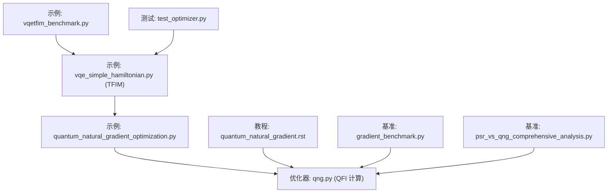
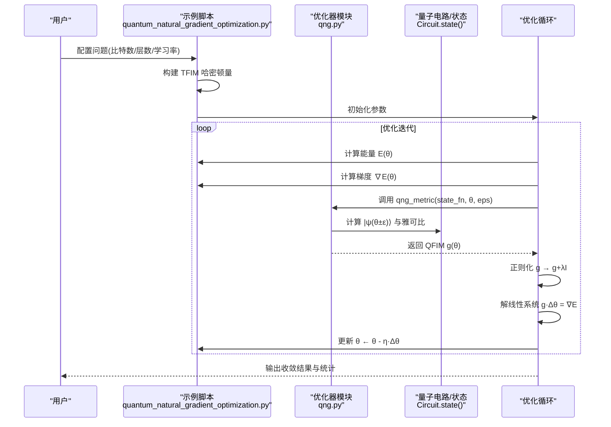
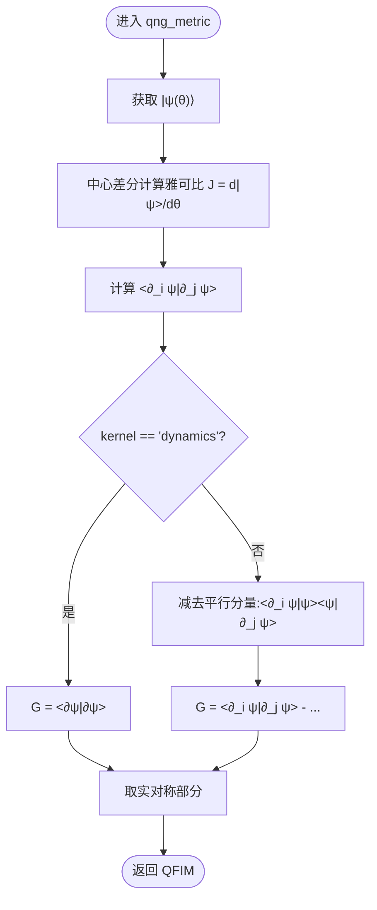
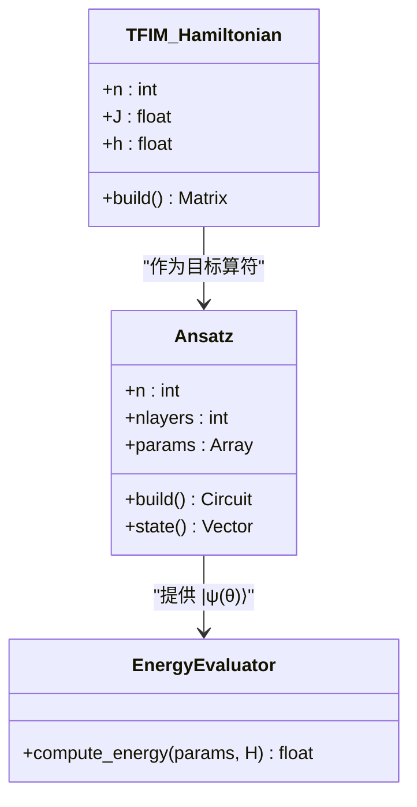
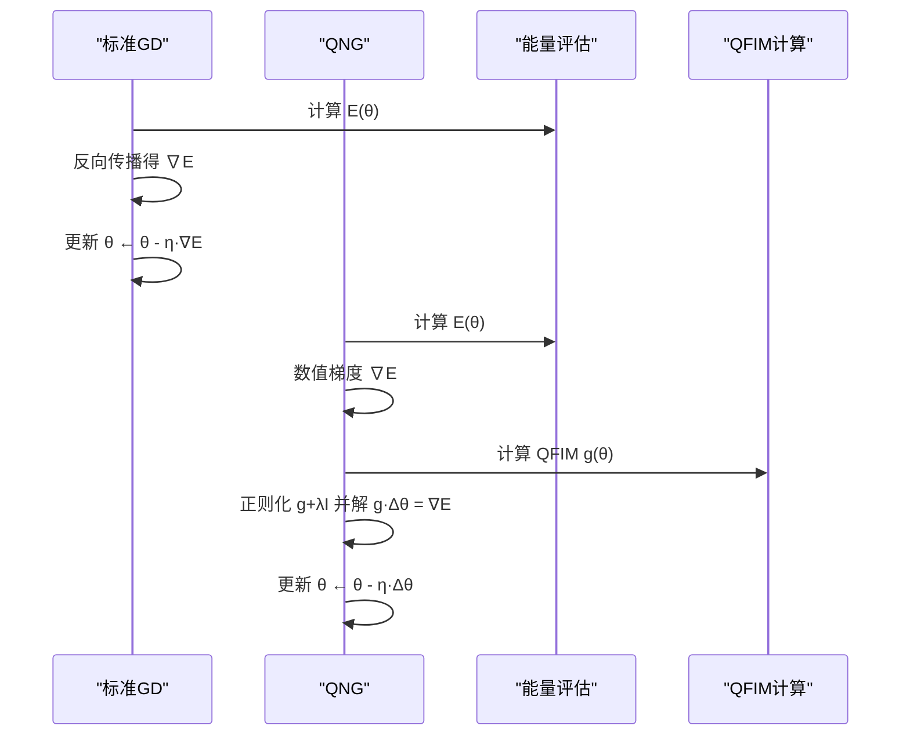
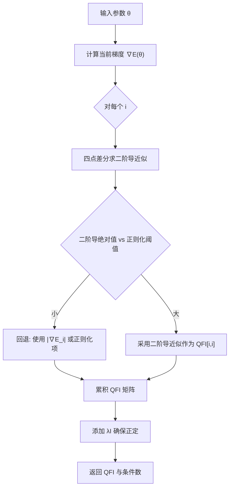
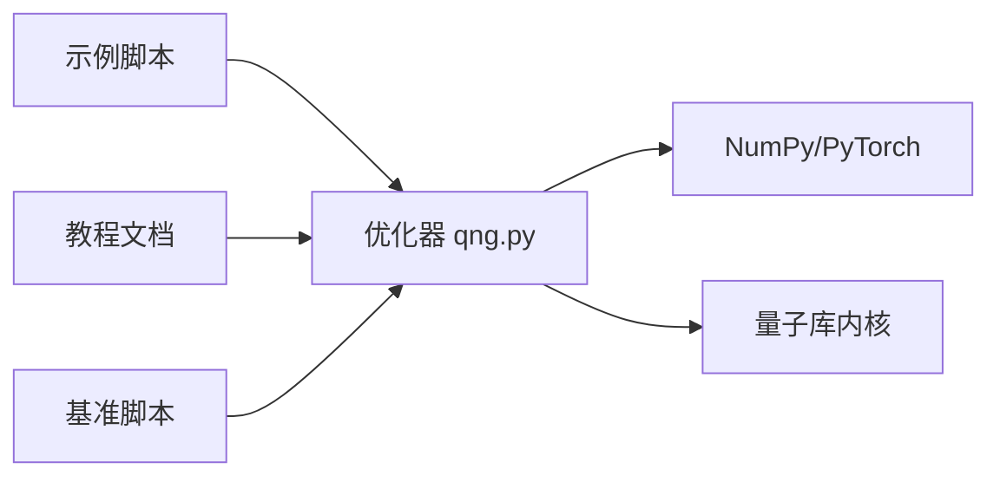

# 量子自然梯度优化

<cite>
**本文引用的文件**
- [examples/quantum_natural_gradient_optimization.py](file://examples/quantum_natural_gradient_optimization.py)
- [src/tyxonq/libs/optimizer/qng.py](file://src/tyxonq/libs/optimizer/qng.py)
- [docs/source/tutorials/advanced/quantum_natural_gradient.rst](file://docs/source/tutorials/advanced/quantum_natural_gradient.rst)
- [examples/vqe_simple_hamiltonian.py](file://examples/vqe_simple_hamiltonian.py)
- [examples/gradient_benchmark.py](file://examples/gradient_benchmark.py)
- [examples/psr_vs_qng_comprehensive_analysis.py](file://examples/psr_vs_qng_comprehensive_analysis.py)
- [examples/vqetfim_benchmark.py](file://examples/vqetfim_benchmark.py)
- [tests_mol_valid/test_optimizer.py](file://tests_mol_valid/test_optimizer.py)
</cite>

## 目录
1. [引言](#引言)
2. [项目结构](#项目结构)
3. [核心组件](#核心组件)
4. [架构总览](#架构总览)
5. [详细组件分析](#详细组件分析)
6. [依赖关系分析](#依赖关系分析)
7. [性能考量](#性能考量)
8. [故障排查指南](#故障排查指南)
9. [结论](#结论)
10. [附录](#附录)

## 引言
本文件系统性阐述量子自然梯度（Quantum Natural Gradient, QNG）在 TyxonQ 中的数学原理与实现细节，重点围绕量子 Fisher 信息矩阵（QFIM/Fubini-Study 度量张量）的计算、正则化策略与数值稳定性处理。文档同时给出标准梯度下降与 QNG 的对比实验流程，并以横向磁场 Ising 模型（TFIM）等典型问题展示 QNG 在变分量子算法（VQA）中的收敛优势。

## 项目结构
围绕 QNG 的核心代码与示例分布在以下位置：
- 优化器库：TyxonQ 提供基于数值雅可比计算 Fubini-Study 度量的工具函数，位于 libs/optimizer 下。
- 示例与教程：包含端到端 QNG 演示、TFIM 构建、能量评估、以及与传统梯度下降的对比脚本；教程文档提供理论背景与使用指引。
- 基准测试：提供不同后端与方法的梯度/QFI 计算性能对比。
- 应用案例：涵盖 VQE、量子动力学等场景，便于将 QNG 嵌入到更广泛的量子化学与物理模拟任务中。

**图示来源**
- [examples/quantum_natural_gradient_optimization.py:1-406](file://examples/quantum_natural_gradient_optimization.py#L1-L406)
- [src/tyxonq/libs/optimizer/qng.py:1-114](file://src/tyxonq/libs/optimizer/qng.py#L1-L114)
- [docs/source/tutorials/advanced/quantum_natural_gradient.rst:1-632](file://docs/source/tutorials/advanced/quantum_natural_gradient.rst#L1-L632)
- [examples/vqe_simple_hamiltonian.py:1-194](file://examples/vqe_simple_hamiltonian.py#L1-L194)
- [examples/gradient_benchmark.py:140-319](file://examples/gradient_benchmark.py#L140-L319)
- [examples/psr_vs_qng_comprehensive_analysis.py:134-241](file://examples/psr_vs_qng_comprehensive_analysis.py#L134-L241)
- [examples/vqetfim_benchmark.py:1-124](file://examples/vqetfim_benchmark.py#L1-L124)
- [tests_mol_valid/test_optimizer.py:1-18](file://tests_mol_valid/test_optimizer.py#L1-L18)

**章节来源**
- [examples/quantum_natural_gradient_optimization.py:1-406](file://examples/quantum_natural_gradient_optimization.py#L1-L406)
- [src/tyxonq/libs/optimizer/qng.py:1-114](file://src/tyxonq/libs/optimizer/qng.py#L1-L114)
- [docs/source/tutorials/advanced/quantum_natural_gradient.rst:1-632](file://docs/source/tutorials/advanced/quantum_natural_gradient.rst#L1-L632)

## 核心组件
- 量子自然梯度度量计算（QFIM/Fubini-Study）
  - 通过中心差分数值雅可比估计态矢对参数的导数，并构造投影度量（扣除平行于态的分量），得到对称实矩阵。
  - 支持“dynamics”核以获取未投影的 <∂ψ|∂ψ> 度量，适用于特定动力学场景。
- 变分量子电路与能量评估
  - 硬件高效 Ansatz（RY/RZ + CNOT 纠缠层）用于 TFIM 基态搜索。
  - 能量期望值通过态矢与哈密顿量内积计算，兼容 NumPy/PyTorch 后端。
- 优化流程
  - 标准梯度下降：基于自动微分的 SGD。
  - QNG：在每个步骤计算 QFIM，正则化后求解线性系统得到自然梯度方向，更新参数。
- 对比与可视化
  - 同一初始参数与学习率下比较两种优化器的收敛曲线、每步耗时与最终误差。

**章节来源**
- [src/tyxonq/libs/optimizer/qng.py:45-113](file://src/tyxonq/libs/optimizer/qng.py#L45-L113)
- [examples/quantum_natural_gradient_optimization.py:82-163](file://examples/quantum_natural_gradient_optimization.py#L82-L163)
- [examples/quantum_natural_gradient_optimization.py:168-316](file://examples/quantum_natural_gradient_optimization.py#L168-L316)

## 架构总览
下图展示了 QNG 在 TyxonQ 中的整体数据流与控制流：从 Hamiltonian 构建、Ansatz 状态生成、能量与梯度计算，到 QFIM 计算与自然梯度更新。

**图示来源**
- [examples/quantum_natural_gradient_optimization.py:230-316](file://examples/quantum_natural_gradient_optimization.py#L230-L316)
- [src/tyxonq/libs/optimizer/qng.py:74-106](file://src/tyxonq/libs/optimizer/qng.py#L74-L106)

## 详细组件分析

### 组件A：QFIM/Fubini-Study 度量计算（qng.py）
- 设计要点
  - 数值雅可比：对每个参数进行中心差分扰动，估计态矢导数向量。
  - 度量构造：根据 kernel 选择是否投影掉与当前态平行的分量，保证度量反映量子流形几何。
  - 数值稳健性：输出为实对称矩阵，抑制复数噪声。
- 复杂度
  - 时间：O(P·D)，其中 P 为参数个数，D=2^N 为态维；度量矩阵乘法 O(P²)。
  - 空间：O(P·D + P²)。

**图示来源**
- [src/tyxonq/libs/optimizer/qng.py:45-106](file://src/tyxonq/libs/optimizer/qng.py#L45-L106)

**章节来源**
- [src/tyxonq/libs/optimizer/qng.py:1-114](file://src/tyxonq/libs/optimizer/qng.py#L1-L114)

### 组件B：TFIM 哈密顿量与 Ansatz（示例脚本）
- TFIM 构建
  - 使用 Heisenberg 构建器指定 ZZ 耦合与横向 X 场，形成周期性边界的一维链。
- Ansatz
  - 初始叠加层（Hadamard），随后交替 CNOT 纠缠与 RY/RZ 旋转层，形成硬件高效参数化电路。
- 能量评估
  - 通过态矢与哈密顿量内积计算期望值，兼容多后端。

**图示来源**
- [examples/quantum_natural_gradient_optimization.py:54-129](file://examples/quantum_natural_gradient_optimization.py#L54-L129)
- [examples/vqe_simple_hamiltonian.py:55-82](file://examples/vqe_simple_hamiltonian.py#L55-L82)

**章节来源**
- [examples/quantum_natural_gradient_optimization.py:54-163](file://examples/quantum_natural_gradient_optimization.py#L54-L163)
- [examples/vqe_simple_hamiltonian.py:1-194](file://examples/vqe_simple_hamiltonian.py#L1-L194)

### 组件C：标准梯度下降与 QNG 对比（示例脚本）
- 标准梯度下降
  - 使用 PyTorch 自动微分与 SGD 优化器，记录能量历史与每步耗时。
- QNG
  - 使用数值梯度与 QFIM 计算自然梯度，正则化后求解线性系统更新参数。
- 对比指标
  - 最终能量误差、收敛步数、每步平均耗时。

**图示来源**
- [examples/quantum_natural_gradient_optimization.py:168-316](file://examples/quantum_natural_gradient_optimization.py#L168-L316)

**章节来源**
- [examples/quantum_natural_gradient_optimization.py:168-394](file://examples/quantum_natural_gradient_optimization.py#L168-L394)

### 组件D：设备侧 QFI 估计与自适应回退（基准脚本）
- 四点位点差分估计对角元，结合梯度幅值进行自适应回退，确保正定性与鲁棒性。
- 统计测量次数与条件数，辅助诊断数值稳定性。

**图示来源**
- [examples/psr_vs_qng_comprehensive_analysis.py:134-241](file://examples/psr_vs_qng_comprehensive_analysis.py#L134-L241)

**章节来源**
- [examples/psr_vs_qng_comprehensive_analysis.py:134-241](file://examples/psr_vs_qng_comprehensive_analysis.py#L134-L241)

### 组件E：教程与最佳实践（教程文档）
- 理论基础：Fubini-Study 度量定义、自然梯度更新规则。
- 实现细节：数值雅可比方法、复杂度分析。
- 正则化策略：Tikhonov、特征值裁剪、自适应正则化。
- 高级用法：与 Adam 混合、块对角近似、测量分组与噪声缓解。
- 调参建议：学习率与正则化系数选择、何时使用/避免 QNG。

**章节来源**
- [docs/source/tutorials/advanced/quantum_natural_gradient.rst:21-202](file://docs/source/tutorials/advanced/quantum_natural_gradient.rst#L21-L202)
- [docs/source/tutorials/advanced/quantum_natural_gradient.rst:203-536](file://docs/source/tutorials/advanced/quantum_natural_gradient.rst#L203-L536)

## 依赖关系分析
- 模块耦合
  - 示例脚本依赖优化器模块提供的 QFIM 计算接口。
  - 教程文档引用优化器 API 并提供理论与使用指导。
  - 基准脚本提供不同后端与方法的性能对比，验证 QFIM 计算的效率与正确性。
- 外部依赖
  - NumPy/PyTorch 后端用于张量运算与自动微分。
  - 量子库内核用于哈密顿量构建与态矢演化。

**图示来源**
- [examples/quantum_natural_gradient_optimization.py:1-406](file://examples/quantum_natural_gradient_optimization.py#L1-L406)
- [src/tyxonq/libs/optimizer/qng.py:1-114](file://src/tyxonq/libs/optimizer/qng.py#L1-L114)
- [examples/gradient_benchmark.py:140-319](file://examples/gradient_benchmark.py#L140-L319)

**章节来源**
- [examples/quantum_natural_gradient_optimization.py:1-406](file://examples/quantum_natural_gradient_optimization.py#L1-L406)
- [src/tyxonq/libs/optimizer/qng.py:1-114](file://src/tyxonq/libs/optimizer/qng.py#L1-L114)
- [examples/gradient_benchmark.py:140-319](file://examples/gradient_benchmark.py#L140-L319)

## 性能考量
- 复杂度与瓶颈
  - QFIM 计算的时间复杂度约为 O(P·D + P²)，其中 P 为参数数量，D=2^N 为态维。当 N 较大时，指数增长成为主要瓶颈。
  - 线性系统求解复杂度 O(P³)，在参数较多时需考虑近似（如块对角）。
- 加速策略
  - 减少有限差分精度（增大 ε）以降低每次 QFIM 计算成本。
  - 降低 QFIM 更新频率（例如每若干步更新一次）。
  - 使用块对角近似或稀疏表示，降低 P² 与 P³ 开销。
- 后端选择
  - 示例中 QNG 路径使用 NumPy 后端以获得稳定的数值雅可比；标准 GD 使用 PyTorch 自动微分。

[本节提供通用指导，不直接分析具体文件]

## 故障排查指南
- 奇异或病态 QFIM
  - 症状：线性系统求解失败或出现 NaN。
  - 解决：增加正则化强度；使用伪逆或特征值分解裁剪；检查有限差分步长 ε。
- 计算过慢
  - 症状：单步耗时过长。
  - 解决：降低 ε；采用块对角近似；降低 QFIM 更新频率；使用更高效的后端或并行化。
- 能量振荡
  - 症状：能量不单调下降。
  - 解决：减小学习率；引入动量或阻尼；在线搜索步长。

**章节来源**
- [docs/source/tutorials/advanced/quantum_natural_gradient.rst:451-536](file://docs/source/tutorials/advanced/quantum_natural_gradient.rst#L451-L536)
- [examples/quantum_natural_gradient_optimization.py:283-316](file://examples/quantum_natural_gradient_optimization.py#L283-L316)

## 结论
QNG 通过利用量子态流形的几何结构（Fubini-Study 度量）预处理梯度，能够在深电路与 barren plateau 场景中显著改善收敛速度与精度。TyxonQ 提供了稳定且可复用的 QFIM 计算工具，配合示例脚本与教程，便于用户在 TFIM 等典型问题上快速验证与扩展。对于大规模问题，建议结合块对角近似与自适应正则化，平衡精度与效率。

[本节总结性内容，不直接分析具体文件]

## 附录
- 完整示例参考
  - 端到端 QNG 演示与对比：[examples/quantum_natural_gradient_optimization.py:1-406](file://examples/quantum_natural_gradient_optimization.py#L1-L406)
  - TFIM 哈密顿量与 VQE：[examples/vqe_simple_hamiltonian.py:1-194](file://examples/vqe_simple_hamiltonian.py#L1-L194)
  - 梯度/QFI 基准：[examples/gradient_benchmark.py:140-319](file://examples/gradient_benchmark.py#L140-L319)
  - 设备侧 QFI 估计：[examples/psr_vs_qng_comprehensive_analysis.py:134-241](file://examples/psr_vs_qng_comprehensive_analysis.py#L134-L241)
  - 量子动力学 TFIM 示例：[examples/vqetfim_benchmark.py:1-124](file://examples/vqetfim_benchmark.py#L1-L124)
  - 优化器集成测试：[tests_mol_valid/test_optimizer.py:1-18](file://tests_mol_valid/test_optimizer.py#L1-L18)
- 教程与理论
  - 量子自然梯度教程：[docs/source/tutorials/advanced/quantum_natural_gradient.rst:1-632](file://docs/source/tutorials/advanced/quantum_natural_gradient.rst#L1-L632)

[本节列出参考文件，不直接分析具体文件]