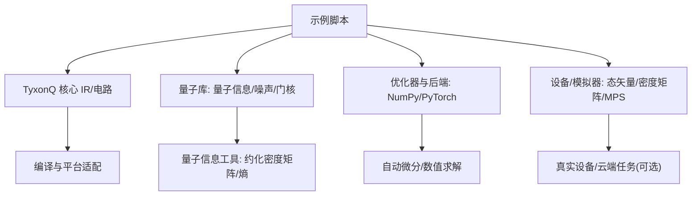
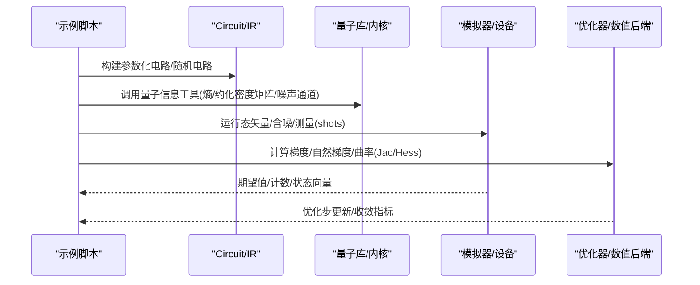
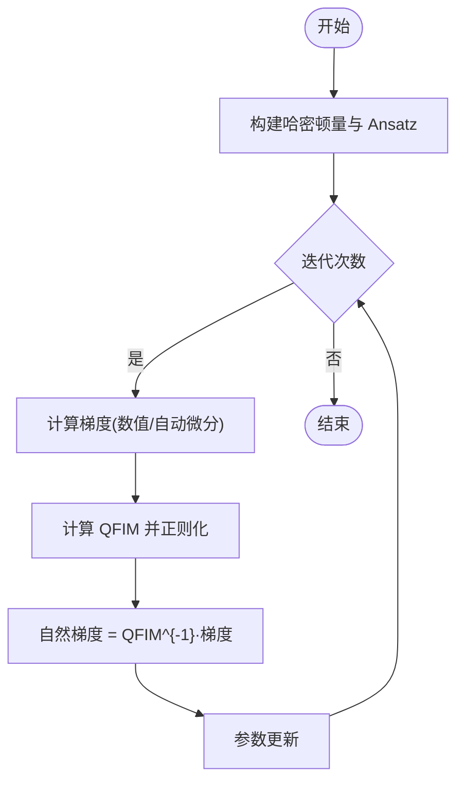
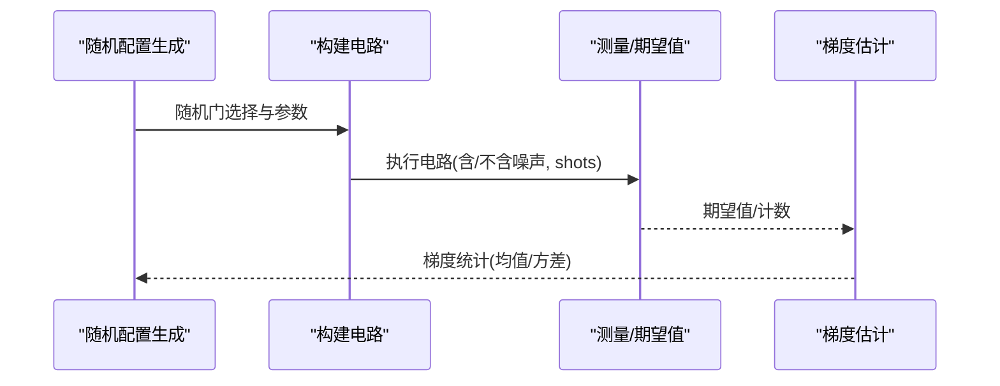
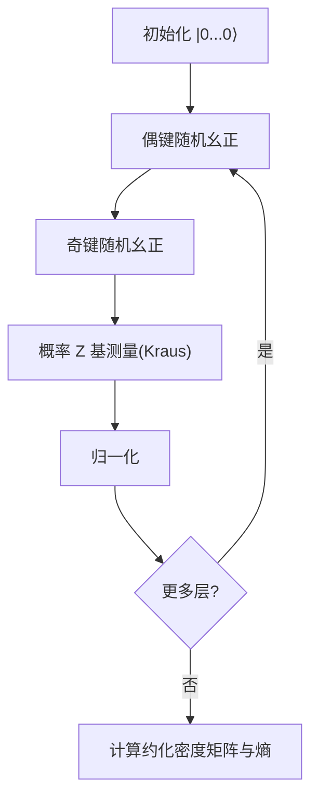
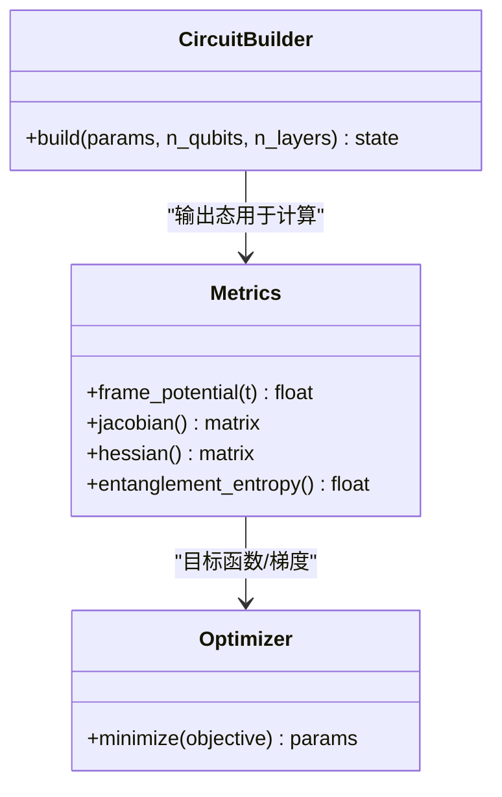
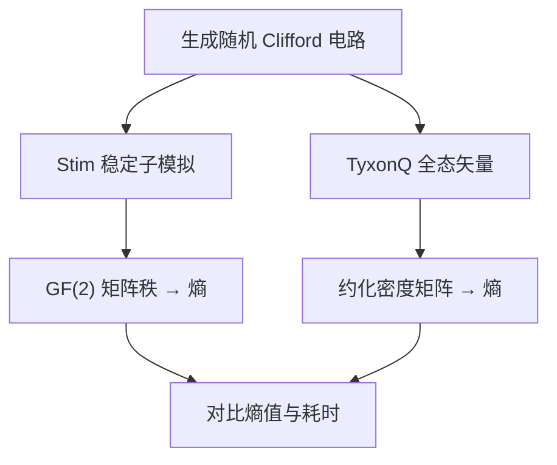
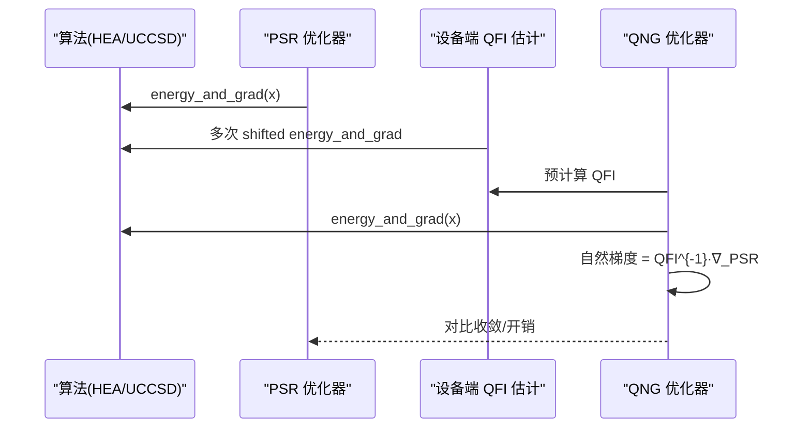
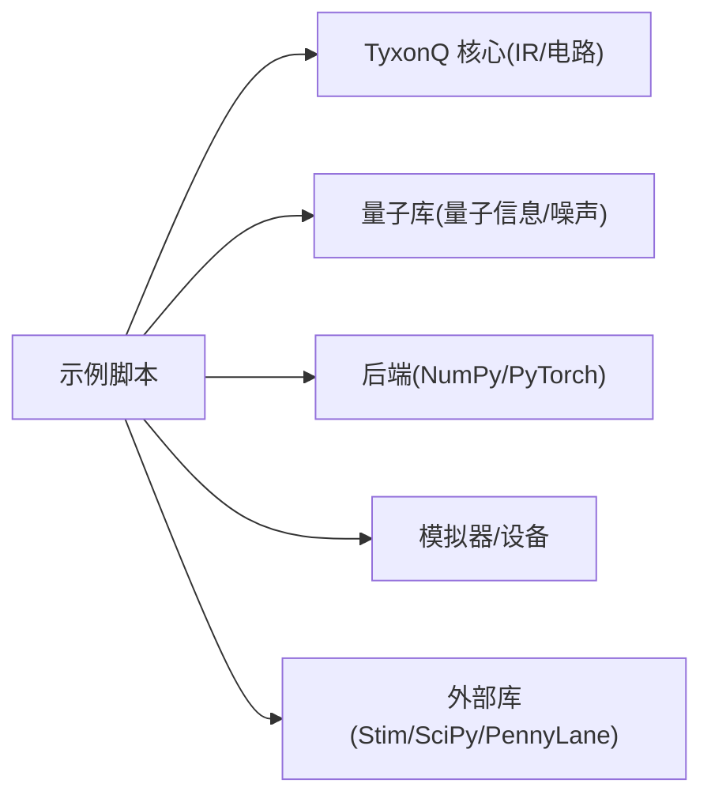

# 高级算法示例

<cite>
**本文引用的文件**
- [quantum_natural_gradient_optimization.py](file://examples/quantum_natural_gradient_optimization.py)
- [barren_plateau_benchmark.py](file://examples/barren_plateau_benchmark.py)
- [measurement_induced_phase_transition.py](file://examples/measurement_induced_phase_transition.py)
- [quantum_chaos_analysis.py](file://examples/quantum_chaos_analysis.py)
- [stabilizer_clifford_entropy.py](file://examples/stabilizer_clifford_entropy.py)
- [psr_vs_qng_comprehensive_analysis.py](file://examples/psr_vs_qng_comprehensive_analysis.py)
</cite>

## 目录
1. [简介](#简介)
2. [项目结构](#项目结构)
3. [核心组件](#核心组件)
4. [架构总览](#架构总览)
5. [详细组件分析](#详细组件分析)
6. [依赖关系分析](#依赖关系分析)
7. [性能考量](#性能考量)
8. [故障排查指南](#故障排查指南)
9. [结论](#结论)
10. [附录](#附录)

## 简介
本文件面向量子信息科学前沿研究，系统性梳理并解读 TyxonQ 中的高级算法示例，覆盖以下主题：
- 量子自然梯度优化（QNG）：基于量子 Fisher 信息矩阵（QFIM）的几何感知优化
-  barren plateau（平坦高原）现象：参数化量子电路梯度指数衰减与缓解策略
- 测量诱导相变（MIPT）：随机幺正演化与概率测量竞争导致的纠缠标度相变
- 量子混沌与复杂性度量：框架势、Jacobian/Hessian 曲率、纠缠熵等
- Stabilizer 熵计算：Clifford 电路下的高效稳定子方法与全态矢量方法对比

文档提供理论背景、数值实验设计、结果分析方法与实现要点，帮助读者使用 TyxonQ 开展量子纠错、量子复杂性理论与量子多体物理等方向的研究。

## 项目结构
仓库包含丰富的示例脚本与底层库。本文聚焦 examples 目录下的高级算法示例，并结合 TyxonQ 提供的量子库工具进行说明。各示例脚本职责清晰：
- quantum_natural_gradient_optimization.py：演示 QNG 在变分量子算法中的优势
- barren_plateau_benchmark.py：对比理想自动微分、参数移位法与含噪设备模式下的梯度行为
- measurement_induced_phase_transition.py：构建 MIPT 随机电路并扫描测量概率以观测体积律到面积律的相变
- quantum_chaos_analysis.py：展示纠缠熵、框架势、Jacobian/Hessian 与优化流程
- stabilizer_clifford_entropy.py：对比 Stim 稳定子模拟与 TyxonQ 全态矢量的效率与精度
- psr_vs_qng_comprehensive_analysis.py：在分子 VQE 任务上系统比较 PSR 与 QNG 的收敛与开销

图表来源
- [quantum_natural_gradient_optimization.py:1-406](file://examples/quantum_natural_gradient_optimization.py#L1-L406)
- [barren_plateau_benchmark.py:1-592](file://examples/barren_plateau_benchmark.py#L1-L592)
- [measurement_induced_phase_transition.py:1-436](file://examples/measurement_induced_phase_transition.py#L1-L436)
- [quantum_chaos_analysis.py:1-348](file://examples/quantum_chaos_analysis.py#L1-L348)
- [stabilizer_clifford_entropy.py:1-309](file://examples/stabilizer_clifford_entropy.py#L1-L309)
- [psr_vs_qng_comprehensive_analysis.py:1-595](file://examples/psr_vs_qng_comprehensive_analysis.py#L1-L595)

章节来源
- [quantum_natural_gradient_optimization.py:1-406](file://examples/quantum_natural_gradient_optimization.py#L1-L406)
- [barren_plateau_benchmark.py:1-592](file://examples/barren_plateau_benchmark.py#L1-L592)
- [measurement_induced_phase_transition.py:1-436](file://examples/measurement_induced_phase_transition.py#L1-L436)
- [quantum_chaos_analysis.py:1-348](file://examples/quantum_chaos_analysis.py#L1-L348)
- [stabilizer_clifford_entropy.py:1-309](file://examples/stabilizer_clifford_entropy.py#L1-L309)
- [psr_vs_qng_comprehensive_analysis.py:1-595](file://examples/psr_vs_qng_comprehensive_analysis.py#L1-L595)

## 核心组件
- 量子自然梯度（QNG）
  - 通过 QFIM 对梯度进行预处理，利用量子态空间的 Fubini-Study 度量提升收敛性
  - 示例中对比标准 SGD 与 QNG，展示更少迭代达到更低能量
-  barren plateau 基准
  - 三种梯度估计方式：理想自动微分、参数移位（有限 shot）、参数移位+噪声
  - 验证梯度方差随系统尺寸指数衰减，并评估硬件噪声的影响
- 测量诱导相变（MIPT）
  - 随机两比特幺正 + 概率 Z 基测量，计算 von Neumann 与 Rényi-2 熵
  - 扫描测量概率 p，观察体积律到面积律的临界点
- 量子混沌与复杂性
  - 框架势（t-design 度量）、Jacobian/Hessian 曲率、纠缠熵、梯度优化
- Stabilizer 熵计算
  - 对比 Stim 稳定子方法与 TyxonQ 全态矢量方法，展示 O(n^2) vs O(2^n) 复杂度差异

章节来源
- [quantum_natural_gradient_optimization.py:1-406](file://examples/quantum_natural_gradient_optimization.py#L1-L406)
- [barren_plateau_benchmark.py:1-592](file://examples/barren_plateau_benchmark.py#L1-L592)
- [measurement_induced_phase_transition.py:1-436](file://examples/measurement_induced_phase_transition.py#L1-L436)
- [quantum_chaos_analysis.py:1-348](file://examples/quantum_chaos_analysis.py#L1-L348)
- [stabilizer_clifford_entropy.py:1-309](file://examples/stabilizer_clifford_entropy.py#L1-L309)

## 架构总览
下图展示了示例脚本如何调用 TyxonQ 的核心能力完成高级算法任务：

图表来源
- [quantum_natural_gradient_optimization.py:1-406](file://examples/quantum_natural_gradient_optimization.py#L1-L406)
- [barren_plateau_benchmark.py:1-592](file://examples/barren_plateau_benchmark.py#L1-L592)
- [measurement_induced_phase_transition.py:1-436](file://examples/measurement_induced_phase_transition.py#L1-L436)
- [quantum_chaos_analysis.py:1-348](file://examples/quantum_chaos_analysis.py#L1-L348)
- [stabilizer_clifford_entropy.py:1-309](file://examples/stabilizer_clifford_entropy.py#L1-L309)
- [psr_vs_qng_comprehensive_analysis.py:1-595](file://examples/psr_vs_qng_comprehensive_analysis.py#L1-L595)

## 详细组件分析

### 量子自然梯度优化（QNG）
- 数学原理
  - 标准梯度下降：θ_{t+1} = θ_t - η ∇L(θ)
  - 自然梯度下降：θ_{t+1} = θ_t - η F^{-1}(θ) ∇L(θ)，其中 F 为 QFIM
  - QFIM 反映量子态空间几何，使更新方向与参数化无关且更稳健
- 实现要点
  - 构造硬件高效 ansatz（RY/RZ + CNOT 环）
  - 使用 qng_metric 计算 QFIM，正则化保证数值稳定性
  - 对比标准 SGD 与 QNG 的收敛速度与最终能量误差
- 性能特征
  - QNG 通常以更少迭代达到更低能量；代价是每步需计算并求逆 QFIM（O(P^3)）
  - 适合中小规模参数（P < ~100），可通过块对角近似或随机采样扩展

图表来源
- [quantum_natural_gradient_optimization.py:168-316](file://examples/quantum_natural_gradient_optimization.py#L168-L316)

章节来源
- [quantum_natural_gradient_optimization.py:1-406](file://examples/quantum_natural_gradient_optimization.py#L1-L406)

### barren plateau 现象分析
- 物理背景
  - 深随机参数化电路导致局部可观测量与初态重叠指数小，梯度方差 σ² ~ O(1/2^n)
  - 硬件噪声可掩盖、加剧或缓解 barren plateau
- 三种梯度方法
  - 方法A：理想自动微分（非硬件可实现，作为理论基线）
  - 方法B：参数移位规则 + 有限 shots（硬件可实现）
  - 方法C：参数移位 + 噪声（最接近 NISQ 设备）
- 实验设计
  - 随机选择旋转门类型（RX/RY/RZ）与 entangling CZ 层
  - 统计梯度均值与标准差，对比理论缩放
  - 可扩展不同系统尺寸验证指数衰减
- 结果分析
  - 方法A最快但不可硬件实现；方法B/C受 shot 噪声影响；含噪方法可能改变表观梯度尺度

图表来源
- [barren_plateau_benchmark.py:91-345](file://examples/barren_plateau_benchmark.py#L91-L345)

章节来源
- [barren_plateau_benchmark.py:1-592](file://examples/barren_plateau_benchmark.py#L1-L592)

### 测量诱导相变（MIPT）
- 物理背景
  - 随机幺正演化产生纠缠，概率测量局域化信息；存在临界测量率 p_c 分隔体积律与面积律相
  - 可观测量：von Neumann 熵与 Rényi-2 熵
- 电路架构
  - 偶键/奇键交替应用随机两比特幺正门
  - 每层对所有 qubit 施加概率 p 的 Z 基测量（Kraus 通道）
- 数值实验
  - 单点演示：展示 JIT 编译加速与熵计算
  - 扫描测量概率：统计 S_vN 与 S_2，定位临界点 p_c ≈ 0.16（一维随机电路）
- 结果分析
  - 低 p → 体积律（高纠缠）；高 p → 面积律（低纠缠）
  - 通过导数最大变化位置近似 p_c

图表来源
- [measurement_induced_phase_transition.py:137-243](file://examples/measurement_induced_phase_transition.py#L137-L243)

章节来源
- [measurement_induced_phase_transition.py:1-436](file://examples/measurement_induced_phase_transition.py#L1-L436)

### 量子混沌与复杂性分析
- 指标与方法
  - 框架势（t-design 度量）：衡量酉算符集合接近 Haar 均匀分布的程度
  - Jacobian/Hessian：灵敏度与曲率分析，识别重要参数与平坦方向
  - 纠缠熵：通过约化密度矩阵计算 von Neumann 熵
  - 优化：最小化特定关联函数（如 ⟨Z_1 Z_2⟩）
- 实现要点
  - 使用 PyTorch 后端进行自动微分与数值线性代数
  - 注意 Jacobian/Hessian 在高维复数运算中的限制与成本

图表来源
- [quantum_chaos_analysis.py:43-266](file://examples/quantum_chaos_analysis.py#L43-L266)

章节来源
- [quantum_chaos_analysis.py:1-348](file://examples/quantum_chaos_analysis.py#L1-L348)

### Stabilizer 熵计算（Clifford 电路）
- 核心思想
  - Clifford 电路可用稳定子形式高效模拟（O(n^2) 内存/时间）
  - 通过稳定子表提取 Z-稳定子，转换为 GF(2) 矩阵秩计算纠缠熵
- 对比方案
  - Stim 稳定子模拟：快速、低内存
  - TyxonQ 全态矢量：通用但 O(2^n) 内存
- 结果验证
  - 两种方法熵值一致（数值容差内）
  - 速度比与内存比显著，体现稳定子方法的优势

图表来源
- [stabilizer_clifford_entropy.py:52-256](file://examples/stabilizer_clifford_entropy.py#L52-L256)

章节来源
- [stabilizer_clifford_entropy.py:1-309](file://examples/stabilizer_clifford_entropy.py#L1-L309)

### PSR 与 QNG 综合对比（分子 VQE）
- 场景
  - 针对 H2 分子，分别使用 HEA/UCCSD 作为 ansatz
  - 对比 PSR（参数移位）与 QNG（设备端 QFI 预计算 + L-BFGS-B）
- 关键步骤
  - PSR：每次迭代计算能量与梯度（1+2P 次电路评估）
  - QNG：一次性设备端 QFI 预计算（4-point stencil），后续用 QFI^{-1}·∇_PSR 作为自然梯度
- 结果指标
  - 迭代次数、总电路评估次数、总 shot 预算、相对 FCI 误差
- 洞察
  - QNG 通常更快收敛（更少迭代），但需额外 shot 预算用于 QFI 估计
  - 设备端运行下，shot 噪声与 QFI 条件数影响稳定性

图表来源
- [psr_vs_qng_comprehensive_analysis.py:33-387](file://examples/psr_vs_qng_comprehensive_analysis.py#L33-L387)

章节来源
- [psr_vs_qng_comprehensive_analysis.py:1-595](file://examples/psr_vs_qng_comprehensive_analysis.py#L1-L595)

## 依赖关系分析
- 示例脚本依赖 TyxonQ 的：
  - 电路与 IR：构建参数化/随机电路、输入态、测量与噪声通道
  - 量子库：量子信息工具（约化密度矩阵、熵）、噪声模型、门核
  - 后端与优化：NumPy/PyTorch 自动微分、数值求解器（线性方程组、特征值）
  - 设备/模拟器：态矢量、密度矩阵、MPS、真实设备（可选）
- 外部库
  - Stim：稳定子模拟（Clifford 电路）
  - SciPy/PennyLane：数值优化与交叉验证（可选）

图表来源
- [quantum_natural_gradient_optimization.py:1-406](file://examples/quantum_natural_gradient_optimization.py#L1-L406)
- [barren_plateau_benchmark.py:1-592](file://examples/barren_plateau_benchmark.py#L1-L592)
- [measurement_induced_phase_transition.py:1-436](file://examples/measurement_induced_phase_transition.py#L1-L436)
- [quantum_chaos_analysis.py:1-348](file://examples/quantum_chaos_analysis.py#L1-L348)
- [stabilizer_clifford_entropy.py:1-309](file://examples/stabilizer_clifford_entropy.py#L1-L309)
- [psr_vs_qng_comprehensive_analysis.py:1-595](file://examples/psr_vs_qng_comprehensive_analysis.py#L1-L595)

章节来源
- [quantum_natural_gradient_optimization.py:1-406](file://examples/quantum_natural_gradient_optimization.py#L1-L406)
- [barren_plateau_benchmark.py:1-592](file://examples/barren_plateau_benchmark.py#L1-L592)
- [measurement_induced_phase_transition.py:1-436](file://examples/measurement_induced_phase_transition.py#L1-L436)
- [quantum_chaos_analysis.py:1-348](file://examples/quantum_chaos_analysis.py#L1-L348)
- [stabilizer_clifford_entropy.py:1-309](file://examples/stabilizer_clifford_entropy.py#L1-L309)
- [psr_vs_qng_comprehensive_analysis.py:1-595](file://examples/psr_vs_qng_comprehensive_analysis.py#L1-L595)

## 性能考量
- QNG
  - 优点：几何感知更新，通常更快收敛
  - 成本：每步 QFIM 计算与求逆 O(P^3)，适合中小 P；可扩展为块对角或随机采样
- barren plateau
  - 梯度方差随系统尺寸指数衰减；含噪设备会引入统计噪声，影响梯度质量
  - 缓解策略：局部代价函数、问题启发式 ansatz、分层训练、增加 shot 预算
- MIPT
  - 随机电路深度与系统尺寸影响计算成本；JIT 编译可显著加速重复运行
  - 熵计算涉及约化密度矩阵，维度随系统尺寸指数增长
- 量子混沌
  - Jacobian/Hessian 计算昂贵，需谨慎选择系统与层数；复杂数自动微分可能存在限制
- Stabilizer 熵
  - Clifford 电路下稳定子方法具有 O(n^2) 复杂度，远优于全态矢量 O(2^n)

[本节为通用指导，不直接分析具体文件]

## 故障排查指南
- QNG 奇异矩阵
  - 现象：QFIM 求逆失败或条件数过大
  - 处理：增大正则化项；回退到标准梯度；检查参数范围与电路结构
  - 参考路径
    - [quantum_natural_gradient_optimization.py:283-296](file://examples/quantum_natural_gradient_optimization.py#L283-L296)
- barren plateau 梯度消失
  - 现象：梯度范数极小，优化停滞
  - 处理：降低电路深度、采用局部可观测量、增加 shot 预算、考虑噪声感知训练
  - 参考路径
    - [barren_plateau_benchmark.py:142-345](file://examples/barren_plateau_benchmark.py#L142-L345)
- MIPT 熵计算不稳定
  - 现象：归一化后仍出现数值波动
  - 处理：确保 Kraus 通道后归一化；减少随机性或使用更大系统尺寸平均
  - 参考路径
    - [measurement_induced_phase_transition.py:192-205](file://examples/measurement_induced_phase_transition.py#L192-L205)
- Jacobian/Hessian 计算异常
  - 现象：复杂数自动微分报错或内存不足
  - 处理：减小系统尺寸/层数；改用数值差分或分段计算；关注后端限制
  - 参考路径
    - [quantum_chaos_analysis.py:167-266](file://examples/quantum_chaos_analysis.py#L167-L266)
- Stabilizer 与全态矢量不一致
  - 现象：熵值偏差超出容差
  - 处理：检查 Clifford 门集与操作顺序；确认 GF(2) 矩阵构造正确；提高数值精度
  - 参考路径
    - [stabilizer_clifford_entropy.py:200-256](file://examples/stabilizer_clifford_entropy.py#L200-L256)

章节来源
- [quantum_natural_gradient_optimization.py:283-296](file://examples/quantum_natural_gradient_optimization.py#L283-L296)
- [barren_plateau_benchmark.py:142-345](file://examples/barren_plateau_benchmark.py#L142-L345)
- [measurement_induced_phase_transition.py:192-205](file://examples/measurement_induced_phase_transition.py#L192-L205)
- [quantum_chaos_analysis.py:167-266](file://examples/quantum_chaos_analysis.py#L167-L266)
- [stabilizer_clifford_entropy.py:200-256](file://examples/stabilizer_clifford_entropy.py#L200-L256)

## 结论
TyxonQ 的高级算法示例提供了从基础到前沿的完整研究工具链：
- QNG 为变分量子算法提供更优的几何感知优化路径
- barren plateau 基准帮助理解与缓解梯度消失问题
- MIPT 示例支持多体物理中的纠缠相变研究
- 量子混沌度量与优化流程有助于评估电路表达能力与优化景观
- Stabilizer 熵计算展示 Clifford 电路的高效模拟优势

这些示例可直接迁移至量子纠错、量子复杂性理论与量子多体物理等研究领域，结合 TyxonQ 的设备与编译器能力，实现从仿真到真实设备的端到端研究闭环。

[本节为总结性内容，不直接分析具体文件]

## 附录
- 推荐实践
  - 小规模验证：先用小系统/浅电路验证算法正确性
  - 逐步扩展：按系统尺寸与电路深度递增，监控资源与收敛
  - 噪声建模：在设备模式下加入合理噪声模型，贴近真实设备
  - 结果复现：固定随机种子，记录超参与环境信息
- 进一步阅读
  - 量子自然梯度：参考示例中对 QFIM 的使用与正则化策略
  - barren plateau：对比三种梯度方法的统计特性与硬件影响
  - MIPT：关注临界点附近熵的标度行为与有限尺寸效应
  - 量子混沌：结合框架势与曲率分析评估电路表达能力
  - Stabilizer：在 Clifford 场景优先使用稳定子方法以获得最佳性能

[本节为补充信息，不直接分析具体文件]