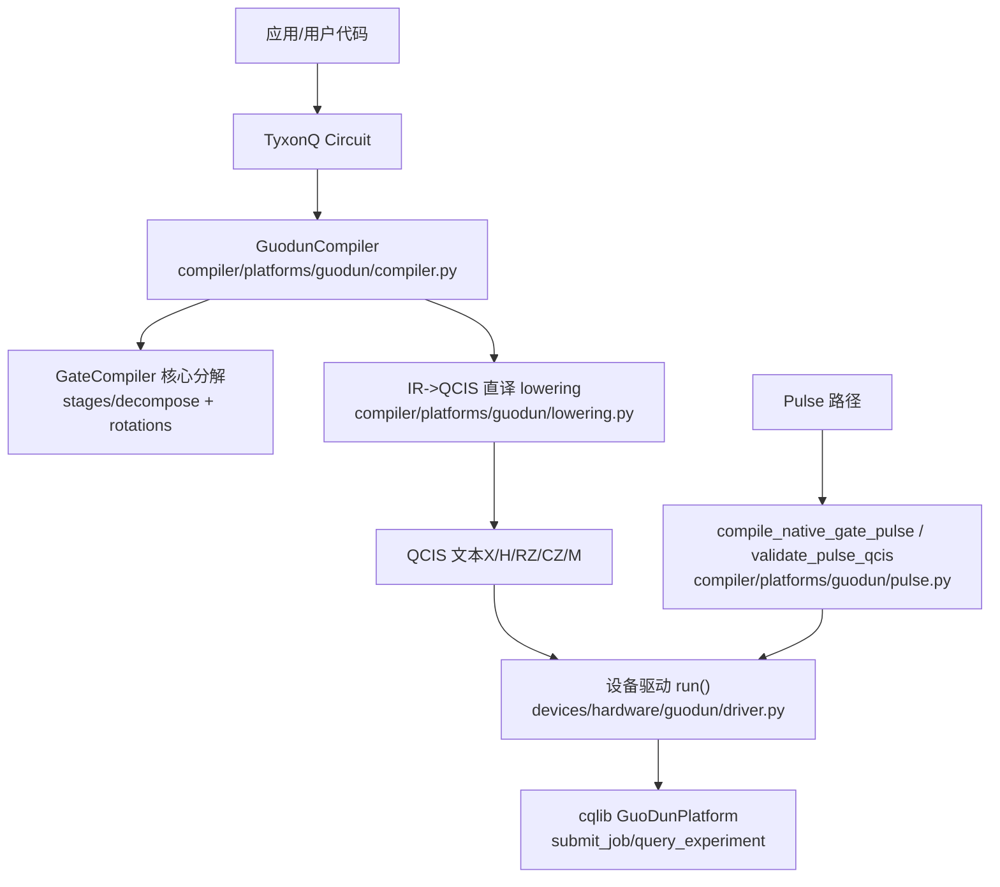
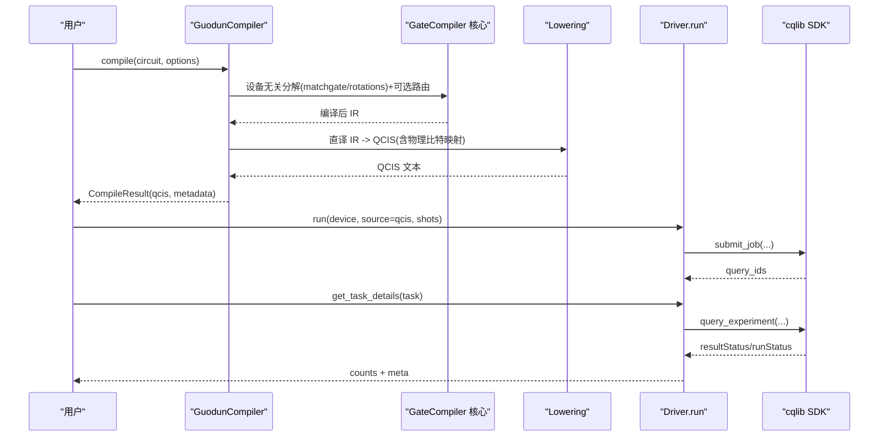
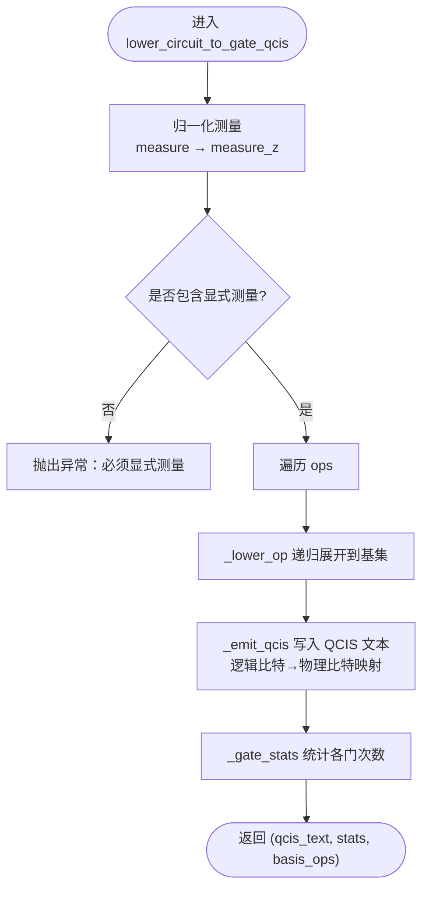
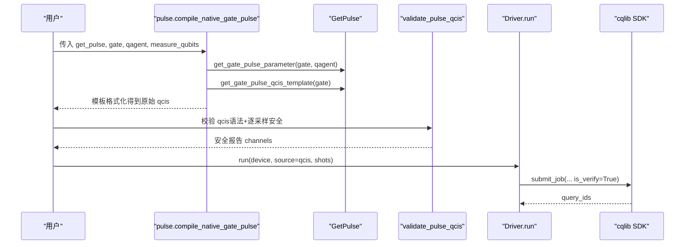
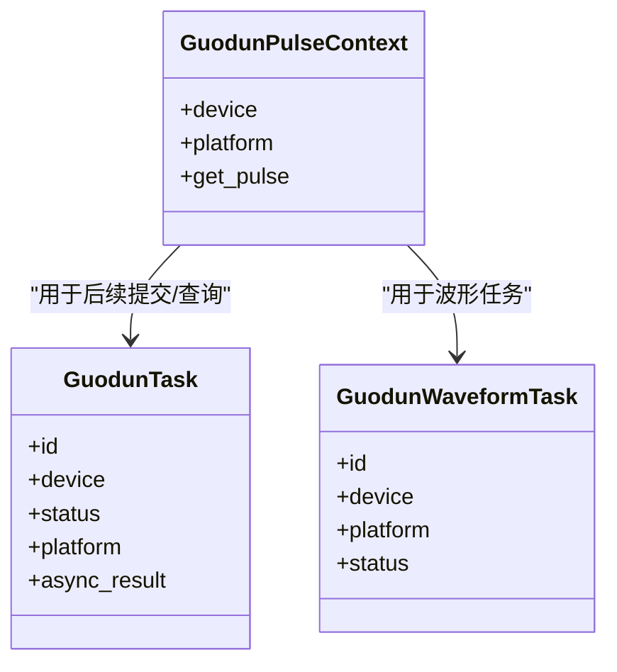
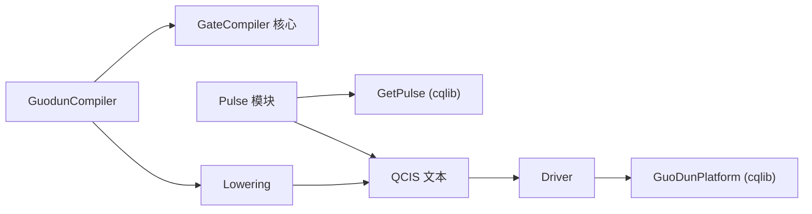

# Guodun平台适配器

<cite>
**本文引用的文件**
- [src/tyxonq/compiler/platforms/guodun/__init__.py](file://src/tyxonq/compiler/platforms/guodun/__init__.py)
- [src/tyxonq/compiler/platforms/guodun/compiler.py](file://src/tyxonq/compiler/platforms/guodun/compiler.py)
- [src/tyxonq/compiler/platforms/guodun/lowering.py](file://src/tyxonq/compiler/platforms/guodun/lowering.py)
- [src/tyxonq/compiler/platforms/guodun/pulse.py](file://src/tyxonq/compiler/platforms/guodun/pulse.py)
- [src/tyxonq/devices/hardware/guodun/__init__.py](file://src/tyxonq/devices/hardware/guodun/__init__.py)
- [src/tyxonq/devices/hardware/guodun/driver.py](file://src/tyxonq/devices/hardware/guodun/driver.py)
- [examples/run_circuit_on_guodun.py](file://examples/run_circuit_on_guodun.py)
- [examples/run_guodun_variational.py](file://examples/run_guodun_variational.py)
- [docs/guodun_provider.md](file://docs/guodun_provider.md)
</cite>

## 目录
1. [简介](#简介)
2. [项目结构](#项目结构)
3. [核心组件](#核心组件)
4. [架构总览](#架构总览)
5. [详细组件分析](#详细组件分析)
6. [依赖关系分析](#依赖关系分析)
7. [性能与调优](#性能与调优)
8. [故障排查指南](#故障排查指南)
9. [结论](#结论)
10. [附录：接口与示例](#附录接口与示例)

## 简介
本文件面向需要在 TyxonQ 中接入并适配“国盾（Guodun）”量子平台的开发者，系统性说明其编译策略、低层转换机制、量子门集合、脉冲控制、物理约束、编译器架构、降级策略、脉冲生成、波形定制能力、配置选项与性能调优、错误处理与调试工具，以及与硬件的通信协议和数据格式。文档以仓库源码为依据，提供可追溯的文件级引用和图示，帮助读者从高层到代码级全面理解 Guodun 适配器的设计与实现。

## 项目结构
Guodun 适配在 TyxonQ 中分为“编译器侧”和“设备驱动侧”两部分：
- 编译器侧位于 compiler/platforms/guodun，负责将 TyxonQ Circuit IR 降为 QCIS 门级指令，以及生成/校验 pulse-QCIS。
- 设备驱动侧位于 devices/hardware/guodun，负责与 cqlib SDK 交互，完成登录、提交任务、查询结果、拓扑校验、波形任务管理等。

图表来源
- [src/tyxonq/compiler/platforms/guodun/compiler.py:88-173](file://src/tyxonq/compiler/platforms/guodun/compiler.py#L88-L173)
- [src/tyxonq/compiler/platforms/guodun/lowering.py:197-223](file://src/tyxonq/compiler/platforms/guodun/lowering.py#L197-L223)
- [src/tyxonq/compiler/platforms/guodun/pulse.py:233-420](file://src/tyxonq/compiler/platforms/guodun/pulse.py#L233-L420)
- [src/tyxonq/devices/hardware/guodun/driver.py:310-357](file://src/tyxonq/devices/hardware/guodun/driver.py#L310-L357)

章节来源
- [src/tyxonq/compiler/platforms/guodun/__init__.py:1-14](file://src/tyxonq/compiler/platforms/guodun/__init__.py#L1-L14)
- [src/tyxonq/devices/hardware/guodun/__init__.py:1-6](file://src/tyxonq/devices/hardware/guodun/__init__.py#L1-L6)

## 核心组件
- GuodunCompiler：将 TyxonQ Circuit 委托给 gate_compiler 核心进行设备无关分解（matchgate + rotations），再将编译后的 IR 直译为 QCIS 门级方言；同时烘焙逻辑比特到物理比特的映射。
- Lowering：纯方言翻译，把 IR op 序列降到 {X, H, RZ, CZ, M} 基础集，并通过标准恒等式展开非基门（如 CX→H·CZ·H，swap/iswap/cy/cry 的内联展开）。
- Pulse 模块：基于 GetPulse 当前标定模板生成原生门脉冲 QCIS，并对 PXY/PZ/PZ0/G/I/B/M/RZ 指令执行语法与逐采样安全校验。
- Driver：封装与 cqlib SDK 的交互，包括 token 解析、平台创建、拓扑校验、提交/查询/取消任务、波形任务管理、结果解析与错误处理。

章节来源
- [src/tyxonq/compiler/platforms/guodun/compiler.py:88-173](file://src/tyxonq/compiler/platforms/guodun/compiler.py#L88-L173)
- [src/tyxonq/compiler/platforms/guodun/lowering.py:1-25](file://src/tyxonq/compiler/platforms/guodun/lowering.py#L1-L25)
- [src/tyxonq/compiler/platforms/guodun/pulse.py:14-20](file://src/tyxonq/compiler/platforms/guodun/pulse.py#L14-L20)
- [src/tyxonq/devices/hardware/guodun/driver.py:30-67](file://src/tyxonq/devices/hardware/guodun/driver.py#L30-L67)

## 架构总览
Guodun 适配器采用“编译器+驱动”的分层设计：
- 编译器层专注语言与方言转换，确保输出严格符合 QCIS 门级或 pulse-QCIS 规范。
- 驱动层专注与硬件/云平台交互，包含认证、拓扑校验、任务生命周期管理与结果解析。
- 通过 GateCompiler 核心复用通用分解与路由能力，避免重复实现，保证多平台一致性。

图表来源
- [src/tyxonq/compiler/platforms/guodun/compiler.py:102-173](file://src/tyxonq/compiler/platforms/guodun/compiler.py#L102-L173)
- [src/tyxonq/compiler/platforms/guodun/lowering.py:197-223](file://src/tyxonq/compiler/platforms/guodun/lowering.py#L197-L223)
- [src/tyxonq/devices/hardware/guodun/driver.py:310-357](file://src/tyxonq/devices/hardware/guodun/driver.py#L310-L357)
- [src/tyxonq/devices/hardware/guodun/driver.py:403-471](file://src/tyxonq/devices/hardware/guodun/driver.py#L403-L471)

## 详细组件分析

### 编译器：GuodunCompiler
- 职责：接收 TyxonQ Circuit，委托 GateCompiler 做 matchgate 与旋转分解，再调用 lowering 将 IR 直译为 QCIS 门级指令；注入 physical_qubits 映射；输出 QCIS 与元数据。
- 关键约束：
  - 仅支持 output="qcis"。
  - 强制开启 matchgate 与 rotations 分解，因为目标基 {X,H,RZ,CZ,M} 无法表达参数化门与 matchgate。
  - basis_gates 使用 ["x","h","rz","cz","cx"]，避免 GatesTransform 将 X 重写为 rx(pi) 破坏 QCIS 文本断言。
  - 双保险：对 QCIS 文本进行允许指令集合校验，并用 cqlib 解析器做一次离线语法验收。
- 元数据：包含 logical_physical_mapping、physical_qubits、gate_stats、conversion 标记、core_steps 等，便于追踪与测试断言。

章节来源
- [src/tyxonq/compiler/platforms/guodun/compiler.py:17-24](file://src/tyxonq/compiler/platforms/guodun/compiler.py#L17-L24)
- [src/tyxonq/compiler/platforms/guodun/compiler.py:102-173](file://src/tyxonq/compiler/platforms/guodun/compiler.py#L102-L173)

### 低层转换：Lowering（IR→QCIS）
- 目标方言：{X, H, RZ, CZ, M}。
- 规则要点：
  - 单比特固定门归约到 rz/x（例如 Y→RZ(π)·X，Z/S/T 归约为 rz 角度）。
  - 双比特门归约到 cz + 单比特（CX→H·CZ·H；swap/iswap/cy/cry 内联为 cx/rz/h 组合）。
  - barrier 丢弃；特殊 op（unitary/kraus/project_z/reset/pulse/pulse_inline）拒绝走门级路径。
  - 测量归一：将 instructions 中的 measure 统一转为 ops 中的 measure_z，并在 emit 时写为 M。
  - 物理比特烘焙：emit 时将逻辑 q 替换为 physical_qubits[q]。
- 复杂度：线性扫描 ops，每条 op 常数时间展开；总体 O(N)。

图表来源
- [src/tyxonq/compiler/platforms/guodun/lowering.py:150-185](file://src/tyxonq/compiler/platforms/guodun/lowering.py#L150-L185)
- [src/tyxonq/compiler/platforms/guodun/lowering.py:197-223](file://src/tyxonq/compiler/platforms/guodun/lowering.py#L197-L223)

章节来源
- [src/tyxonq/compiler/platforms/guodun/lowering.py:1-25](file://src/tyxonq/compiler/platforms/guodun/lowering.py#L1-L25)
- [src/tyxonq/compiler/platforms/guodun/lowering.py:46-133](file://src/tyxonq/compiler/platforms/guodun/lowering.py#L46-L133)
- [src/tyxonq/compiler/platforms/guodun/lowering.py:150-185](file://src/tyxonq/compiler/platforms/guodun/lowering.py#L150-L185)
- [src/tyxonq/compiler/platforms/guodun/lowering.py:197-223](file://src/tyxonq/compiler/platforms/guodun/lowering.py#L197-L223)

### 脉冲路径：原生门脉冲生成与安全校验
- 原生门集合：X2P、X2M、Y2P、Y2M、CZ。
- 输入来源：GetPulse 当前标定的模板与参数；禁止硬编码或猜测波形。
- 校验范围：
  - 语法：PXY/PZ/PZ0/G/I/B/M/RZ 字段、qagent/Qubit 格式、数值范围（频率、相位、dragalpha、长度等）。
  - 波形安全：按 wave_type 校验附加参数；对 XY/Z/G 通道逐采样检查幅度范围与 AWG 码值安全区间。
  - 拓扑：提交前再次校验禁用比特、禁用耦合器及 CZ 边有效性。
- 生成流程：读取模板 → 填充参数 → 拼接测量指令 → 调用 validate_pulse_qcis → 返回 qcis 与安全信息。

图表来源
- [src/tyxonq/compiler/platforms/guodun/pulse.py:367-420](file://src/tyxonq/compiler/platforms/guodun/pulse.py#L367-L420)
- [src/tyxonq/compiler/platforms/guodun/pulse.py:233-364](file://src/tyxonq/compiler/platforms/guodun/pulse.py#L233-L364)
- [src/tyxonq/devices/hardware/guodun/driver.py:310-357](file://src/tyxonq/devices/hardware/guodun/driver.py#L310-L357)

章节来源
- [src/tyxonq/compiler/platforms/guodun/pulse.py:14-20](file://src/tyxonq/compiler/platforms/guodun/pulse.py#L14-L20)
- [src/tyxonq/compiler/platforms/guodun/pulse.py:22-139](file://src/tyxonq/compiler/platforms/guodun/pulse.py#L22-L139)
- [src/tyxonq/compiler/platforms/guodun/pulse.py:142-230](file://src/tyxonq/compiler/platforms/guodun/pulse.py#L142-L230)
- [src/tyxonq/compiler/platforms/guodun/pulse.py:233-364](file://src/tyxonq/compiler/platforms/guodun/pulse.py#L233-L364)
- [src/tyxonq/compiler/platforms/guodun/pulse.py:367-420](file://src/tyxonq/compiler/platforms/guodun/pulse.py#L367-L420)

### 设备驱动：与硬件通信与任务管理
- Token 解析：显式参数 > set_token > 环境变量 TYXONQ_GUODUN_TOKEN。
- 平台创建：构造 GuoDunPlatform，关闭自动重试装饰器，显式登录。
- 拓扑校验：下载配置，校验 disabledQubits/disabledCouplers 与 coupler_map，逐条验证 CZ 边与 B 指令连接关系。
- 提交与查询：run() 提交批次，get_task_details() 轮询结果；识别临时查询错误，不自动重提。
- 波形任务：create_waveform/get_waveform 只读管理波形任务，不重复创建。
- 结果解析：保持平台 bit 顺序，统计 resultStatus[1:] 为 counts，附带 measurement_order、probability、raw 等元数据。

图表来源
- [src/tyxonq/devices/hardware/guodun/driver.py:224-252](file://src/tyxonq/devices/hardware/guodun/driver.py#L224-L252)

章节来源
- [src/tyxonq/devices/hardware/guodun/driver.py:30-67](file://src/tyxonq/devices/hardware/guodun/driver.py#L30-L67)
- [src/tyxonq/devices/hardware/guodun/driver.py:93-113](file://src/tyxonq/devices/hardware/guodun/driver.py#L93-L113)
- [src/tyxonq/devices/hardware/guodun/driver.py:152-222](file://src/tyxonq/devices/hardware/guodun/driver.py#L152-L222)
- [src/tyxonq/devices/hardware/guodun/driver.py:254-294](file://src/tyxonq/devices/hardware/guodun/driver.py#L254-L294)
- [src/tyxonq/devices/hardware/guodun/driver.py:310-357](file://src/tyxonq/devices/hardware/guodun/driver.py#L310-L357)
- [src/tyxonq/devices/hardware/guodun/driver.py:360-471](file://src/tyxonq/devices/hardware/guodun/driver.py#L360-L471)

## 依赖关系分析
- 外部依赖：cqlib==1.3.11（版本锁定），仅在需要时延迟加载，避免未使用时的强制安装。
- 内部依赖：
  - GuodunCompiler 依赖 GateCompiler 核心（stages/decompose/rotations）与 lowering。
  - Pulse 模块依赖 GetPulse（来自 cqlib.utils.get_pulse）。
  - Driver 依赖 GuoDunPlatform（来自 cqlib）。
- 耦合与内聚：
  - 编译器与驱动解耦：编译器产出 QCIS/pulse-QCIS 文本，驱动负责提交与结果解析。
  - 降低循环依赖：通过延迟导入与函数内 import，避免启动时强依赖。

图表来源
- [src/tyxonq/compiler/platforms/guodun/compiler.py:123-147](file://src/tyxonq/compiler/platforms/guodun/compiler.py#L123-L147)
- [src/tyxonq/compiler/platforms/guodun/pulse.py:367-420](file://src/tyxonq/compiler/platforms/guodun/pulse.py#L367-L420)
- [src/tyxonq/devices/hardware/guodun/driver.py:30-53](file://src/tyxonq/devices/hardware/guodun/driver.py#L30-L53)

章节来源
- [src/tyxonq/compiler/platforms/guodun/compiler.py:27-43](file://src/tyxonq/compiler/platforms/guodun/compiler.py#L27-L43)
- [src/tyxonq/devices/hardware/guodun/driver.py:30-53](file://src/tyxonq/devices/hardware/guodun/driver.py#L30-L53)

## 性能与调优
- 分解策略：
  - 强制 matchgate 与 rotations 分解，确保所有参数化门被降至 {X,H,RZ,CZ,M}，减少 lowering 分支复杂度。
  - 避免不必要的中间表示（如 QASM）往返，直接 IR→QCIS 直译，零精度损耗。
- 物理比特映射：
  - 编译期烘焙 physical_qubits，减少运行期开销；需根据设备可用路径选择连续可用的物理比特。
- 脉冲优化：
  - 使用 GetPulse 当前标定模板生成波形，避免手工调参带来的不稳定。
  - 利用 validate_pulse_qcis 的逐采样安全检查，提前发现超界与非法参数，减少失败重试。
- 提交与查询：
  - 关闭自动重试，避免并发/重复提交导致资源浪费。
  - 批量提交同一 shots，减少网络往返。
- 建议：
  - 优先本地编译与离线校验，确认 QCIS 与拓扑后再在线提交。
  - 合理设置 shots，结合实验需求平衡统计精度与耗时。
  - 关注 gate_stats 与 metadata 中的 core_steps，定位分解与路由效果。

章节来源
- [src/tyxonq/compiler/platforms/guodun/compiler.py:123-173](file://src/tyxonq/compiler/platforms/guodun/compiler.py#L123-L173)
- [src/tyxonq/compiler/platforms/guodun/lowering.py:12-19](file://src/tyxonq/compiler/platforms/guodun/lowering.py#L12-L19)
- [src/tyxonq/devices/hardware/guodun/driver.py:69-90](file://src/tyxonq/devices/hardware/guodun/driver.py#L69-L90)
- [src/tyxonq/devices/hardware/guodun/driver.py:310-357](file://src/tyxonq/devices/hardware/guodun/driver.py#L310-L357)

## 故障排查指南
- 常见错误与定位：
  - 缺少 cqlib 或版本不匹配：启动时会抛出运行时错误，提示安装指定版本。
  - 未显式测量：lowering 阶段会报错，需在 Circuit 中添加 add_measure 或 measure_z。
  - 物理比特无效：physical_qubits 类型/长度/重复/负数校验失败。
  - 拓扑冲突：禁用比特/耦合器或 CZ 边不可用，提交前拓扑校验失败。
  - 脉冲参数越界：validate_pulse_qcis 对频率、相位、dragalpha、长度、波形采样范围等进行严格检查。
  - 查询临时错误：get_task_details 捕获临时查询异常，返回 unknown 状态，避免重新提交。
- 调试建议：
  - 使用 metadata.gate_stats 与 core_steps 观察分解与路由过程。
  - 打印生成的 QCIS 文本，核对指令与物理比特映射。
  - 对 pulse-QCIS 先调用 validate_pulse_qcis，查看 channels 的安全报告。
  - 使用 open_pulse_context 获取当前标定上下文，确保模板与参数一致。

章节来源
- [src/tyxonq/compiler/platforms/guodun/compiler.py:46-85](file://src/tyxonq/compiler/platforms/guodun/compiler.py#L46-L85)
- [src/tyxonq/compiler/platforms/guodun/lowering.py:212-216](file://src/tyxonq/compiler/platforms/guodun/lowering.py#L212-L216)
- [src/tyxonq/compiler/platforms/guodun/pulse.py:233-364](file://src/tyxonq/compiler/platforms/guodun/pulse.py#L233-L364)
- [src/tyxonq/devices/hardware/guodun/driver.py:152-222](file://src/tyxonq/devices/hardware/guodun/driver.py#L152-L222)
- [src/tyxonq/devices/hardware/guodun/driver.py:392-430](file://src/tyxonq/devices/hardware/guodun/driver.py#L392-L430)

## 结论
Guodun 适配器通过“编译器+驱动”的分层设计，实现了从 TyxonQ Circuit 到 QCIS 门级指令与 pulse-QCIS 的稳定转换，并与 cqlib SDK 紧密集成，提供安全的拓扑校验、严格的脉冲参数检查与可靠的任务管理。其核心优势在于：
- 复用 GateCompiler 核心分解能力，保证多平台一致性。
- 直译 IR→QCIS，避免中间表示带来的精度损失与复杂度。
- 基于 GetPulse 的脉冲生成与逐采样安全校验，确保波形合法且安全。
- 驱动层提供健壮的错误处理与调试信息，便于问题定位与优化。

## 附录：接口与示例
- 门线路最小示例：构建 Bell 或 X+M 线路，本地编译输出 QCIS，可选在线提交。
- 五比特变分示例：构建两层旋转与链式纠缠，映射到可用物理比特路径，本地编译与在线运行。
- 官方原生门脉冲：使用 open_pulse_context 与 compile_native_gate_pulse 生成 X2P 等脉冲 QCIS，并进行安全校验。

章节来源
- [examples/run_circuit_on_guodun.py:18-125](file://examples/run_circuit_on_guodun.py#L18-L125)
- [examples/run_guodun_variational.py:18-154](file://examples/run_guodun_variational.py#L18-L154)
- [docs/guodun_provider.md:30-169](file://docs/guodun_provider.md#L30-L169)