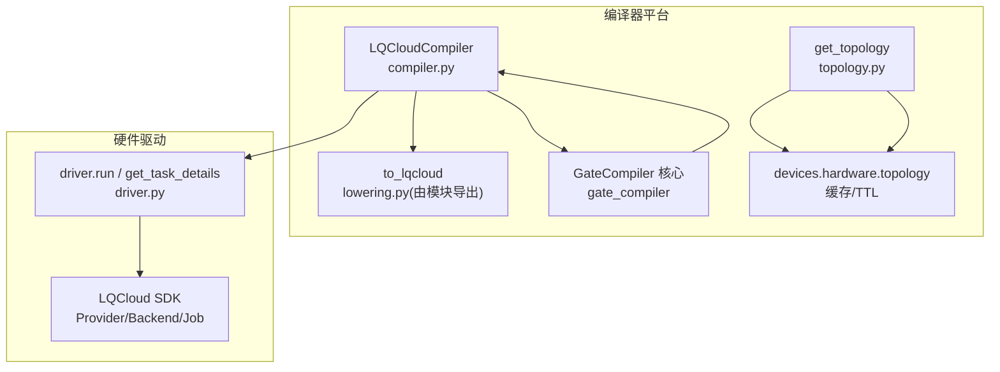
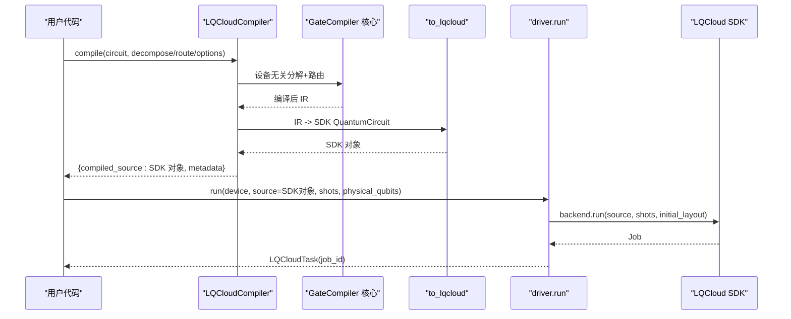
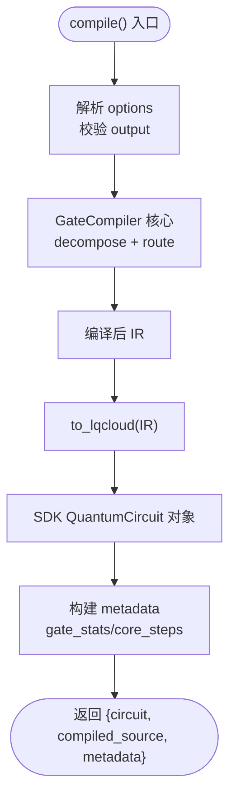
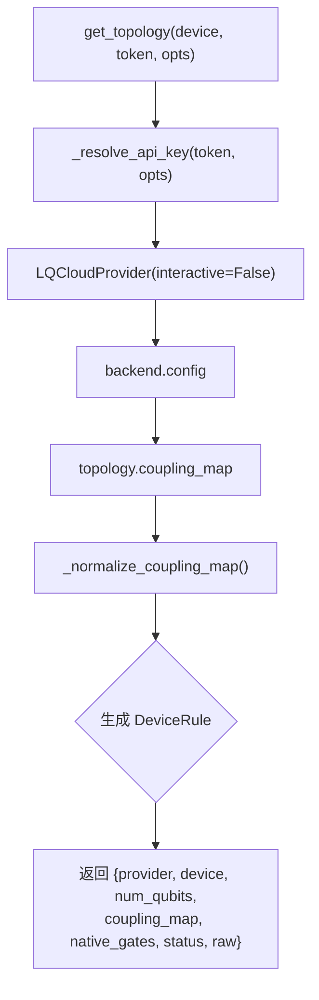
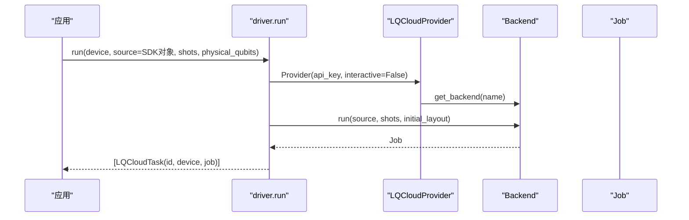
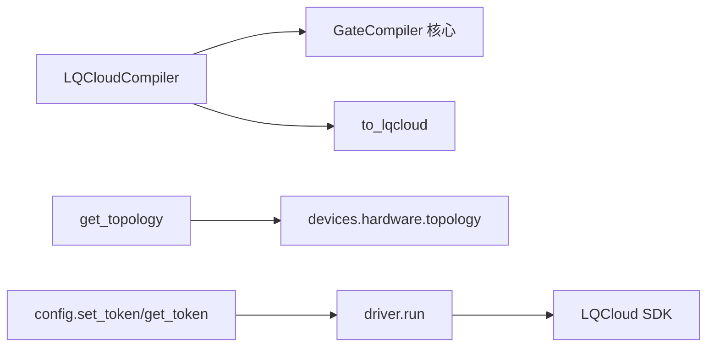

# LQCloud云平台适配器

<cite>
**本文引用的文件**
- [src/tyxonq/compiler/platforms/lqcloud/__init__.py](file://src/tyxonq/compiler/platforms/lqcloud/__init__.py)
- [src/tyxonq/compiler/platforms/lqcloud/compiler.py](file://src/tyxonq/compiler/platforms/lqcloud/compiler.py)
- [src/tyxonq/compiler/platforms/lqcloud/topology.py](file://src/tyxonq/compiler/platforms/lqcloud/topology.py)
- [src/tyxonq/devices/hardware/lqcloud/__init__.py](file://src/tyxonq/devices/hardware/lqcloud/__init__.py)
- [src/tyxonq/devices/hardware/lqcloud/driver.py](file://src/tyxonq/devices/hardware/lqcloud/driver.py)
- [examples/run_circuit_on_lqcloud.py](file://examples/run_circuit_on_lqcloud.py)
- [examples/run_chem_on_lqcloud.py](file://examples/run_chem_on_lqcloud.py)
- [tests_core_module/test_lqcloud_compiler.py](file://tests_core_module/test_lqcloud_compiler.py)
- [tests_core_module/test_lqcloud_topology.py](file://tests_core_module/test_lqcloud_topology.py)
- [tests_core_module/test_lqcloud_driver.py](file://tests_core_module/test_lqcloud_driver.py)
- [src/tyxonq/devices/hardware/config.py](file://src/tyxonq/devices/hardware/config.py)
- [docs/tyxonq_cloud_api.md](file://docs/tyxonq_cloud_api.md)
</cite>

## 目录
1. [简介](#简介)
2. [项目结构](#项目结构)
3. [核心组件](#核心组件)
4. [架构总览](#架构总览)
5. [详细组件分析](#详细组件分析)
6. [依赖关系分析](#依赖关系分析)
7. [性能与优化](#性能与优化)
8. [故障排查指南](#故障排查指南)
9. [结论](#结论)
10. [附录](#附录)

## 简介
本文件面向需要在 TyxonQ 中接入并适配 LQCloud 云平台的开发者，系统性说明 LQCloud 的编译策略、量子门集合、拓扑结构与连接性约束、编译流程（含路由与布局）、API 集成与 SDK 调用方式、配置与参数调优、性能特征与限制，以及如何在 LQCloud 上运行电路并提交任务。文档同时覆盖认证与授权机制，并提供可操作的示例路径与测试用例参考。

## 项目结构
LQCloud 适配在 TyxonQ 中分为“编译器平台”和“硬件驱动”两层：
- 编译器平台层：将 TyxonQ IR 编译为 LQCloud SDK 的 QuantumCircuit 对象，复用 gate_compiler 核心完成设备无关的分解与路由。
- 硬件驱动层：封装 LQCloud SDK 的 Provider/Backend/Job，负责提交任务、查询状态、标准化结果。

图示来源
- [src/tyxonq/compiler/platforms/lqcloud/compiler.py:50-112](file://src/tyxonq/compiler/platforms/lqcloud/compiler.py#L50-L112)
- [src/tyxonq/compiler/platforms/lqcloud/topology.py:108-151](file://src/tyxonq/compiler/platforms/lqcloud/topology.py#L108-L151)
- [src/tyxonq/devices/hardware/lqcloud/driver.py:56-92](file://src/tyxonq/devices/hardware/lqcloud/driver.py#L56-L92)

章节来源
- [src/tyxonq/compiler/platforms/lqcloud/__init__.py:1-12](file://src/tyxonq/compiler/platforms/lqcloud/__init__.py#L1-L12)
- [src/tyxonq/devices/hardware/lqcloud/__init__.py:1-6](file://src/tyxonq/devices/hardware/lqcloud/__init__.py#L1-L6)

## 核心组件
- LQCloudCompiler：一等 compile_engine，输出目标为 lqcloud.QuantumCircuit 对象；先委托 gate_compiler 核心做分解与路由，再直译为 SDK 对象。
- topology.get_topology：从 LQCloud SDK backend.config 抓取拓扑（耦合图、比特数、原生门等），归一化为 DeviceRule，供路由使用。
- driver：最小门线路适配，封装 run、get_task_details、remove_task、list_devices 等能力，统一结果格式。
- 配置与认证：通过 _resolve_api_key 解析 API key，支持显式 token、环境变量与存储令牌；全局密钥不被回退使用。

章节来源
- [src/tyxonq/compiler/platforms/lqcloud/compiler.py:50-112](file://src/tyxonq/compiler/platforms/lqcloud/compiler.py#L50-L112)
- [src/tyxonq/compiler/platforms/lqcloud/topology.py:108-151](file://src/tyxonq/compiler/platforms/lqcloud/topology.py#L108-L151)
- [src/tyxonq/devices/hardware/lqcloud/driver.py:33-42](file://src/tyxonq/devices/hardware/lqcloud/driver.py#L33-L42)
- [src/tyxonq/devices/hardware/config.py:24-50](file://src/tyxonq/devices/hardware/config.py#L24-L50)

## 架构总览
TyxonQ 对 LQCloud 的适配遵循“编译期与运行期解耦”的设计：
- 编译期：IR -> gate_compiler 核心（分解/路由）-> to_lqcloud 直译 -> SDK QuantumCircuit 对象。
- 运行期：Circuit.run(provider="lqcloud") -> driver.run -> SDK Backend.run(initial_layout=physical_qubits) -> Job 查询 -> 统一结果。

图示来源
- [src/tyxonq/compiler/platforms/lqcloud/compiler.py:74-92](file://src/tyxonq/compiler/platforms/lqcloud/compiler.py#L74-L92)
- [src/tyxonq/devices/hardware/lqcloud/driver.py:56-92](file://src/tyxonq/devices/hardware/lqcloud/driver.py#L56-L92)

## 详细组件分析

### LQCloudCompiler（编译入口）
- 职责：将 TyxonQ Circuit 编译为 LQCloud SDK QuantumCircuit 对象；不消费 physical_qubits（该参数是运行期 initial_layout）。
- 关键行为：
  - 委托 gate_compiler 核心执行分解与路由，得到 IR。
  - 通过 to_lqcloud 将 IR 直译为 SDK 对象。
  - 返回 compiled_source 为 SDK 对象，metadata 包含 gate_stats、core_steps 等诊断信息。
- 输出选项：仅支持 output="lqcloud"（或等价别名），拒绝其他输出类型。

图示来源
- [src/tyxonq/compiler/platforms/lqcloud/compiler.py:55-109](file://src/tyxonq/compiler/platforms/lqcloud/compiler.py#L55-L109)

章节来源
- [src/tyxonq/compiler/platforms/lqcloud/compiler.py:1-113](file://src/tyxonq/compiler/platforms/lqcloud/compiler.py#L1-L113)
- [tests_core_module/test_lqcloud_compiler.py:79-144](file://tests_core_module/test_lqcloud_compiler.py#L79-L144)

### Topology 与耦合图归一化
- 职责：只读发现 LQCloud 设备拓扑，提供 DeviceRule（provider/device/num_qubits/coupling_map/native_gates/status/raw）。
- 关键点：
  - 耦合图来自 backend.config['topology']['coupling_map']。
  - 服务端边列表可能不对称，需归一为双向去重边集，便于路由选择更优方向。
  - 原生门集合多为 None（现网未声明），防御式探测多种字段名。
  - raw 落盘裁剪大字段（properties、qubit_coordinates），控制缓存体积。
- 与上层协作：TTL 缓存与跨 provider 分派由 devices.hardware.topology 统一管理。

图示来源
- [src/tyxonq/compiler/platforms/lqcloud/topology.py:108-151](file://src/tyxonq/compiler/platforms/lqcloud/topology.py#L108-L151)
- [src/tyxonq/devices/hardware/lqcloud/driver.py:33-42](file://src/tyxonq/devices/hardware/lqcloud/driver.py#L33-L42)

章节来源
- [src/tyxonq/compiler/platforms/lqcloud/topology.py:1-155](file://src/tyxonq/compiler/platforms/lqcloud/topology.py#L1-L155)
- [tests_core_module/test_lqcloud_topology.py:69-183](file://tests_core_module/test_lqcloud_topology.py#L69-L183)

### 硬件驱动（Driver）
- 职责：最小门线路适配，封装 LQCloud SDK 的 Provider/Backend/Job，提供 run、get_task_details、remove_task、list_devices。
- 认证与授权：
  - _resolve_api_key 严格解析 API key，优先显式 token，其次命名空间环境变量，最后上游环境变量；绝不回退到 TyxonQ 全局密钥。
- 运行期参数：
  - physical_qubits 作为运行期 initial_layout 传入 SDK，不在编译期烘焙进对象。
  - 首版不支持批量任务与未知参数，会抛出明确错误。
- 结果标准化：
  - 将 SDK 原始结果转换为统一 counts/probabilities/result_format，并映射 uni_status。

图示来源
- [src/tyxonq/devices/hardware/lqcloud/driver.py:56-92](file://src/tyxonq/devices/hardware/lqcloud/driver.py#L56-L92)

章节来源
- [src/tyxonq/devices/hardware/lqcloud/driver.py:1-223](file://src/tyxonq/devices/hardware/lqcloud/driver.py#L1-L223)
- [tests_core_module/test_lqcloud_driver.py:129-157](file://tests_core_module/test_lqcloud_driver.py#L129-L157)
- [tests_core_module/test_lqcloud_driver.py:175-196](file://tests_core_module/test_lqcloud_driver.py#L175-L196)

### 示例与端到端工作流
- 基础电路示例：构建四比特电路，离线展示指令统计，在线模式设置 token 并提交任务。
- 量子化学示例：HEA/UCCSD/SQD 统一链式 .run()，同一套调用在模拟器与真机间切换；SQD 的 fSim 家族 matchgate 经核心分解为 LQCloud 可执行门。

章节来源
- [examples/run_circuit_on_lqcloud.py:18-113](file://examples/run_circuit_on_lqcloud.py#L18-L113)
- [examples/run_chem_on_lqcloud.py:50-111](file://examples/run_chem_on_lqcloud.py#L50-L111)
- [examples/run_chem_on_lqcloud.py:122-179](file://examples/run_chem_on_lqcloud.py#L122-L179)

## 依赖关系分析
- 编译器平台依赖 gate_compiler 核心进行设备无关的分解与路由；to_lqcloud 仅做 1:1 翻译。
- Topology 依赖 LQCloud SDK 的 backend.config；通过 devices.hardware.topology 实现缓存与 TTL。
- Driver 依赖 LQCloud SDK 的 Provider/Backend/Job，并将物理比特映射为 initial_layout。
- 配置与认证通过 devices.hardware.config 管理命名空间令牌与环境变量。

图示来源
- [src/tyxonq/compiler/platforms/lqcloud/compiler.py:74-92](file://src/tyxonq/compiler/platforms/lqcloud/compiler.py#L74-L92)
- [src/tyxonq/compiler/platforms/lqcloud/topology.py:108-151](file://src/tyxonq/compiler/platforms/lqcloud/topology.py#L108-L151)
- [src/tyxonq/devices/hardware/lqcloud/driver.py:56-92](file://src/tyxonq/devices/hardware/lqcloud/driver.py#L56-L92)
- [src/tyxonq/devices/hardware/config.py:24-50](file://src/tyxonq/devices/hardware/config.py#L24-L50)

章节来源
- [src/tyxonq/compiler/platforms/lqcloud/compiler.py:1-113](file://src/tyxonq/compiler/platforms/lqcloud/compiler.py#L1-L113)
- [src/tyxonq/compiler/platforms/lqcloud/topology.py:1-155](file://src/tyxonq/compiler/platforms/lqcloud/topology.py#L1-L155)
- [src/tyxonq/devices/hardware/lqcloud/driver.py:1-223](file://src/tyxonq/devices/hardware/lqcloud/driver.py#L1-L223)
- [src/tyxonq/devices/hardware/config.py:1-78](file://src/tyxonq/devices/hardware/config.py#L1-L78)

## 性能与优化
- 编译期优化：
  - 复用 gate_compiler 核心进行设备无关的分解与路由，避免重复实现 matchgate 分解。
  - 路由阶段利用归一化的双向耦合图，减少不必要的 SWAP 与方向修正门。
- 运行期优化：
  - physical_qubits 作为 initial_layout 直接传入 SDK，减少运行时映射开销。
  - 拓扑缓存与 TTL 降低频繁网络请求成本。
- 限制条件：
  - 首版 driver 不支持批量任务与未知运行参数。
  - 原生门集合常为 None，需依赖核心分解为可执行门。
  - 拓扑中的 qubit_coordinates 与 properties 为大字段，已裁剪以控制缓存体积。

章节来源
- [src/tyxonq/compiler/platforms/lqcloud/compiler.py:1-15](file://src/tyxonq/compiler/platforms/lqcloud/compiler.py#L1-L15)
- [src/tyxonq/compiler/platforms/lqcloud/topology.py:32-34](file://src/tyxonq/compiler/platforms/lqcloud/topology.py#L32-L34)
- [src/tyxonq/devices/hardware/lqcloud/driver.py:66-80](file://src/tyxonq/devices/hardware/lqcloud/driver.py#L66-L80)

## 故障排查指南
- 认证失败：
  - 检查是否通过 tq.set_token(..., provider="lqcloud") 或环境变量设置 API key；确保不使用全局 TYXONQ_API_KEY。
  - 参考 _resolve_api_key 的优先级与报错提示。
- 拓扑获取失败：
  - 确认设备名正确；若 SDK config 非预期类型，会抛出 RuntimeError。
  - 无耦合图时 coupling_map 为空列表，调用方应据此判定全连接或无需路由。
- 任务提交失败：
  - 首版不支持批量任务与未知参数；请检查 shots 与额外参数。
  - 若未返回 job_id，视为提交失败。
- 结果解析异常：
  - get_task_details 会将异常转为 uni_status="error"/"unknown"，并保留 raw 与 error 字段用于定位。

章节来源
- [src/tyxonq/devices/hardware/lqcloud/driver.py:33-42](file://src/tyxonq/devices/hardware/lqcloud/driver.py#L33-L42)
- [src/tyxonq/devices/hardware/lqcloud/driver.py:86-92](file://src/tyxonq/devices/hardware/lqcloud/driver.py#L86-L92)
- [src/tyxonq/devices/hardware/lqcloud/driver.py:119-180](file://src/tyxonq/devices/hardware/lqcloud/driver.py#L119-L180)
- [src/tyxonq/compiler/platforms/lqcloud/topology.py:137-151](file://src/tyxonq/compiler/platforms/lqcloud/topology.py#L137-L151)

## 结论
LQCloud 适配器在 TyxonQ 中实现了“编译期与运行期解耦”的清晰分层：编译器平台通过 gate_compiler 核心保证设备无关的分解与路由，再以 to_lqcloud 直译为 SDK 对象；硬件驱动则专注 SDK 交互与结果标准化。配合拓扑归一化与缓存、严格的认证解析与参数校验，能够在保证稳定性的前提下高效对接 LQCloud 真机。

## 附录

### LQCloud 量子门集合与拓扑
- 原生门集合：现网设备多未声明（None），由 gate_compiler 核心分解为可执行门。
- 拓扑结构：耦合图来自 backend.config['topology']['coupling_map']，归一为双向去重边集；比特总数取自 config 的多处字段或从耦合图推断。
- 连接性约束：若无耦合图，视为全连接或无需路由；否则按耦合图进行路由与 SWAP 插入。

章节来源
- [src/tyxonq/compiler/platforms/lqcloud/topology.py:85-94](file://src/tyxonq/compiler/platforms/lqcloud/topology.py#L85-L94)
- [src/tyxonq/compiler/platforms/lqcloud/topology.py:70-82](file://src/tyxonq/compiler/platforms/lqcloud/topology.py#L70-L82)
- [src/tyxonq/compiler/platforms/lqcloud/topology.py:43-67](file://src/tyxonq/compiler/platforms/lqcloud/topology.py#L43-L67)

### 编译流程与路由算法
- 分解：matchgate/rotations 等在 gate_compiler 核心完成，避免重复实现。
- 路由：基于归一化耦合图进行设备相关的路由与布线，减少 SWAP 数量。
- 布局：physical_qubits 作为运行期 initial_layout 传入 SDK，不烘焙进对象。

章节来源
- [src/tyxonq/compiler/platforms/lqcloud/compiler.py:74-92](file://src/tyxonq/compiler/platforms/lqcloud/compiler.py#L74-L92)
- [src/tyxonq/compiler/platforms/lqcloud/compiler.py:11-15](file://src/tyxonq/compiler/platforms/lqcloud/compiler.py#L11-L15)

### API 集成与 SDK 调用
- 认证：Bearer token 用于 TyxonQ Cloud API；LQCloud 驱动通过 _resolve_api_key 解析 API key。
- 设备管理：list_devices 动态列出当前 API key 可见的设备。
- 任务提交：driver.run 提交单个任务，返回 LQCloudTask；get_task_details 查询状态与结果。

章节来源
- [docs/tyxonq_cloud_api.md:16-21](file://docs/tyxonq_cloud_api.md#L16-L21)
- [docs/tyxonq_cloud_api.md:89-158](file://docs/tyxonq_cloud_api.md#L89-L158)
- [src/tyxonq/devices/hardware/lqcloud/driver.py:190-213](file://src/tyxonq/devices/hardware/lqcloud/driver.py#L190-L213)
- [src/tyxonq/devices/hardware/lqcloud/driver.py:119-180](file://src/tyxonq/devices/hardware/lqcloud/driver.py#L119-L180)

### 配置选项与参数调优
- 编译选项：output 仅支持 "lqcloud"；decompose/route 由 GateCompiler 核心处理。
- 运行选项：shots 必须为正整数；physical_qubits 作为 initial_layout 传入；首版不支持批量与未知参数。
- 认证选项：api_key 可通过显式参数、环境变量或存储令牌注入；命名空间隔离避免冲突。

章节来源
- [src/tyxonq/compiler/platforms/lqcloud/compiler.py:64-72](file://src/tyxonq/compiler/platforms/lqcloud/compiler.py#L64-L72)
- [src/tyxonq/devices/hardware/lqcloud/driver.py:66-80](file://src/tyxonq/devices/hardware/lqcloud/driver.py#L66-L80)
- [src/tyxonq/devices/hardware/lqcloud/driver.py:33-42](file://src/tyxonq/devices/hardware/lqcloud/driver.py#L33-L42)
- [src/tyxonq/devices/hardware/config.py:24-50](file://src/tyxonq/devices/hardware/config.py#L24-L50)

### 在 LQCloud 上运行电路与任务
- 离线验证：使用 to_lqcloud 将 IR 转换为 SDK 对象，查看指令统计。
- 在线提交：设置 token，调用 circuit.run(provider="lqcloud", device, shots, wait_async_result=True)，可选 physical_qubits。
- 量子化学方法：HEA/UCCSD/SQD 统一链式 .run()，同一接口在模拟器与真机间切换。

章节来源
- [examples/run_circuit_on_lqcloud.py:70-108](file://examples/run_circuit_on_lqcloud.py#L70-L108)
- [examples/run_chem_on_lqcloud.py:50-111](file://examples/run_chem_on_lqcloud.py#L50-L111)
- [examples/run_chem_on_lqcloud.py:122-179](file://examples/run_chem_on_lqcloud.py#L122-L179)

### 认证与授权机制
- TyxonQ Cloud API：Authorization: Bearer YOUR_TOKEN。
- LQCloud 驱动：_resolve_api_key 严格解析 API key，支持命名空间环境变量与存储令牌，忽略全局密钥。

章节来源
- [docs/tyxonq_cloud_api.md:16-21](file://docs/tyxonq_cloud_api.md#L16-L21)
- [src/tyxonq/devices/hardware/lqcloud/driver.py:33-42](file://src/tyxonq/devices/hardware/lqcloud/driver.py#L33-L42)
- [src/tyxonq/devices/hardware/config.py:24-50](file://src/tyxonq/devices/hardware/config.py#L24-L50)