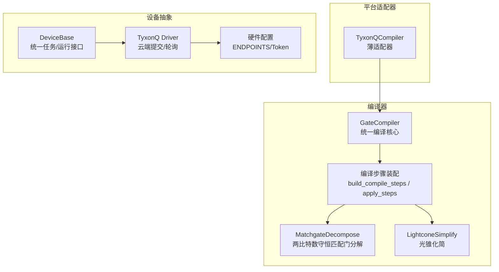
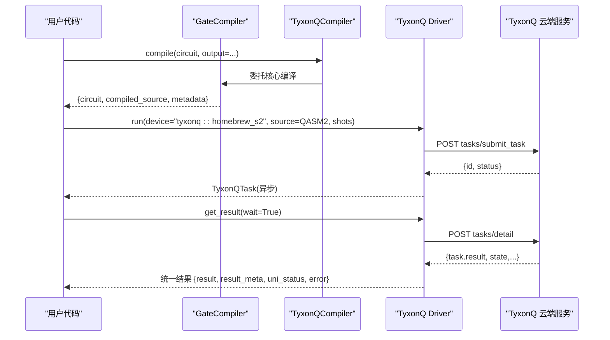
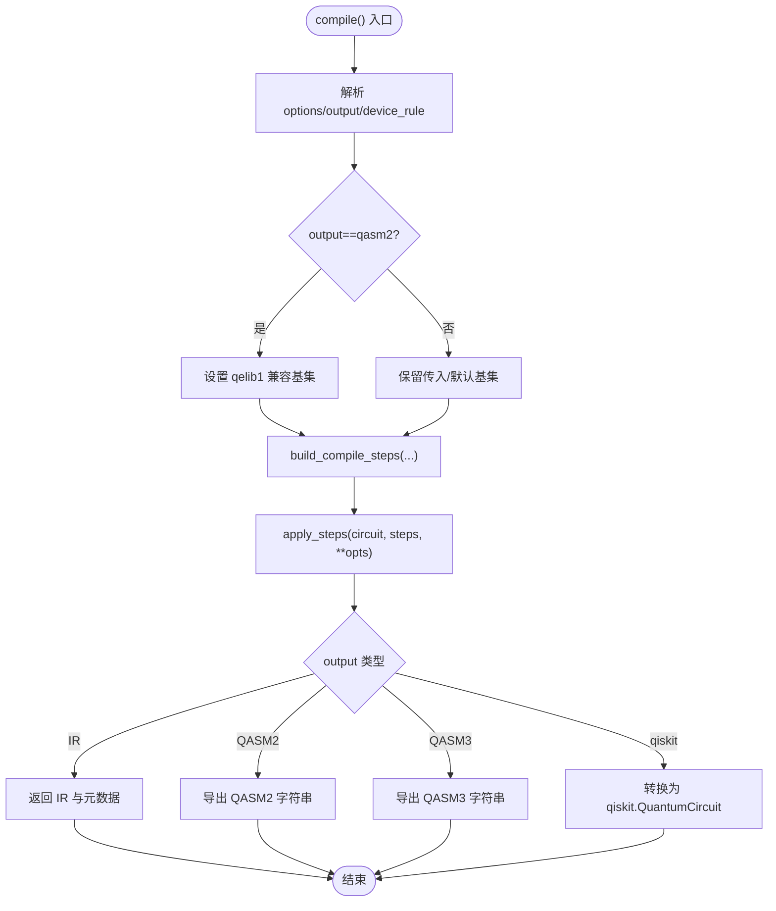
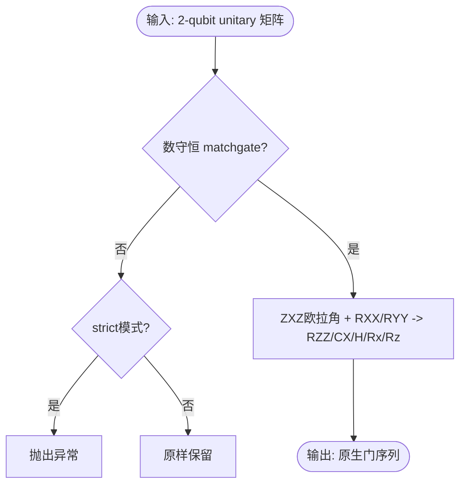
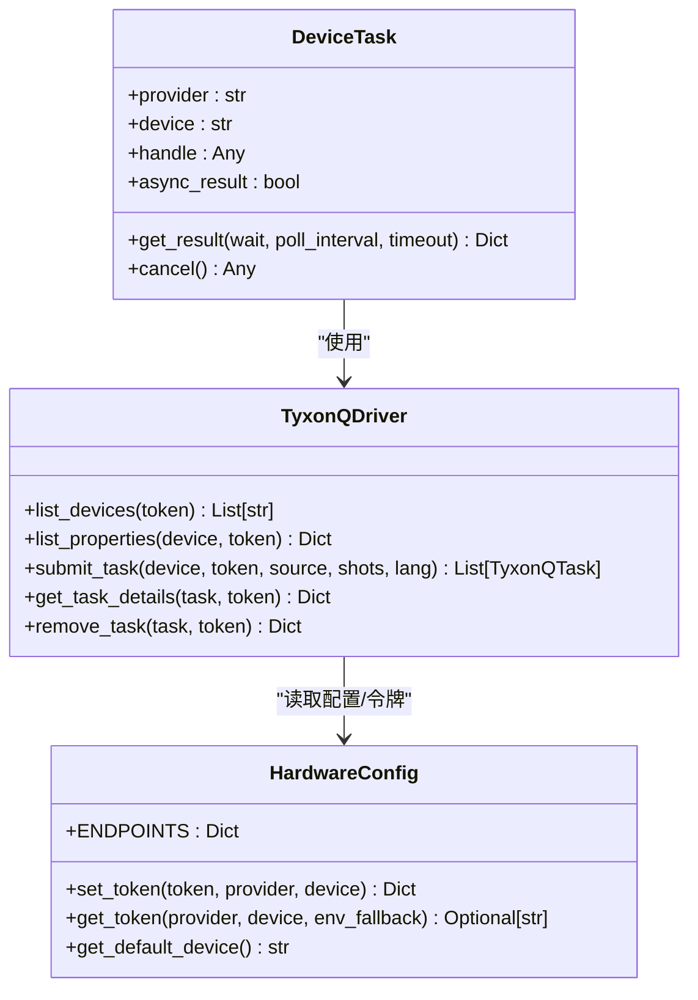
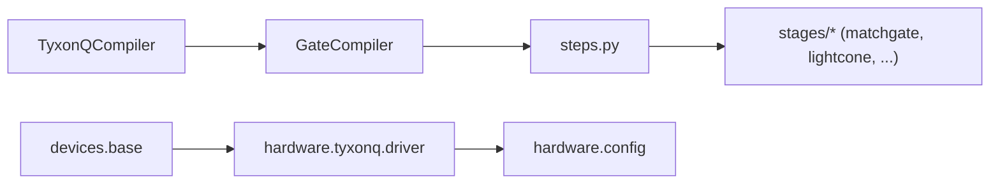

# TyxonQ核心平台

<cite>
**本文引用的文件**
- [src/tyxonq/compiler/platforms/tyxonq/__init__.py](file://src/tyxonq/compiler/platforms/tyxonq/__init__.py)
- [src/tyxonq/devices/hardware/tyxonq/driver.py](file://src/tyxonq/devices/hardware/tyxonq/driver.py)
- [src/tyxonq/devices/base.py](file://src/tyxonq/devices/base.py)
- [src/tyxonq/devices/hardware/config.py](file://src/tyxonq/devices/hardware/config.py)
- [src/tyxonq/compiler/gate_compiler/__init__.py](file://src/tyxonq/compiler/gate_compiler/__init__.py)
- [src/tyxonq/compiler/gate_compiler/compiler.py](file://src/tyxonq/compiler/gate_compiler/compiler.py)
- [src/tyxonq/compiler/gate_compiler/steps.py](file://src/tyxonq/compiler/gate_compiler/steps.py)
- [src/tyxonq/compiler/gate_compiler/stages/decompose/matchgate.py](file://src/tyxonq/compiler/gate_compiler/stages/decompose/matchgate.py)
- [src/tyxonq/compiler/gate_compiler/stages/simplify/lightcone.py](file://src/tyxonq/compiler/gate_compiler/stages/simplify/lightcone.py)
- [README.md](file://README.md)
</cite>

## 目录
1. [简介](#简介)
2. [项目结构](#项目结构)
3. [核心组件](#核心组件)
4. [架构总览](#架构总览)
5. [详细组件分析](#详细组件分析)
6. [依赖关系分析](#依赖关系分析)
7. [性能考量](#性能考量)
8. [故障排查指南](#故障排查指南)
9. [结论](#结论)
10. [附录](#附录)

## 简介
本文件面向“TyxonQ核心平台”的编译器实现与硬件适配，系统性阐述其设计理念、编译优化策略、执行约束、与其他平台的差异与优势，并提供使用示例、配置选项、基准测试要点与最佳实践。同时给出如何基于核心平台开发自定义硬件适配器的指导。

## 项目结构
TyxonQ采用“设备无关的核心编译器 + 多平台方言适配器 + 统一设备抽象”的分层设计：
- 核心编译器（gate_compiler）提供统一的分解、重写、路由、优化、化简等编译步骤装配与执行。
- 平台适配器（platforms/*）将核心编译结果翻译为各平台可执行的方言（如 QASM2/QASM3/TQASM）。
- 设备抽象（devices/*）统一驱动模拟器与真实硬件，屏蔽底层差异。

图表来源
- [src/tyxonq/compiler/gate_compiler/compiler.py:14-109](file://src/tyxonq/compiler/gate_compiler/compiler.py#L14-L109)
- [src/tyxonq/compiler/gate_compiler/steps.py:27-105](file://src/tyxonq/compiler/gate_compiler/steps.py#L27-L105)
- [src/tyxonq/compiler/gate_compiler/stages/decompose/matchgate.py:152-197](file://src/tyxonq/compiler/gate_compiler/stages/decompose/matchgate.py#L152-L197)
- [src/tyxonq/compiler/gate_compiler/stages/simplify/lightcone.py:12-97](file://src/tyxonq/compiler/gate_compiler/stages/simplify/lightcone.py#L12-L97)
- [src/tyxonq/compiler/platforms/tyxonq/__init__.py:12-16](file://src/tyxonq/compiler/platforms/tyxonq/__init__.py#L12-L16)
- [src/tyxonq/devices/base.py:146-258](file://src/tyxonq/devices/base.py#L146-L258)
- [src/tyxonq/devices/hardware/tyxonq/driver.py:83-141](file://src/tyxonq/devices/hardware/tyxonq/driver.py#L83-L141)
- [src/tyxonq/devices/hardware/config.py:11-19](file://src/tyxonq/devices/hardware/config.py#L11-L19)

章节来源
- [README.md:191-200](file://README.md#L191-L200)

## 核心组件
- GateCompiler：设备无关的统一编译核心，负责按类型化参数装配并顺序执行编译步骤，支持输出 IR、QASM2、QASM3、Qiskit 对象。
- 编译步骤：AutoMeasure → GatesTransform → MatchgateDecompose/RotationsDecompose → Routing → MergePrune → LightconeSimplify。
- TyxonQCompiler：薄适配器，直接委托 GateCompiler，保持平台对称性。
- 设备抽象 DeviceTask/run：统一任务封装、结果归一化、异步轮询与错误处理；resolve_driver 根据 provider/device 选择具体驱动。
- TyxonQ Driver：通过 HTTP API 提交任务、查询详情、删除任务；对 homebrew_s2/s3 等设备进行 QASM2 校验。
- 硬件配置：集中管理 ENDPOINTS、默认 provider/device、Token 获取与设置。

章节来源
- [src/tyxonq/compiler/gate_compiler/compiler.py:14-109](file://src/tyxonq/compiler/gate_compiler/compiler.py#L14-L109)
- [src/tyxonq/compiler/gate_compiler/steps.py:27-105](file://src/tyxonq/compiler/gate_compiler/steps.py#L27-L105)
- [src/tyxonq/compiler/platforms/tyxonq/__init__.py:12-16](file://src/tyxonq/compiler/platforms/tyxonq/__init__.py#L12-L16)
- [src/tyxonq/devices/base.py:14-57](file://src/tyxonq/devices/base.py#L14-L57)
- [src/tyxonq/devices/base.py:294-445](file://src/tyxonq/devices/base.py#L294-L445)
- [src/tyxonq/devices/hardware/tyxonq/driver.py:83-141](file://src/tyxonq/devices/hardware/tyxonq/driver.py#L83-L141)
- [src/tyxonq/devices/hardware/config.py:24-65](file://src/tyxonq/devices/hardware/config.py#L24-L65)

## 架构总览
TyxonQ 核心平台在编译期与运行期的交互如下：
- 编译期：用户构建 Circuit → GateCompiler.compile 装配步骤 → 生成 IR/QASM2/QASM3 或 qiskit 对象。
- 运行期：Circuit.run 或 device.run 通过 resolve_driver 选择 TyxonQ 驱动 → submit_task 提交 OpenQASM 源 → 轮询 get_task_details 获取计数结果 → DeviceTask.get_result 归一化返回。

图表来源
- [src/tyxonq/compiler/gate_compiler/compiler.py:27-109](file://src/tyxonq/compiler/gate_compiler/compiler.py#L27-L109)
- [src/tyxonq/compiler/platforms/tyxonq/__init__.py:12-16](file://src/tyxonq/compiler/platforms/tyxonq/__init__.py#L12-L16)
- [src/tyxonq/devices/hardware/tyxonq/driver.py:83-141](file://src/tyxonq/devices/hardware/tyxonq/driver.py#L83-L141)
- [src/tyxonq/devices/hardware/tyxonq/driver.py:145-214](file://src/tyxonq/devices/hardware/tyxonq/driver.py#L145-L214)

## 详细组件分析

### 编译器核心 GateCompiler
- 职责：接收 Circuit 与类型化参数（basis_gates、decompose、route、optimize、simplify、device_rule），装配编译步骤并顺序执行，最终输出 IR/QASM2/QASM3/qiskit。
- 关键行为：
  - 当输出为 QASM2 且未指定 basis_gates 时，自动降级到 qelib1 兼容基集，确保导出器不遇到不支持的门。
  - 将 optimize 与 options.optimization_level 归一化，控制是否启用合并剪枝。
  - 元数据包含 steps、basis_gates、optimization_level 等，便于诊断与复现。

图表来源
- [src/tyxonq/compiler/gate_compiler/compiler.py:27-109](file://src/tyxonq/compiler/gate_compiler/compiler.py#L27-L109)

章节来源
- [src/tyxonq/compiler/gate_compiler/compiler.py:27-109](file://src/tyxonq/compiler/gate_compiler/compiler.py#L27-L109)

### 编译步骤装配与执行
- 固定顺序：规范化（AutoMeasure、GatesTransform）→ 分解（MatchgateDecompose、RotationsDecompose）→ 路由（Routing，可选）→ 优化（MergePrune，optimize≥1）→ 化简（LightconeSimplify，可选）。
- 延迟导入：仅在启用相关能力时加载对应模块，降低核心依赖。
- 设备规则透传：routing 步骤可从 device_rule.coupling_map 读取拓扑信息。

章节来源
- [src/tyxonq/compiler/gate_compiler/steps.py:27-105](file://src/tyxonq/compiler/gate_compiler/steps.py#L27-L105)

### 两比特数守恒匹配门分解（Matchgate）
- 物理依据：fSim 家族可分解为 iSWAP 型相互作用 + CPhase，作用于正交子空间且彼此对易。
- 实现要点：
  - 检测矩阵是否为数守恒 matchgate（跨粒子数子空间耦合为零）。
  - 将 |11> 相位由 Rz⊗Rz 承载，单激发子空间用 ZXZ 欧拉角分解，进一步落到原生门 {rz, rx, h, cx}。
  - 零角度块剪枝以减少冗余门。
- 作为核心编译步骤被复用，避免各平台重复实现。

图表来源
- [src/tyxonq/compiler/gate_compiler/stages/decompose/matchgate.py:46-149](file://src/tyxonq/compiler/gate_compiler/stages/decompose/matchgate.py#L46-L149)
- [src/tyxonq/compiler/gate_compiler/stages/decompose/matchgate.py:152-197](file://src/tyxonq/compiler/gate_compiler/stages/decompose/matchgate.py#L152-L197)

章节来源
- [src/tyxonq/compiler/gate_compiler/stages/decompose/matchgate.py:46-197](file://src/tyxonq/compiler/gate_compiler/stages/decompose/matchgate.py#L46-L197)

### 光锥化简（LightconeSimplify）
- 目标：仅保留影响测量结果的必要操作，减少无效门。
- 机制：从测量位反向追踪活跃量子比特集合，遇到双比特纠缠门扩展活跃集，收集需保留的操作索引并重建线路。
- 支持 assume_measure_all 以在无显式测量时假设全比特测量。

章节来源
- [src/tyxonq/compiler/gate_compiler/stages/simplify/lightcone.py:12-97](file://src/tyxonq/compiler/gate_compiler/stages/simplify/lightcone.py#L12-L97)

### TyxonQ 平台适配器
- 角色：薄适配器，名称为 tyxonq，直接委托 GateCompiler 完成编译，保持与 lqcloud/guodun 等平台对称结构。
- 优势：避免重复实现编译逻辑，聚焦方言翻译与平台特性。

章节来源
- [src/tyxonq/compiler/platforms/tyxonq/__init__.py:1-18](file://src/tyxonq/compiler/platforms/tyxonq/__init__.py#L1-L18)

### 设备抽象与 TyxonQ 驱动
- DeviceTask：统一任务包装，get_result 负责轮询与结果归一化，提升下游兼容性。
- resolve_driver：根据 provider/device 选择具体驱动；支持 simulator/local、tyxonq、ibm、qcos、quafu、lqcloud、guodun。
- TyxonQ Driver：
  - submit_task：向云端提交 OpenQASM 2 源，针对 homebrew_s2/s3 进行格式校验。
  - get_task_details：标准化返回 {result, result_meta, uni_status, error}。
  - remove_task：删除任务。
- 配置：ENDPOINTS 定义 base_url 与 api_version；set_token/get_token 管理认证令牌。

图表来源
- [src/tyxonq/devices/base.py:14-57](file://src/tyxonq/devices/base.py#L14-L57)
- [src/tyxonq/devices/base.py:146-258](file://src/tyxonq/devices/base.py#L146-L258)
- [src/tyxonq/devices/hardware/tyxonq/driver.py:56-141](file://src/tyxonq/devices/hardware/tyxonq/driver.py#L56-L141)
- [src/tyxonq/devices/hardware/tyxonq/driver.py:145-221](file://src/tyxonq/devices/hardware/tyxonq/driver.py#L145-L221)
- [src/tyxonq/devices/hardware/config.py:11-65](file://src/tyxonq/devices/hardware/config.py#L11-L65)

章节来源
- [src/tyxonq/devices/base.py:14-57](file://src/tyxonq/devices/base.py#L14-L57)
- [src/tyxonq/devices/base.py:146-258](file://src/tyxonq/devices/base.py#L146-L258)
- [src/tyxonq/devices/hardware/tyxonq/driver.py:56-221](file://src/tyxonq/devices/hardware/tyxonq/driver.py#L56-L221)
- [src/tyxonq/devices/hardware/config.py:11-65](file://src/tyxonq/devices/hardware/config.py#L11-L65)

## 依赖关系分析
- GateCompiler 依赖步骤装配与执行模块，按需延迟导入以降低启动开销。
- TyxonQCompiler 仅依赖 GateCompiler，无额外编译逻辑。
- 设备层通过 resolve_driver 动态加载具体驱动，避免全局重依赖。
- TyxonQ Driver 依赖 requests 与硬件配置模块，统一访问云端 API。

图表来源
- [src/tyxonq/compiler/gate_compiler/compiler.py:14-109](file://src/tyxonq/compiler/gate_compiler/compiler.py#L14-L109)
- [src/tyxonq/compiler/gate_compiler/steps.py:27-105](file://src/tyxonq/compiler/gate_compiler/steps.py#L27-L105)
- [src/tyxonq/devices/base.py:146-258](file://src/tyxonq/devices/base.py#L146-L258)
- [src/tyxonq/devices/hardware/tyxonq/driver.py:83-141](file://src/tyxonq/devices/hardware/tyxonq/driver.py#L83-L141)
- [src/tyxonq/devices/hardware/config.py:11-19](file://src/tyxonq/devices/hardware/config.py#L11-L19)

章节来源
- [src/tyxonq/compiler/gate_compiler/compiler.py:14-109](file://src/tyxonq/compiler/gate_compiler/compiler.py#L14-L109)
- [src/tyxonq/devices/base.py:146-258](file://src/tyxonq/devices/base.py#L146-L258)

## 性能考量
- 编译优化：
  - 分解优先于路由，避免后续步骤对 unitary op 的不兼容。
  - 优化级别 ≥1 启用合并剪枝，减少冗余门。
  - 光锥化简仅保留影响测量的必要操作，显著降低有效深度。
- 执行路径：
  - 模拟器路径支持噪声注入与解析期望值快速路径（shots==0）。
  - 真机路径丢弃模拟器专属参数，避免无效键导致错误。
- 网络与轮询：
  - 异步任务支持超时与轮询间隔控制，避免长时间阻塞。
  - 统一结果格式便于下游后处理与指标计算。

[本节提供通用指导，无需特定文件引用]

## 故障排查指南
- 提交失败：
  - 检查 Token 是否正确设置（set_token/get_token）。
  - 确认 homebrew_s2/s3 的 source 为合法 QASM2（包含 qreg/creg）。
  - 查看 list_properties 返回的设备状态辅助诊断。
- 任务等待超时：
  - get_task_details 在 wait=True 且超过 timeout 时会发出警告并返回可能不完整的结果，建议增大超时或重试。
- 结果归一化：
  - DeviceTask.get_result 会提升内层 metadata 字段至外层，确保 downstream 解析一致性。

章节来源
- [src/tyxonq/devices/hardware/tyxonq/driver.py:83-141](file://src/tyxonq/devices/hardware/tyxonq/driver.py#L83-L141)
- [src/tyxonq/devices/hardware/tyxonq/driver.py:145-214](file://src/tyxonq/devices/hardware/tyxonq/driver.py#L145-L214)
- [src/tyxonq/devices/base.py:20-57](file://src/tyxonq/devices/base.py#L20-L57)
- [src/tyxonq/devices/base.py:497-557](file://src/tyxonq/devices/base.py#L497-L557)

## 结论
TyxonQ 核心平台通过“设备无关的核心编译器 + 薄平台适配器 + 统一设备抽象”实现了高内聚、低耦合的架构。核心编译器提供稳定的 IR 与丰富的编译优化能力；TyxonQ 平台适配器专注方言翻译与云端交互；设备抽象屏蔽了模拟器与真机的差异，提供一致的运行体验。该设计在保证可扩展性的同时，提升了编译质量与执行效率。

[本节总结性内容，无需特定文件引用]

## 附录

### 支持的量子门集合、拓扑结构与执行约束
- 门集合：
  - 单比特门：Pauli X/Y/Z、Hadamard、S/T、Rx/Ry/Rz 等。
  - 双比特门：CX/CNOT、CZ、CY、SWAP、RXX/RYY/RZZ 等。
  - 测量与重置：measure_z、reset、barrier 等。
- 拓扑结构：
  - 通过 DeviceRule.coupling_map 描述物理比特可交互边；为空表示全连接。
  - initial_layout 可指定初始映射，否则交由路由算法选择。
- 执行约束：
  - 真机路径要求已编译为平台可接受的源（如 OpenQASM 2）。
  - 模拟器路径支持噪声注入与解析期望值快速路径。

章节来源
- [docs/source/user_guide/core/index.rst:204-267](file://docs/source/user_guide/core/index.rst#L204-L267)
- [src/tyxonq/devices/base.py:60-83](file://src/tyxonq/devices/base.py#L60-L83)

### 使用示例与配置选项
- 最小示例：构建电路、编译、选择设备（模拟器或 TyxonQ 真机）、运行与后处理。
- 配置选项：
  - set_token 设置认证令牌。
  - device(provider="tyxonq", device="homebrew_s2") 选择真机。
  - compile(output="qasm") 输出 QASM2 供真机执行。
  - run(shots=...) 设置采样次数。

章节来源
- [README.md:27-87](file://README.md#L27-L87)

### 基准测试结果与最佳实践
- 性能领导力：
  - 在梯度计算方面相比其他框架具有显著加速；不同模式（shot-based、数值梯度、autograd）各有适用场景。
- 最佳实践：
  - 合理设置 optimization_level 与 simplify 开关，平衡编译时间与电路深度。
  - 使用光锥化简减少无效门，提高真机执行效率。
  - 真机执行前确保 source 格式正确，必要时开启严格匹配门分解。

章节来源
- [docs/source/technical_references/performance_leadership.rst:1-43](file://docs/source/technical_references/performance_leadership.rst#L1-L43)
- [examples/framework_performance_comparison.py:582-614](file://examples/framework_performance_comparison.py#L582-L614)

### 如何开发自定义硬件适配器
- 步骤概览：
  - 在 devices/hardware/<your_provider>/driver.py 中实现列表设备、提交任务、查询详情、删除任务等方法。
  - 在 devices/base.py 的 resolve_driver 中添加 provider 分支，指向新驱动。
  - 如需方言翻译，可在 compiler/platforms/<your_provider>/ 下创建薄适配器，委托 GateCompiler 完成核心编译。
- 注意事项：
  - 统一结果格式（result、result_meta、uni_status、error）以便下游处理。
  - 正确处理 Token 与 ENDPOINTS，支持环境变量回退。
  - 对特定设备的源格式进行校验（如 QASM2 必需字段）。

章节来源
- [src/tyxonq/devices/base.py:146-258](file://src/tyxonq/devices/base.py#L146-L258)
- [src/tyxonq/devices/hardware/config.py:11-65](file://src/tyxonq/devices/hardware/config.py#L11-L65)
- [src/tyxonq/compiler/platforms/tyxonq/__init__.py:1-18](file://src/tyxonq/compiler/platforms/tyxonq/__init__.py#L1-L18)