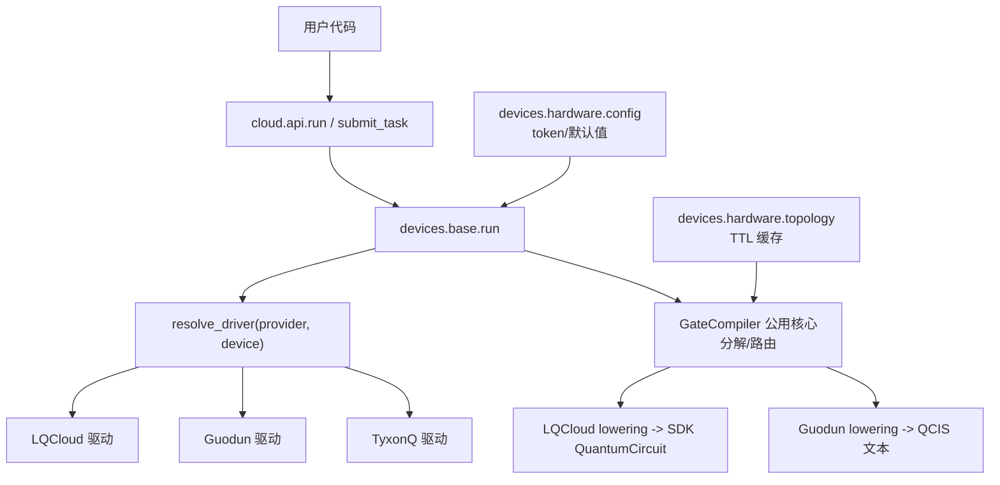
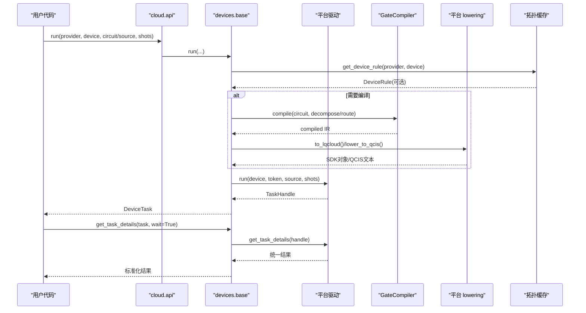
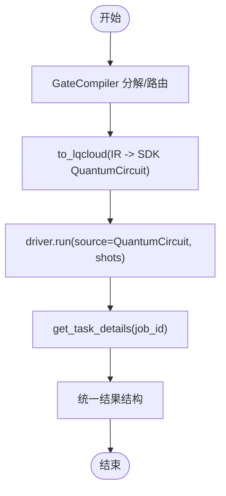
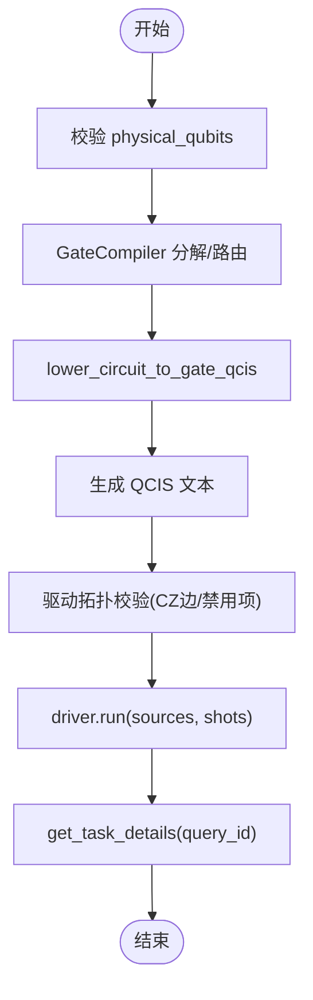
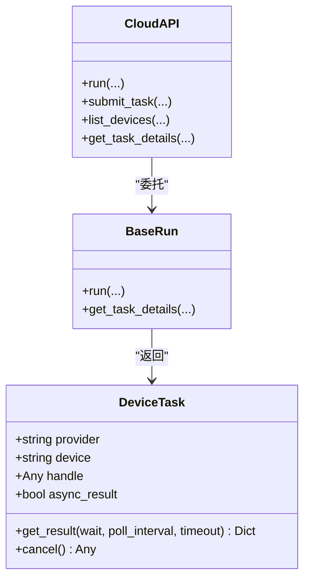
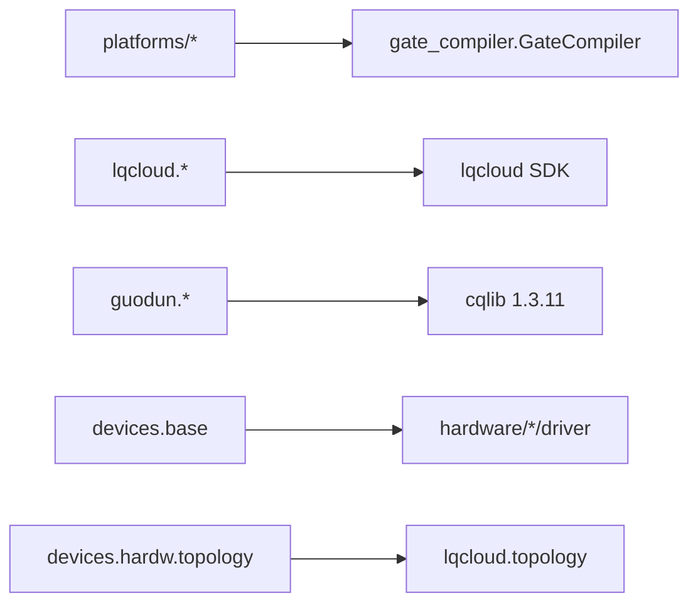

# 平台适配器

<cite>
**本文引用的文件**
- [src/tyxonq/compiler/platforms/__init__.py](file://src/tyxonq/compiler/platforms/__init__.py)
- [src/tyxonq/compiler/platforms/tyxonq/__init__.py](file://src/tyxonq/compiler/platforms/tyxonq/__init__.py)
- [src/tyxonq/compiler/platforms/lqcloud/__init__.py](file://src/tyxonq/compiler/platforms/lqcloud/__init__.py)
- [src/tyxonq/compiler/platforms/lqcloud/compiler.py](file://src/tyxonq/compiler/platforms/lqcloud/compiler.py)
- [src/tyxonq/compiler/platforms/lqcloud/lowering.py](file://src/tyxonq/compiler/platforms/lqcloud/lowering.py)
- [src/tyxonq/compiler/platforms/lqcloud/topology.py](file://src/tyxonq/compiler/platforms/lqcloud/topology.py)
- [src/tyxonq/compiler/platforms/guodun/__init__.py](file://src/tyxonq/compiler/platforms/guodun/__init__.py)
- [src/tyxonq/compiler/platforms/guodun/compiler.py](file://src/tyxonq/compiler/platforms/guodun/compiler.py)
- [src/tyxonq/compiler/platforms/guodun/lowering.py](file://src/tyxonq/compiler/platforms/guodun/lowering.py)
- [src/tyxonq/devices/base.py](file://src/tyxonq/devices/base.py)
- [src/tyxonq/devices/hardware/config.py](file://src/tyxonq/devices/hardware/config.py)
- [src/tyxonq/devices/hardware/topology.py](file://src/tyxonq/devices/hardware/topology.py)
- [src/tyxonq/devices/hardware/lqcloud/driver.py](file://src/tyxonq/devices/hardware/lqcloud/driver.py)
- [src/tyxonq/devices/hardware/guodun/driver.py](file://src/tyxonq/devices/hardware/guodun/driver.py)
- [src/tyxonq/cloud/api.py](file://src/tyxonq/cloud/api.py)
</cite>

## 目录
1. [简介](#简介)
2. [项目结构](#项目结构)
3. [核心组件](#核心组件)
4. [架构总览](#架构总览)
5. [详细组件分析](#详细组件分析)
6. [依赖关系分析](#依赖关系分析)
7. [性能与优化](#性能与优化)
8. [故障排查指南](#故障排查指南)
9. [结论](#结论)
10. [附录：新平台适配器开发指南](#附录：新平台适配器开发指南)

## 简介
本文件面向 TyxonQ 平台适配器的设计与实现，聚焦不同硬件平台的编译策略、方言支持与执行约束。重点覆盖三类目标：
- TyxonQ 原生平台：以门电路 IR 为核心，直接委托通用 GateCompiler 完成设备无关的分解与路由，输出为 IR/QASM2/QASM3/Qiskit 等中间形式。
- LQCloud 云平台：将 TyxonQ IR 直译为官方 SDK 的 QuantumCircuit 对象（纯对象方言），并通过 LQCloud SDK 提交任务；拓扑由 SDK 配置获取并缓存。
- 国盾平台：将 TyxonQ IR 降门为门级 QCIS 文本（{X, H, RZ, CZ, M}），并在驱动层进行拓扑校验与提交；支持脉冲 QCIS 的标定校验。

文档同时说明各平台的原生门集合、拓扑发现与路由、执行约束、优化技术、编译选项、云平台 SDK 集成方式、API 调用流程、迁移建议、基准测试要点以及为新硬件平台开发自定义适配器的步骤。

## 项目结构
TyxonQ 的平台适配体系采用“平台方言编译器 + 设备驱动”的分层设计：
- 平台方言编译器位于 compiler/platforms，每个子目录对应一个平台（tyxonq、lqcloud、guodun）。
- 设备驱动位于 devices/hardware/<provider>，负责与具体后端交互（提交、查询、取消、设备列表）。
- 统一设备抽象位于 devices/base，提供 run/expval/list_all_devices/get_task_details 等统一入口。
- 拓扑发现与缓存位于 devices/hardware/topology，按 provider 分派抓取逻辑（当前已落地 lqcloud）。
- 云 API 门面位于 cloud/api，封装 set_token/set_default/device/list_devices/submit_task/run/result/cancel。

图表来源
- [src/tyxonq/cloud/api.py:42-73](file://src/tyxonq/cloud/api.py#L42-L73)
- [src/tyxonq/devices/base.py:294-445](file://src/tyxonq/devices/base.py#L294-L445)
- [src/tyxonq/devices/hardware/topology.py:164-258](file://src/tyxonq/devices/hardware/topology.py#L164-L258)
- [src/tyxonq/devices/hardware/config.py:24-65](file://src/tyxonq/devices/hardware/config.py#L24-L65)

章节来源
- [src/tyxonq/compiler/platforms/__init__.py:1-9](file://src/tyxonq/compiler/platforms/__init__.py#L1-L9)
- [src/tyxonq/devices/base.py:97-258](file://src/tyxonq/devices/base.py#L97-L258)
- [src/tyxonq/devices/hardware/topology.py:1-29](file://src/tyxonq/devices/hardware/topology.py#L1-L29)

## 核心组件
- 平台方言编译器
  - TyxonQ 原生编译器：薄包装，name="tyxonq"，直接委托 GateCompiler。
  - LQCloud 编译器：先委托 GateCompiler 做设备无关分解与路由，再将 IR 直译为 SDK QuantumCircuit 对象；output 固定为 "lqcloud"。
  - Guodun 编译器：强制 matchgate+rotations 分解，IR 直译为门级 QCIS 文本；physical_qubits 在编译期烘焙进 QCIS。
- 设备驱动
  - LQCloud 驱动：提交 QuantumCircuit，返回 Job ID；查询状态并转换为统一结果结构；支持 list_devices。
  - Guodun 驱动：提交 QCIS 文本（含脉冲 QCIS 校验）；拓扑校验（禁用比特/耦合器/CZ 边）；查询结果解析与状态映射。
- 统一设备接口
  - base.run：选择驱动、注入噪声（仅模拟器）、归一化 shots、统一返回 DeviceTask；get_task_details 轮询并标准化结果。
- 拓扑发现与缓存
  - topology.get_device_rule：内存+磁盘两级 TTL 缓存；失败时降级沿用过期缓存或空规则；目前仅实现 lqcloud 抓取。
- 配置与认证
  - config.set_token/get_token：按 provider::device/provider 优先级读取；ENDPOINTS 定义基础 URL。

章节来源
- [src/tyxonq/compiler/platforms/tyxonq/__init__.py:1-19](file://src/tyxonq/compiler/platforms/tyxonq/__init__.py#L1-L19)
- [src/tyxonq/compiler/platforms/lqcloud/compiler.py:50-113](file://src/tyxonq/compiler/platforms/lqcloud/compiler.py#L50-L113)
- [src/tyxonq/compiler/platforms/guodun/compiler.py:88-177](file://src/tyxonq/compiler/platforms/guodun/compiler.py#L88-L177)
- [src/tyxonq/devices/hardware/lqcloud/driver.py:56-93](file://src/tyxonq/devices/hardware/lqcloud/driver.py#L56-L93)
- [src/tyxonq/devices/hardware/guodun/driver.py:310-357](file://src/tyxonq/devices/hardware/guodun/driver.py#L310-L357)
- [src/tyxonq/devices/base.py:294-445](file://src/tyxonq/devices/base.py#L294-L445)
- [src/tyxonq/devices/hardware/topology.py:180-258](file://src/tyxonq/devices/hardware/topology.py#L180-L258)
- [src/tyxonq/devices/hardware/config.py:24-65](file://src/tyxonq/devices/hardware/config.py#L24-L65)

## 架构总览
下图展示从用户代码到平台执行的完整链路，包括编译、降低、驱动提交与结果聚合。

图表来源
- [src/tyxonq/cloud/api.py:42-73](file://src/tyxonq/cloud/api.py#L42-L73)
- [src/tyxonq/devices/base.py:294-445](file://src/tyxonq/devices/base.py#L294-L445)
- [src/tyxonq/devices/hardware/topology.py:180-258](file://src/tyxonq/devices/hardware/topology.py#L180-L258)
- [src/tyxonq/compiler/platforms/lqcloud/compiler.py:74-109](file://src/tyxonq/compiler/platforms/lqcloud/compiler.py#L74-L109)
- [src/tyxonq/compiler/platforms/guodun/compiler.py:123-173](file://src/tyxonq/compiler/platforms/guodun/compiler.py#L123-L173)

## 详细组件分析

### TyxonQ 原生平台适配器
- 角色定位：薄适配器，不实现具体编译逻辑，直接委托 GateCompiler。
- 名称标识：name="tyxonq"。
- 适用场景：当上层希望使用 TyxonQ 的 IR/QASM2/QASM3/Qiskit 输出而不绑定特定硬件方言时使用。

章节来源
- [src/tyxonq/compiler/platforms/tyxonq/__init__.py:1-19](file://src/tyxonq/compiler/platforms/tyxonq/__init__.py#L1-L19)

### LQCloud 平台适配器
- 编译策略
  - 先委托 GateCompiler 完成设备无关分解（matchgate/rotations）与路由，得到 IR。
  - 通过 lowering.to_lqcloud 将 IR 1:1 直译为 SDK QuantumCircuit 对象（无 QASM 文本往返）。
  - output 固定为 "lqcloud"；physical_qubits 作为运行期 initial_layout 透传，不在编译期消费。
- 原生门与限制
  - 支持 h/x/y/z/s/sdg/t/tdg/rx/ry/rz/crx/cry/crz/cx/cnot/cy/cz/swap/iswap/rzz(unitary 单比特 su2)。
  - rzz 使用标准分解 CX·RZ·CX。
  - 2-qubit 及以上 unitary 不再本地分解，需由 GateCompiler 核心处理；否则 raising NotImplementedError。
- 拓扑与路由
  - 通过 topology.get_topology 抓取 SDK backend.config['topology']['coupling_map']，归一化为双向去重边集。
  - 未声明 native_gates 时视为 None；num_qubits 从 qubits/n_qubits 等字段推断。
- 驱动与执行
  - driver.run 要求 source 为 QuantumCircuit；shots>0；initial_layout 来自 physical_qubits。
  - get_task_details 将 SDK Result 转为统一结构（counts/probabilities/raw）。
  - list_devices 动态列出可见后端。

图表来源
- [src/tyxonq/compiler/platforms/lqcloud/compiler.py:74-109](file://src/tyxonq/compiler/platforms/lqcloud/compiler.py#L74-L109)
- [src/tyxonq/compiler/platforms/lqcloud/lowering.py:85-156](file://src/tyxonq/compiler/platforms/lqcloud/lowering.py#L85-L156)
- [src/tyxonq/devices/hardware/lqcloud/driver.py:56-93](file://src/tyxonq/devices/hardware/lqcloud/driver.py#L56-L93)
- [src/tyxonq/devices/hardware/lqcloud/driver.py:119-180](file://src/tyxonq/devices/hardware/lqcloud/driver.py#L119-L180)
- [src/tyxonq/compiler/platforms/lqcloud/topology.py:108-151](file://src/tyxonq/compiler/platforms/lqcloud/topology.py#L108-L151)

章节来源
- [src/tyxonq/compiler/platforms/lqcloud/__init__.py:1-12](file://src/tyxonq/compiler/platforms/lqcloud/__init__.py#L1-L12)
- [src/tyxonq/compiler/platforms/lqcloud/compiler.py:50-113](file://src/tyxonq/compiler/platforms/lqcloud/compiler.py#L50-L113)
- [src/tyxonq/compiler/platforms/lqcloud/lowering.py:1-160](file://src/tyxonq/compiler/platforms/lqcloud/lowering.py#L1-L160)
- [src/tyxonq/compiler/platforms/lqcloud/topology.py:1-155](file://src/tyxonq/compiler/platforms/lqcloud/topology.py#L1-L155)
- [src/tyxonq/devices/hardware/lqcloud/driver.py:1-223](file://src/tyxonq/devices/hardware/lqcloud/driver.py#L1-L223)

### 国盾平台适配器
- 编译策略
  - 强制 matchgate+rotations 分解（basis_gates 包含 x/h/rz/cz/cx），确保 IR 可被门级 lowering 翻译。
  - lowering.lower_circuit_to_gate_qcis 将 IR 直译为 QCIS 文本（{X, H, RZ, CZ, M}），物理比特映射在编译期烘焙。
  - 输出固定为 "qcis"；physical_qubits 必须合法且长度等于逻辑比特数。
- 原生门与限制
  - 目标基 {X, H, RZ, CZ, M}；特殊 op（unitary/kraus/project_z/reset/pulse/pulse_inline）在门级路径中拒绝。
  - 具名双比特门 swap/iswap/cy/cry 在此处做方言翻译（内部旋转就地内联）。
- 拓扑与校验
  - 驱动层对 QCIS 进行拓扑校验：禁用比特、禁用耦合器、CZ 边有效性；脉冲 QCIS 额外通过 GetPulse 标定校验。
- 驱动与执行
  - driver.run 支持批量提交；shots 在同一批次中必须一致；提交后返回 query IDs。
  - get_task_details 解析 resultStatus，保留测量顺序，映射 uni_status。

图表来源
- [src/tyxonq/compiler/platforms/guodun/compiler.py:102-173](file://src/tyxonq/compiler/platforms/guodun/compiler.py#L102-L173)
- [src/tyxonq/compiler/platforms/guodun/lowering.py:197-223](file://src/tyxonq/compiler/platforms/guodun/lowering.py#L197-L223)
- [src/tyxonq/devices/hardware/guodun/driver.py:152-223](file://src/tyxonq/devices/hardware/guodun/driver.py#L152-L223)
- [src/tyxonq/devices/hardware/guodun/driver.py:310-357](file://src/tyxonq/devices/hardware/guodun/driver.py#L310-L357)
- [src/tyxonq/devices/hardware/guodun/driver.py:403-471](file://src/tyxonq/devices/hardware/guodun/driver.py#L403-L471)

章节来源
- [src/tyxonq/compiler/platforms/guodun/__init__.py:1-14](file://src/tyxonq/compiler/platforms/guodun/__init__.py#L1-L14)
- [src/tyxonq/compiler/platforms/guodun/compiler.py:88-177](file://src/tyxonq/compiler/platforms/guodun/compiler.py#L88-L177)
- [src/tyxonq/compiler/platforms/guodun/lowering.py:1-232](file://src/tyxonq/compiler/platforms/guodun/lowering.py#L1-L232)
- [src/tyxonq/devices/hardware/guodun/driver.py:1-525](file://src/tyxonq/devices/hardware/guodun/driver.py#L1-L525)

### 统一设备接口与云 API
- 统一入口
  - devices.base.run：选择驱动、注入噪声（仅模拟器）、归一化 shots、统一返回 DeviceTask。
  - get_task_details：轮询统一状态，超时告警，标准化 result/result_meta/uni_status/error。
- 云 API 门面
  - cloud.api.run/submit_task：透明转发至 devices.base.run；set_token/set_default/device/list_devices 复用底层能力。

图表来源
- [src/tyxonq/devices/base.py:12-57](file://src/tyxonq/devices/base.py#L12-L57)
- [src/tyxonq/devices/base.py:294-445](file://src/tyxonq/devices/base.py#L294-L445)
- [src/tyxonq/cloud/api.py:42-73](file://src/tyxonq/cloud/api.py#L42-L73)

章节来源
- [src/tyxonq/devices/base.py:97-578](file://src/tyxonq/devices/base.py#L97-L578)
- [src/tyxonq/cloud/api.py:1-160](file://src/tyxonq/cloud/api.py#L1-L160)

## 依赖关系分析
- 模块耦合
  - 平台编译器依赖 GateCompiler 公用核心；LQCloud/Guodun lowering 分别依赖各自 SDK 或 cqlib。
  - 设备驱动依赖各自 SDK（lqcloud/cqlib），并通过 devices.base 的统一接口暴露。
  - 拓扑发现集中在 devices/hardware/topology，按 provider 分派到 compiler.platforms.<provider>.get_topology。
- 外部依赖
  - LQCloud：lqcloud==0.4.2（延迟导入）。
  - 国盾：cqlib==1.3.11（版本锁定，延迟加载）。
- 潜在循环与解耦
  - 平台包 __init__ 不做 eager 导入，避免重量级依赖；按需惰性导入 GateCompiler 与 lowering。
  - 设备驱动通过 resolve_driver 动态选择，避免启动期耦合。

图表来源
- [src/tyxonq/compiler/platforms/__init__.py:1-9](file://src/tyxonq/compiler/platforms/__init__.py#L1-L9)
- [src/tyxonq/compiler/platforms/lqcloud/compiler.py:74-89](file://src/tyxonq/compiler/platforms/lqcloud/compiler.py#L74-L89)
- [src/tyxonq/compiler/platforms/guodun/compiler.py:123-141](file://src/tyxonq/compiler/platforms/guodun/compiler.py#L123-L141)
- [src/tyxonq/devices/hardware/topology.py:164-177](file://src/tyxonq/devices/hardware/topology.py#L164-L177)

章节来源
- [src/tyxonq/compiler/platforms/__init__.py:1-9](file://src/tyxonq/compiler/platforms/__init__.py#L1-L9)
- [src/tyxonq/devices/hardware/topology.py:164-177](file://src/tyxonq/devices/hardware/topology.py#L164-L177)

## 性能与优化
- 分解与路由
  - GateCompiler 统一承担 matchgate 与 rotations 分解，消除重复实现；LQCloud/Guodun lowering 退化为纯翻译，减少冗余计算。
- 拓扑缓存
  - 两级缓存（内存+磁盘）与 TTL 控制，避免频繁网络请求；失败时降级沿用过期缓存，保障离线韧性。
- 直译优势
  - LQCloud lowering 直接操作 SDK 对象，零文本序列化/parse 往返，零精度损耗。
  - Guodun lowering 在 IR 上做恒等式展开，目标方言完全可控，避免 QASM 中间层带来的开销。
- 执行优化
  - 模拟器路径支持 shots==0 的解析期望值快速路径；真机路径丢弃模拟器专属参数，避免无效传输。
- 基准测试建议
  - 对比不同 decompose/route 组合下的门计数与线路深度。
  - 统计 gate_stats（LQCloud 统计 SDK 对象指令名；Guodun 统计 QCIS 指令出现次数）。
  - 评估拓扑缓存命中率与刷新频率对端到端时延的影响。

[本节为通用指导，不直接分析具体文件]

## 故障排查指南
- 常见错误与定位
  - LQCloud 缺少 SDK：抛出 RuntimeError，提示安装 lqcloud==0.4.2。
  - 国盾缺少 cqlib 或版本不符：抛出 RuntimeError，提示安装指定版本。
  - 拓扑抓取失败：记录警告，若存在过期缓存则沿用并告警；若无缓存则返回空规则，跳过路由。
  - 任务等待超时：get_task_details 发出 RuntimeWarning，提示排队或执行耗时超过上限。
- 诊断步骤
  - 检查 token 与 provider 设置（config.set_token/get_token）。
  - 确认设备名格式（如 "lqcloud::AGate-100" 或 "guodun::gd_qc1"）。
  - 查看 metadata 中的 core_steps/gate_stats/logical_physical_mapping 等信息。
  - 对于 Guodun，检查 QCIS 是否包含显式测量 M，以及 CZ/B 指令是否符合拓扑。

章节来源
- [src/tyxonq/devices/hardware/lqcloud/driver.py:24-43](file://src/tyxonq/devices/hardware/lqcloud/driver.py#L24-L43)
- [src/tyxonq/devices/hardware/guodun/driver.py:30-67](file://src/tyxonq/devices/hardware/guodun/driver.py#L30-L67)
- [src/tyxonq/devices/hardware/topology.py:223-258](file://src/tyxonq/devices/hardware/topology.py#L223-L258)
- [src/tyxonq/devices/base.py:497-557](file://src/tyxonq/devices/base.py#L497-L557)

## 结论
TyxonQ 平台适配器通过“通用 GateCompiler + 平台 lowering + 设备驱动”的分层架构，实现了跨平台的编译与执行一致性。LQCloud 与 Guodun 在方言目标与执行约束上各有侧重：前者以 SDK 对象为目标，后者以门级 QCIS 文本为目标并强化拓扑校验。统一的设备接口与云 API 屏蔽了差异，便于用户在不同平台间迁移与扩展。

[本节为总结性内容，不直接分析具体文件]

## 附录：新平台适配器开发指南
- 创建平台目录与导出
  - 在 compiler/platforms/<new_provider> 下实现编译器类（name 标识），导出必要函数（如 lowering、topology）。
  - 在 __init__.py 中集中导出编译器与工具函数。
- 实现 lowering
  - 将 TyxonQ IR 直译为平台方言（对象或文本），遵循“核心分解 + 方言翻译”的职责边界。
  - 明确支持的 gates 与限制，对不支持的门 raise 清晰错误。
- 实现拓扑发现
  - 实现 get_topology(device, token, **opts)，返回 DeviceRule（provider/device/num_qubits/coupling_map/native_gates/status/raw）。
  - 通过 devices/hardware/topology.fetch_topology 分派接入。
- 实现设备驱动
  - 实现 run/get_task_details/remove_task/list_devices，遵循统一结果结构与状态映射。
  - 处理 token 解析、设备名归一化、shots 校验与异常信息。
- 集成与验证
  - 在 devices/base.resolve_driver 中注册 provider（如需）。
  - 编写单元测试覆盖 lowering 正确性、拓扑缓存、驱动提交与结果解析。
  - 使用 gate_stats/core_steps/metadata 进行回归断言与问题定位。

[本节为通用指导，不直接分析具体文件]