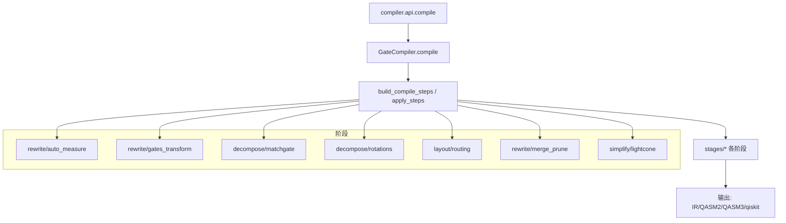
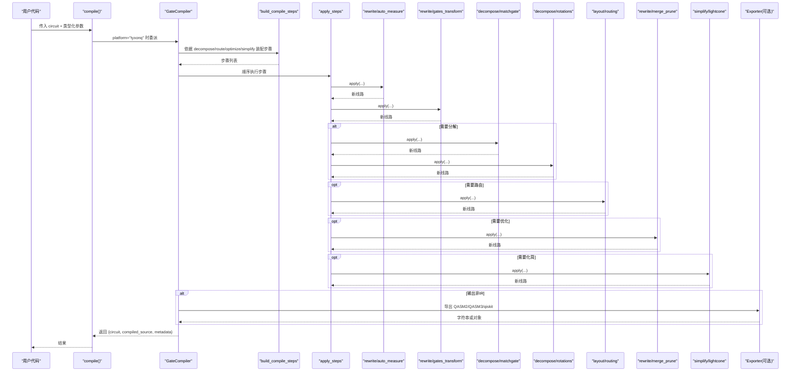
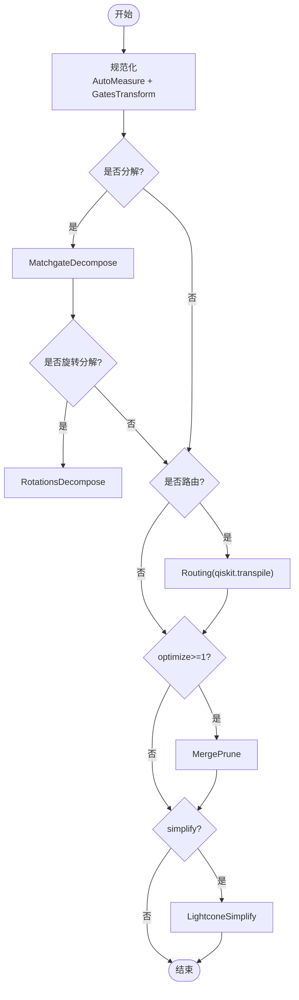
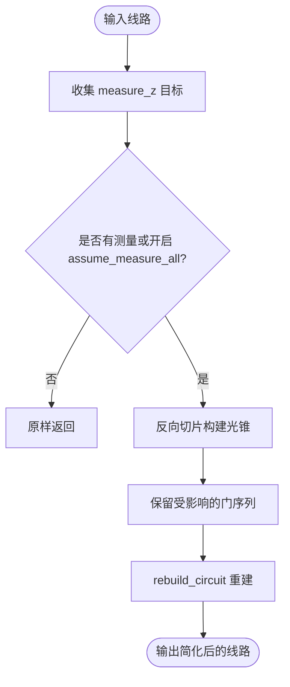
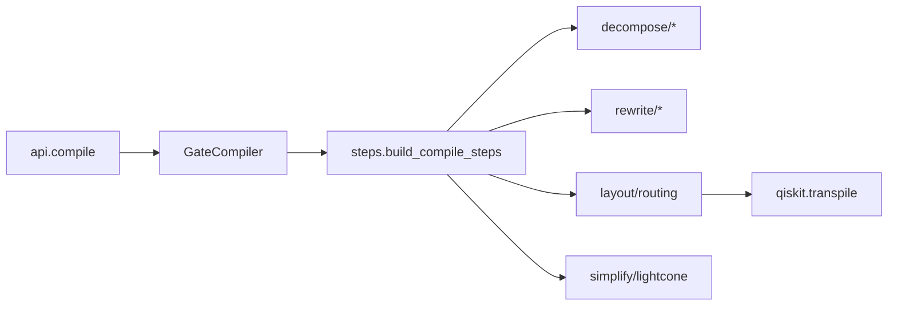

# 优化流水线

<cite>
**本文引用的文件**
- [src/tyxonq/compiler/api.py](file://src/tyxonq/compiler/api.py)
- [src/tyxonq/compiler/gate_compiler/compiler.py](file://src/tyxonq/compiler/gate_compiler/compiler.py)
- [src/tyxonq/compiler/gate_compiler/steps.py](file://src/tyxonq/compiler/gate_compiler/steps.py)
- [src/tyxonq/compiler/gate_compiler/stages/__init__.py](file://src/tyxonq/compiler/gate_compiler/stages/__init__.py)
- [src/tyxonq/compiler/gate_compiler/stages/simplify/lightcone.py](file://src/tyxonq/compiler/gate_compiler/stages/simplify/lightcone.py)
- [src/tyxonq/compiler/gate_compiler/stages/rewrite/merge_prune.py](file://src/tyxonq/compiler/gate_compiler/stages/rewrite/merge_prune.py)
- [src/tyxonq/core/ir/circuit.py](file://src/tyxonq/core/ir/circuit.py)
- [src/tyxonq/core/errors.py](file://src/tyxonq/core/errors.py)
- [examples/performance_optimization_tips.md](file://examples/performance_optimization_tips.md)
- [tests_core_module/test_compiler_pipeline.py](file://tests_core_module/test_compiler_pipeline.py)
</cite>

## 目录
1. [简介](#简介)
2. [项目结构](#项目结构)
3. [核心组件](#核心组件)
4. [架构总览](#架构总览)
5. [详细组件分析](#详细组件分析)
6. [依赖关系分析](#依赖关系分析)
7. [性能考量](#性能考量)
8. [故障排除指南](#故障排除指南)
9. [结论](#结论)
10. [附录](#附录)

## 简介
本文件面向 TyxonQ 的“编译期优化流水线”，系统性说明：
- 编译阶段的定义、依赖与执行顺序
- 如何构建自定义优化流水线（阶段注册与配置管理）
- 优化级别预设与性能调优策略
- 不同优化策略的组合效果与相互影响
- 编译性能监控与优化方法
- 故障排除与调试工具使用
- 最佳实践与常见陷阱

TyxonQ 将“门电路编译”抽象为一系列可组合的 CompileStep，通过类型化参数装配并顺序执行，从而在设备无关的核心层实现分解、重写、路由、优化与化简等能力。平台方言（如 lqcloud、guodun）统一委托核心完成编译后再翻译为目标方言。

## 项目结构
TyxonQ 的优化流水线位于编译器子系统中，核心由以下模块组成：
- 统一入口与平台分发：compiler.api.compile
- 设备无关核心编译器：gate_compiler.compiler.GateCompiler
- 步骤装配与执行：gate_compiler.steps.build_compile_steps / apply_steps
- 具体阶段：stages/*（decompose、rewrite、layout、simplify）
- IR 与全局默认：core.ir.circuit（含全局编译默认值）
- 错误模型：core.errors

图表来源
- [src/tyxonq/compiler/api.py:39-340](file://src/tyxonq/compiler/api.py#L39-L340)
- [src/tyxonq/compiler/gate_compiler/compiler.py:27-109](file://src/tyxonq/compiler/gate_compiler/compiler.py#L27-L109)
- [src/tyxonq/compiler/gate_compiler/steps.py:27-105](file://src/tyxonq/compiler/gate_compiler/steps.py#L27-L105)
- [src/tyxonq/compiler/gate_compiler/stages/__init__.py:1-11](file://src/tyxonq/compiler/gate_compiler/stages/__init__.py#L1-L11)

章节来源
- [src/tyxonq/compiler/api.py:39-340](file://src/tyxonq/compiler/api.py#L39-L340)
- [src/tyxonq/compiler/gate_compiler/compiler.py:27-109](file://src/tyxonq/compiler/gate_compiler/compiler.py#L27-L109)
- [src/tyxonq/compiler/gate_compiler/steps.py:27-105](file://src/tyxonq/compiler/gate_compiler/steps.py#L27-L105)
- [src/tyxonq/compiler/gate_compiler/stages/__init__.py:1-11](file://src/tyxonq/compiler/gate_compiler/stages/__init__.py#L1-L11)

## 核心组件
- 统一编译入口 compile()：负责平台选择、输出格式归一、脉冲自动推断、设备规则透传，并将类型化参数转发到 GateCompiler。
- GateCompiler：设备无关核心编译器，按类型化参数装配步骤并顺序执行，支持 IR/QASM2/QASM3/qiskit 输出。
- 步骤装配器 build_compile_steps：根据 decompose/route/optimize/simplify 等参数决定追加哪些阶段；未启用不占位。
- 步骤执行器 apply_steps：顺序对线路施加每个 CompileStep，返回最终线路。
- 阶段集合：
  - rewrite：AutoMeasure、GatesTransform、MergePrune
  - decompose：MatchgateDecompose、RotationsDecompose
  - layout：Routing（委托 qiskit.transpile）
  - simplify：LightconeSimplify

章节来源
- [src/tyxonq/compiler/api.py:39-340](file://src/tyxonq/compiler/api.py#L39-L340)
- [src/tyxonq/compiler/gate_compiler/compiler.py:27-109](file://src/tyxonq/compiler/gate_compiler/compiler.py#L27-L109)
- [src/tyxonq/compiler/gate_compiler/steps.py:27-105](file://src/tyxonq/compiler/gate_compiler/steps.py#L27-L105)
- [src/tyxonq/compiler/gate_compiler/stages/__init__.py:1-11](file://src/tyxonq/compiler/gate_compiler/stages/__init__.py#L1-L11)

## 架构总览
下图展示从用户调用到最终产物的完整流程，包括平台分发、核心编译、阶段装配与执行、以及输出导出。

图表来源
- [src/tyxonq/compiler/api.py:39-340](file://src/tyxonq/compiler/api.py#L39-L340)
- [src/tyxonq/compiler/gate_compiler/compiler.py:27-109](file://src/tyxonq/compiler/gate_compiler/compiler.py#L27-L109)
- [src/tyxonq/compiler/gate_compiler/steps.py:27-105](file://src/tyxonq/compiler/gate_compiler/steps.py#L27-L105)

## 详细组件分析

### 阶段装配与执行（steps）
- 固定顺序：
  1) 规范化：AutoMeasure → GatesTransform
  2) 分解：MatchgateDecompose / RotationsDecompose（先于路由，因 to_qiskit 不识别 unitary op）
  3) 路由：Routing（route=True 时追加，委托 qiskit.transpile）
  4) 优化：MergePrune（optimize>=1 时追加）
  5) 化简：LightconeSimplify（simplify=True 时追加）
- 未启用的能力不追加占位步骤，避免无谓开销。
- apply_steps 以朴素循环顺序执行，每个步骤从 opts 自取所需参数，互不干扰。

图表来源
- [src/tyxonq/compiler/gate_compiler/steps.py:27-105](file://src/tyxonq/compiler/gate_compiler/steps.py#L27-L105)

章节来源
- [src/tyxonq/compiler/gate_compiler/steps.py:27-105](file://src/tyxonq/compiler/gate_compiler/steps.py#L27-L105)

### 门分解阶段（decompose）
- MatchgateDecompose：将 2-qubit 数守恒 matchgate（two_mode_fock/fSim）分解为原生基 {rz, rx, h, cx}。
- RotationsDecompose：将 rx/ry/rxx/ryy/rzz 等旋转到 {h, rz, cx}。
- 两者均可由 DecomposeSpec 细粒度控制；任一为真即追加对应步骤。

章节来源
- [src/tyxonq/compiler/gate_compiler/stages/decompose/__init__.py:1-12](file://src/tyxonq/compiler/gate_compiler/stages/decompose/__init__.py#L1-L12)
- [src/tyxonq/compiler/gate_compiler/steps.py:61-72](file://src/tyxonq/compiler/gate_compiler/steps.py#L61-L72)

### 重写阶段（rewrite）
- AutoMeasure：无测量时补 Z 测量，便于后续光锥化简。
- GatesTransform：按 basis_gates 重写门，保证目标基集一致。
- MergePrune：合并相邻同线门并剪除恒等门，提升简洁性。

章节来源
- [src/tyxonq/compiler/gate_compiler/stages/rewrite/merge_prune.py:12-88](file://src/tyxonq/compiler/gate_compiler/stages/rewrite/merge_prune.py#L12-L88)
- [src/tyxonq/compiler/gate_compiler/steps.py:56-59](file://src/tyxonq/compiler/gate_compiler/steps.py#L56-L59)

### 路由阶段（layout）
- Routing：当 route=True 时追加，委托 qiskit.transpile 进行拓扑感知布局与 SWAP 插入。
- device_rule 中的 coupling_map 若缺失则从设备规则中读取。

章节来源
- [src/tyxonq/compiler/gate_compiler/steps.py:74-79](file://src/tyxonq/compiler/gate_compiler/steps.py#L74-L79)

### 化简阶段（simplify）
- LightconeSimplify：基于测量反向切片，仅保留影响测量结果的算符，显著减少无用操作。
- 支持 assume_measure_all 选项，在无显式测量时将全部量子比特视为被测量。

图表来源
- [src/tyxonq/compiler/gate_compiler/stages/simplify/lightcone.py:12-97](file://src/tyxonq/compiler/gate_compiler/stages/simplify/lightcone.py#L12-L97)

章节来源
- [src/tyxonq/compiler/gate_compiler/stages/simplify/lightcone.py:12-97](file://src/tyxonq/compiler/gate_compiler/stages/simplify/lightcone.py#L12-L97)

### 平台与输出（GateCompiler）
- 支持 output=ir/qasm2/qasm3/qiskit 等；qasm2 降级到 qelib1 兼容基以保证导出正确性。
- 元数据包含 steps、basis_gates、optimization_level 等，便于追踪与诊断。

章节来源
- [src/tyxonq/compiler/gate_compiler/compiler.py:27-109](file://src/tyxonq/compiler/gate_compiler/compiler.py#L27-L109)

### 统一入口（api.compile）
- 自动检测脉冲操作或模式，必要时切换到 pulse 编译。
- 平台别名处理（default/native→tyxonq；qiskit→互操作）。
- 将类型化参数与 options 合并后下发至 GateCompiler 或平台方言。

章节来源
- [src/tyxonq/compiler/api.py:39-340](file://src/tyxonq/compiler/api.py#L39-L340)

## 依赖关系分析
- 耦合度：
  - api.compile 与 GateCompiler 强耦合（平台分发与参数归一）
  - GateCompiler 与 steps 解耦（通过类型化参数装配）
  - 各 stages 之间通过 Circuit 接口交互，低耦合
- 外部依赖：
  - routing 阶段依赖 qiskit.transpile
  - qasm2/qasm3 导出器零/低依赖
- 潜在环：无直接循环导入；延迟导入用于避免不必要的依赖加载（如 routing、exporters）。

图表来源
- [src/tyxonq/compiler/api.py:39-340](file://src/tyxonq/compiler/api.py#L39-L340)
- [src/tyxonq/compiler/gate_compiler/compiler.py:27-109](file://src/tyxonq/compiler/gate_compiler/compiler.py#L27-L109)
- [src/tyxonq/compiler/gate_compiler/steps.py:27-105](file://src/tyxonq/compiler/gate_compiler/steps.py#L27-L105)

章节来源
- [src/tyxonq/compiler/api.py:39-340](file://src/tyxonq/compiler/api.py#L39-L340)
- [src/tyxonq/compiler/gate_compiler/compiler.py:27-109](file://src/tyxonq/compiler/gate_compiler/compiler.py#L27-L109)
- [src/tyxonq/compiler/gate_compiler/steps.py:27-105](file://src/tyxonq/compiler/gate_compiler/steps.py#L27-L105)

## 性能考量
- 优化级别 preset：
  - optimize=0：仅规范化与分解（默认）
  - optimize≥1：追加 MergePrune（相邻门合并与恒等剪枝）
  - simplify=True：追加 LightconeSimplify（光锥裁剪）
- 组合效果与相互影响：
  - 分解先于路由，确保下游能识别基本门；路由可能引入 SWAP，随后 MergePrune 可进一步化简。
  - LightconeSimplify 在存在测量时收益最大，可大幅减少无效操作。
- 性能调优建议：
  - 开发阶段：关闭路由与化简，快速验证逻辑；使用较低 shots 与两级模拟。
  - 优化阶段：开启 optimize≥1 与 simplify，结合真实设备 coupling_map 进行路由。
  - 生产阶段：导出 TQASM/QASM3 提交云端，避免本地重复仿真。
- 运行时性能（参考示例文档）：
  - 避免重复电路执行，缓存状态向量或使用 Hamiltonian 一次性计算期望值。
  - 合理选择后端与 shots，平衡精度与速度。

章节来源
- [src/tyxonq/compiler/gate_compiler/steps.py:27-105](file://src/tyxonq/compiler/gate_compiler/steps.py#L27-L105)
- [src/tyxonq/compiler/gate_compiler/stages/simplify/lightcone.py:12-97](file://src/tyxonq/compiler/gate_compiler/stages/simplify/lightcone.py#L12-L97)
- [examples/performance_optimization_tips.md:1-223](file://examples/performance_optimization_tips.md#L1-L223)

## 故障排除指南
- 常见问题定位：
  - 路由失败：检查 device_rule 的 coupling_map 是否正确；确认 route=True 且设备拓扑可用。
  - 分解异常：确认 decompose 配置与目标基集匹配；必要时仅启用 rotations 或 matchgate。
  - 输出问题：qasm2 输出需保证基集兼容；必要时显式设置 basis_gates。
- 调试手段：
  - 查看 metadata.steps 与 metadata.basis_gates，确认实际执行的阶段与基集。
  - 逐步开关 optimize/simplify 观察差异，定位瓶颈阶段。
  - 使用测试用例验证装配顺序与行为一致性。
- 错误模型：
  - CompilationError：编译失败或产生无效输出
  - DeviceExecutionError：设备执行失败（超时、连接问题等）
  - VectorizationFallbackWarning：向量化回退警告

章节来源
- [src/tyxonq/compiler/gate_compiler/compiler.py:76-83](file://src/tyxonq/compiler/gate_compiler/compiler.py#L76-L83)
- [src/tyxonq/core/errors.py:1-17](file://src/tyxonq/core/errors.py#L1-L17)
- [tests_core_module/test_compiler_pipeline.py:66-103](file://tests_core_module/test_compiler_pipeline.py#L66-L103)

## 结论
TyxonQ 的优化流水线以“类型化参数 + 可组合阶段”为核心，提供清晰、可控、可扩展的编译路径。通过规范化的装配与执行机制，开发者可以灵活组合分解、重写、路由、优化与化简，满足不同平台与性能需求。配合全局默认与元数据追踪，可实现一致的编译体验与高效的性能调优。

## 附录

### 自定义优化流水线构建指南
- 阶段注册：
  - 实现 CompileStep 协议（提供 apply(circuit, **opts) -> Circuit）
  - 将阶段放入 stages/* 并按职责分子包（decompose/rewrite/layout/simplify）
- 配置管理：
  - 通过 DecomposeSpec/RoutingSpec 等类型化参数控制阶段启用与行为
  - 使用 build_compile_steps 装配步骤，apply_steps 顺序执行
  - 利用 GateCompiler 的 options 传递平台专属参数
- 预设配置：
  - optimize=0/1/... 控制优化强度
  - simplify=True 启用光锥化简
  - route=True 启用拓扑感知路由
- 最佳实践：
  - 优先使用内置阶段；仅在必要时扩展自定义阶段
  - 保持阶段幂等与可重入，避免副作用
  - 通过 metadata 记录执行轨迹，便于回溯与对比

章节来源
- [src/tyxonq/compiler/gate_compiler/steps.py:27-105](file://src/tyxonq/compiler/gate_compiler/steps.py#L27-L105)
- [src/tyxonq/compiler/gate_compiler/compiler.py:27-109](file://src/tyxonq/compiler/gate_compiler/compiler.py#L27-L109)
- [src/tyxonq/compiler/api.py:39-340](file://src/tyxonq/compiler/api.py#L39-L340)

### 监控与度量
- 编译产物元数据：
  - steps：实际执行的阶段名称序列
  - basis_gates：使用的目标基集
  - optimization_level：优化级别
- 运行期指标：
  - 编译时间、执行时间、结果差异（参考示例脚本）
- 建议：
  - 在不同 optimize/simplify 组合下采集指标，绘制对比图
  - 针对热点阶段（如路由、分解）进行专项优化

章节来源
- [src/tyxonq/compiler/gate_compiler/compiler.py:76-83](file://src/tyxonq/compiler/gate_compiler/compiler.py#L76-L83)
- [examples/performance_layerwise_optimization.py:269-299](file://examples/performance_layerwise_optimization.py#L269-L299)

### 常见陷阱与避免
- 陷阱：
  - 未设置 basis_gates 导致导出失败或不兼容
  - 路由阶段未提供 coupling_map 导致失败
  - 过度优化导致电路语义变化（应验证等价性）
- 避免：
  - 显式指定 basis_gates，尤其 qasm2 输出
  - 提供正确的 device_rule 与拓扑信息
  - 使用单元测试与回归测试保障等价性与稳定性

章节来源
- [src/tyxonq/compiler/gate_compiler/compiler.py:51-55](file://src/tyxonq/compiler/gate_compiler/compiler.py#L51-L55)
- [src/tyxonq/compiler/gate_compiler/steps.py:74-79](file://src/tyxonq/compiler/gate_compiler/steps.py#L74-L79)
- [tests_core_module/test_compiler_pipeline.py:66-103](file://tests_core_module/test_compiler_pipeline.py#L66-L103)