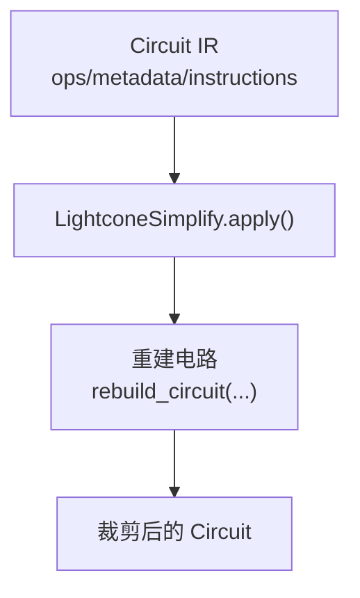
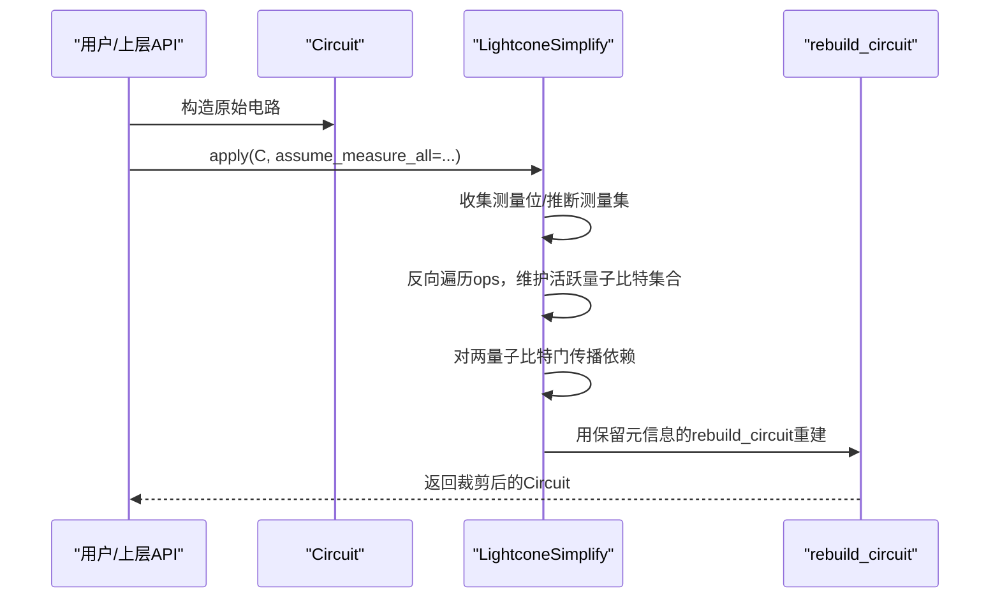
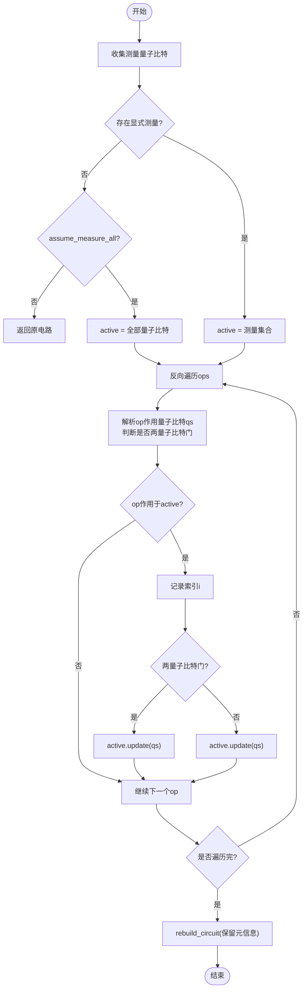
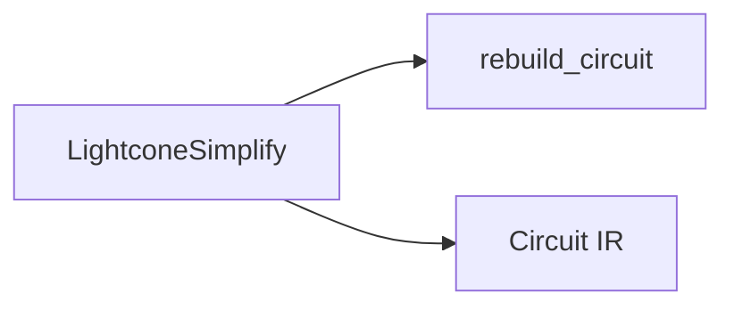

# 光锥简化技术

<cite>
**本文引用的文件**
- [lightcone.py](file://src/tyxonq/compiler/gate_compiler/stages/simplify/lightcone.py)
- [circuit.py](file://src/tyxonq/core/ir/circuit.py)
- [test_compiler_simplify_lightcone.py](file://tests_core_module/test_compiler_simplify_lightcone.py)
- [compiler_lightcone_optimization.py](file://examples/compiler_lightcone_optimization.py)
</cite>

## 目录
1. [简介](#简介)
2. [项目结构](#项目结构)
3. [核心组件](#核心组件)
4. [架构总览](#架构总览)
5. [详细组件分析](#详细组件分析)
6. [依赖关系分析](#依赖关系分析)
7. [性能考量](#性能考量)
8. [故障排查指南](#故障排查指南)
9. [结论](#结论)
10. [附录](#附录)

## 简介
本文件系统性阐述 TyxonQ 中的“光锥简化”（Lightcone Simplify）技术，聚焦测量依赖分析与算符裁剪的核心原理。重点解释 LightconeSimplify 类的实现机制：向后切片算法、活跃量子比特集合的维护、两量子比特门的依赖传播；说明 assume_measure_all 选项的作用与适用场景；给出应用示例以展示如何减少电路复杂度；并分析优化效果的性能影响、适用条件以及与其他优化技术的组合策略。

## 项目结构
光锥简化位于编译器“简化阶段”，作为独立的编译步骤被调用。其输入为 Circuit IR（包含 ops、metadata、instructions 等），输出为经过裁剪后的新 Circuit。相关代码分布在以下位置：
- 简化阶段实现：src/tyxonq/compiler/gate_compiler/stages/simplify/lightcone.py
- 电路 IR 定义与基础能力：src/tyxonq/core/ir/circuit.py
- 单元测试验证行为：tests_core_module/test_compiler_simplify_lightcone.py
- 示例与基准演示：examples/compiler_lightcone_optimization.py

图表来源
- [lightcone.py:15-97](file://src/tyxonq/compiler/gate_compiler/stages/simplify/lightcone.py#L15-L97)
- [circuit.py:48-106](file://src/tyxonq/core/ir/circuit.py#L48-L106)

章节来源
- [lightcone.py:1-100](file://src/tyxonq/compiler/gate_compiler/stages/simplify/lightcone.py#L1-L100)
- [circuit.py:48-106](file://src/tyxonq/core/ir/circuit.py#L48-L106)

## 核心组件
- LightconeSimplify：实现光锥简化的核心类，提供 apply(circuit, device_rule=None, **opts) 接口。
- Circuit：IR 载体，承载 num_qubits、ops、metadata、instructions 等，支持链式构建与变换。
- rebuild_circuit：用于在保留 metadata/instructions/_unitary_cache 等上下文信息的前提下重建电路。

关键职责
- 收集测量量子比特或根据 assume_measure_all 推断全量测量。
- 从后向前扫描算子序列，维护“活跃量子比特集合”。
- 对两量子比特门进行依赖传播，确保纠缠链路上的算子不被误删。
- 仅保留进入光锥的算子，返回新的 Circuit。

章节来源
- [lightcone.py:12-97](file://src/tyxonq/compiler/gate_compiler/stages/simplify/lightcone.py#L12-L97)
- [circuit.py:48-106](file://src/tyxonq/core/ir/circuit.py#L48-L106)

## 架构总览
下图展示了光锥简化在编译流程中的角色及数据流：

图表来源
- [lightcone.py:15-97](file://src/tyxonq/compiler/gate_compiler/stages/simplify/lightcone.py#L15-L97)
- [circuit.py:48-106](file://src/tyxonq/core/ir/circuit.py#L48-L106)

## 详细组件分析

### LightconeSimplify 类与向后切片算法
- 输入参数
  - circuit：待简化的 Circuit IR。
  - device_rule：当前实现未使用，预留扩展点。
  - opts：
    - assume_measure_all：布尔值。若为 True 且无显式测量，则假设所有量子比特均被测量，从而将全部量子比特纳入光锥。
- 测量集合收集
  - 扫描 ops，提取所有 measure_z 的目标量子比特。
  - 若无测量且 assume_measure_all=False，直接返回原电路（不裁剪）。
  - 若无测量但 assume_measure_all=True，则将全部量子比特视为测量目标。
- 活跃量子比特集合与反向扫描
  - 初始化 active = 测量集合。
  - 从末尾到开头遍历 ops：
    - 解析每个 op 作用的量子比特列表 qs 及其是否为两量子比特门 is_two_q。
    - 若 op 作用于 active 中的任意 qubit，则保留该 op 的索引。
    - 若为两量子比特门，则将两个量子比特都加入 active（依赖传播）。
    - 单量子比特门也更新 active（覆盖自身作用域）。
    - 显式 measure_z 始终保留。
- 重建电路
  - 按 keep_indices 筛选 ops 并排序。
  - 通过 rebuild_circuit 重建 Circuit，保留 metadata/instructions/_unitary_cache 等上下文。

图表来源
- [lightcone.py:24-97](file://src/tyxonq/compiler/gate_compiler/stages/simplify/lightcone.py#L24-L97)

章节来源
- [lightcone.py:15-97](file://src/tyxonq/compiler/gate_compiler/stages/simplify/lightcone.py#L15-L97)

### 两量子比特门的依赖传播
- 当遇到两量子比特门时，由于纠缠效应，任一输出端受测量影响意味着两端量子比特都可能参与计算，因此将两端量子比特同时加入 active。
- 这保证了纠缠链路上的算子不会被错误裁剪，维持数学等价性。

章节来源
- [lightcone.py:80-88](file://src/tyxonq/compiler/gate_compiler/stages/simplify/lightcone.py#L80-L88)

### 活跃量子比特集合的维护
- 初始化为测量集合或全量集合（由 assume_measure_all 控制）。
- 每次保留一个 op 时，将其作用的所有量子比特并入 active，确保后续更早的 op 能正确判定是否影响最终测量结果。

章节来源
- [lightcone.py:39-88](file://src/tyxonq/compiler/gate_compiler/stages/simplify/lightcone.py#L39-L88)

### assume_measure_all 选项的作用与使用场景
- 作用：当电路中没有显式 measure_z 时，默认不进行裁剪；开启 assume_measure_all=True 后，将所有量子比特视为测量目标，从而允许基于全光锥的裁剪逻辑（尽管此时不会实际删除任何算子，但为后续期望值计算路径提供一致性）。
- 使用场景：
  - 全量子位期望值计算：例如对所有量子位求 ⟨Z_i⟩ 之和，可设置 assume_measure_all=True 以统一处理路径。
  - 与后续期望值 API 配合：先标记测量再裁剪，或直接利用该选项保证全光锥不变。

章节来源
- [lightcone.py:15-37](file://src/tyxonq/compiler/gate_compiler/stages/simplify/lightcone.py#L15-L37)
- [compiler_lightcone_optimization.py:85-89](file://examples/compiler_lightcone_optimization.py#L85-L89)

### 代码级示例与用法
- 基本用法：实例化 LightconeSimplify 并调用 apply，传入 Circuit 与可选 assume_measure_all。
- 部分测量场景：先添加 measure_z 标记，再进行裁剪，最后移除测量标记以获得最小必要算子集。
- 全测量场景：设置 assume_measure_all=True，保持数学等价的同时统一处理路径。

参考路径
- [示例：全测量与部分测量:85-89](file://examples/compiler_lightcone_optimization.py#L85-L89)
- [示例：部分测量裁剪后再移除测量标记:218-224](file://examples/compiler_lightcone_optimization.py#L218-L224)

章节来源
- [compiler_lightcone_optimization.py:85-89](file://examples/compiler_lightcone_optimization.py#L85-L89)
- [compiler_lightcone_optimization.py:218-224](file://examples/compiler_lightcone_optimization.py#L218-L224)

### 单元测试验证要点
- 无关算子裁剪：仅测量某量子位时，其他量子位上的单/多量子比特门应被裁剪。
- assume_measure_all：无显式测量时，默认不裁剪；开启后仍保持完整（因为全光锥）。
- 多测量点与纠缠传播：链式纠缠时，仅测量末端量子位，仍能回溯保留上游纠缠门。
- reset/project 指令保留：若这些指令影响测量结果，应被保留。

章节来源
- [test_compiler_simplify_lightcone.py:8-76](file://tests_core_module/test_compiler_simplify_lightcone.py#L8-L76)

## 依赖关系分析
- 模块内依赖
  - lightcone.py 依赖 _circuit_utils.rebuild_circuit 用于重建电路并保留元信息。
  - 依赖 Circuit IR 的结构约定（ops 为操作描述序列）。
- 外部依赖
  - 设备规则 device_rule 在当前实现中未使用，预留扩展点。
- 耦合与内聚
  - 高内聚：裁剪逻辑集中在 LightconeSimplify.apply。
  - 低耦合：通过标准 IR 接口交互，便于嵌入编译流水线。

图表来源
- [lightcone.py:5-97](file://src/tyxonq/compiler/gate_compiler/stages/simplify/lightcone.py#L5-L97)
- [circuit.py:48-106](file://src/tyxonq/core/ir/circuit.py#L48-L106)

章节来源
- [lightcone.py:5-97](file://src/tyxonq/compiler/gate_compiler/stages/simplify/lightcone.py#L5-L97)
- [circuit.py:48-106](file://src/tyxonq/core/ir/circuit.py#L48-L106)

## 性能考量
- 时间复杂度
  - 单次扫描 O(N)，N 为算子数；活跃集合更新与查询近似常数时间（哈希集合）。
- 空间复杂度
  - 额外存储 keep_indices 与 active 集合，线性于 N 与量子位数。
- 加速效果
  - 部分测量场景下显著减少仿真/执行成本，尤其在 10+ 量子位、局部测量时可获得数量级加速。
  - 全测量场景下保持数学等价，主要用于统一处理路径与后续优化衔接。
- 适用条件
  - 适用于期望值计算、采样任务等可明确识别测量依赖的场景。
  - 对于非测量相关的中间态保存需求需谨慎评估。

章节来源
- [compiler_lightcone_optimization.py:97-159](file://examples/compiler_lightcone_optimization.py#L97-L159)
- [compiler_lightcone_optimization.py:201-255](file://examples/compiler_lightcone_optimization.py#L201-L255)

## 故障排查指南
- 未触发裁剪
  - 检查是否存在显式 measure_z；若无且 assume_measure_all=False，将不会裁剪。
  - 确认 ops 格式符合预期（名称字符串 + 整数量子比特索引）。
- 意外删除了重要算子
  - 检查两量子比特门是否正确识别为纠缠门；确认依赖传播逻辑生效。
  - 核对测量集合是否与期望一致（必要时显式添加 measure_z 标记）。
- 元信息丢失
  - 确保通过 rebuild_circuit 重建电路，避免直接构造导致 metadata/instructions 丢失。

章节来源
- [lightcone.py:24-97](file://src/tyxonq/compiler/gate_compiler/stages/simplify/lightcone.py#L24-L97)
- [test_compiler_simplify_lightcone.py:8-76](file://tests_core_module/test_compiler_simplify_lightcone.py#L8-L76)

## 结论
光锥简化通过测量依赖分析与向后切片，精准裁剪不影响测量结果的算子，在保证数学等价性的前提下显著降低计算开销。LightconeSimplify 的实现简洁高效，结合 assume_measure_all 选项可灵活适配全/部分测量场景。建议将其与分解、重写、合并等编译阶段组合使用，以获得更优的整体性能。

## 附录

### 与其他优化技术的组合策略
- 与分解阶段（decompose）组合：先将高阶门分解为标准基，再进行光锥裁剪，有利于后续映射与调度。
- 与重写阶段（rewrite）组合：如自动测量插入、门变换、合并裁剪等，可在光锥基础上进一步精简。
- 与布局/调度组合：裁剪后的电路规模更小，有助于提升路由效率与时序优化效果。

[本节为概念性指导，不直接引用具体文件]