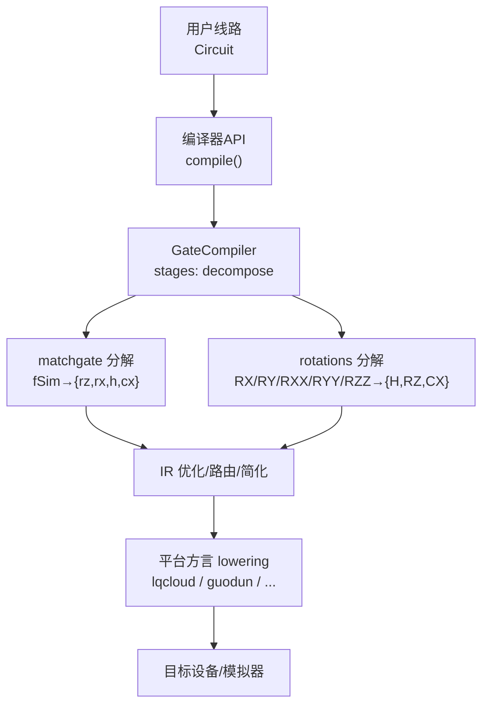
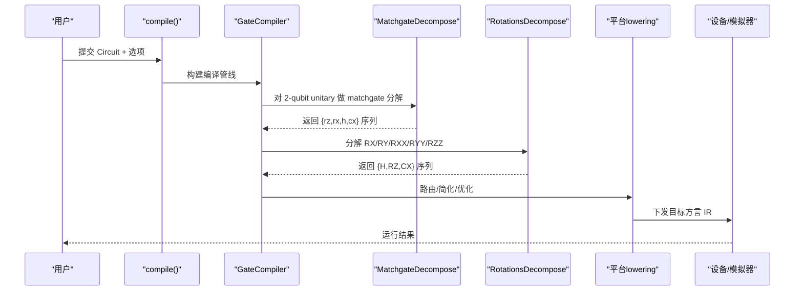
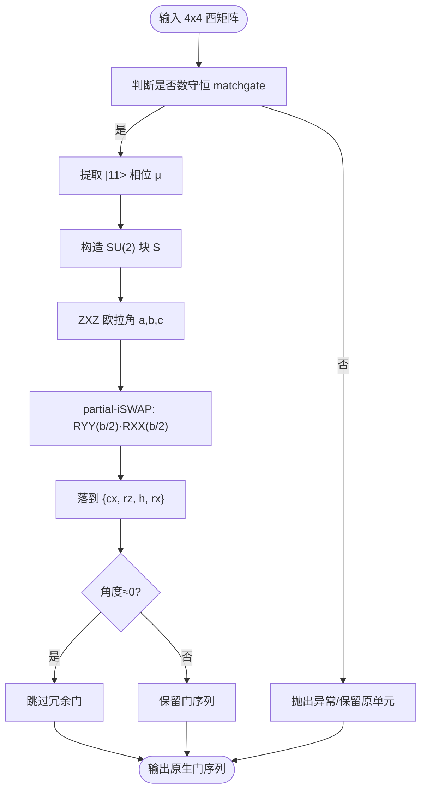
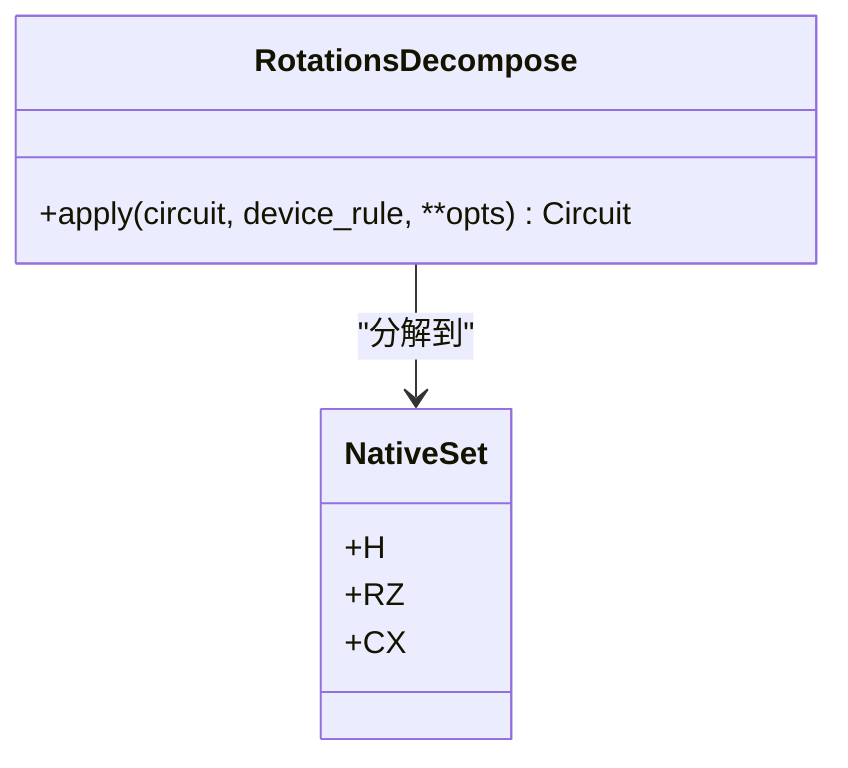
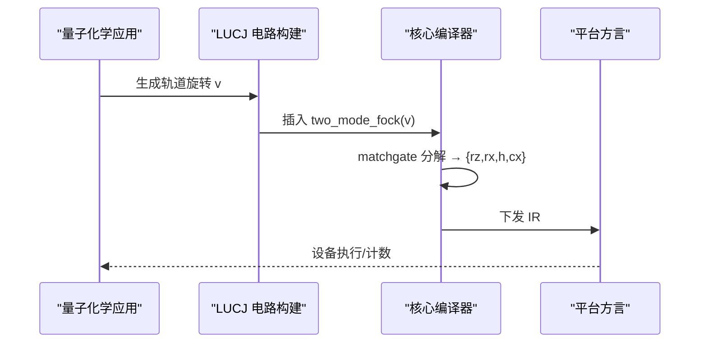
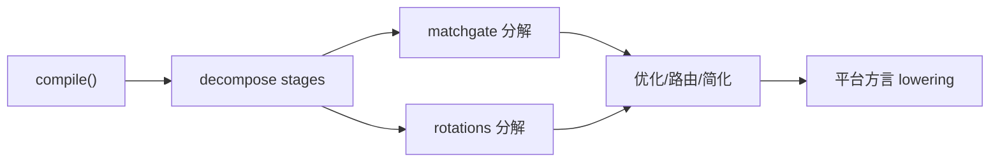

# 匹配门分解

<cite>
**本文引用的文件**
- [matchgate.py](file://src/tyxonq/compiler/gate_compiler/stages/decompose/matchgate.py)
- [rotations.py](file://src/tyxonq/compiler/gate_compiler/stages/decompose/rotations.py)
- [test_decompose_matchgate.py](file://tests_core_module/test_decompose_matchgate.py)
- [test_decompose_rotations.py](file://tests_core_module/test_decompose_rotations.py)
- [api.py](file://src/tyxonq/compiler/api.py)
- [circuit_builder.py](file://src/tyxonq/applications/chem/algorithms/lucj/circuit_builder.py)
- [run_chem_on_lqcloud.py](file://examples/run_chem_on_lqcloud.py)
- [pulse_iswap_swap_decomposition.py](file://examples/pulse_iswap_swap_decomposition.py)
</cite>

## 目录
1. [简介](#简介)
2. [项目结构](#项目结构)
3. [核心组件](#核心组件)
4. [架构总览](#架构总览)
5. [详细组件分析](#详细组件分析)
6. [依赖关系分析](#依赖关系分析)
7. [性能考量](#性能考量)
8. [故障排查指南](#故障排查指南)
9. [结论](#结论)
10. [附录](#附录)

## 简介
本文件系统性阐述 TyxonQ 中的“匹配门（Matchgate）分解”技术，覆盖数学基础、实现细节与工程实践。匹配门是数守恒的 2-qubit 酉矩阵，属于 fSim 家族，可精确分解为 iSWAP 型相互作用与 CPhase 的组合，并进一步落到硬件原生基 {rz, rx, h, cx}。该能力在量子化学算法（如 LUCJ/SQD）中尤为关键：轨道旋转块以 two_mode_fock_matrix 形式生成，天然落入 matchgate 范畴，经核心编译器统一分解后，可在多种硬件平台（如 LQCloud）上高效执行。

## 项目结构
TyxonQ 将匹配门分解作为“门编译阶段”的核心步骤之一，位于 gate_compiler/stages/decompose 下，并与参数化旋转门分解并列。上层通过统一的 compile API 装配分解步骤；下游方言（如 lqcloud）复用核心分解结果，避免重复实现。

图表来源
- [api.py:60-259](file://src/tyxonq/compiler/api.py#L60-L259)
- [matchgate.py:152-197](file://src/tyxonq/compiler/gate_compiler/stages/decompose/matchgate.py#L152-L197)
- [rotations.py:13-73](file://src/tyxonq/compiler/gate_compiler/stages/decompose/rotations.py#L13-L73)

章节来源
- [api.py:60-259](file://src/tyxonq/compiler/api.py#L60-L259)

## 核心组件
- MatchgateDecompose：核心编译器步骤，识别 2-qubit unitary 是否为数守恒 matchgate，若是则调用纯函数分解为原生门序列；否则默认保留或严格模式报错。
- decompose_two_qubit_matchgate：纯函数实现，基于 ZXZ 欧拉角与 partial-iSWAP 恒等式，输出按时间顺序排列的原生 op 列表。
- is_number_conserving_matchgate：结构判定器，检查跨粒子数子空间耦合是否为零，确保 fSim=iSWAP+CPhase 分解前提成立。
- RotationsDecompose：将参数化旋转门 RX/RY/RXX/RYY/RZZ 分解到 {H, RZ, CX}，与 matchgate 分解协同工作，形成完整的原生基落地路径。

章节来源
- [matchgate.py:46-149](file://src/tyxonq/compiler/gate_compiler/stages/decompose/matchgate.py#L46-L149)
- [matchgate.py:152-197](file://src/tyxonq/compiler/gate_compiler/stages/decompose/matchgate.py#L152-L197)
- [rotations.py:13-73](file://src/tyxonq/compiler/gate_compiler/stages/decompose/rotations.py#L13-L73)

## 架构总览
匹配门分解嵌入 GateCompiler 的分解阶段，由 compile API 根据 DecomposeSpec 装配。典型流程如下：

图表来源
- [api.py:60-259](file://src/tyxonq/compiler/api.py#L60-L259)
- [matchgate.py:152-197](file://src/tyxonq/compiler/gate_compiler/stages/decompose/matchgate.py#L152-L197)
- [rotations.py:13-73](file://src/tyxonq/compiler/gate_compiler/stages/decompose/rotations.py#L13-L73)

## 详细组件分析

### 匹配门的数学基础与分解原理
- 匹配门定义：数守恒的 2-qubit 酉矩阵，|00>、|11> 与单激发子空间 {|01>,|10>} 之间无耦合。对应 fSim 家族：iSWAP 型相互作用 + CPhase。
- 分解思路：
  - 提取 |11> 相位 det(v)=e^{2iμ}，用两比特各一个 Rz(μ) 承载 e^{iμN}。
  - 去掉该相位后，单激发子空间作用 S∈SU(2)，按 ZXZ 欧拉角分解为 Rz(a)·Rx(b)·Rz(c)。
  - 子空间 Rx(b) = partial-iSWAP = RYY(b/2)·RXX(b/2)，再用标准恒等式落到 {cx, rz, h, rx}。
  - 零角度块剪枝（b≈0 时跳过整段 partial-iSWAP），减少冗余门。

图表来源
- [matchgate.py:46-149](file://src/tyxonq/compiler/gate_compiler/stages/decompose/matchgate.py#L46-L149)

章节来源
- [matchgate.py:46-149](file://src/tyxonq/compiler/gate_compiler/stages/decompose/matchgate.py#L46-L149)

### 参数化旋转门分解
- 支持 RX(θ)、RY(θ)、RXX(θ)、RYY(θ)、RZZ(θ) 的标准恒等式分解到 {H, RZ, CX}。
- 与 matchgate 分解协同：matchgate 内部使用 RXX/RYY 的等价实现，最终统一落到 {cx, rz, h, rx}。

图表来源
- [rotations.py:13-73](file://src/tyxonq/compiler/gate_compiler/stages/decompose/rotations.py#L13-L73)

章节来源
- [rotations.py:13-73](file://src/tyxonq/compiler/gate_compiler/stages/decompose/rotations.py#L13-L73)

### 在量子化学中的应用（LUCJ/SQD）
- LUCJ/SQD 的 two_mode_fock_matrix(v) 正是 fSim 家族的 2-qubit matchgate，用于将 2×2 轨道旋转提升到 4×4 Fock 酉。
- 电路构建器按层组装参考态、对角库仑项与轨道旋转，后者即 matchgate 序列。
- 通过核心分解后，可在 LQCloud 等平台直接执行，无需重复实现分解逻辑。

图表来源
- [circuit_builder.py:78-155](file://src/tyxonq/applications/chem/algorithms/lucj/circuit_builder.py#L78-L155)
- [run_chem_on_lqcloud.py:1-183](file://examples/run_chem_on_lqcloud.py#L1-L183)

章节来源
- [circuit_builder.py:78-155](file://src/tyxonq/applications/chem/algorithms/lucj/circuit_builder.py#L78-L155)
- [run_chem_on_lqcloud.py:1-183](file://examples/run_chem_on_lqcloud.py#L1-L183)

### 脉冲级适配与示例
- iSWAP/SWAP 可通过 3-CX 链通用实现，与 matchgate 分解后的 {cx, rz, h, rx} 兼容。
- 示例展示了从线路到脉冲 IR 再到 TQASM 导出的完整链路，便于云端提交与本地仿真。

章节来源
- [pulse_iswap_swap_decomposition.py:1-336](file://examples/pulse_iswap_swap_decomposition.py#L1-L336)

## 依赖关系分析
- 入口：compile API 接收 decompose 选项，装配 GateCompiler 的分解阶段。
- 分解阶段：
  - matchgate 分解：仅处理 2-qubit unitary，且需 _unitary_cache 提供矩阵。
  - rotations 分解：处理 RX/RY/RXX/RYY/RZZ，透传 RZ。
- 下游：平台方言（如 lqcloud）复用核心分解结果，不再重复实现。

图表来源
- [api.py:60-259](file://src/tyxonq/compiler/api.py#L60-L259)
- [matchgate.py:152-197](file://src/tyxonq/compiler/gate_compiler/stages/decompose/matchgate.py#L152-L197)
- [rotations.py:13-73](file://src/tyxonq/compiler/gate_compiler/stages/decompose/rotations.py#L13-L73)

章节来源
- [api.py:60-259](file://src/tyxonq/compiler/api.py#L60-L259)

## 性能考量
- 门数量变化：
  - 单个 matchgate（two_mode_fock）分解后通常包含 4 个 CX（来自 RXX/RYY 的 partial-iSWAP 实现），以及若干 Rz/H/Rx。
  - 零角度块会被剪枝，避免冗余门引入噪声。
- 电路深度：
  - 分解后的 CX 链会显著增加深度；但通过后续优化（相邻门合并、光锥简化）可部分抵消。
- 数值精度：
  - 测试覆盖随机 U(2)、Givens 形式及退化情形，保真度接近 1.0（允许全局相位差）。
- 平台适配：
  - 不同平台对 CX 成本敏感，建议结合拓扑进行路由与交换优化。
  - 脉冲级实现可将双量子门映射为更高效的物理控制波形（如 XX/YY 耦合）。

章节来源
- [test_decompose_matchgate.py:76-150](file://tests_core_module/test_decompose_matchgate.py#L76-L150)
- [test_decompose_rotations.py:75-114](file://tests_core_module/test_decompose_rotations.py#L75-L114)

## 故障排查指南
- 非 4x4 矩阵：分解函数会抛出 ValueError，需检查输入维度。
- 非数守恒 matchgate：检测到跨粒子数子空间耦合时抛出 NotImplementedError；若使用 strict 模式，步骤级也会报错。
- 缺少矩阵缓存：当线路中存在 unitary 操作但无 _unitary_cache 时，分解步骤会提示缺失缓存。
- 调试建议：
  - 使用 statevector 引擎对比分解前后酉矩阵的保真度。
  - 检查 decompose 选项是否正确启用（默认 True）。
  - 查看平台方言是否复用了核心分解结果，避免重复实现导致不一致。

章节来源
- [matchgate.py:84-93](file://src/tyxonq/compiler/gate_compiler/stages/decompose/matchgate.py#L84-L93)
- [matchgate.py:182-193](file://src/tyxonq/compiler/gate_compiler/stages/decompose/matchgate.py#L182-L193)
- [test_decompose_matchgate.py:63-73](file://tests_core_module/test_decompose_matchgate.py#L63-L73)
- [test_decompose_matchgate.py:206-211](file://tests_core_module/test_decompose_matchgate.py#L206-L211)

## 结论
匹配门分解是 TyxonQ 门编译的核心能力之一，将量子化学中常见的轨道旋转块（two_mode_fock）精确落到硬件原生基，支撑多平台执行。其数学基础清晰、实现稳健，并通过系统测试保障数值精度。配合旋转门分解与平台方言，形成端到端的编译链路，兼顾正确性与效率。实际应用中，应关注门数量与深度的权衡，并结合拓扑与脉冲级优化策略以获得更佳性能。

## 附录
- 最佳实践建议：
  - 保持 decompose=True 以启用 matchgate 与旋转门分解。
  - 在已知全部 2-qubit unitary 均为 matchgate 的场景（如 LUCJ），开启 strict 模式以尽早捕获错误。
  - 利用路由与简化阶段降低 CX 数量与电路深度。
  - 在脉冲级场景中，优先选择平台原生耦合（如 XX/YY）以减少分解开销。
- 基准测试参考：
  - 单元测试覆盖随机 U(2)、Givens 形式与退化情形，保真度 > 1 - 1e-9。
  - 旋转门分解验证 up-to-global-phase 等价性，确保数值稳定。