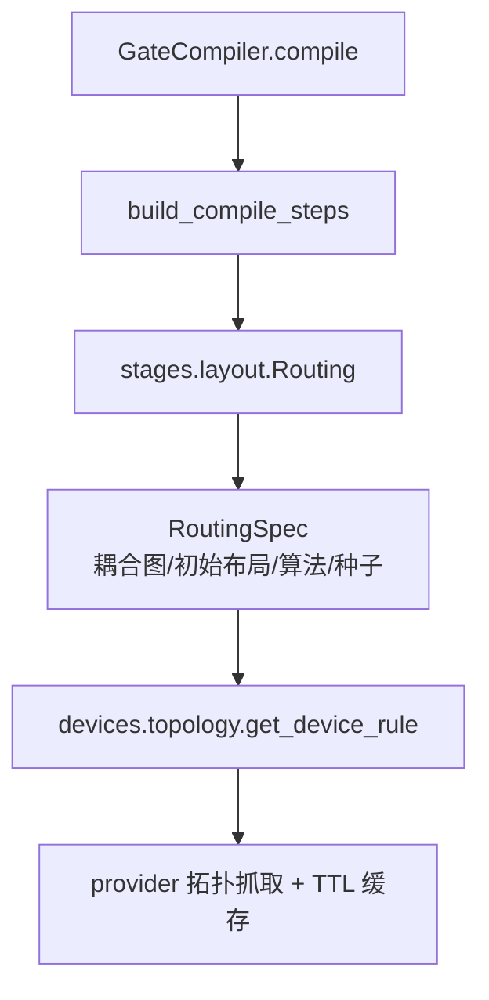
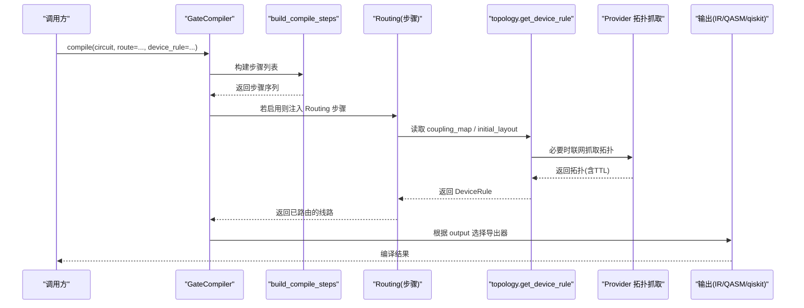
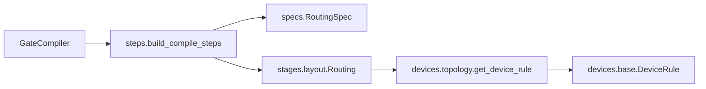

# 布局优化

<cite>
**本文引用的文件**
- [src/tyxonq/compiler/gate_compiler/stages/layout/__init__.py](file://src/tyxonq/compiler/gate_compiler/stages/layout/__init__.py)
- [src/tyxonq/compiler/gate_compiler/steps.py](file://src/tyxonq/compiler/gate_compiler/steps.py)
- [src/tyxonq/compiler/gate_compiler/compiler.py](file://src/tyxonq/compiler/gate_compiler/compiler.py)
- [src/tyxonq/compiler/gate_compiler/specs.py](file://src/tyxonq/compiler/gate_compiler/specs.py)
- [src/tyxonq/devices/hardware/topology.py](file://src/tyxonq/devices/hardware/topology.py)
- [src/tyxonq/devices/base.py](file://src/tyxonq/devices/base.py)
</cite>

## 目录
1. [简介](#简介)
2. [项目结构](#项目结构)
3. [核心组件](#核心组件)
4. [架构总览](#架构总览)
5. [详细组件分析](#详细组件分析)
6. [依赖关系分析](#依赖关系分析)
7. [性能考量](#性能考量)
8. [故障排查指南](#故障排查指南)
9. [结论](#结论)
10. [附录](#附录)

## 简介
本文件聚焦 TyxonQ 编译器中的“布局优化”能力，系统阐述量子比特映射与连接性优化的核心机制：如何将逻辑电路映射到物理设备拓扑、如何在相邻性约束下插入 SWAP 完成路由、如何通过配置控制初始布局与算法参数，以及不同策略对保真度与性能的影响。文档同时给出可操作的定制方法与调优建议，帮助读者在真实硬件上获得更优的编译结果。

## 项目结构
TyxonQ 将布局与路由作为编译管线中的一个步骤，位于 gate_compiler 的 stages/layout 子包中；该步骤默认关闭（route=False），由用户或平台适配器按需启用。编译步骤通过类型化规格（specs）装配，并由统一的 apply_steps 顺序执行。设备拓扑信息通过 devices/hardware/topology 模块统一发现与缓存，供路由步骤使用。

图表来源
- [src/tyxonq/compiler/gate_compiler/compiler.py:27-73](file://src/tyxonq/compiler/gate_compiler/compiler.py#L27-L73)
- [src/tyxonq/compiler/gate_compiler/steps.py:27-91](file://src/tyxonq/compiler/gate_compiler/steps.py#L27-L91)
- [src/tyxonq/compiler/gate_compiler/specs.py:33-58](file://src/tyxonq/compiler/gate_compiler/specs.py#L33-L58)
- [src/tyxonq/devices/hardware/topology.py:180-258](file://src/tyxonq/devices/hardware/topology.py#L180-L258)

章节来源
- [src/tyxonq/compiler/gate_compiler/stages/layout/__init__.py:1-15](file://src/tyxonq/compiler/gate_compiler/stages/layout/__init__.py#L1-L15)
- [src/tyxonq/compiler/gate_compiler/steps.py:27-91](file://src/tyxonq/compiler/gate_compiler/steps.py#L27-L91)
- [src/tyxonq/compiler/gate_compiler/compiler.py:27-73](file://src/tyxonq/compiler/gate_compiler/compiler.py#L27-L73)
- [src/tyxonq/compiler/gate_compiler/specs.py:33-58](file://src/tyxonq/compiler/gate_compiler/specs.py#L33-L58)
- [src/tyxonq/devices/hardware/topology.py:180-258](file://src/tyxonq/devices/hardware/topology.py#L180-L258)

## 核心组件
- 编译步骤装配器：按固定顺序组装规范化、分解、路由、优化、化简等步骤；路由仅在 route=True 或提供 RoutingSpec 时追加。
- 路由规格 RoutingSpec：声明耦合图、初始布局、算法、优化级别、随机种子等关键参数。
- 设备拓扑发现：统一从 provider 获取拓扑并做内存+磁盘两级 TTL 缓存，失败时降级为无拓扑（跳过路由）。
- GateCompiler：对外暴露 compile 接口，收集参数、装配步骤、执行并输出 IR/QASM/qiskit 等格式。

章节来源
- [src/tyxonq/compiler/gate_compiler/steps.py:27-91](file://src/tyxonq/compiler/gate_compiler/steps.py#L27-L91)
- [src/tyxonq/compiler/gate_compiler/specs.py:33-58](file://src/tyxonq/compiler/gate_compiler/specs.py#L33-L58)
- [src/tyxonq/devices/hardware/topology.py:180-258](file://src/tyxonq/devices/hardware/topology.py#L180-L258)
- [src/tyxonq/compiler/gate_compiler/compiler.py:27-73](file://src/tyxonq/compiler/gate_compiler/compiler.py#L27-L73)

## 架构总览
下图展示了从高层 compile 调用到具体路由执行的完整流程，包括拓扑发现与缓存、步骤装配与执行、以及最终输出。

图表来源
- [src/tyxonq/compiler/gate_compiler/compiler.py:27-109](file://src/tyxonq/compiler/gate_compiler/compiler.py#L27-L109)
- [src/tyxonq/compiler/gate_compiler/steps.py:27-91](file://src/tyxonq/compiler/gate_compiler/steps.py#L27-L91)
- [src/tyxonq/devices/hardware/topology.py:180-258](file://src/tyxonq/devices/hardware/topology.py#L180-L258)

## 详细组件分析

### 编译步骤装配与执行
- 固定顺序：规范化 → 分解 → 路由 → 优化 → 化简。
- 路由步骤延迟导入：当 route=False（默认）时不引入额外依赖。
- apply_steps 顺序执行每个 CompileStep.apply，保证可组合性与可观测性。

章节来源
- [src/tyxonq/compiler/gate_compiler/steps.py:27-105](file://src/tyxonq/compiler/gate_compiler/steps.py#L27-L105)

### 路由规格 RoutingSpec 与默认行为
- coupling_map：物理比特耦合边集合；None 时从 device_rule 读取。
- initial_layout：逻辑→物理的初始映射；None 时优先恒等布局，若不连通再按耦合图自动挑选。
- algorithm：当前委托 qiskit.transpile（即“qiskit”）。
- optimization_level：默认 0，仅负责布局与 SWAP 插入，不做门重写（避免 IR 词汇表不一致）。
- seed：默认 0，确保路由搜索可复现；传 None 可恢复随机搜索用于对比。

章节来源
- [src/tyxonq/compiler/gate_compiler/specs.py:33-58](file://src/tyxonq/compiler/gate_compiler/specs.py#L33-L58)

### 设备拓扑发现与缓存
- 两级缓存：会话内内存缓存 + 磁盘 TTL 缓存（默认 1 天）。
- 失败降级：网络/凭证/SDK 缺失时，若有过期缓存则沿用并告警；否则返回空规则，编译器据此跳过路由。
- 安全拷贝：防止缓存被后续步骤原地修改污染。

章节来源
- [src/tyxonq/devices/hardware/topology.py:1-29](file://src/tyxonq/devices/hardware/topology.py#L1-L29)
- [src/tyxonq/devices/hardware/topology.py:180-258](file://src/tyxonq/devices/hardware/topology.py#L180-L258)

### GateCompiler 集成点
- 统一入口 compile：收集 basis_gates、decompose、route、optimize、simplify、device_rule 等参数。
- 输出模式：IR、OpenQASM 3.0、QASM 2.0、qiskit；QASM2 路径会强制使用兼容基集。
- 元数据：记录 steps、basis_gates、optimization_level 等，便于回溯与诊断。

章节来源
- [src/tyxonq/compiler/gate_compiler/compiler.py:27-109](file://src/tyxonq/compiler/gate_compiler/compiler.py#L27-L109)

### 路由算法与 SWAP 插入策略
- 算法委托：当前实现通过 qiskit.transpile 完成布局与路由，TyxonQ 侧负责装配参数与上下文。
- SWAP 插入：由底层 transpiler 依据耦合图与初始布局生成，目标是最小化 SWAP 数量并保持时序合理。
- 路径选择优化：受 initial_layout、seed、optimization_level 影响；seed=0 保证可复现，seed=None 可用于多轮探索。

章节来源
- [src/tyxonq/compiler/gate_compiler/specs.py:33-58](file://src/tyxonq/compiler/gate_compiler/specs.py#L33-L58)
- [src/tyxonq/compiler/gate_compiler/steps.py:74-79](file://src/tyxonq/compiler/gate_compiler/steps.py#L74-L79)

### 相邻性约束与拓扑结构考虑
- 相邻性约束：两比特门必须在耦合图中有边；否则需通过 SWAP 使逻辑比特移动到相邻位置。
- 拓扑结构：不同设备的耦合图差异显著（如线性链、网格、星型等），直接影响路由代价与保真度。
- 初始布局：合理的 initial_layout 可显著减少 SWAP 数量，提升整体保真度。

章节来源
- [src/tyxonq/devices/base.py:60-83](file://src/tyxonq/devices/base.py#L60-L83)
- [src/tyxonq/devices/hardware/topology.py:180-258](file://src/tyxonq/devices/hardware/topology.py#L180-L258)

### 自定义映射规则与配置选项
- 显式指定耦合图：通过 RoutingSpec.coupling_map 覆盖默认值。
- 固定初始布局：通过 RoutingSpec.initial_layout 锁定逻辑→物理映射。
- 控制算法与随机性：algorithm="qiskit"，seed 控制可复现性；optimization_level=0 避免额外门重写。
- 设备规则透传：device_rule 可携带 num_qubits、native_gates、initial_layout 等，供路由与后续步骤使用。

章节来源
- [src/tyxonq/compiler/gate_compiler/specs.py:33-58](file://src/tyxonq/compiler/gate_compiler/specs.py#L33-L58)
- [src/tyxonq/devices/base.py:60-83](file://src/tyxonq/devices/base.py#L60-L83)

### 不同布局策略对性能与保真度的影响
- 恒等布局 vs BFS 自动选择：恒等布局简单但可能引发大量 SWAP；BFS 自动选择通常更均衡。
- 固定初始布局：针对特定电路结构（如局部相互作用）可显著降低 SWAP 数，提高保真度。
- 随机种子：seed=0 保证稳定；seed=None 适合多次采样比较不同路由质量。

章节来源
- [src/tyxonq/compiler/gate_compiler/specs.py:33-58](file://src/tyxonq/compiler/gate_compiler/specs.py#L33-L58)

### 实际案例研究与性能对比方法
- 基准电路：选择具有不同连通需求的典型电路（如 VQE、QAOA、Trotter 演化），在不同拓扑设备上运行。
- 指标：SWAP 计数、深度、保真度（模拟/真机）、能量误差（化学应用）。
- 对比维度：initial_layout 策略、seed 设置、是否启用路由、优化级别。

[本节为方法论说明，不直接分析具体文件]

### 基于硬件特性的定制优化
- 利用 native_gates：结合设备原生门集，避免不必要的分解与重写。
- 拓扑感知布局：根据设备耦合图设计 initial_layout，优先将频繁交互的逻辑比特映射到相邻物理比特。
- 分层路由：对大规模电路分块路由，降低单次路由复杂度。

章节来源
- [src/tyxonq/devices/base.py:60-83](file://src/tyxonq/devices/base.py#L60-L83)
- [src/tyxonq/devices/hardware/topology.py:180-258](file://src/tyxonq/devices/hardware/topology.py#L180-L258)

## 依赖关系分析
- GateCompiler 依赖 steps 装配器与 specs 规格对象。
- Routing 步骤依赖 topology 模块获取设备规则（耦合图等）。
- 设备层 base 定义 DeviceRule 契约，供拓扑发现与路由使用。

图表来源
- [src/tyxonq/compiler/gate_compiler/compiler.py:27-73](file://src/tyxonq/compiler/gate_compiler/compiler.py#L27-L73)
- [src/tyxonq/compiler/gate_compiler/steps.py:27-91](file://src/tyxonq/compiler/gate_compiler/steps.py#L27-L91)
- [src/tyxonq/compiler/gate_compiler/specs.py:33-58](file://src/tyxonq/compiler/gate_compiler/specs.py#L33-L58)
- [src/tyxonq/devices/hardware/topology.py:180-258](file://src/tyxonq/devices/hardware/topology.py#L180-L258)
- [src/tyxonq/devices/base.py:60-83](file://src/tyxonq/devices/base.py#L60-L83)

章节来源
- [src/tyxonq/compiler/gate_compiler/compiler.py:27-73](file://src/tyxonq/compiler/gate_compiler/compiler.py#L27-L73)
- [src/tyxonq/compiler/gate_compiler/steps.py:27-91](file://src/tyxonq/compiler/gate_compiler/steps.py#L27-L91)
- [src/tyxonq/compiler/gate_compiler/specs.py:33-58](file://src/tyxonq/compiler/gate_compiler/specs.py#L33-L58)
- [src/tyxonq/devices/hardware/topology.py:180-258](file://src/tyxonq/devices/hardware/topology.py#L180-L258)
- [src/tyxonq/devices/base.py:60-83](file://src/tyxonq/devices/base.py#L60-L83)

## 性能考量
- 路由开销：启用路由会增加编译时间；对于小规模或全连接模拟器可关闭路由以提速。
- SWAP 代价：每次 SWAP 增加深度与错误累积；应优先通过初始布局与拓扑感知优化减少 SWAP。
- 可复现性：保持 seed 固定以获得稳定结果；如需评估多样性，可多次随机路由取最优。
- 输出格式：QASM2 路径会强制使用兼容基集，避免下游工具无法解析。

[本节提供通用指导，不直接分析具体文件]

## 故障排查指南
- 拓扑抓取失败：检查网络、凭证、SDK；若存在过期缓存将沿用并告警；若无缓存则跳过路由。
- 路由未生效：确认 route 为 True 或提供了 RoutingSpec；检查 coupling_map 与 initial_layout 是否正确传入。
- 结果不稳定：检查 seed 是否为 None；若需要可复现，请固定 seed。
- QASM2 兼容问题：确保 basis_gates 包含 qelib1 兼容门；GateCompiler 会在 QASM2 模式下自动降级。

章节来源
- [src/tyxonq/devices/hardware/topology.py:223-258](file://src/tyxonq/devices/hardware/topology.py#L223-L258)
- [src/tyxonq/compiler/gate_compiler/compiler.py:51-59](file://src/tyxonq/compiler/gate_compiler/compiler.py#L51-L59)
- [src/tyxonq/compiler/gate_compiler/specs.py:33-58](file://src/tyxonq/compiler/gate_compiler/specs.py#L33-L58)

## 结论
TyxonQ 的布局优化以“可配置、可复用、可回退”为核心设计：通过类型化规格精确控制路由行为，借助设备拓扑发现与缓存保障鲁棒性，并以 GateCompiler 统一入口串联编译全流程。实践中，应优先通过合理的 initial_layout 与拓扑感知策略减少 SWAP，配合固定 seed 保证可复现，并根据硬件特性定制优化，从而在保真度与性能之间取得平衡。

[本节总结性内容，不直接分析具体文件]

## 附录
- 常用配置清单：
  - route=True 或 RoutingSpec：启用路由
  - coupling_map：显式耦合图
  - initial_layout：固定初始布局
  - optimization_level=0：仅路由，不做门重写
  - seed=0：可复现路由
- 推荐工作流：
  - 先离线分析设备拓扑与电路连通需求
  - 设计 initial_layout 并验证 SWAP 计数
  - 在模拟器上快速迭代，再迁移至真机
  - 记录 metadata 以便回溯与对比

[本节为操作指引，不直接分析具体文件]