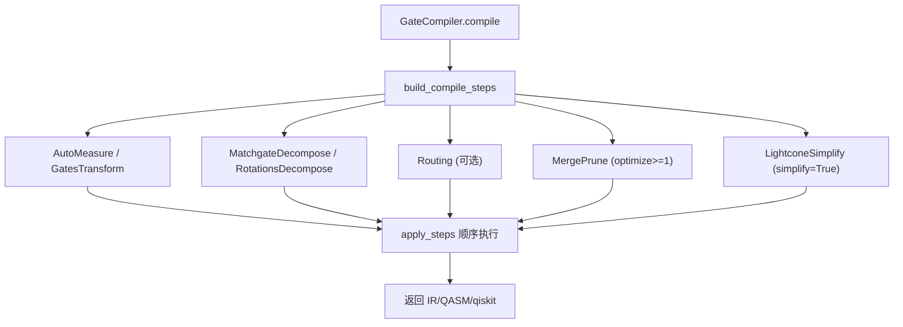
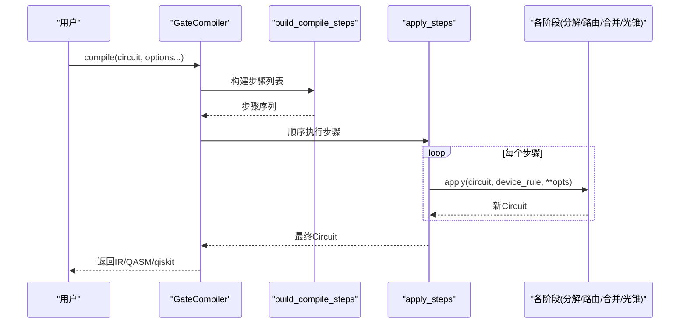
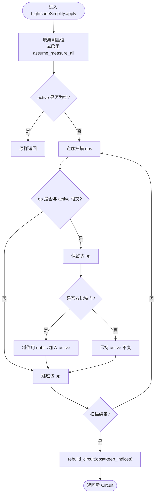
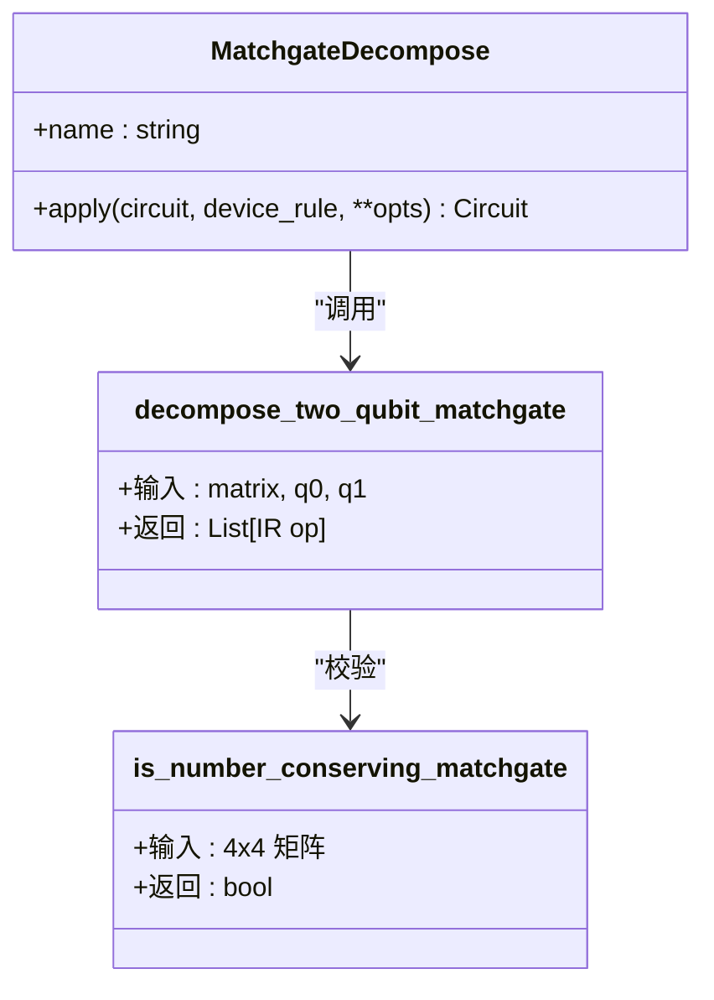
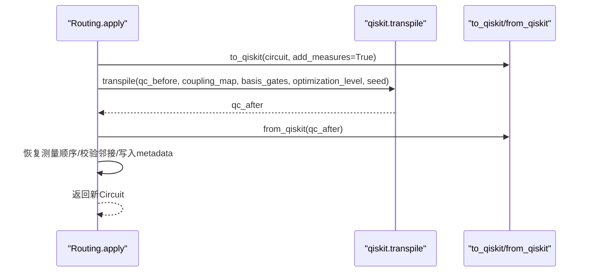
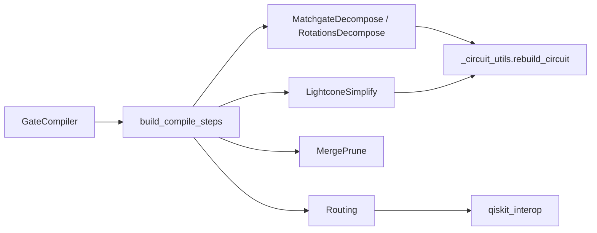

# 编译优化技术

<cite>
**本文引用的文件**
- [lightcone.py](file://src/tyxonq/compiler/gate_compiler/stages/simplify/lightcone.py)
- [matchgate.py](file://src/tyxonq/compiler/gate_compiler/stages/decompose/matchgate.py)
- [routing.py](file://src/tyxonq/compiler/gate_compiler/stages/layout/routing.py)
- [merge_prune.py](file://src/tyxonq/compiler/gate_compiler/stages/rewrite/merge_prune.py)
- [steps.py](file://src/tyxonq/compiler/gate_compiler/steps.py)
- [compiler.py](file://src/tyxonq/compiler/gate_compiler/compiler.py)
- [compiler_lightcone_optimization.py](file://examples/compiler_lightcone_optimization.py)
- [test_compiler_simplify_lightcone.py](file://tests_core_module/test_compiler_simplify_lightcone.py)
- [test_decompose_matchgate.py](file://tests_core_module/test_decompose_matchgate.py)
</cite>

## 目录
1. [简介](#简介)
2. [项目结构](#项目结构)
3. [核心组件](#核心组件)
4. [架构总览](#架构总览)
5. [详细组件分析](#详细组件分析)
6. [依赖关系分析](#依赖关系分析)
7. [性能考量](#性能考量)
8. [故障排查指南](#故障排查指南)
9. [结论](#结论)
10. [附录](#附录)

## 简介
本文件系统性梳理 TyxonQ 门级编译器的优化能力，重点覆盖：
- 光锥简化（Lightcone Simplification）：基于测量依赖的算符裁剪与传播，实现“只计算影响测量结果”的最小电路。
- 匹配门分解（Matchgate Decomposition）：将数守恒两比特 unitary（fSim/two_mode_fock 家族）精确分解为原生门集 {rz, rx, h, cx}。
- 布局与路由（Layout & Routing）：逻辑量子比特到物理量子比特的映射、连接性约束下的 SWAP 插入与测量顺序保持。
- 基础重写优化：相邻门合并、恒等剪枝、基变换重写等。
- 优化级别配置与性能影响：通过类型化参数装配步骤，控制分解、路由、合并与化简的组合。
- 量化评估与基准：提供示例脚本与单测，验证正确性与加速效果。
- 自定义优化器扩展：以 CompileStep 协议接入新阶段，组合进流水线。

## 项目结构
TyxonQ 的门级编译器位于 gate_compiler 子包，采用“阶段（stages）+ 装配（steps）+ 入口（compiler）”的分层组织：
- stages：按功能划分的具体优化阶段（simplify、decompose、layout、rewrite）。
- steps：根据类型化参数装配步骤序列并顺序执行。
- compiler：统一入口 GateCompiler.compile，负责参数归一化、步骤装配与输出格式选择。

图表来源
- [compiler.py:27-110](file://src/tyxonq/compiler/gate_compiler/compiler.py#L27-L110)
- [steps.py:27-91](file://src/tyxonq/compiler/gate_compiler/steps.py#L27-L91)

章节来源
- [compiler.py:1-110](file://src/tyxonq/compiler/gate_compiler/compiler.py#L1-L110)
- [steps.py:1-109](file://src/tyxonq/compiler/gate_compiler/steps.py#L1-L109)

## 核心组件
- 光锥简化 LightconeSimplify：从测量位反向追踪依赖，仅保留对测量有影响的算符；支持 assume_measure_all 模式用于全量测量的等价裁剪。
- 匹配门分解 MatchgateDecompose：识别数守恒 matchgate，将其精确分解为 {rz, rx, h, cx}；非 matchgate 默认保留或严格模式下报错。
- 布局与路由 Routing：在设备耦合图约束下完成逻辑到物理映射与 SWAP 插入，保持测量顺序与可复现性，失败时回退保守门集重试。
- 相邻门合并与恒等剪枝 MergePrune：对同一量子比特上的相邻门进行代数合并与恒等消除。
- 步骤装配与执行：build_compile_steps 按固定顺序组装步骤，apply_steps 顺序应用。

章节来源
- [lightcone.py:12-99](file://src/tyxonq/compiler/gate_compiler/stages/simplify/lightcone.py#L12-L99)
- [matchgate.py:46-199](file://src/tyxonq/compiler/gate_compiler/stages/decompose/matchgate.py#L46-L199)
- [routing.py:289-539](file://src/tyxonq/compiler/gate_compiler/stages/layout/routing.py#L289-L539)
- [merge_prune.py:27-88](file://src/tyxonq/compiler/gate_compiler/stages/rewrite/merge_prune.py#L27-L88)
- [steps.py:27-109](file://src/tyxonq/compiler/gate_compiler/steps.py#L27-L109)

## 架构总览
TyxonQ 的编译管线遵循“规范化 → 分解 → 路由 → 优化 → 化简”的固定顺序，所有阶段以统一的 CompileStep 协议暴露 apply(circuit, device_rule, **opts) 接口，便于组合与扩展。

图表来源
- [compiler.py:27-110](file://src/tyxonq/compiler/gate_compiler/compiler.py#L27-L110)
- [steps.py:27-109](file://src/tyxonq/compiler/gate_compiler/steps.py#L27-L109)

## 详细组件分析

### 光锥简化（Lightcone Simplification）
- 原理：收集显式测量位（或在全量假设下视为全部 qubit），自后向前扫描 ops，维护 active 集合；若某 op 作用域与 active 相交则保留，并根据是否为双比特门更新 active。
- 关键点：
  - 明确区分单/双比特门对依赖传播的影响。
  - 保留 barrier、measure_z、project_z、reset 等语义相关指令。
  - 使用 rebuild_circuit 保留 metadata/instructions/_unitary_cache。
- 应用场景：期望值计算中大量无关算符被裁剪，尤其部分测量场景可获得指数级加速。
- 配置项：assume_measure_all（布尔）控制是否将未显式测量的线路视为全测量。

图表来源
- [lightcone.py:15-99](file://src/tyxonq/compiler/gate_compiler/stages/simplify/lightcone.py#L15-L99)

章节来源
- [lightcone.py:12-99](file://src/tyxonq/compiler/gate_compiler/stages/simplify/lightcone.py#L12-L99)
- [test_compiler_simplify_lightcone.py:8-76](file://tests_core_module/test_compiler_simplify_lightcone.py#L8-L76)

### 匹配门分解（Matchgate Decomposition）
- 数学基础：fSim(two_mode_fock) 属于数守恒 matchgate，可在 |00>, |11> 与单激发子空间 {|01>,|10>} 上分别处理。|11> 相位由 e^{iμN} 承载（两比特 Rz），单激发块 S∈SU(2) 用 ZXZ 欧拉角分解为 Rz(a)Rx(b)Rz(c)，其中 Rx(b) 对应 partial-iSWAP，进一步用 RXX/RYY 与 RZZ 落地为 {cx, rz, rx, h}。
- 实现要点：
  - is_number_conserving_matchgate：检查跨粒子数子空间耦合是否为零。
  - decompose_two_qubit_matchgate：纯函数，返回 TyxonQ IR op 词汇，零角度块剪枝。
  - MatchgateDecompose 步骤：遍历 circuit.ops，对 2-qubit unitary 调用分解；非 matchgate 默认保留，strict 模式抛错；复制 _unitary_cache 避免后续 lowering 丢失矩阵。
- 适用性：LUCJ/SQD 的两模 Fock 酉、任意 U(2) 提升的 matchgate 均可精确分解。

图表来源
- [matchgate.py:46-199](file://src/tyxonq/compiler/gate_compiler/stages/decompose/matchgate.py#L46-L199)

章节来源
- [matchgate.py:1-205](file://src/tyxonq/compiler/gate_compiler/stages/decompose/matchgate.py#L1-L205)
- [test_decompose_matchgate.py:1-211](file://tests_core_module/test_decompose_matchgate.py#L1-L211)

### 布局与路由（Layout & Routing）
- 目标：在设备耦合图约束下，将逻辑比特映射到物理比特，并在必要时插入 SWAP 以满足两比特门邻接要求。
- 设计要点：
  - 仅在需要时路由：若无耦合图或已满足邻接，直接返回原线路。
  - 在本地下标空间路由：限制耦合图为所选物理比特诱导子图，避免产物膨胀。
  - 保持测量逻辑序：依据经典比特映射重排 measure_z，确保计数键顺序一致。
  - 保守门集兜底：自由路由失败时回退到安全门集重试。
  - 可复现性：固定 seed，保证多次编译结果一致。
- 关键流程：
  - 选择 initial_layout（显式优先，否则恒等或自动挑选连通子图）。
  - 检测相邻冲突与连通性，必要时调整布局。
  - 委托 qiskit.transpile 完成布局与 SWAP 插入，再读回 IR。
  - 后置校验：确保产物仍满足邻接约束，写入 metadata["routing"]。

图表来源
- [routing.py:312-539](file://src/tyxonq/compiler/gate_compiler/stages/layout/routing.py#L312-L539)

章节来源
- [routing.py:1-543](file://src/tyxonq/compiler/gate_compiler/stages/layout/routing.py#L1-L543)

### 相邻门合并与恒等剪枝（MergePrune）
- 规则：对同一量子比特上的相邻门按预定义规则合并（如 s·s→z、t·t→s、x·x→i 等），旋转角相加（rx/rz），恒等 i 被剪枝。
- 特点：轻量、快速，适合 optimize≥1 时作为通用优化阶段。
- 可扩展：可通过 rules 参数注入自定义合并规则。

章节来源
- [merge_prune.py:12-88](file://src/tyxonq/compiler/gate_compiler/stages/rewrite/merge_prune.py#L12-L88)

### 优化级别与配置选项
- 入口参数：
  - basis_gates：目标原生门集合，影响 GatesTransform 重写与路由时的 basis_gates。
  - decompose：bool 或 DecomposeSpec，控制 matchgate/rotations 分解。
  - route：bool 或 RoutingSpec，控制是否追加路由步骤。
  - optimize：int，≥1 时追加 MergePrune。
  - simplify：bool，为真时追加 LightconeSimplify。
  - device_rule：设备能力描述（coupling_map、num_qubits、initial_layout 等）。
- 步骤顺序：AutoMeasure → GatesTransform → MatchgateDecompose/RotationsDecompose → Routing（可选）→ MergePrune（optimize≥1）→ LightconeSimplify（simplify=True）。
- 输出格式：ir/qasm/qasm2/qasm3/qiskit，不同输出会触发相应导出器或互操作。

章节来源
- [steps.py:27-91](file://src/tyxonq/compiler/gate_compiler/steps.py#L27-L91)
- [compiler.py:27-110](file://src/tyxonq/compiler/gate_compiler/compiler.py#L27-L110)

## 依赖关系分析
- GateCompiler 依赖 steps 装配器与规格类型（DecomposeSpec/RoutingSpec）。
- 各阶段通过 _circuit_utils.rebuild_circuit 构造新 Circuit，避免破坏元数据与缓存。
- 路由阶段依赖 qiskit 互操作模块进行线路转换与 transpile。
- 测试用例覆盖光锥简化与 matchgate 分解的正确性与边界条件。

图表来源
- [compiler.py:27-110](file://src/tyxonq/compiler/gate_compiler/compiler.py#L27-L110)
- [steps.py:27-91](file://src/tyxonq/compiler/gate_compiler/steps.py#L27-L91)
- [routing.py:312-539](file://src/tyxonq/compiler/gate_compiler/stages/layout/routing.py#L312-L539)
- [lightcone.py:15-99](file://src/tyxonq/compiler/gate_compiler/stages/simplify/lightcone.py#L15-L99)

## 性能考量
- 光锥简化：在部分测量场景下显著减少仿真/运行成本，理论上无精度损失；全测量时等价于恒等变换。
- 匹配门分解：将高层 unitary 降为原生门，利于硬件执行；零角度块剪枝减少冗余 CX。
- 路由：仅在存在邻接冲突时执行；保守门集兜底提高成功率；seed 固定保障可复现。
- 合并与剪枝：降低门数与深度，减少噪声累积。
- 建议：
  - 对期望值计算开启 simplify=True 或手动调用 LightconeSimplify。
  - 对含两比特 unitary 的线路开启 decompose.matchgate=True。
  - 对真实设备运行设置 route=True 并提供耦合图与 initial_layout。
  - 使用 optimize≥1 获得额外门级优化收益。

## 故障排查指南
- 路由失败：
  - 现象：qiskit.transpile 抛出异常或产物比特数不一致。
  - 排查：检查耦合图是否连通、initial_layout 是否合法、是否存在跨连通块的两比特门；必要时放宽 optimization_level 或指定 basis_gates。
  - 参考：路由阶段的错误信息与警告提示。
- 匹配门分解报错：
  - 现象：非 4x4 矩阵或非数守恒 matchgate 时报错。
  - 排查：确认 unitary 是否为两比特且满足数守恒；如需严格模式请设置 matchgate_strict=True。
- 光锥简化无效：
  - 现象：未裁剪任何算符。
  - 排查：确认是否存在显式测量或启用 assume_measure_all；检查 active 集合更新逻辑是否符合预期。
- 测量顺序不一致：
  - 现象：计数键顺序变化导致解析错误。
  - 排查：路由后通过经典比特映射恢复 measure_z 顺序；核对 metadata["routing"] 中的信息。

章节来源
- [routing.py:312-539](file://src/tyxonq/compiler/gate_compiler/stages/layout/routing.py#L312-L539)
- [matchgate.py:46-199](file://src/tyxonq/compiler/gate_compiler/stages/decompose/matchgate.py#L46-L199)
- [lightcone.py:15-99](file://src/tyxonq/compiler/gate_compiler/stages/simplify/lightcone.py#L15-L99)

## 结论
TyxonQ 的门级编译器通过模块化阶段与类型化装配，提供了从分解、路由到化简的全链路优化能力。光锥简化与匹配门分解在理论与工程层面均具备高价值：前者在不牺牲精度的前提下大幅削减计算量，后者将高层酉精确降为硬件友好门集。结合布局路由与基础重写优化，可在真实设备上获得稳定、可复现且高效的编译结果。通过 CompileStep 协议，用户可以轻松扩展自定义优化器，进一步提升编译效率与适配性。

## 附录

### 量化评估与基准测试
- 示例脚本：examples/compiler_lightcone_optimization.py 展示了在不同问题规模下开启/关闭光锥优化的时间对比与正确性验证。
- 单测覆盖：
  - test_compiler_simplify_lightcone.py：验证光锥裁剪、assume_measure_all、多测量点传播、reset/project 保留。
  - test_decompose_matchgate.py：覆盖 matchgate 判定、纯函数行为、数值精确性、步骤级行为与缓存保留。

章节来源
- [compiler_lightcone_optimization.py:1-282](file://examples/compiler_lightcone_optimization.py#L1-L282)
- [test_compiler_simplify_lightcone.py:1-76](file://tests_core_module/test_compiler_simplify_lightcone.py#L1-L76)
- [test_decompose_matchgate.py:1-211](file://tests_core_module/test_decompose_matchgate.py#L1-L211)

### 自定义优化器扩展
- 扩展方式：实现一个类，提供 name 与 apply(self, circuit, device_rule=None, **opts) -> Circuit 方法，并通过 build_compile_steps 或手动插入到步骤序列中。
- 最佳实践：
  - 使用 rebuild_circuit 构造新 Circuit，保留 metadata 与缓存。
  - 在 apply 中读取 opts 获取配置，避免污染全局状态。
  - 对不可变输入保持“不修改原线路”的约定，返回新实例。

章节来源
- [steps.py:27-109](file://src/tyxonq/compiler/gate_compiler/steps.py#L27-L109)
- [lightcone.py:15-99](file://src/tyxonq/compiler/gate_compiler/stages/simplify/lightcone.py#L15-L99)
- [merge_prune.py:27-88](file://src/tyxonq/compiler/gate_compiler/stages/rewrite/merge_prune.py#L27-L88)