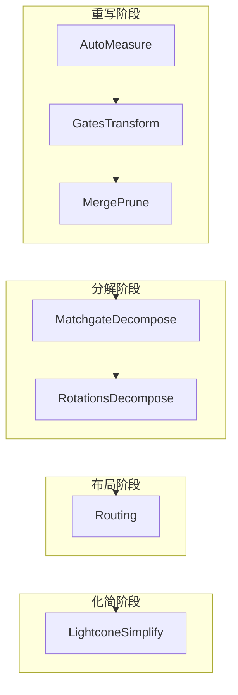
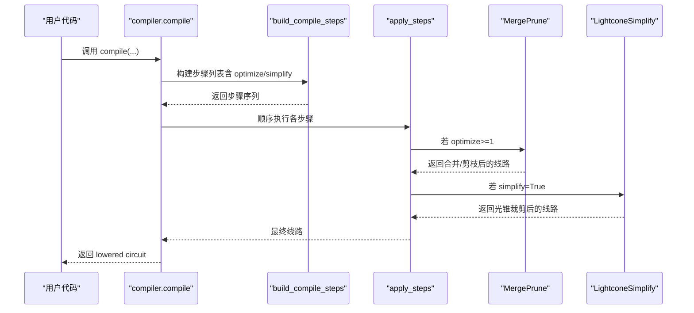
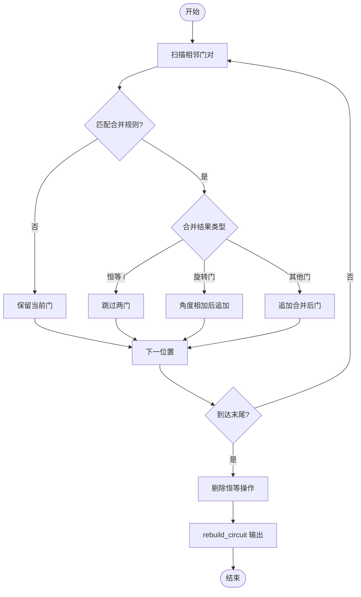
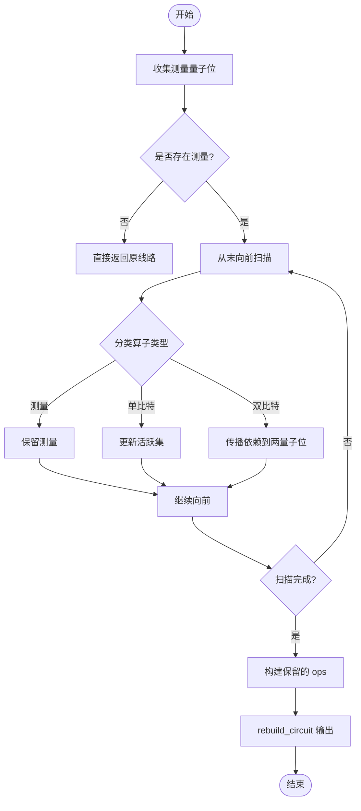
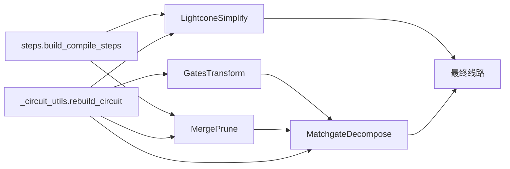

# 门合并与剪枝

<cite>
**本文引用的文件**
- [merge_prune.py](file://src/tyxonq/compiler/gate_compiler/stages/rewrite/merge_prune.py)
- [gates_transform.py](file://src/tyxonq/compiler/gate_compiler/stages/rewrite/gates_transform.py)
- [lightcone.py](file://src/tyxonq/compiler/gate_compiler/stages/simplify/lightcone.py)
- [steps.py](file://src/tyxonq/compiler/gate_compiler/steps.py)
- [compiler.py](file://src/tyxonq/compiler/gate_compiler/compiler.py)
- [_circuit_utils.py](file://src/tyxonq/compiler/gate_compiler/_circuit_utils.py)
- [matchgate.py](file://src/tyxonq/compiler/gate_compiler/stages/decompose/matchgate.py)
- [__init__.py（stages）](file://src/tyxonq/compiler/gate_compiler/stages/__init__.py)
- [compiler_lightcone_optimization.py](file://examples/compiler_lightcone_optimization.py)
</cite>

## 目录
1. [简介](#简介)
2. [项目结构](#项目结构)
3. [核心组件](#核心组件)
4. [架构总览](#架构总览)
5. [详细组件分析](#详细组件分析)
6. [依赖关系分析](#依赖关系分析)
7. [性能考量](#性能考量)
8. [故障排查指南](#故障排查指南)
9. [结论](#结论)
10. [附录：扩展自定义变换规则](#附录：扩展自定义变换规则)

## 简介
本文件系统性阐述 TyxonQ 编译器中的“门合并与剪枝”技术，覆盖相邻门合并、恒等剪枝、光锥化简等基础优化，并解释其与门代数运算、矩阵分解的协同关系。文档给出可识别的可合并门序列与可剪枝冗余操作的判定方法、重写规则与算法流程，分析优化前后电路复杂度变化，说明与其他编译阶段的集成顺序，并提供性能评估方法与扩展自定义变换规则的实践指南。

## 项目结构
TyxonQ 的门级编译以“步骤链”组织，关键目录与职责如下：
- rewrite（重写）：规范化与等价替换，包括自动测量补全、基集归一、相邻门合并与恒等剪枝。
- decompose（分解）：将通用酉或匹配门分解为硬件友好基集。
- layout（布局/路由）：在目标拓扑上布线。
- simplify（化简）：基于测量依赖的光锥裁剪。

图表来源
- [steps.py:27-91](file://src/tyxonq/compiler/gate_compiler/steps.py#L27-L91)
- [__init__.py（stages）:1-14](file://src/tyxonq/compiler/gate_compiler/stages/__init__.py#L1-L14)

章节来源
- [steps.py:27-91](file://src/tyxonq/compiler/gate_compiler/steps.py#L27-L91)
- [__init__.py（stages）:1-14](file://src/tyxonq/compiler/gate_compiler/stages/__init__.py#L1-L14)

## 核心组件
- 相邻门合并与恒等剪枝：MergePrune
  - 通过规则表对相邻同线量子位门进行代数合并，并将结果中的恒等操作移除。
  - 支持旋转门角度相加合并（如 rz/rx/ry），以及常见单比特门的自逆合并（如 x·x→i）。
- 基集归一：GatesTransform
  - 将输入门映射到目标基集（如 h, rx, rz, cx, cz），减少后续分解压力。
- 光锥化简：LightconeSimplify
  - 从测量位置反向追踪依赖，仅保留影响测量结果的算子，大幅降低计算量。
- 编译步骤装配：build_compile_steps / apply_steps
  - 定义固定执行顺序：规范化 → 分解 → 路由 → 优化（合并/剪枝）→ 化简。
- 线路重建工具：rebuild_circuit
  - 安全重建 Circuit 并保留非 dataclass 字段 _unitary_cache，确保后续分解不丢失矩阵缓存。

章节来源
- [merge_prune.py:12-85](file://src/tyxonq/compiler/gate_compiler/stages/rewrite/merge_prune.py#L12-L85)
- [gates_transform.py:12-50](file://src/tyxonq/compiler/gate_compiler/stages/rewrite/gates_transform.py#L12-L50)
- [lightcone.py:12-97](file://src/tyxonq/compiler/gate_compiler/stages/simplify/lightcone.py#L12-L97)
- [steps.py:27-105](file://src/tyxonq/compiler/gate_compiler/steps.py#L27-L105)
- [_circuit_utils.py:28-72](file://src/tyxonq/compiler/gate_compiler/_circuit_utils.py#L28-L72)

## 架构总览
编译管线按类型化参数装配步骤，并在统一入口顺序执行。优化级别控制是否启用 MergePrune；simplify 开关控制 LightconeSimplify。

图表来源
- [compiler.py:57-74](file://src/tyxonq/compiler/gate_compiler/compiler.py#L57-L74)
- [steps.py:27-105](file://src/tyxonq/compiler/gate_compiler/steps.py#L27-L105)

章节来源
- [compiler.py:57-74](file://src/tyxonq/compiler/gate_compiler/compiler.py#L57-L74)
- [steps.py:27-105](file://src/tyxonq/compiler/gate_compiler/steps.py#L27-L105)

## 详细组件分析

### 相邻门合并与恒等剪枝（MergePrune）
- 目标：对同一量子位上的相邻门进行代数合并，消除恒等操作，减少门数与相位更新次数。
- 关键能力：
  - 规则驱动合并：内置默认规则表，支持 s·s→z、t·t→s、x·x→i、h·h→i 等。
  - 旋转门角度相加：rz(θ1)·rz(θ2)→rz(θ1+θ2)，rx/ry 同理。
  - 迭代收敛：反复扫描直到无变化，再剔除恒等操作。
- 复杂度：单次线性扫描 O(n)；最坏情况下多次扫描，但通常很快收敛。
- 数据流：读取 ops → 生成新 ops → rebuild_circuit 保持 _unitary_cache。

图表来源
- [merge_prune.py:40-85](file://src/tyxonq/compiler/gate_compiler/stages/rewrite/merge_prune.py#L40-L85)

章节来源
- [merge_prune.py:12-85](file://src/tyxonq/compiler/gate_compiler/stages/rewrite/merge_prune.py#L12-L85)

### 基集归一（GatesTransform）
- 目标：将输入门映射到目标基集（如 h, rx, rz, cx, cz），便于后续分解与硬件落地。
- 策略：对 x/y 用旋转门近似替代；对已存在的基集门原样保留；其余门交由后续分解处理。
- 重要性：在 Matchgate 分解之前运行，避免后续因缺少矩阵缓存而失败。

章节来源
- [gates_transform.py:12-50](file://src/tyxonq/compiler/gate_compiler/stages/rewrite/gates_transform.py#L12-L50)

### 光锥化简（LightconeSimplify）
- 目标：根据测量位置反向追踪依赖，仅保留影响测量结果的算子。
- 关键点：
  - 显式测量或 assume_measure_all 时收集受影响的量子位集合。
  - 遇到双量子位纠缠门时，传播依赖到两个量子位。
  - 保留所有显式测量操作。
- 效果：对部分测量的变分算法带来显著加速，且数学精确。

图表来源
- [lightcone.py:15-97](file://src/tyxonq/compiler/gate_compiler/stages/simplify/lightcone.py#L15-L97)

章节来源
- [lightcone.py:15-97](file://src/tyxonq/compiler/gate_compiler/stages/simplify/lightcone.py#L15-L97)

### 矩阵分解与缓存（MatchgateDecompose）
- 作用：将两量子位 unitary 或匹配门分解为硬件友好基集。
- 与合并/剪枝的关系：
  - 合并/剪枝发生在分解之后（或并行于其他阶段），但 GatesTransform 必须在分解前运行，以确保后续分解能正确获取矩阵缓存。
  - 任何中间步骤重建线路时必须使用 rebuild_circuit，否则可能丢失 _unitary_cache 导致分解报错。

章节来源
- [matchgate.py:176-197](file://src/tyxonq/compiler/gate_compiler/stages/decompose/matchgate.py#L176-L197)
- [_circuit_utils.py:28-72](file://src/tyxonq/compiler/gate_compiler/_circuit_utils.py#L28-L72)

## 依赖关系分析
- 步骤装配依赖：
  - build_compile_steps 依据 optimize/simplify 决定是否插入 MergePrune/LightconeSimplify。
  - apply_steps 顺序执行步骤，保证优化与化简的先后关系。
- 模块耦合：
  - 所有重写/化简步骤均依赖 rebuild_circuit 以安全重建线路并保留 _unitary_cache。
  - MatchgateDecompose 依赖矩阵缓存，因此 GatesTransform 必须在其之前运行。

图表来源
- [steps.py:27-91](file://src/tyxonq/compiler/gate_compiler/steps.py#L27-L91)
- [_circuit_utils.py:28-72](file://src/tyxonq/compiler/gate_compiler/_circuit_utils.py#L28-L72)
- [matchgate.py:176-197](file://src/tyxonq/compiler/gate_compiler/stages/decompose/matchgate.py#L176-L197)

章节来源
- [steps.py:27-91](file://src/tyxonq/compiler/gate_compiler/steps.py#L27-L91)
- [_circuit_utils.py:28-72](file://src/tyxonq/compiler/gate_compiler/_circuit_utils.py#L28-L72)
- [matchgate.py:176-197](file://src/tyxonq/compiler/gate_compiler/stages/decompose/matchgate.py#L176-L197)

## 性能考量
- 门合并与剪枝：
  - 减少相邻重复门数量，降低相位更新与模拟成本；对旋转门合并尤为有效。
  - 时间复杂度近似 O(n) 每轮扫描，通常少量迭代即可收敛。
- 光锥化简：
  - 对部分测量场景提供指数级加速潜力；全测量时退化为恒等变换，不影响正确性。
  - 示例中展示了在不同问题规模下的加速对比与数值一致性验证。
- 整体管线：
  - 通过合理顺序（规范化→分解→路由→优化→化简）最大化收益并避免副作用。

章节来源
- [compiler_lightcone_optimization.py:97-159](file://examples/compiler_lightcone_optimization.py#L97-L159)

## 故障排查指南
- 错误：matchgate 分解缺少矩阵缓存
  - 现象：在 MatchgateDecompose 阶段抛出“缺少矩阵缓存”异常。
  - 原因：中间步骤重建线路时未保留 _unitary_cache。
  - 解决：确保所有重写/化简步骤使用 rebuild_circuit 重建线路。
- 行为：光锥化简未裁剪任何门
  - 检查是否启用了 assume_measure_all 或存在全量子位测量；此时光锥包含全部量子位，属于预期行为。
- 行为：合并未生效
  - 确认相邻门作用于同一量子位，且名称与参数符合规则；必要时扩展规则表。

章节来源
- [matchgate.py:176-197](file://src/tyxonq/compiler/gate_compiler/stages/decompose/matchgate.py#L176-L197)
- [_circuit_utils.py:28-72](file://src/tyxonq/compiler/gate_compiler/_circuit_utils.py#L28-L72)
- [lightcone.py:15-97](file://src/tyxonq/compiler/gate_compiler/stages/simplify/lightcone.py#L15-L97)

## 结论
TyxonQ 的门合并与剪枝技术以轻量、可组合的方式嵌入编译管线：
- 相邻门合并与恒等剪枝通过规则驱动快速降维；
- 光锥化简基于测量依赖实现精确裁剪；
- 与基集归一和矩阵分解协同工作，保障后续分解的正确性与效率；
- 通过类型化步骤装配与统一重建工具，确保稳定性与可扩展性。

## 附录：扩展自定义变换规则
- 扩展 MergePrune 规则：
  - 在构造 MergePrune 时传入自定义 rules 字典，覆盖或新增相邻门合并规则。
  - 注意：对于旋转门合并需确保角度语义一致（如 rz/rx/ry 的角度相加）。
- 自定义 GatesTransform：
  - 可在 GatesTransform 基础上增加新的基集映射或保留策略，以适配特定设备或算法需求。
- 自定义 LightconeSimplify：
  - 如需扩展依赖传播逻辑（例如新增门类型的影响范围），可在 op_qubits 中添加对应分支。
- 集成到编译管线：
  - 通过 build_compile_steps 的参数控制是否启用相应步骤；或通过自定义步骤类实现更复杂的优化逻辑。

章节来源
- [merge_prune.py:35-46](file://src/tyxonq/compiler/gate_compiler/stages/rewrite/merge_prune.py#L35-L46)
- [gates_transform.py:29-50](file://src/tyxonq/compiler/gate_compiler/stages/rewrite/gates_transform.py#L29-L50)
- [lightcone.py:43-66](file://src/tyxonq/compiler/gate_compiler/stages/simplify/lightcone.py#L43-L66)
- [steps.py:27-91](file://src/tyxonq/compiler/gate_compiler/steps.py#L27-L91)