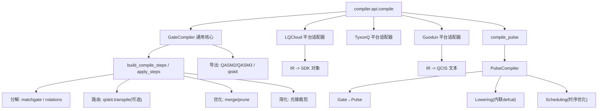
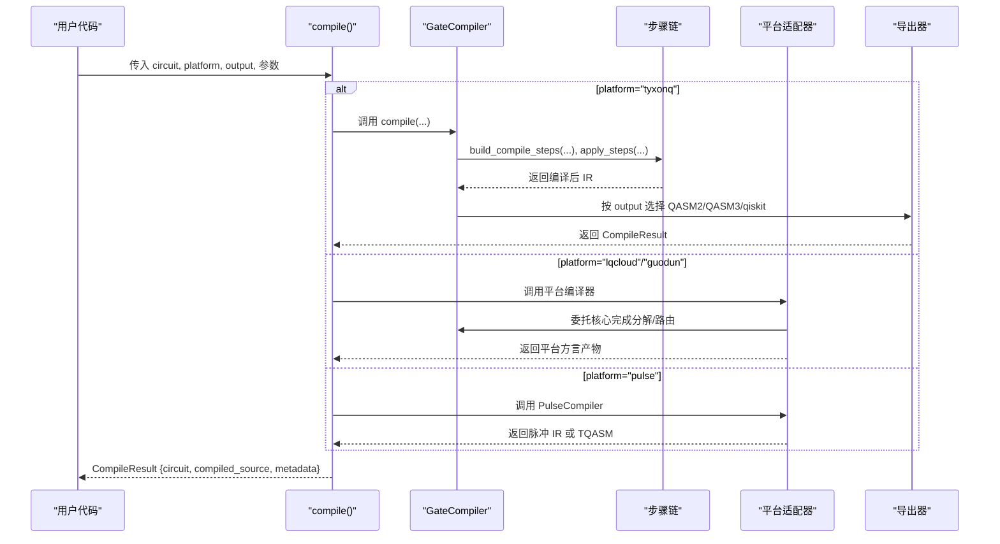
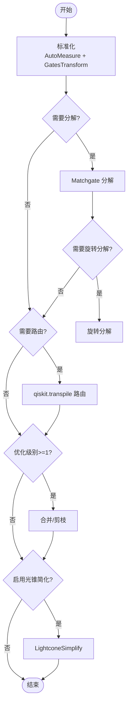
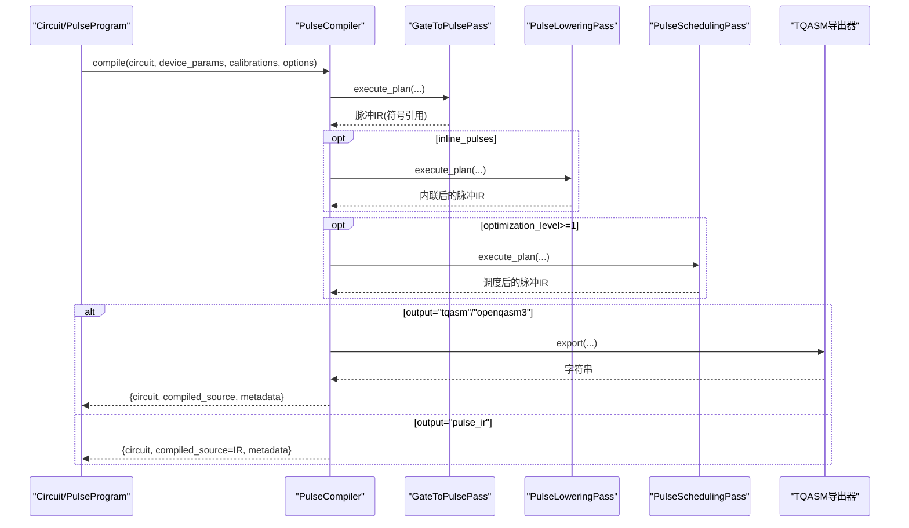
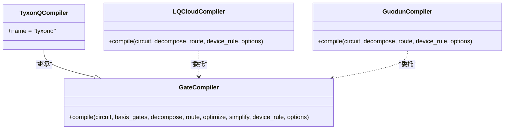
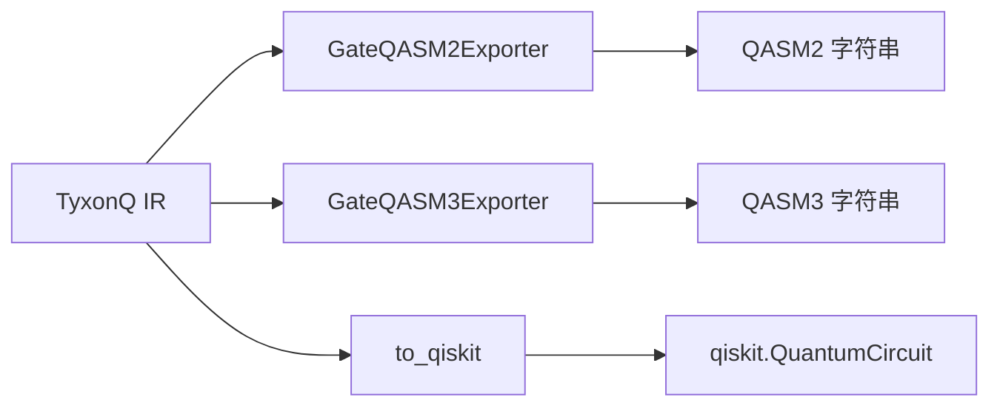
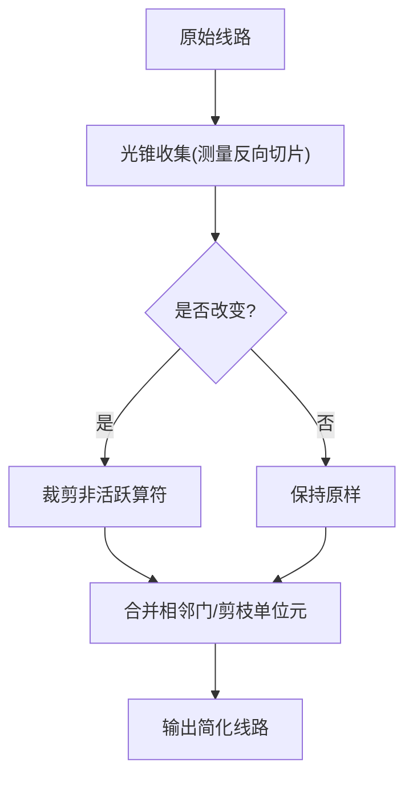
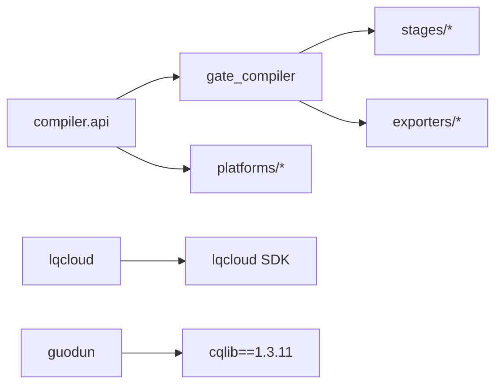

# 编译器系统

<cite>
**本文引用的文件**
- [src/tyxonq/compiler/api.py](file://src/tyxonq/compiler/api.py)
- [src/tyxonq/compiler/gate_compiler/compiler.py](file://src/tyxonq/compiler/gate_compiler/compiler.py)
- [src/tyxonq/compiler/gate_compiler/steps.py](file://src/tyxonq/compiler/gate_compiler/steps.py)
- [src/tyxonq/compiler/platforms/__init__.py](file://src/tyxonq/compiler/platforms/__init__.py)
- [src/tyxonq/compiler/platforms/tyxonq/__init__.py](file://src/tyxonq/compiler/platforms/tyxonq/__init__.py)
- [src/tyxonq/compiler/platforms/lqcloud/compiler.py](file://src/tyxonq/compiler/platforms/lqcloud/compiler.py)
- [src/tyxonq/compiler/platforms/guodun/compiler.py](file://src/tyxonq/compiler/platforms/guodun/compiler.py)
- [src/tyxonq/compiler/gate_compiler/stages/decompose/matchgate.py](file://src/tyxonq/compiler/gate_compiler/stages/decompose/matchgate.py)
- [src/tyxonq/compiler/gate_compiler/stages/decompose/rotations.py](file://src/tyxonq/compiler/gate_compiler/stages/decompose/rotations.py)
- [src/tyxonq/compiler/gate_compiler/stages/simplify/lightcone.py](file://src/tyxonq/compiler/gate_compiler/stages/simplify/lightcone.py)
- [src/tyxonq/compiler/gate_compiler/stages/rewrite/merge_prune.py](file://src/tyxonq/compiler/gate_compiler/stages/rewrite/merge_prune.py)
- [src/tyxonq/compiler/pulse_compiler/native/pulse_compiler.py](file://src/tyxonq/compiler/pulse_compiler/native/pulse_compiler.py)
- [src/tyxonq/compiler/gate_compiler/exporters/gate_qasm2_exporter.py](file://src/tyxonq/compiler/gate_compiler/exporters/gate_qasm2_exporter.py)
</cite>

## 目录
1. [简介](#简介)
2. [项目结构](#项目结构)
3. [核心组件](#核心组件)
4. [架构总览](#架构总览)
5. [详细组件分析](#详细组件分析)
6. [依赖关系分析](#依赖关系分析)
7. [性能考量](#性能考量)
8. [故障排查指南](#故障排查指南)
9. [结论](#结论)
10. [附录](#附录)

## 简介
本文件系统性阐述 TyxonQ 编译器系统的双阶段架构：门级编译与脉冲级编译。门级编译器负责将高层量子线路标准化、分解（matchgate/旋转）、路由、优化与简化（光锥），并支持导出 QASM2/QASM3；脉冲级编译器将门电路转换为可执行的脉冲序列，支持校准内联、调度与波形约束。同时说明不同硬件平台（TyxonQ、LQCloud、Guodun）的特定编译策略，以及配置选项、扩展方式、调试与性能分析方法。

## 项目结构
编译器子系统位于 src/tyxonq/compiler 下，采用“统一入口 + 通用核心 + 平台适配器”的分层组织：
- 统一入口：compiler.api 提供 compile() 与 compile_pulse()，按 platform/output 分派到具体编译器。
- 门级通用核心：gate_compiler.compiler.GateCompiler 装配并执行步骤链（标准化→分解→路由→优化→简化）。
- 平台适配器：platforms/* 针对目标方言进行 IR 直译或对象构建（如 LQCloud QuantumCircuit、Guodun QCIS）。
- 脉冲编译器：pulse_compiler.native 实现 Gate→Pulse→Scheduling 流水线，支持 TQASM/OpenQASM3 导出。
- 导出器：gate_qasm2_exporter/gate_qasm3_exporter 将 IR 直接转译为 QASM 文本，零外部依赖。

图示来源
- [src/tyxonq/compiler/api.py:39-340](file://src/tyxonq/compiler/api.py#L39-L340)
- [src/tyxonq/compiler/gate_compiler/compiler.py:27-109](file://src/tyxonq/compiler/gate_compiler/compiler.py#L27-L109)
- [src/tyxonq/compiler/gate_compiler/steps.py:27-105](file://src/tyxonq/compiler/gate_compiler/steps.py#L27-L105)
- [src/tyxonq/compiler/platforms/lqcloud/compiler.py:50-112](file://src/tyxonq/compiler/platforms/lqcloud/compiler.py#L50-L112)
- [src/tyxonq/compiler/platforms/guodun/compiler.py:88-176](file://src/tyxonq/compiler/platforms/guodun/compiler.py#L88-L176)
- [src/tyxonq/compiler/pulse_compiler/native/pulse_compiler.py:24-197](file://src/tyxonq/compiler/pulse_compiler/native/pulse_compiler.py#L24-L197)

章节来源
- [src/tyxonq/compiler/api.py:39-340](file://src/tyxonq/compiler/api.py#L39-L340)
- [src/tyxonq/compiler/gate_compiler/compiler.py:27-109](file://src/tyxonq/compiler/gate_compiler/compiler.py#L27-L109)
- [src/tyxonq/compiler/gate_compiler/steps.py:27-105](file://src/tyxonq/compiler/gate_compiler/steps.py#L27-L105)
- [src/tyxonq/compiler/platforms/__init__.py:1-9](file://src/tyxonq/compiler/platforms/__init__.py#L1-L9)

## 核心组件
- 统一编译入口
  - compile(): 类型化参数驱动（basis_gates、decompose、route、optimize、simplify、device_rule、options），自动推断是否走脉冲编译，并按 platform 分派到 TyxonQ/LQCloud/Guodun/Pulse。
  - compile_pulse(): 为 PulseProgram 提供与 Circuit 平级的编译入口，内部复用 compile() 并补齐 device_params。
- 门级通用核心
  - GateCompiler.compile(): 归一化 options，装配步骤链（标准化→分解→路由→优化→简化），顺序执行后按 output 选择导出（IR/QASM2/QASM3/qiskit）。
- 平台适配器
  - TyxonQCompiler: 薄封装，委托 GateCompiler。
  - LQCloudCompiler: 先经 GateCompiler 得到 IR，再 1:1 翻译为 lqcloud SDK 对象。
  - GuodunCompiler: 强制 matchgate+rotations 分解，输出门级 QCIS 文本，物理比特映射在编译期烘焙。
- 脉冲编译器
  - PulseCompiler: Gate→Pulse→Lowering→Scheduling 三阶段，支持 inline_pulses、supported_waveforms 等选项，输出 pulse_ir/TQASM/OpenQASM3。

章节来源
- [src/tyxonq/compiler/api.py:39-340](file://src/tyxonq/compiler/api.py#L39-L340)
- [src/tyxonq/compiler/gate_compiler/compiler.py:27-109](file://src/tyxonq/compiler/gate_compiler/compiler.py#L27-L109)
- [src/tyxonq/compiler/platforms/tyxonq/__init__.py:12-18](file://src/tyxonq/compiler/platforms/tyxonq/__init__.py#L12-L18)
- [src/tyxonq/compiler/platforms/lqcloud/compiler.py:50-112](file://src/tyxonq/compiler/platforms/lqcloud/compiler.py#L50-L112)
- [src/tyxonq/compiler/platforms/guodun/compiler.py:88-176](file://src/tyxonq/compiler/platforms/guodun/compiler.py#L88-L176)
- [src/tyxonq/compiler/pulse_compiler/native/pulse_compiler.py:24-197](file://src/tyxonq/compiler/pulse_compiler/native/pulse_compiler.py#L24-L197)

## 架构总览
双阶段编译器的设计要点：
- 门级阶段：设备无关的标准化、分解、路由、优化、简化，确保 IR 稳定且可移植。
- 脉冲级阶段：基于校准/波形库生成可执行脉冲序列，支持时序优化与云端序列化。
- 平台适配：各平台仅做轻量 lowering 或对象构造，避免重复实现分解逻辑。

图示来源
- [src/tyxonq/compiler/api.py:39-340](file://src/tyxonq/compiler/api.py#L39-L340)
- [src/tyxonq/compiler/gate_compiler/compiler.py:27-109](file://src/tyxonq/compiler/gate_compiler/compiler.py#L27-L109)
- [src/tyxonq/compiler/platforms/lqcloud/compiler.py:50-112](file://src/tyxonq/compiler/platforms/lqcloud/compiler.py#L50-L112)
- [src/tyxonq/compiler/platforms/guodun/compiler.py:88-176](file://src/tyxonq/compiler/platforms/guodun/compiler.py#L88-L176)
- [src/tyxonq/compiler/pulse_compiler/native/pulse_compiler.py:24-197](file://src/tyxonq/compiler/pulse_compiler/native/pulse_compiler.py#L24-L197)

## 详细组件分析

### 门级编译器：标准化、分解、路由、优化、简化
- 标准化
  - AutoMeasure：无测量时补 Z 测量，便于后续光锥简化。
  - GatesTransform：按 basis_gates 重写门（例如 qasm2 路径默认降级到 qelib1 兼容基）。
- 分解
  - MatchgateDecompose：将数守恒 2-qubit matchgate（fSim/two_mode_fock）精确分解为 {rz, rx, h, cx}。
  - RotationsDecompose：将 RX/RY/RXX/RYY/RZZ 用标准恒等式分解到 {H,RZ,CX}。
- 路由
  - Routing：当 route=True 或提供 RoutingSpec 时，委托 qiskit.transpile 进行拓扑布线。
- 优化
  - MergePrune：合并相邻同线门并剪除单位元，减少冗余门。
- 简化
  - LightconeSimplify：从测量反向切片，仅保留影响测量的算符（光锥），显著降低门数。

图示来源
- [src/tyxonq/compiler/gate_compiler/steps.py:27-105](file://src/tyxonq/compiler/gate_compiler/steps.py#L27-L105)
- [src/tyxonq/compiler/gate_compiler/stages/decompose/matchgate.py:152-197](file://src/tyxonq/compiler/gate_compiler/stages/decompose/matchgate.py#L152-L197)
- [src/tyxonq/compiler/gate_compiler/stages/decompose/rotations.py:13-73](file://src/tyxonq/compiler/gate_compiler/stages/decompose/rotations.py#L13-L73)
- [src/tyxonq/compiler/gate_compiler/stages/simplify/lightcone.py:12-97](file://src/tyxonq/compiler/gate_compiler/stages/simplify/lightcone.py#L12-L97)
- [src/tyxonq/compiler/gate_compiler/stages/rewrite/merge_prune.py:27-85](file://src/tyxonq/compiler/gate_compiler/stages/rewrite/merge_prune.py#L27-L85)

章节来源
- [src/tyxonq/compiler/gate_compiler/steps.py:27-105](file://src/tyxonq/compiler/gate_compiler/steps.py#L27-L105)
- [src/tyxonq/compiler/gate_compiler/stages/decompose/matchgate.py:46-149](file://src/tyxonq/compiler/gate_compiler/stages/decompose/matchgate.py#L46-L149)
- [src/tyxonq/compiler/gate_compiler/stages/decompose/rotations.py:13-73](file://src/tyxonq/compiler/gate_compiler/stages/decompose/rotations.py#L13-L73)
- [src/tyxonq/compiler/gate_compiler/stages/simplify/lightcone.py:12-97](file://src/tyxonq/compiler/gate_compiler/stages/simplify/lightcone.py#L12-L97)
- [src/tyxonq/compiler/gate_compiler/stages/rewrite/merge_prune.py:27-85](file://src/tyxonq/compiler/gate_compiler/stages/rewrite/merge_prune.py#L27-L85)

### 脉冲编译器：功能与工作流程
- 输入：Gate-level Circuit 或 PulseProgram。
- 流程：
  1) GateToPulsePass：将标准门分解为脉冲原语（支持 defcal 校准）。
  2) PulseLoweringPass：内联 defcal 定义（inline_pulses=True 时），使程序自包含。
  3) PulseSchedulingPass：脉冲时序优化与资源分配。
- 输出：pulse_ir（原生 IR）、TQASM 0.2（homebrew_s2）、OpenQASM3（含脉冲扩展）。
- 关键选项：
  - device_params：qubit_freq、anharmonicity、T1/T2、coupling_map。
  - calibrations：自定义门到脉冲的校准映射。
  - supported_waveforms：限制波形类型以匹配硬件能力。
  - mode：hybrid/pulse_only/auto_lower。
  - dt、max_pulse_duration、inline_pulses。

图示来源
- [src/tyxonq/compiler/pulse_compiler/native/pulse_compiler.py:24-197](file://src/tyxonq/compiler/pulse_compiler/native/pulse_compiler.py#L24-L197)
- [src/tyxonq/compiler/api.py:343-463](file://src/tyxonq/compiler/api.py#L343-L463)

章节来源
- [src/tyxonq/compiler/pulse_compiler/native/pulse_compiler.py:24-197](file://src/tyxonq/compiler/pulse_compiler/native/pulse_compiler.py#L24-L197)
- [src/tyxonq/compiler/api.py:343-463](file://src/tyxonq/compiler/api.py#L343-L463)

### 平台特定编译策略
- TyxonQ（默认）
  - 委托 GateCompiler 完成设备无关编译，支持 IR/QASM2/QASM3/qiskit 输出。
  - homebrew_s2 场景自动切换输出格式与默认 basis_gates。
- LQCloud
  - 先经 GateCompiler 得到 IR，再 1:1 翻译为官方 SDK 的 QuantumCircuit 对象。
  - physical_qubits 作为运行期 initial_layout，不在编译期消费。
- Guodun
  - 强制 matchgate+rotations 分解，输出门级 QCIS 文本。
  - physical_qubits 在编译期校验并烘焙进 QCIS 文本。

图示来源
- [src/tyxonq/compiler/gate_compiler/compiler.py:27-109](file://src/tyxonq/compiler/gate_compiler/compiler.py#L27-L109)
- [src/tyxonq/compiler/platforms/tyxonq/__init__.py:12-18](file://src/tyxonq/compiler/platforms/tyxonq/__init__.py#L12-L18)
- [src/tyxonq/compiler/platforms/lqcloud/compiler.py:50-112](file://src/tyxonq/compiler/platforms/lqcloud/compiler.py#L50-L112)
- [src/tyxonq/compiler/platforms/guodun/compiler.py:88-176](file://src/tyxonq/compiler/platforms/guodun/compiler.py#L88-L176)

章节来源
- [src/tyxonq/compiler/platforms/tyxonq/__init__.py:12-18](file://src/tyxonq/compiler/platforms/tyxonq/__init__.py#L12-L18)
- [src/tyxonq/compiler/platforms/lqcloud/compiler.py:50-112](file://src/tyxonq/compiler/platforms/lqcloud/compiler.py#L50-L112)
- [src/tyxonq/compiler/platforms/guodun/compiler.py:88-176](file://src/tyxonq/compiler/platforms/guodun/compiler.py#L88-L176)

### QASM2/QASM3 导出与互操作
- QASM2
  - GateQASM2Exporter：纯 IR → OpenQASM 2.0（qelib1.inc），零外部依赖；遇到不支持的门会报错，需先分解到兼容基。
- QASM3
  - GateQASM3Exporter：IR → OpenQASM 3.0 文本。
- qiskit 互操作
  - 通过 to_qiskit 将 IR 转为 qiskit.QuantumCircuit（不做 transpile，布局由 routing 步骤负责）。

图示来源
- [src/tyxonq/compiler/gate_compiler/compiler.py:84-107](file://src/tyxonq/compiler/gate_compiler/compiler.py#L84-L107)
- [src/tyxonq/compiler/gate_compiler/exporters/gate_qasm2_exporter.py:19-204](file://src/tyxonq/compiler/gate_compiler/exporters/gate_qasm2_exporter.py#L19-L204)

章节来源
- [src/tyxonq/compiler/gate_compiler/compiler.py:84-107](file://src/tyxonq/compiler/gate_compiler/compiler.py#L84-L107)
- [src/tyxonq/compiler/gate_compiler/exporters/gate_qasm2_exporter.py:19-204](file://src/tyxonq/compiler/gate_compiler/exporters/gate_qasm2_exporter.py#L19-L204)

### 编译优化技术
- 光锥简化
  - 从测量反向追踪活跃量子比特集合，仅保留影响测量结果的算符，显著减少门数。
- 路由优化
  - 通过 qiskit.transpile 根据耦合图进行布线，满足硬件连通性约束。
- 门合并与剪枝
  - 合并相邻同线门（如 rz/rx/ry 角度相加），移除单位元，降低噪声累积。

图示来源
- [src/tyxonq/compiler/gate_compiler/stages/simplify/lightcone.py:12-97](file://src/tyxonq/compiler/gate_compiler/stages/simplify/lightcone.py#L12-L97)
- [src/tyxonq/compiler/gate_compiler/stages/rewrite/merge_prune.py:27-85](file://src/tyxonq/compiler/gate_compiler/stages/rewrite/merge_prune.py#L27-L85)

章节来源
- [src/tyxonq/compiler/gate_compiler/stages/simplify/lightcone.py:12-97](file://src/tyxonq/compiler/gate_compiler/stages/simplify/lightcone.py#L12-L97)
- [src/tyxonq/compiler/gate_compiler/stages/rewrite/merge_prune.py:27-85](file://src/tyxonq/compiler/gate_compiler/stages/rewrite/merge_prune.py#L27-L85)

### 配置选项与自定义扩展
- 统一编译选项（compile）
  - basis_gates：目标原生门集合。
  - decompose：bool 或 DecomposeSpec（matchgate/rotations/two_qubit_unitary）。
  - route：bool 或 RoutingSpec（coupling_map/initial_layout/algorithm/optimization_level）。
  - optimize：0-3，控制合并/剪枝强度。
  - simplify：启用光锥简化。
  - device_rule：设备能力描述（num_qubits/coupling_map 等）。
  - options：平台专属逃生舱（如 pulse 的 device_params/calibrations/mode）。
- 脉冲编译选项（compile_pulse）
  - device_params：qubit_freq、anharmonicity、T1/T2、coupling_map。
  - calibrations：门到脉冲的校准映射。
  - supported_waveforms：限制波形类型。
  - mode：hybrid/pulse_only/auto_lower。
  - dt、max_pulse_duration、inline_pulses。
- 自定义扩展
  - 新增 CompileStep：实现 apply(circuit, **opts) 协议，加入步骤链。
  - 新增平台适配器：继承 GateCompiler 或实现独立 compile(...)，委托核心后再方言转换。
  - 新增导出器：实现 IR → 目标格式的 export(circuit) 方法。

章节来源
- [src/tyxonq/compiler/api.py:39-340](file://src/tyxonq/compiler/api.py#L39-L340)
- [src/tyxonq/compiler/api.py:343-463](file://src/tyxonq/compiler/api.py#L343-L463)
- [src/tyxonq/compiler/gate_compiler/steps.py:27-105](file://src/tyxonq/compiler/gate_compiler/steps.py#L27-L105)

### 调试与性能分析
- 元数据跟踪
  - GateCompiler 返回 metadata 包含 steps、basis_gates、optimization_level、device_rule 等，便于回溯编译过程。
- 平台元数据
  - LQCloud/Guodun 平台在 metadata 中记录 core_steps、conversion、gate_stats 等，辅助定位问题。
- 波形验证
  - PulseCompiler.validate_waveforms：检查使用的波形是否在 supported_waveforms 范围内，输出未支持波形与警告。
- 示例与测试
  - 使用 tests_core_module 中的相关测试用例验证分解、路由、简化与平台行为。

章节来源
- [src/tyxonq/compiler/gate_compiler/compiler.py:76-109](file://src/tyxonq/compiler/gate_compiler/compiler.py#L76-L109)
- [src/tyxonq/compiler/platforms/lqcloud/compiler.py:94-109](file://src/tyxonq/compiler/platforms/lqcloud/compiler.py#L94-L109)
- [src/tyxonq/compiler/platforms/guodun/compiler.py:156-173](file://src/tyxonq/compiler/platforms/guodun/compiler.py#L156-L173)
- [src/tyxonq/compiler/pulse_compiler/native/pulse_compiler.py:250-316](file://src/tyxonq/compiler/pulse_compiler/native/pulse_compiler.py#L250-L316)

## 依赖关系分析
- 模块耦合
  - compiler.api 依赖 gate_compiler 与 platforms/*，按需惰性导入以避免启动开销。
  - gate_compiler 依赖 stages/* 与 exporters/*，步骤链按需加载。
  - platforms/* 依赖各自 lowering 模块与第三方 SDK（如 cqlib）。
- 外部依赖
  - qiskit：仅在路由或 qiskit 输出时引入。
  - cqlib：Guodun 平台必需，版本锁定为 1.3.11。
- 循环依赖规避
  - 通过 TYPE_CHECKING 与 __getattr__ 延迟导入，避免循环与重量级依赖提前加载。

图示来源
- [src/tyxonq/compiler/platforms/__init__.py:1-9](file://src/tyxonq/compiler/platforms/__init__.py#L1-L9)
- [src/tyxonq/compiler/platforms/guodun/compiler.py:27-43](file://src/tyxonq/compiler/platforms/guodun/compiler.py#L27-L43)

章节来源
- [src/tyxonq/compiler/platforms/__init__.py:1-9](file://src/tyxonq/compiler/platforms/__init__.py#L1-L9)
- [src/tyxonq/compiler/platforms/guodun/compiler.py:27-43](file://src/tyxonq/compiler/platforms/guodun/compiler.py#L27-L43)

## 性能考量
- 分解精度与门数
  - matchgate 分解利用 ZXZ 欧拉角与 partial-iSWAP，零角度块剪枝以减少冗余 CX。
- 路由成本
  - 路由仅在显式启用时触发，避免不必要的 transpile 开销。
- 光锥简化
  - 对大规模线路效果显著，尤其测量稀疏场景。
- 脉冲调度
  - 优化级别≥1 时启用调度，平衡时序与资源占用；inline_pulses 增加体积但提升可移植性。
- 波形约束
  - supported_waveforms 可在编译期过滤不兼容波形，减少后端失败重试。

[本节提供一般性指导，无需特定文件引用]

## 故障排查指南
- 常见错误
  - QASM2 不支持门：需先分解到 qelib1 兼容基（compiler 已默认降级 basis_gates）。
  - Guodun 缺少 cqlib：安装 tyxonq[guodun] 并确保版本 1.3.11。
  - 脉冲编译缺少 device_params：自动补足默认测试参数并告警，建议显式提供真实设备参数。
- 诊断步骤
  - 查看 metadata.steps 确认实际执行的步骤序列。
  - 使用 PulseCompiler.validate_waveforms 检查波形兼容性。
  - 对 LQCloud/Guodun 平台，检查 gate_stats 与 conversion 字段定位转换阶段问题。

章节来源
- [src/tyxonq/compiler/gate_compiler/exporters/gate_qasm2_exporter.py:128-136](file://src/tyxonq/compiler/gate_compiler/exporters/gate_qasm2_exporter.py#L128-L136)
- [src/tyxonq/compiler/platforms/guodun/compiler.py:27-43](file://src/tyxonq/compiler/platforms/guodun/compiler.py#L27-L43)
- [src/tyxonq/compiler/api.py:247-262](file://src/tyxonq/compiler/api.py#L247-L262)
- [src/tyxonq/compiler/pulse_compiler/native/pulse_compiler.py:250-316](file://src/tyxonq/compiler/pulse_compiler/native/pulse_compiler.py#L250-L316)

## 结论
TyxonQ 编译器通过“统一入口 + 通用核心 + 平台适配器”的双阶段架构，实现了从高层算法到硬件可执行指令的高效、可移植编译。门级阶段保证分解正确性与优化收益，脉冲级阶段提供细粒度控制与云端序列化能力。多平台适配策略避免了重复实现，提升了维护性与扩展性。结合光锥简化、路由优化与波形约束，可在不同硬件上获得稳定且高效的编译结果。

[本节总结性内容，无需特定文件引用]

## 附录
- 典型工作流
  - 算法 → Circuit → compile(platform=output, options) → 平台方言产物 → 执行/提交。
  - 脉冲编程：PulseProgram → compile_pulse(device_params, calibrations, options) → TQASM/OpenQASM3 → 云端执行。
- 最佳实践
  - 明确指定 basis_gates 与 decompose 规格，避免隐式行为。
  - 对硬件敏感任务启用 route 并提供 coupling_map。
  - 使用 simplify 与 optimize 组合以获得更优门数与深度。
  - 脉冲编译务必提供 device_params 与支持的波形列表。

[本节为概念性内容，无需特定文件引用]