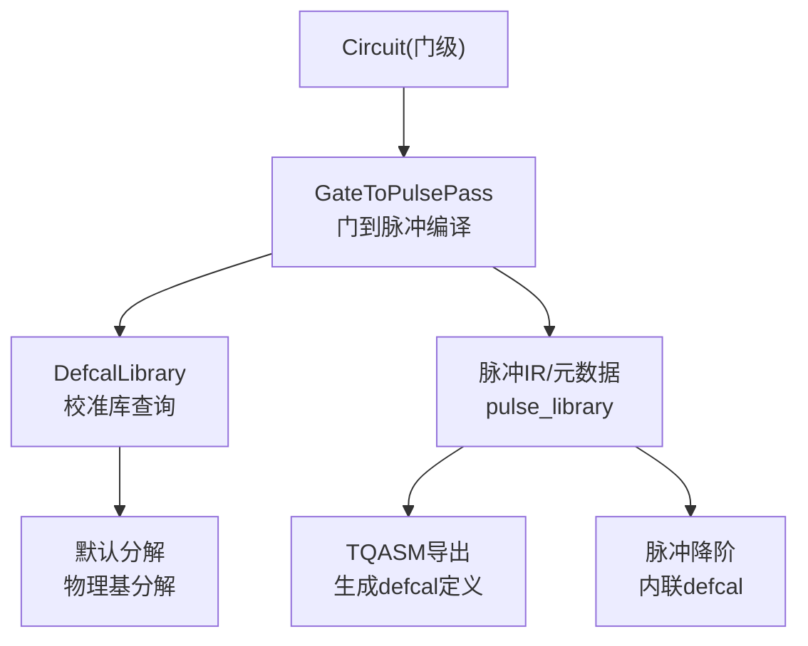
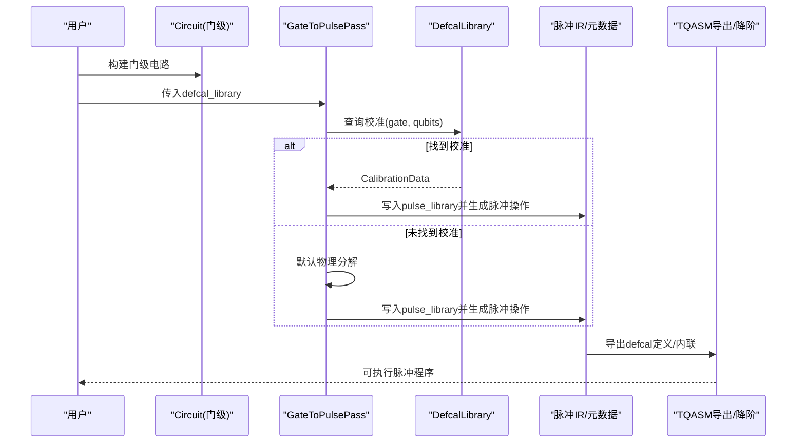
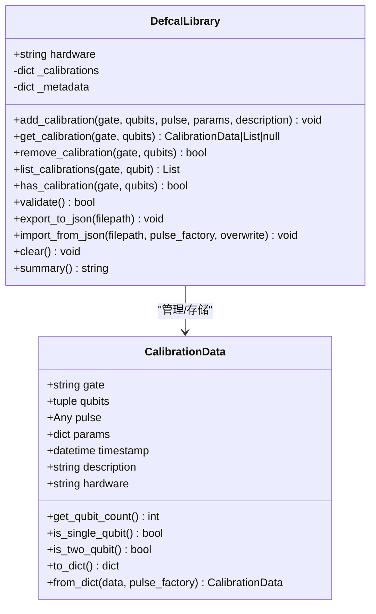
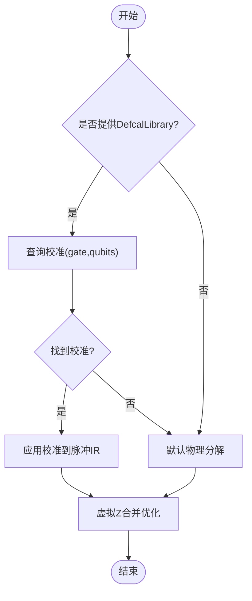
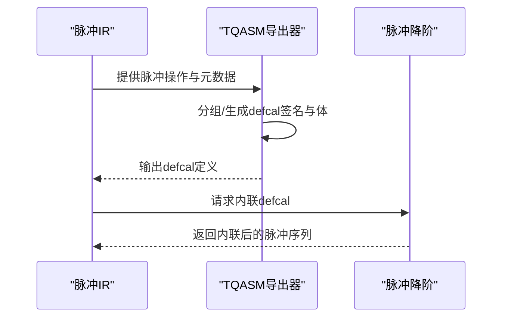
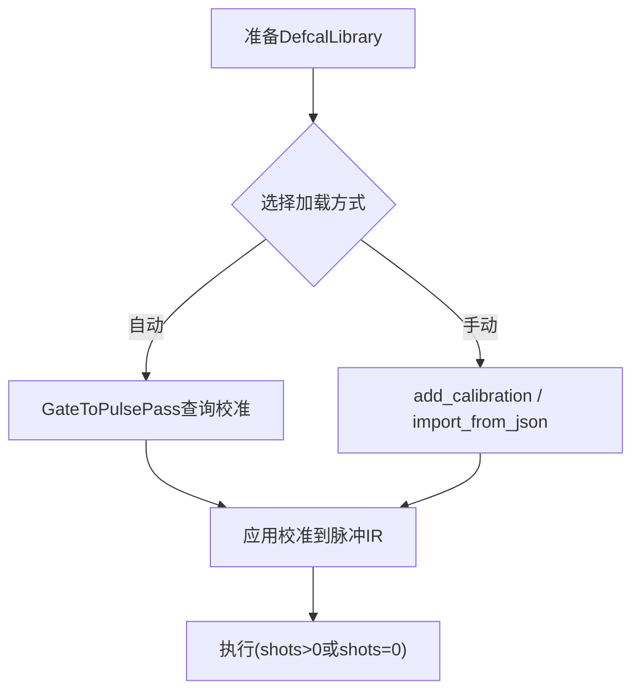
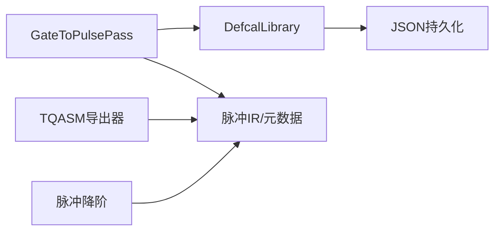

# DefCal库集成

<cite>
**本文引用的文件**
- [defcal_library.py](file://src/tyxonq/compiler/pulse_compiler/defcal_library.py)
- [gate_to_pulse.py](file://src/tyxonq/compiler/pulse_compiler/native/gate_to_pulse.py)
- [tqasm_exporter.py](file://src/tyxonq/compiler/pulse_compiler/native/tqasm_exporter.py)
- [pulse_lowering.py](file://src/tyxonq/compiler/pulse_compiler/native/pulse_lowering.py)
- [defcal_workflow_complete.py](file://examples/defcal_workflow_complete.py)
- [defcal_performance_analysis.py](file://examples/defcal_performance_analysis.py)
- [test_defcal_library.py](file://tests_core_module/test_defcal_library.py)
- [test_defcal_integration.py](file://tests_core_module/test_defcal_integration.py)
- [pulse_support_cn.md](file://docs/pulse_support_cn.md)
</cite>

## 目录
1. [简介](#简介)
2. [项目结构](#项目结构)
3. [核心组件](#核心组件)
4. [架构总览](#架构总览)
5. [详细组件分析](#详细组件分析)
6. [依赖关系分析](#依赖关系分析)
7. [性能考量](#性能考量)
8. [故障排查指南](#故障排查指南)
9. [结论](#结论)
10. [附录](#附录)

## 简介
本技术文档面向需要在脉冲编译器中集成DefCal（Definition Calibration）的工程师与研究人员。DefCal用于将硬件特定的校准数据（如脉冲幅度、持续时间、相位校正、频率偏移等）以结构化方式存储、查询与应用，从而在门到脉冲编译阶段优先使用用户提供的校准波形，提升量子门操作的保真度与可靠性。本文涵盖：
- DefCal语言的概念与作用
- 校准数据结构、版本管理与设备特定配置
- 校准数据的加载与应用流程（自动检测与手动配置）
- 常用校准参数的含义与影响
- 完整校准工作流示例（从数据采集到参数应用）
- 校准验证与质量评估（保真度测试、性能监控）
- 设备特定脉冲优化实践

## 项目结构
围绕DefCal的核心代码位于脉冲编译器模块中，关键文件包括：
- 校准库管理：defcal_library.py
- 门到脉冲编译：gate_to_pulse.py
- TQASM导出（生成defcal定义）：tqasm_exporter.py
- 脉冲降阶（内联defcal定义）：pulse_lowering.py
- 端到端示例与性能分析：examples下的defcal_workflow_complete.py、defcal_performance_analysis.py
- 单元测试：tests_core_module下的test_defcal_library.py、test_defcal_integration.py

图表来源
- [gate_to_pulse.py:64-115](file://src/tyxonq/compiler/pulse_compiler/native/gate_to_pulse.py#L64-L115)
- [defcal_library.py:153-205](file://src/tyxonq/compiler/pulse_compiler/defcal_library.py#L153-L205)
- [tqasm_exporter.py:312-349](file://src/tyxonq/compiler/pulse_compiler/native/tqasm_exporter.py#L312-L349)
- [pulse_lowering.py:1-12](file://src/tyxonq/compiler/pulse_compiler/native/pulse_lowering.py#L1-L12)

章节来源
- [gate_to_pulse.py:64-115](file://src/tyxonq/compiler/pulse_compiler/native/gate_to_pulse.py#L64-L115)
- [defcal_library.py:153-205](file://src/tyxonq/compiler/pulse_compiler/defcal_library.py#L153-L205)

## 核心组件
- DefcalLibrary：集中管理硬件相关的门校准数据，支持添加、查询、删除、列表、验证、JSON导入导出、摘要输出等。
- CalibrationData：单条校准记录的数据类，包含门名、目标量子比特、脉冲对象、参数、时间戳、描述、设备标识等。
- GateToPulsePass：门到脉冲编译主流程，优先使用DefcalLibrary中的校准，否则回退到默认物理分解；同时优化虚拟Z操作。
- TQASM导出器：将脉冲操作分组并生成defcal签名与体，便于跨系统复用与部署。
- 脉冲降阶：将defcal定义内联为具体脉冲操作，移除抽象层以便直接执行。

章节来源
- [defcal_library.py:39-151](file://src/tyxonq/compiler/pulse_compiler/defcal_library.py#L39-L151)
- [defcal_library.py:153-565](file://src/tyxonq/compiler/pulse_compiler/defcal_library.py#L153-L565)
- [gate_to_pulse.py:38-115](file://src/tyxonq/compiler/pulse_compiler/native/gate_to_pulse.py#L38-L115)
- [tqasm_exporter.py:312-349](file://src/tyxonq/compiler/pulse_compiler/native/tqasm_exporter.py#L312-L349)
- [pulse_lowering.py:1-12](file://src/tyxonq/compiler/pulse_compiler/native/pulse_lowering.py#L1-L12)

## 架构总览
下图展示了从门级电路到脉冲级执行的完整路径，以及DefCal在其中的作用点。

图表来源
- [gate_to_pulse.py:137-192](file://src/tyxonq/compiler/pulse_compiler/native/gate_to_pulse.py#L137-L192)
- [gate_to_pulse.py:798-826](file://src/tyxonq/compiler/pulse_compiler/native/gate_to_pulse.py#L798-L826)
- [tqasm_exporter.py:312-349](file://src/tyxonq/compiler/pulse_compiler/native/tqasm_exporter.py#L312-L349)
- [pulse_lowering.py:1-12](file://src/tyxonq/compiler/pulse_compiler/native/pulse_lowering.py#L1-L12)

## 详细组件分析

### DefcalLibrary与CalibrationData
- 数据结构
  - CalibrationData：封装单条校准，提供to_dict/from_dict序列化能力，支持时间戳与设备标识，便于版本追踪与设备隔离。
  - DefcalLibrary：内部以(gate, qubits)为键存储校准，支持精确匹配与按门/量子比特过滤列表查询；提供validate校验、export/import JSON持久化、summary汇总。
- 复杂度
  - 添加/查询/删除均为O(1)哈希表操作；列表过滤为O(N)。
- 错误处理
  - 输入校验（门名、量子比特索引、脉冲对象非空），导入时版本兼容性警告与硬件不匹配警告。
- 典型用法
  - 创建库→添加单/多量子比特校准→导出JSON→在其他环境导入→编译时使用。

图表来源
- [defcal_library.py:39-151](file://src/tyxonq/compiler/pulse_compiler/defcal_library.py#L39-L151)
- [defcal_library.py:153-565](file://src/tyxonq/compiler/pulse_compiler/defcal_library.py#L153-L565)

章节来源
- [defcal_library.py:39-151](file://src/tyxonq/compiler/pulse_compiler/defcal_library.py#L39-L151)
- [defcal_library.py:153-565](file://src/tyxonq/compiler/pulse_compiler/defcal_library.py#L153-L565)
- [test_defcal_library.py:1-200](file://tests_core_module/test_defcal_library.py#L1-L200)

### GateToPulsePass与DefCal集成
- 优先级策略
  1) 若提供DefcalLibrary，则优先查询校准；2) 否则检查旧版circuit metadata中的校准；3) 最后使用默认物理分解。
- 支持的门
  - 单量子比特：x/y/z/h等；双量子比特：cx/cz/iswap/swap等。
- 虚拟Z优化
  - 合并相邻同量子比特的virtual_z操作，减少相位帧更新次数。
- 应用校准
  - 将校准中的脉冲对象存入circuit.metadata["pulse_library"]，并返回对应的脉冲操作。

图表来源
- [gate_to_pulse.py:64-115](file://src/tyxonq/compiler/pulse_compiler/native/gate_to_pulse.py#L64-L115)
- [gate_to_pulse.py:137-192](file://src/tyxonq/compiler/pulse_compiler/native/gate_to_pulse.py#L137-L192)
- [gate_to_pulse.py:798-826](file://src/tyxonq/compiler/pulse_compiler/native/gate_to_pulse.py#L798-L826)
- [gate_to_pulse.py:833-908](file://src/tyxonq/compiler/pulse_compiler/native/gate_to_pulse.py#L833-L908)

章节来源
- [gate_to_pulse.py:64-115](file://src/tyxonq/compiler/pulse_compiler/native/gate_to_pulse.py#L64-L115)
- [gate_to_pulse.py:137-192](file://src/tyxonq/compiler/pulse_compiler/native/gate_to_pulse.py#L137-L192)
- [gate_to_pulse.py:798-826](file://src/tyxonq/compiler/pulse_compiler/native/gate_to_pulse.py#L798-L826)
- [gate_to_pulse.py:833-908](file://src/tyxonq/compiler/pulse_compiler/native/gate_to_pulse.py#L833-L908)

### TQASM导出与脉冲降阶
- TQASM导出
  - 分析脉冲操作并按门分组，生成defcal签名与体（包含波形定义、相位偏移、播放指令）。
- 脉冲降阶
  - 将defcal定义展开为内联脉冲操作，消除抽象层，便于直接执行。

图表来源
- [tqasm_exporter.py:312-349](file://src/tyxonq/compiler/pulse_compiler/native/tqasm_exporter.py#L312-L349)
- [pulse_lowering.py:1-12](file://src/tyxonq/compiler/pulse_compiler/native/pulse_lowering.py#L1-L12)

章节来源
- [tqasm_exporter.py:312-349](file://src/tyxonq/compiler/pulse_compiler/native/tqasm_exporter.py#L312-L349)
- [pulse_lowering.py:1-12](file://src/tyxonq/compiler/pulse_compiler/native/pulse_lowering.py#L1-L12)

### 校准数据加载与应用流程
- 自动检测
  - 编译时GateToPulsePass自动查询DefcalLibrary；若无则回退默认分解。
- 手动配置
  - 通过DefcalLibrary.add_calibration手工添加；或通过import_from_json批量导入。
- 常见模式
  - 初始化库→导入JSON→构建电路→编译→执行（采样或理想态）。

图表来源
- [defcal_library.py:206-303](file://src/tyxonq/compiler/pulse_compiler/defcal_library.py#L206-L303)
- [defcal_library.py:422-512](file://src/tyxonq/compiler/pulse_compiler/defcal_library.py#L422-L512)
- [gate_to_pulse.py:137-192](file://src/tyxonq/compiler/pulse_compiler/native/gate_to_pulse.py#L137-L192)

章节来源
- [defcal_library.py:206-303](file://src/tyxonq/compiler/pulse_compiler/defcal_library.py#L206-L303)
- [defcal_library.py:422-512](file://src/tyxonq/compiler/pulse_compiler/defcal_library.py#L422-L512)
- [gate_to_pulse.py:137-192](file://src/tyxonq/compiler/pulse_compiler/native/gate_to_pulse.py#L137-L192)

### 常用校准参数及其影响
- 脉冲幅度（amp）
  - 控制旋转角度与保真度；过高可能导致泄漏，过低导致噪声敏感。
- 持续时间（duration）
  - 决定门时间与退相干权衡；过长增加T1/T2损耗，过短可能频谱泄漏。
- 相位校正（phase/angle）
  - 实现Y旋转或相对相位调整；对干涉与纠缠至关重要。
- 频率偏移（drive_freq/qubit_freq/anharmonicity）
  - 确保驱动频率与量子比特共振；避免串扰与失谐误差。
- DRAG参数（sigma, beta）
  - 抑制泄漏到|2⟩态，提高单量子比特门保真度。

章节来源
- [pulse_support_cn.md:184-250](file://docs/pulse_support_cn.md#L184-L250)

### 完整校准工作流示例
- 步骤概览
  1) 硬件表征：测量各门在各量子比特上的最优脉冲参数。
  2) 创建DefcalLibrary：组织校准数据，标注设备与描述。
  3) 保存JSON：跨会话/系统复用。
  4) 构建门级电路：H/X/CX等。
  5) 编译：GateToPulsePass优先使用校准。
  6) 执行：两种模式——采样(shots>0)与理想态(shots=0)。
- 参考示例
  - 端到端工作流：defcal_workflow_complete.py
  - 性能与可扩展性分析：defcal_performance_analysis.py

章节来源
- [defcal_workflow_complete.py:1-530](file://examples/defcal_workflow_complete.py#L1-L530)
- [defcal_performance_analysis.py:1-392](file://examples/defcal_performance_analysis.py#L1-L392)

### 校准验证与质量评估
- 保真度测试
  - 制备Bell态并测量保真度；期望值通常在95%以上（取决于设备与校准质量）。
- CHSH不等式测试
  - 验证纠缠质量，S > 2.7表明真实量子关联。
- 误差来源分析
  - 门不完美、退相干(T1/T2)、态制备误差、测量误差、串扰。
- 性能监控
  - 编译时间开销对比（有/无DefCal）、测量统计分布、状态保真度、随电路深度扩展性。

章节来源
- [pulse_calibration_workflow.rst:333-376](file://docs/source/tutorials/advanced/pulse_calibration_workflow.rst#L333-L376)
- [defcal_performance_analysis.py:70-141](file://examples/defcal_performance_analysis.py#L70-L141)

### 设备特定脉冲优化
- 策略
  - 针对不同量子比特异构性，分别标定X/H/CX等门的幅度、持续时间、DRAG参数。
  - 利用虚拟Z优化减少相位帧更新，降低时序开销。
  - 在双量子比特门中使用交叉共振与回波脉冲抑制误差项。
- 实践要点
  - 定期重新标定（漂移检测）；维护高斯基线作为回退方案；版本控制校准文件。

章节来源
- [gate_to_pulse.py:381-495](file://src/tyxonq/compiler/pulse_compiler/native/gate_to_pulse.py#L381-L495)
- [gate_to_pulse.py:833-908](file://src/tyxonq/compiler/pulse_compiler/native/gate_to_pulse.py#L833-L908)

## 依赖关系分析
- 组件耦合
  - GateToPulsePass依赖DefcalLibrary进行校准查询；两者均与脉冲IR/元数据交互。
  - TQASM导出器与脉冲降阶作用于脉冲IR，形成“导出—内联”闭环。
- 外部依赖
  - 波形模块（waveforms）用于默认分解与示例；JSON用于校准持久化。
- 循环依赖
  - 未见明显循环依赖；模块职责清晰。

图表来源
- [gate_to_pulse.py:64-115](file://src/tyxonq/compiler/pulse_compiler/native/gate_to_pulse.py#L64-L115)
- [defcal_library.py:422-512](file://src/tyxonq/compiler/pulse_compiler/defcal_library.py#L422-L512)
- [tqasm_exporter.py:312-349](file://src/tyxonq/compiler/pulse_compiler/native/tqasm_exporter.py#L312-L349)
- [pulse_lowering.py:1-12](file://src/tyxonq/compiler/pulse_compiler/native/pulse_lowering.py#L1-L12)

章节来源
- [gate_to_pulse.py:64-115](file://src/tyxonq/compiler/pulse_compiler/native/gate_to_pulse.py#L64-L115)
- [defcal_library.py:422-512](file://src/tyxonq/compiler/pulse_compiler/defcal_library.py#L422-L512)
- [tqasm_exporter.py:312-349](file://src/tyxonq/compiler/pulse_compiler/native/tqasm_exporter.py#L312-L349)
- [pulse_lowering.py:1-12](file://src/tyxonq/compiler/pulse_compiler/native/pulse_lowering.py#L1-L12)

## 性能考量
- 编译开销
  - DefCal查询引入的额外开销极小；基准显示线性扩展至更大电路。
- 保真度收益
  - 使用设备特定校准可显著提升门保真度；建议始终优先使用DefCal。
- 执行模式
  - 理想态(shots=0)用于快速验证算法；采样(shots>0)用于贴近硬件行为。
- 可扩展性
  - 随着电路深度增加，编译与仿真时间呈线性增长；适合大规模电路。

章节来源
- [defcal_performance_analysis.py:70-141](file://examples/defcal_performance_analysis.py#L70-L141)
- [defcal_performance_analysis.py:283-335](file://examples/defcal_performance_analysis.py#L283-L335)

## 故障排查指南
- 常见问题
  - 校准缺失：编译时回退默认分解；检查DefcalLibrary是否已正确加载。
  - 硬件不匹配：导入JSON时发出警告；确认hardware字段一致。
  - 无效参数：validate失败；检查门名、量子比特索引、脉冲对象与params结构。
- 调试建议
  - 使用summary查看库内容；通过list_calibrations过滤问题门/量子比特。
  - 在GateToPulsePass中打印或记录查询结果，定位未命中原因。
  - 对波形参数进行±10%扫描，验证鲁棒性与容差带。

章节来源
- [defcal_library.py:382-420](file://src/tyxonq/compiler/pulse_compiler/defcal_library.py#L382-L420)
- [defcal_library.py:455-512](file://src/tyxonq/compiler/pulse_compiler/defcal_library.py#L455-L512)
- [test_defcal_integration.py:127-160](file://tests_core_module/test_defcal_integration.py#L127-L160)

## 结论
DefCal为TyxonQ提供了强大的硬件感知编译能力。通过集中管理校准数据并在编译阶段优先应用，显著提升了量子门保真度与系统稳定性。结合TQASM导出与脉冲降阶，可实现从校准采集到部署执行的完整闭环。建议在工程实践中：
- 建立规范的校准流程与版本管理
- 定期重标定并监控漂移
- 使用两种执行模式进行验证与回归
- 持续优化设备特定参数以提升精度与可靠性

## 附录
- 快速上手
  - 创建库→添加校准→导出JSON→导入→编译→执行
- 推荐工具
  - 使用示例脚本进行端到端演示与性能分析
- 参考资料
  - 脉冲波形参数说明与约束条件

章节来源
- [defcal_workflow_complete.py:467-529](file://examples/defcal_workflow_complete.py#L467-L529)
- [pulse_support_cn.md:184-250](file://docs/pulse_support_cn.md#L184-L250)