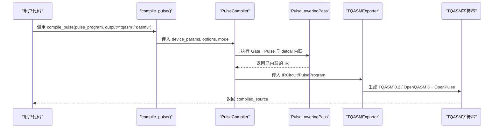
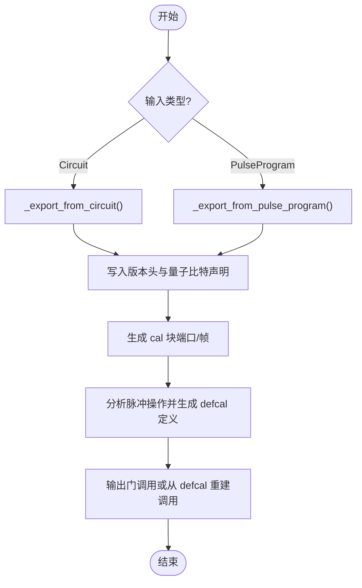
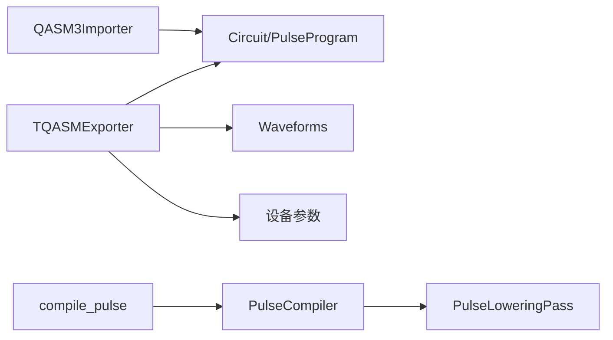

# TQASM导出器

<cite>
**本文引用的文件**
- [tqasm_exporter.py](file://src/tyxonq/compiler/pulse_compiler/native/tqasm_exporter.py)
- [qasm3_importer.py](file://src/tyxonq/compiler/pulse_compiler/native/qasm3_importer.py)
- [pulse.py](file://src/tyxonq/core/ir/pulse.py)
- [waveforms.py](file://src/tyxonq/waveforms.py)
- [test_tqasm_version_declaration.py](file://tests_core_module/test_tqasm_version_declaration.py)
- [test_tqasm_defcal_export.py](file://tests_core_module/test_tqasm_defcal_export.py)
- [pulse_lowering.py](file://src/tyxonq/compiler/pulse_compiler/native/pulse_lowering.py)
- [pulse_compiler.py](file://src/tyxonq/compiler/pulse_compiler/native/pulse_compiler.py)
- [api.py](file://src/tyxonq/compiler/api.py)
- [pulse_support_cn.md](file://docs/pulse_support_cn.md)
</cite>

## 目录
1. [简介](#简介)
2. [项目结构](#项目结构)
3. [核心组件](#核心组件)
4. [架构总览](#架构总览)
5. [详细组件分析](#详细组件分析)
6. [依赖关系分析](#依赖关系分析)
7. [性能与实现特性](#性能与实现特性)
8. [故障排查指南](#故障排查指南)
9. [结论](#结论)
10. [附录：TQASM格式规范与示例](#附录tqasm格式规范与示例)

## 简介
本技术文档围绕 TyxonQ 的 TQASM 导出器展开，系统性说明 TQASM 0.2 / OpenQASM 3 + OpenPulse 的设计目标、语法规范、序列化流程、版本管理、互操作性以及调试验证方法。重点覆盖：
- TQASM 格式设计理念与语法（兼容 OpenQASM 3.0 并扩展 OpenPulse）
- 脉冲序列序列化：波形参数、时序信息、设备配置编码
- TQASM 文件结构与版本管理：元数据、指令格式、数据类型
- 完整示例：从简单脉冲到复杂量子电路的导出结果
- 与其他编译器/仿真器的互操作：导入导出与格式转换
- 调试与验证工具使用方法
- 最佳实践：确保导出的脉冲在目标硬件上正确执行

## 项目结构
TQASM 导出能力位于脉冲编译子系统中，核心由“导出器”和“导入器”构成，配合 IR 层的数据模型与波形库，形成完整的“门级→脉冲级→TQASM/OpenQASM3”双向通道。

```mermaid
graph TB
subgraph "IR与波形"
P["PulseProgram<br/>Circuit"]
W["Waveforms<br/>Gaussian/Drag/Constant等"]
end
subgraph "编译器"
PC["PulseCompiler<br/>Passes编排"]
PL["PulseLoweringPass<br/>内联defcal"]
TE["TQASMExporter<br/>导出TQASM/OpenQASM3"]
TI["QASM3Importer<br/>导入OpenQASM3+OpenPulse"]
end
subgraph "API"
API["compile_pulse()<br/>统一入口"]
end
P --> PC
PC --> PL
PL --> TE
W --> TE
TE --> |输出| TQASM["TQASM 0.2 / OpenQASM 3 + OpenPulse"]
TQASM --> TI
TI --> |输入| P
API --> PC
```

图表来源
- [tqasm_exporter.py:24-128](file://src/tyxonq/compiler/pulse_compiler/native/tqasm_exporter.py#L24-L128)
- [qasm3_importer.py:84-143](file://src/tyxonq/compiler/pulse_compiler/native/qasm3_importer.py#L84-L143)
- [pulse.py:71-138](file://src/tyxonq/core/ir/pulse.py#L71-L138)
- [waveforms.py:19-157](file://src/tyxonq/waveforms.py#L19-L157)
- [pulse_compiler.py:138-163](file://src/tyxonq/compiler/pulse_compiler/native/pulse_compiler.py#L138-L163)
- [api.py:434-463](file://src/tyxonq/compiler/api.py#L434-L463)

章节来源
- [tqasm_exporter.py:24-128](file://src/tyxonq/compiler/pulse_compiler/native/tqasm_exporter.py#L24-L128)
- [qasm3_importer.py:84-143](file://src/tyxonq/compiler/pulse_compiler/native/qasm3_importer.py#L84-L143)
- [pulse.py:71-138](file://src/tyxonq/core/ir/pulse.py#L71-L138)
- [waveforms.py:19-157](file://src/tyxonq/waveforms.py#L19-L157)
- [pulse_compiler.py:138-163](file://src/tyxonq/compiler/pulse_compiler/native/pulse_compiler.py#L138-L163)
- [api.py:434-463](file://src/tyxonq/compiler/api.py#L434-L463)

## 核心组件
- TQASMExporter：将 TyxonQ 脉冲 IR（Circuit/PulseProgram）导出为 TQASM 0.2 或 OpenQASM 3 + OpenPulse 文本。支持两种版本风格：
  - openqasm3：标准 OPENQASM 3.0 + defcalgrammar "openpulse"
  - tyxonq_homebrew_tqasm：TQASM 0.2 头 + qreg 风格声明（用于 homebrew_s2 等特定后端）
- QASM3Importer：反向解析 TQASM/OpenQASM3 + OpenPulse 源，构建 Circuit IR 与元数据（帧、defcal）。
- PulseProgram/Circuit：IR 层数据结构，承载脉冲操作、设备参数与元数据。
- Waveforms：波形类型定义（Gaussian、Drag、Constant、GaussianSquare、CosineDrag、Flattop、Hermite、BlackmanSquare 等），提供 qasm_name() 与 to_args() 以适配导出。
- PulseLoweringPass：将符号化的 pulse 引用内联为可直接序列化的 waveform_dict，便于导出器生成稳定文本。
- PulseCompiler：编排 Gate→Pulse→Scheduling 流水线，控制模式（如 pulse_only）、支持的波形过滤等。
- compile_pulse API：统一入口，自动选择平台、输出格式、设备参数传递与缓存。

章节来源
- [tqasm_exporter.py:24-128](file://src/tyxonq/compiler/pulse_compiler/native/tqasm_exporter.py#L24-L128)
- [qasm3_importer.py:84-143](file://src/tyxonq/compiler/pulse_compiler/native/qasm3_importer.py#L84-L143)
- [pulse.py:71-138](file://src/tyxonq/core/ir/pulse.py#L71-L138)
- [waveforms.py:19-157](file://src/tyxonq/waveforms.py#L19-L157)
- [pulse_lowering.py:22-68](file://src/tyxonq/compiler/pulse_compiler/native/pulse_lowering.py#L22-L68)
- [pulse_compiler.py:138-163](file://src/tyxonq/compiler/pulse_compiler/native/pulse_compiler.py#L138-L163)
- [api.py:434-463](file://src/tyxonq/compiler/api.py#L434-L463)

## 架构总览
TQASM 导出链路遵循“IR → Passes → 导出器”的分层设计，保证可测试性与可扩展性。



图表来源
- [api.py:434-463](file://src/tyxonq/compiler/api.py#L434-L463)
- [pulse_compiler.py:138-163](file://src/tyxonq/compiler/pulse_compiler/native/pulse_compiler.py#L138-L163)
- [pulse_lowering.py:22-68](file://src/tyxonq/compiler/pulse_compiler/native/pulse_lowering.py#L22-L68)
- [tqasm_exporter.py:129-295](file://src/tyxonq/compiler/pulse_compiler/native/tqasm_exporter.py#L129-L295)

## 详细组件分析

### TQASMExporter：导出器
- 职责
  - 识别输入类型（Circuit 或 PulseProgram），分别走不同路径生成 TQASM。
  - 生成头部（OPENQASM 3.0 或 TQASM 0.2）、量子比特声明（qubit[n] 或 qreg）、cal 块（端口与帧）、defcal 定义、门调用。
  - 将波形对象或字典转换为 OpenPulse 语法（drag/gaussian/constant/gaussian_square 等），时间单位使用 dt。
  - 处理相位偏移（shift_phase）与虚拟 Z（virtual_z）映射。
- 关键流程
  - export()：分发至 _export_from_circuit() 或 _export_from_pulse_program()。
  - _analyze_pulse_operations()/_analyze_pulse_program_operations()：按门分组，推断 gate_key，收集端口与帧。
  - _generate_cal_block()：根据设备参数生成 extern port 与 newframe。
  - _generate_defcal()：为每个门生成 defcal body（波形定义、play、phase 调整）。
  - _export_waveform_openpulse()/dict：将波形对象/字典转为 OpenPulse 波形语句。
  - _export_gate_operation()：将标准门（h/x/y/rx/ry/rz/cx/cz/measure/barrier 等）输出为 TQASM 语句。
- 版本策略
  - openqasm3：输出 OPENQASM 3.0 + defcalgrammar "openpulse"，使用 qubit[n] 声明。
  - tyxonq_homebrew_tqasm：输出 TQASM 0.2，使用 qreg q[n]; 风格（兼容 homebrew_s2）。



图表来源
- [tqasm_exporter.py:129-295](file://src/tyxonq/compiler/pulse_compiler/native/tqasm_exporter.py#L129-L295)
- [tqasm_exporter.py:344-591](file://src/tyxonq/compiler/pulse_compiler/native/tqasm_exporter.py#L344-L591)
- [tqasm_exporter.py:593-733](file://src/tyxonq/compiler/pulse_compiler/native/tqasm_exporter.py#L593-L733)

章节来源
- [tqasm_exporter.py:24-128](file://src/tyxonq/compiler/pulse_compiler/native/tqasm_exporter.py#L24-L128)
- [tqasm_exporter.py:129-295](file://src/tyxonq/compiler/pulse_compiler/native/tqasm_exporter.py#L129-L295)
- [tqasm_exporter.py:344-591](file://src/tyxonq/compiler/pulse_compiler/native/tqasm_exporter.py#L344-L591)
- [tqasm_exporter.py:593-733](file://src/tyxonq/compiler/pulse_compiler/native/tqasm_exporter.py#L593-L733)

### QASM3Importer：导入器
- 职责
  - 解析 QASM3 + OpenPulse 源：量子比特声明、cal 块（端口/帧）、defcal 定义、门操作。
  - 将解析结果转换为 Circuit IR，并将帧与 defcal 信息存入 metadata，供后续执行或回写。
- 关键流程
  - Tokenize/Parse：提取 num_qubits、frames、defcals、gates。
  - 支持多种门与测量，角度表达式解析（含 pi、三角函数）。
  - 将 defcal 体作为字符串存储，便于后续执行或再编译。

```mermaid
sequenceDiagram
participant SRC as "QASM3/OpenPulse源"
participant TOK as "QASM3Tokenizer"
participant PAR as "QASM3Parser"
participant CIR as "Circuit IR"
SRC->>TOK : 去除注释/空行
TOK-->>PAR : tokens
PAR->>PAR : 解析 qubit/n, cal, defcal, gates
PAR-->>CIR : 构建 ops + metadata(frames/defcals)
```

图表来源
- [qasm3_importer.py:84-143](file://src/tyxonq/compiler/pulse_compiler/native/qasm3_importer.py#L84-L143)
- [qasm3_importer.py:145-331](file://src/tyxonq/compiler/pulse_compiler/native/qasm3_importer.py#L145-L331)
- [qasm3_importer.py:333-396](file://src/tyxonq/compiler/pulse_compiler/native/qasm3_importer.py#L333-L396)

章节来源
- [qasm3_importer.py:84-143](file://src/tyxonq/compiler/pulse_compiler/native/qasm3_importer.py#L84-L143)
- [qasm3_importer.py:145-331](file://src/tyxonq/compiler/pulse_compiler/native/qasm3_importer.py#L145-L331)
- [qasm3_importer.py:333-396](file://src/tyxonq/compiler/pulse_compiler/native/qasm3_importer.py#L333-L396)

### PulseProgram/Circuit：IR 数据模型
- PulseProgram
  - 与 Circuit 平级的抽象，支持链式 API 与数值模拟。
  - 属性：num_qubits、ops（(qubit, waveform, params)）、device_params、metadata。
  - 方法：drag/gaussian/constant/cosine_drag、set_device_params、with_metadata、compile、run、state、to_circuit。
- Circuit
  - 通过 use_pulse() 进入脉冲模式，metadata 中携带 pulse_library、pulse_device_params 等。
  - 与 TQASMExporter 协作，支持脉冲操作的内联与 defcal 生成。

章节来源
- [pulse.py:71-138](file://src/tyxonq/core/ir/pulse.py#L71-L138)
- [pulse.py:154-357](file://src/tyxonq/core/ir/pulse.py#L154-L357)
- [pulse.py:360-493](file://src/tyxonq/core/ir/pulse.py#L360-L493)
- [pulse.py:496-648](file://src/tyxonq/core/ir/pulse.py#L496-L648)

### Waveforms：波形类型与导出
- 支持的波形类：Gaussian、GaussianSquare、Drag、Constant、Sine、Cosine、CosineDrag、Flattop、Hermite、BlackmanSquare。
- 每个类提供：
  - qasm_name()：导出时使用的波形函数名（如 drag、gaussian、constant、gaussian_square 等）。
  - to_args()：导出时的参数列表，顺序与目标语法一致。
- 导出器将波形对象或字典转换为 OpenPulse 波形语句，时间单位使用 dt，幅度为复数形式。

章节来源
- [waveforms.py:19-157](file://src/tyxonq/waveforms.py#L19-L157)
- [tqasm_exporter.py:593-681](file://src/tyxonq/compiler/pulse_compiler/native/tqasm_exporter.py#L593-L681)

### PulseLoweringPass：defcal 内联
- 作用：将符号化的 pulse 引用（("pulse", qubit, key, params)）替换为可直接序列化的 waveform_dict（("pulse_inline", qubit, {"type":"...","args":[...]}, params)）。
- 好处：使 TQASMExporter 能直接读取波形参数，无需依赖 Python 对象，提升跨进程/云端兼容性。

章节来源
- [pulse_lowering.py:22-68](file://src/tyxonq/compiler/pulse_compiler/native/pulse_lowering.py#L22-L68)
- [tqasm_exporter.py:376-387](file://src/tyxonq/compiler/pulse_compiler/native/tqasm_exporter.py#L376-L387)

### PulseCompiler：编译流水线
- 编排 Gate→Pulse 分解、defcal 内联、调度等 Pass。
- 支持模式选项（如 pulse_only）、supported_waveforms 过滤、inline_pulses 开关等。
- 将模式与选项传递给各 Pass，最终产出可用于导出的 IR。

章节来源
- [pulse_compiler.py:138-163](file://src/tyxonq/compiler/pulse_compiler/native/pulse_compiler.py#L138-L163)

### compile_pulse API：统一入口
- 自动处理设备判断、脉冲编译启用、输出格式转换、supported_waveforms 设置与缓存。
- 返回包含 compiled_pulse_schedule（TQASM/OpenQASM3 文本）的结构化结果。

章节来源
- [api.py:434-463](file://src/tyxonq/compiler/api.py#L434-L463)

## 依赖关系分析
- 模块耦合
  - TQASMExporter 依赖 IR（Circuit/PulseProgram）、波形库、设备参数；与 PulseLoweringPass 解耦但共享 IR 约定。
  - QASM3Importer 独立于导出器，仅依赖正则解析与 IR 构造。
  - PulseCompiler 协调多个 Pass，对外暴露统一接口。
- 外部依赖
  - OpenQASM 3.0 与 OpenPulse 语法约定（版本头、defcalgrammar、frame/newframe、play/shift_phase 等）。
- 潜在循环依赖
  - 通过条件 import（TYPE_CHECKING）与运行时延迟导入避免循环。



图表来源
- [tqasm_exporter.py:24-128](file://src/tyxonq/compiler/pulse_compiler/native/tqasm_exporter.py#L24-L128)
- [qasm3_importer.py:84-143](file://src/tyxonq/compiler/pulse_compiler/native/qasm3_importer.py#L84-L143)
- [pulse_compiler.py:138-163](file://src/tyxonq/compiler/pulse_compiler/native/pulse_compiler.py#L138-L163)
- [api.py:434-463](file://src/tyxonq/compiler/api.py#L434-L463)

章节来源
- [tqasm_exporter.py:24-128](file://src/tyxonq/compiler/pulse_compiler/native/tqasm_exporter.py#L24-L128)
- [qasm3_importer.py:84-143](file://src/tyxonq/compiler/pulse_compiler/native/qasm3_importer.py#L84-L143)
- [pulse_compiler.py:138-163](file://src/tyxonq/compiler/pulse_compiler/native/pulse_compiler.py#L138-L163)
- [api.py:434-463](file://src/tyxonq/compiler/api.py#L434-L463)

## 性能与实现特性
- 序列化效率
  - 通过 PulseLoweringPass 将脉冲引用内联为字典，减少运行时依赖，提高跨环境序列化稳定性。
  - 导出器对波形进行快速类型匹配与参数映射，避免昂贵计算。
- 内存与缓存
  - PulseProgram 缓存编译后的 TQASM 源码，避免重复编译开销。
- 可扩展性
  - 新增波形只需在 waveforms.py 中定义 qasm_name() 与 to_args()，并在导出器中补充映射逻辑。
- 错误处理
  - 对不支持的操作与非法参数抛出明确异常，便于定位问题。

[本节为通用性能讨论，不直接分析具体文件]

## 故障排查指南
- 常见问题
  - 未包含版本头或 defcalgrammar：检查是否选择了正确的输出格式与设备目标。
  - 缺少 cal 块或 frame：确认设备参数（如 qubit_freq）是否正确传入。
  - 波形未生效：确认 PulseLoweringPass 已将 pulse 引用内联为 pulse_inline。
  - 角度解析失败：检查 QASM3Importer 的角度表达式是否合法。
- 验证手段
  - 使用测试用例断言关键语法片段（版本头、qubit/qreg、cal、defcal、waveform、play 等）。
  - 通过 QASM3Importer 将生成的 TQASM 重新导入，校验 IR 一致性。
- 参考测试
  - 版本声明与差异对比
  - defcal 导出完整性与语法合规性

章节来源
- [test_tqasm_version_declaration.py:13-143](file://tests_core_module/test_tqasm_version_declaration.py#L13-L143)
- [test_tqasm_defcal_export.py:4-222](file://tests_core_module/test_tqasm_defcal_export.py#L4-L222)

## 结论
TyxonQ 的 TQASM 导出器实现了从脉冲 IR 到 TQASM 0.2 / OpenQASM 3 + OpenPulse 的稳定转换，具备以下优势：
- 双版本兼容：同时支持标准 OpenQASM 3.0 与 homebrew_s2 专用的 TQASM 0.2。
- 完整 OpenPulse 支持：端口、帧、波形、播放与相位操作均被正确序列化。
- 双向互操作：导入器可将 TQASM/OpenQASM3 还原为 IR，便于调试与再编译。
- 工程化完善：通过 Pass 机制、API 封装与测试覆盖，保障可靠性与可维护性。

[本节为总结性内容，不直接分析具体文件]

## 附录：TQASM格式规范与示例

### 设计理念与语法规范
- 基于 OpenQASM 3.0，扩展 OpenPulse 语法：
  - 版本声明：OPENQASM 3.0 或 TQASM 0.2
  - 脉冲语法：defcalgrammar "openpulse"
  - 物理量子比特：$0, $1, ...
  - 帧：newframe(port, frequency, phase)
  - 波形：drag/gaussian/constant/gaussian_square 等
  - 指令：play(frame, waveform)、shift_phase(frame, angle)
- BNF 与关键字说明参见文档中的语法定义与关键词表。

章节来源
- [tqasm_exporter.py:24-91](file://src/tyxonq/compiler/pulse_compiler/native/tqasm_exporter.py#L24-L91)
- [pulse_support_cn.md:39-94](file://docs/pulse_support_cn.md#L39-L94)

### 脉冲序列序列化过程
- 波形参数：振幅（可为复数）、持续时间（dt 单位）、形状参数（sigma、beta、width 等）。
- 时序信息：通过 play 指令在指定 frame 上播放波形；shift_phase 用于相位调整；虚拟 Z 映射为相位偏移。
- 设备配置：cal 块中声明 extern port 与 frame，频率来自设备参数（qubit_freq）。

章节来源
- [tqasm_exporter.py:465-591](file://src/tyxonq/compiler/pulse_compiler/native/tqasm_exporter.py#L465-L591)
- [tqasm_exporter.py:593-681](file://src/tyxonq/compiler/pulse_compiler/native/tqasm_exporter.py#L593-L681)

### TQASM 文件结构与版本管理
- 元数据：metadata 中保存 pulse_library、pulse_device_params、device_target 等。
- 指令格式：
  - 版本头：OPENQASM 3.0 或 TQASM 0.2
  - 量子比特声明：qubit[n] 或 qreg q[n]
  - cal 块：extern port、frame = newframe(...)
  - defcal：gate 校准定义，包含波形与播放指令
  - 门调用：标准门或从 defcal 重建的调用
- 版本选择规则：
  - homebrew_s2 + use_pulse() → TQASM 0.2（qreg 风格）
  - 其他设备 + use_pulse() → OpenQASM 3.0（qubit 风格）

章节来源
- [test_tqasm_version_declaration.py:13-143](file://tests_core_module/test_tqasm_version_declaration.py#L13-L143)
- [tqasm_exporter.py:93-128](file://src/tyxonq/compiler/pulse_compiler/native/tqasm_exporter.py#L93-L128)

### 完整示例（从简单脉冲到复杂电路）
- 简单单比特 H 门：
  - 包含 cal 块、frame、defcal h $0、waveform drag、play、h q[0]。
- 双比特 Bell 态：
  - 包含两个端口与帧、H 门 defcal、CX 相关 defcal（若存在显式脉冲定义）、门调用。
- 复杂电路：
  - 多门组合、参数化旋转、测量、barrier 等。

章节来源
- [test_tqasm_defcal_export.py:4-222](file://tests_core_module/test_tqasm_defcal_export.py#L4-L222)

### 与其他编译器/仿真器的互操作性
- 导出：将 TyxonQ 脉冲 IR 导出为标准 OpenQASM 3 + OpenPulse 文本，可提交至支持该格式的硬件或仿真器。
- 导入：通过 QASM3Importer 将外部 TQASM/OpenQASM3 源解析为 TyxonQ IR，便于本地调试与再编译。
- 格式转换：利用导入器与导出器实现不同前端之间的格式桥接。

章节来源
- [qasm3_importer.py:333-396](file://src/tyxonq/compiler/pulse_compiler/native/qasm3_importer.py#L333-L396)
- [tqasm_exporter.py:24-91](file://src/tyxonq/compiler/pulse_compiler/native/tqasm_exporter.py#L24-L91)

### 调试与验证工具
- 单元测试：
  - 版本声明测试：验证 TQASM 0.2 与 OpenQASM 3.0 的差异与正确性。
  - defcal 导出测试：断言语法完整性与规范符合性。
- 建议流程：
  - 生成 TQASM → 使用导入器重新解析 → 比较 IR 与元数据 → 回放执行验证。

章节来源
- [test_tqasm_version_declaration.py:13-143](file://tests_core_module/test_tqasm_version_declaration.py#L13-L143)
- [test_tqasm_defcal_export.py:4-222](file://tests_core_module/test_tqasm_defcal_export.py#L4-L222)

### 最佳实践
- 选择合适的波形：
  - Constant：快速测试，泄漏较高。
  - Gaussian：平滑过渡，泄漏较低。
  - DRAG：抑制泄漏态跃迁，适合高保真生产。
- 合理设置设备参数：
  - qubit_freq、anharmonicity、T1/T2 等需与实际硬件一致。
- 使用 inline_pulses：
  - 在需要跨进程/云端执行时，开启内联以确保自包含。
- 验证输出：
  - 通过导入器与测试用例双重验证，确保语法与语义正确。

章节来源
- [examples/pulse_calibration_tutorial/step_1_hardware_basics.py:282-318](file://examples/pulse_calibration_tutorial/step_1_hardware_basics.py#L282-L318)
- [pulse_compiler.py:138-163](file://src/tyxonq/compiler/pulse_compiler/native/pulse_compiler.py#L138-L163)