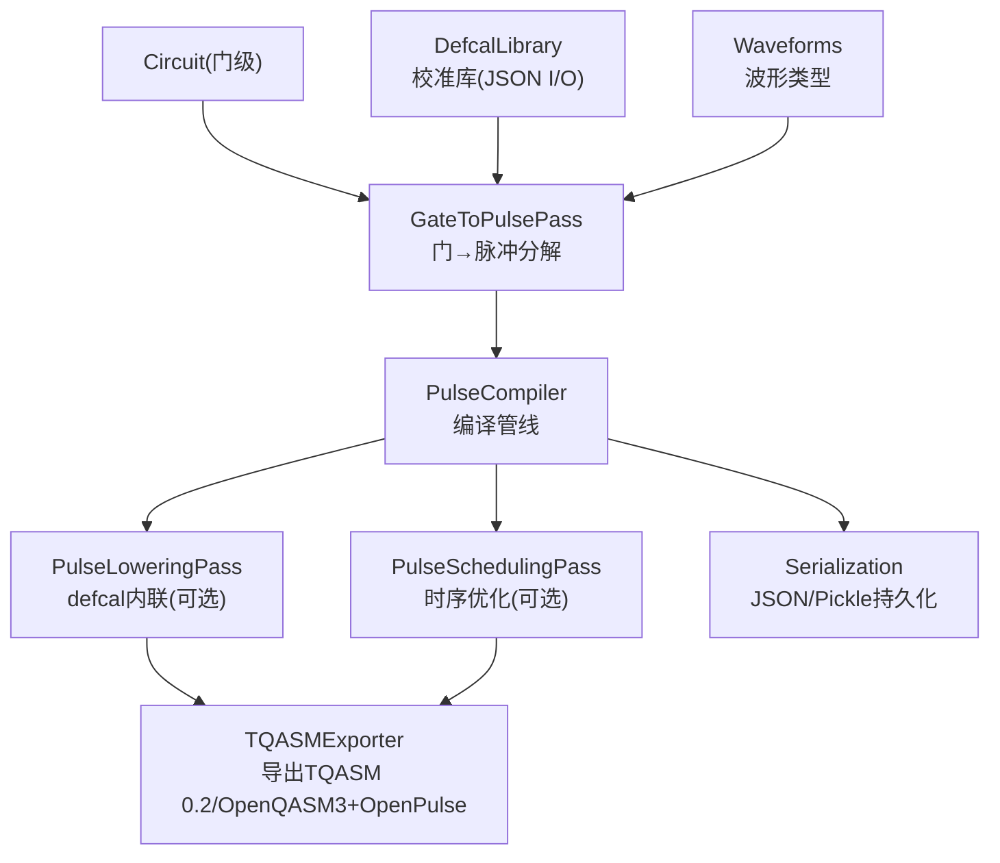
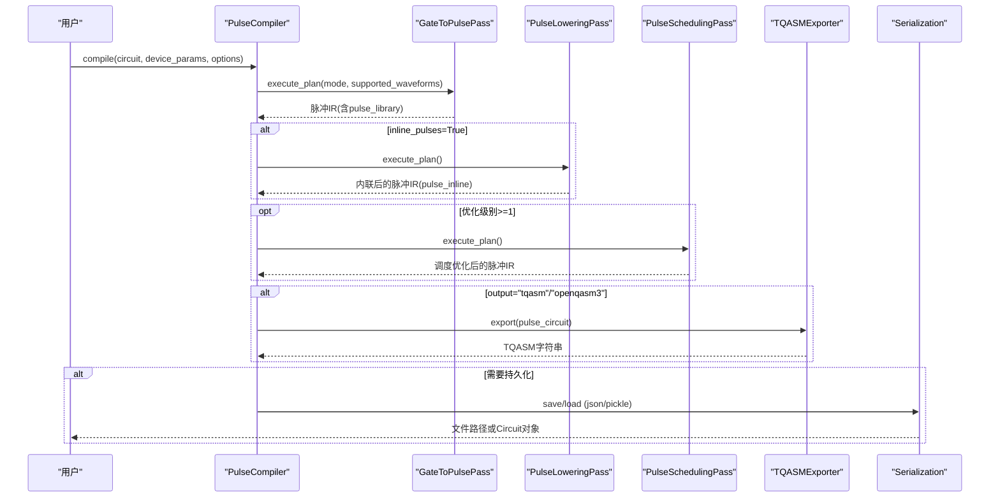
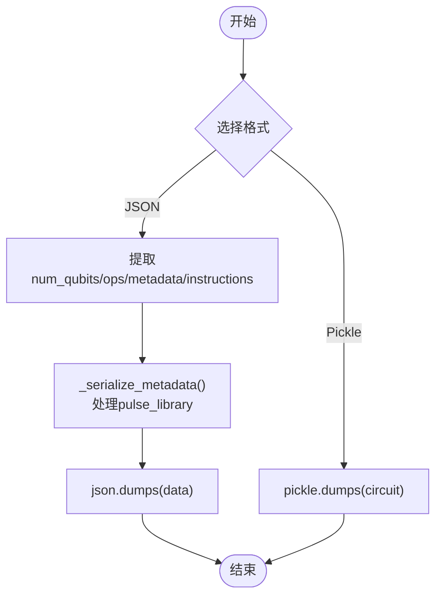
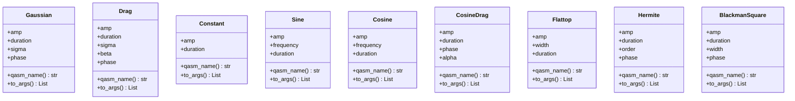
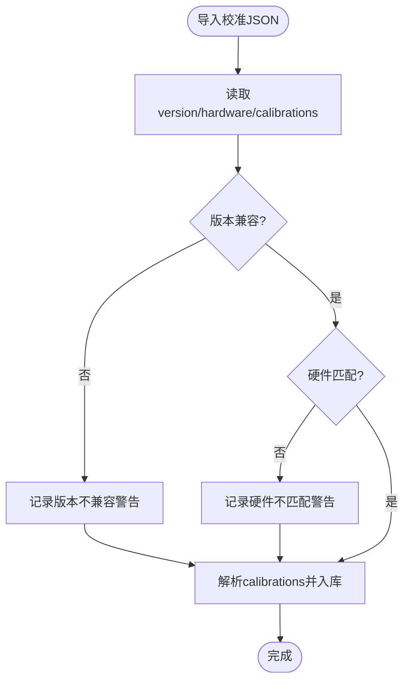
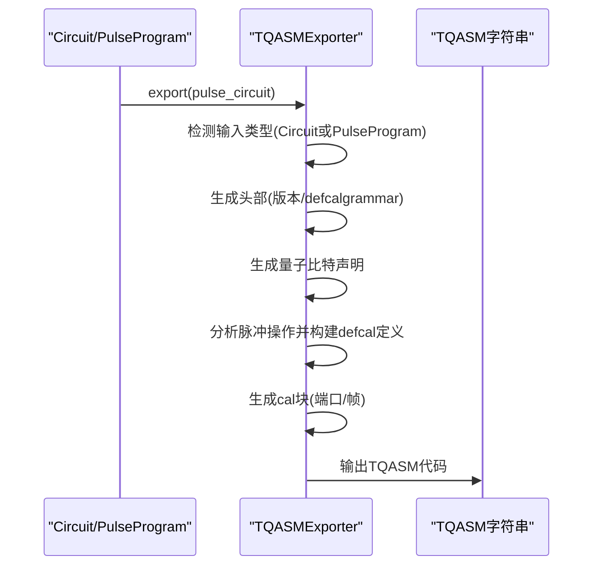
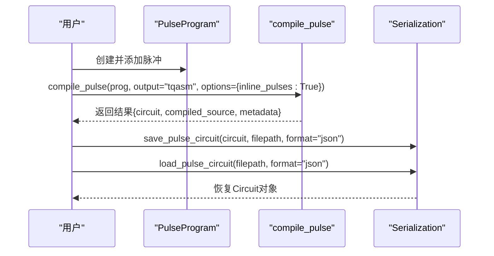
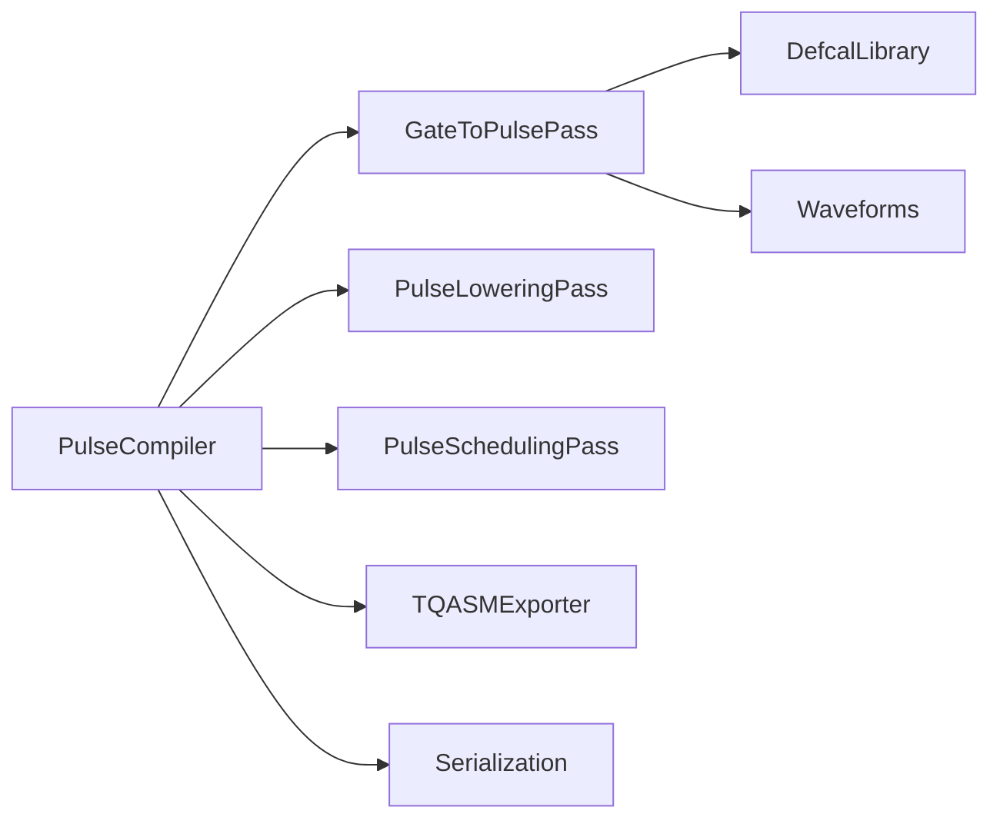

# 序列化系统

<cite>
**本文引用的文件**
- [serialization.py](file://src/tyxonq/compiler/pulse_compiler/serialization.py)
- [pulse_compiler.py](file://src/tyxonq/compiler/pulse_compiler/native/pulse_compiler.py)
- [gate_to_pulse.py](file://src/tyxonq/compiler/pulse_compiler/native/gate_to_pulse.py)
- [tqasm_exporter.py](file://src/tyxonq/compiler/pulse_compiler/native/tqasm_exporter.py)
- [waveforms.py](file://src/tyxonq/waveforms.py)
- [defcal_library.py](file://src/tyxonq/compiler/pulse_compiler/defcal_library.py)
- [test_pulse_complete_chain.py](file://tests_core_module/test_pulse_complete_chain.py)
- [test_defcal_library.py](file://tests_core_module/test_defcal_library.py)
</cite>

## 目录
1. [简介](#简介)
2. [项目结构](#项目结构)
3. [核心组件](#核心组件)
4. [架构总览](#架构总览)
5. [详细组件分析](#详细组件分析)
6. [依赖关系分析](#依赖关系分析)
7. [性能考虑](#性能考虑)
8. [故障排查指南](#故障排查指南)
9. [结论](#结论)
10. [附录](#附录)

## 简介
本技术文档聚焦于 TyxonQ 脉冲序列化系统，系统性阐述脉冲数据的序列化与反序列化机制，覆盖二进制与文本格式转换、支持的序列化格式（JSON、Pickle、TQASM/OpenQASM 3 + OpenPulse）、数据结构设计（脉冲序列、波形参数、设备配置等）、版本兼容性管理、性能优化方法、扩展新格式的接口与实现指南，以及端到端工作流程示例和错误处理调试技巧。

## 项目结构
TyxonQ 的脉冲序列化能力分布在以下模块：
- 脉冲编译器主流程：负责将门级电路转换为脉冲级 IR，并支持内联化与调度优化
- 波形定义：提供多种标准波形类型及其序列化元数据接口
- 校准库：管理硬件相关的门级校准，支持 JSON 导出/导入与版本兼容
- TQASM 导出器：将脉冲 IR 导出为 TQASM 0.2 / OpenQASM 3 + OpenPulse 代码
- 序列化/反序列化：提供 JSON 与 Pickle 两种持久化方式，便于文件存储与跨进程传输

图表来源
- [pulse_compiler.py:24-197](file://src/tyxonq/compiler/pulse_compiler/native/pulse_compiler.py#L24-L197)
- [gate_to_pulse.py:38-193](file://src/tyxonq/compiler/pulse_compiler/native/gate_to_pulse.py#L38-L193)
- [tqasm_exporter.py:24-200](file://src/tyxonq/compiler/pulse_compiler/native/tqasm_exporter.py#L24-L200)
- [serialization.py:26-240](file://src/tyxonq/compiler/pulse_compiler/serialization.py#L26-L240)
- [defcal_library.py:153-565](file://src/tyxonq/compiler/pulse_compiler/defcal_library.py#L153-L565)
- [waveforms.py:19-157](file://src/tyxonq/waveforms.py#L19-L157)

章节来源
- [pulse_compiler.py:24-197](file://src/tyxonq/compiler/pulse_compiler/native/pulse_compiler.py#L24-L197)
- [serialization.py:26-240](file://src/tyxonq/compiler/pulse_compiler/serialization.py#L26-L240)

## 核心组件
- 脉冲编译器（PulseCompiler）：编排 Gate→Pulse 分解、defcal 内联、脉冲调度，支持输出为脉冲 IR 或 TQASM
- 门到脉冲分解（GateToPulsePass）：将标准门（X/Y/Z/H/CX/CZ/iSWAP/SWAP 等）分解为物理脉冲序列，优先使用用户提供的 defcal 校准
- 波形（Waveforms）：Drag/Gaussian/Constant/Sine/Cosine/CosineDrag/Flattop/Hermite/BlackmanSquare 等，统一提供 qasm_name() 与 to_args() 用于序列化
- 校准库（DefcalLibrary）：管理硬件相关校准，支持 JSON 导出/导入，内置版本与硬件兼容性检查
- TQASM 导出器（TQASMExporter）：生成 TQASM 0.2 或 OpenQASM 3 + OpenPulse 代码，包含帧、端口、波形定义与 defcal 块
- 序列化/反序列化（Serialization）：提供 JSON 与 Pickle 两种格式，支持保存/加载脉冲电路，处理 metadata 中的 pulse_library

章节来源
- [pulse_compiler.py:24-197](file://src/tyxonq/compiler/pulse_compiler/native/pulse_compiler.py#L24-L197)
- [gate_to_pulse.py:38-193](file://src/tyxonq/compiler/pulse_compiler/native/gate_to_pulse.py#L38-L193)
- [waveforms.py:19-157](file://src/tyxonq/waveforms.py#L19-L157)
- [defcal_library.py:153-565](file://src/tyxonq/compiler/pulse_compiler/defcal_library.py#L153-L565)
- [tqasm_exporter.py:24-200](file://src/tyxonq/compiler/pulse_compiler/native/tqasm_exporter.py#L24-L200)
- [serialization.py:26-240](file://src/tyxonq/compiler/pulse_compiler/serialization.py#L26-L240)

## 架构总览
下图展示了从脉冲对象创建到文件存储的完整序列化工作流，包括编译、内联、导出与持久化。

图表来源
- [pulse_compiler.py:81-197](file://src/tyxonq/compiler/pulse_compiler/native/pulse_compiler.py#L81-L197)
- [tqasm_exporter.py:129-200](file://src/tyxonq/compiler/pulse_compiler/native/tqasm_exporter.py#L129-L200)
- [serialization.py:196-240](file://src/tyxonq/compiler/pulse_compiler/serialization.py#L196-L240)

## 详细组件分析

### 序列化与反序列化（JSON 与 Pickle）
- JSON 序列化：
  - 提取 num_qubits、ops、metadata、instructions
  - 对 metadata 中的 pulse_library 进行特殊处理：将波形对象转换为 {"type": ..., "args": [...], "class": ...} 的结构
  - 适合人类可读、版本控制、跨语言交换
- Pickle 序列化：
  - 直接序列化 Circuit 对象，保留 Python 对象（如波形实例）
  - 适合快速序列化/反序列化、同 Python 版本间通信
- 便捷函数：
  - save_pulse_circuit(filepath, format="json")
  - load_pulse_circuit(filepath, format="json")

图表来源
- [serialization.py:26-87](file://src/tyxonq/compiler/pulse_compiler/serialization.py#L26-L87)
- [serialization.py:90-133](file://src/tyxonq/compiler/pulse_compiler/serialization.py#L90-L133)
- [serialization.py:135-191](file://src/tyxonq/compiler/pulse_compiler/serialization.py#L135-L191)

章节来源
- [serialization.py:26-240](file://src/tyxonq/compiler/pulse_compiler/serialization.py#L26-L240)

### 波形数据结构与序列化
- 所有波形类均实现：
  - qasm_name(): 返回波形类型名（如 drag、gaussian）
  - to_args(): 返回构造参数列表（如 amp、duration、sigma、beta、phase 等）
- 在 JSON 序列化中，pulse_library 内的波形被转换为字典形式，便于跨语言与云端传输
- 在 Pickle 序列化中，波形对象保持原样，无需内联

图表来源
- [waveforms.py:19-157](file://src/tyxonq/waveforms.py#L19-L157)

章节来源
- [waveforms.py:19-157](file://src/tyxonq/waveforms.py#L19-L157)
- [serialization.py:135-191](file://src/tyxonq/compiler/pulse_compiler/serialization.py#L135-L191)

### 校准库（DefcalLibrary）与版本兼容性
- 功能：
  - 添加/查询/删除校准项
  - 导出为 JSON（包含 version、hardware、created、last_updated、calibration_count、calibrations）
  - 从 JSON 导入，支持版本与硬件兼容性检查，记录警告日志
- 版本兼容性：
  - 导入时读取 version 字段，若与当前期望不一致则发出警告
  - 硬件标识不匹配时记录警告，允许继续导入但提示潜在风险
- 数据结构：
  - CalibrationData 包含 gate、qubits、pulse、params、timestamp、description、hardware
  - 支持 from_dict/to_dict 以适配 JSON 持久化

图表来源
- [defcal_library.py:422-513](file://src/tyxonq/compiler/pulse_compiler/defcal_library.py#L422-L513)

章节来源
- [defcal_library.py:153-565](file://src/tyxonq/compiler/pulse_compiler/defcal_library.py#L153-L565)
- [test_defcal_library.py:419-532](file://tests_core_module/test_defcal_library.py#L419-L532)

### TQASM 导出（OpenQASM 3 + OpenPulse）
- 支持两种版本：
  - tyxonq_homebrew_tqasm：homebrew_s2 特殊格式（Qiskit 风格 qreg q[n];）
  - openqasm3：标准 OpenQASM 3.0 + OpenPulse（qubit[n] q;）
- 生成内容包括：
  - 版本声明与 defcalgrammar
  - 量子比特声明
  - cal 块：端口与帧声明
  - defcal 块：门级校准定义（波形定义与播放指令）
- 输入支持：
  - Circuit（含脉冲操作）
  - PulseProgram（纯脉冲编程）

图表来源
- [tqasm_exporter.py:24-200](file://src/tyxonq/compiler/pulse_compiler/native/tqasm_exporter.py#L24-L200)

章节来源
- [tqasm_exporter.py:24-200](file://src/tyxonq/compiler/pulse_compiler/native/tqasm_exporter.py#L24-L200)

### 端到端工作流程示例
- 步骤：
  1. 创建脉冲程序（PulseProgram）或门级电路
  2. 设置设备参数（qubit_freq、anharmonicity）
  3. 添加脉冲操作（drag、gaussian 等）
  4. 编译为 TQASM 或脉冲 IR（可启用 inline_pulses）
  5. 使用 Serialization 保存为 JSON 或 Pickle
  6. 从文件加载并运行仿真或提交云端

图表来源
- [test_pulse_complete_chain.py:8-45](file://tests_core_module/test_pulse_complete_chain.py#L8-L45)
- [serialization.py:196-240](file://src/tyxonq/compiler/pulse_compiler/serialization.py#L196-L240)

章节来源
- [test_pulse_complete_chain.py:8-45](file://tests_core_module/test_pulse_complete_chain.py#L8-L45)
- [serialization.py:196-240](file://src/tyxonq/compiler/pulse_compiler/serialization.py#L196-L240)

## 依赖关系分析
- PulseCompiler 依赖 GateToPulsePass、PulseLoweringPass、PulseSchedulingPass
- GateToPulsePass 依赖 DefcalLibrary（可选）与 Waveforms
- TQASMExporter 依赖 Circuit/PulseProgram 及波形类型
- Serialization 依赖 Circuit 与波形元数据接口（qasm_name、to_args）
- DefcalLibrary 独立管理校准数据，支持 JSON 持久化与版本/硬件兼容性检查

图表来源
- [pulse_compiler.py:24-197](file://src/tyxonq/compiler/pulse_compiler/native/pulse_compiler.py#L24-L197)
- [gate_to_pulse.py:38-193](file://src/tyxonq/compiler/pulse_compiler/native/gate_to_pulse.py#L38-L193)
- [tqasm_exporter.py:24-200](file://src/tyxonq/compiler/pulse_compiler/native/tqasm_exporter.py#L24-L200)
- [serialization.py:26-240](file://src/tyxonq/compiler/pulse_compiler/serialization.py#L26-L240)
- [defcal_library.py:153-565](file://src/tyxonq/compiler/pulse_compiler/defcal_library.py#L153-L565)

章节来源
- [pulse_compiler.py:24-197](file://src/tyxonq/compiler/pulse_compiler/native/pulse_compiler.py#L24-L197)
- [gate_to_pulse.py:38-193](file://src/tyxonq/compiler/pulse_compiler/native/gate_to_pulse.py#L38-L193)
- [tqasm_exporter.py:24-200](file://src/tyxonq/compiler/pulse_compiler/native/tqasm_exporter.py#L24-L200)
- [serialization.py:26-240](file://src/tyxonq/compiler/pulse_compiler/serialization.py#L26-L240)
- [defcal_library.py:153-565](file://src/tyxonq/compiler/pulse_compiler/defcal_library.py#L153-L565)

## 性能考虑
- 序列化格式选择：
  - JSON：人类可读、跨语言、适合配置文件与版本控制；需将波形对象转为字典，可能增加体积
  - Pickle：快速、保留 Python 对象；仅适用于同 Python 版本环境
- 内联策略：
  - inline_pulses=True：将波形完全内联为 pulse_inline 操作，提升可移植性与云端兼容性，但会失去 Python 对象的灵活性
  - inline_pulses=False：保留符号引用（pulse_library），适合本地模拟与优化
- 批量处理：
  - 对大量脉冲电路，建议批量序列化与反序列化，减少 I/O 开销
- 内存管理：
  - 大电路序列化时注意内存峰值，可分块处理或使用流式写入
- 压缩算法：
  - 当前未内置压缩；可在应用层对 JSON/Pickle 输出进行 gzip/zstd 压缩以降低存储与传输成本
- 验证与过滤：
  - 使用 validate_waveforms 限制支持的波形类型，避免不必要的复杂度与兼容性问题

[本节为通用指导，不直接分析具体文件]

## 故障排查指南
- 常见错误：
  - 不支持的格式：save/load 时 format 参数必须为 "json" 或 "pickle"
  - 版本不兼容：导入校准 JSON 时 version 与当前期望不一致，会记录警告
  - 硬件不匹配：导入校准 JSON 时 hardware 与当前库配置不同，会记录警告
  - 非 JSON 安全对象：metadata 中非基本类型会被转换为字符串表示，可能导致语义丢失
- 调试技巧：
  - 检查 metadata 中的 pulse_library 是否正确序列化（type、args、class）
  - 对比序列化前后的 ops 与 instructions，确保一致性
  - 使用测试用例验证 round-trip 正确性（如 unitary 差异小于阈值）
- 参考测试：
  - 校准库 JSON 导出/导入与版本/硬件兼容性检查
  - 脉冲链编译与状态仿真

章节来源
- [serialization.py:196-240](file://src/tyxonq/compiler/pulse_compiler/serialization.py#L196-L240)
- [defcal_library.py:422-513](file://src/tyxonq/compiler/pulse_compiler/defcal_library.py#L422-L513)
- [test_defcal_library.py:419-532](file://tests_core_module/test_defcal_library.py#L419-L532)

## 结论
TyxonQ 的脉冲序列化系统提供了灵活的 JSON 与 Pickle 持久化能力，结合 TQASM/OpenQASM 3 + OpenPulse 导出，满足本地仿真、云端提交与跨语言交换的需求。通过 DefcalLibrary 的版本与硬件兼容性管理，确保校准数据的可靠迁移。建议在大规模应用中结合批处理、压缩与内存优化策略，以获得更好的性能与稳定性。

[本节为总结，不直接分析具体文件]

## 附录
- 扩展新序列化格式：
  - 在 Serialization 中添加新的序列化/反序列化函数，遵循现有模式（提取关键数据、处理 metadata、返回字符串或字节）
  - 在 save/load 便捷函数中注册新格式
  - 更新文档与测试，确保向后兼容
- 最佳实践：
  - 使用 inline_pulses=True 进行云端提交与跨语言交换
  - 使用 validate_waveforms 限制波形类型，提高兼容性
  - 定期备份校准库 JSON，并记录版本与硬件信息

[本节为补充说明，不直接分析具体文件]