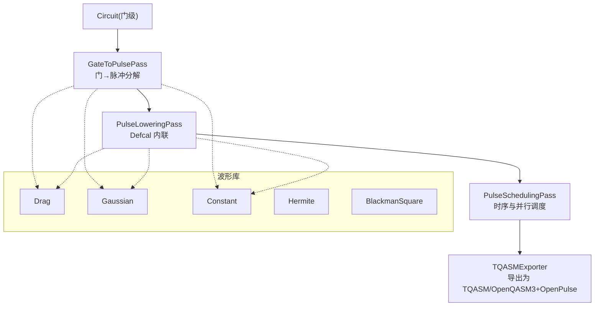
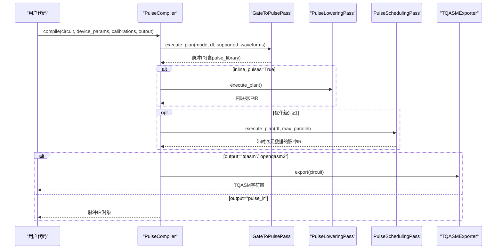
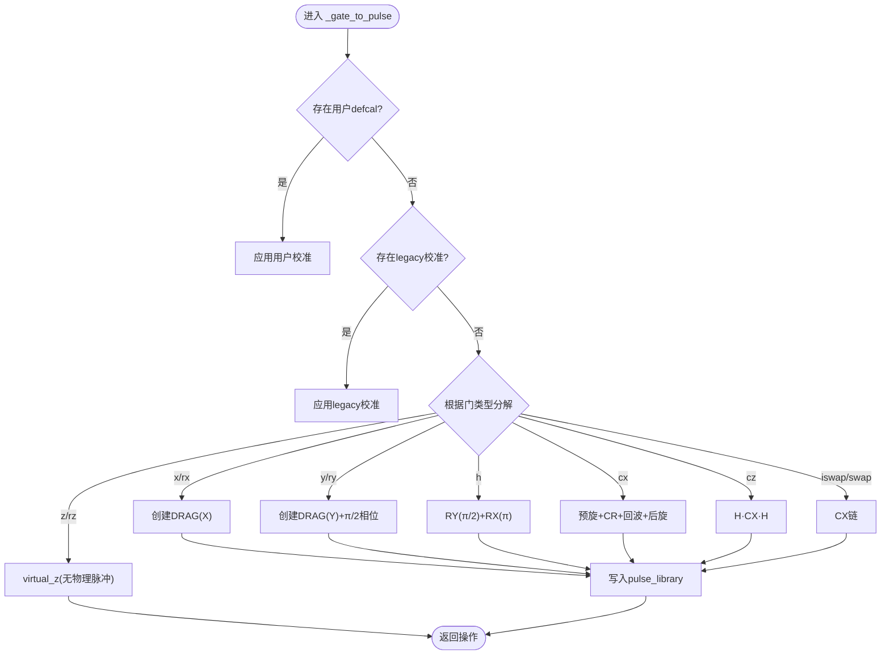
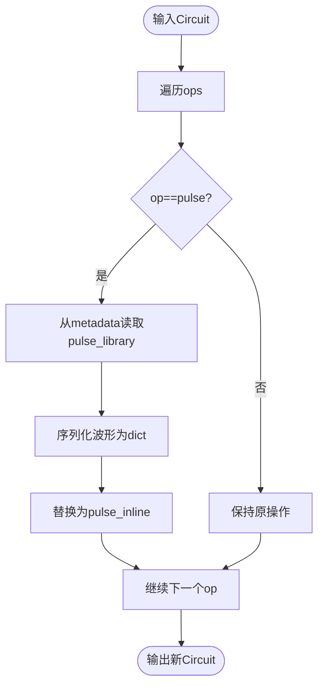
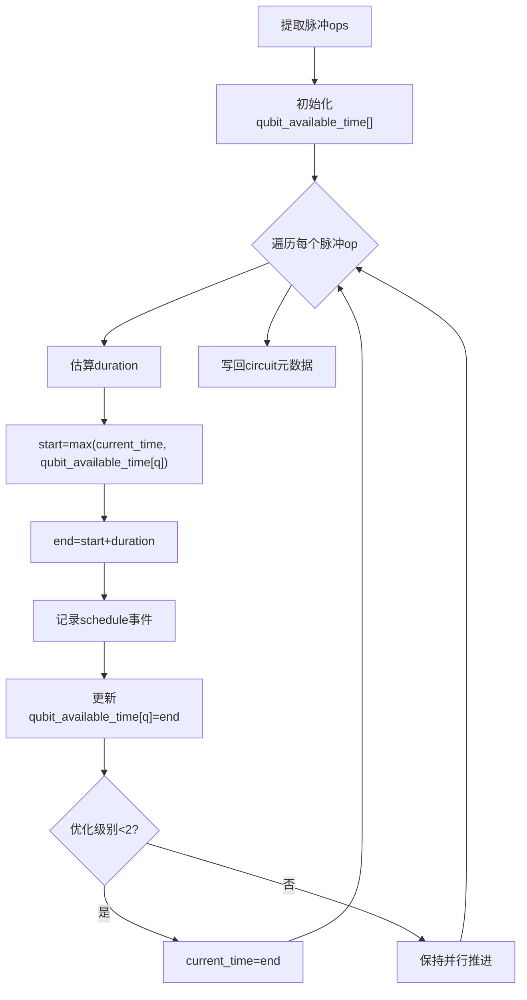
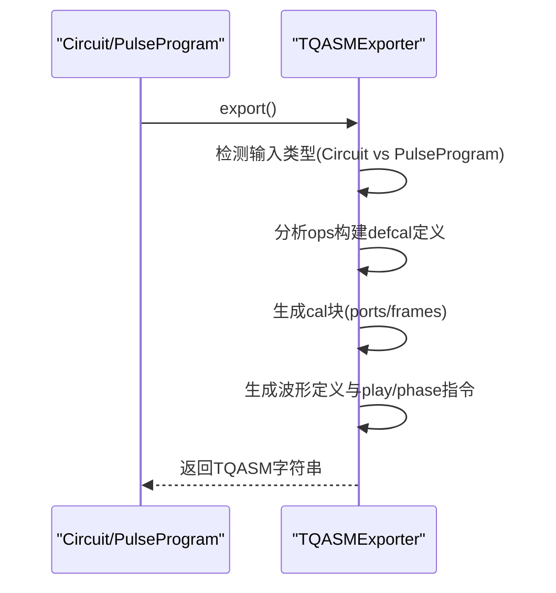
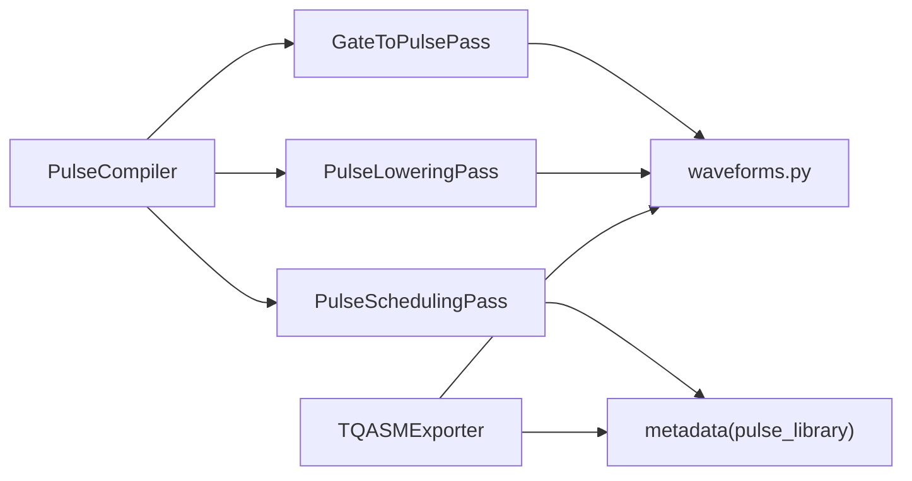

# 脉冲编译器

<cite>
**本文引用的文件**
- [pulse_compiler.py](file://src/tyxonq/compiler/pulse_compiler/native/pulse_compiler.py)
- [gate_to_pulse.py](file://src/tyxonq/compiler/pulse_compiler/native/gate_to_pulse.py)
- [tqasm_exporter.py](file://src/tyxonq/compiler/pulse_compiler/native/tqasm_exporter.py)
- [pulse_scheduling.py](file://src/tyxonq/compiler/pulse_compiler/native/pulse_scheduling.py)
- [pulse_lowering.py](file://src/tyxonq/compiler/pulse_compiler/native/pulse_lowering.py)
- [waveforms.py](file://src/tyxonq/waveforms.py)
- [defcal_library.py](file://src/tyxonq/compiler/pulse_compiler/defcal_library.py)
- [pulse_basic_tutorial.py](file://examples/pulse_basic_tutorial.py)
</cite>

## 目录
1. [简介](#简介)
2. [项目结构](#项目结构)
3. [核心组件](#核心组件)
4. [架构总览](#架构总览)
5. [详细组件分析](#详细组件分析)
6. [依赖关系分析](#依赖关系分析)
7. [性能考量](#性能考量)
8. [故障排除指南](#故障排除指南)
9. [结论](#结论)
10. [附录](#附录)

## 简介
本文件系统性阐述 TyxonQ 脉冲编译器的完整编译流程：从量子门到物理脉冲的转换、波形生成与相位控制、频率调制、TQASM 导出（兼容 OpenQASM 3 + OpenPulse）、脉冲调度系统（并行执行、时序约束、资源管理）、设备参数校准与波形库使用（DRAG、Gaussian 等），以及最佳实践、性能优化与调试排障。文末提供将高级量子算法转换为硬件可执行脉冲序列的方法论与实践路径。

## 项目结构
TyxonQ 脉冲编译器位于 compiler/pulse_compiler/native 下，采用“Pass”流水线组织：Gate→Pulse 分解、Defcal 内联、脉冲调度；配合波形库 waveforms.py 与 TQASM 导出器 tqasm_exporter.py，形成端到端编译链路。示例脚本 examples/pulse_basic_tutorial.py 演示了从门电路到脉冲、再到 TQASM 导出的典型用法。

图表来源
- [pulse_compiler.py:24-197](file://src/tyxonq/compiler/pulse_compiler/native/pulse_compiler.py#L24-L197)
- [gate_to_pulse.py:38-115](file://src/tyxonq/compiler/pulse_compiler/native/gate_to_pulse.py#L38-L115)
- [pulse_lowering.py:22-75](file://src/tyxonq/compiler/pulse_compiler/native/pulse_lowering.py#L22-L75)
- [pulse_scheduling.py:24-86](file://src/tyxonq/compiler/pulse_compiler/native/pulse_scheduling.py#L24-L86)
- [tqasm_exporter.py:24-158](file://src/tyxonq/compiler/pulse_compiler/native/tqasm_exporter.py#L24-L158)
- [waveforms.py:19-157](file://src/tyxonq/waveforms.py#L19-L157)

章节来源
- [pulse_compiler.py:24-197](file://src/tyxonq/compiler/pulse_compiler/native/pulse_compiler.py#L24-L197)
- [pulse_basic_tutorial.py:152-274](file://examples/pulse_basic_tutorial.py#L152-L274)

## 核心组件
- 脉冲编译器主类 PulseCompiler：编排 Gate→Pulse→Scheduled 的三段式编译管线，支持多优化级别与输出格式选择（脉冲 IR、TQASM、OpenQASM3）。
- GateToPulsePass：将标准门（X/Y/Z/H/CX/CZ/iSWAP/SWAP 等）分解为脉冲序列，优先使用用户 defcal 校准，否则回退到基于物理的默认分解。
- PulseLoweringPass：将符号化的脉冲引用展开为内联波形定义，便于序列化与云端执行。
- PulseSchedulingPass：进行脉冲级调度，分配时间槽、处理并行与冲突、累计虚拟-Z 相位并记录总时长。
- TQASMExporter：将脉冲 IR 或 PulseProgram 导出为 TQASM 0.2 或 OpenQASM 3 + OpenPulse，包含端口/帧声明、defcal 块、波形定义与播放指令。
- Waveforms：提供 Drag、Gaussian、Constant、Hermite、BlackmanSquare 等波形类型及其参数化接口。
- DefcalLibrary：集中管理硬件相关的门校准数据，支持增删查、验证、JSON 持久化与导入。

章节来源
- [pulse_compiler.py:24-197](file://src/tyxonq/compiler/pulse_compiler/native/pulse_compiler.py#L24-L197)
- [gate_to_pulse.py:38-115](file://src/tyxonq/compiler/pulse_compiler/native/gate_to_pulse.py#L38-L115)
- [pulse_lowering.py:22-75](file://src/tyxonq/compiler/pulse_compiler/native/pulse_lowering.py#L22-L75)
- [pulse_scheduling.py:24-86](file://src/tyxonq/compiler/pulse_compiler/native/pulse_scheduling.py#L24-L86)
- [tqasm_exporter.py:24-158](file://src/tyxonq/compiler/pulse_compiler/native/tqasm_exporter.py#L24-L158)
- [waveforms.py:19-157](file://src/tyxonq/waveforms.py#L19-L157)
- [defcal_library.py:153-565](file://src/tyxonq/compiler/pulse_compiler/defcal_library.py#L153-L565)

## 架构总览
下图展示从门级电路到可调度的脉冲序列，再到 TQASM 输出的完整编译流，标注关键 Pass 的职责与数据流向。

图表来源
- [pulse_compiler.py:81-197](file://src/tyxonq/compiler/pulse_compiler/native/pulse_compiler.py#L81-L197)
- [gate_to_pulse.py:64-115](file://src/tyxonq/compiler/pulse_compiler/native/gate_to_pulse.py#L64-L115)
- [pulse_lowering.py:37-75](file://src/tyxonq/compiler/pulse_compiler/native/pulse_lowering.py#L37-L75)
- [pulse_scheduling.py:43-86](file://src/tyxonq/compiler/pulse_compiler/native/pulse_scheduling.py#L43-L86)
- [tqasm_exporter.py:129-233](file://src/tyxonq/compiler/pulse_compiler/native/tqasm_exporter.py#L129-L233)

## 详细组件分析

### 门到脉冲的转换（GateToPulsePass）
- 优先级策略：优先使用 DefcalLibrary 中的用户校准；其次检查电路元数据中的 legacy calibrations；最后回退到内置物理分解。
- 单比特门：
  - X/RX：使用 DRAG 脉冲，幅度按旋转角度缩放，驱动频率等于量子比特频率。
  - Y/RY：在 X 脉冲基础上叠加 π/2 相位偏移实现 Y 旋转。
  - Z/RZ：虚拟-Z（frame update），不产生物理脉冲，仅累积相位。
  - H：分解为 RY(π/2) + RX(π)，通过相位与幅值组合实现。
- 两比特门：
  - CX：交叉共振（CR）方案，控制比特在目标比特频率上驱动，结合预/后旋转与可选的回波脉冲抑制非期望项。
  - CZ：通过 H_target · CX · H_target 分解。
  - iSWAP/SWAP：通过 CX 链实现（iSWAP 与 SWAP 相差全局相位）。
- 输出形式：返回 ("pulse", qubit, pulse_key, params) 操作，并将波形对象存入 circuit.metadata["pulse_library"]。

图表来源
- [gate_to_pulse.py:137-192](file://src/tyxonq/compiler/pulse_compiler/native/gate_to_pulse.py#L137-L192)
- [gate_to_pulse.py:194-312](file://src/tyxonq/compiler/pulse_compiler/native/gate_to_pulse.py#L194-L312)
- [gate_to_pulse.py:314-379](file://src/tyxonq/compiler/pulse_compiler/native/gate_to_pulse.py#L314-L379)
- [gate_to_pulse.py:381-495](file://src/tyxonq/compiler/pulse_compiler/native/gate_to_pulse.py#L381-L495)
- [gate_to_pulse.py:497-577](file://src/tyxonq/compiler/pulse_compiler/native/gate_to_pulse.py#L497-L577)
- [gate_to_pulse.py:579-730](file://src/tyxonq/compiler/pulse_compiler/native/gate_to_pulse.py#L579-L730)

章节来源
- [gate_to_pulse.py:64-115](file://src/tyxonq/compiler/pulse_compiler/native/gate_to_pulse.py#L64-L115)
- [gate_to_pulse.py:137-730](file://src/tyxonq/compiler/pulse_compiler/native/gate_to_pulse.py#L137-L730)

### 脉冲内联（PulseLoweringPass）
- 作用：将符号化的 ("pulse", qubit, pulse_key, params) 替换为 ("pulse_inline", qubit, waveform_dict, params)，便于序列化与跨平台传输。
- 波形序列化：对标准波形对象调用 qasm_name()/to_args() 生成统一字典表示；对 dataclass 或其他对象做降级处理。

图表来源
- [pulse_lowering.py:37-75](file://src/tyxonq/compiler/pulse_compiler/native/pulse_lowering.py#L37-L75)
- [pulse_lowering.py:77-151](file://src/tyxonq/compiler/pulse_compiler/native/pulse_lowering.py#L77-L151)

章节来源
- [pulse_lowering.py:22-75](file://src/tyxonq/compiler/pulse_compiler/native/pulse_lowering.py#L22-L75)
- [pulse_lowering.py:77-151](file://src/tyxonq/compiler/pulse_compiler/native/pulse_lowering.py#L77-L151)

### 脉冲调度（PulseSchedulingPass）
- 功能：提取所有脉冲操作，估计持续时间，计算每个量子比特的最早可用时间，生成调度事件（开始/结束时间、持续时长），并写回元数据（pulse_schedule、pulse_total_time）。
- 并行与约束：当前实现按顺序扫描并维护每比特可用性时间；在较低优化级别时强制串行推进 current_time，较高优化级别允许更多并行。
- 虚拟-Z 相位：由 GateToPulsePass 产生的 virtual_z 操作在后续阶段被解释为相位更新（见导出器逻辑）。

图表来源
- [pulse_scheduling.py:43-86](file://src/tyxonq/compiler/pulse_compiler/native/pulse_scheduling.py#L43-L86)
- [pulse_scheduling.py:104-148](file://src/tyxonq/compiler/pulse_compiler/native/pulse_scheduling.py#L104-L148)
- [pulse_scheduling.py:173-238](file://src/tyxonq/compiler/pulse_compiler/native/pulse_scheduling.py#L173-L238)

章节来源
- [pulse_scheduling.py:24-86](file://src/tyxonq/compiler/pulse_compiler/native/pulse_scheduling.py#L24-L86)
- [pulse_scheduling.py:104-148](file://src/tyxonq/compiler/pulse_compiler/native/pulse_scheduling.py#L104-L148)
- [pulse_scheduling.py:173-238](file://src/tyxonq/compiler/pulse_compiler/native/pulse_scheduling.py#L173-L238)

### TQASM 导出（TQASMExporter）
- 版本与语法：
  - openqasm3：输出 OPENQASM 3.0 + defcalgrammar "openpulse"。
  - tyxonq_homebrew_tqasm：输出 TQASM 0.2（homebrew_s2 特殊格式）。
- 内容组成：
  - 量子比特声明（qubit[n] 或 qreg[n] 风格）。
  - cal 块：extern port 与 frame 声明（newframe(port, frequency, phase)）。
  - defcal 块：按门签名聚合脉冲序列，包含波形定义（drag/gaussian/constant/gaussian_square）与 play/shift_phase/set_frequency 等操作。
  - 电路体：保留门调用或根据 defcal 自动生成 gate 调用。
- 兼容性：遵循 OpenQASM 3.0 与 OpenPulse 语法规则，支持跨平台提交与归档。

图表来源
- [tqasm_exporter.py:24-158](file://src/tyxonq/compiler/pulse_compiler/native/tqasm_exporter.py#L24-L158)
- [tqasm_exporter.py:160-233](file://src/tyxonq/compiler/pulse_compiler/native/tqasm_exporter.py#L160-L233)
- [tqasm_exporter.py:235-295](file://src/tyxonq/compiler/pulse_compiler/native/tqasm_exporter.py#L235-L295)
- [tqasm_exporter.py:344-591](file://src/tyxonq/compiler/pulse_compiler/native/tqasm_exporter.py#L344-L591)
- [tqasm_exporter.py:593-681](file://src/tyxonq/compiler/pulse_compiler/native/tqasm_exporter.py#L593-L681)

章节来源
- [tqasm_exporter.py:24-158](file://src/tyxonq/compiler/pulse_compiler/native/tqasm_exporter.py#L24-L158)
- [tqasm_exporter.py:160-233](file://src/tyxonq/compiler/pulse_compiler/native/tqasm_exporter.py#L160-L233)
- [tqasm_exporter.py:235-295](file://src/tyxonq/compiler/pulse_compiler/native/tqasm_exporter.py#L235-L295)
- [tqasm_exporter.py:344-591](file://src/tyxonq/compiler/pulse_compiler/native/tqasm_exporter.py#L344-L591)
- [tqasm_exporter.py:593-681](file://src/tyxonq/compiler/pulse_compiler/native/tqasm_exporter.py#L593-L681)

### 波形库与设备参数校准
- 波形类型：
  - Drag：高斯包络加一阶导数修正，抑制泄漏，适合高精度单比特门。
  - Gaussian：基础平滑包络，常用于 CR 驱动。
  - Constant：恒定幅度，用于回波或基准测试。
  - Hermite/BlackmanSquare：高阶多项式/窗函数包络，降低频谱泄漏与串扰。
- 设备参数：
  - qubit_freq：量子比特频率（Hz），用于设置驱动频率与帧频率。
  - anharmonicity：非谐性（Hz），影响脉冲带宽与失谐容忍度。
  - coupling_strength/cx_duration：两比特门耦合强度与时序。
  - cr_amplitude/cr_echo：交叉共振幅度与回波开关。
- 校准管理：
  - DefcalLibrary 提供 add/get/remove/list/validate/export/import 能力，支持 JSON 持久化与跨会话复用。
  - PulseCompiler.add_calibration 可在运行时注入自定义校准，覆盖默认分解。

章节来源
- [waveforms.py:19-157](file://src/tyxonq/waveforms.py#L19-L157)
- [defcal_library.py:153-565](file://src/tyxonq/compiler/pulse_compiler/defcal_library.py#L153-L565)
- [gate_to_pulse.py:752-772](file://src/tyxonq/compiler/pulse_compiler/native/gate_to_pulse.py#L752-L772)
- [pulse_compiler.py:199-248](file://src/tyxonq/compiler/pulse_compiler/native/pulse_compiler.py#L199-L248)

### 端到端编译流程（PulseCompiler）
- 入口 compile：
  - 将 device_params 与 calibrations 写入 circuit metadata。
  - 依次执行 GateToPulsePass →（可选）PulseLoweringPass →（可选）PulseSchedulingPass。
  - 根据 output 参数返回脉冲 IR 或 TQASM 字符串。
- 优化级别：
  - 0：无调度，基本分解。
  - 1：基础并行调度。
  - 2：高级调度 + 脉冲合并。
  - 3：全优化（含校准感知路由，未来扩展）。

章节来源
- [pulse_compiler.py:24-197](file://src/tyxonq/compiler/pulse_compiler/native/pulse_compiler.py#L24-L197)

## 依赖关系分析
- 模块耦合：
  - PulseCompiler 依赖三个 Pass 完成编译流水线。
  - GateToPulsePass 依赖 waveforms.py 生成具体波形，并通过 metadata 传递 pulse_library。
  - PulseLoweringPass 依赖 metadata 中的 pulse_library 进行内联。
  - PulseSchedulingPass 依赖 ops 结构与 duration 估算。
  - TQASMExporter 依赖 metadata 与波形对象/字典生成 OpenPulse 语法。
- 外部依赖：
  - OpenQASM 3.0 + OpenPulse 语法规范（导出器遵循）。
  - 硬件平台特定后端（通过 driver/topology 抽象，不在本文件范围）。

图表来源
- [pulse_compiler.py:24-197](file://src/tyxonq/compiler/pulse_compiler/native/pulse_compiler.py#L24-L197)
- [gate_to_pulse.py:38-115](file://src/tyxonq/compiler/pulse_compiler/native/gate_to_pulse.py#L38-L115)
- [pulse_lowering.py:22-75](file://src/tyxonq/compiler/pulse_compiler/native/pulse_lowering.py#L22-L75)
- [pulse_scheduling.py:24-86](file://src/tyxonq/compiler/pulse_compiler/native/pulse_scheduling.py#L24-L86)
- [tqasm_exporter.py:24-158](file://src/tyxonq/compiler/pulse_compiler/native/tqasm_exporter.py#L24-L158)
- [waveforms.py:19-157](file://src/tyxonq/waveforms.py#L19-L157)

章节来源
- [pulse_compiler.py:24-197](file://src/tyxonq/compiler/pulse_compiler/native/pulse_compiler.py#L24-L197)
- [gate_to_pulse.py:38-115](file://src/tyxonq/compiler/pulse_compiler/native/gate_to_pulse.py#L38-L115)
- [pulse_lowering.py:22-75](file://src/tyxonq/compiler/pulse_compiler/native/pulse_lowering.py#L22-L75)
- [pulse_scheduling.py:24-86](file://src/tyxonq/compiler/pulse_compiler/native/pulse_scheduling.py#L24-L86)
- [tqasm_exporter.py:24-158](file://src/tyxonq/compiler/pulse_compiler/native/tqasm_exporter.py#L24-L158)
- [waveforms.py:19-157](file://src/tyxonq/waveforms.py#L19-L157)

## 性能考量
- 波形选择：
  - DRAG 适用于高精度单比特门，减少泄漏；Gaussian 适用于 CR 驱动，平滑边缘降低频谱泄漏。
  - Hermite/BlackmanSquare 在高保真场景可降低旁瓣与串扰。
- 时序与并行：
  - 合理设置 dt 与 max_parallel，利用 PulseSchedulingPass 提升并行度。
  - 虚拟-Z 零开销，尽量用 RZ 替代物理脉冲以缩短总时长。
- 校准与参数：
  - 针对不同量子比特独立校准（qubit_freq、anharmonicity、cr_amplitude），提高保真度。
  - 使用 DefcalLibrary 管理校准集，避免重复计算与不一致。
- 导出与序列化：
  - 使用 inline_pulses=True 生成自包含 TQASM，利于云端执行与缓存。
  - 选择合适的 output 格式（pulse_ir 本地优化，tqasm/openqasm3 跨平台）。

[本节为通用指导，无需特定文件来源]

## 故障排除指南
- 常见错误与定位：
  - 不支持的输出格式：compile 的 output 参数需为 'pulse_ir'/'tqasm'/'openqasm3' 等。
  - 波形不被硬件支持：使用 validate_waveforms 检查 supported_waveforms 限制。
  - 未找到脉冲库条目：确保 GateToPulsePass 已将波形写入 metadata["pulse_library"]。
  - 两比特门参数缺失：检查 device_params 中 coupling_strength、cx_duration、cr_amplitude 等。
- 调试建议：
  - 逐步启用 Pass：先运行 GateToPulsePass 查看脉冲 IR，再开启内联与调度。
  - 打印 schedule 元数据：查看 start_time/end_time/duration 与总时长。
  - 对比理想与采样结果：使用示例脚本模式验证鲁棒性。
- 参考位置：
  - 校验与异常抛出点：[pulse_compiler.py:193-197](file://src/tyxonq/compiler/pulse_compiler/native/pulse_compiler.py#L193-L197)、[tqasm_exporter.py:93-106](file://src/tyxonq/compiler/pulse_compiler/native/tqasm_exporter.py#L93-L106)。
  - 波形验证：[pulse_compiler.py:250-316](file://src/tyxonq/compiler/pulse_compiler/native/pulse_compiler.py#L250-L316)。

章节来源
- [pulse_compiler.py:193-197](file://src/tyxonq/compiler/pulse_compiler/native/pulse_compiler.py#L193-L197)
- [pulse_compiler.py:250-316](file://src/tyxonq/compiler/pulse_compiler/native/pulse_compiler.py#L250-L316)
- [tqasm_exporter.py:93-106](file://src/tyxonq/compiler/pulse_compiler/native/tqasm_exporter.py#L93-L106)

## 结论
TyxonQ 脉冲编译器通过清晰的 Pass 流水线实现了从门级电路到物理脉冲的端到端编译，支持灵活的校准机制、丰富的波形库、严格的时序调度与标准化的 TQASM/OpenQASM3 导出。借助 DefcalLibrary 与设备参数配置，用户可将高级量子算法高效转换为硬件可执行的脉冲序列，并在仿真与真实设备上获得一致的结果。

[本节为总结，无需特定文件来源]

## 附录

### 从高级量子算法到硬件脉冲序列的实践步骤
- 构建门级电路：使用 Circuit API 描述算法。
- 准备设备参数：qubit_freq、anharmonicity、耦合与 CR 参数。
- 选择校准策略：
  - 使用默认分解快速验证。
  - 通过 DefcalLibrary 注入硬件校准以提升保真度。
- 编译与优化：
  - 运行 PulseCompiler.compile(output="pulse_ir") 获取脉冲 IR。
  - 根据需要启用 inline_pulses 与调度优化。
- 导出与提交：
  - 使用 output="tqasm" 或 "openqasm3" 生成 TQASM。
  - 通过云平台提交至真实设备执行。
- 验证与调优：
  - 对比理想与采样结果，调整波形参数与校准。
  - 利用调度元数据分析时序瓶颈。

章节来源
- [pulse_basic_tutorial.py:152-274](file://examples/pulse_basic_tutorial.py#L152-L274)
- [pulse_compiler.py:81-197](file://src/tyxonq/compiler/pulse_compiler/native/pulse_compiler.py#L81-L197)
- [tqasm_exporter.py:129-233](file://src/tyxonq/compiler/pulse_compiler/native/tqasm_exporter.py#L129-L233)