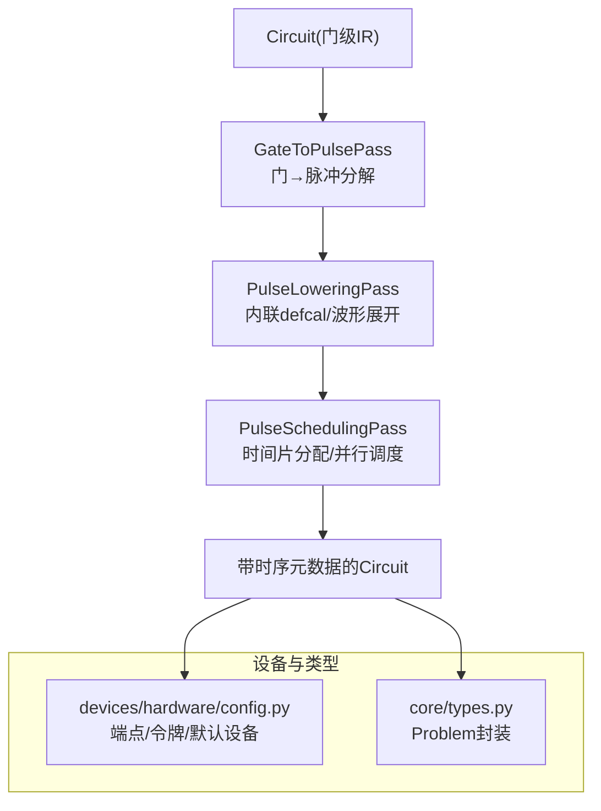
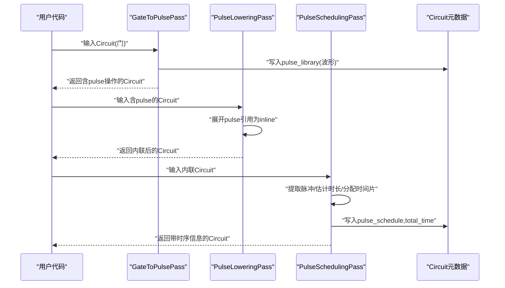
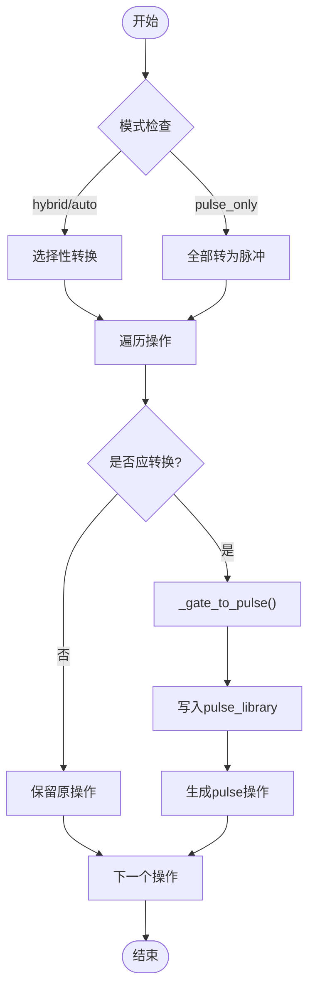
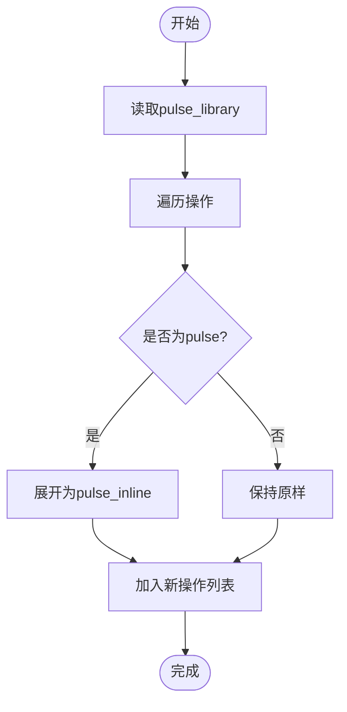
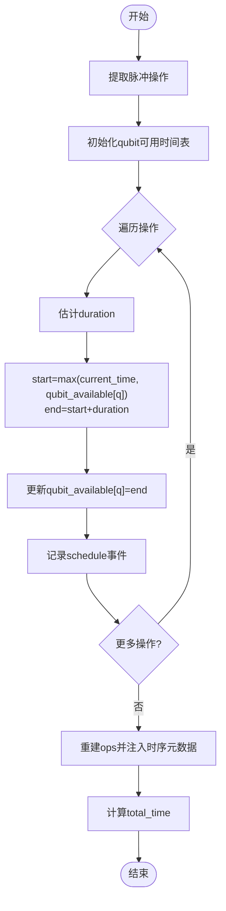
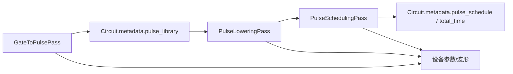

# 脉冲调度系统

<cite>
**本文引用的文件**
- [pulse_scheduling.py](file://src/tyxonq/compiler/pulse_compiler/native/pulse_scheduling.py)
- [gate_to_pulse.py](file://src/tyxonq/compiler/pulse_compiler/native/gate_to_pulse.py)
- [pulse_lowering.py](file://src/tyxonq/compiler/pulse_compiler/native/pulse_lowering.py)
- [config.py](file://src/tyxonq/devices/hardware/config.py)
- [types.py](file://src/tyxonq/core/types.py)
- [pulse_basic_tutorial.py](file://examples/pulse_basic_tutorial.py)
- [pulse_waveforms.py](file://examples/pulse_waveforms.py)
</cite>

## 目录
1. [简介](#简介)
2. [项目结构](#项目结构)
3. [核心组件](#核心组件)
4. [架构总览](#架构总览)
5. [详细组件分析](#详细组件分析)
6. [依赖关系分析](#依赖关系分析)
7. [性能考虑](#性能考虑)
8. [故障排查指南](#故障排查指南)
9. [结论](#结论)
10. [附录](#附录)

## 简介
本技术文档围绕 TyxonQ 的脉冲调度系统，系统性阐述从门到脉冲的分解、脉冲级调度与优化、资源冲突解决、时序约束处理、以及调试与可视化方法。重点覆盖：
- 时间片分配与并行执行优化
- 贪心调度策略与可扩展优化空间
- 时序约束（最小延迟、测量等待、脉冲重叠限制）
- 资源管理（量子比特、控制通道、内存）
- 批处理与缓存机制
- 复杂电路调度示例（多量子比特操作、条件执行）

## 项目结构
TyxonQ 的脉冲编译与调度位于编译器子系统的“脉冲编译器”模块中，采用 Pass（阶段）式流水线组织：
- Gate-to-Pulse：将抽象门操作转换为具体脉冲序列（支持 defcal 校准与默认物理分解）
- Pulse Lowering：内联 defcal 定义，展开为可直接执行的脉冲指令
- Pulse Scheduling：在脉冲级进行时间片分配、并行调度与元数据标注
- 设备配置与类型：提供设备端点、令牌管理与问题封装

图表来源
- [gate_to_pulse.py:38-115](file://src/tyxonq/compiler/pulse_compiler/native/gate_to_pulse.py#L38-L115)
- [pulse_lowering.py:22-75](file://src/tyxonq/compiler/pulse_compiler/native/pulse_lowering.py#L22-L75)
- [pulse_scheduling.py:24-86](file://src/tyxonq/compiler/pulse_compiler/native/pulse_scheduling.py#L24-L86)
- [config.py:11-65](file://src/tyxonq/devices/hardware/config.py#L11-L65)
- [types.py:6-16](file://src/tyxonq/core/types.py#L6-L16)

章节来源
- [gate_to_pulse.py:38-115](file://src/tyxonq/compiler/pulse_compiler/native/gate_to_pulse.py#L38-L115)
- [pulse_lowering.py:22-75](file://src/tyxonq/compiler/pulse_compiler/native/pulse_lowering.py#L22-L75)
- [pulse_scheduling.py:24-86](file://src/tyxonq/compiler/pulse_compiler/native/pulse_scheduling.py#L24-L86)
- [config.py:11-65](file://src/tyxonq/devices/hardware/config.py#L11-L65)
- [types.py:6-16](file://src/tyxonq/core/types.py#L6-L16)

## 核心组件
- 门到脉冲分解（GateToPulsePass）
  - 支持用户提供的 defcal 校准优先，其次回退到默认物理分解（单/双量子比特门）
  - 生成 pulse 操作并存储波形至电路元数据中的 pulse_library
  - 虚拟 Z 门通过相位帧更新实现（零耗时）
- 脉冲下推（PulseLoweringPass）
  - 将 pulse 引用展开为 inline 形式，便于后端直接执行
  - 序列化波形对象为可传输/可执行的字典表示
- 脉冲调度（PulseSchedulingPass）
  - 提取脉冲操作，构建依赖图（当前按顺序扫描），计算每个操作的起止时间与持续时间
  - 维护每量子比特的可用时间线，避免同一量子比特上的重叠
  - 输出带时序元数据的 Circuit，并记录总执行时间

章节来源
- [gate_to_pulse.py:38-115](file://src/tyxonq/compiler/pulse_compiler/native/gate_to_pulse.py#L38-L115)
- [pulse_lowering.py:22-75](file://src/tyxonq/compiler/pulse_compiler/native/pulse_lowering.py#L22-L75)
- [pulse_scheduling.py:24-86](file://src/tyxonq/compiler/pulse_compiler/native/pulse_scheduling.py#L24-L86)

## 架构总览
下图展示了从门级 IR 到可调度的脉冲级 IR 的完整流程，包括关键 Pass 的职责与数据流向。

图表来源
- [gate_to_pulse.py:64-115](file://src/tyxonq/compiler/pulse_compiler/native/gate_to_pulse.py#L64-L115)
- [pulse_lowering.py:37-75](file://src/tyxonq/compiler/pulse_compiler/native/pulse_lowering.py#L37-L75)
- [pulse_scheduling.py:43-86](file://src/tyxonq/compiler/pulse_compiler/native/pulse_scheduling.py#L43-L86)

## 详细组件分析

### 门到脉冲分解（GateToPulsePass）
- 设计要点
  - 优先级：defcal 校准 > 元数据校准 > 默认物理分解
  - 单量子比特门：X/Y/Z/H 等映射为 DRAG/Gaussian/Constant 等波形
  - 双量子比特门：CX/CZ/iSWAP/SWAP 通过交叉共振或 CX 链实现
  - 虚拟 Z：以相位帧更新实现，零耗时
- 关键路径
  - execute_plan：遍历操作，判断是否转换，调用 _gate_to_pulse
  - _gate_to_pulse：根据门名选择对应分解函数
  - 各分解函数：构造波形、写入 pulse_library、返回 ("pulse", qubit, key, params)

图表来源
- [gate_to_pulse.py:64-115](file://src/tyxonq/compiler/pulse_compiler/native/gate_to_pulse.py#L64-L115)
- [gate_to_pulse.py:137-192](file://src/tyxonq/compiler/pulse_compiler/native/gate_to_pulse.py#L137-L192)

章节来源
- [gate_to_pulse.py:38-115](file://src/tyxonq/compiler/pulse_compiler/native/gate_to_pulse.py#L38-L115)
- [gate_to_pulse.py:137-192](file://src/tyxonq/compiler/pulse_compiler/native/gate_to_pulse.py#L137-L192)

### 脉冲下推（PulseLoweringPass）
- 功能
  - 读取 circuit.metadata["pulse_library"]，将 ("pulse", qubit, key, params) 展开为 ("pulse_inline", qubit, waveform_dict, params)
  - 对波形对象进行序列化，确保可被后端直接消费
- 影响
  - 消除引用层，减少运行时查找开销
  - 为后续调度提供更明确的波形参数

图表来源
- [pulse_lowering.py:37-75](file://src/tyxonq/compiler/pulse_compiler/native/pulse_lowering.py#L37-L75)
- [pulse_lowering.py:77-117](file://src/tyxonq/compiler/pulse_compiler/native/pulse_lowering.py#L77-L117)

章节来源
- [pulse_lowering.py:22-75](file://src/tyxonq/compiler/pulse_compiler/native/pulse_lowering.py#L22-L75)
- [pulse_lowering.py:77-117](file://src/tyxonq/compiler/pulse_compiler/native/pulse_lowering.py#L77-L117)

### 脉冲调度（PulseSchedulingPass）
- 算法概述
  - 提取所有脉冲操作及其索引
  - 估算每个操作的持续时间（可从波形参数或默认值获取）
  - 维护每量子比特的最早可用时间，计算 start/end time
  - 将时序信息写回操作参数，并在 Circuit 元数据中保存 schedule 与 total_time
- 复杂度
  - 时间：O(N) 扫描 N 个脉冲操作
  - 空间：O(Q) 维护 Q 个量子比特的可用时间线
- 可扩展性
  - 当前为简单贪心（按序扫描 + 资源占用表）
  - 可通过引入依赖图与跨通道并行度提升进一步优化

图表来源
- [pulse_scheduling.py:43-86](file://src/tyxonq/compiler/pulse_compiler/native/pulse_scheduling.py#L43-L86)
- [pulse_scheduling.py:104-148](file://src/tyxonq/compiler/pulse_compiler/native/pulse_scheduling.py#L104-L148)
- [pulse_scheduling.py:173-238](file://src/tyxonq/compiler/pulse_compiler/native/pulse_scheduling.py#L173-L238)

章节来源
- [pulse_scheduling.py:24-86](file://src/tyxonq/compiler/pulse_compiler/native/pulse_scheduling.py#L24-L86)
- [pulse_scheduling.py:104-148](file://src/tyxonq/compiler/pulse_compiler/native/pulse_scheduling.py#L104-L148)
- [pulse_scheduling.py:173-238](file://src/tyxonq/compiler/pulse_compiler/native/pulse_scheduling.py#L173-L238)

### 时序约束与资源管理
- 时序约束
  - 门操作最小延迟：由波形 duration 决定；若未显式提供，使用默认估计
  - 测量等待时间：当前调度不显式建模测量等待，可在扩展中增加测量槽与空闲插入
  - 脉冲重叠限制：同一量子比特上不允许重叠；不同量子比特可并行
- 资源管理
  - 量子比特分配：基于 qubit_available_time 数组，保证无冲突
  - 控制通道管理：当前以量子比特为粒度；可扩展为通道级（如驱动通道、读出通道）
  - 内存使用优化：波形存储在 circuit.metadata["pulse_library"]，避免重复创建；内联后减少引用开销

章节来源
- [pulse_scheduling.py:104-148](file://src/tyxonq/compiler/pulse_compiler/native/pulse_scheduling.py#L104-L148)
- [gate_to_pulse.py:204-224](file://src/tyxonq/compiler/pulse_compiler/native/gate_to_pulse.py#L204-L224)
- [pulse_lowering.py:77-117](file://src/tyxonq/compiler/pulse_compiler/native/pulse_lowering.py#L77-L117)

### 调度策略与优化方法
- 当前策略
  - Level 0：不进行调度（顺序执行）
  - Level 1：基础并行（无冲突时并行）
  - Level 2：高级调度 + 脉冲合并（预留）
  - Level 3：全优化（含校准感知路由，预留）
- 优化方向
  - 依赖图构建：识别可并行的独立操作
  - 贪心启发式：按最早可用时间分配，降低总时长
  - 动态规划/回溯：在存在严格时序约束时寻找更优解
  - 批处理：批量提交任务以减少调度开销
  - 缓存：复用已生成的波形与调度结果

章节来源
- [pulse_scheduling.py:35-41](file://src/tyxonq/compiler/pulse_compiler/native/pulse_scheduling.py#L35-L41)
- [pulse_scheduling.py:59-86](file://src/tyxonq/compiler/pulse_compiler/native/pulse_scheduling.py#L59-L86)

## 依赖关系分析
- 模块耦合
  - GateToPulsePass 依赖波形库与设备参数，产出 pulse 操作并写入元数据
  - PulseLoweringPass 依赖元数据中的 pulse_library，进行内联展开
  - PulseSchedulingPass 依赖前两步产物，进行时间片分配与元数据标注
- 外部依赖
  - 设备配置与令牌管理（config.py）
  - 问题封装（types.py）

图表来源
- [gate_to_pulse.py:64-115](file://src/tyxonq/compiler/pulse_compiler/native/gate_to_pulse.py#L64-L115)
- [pulse_lowering.py:37-75](file://src/tyxonq/compiler/pulse_compiler/native/pulse_lowering.py#L37-L75)
- [pulse_scheduling.py:43-86](file://src/tyxonq/compiler/pulse_compiler/native/pulse_scheduling.py#L43-L86)

章节来源
- [gate_to_pulse.py:64-115](file://src/tyxonq/compiler/pulse_compiler/native/gate_to_pulse.py#L64-L115)
- [pulse_lowering.py:37-75](file://src/tyxonq/compiler/pulse_compiler/native/pulse_lowering.py#L37-L75)
- [pulse_scheduling.py:43-86](file://src/tyxonq/compiler/pulse_compiler/native/pulse_scheduling.py#L43-L86)

## 性能考虑
- 时间复杂度
  - 门到脉冲分解：O(G)，G 为门数
  - 脉冲下推：O(P)，P 为脉冲操作数
  - 调度：O(P + Q)，Q 为量子比特数
- 内存优化
  - 波形复用：通过 pulse_library 避免重复创建
  - 内联展开：减少运行时解析成本
- 并行与批处理
  - 当前调度按量子比特维度并行；可扩展至通道维度
  - 建议对大量电路进行批处理，共享设备参数与波形库
- 缓存机制
  - 缓存 defcal 与默认分解结果
  - 缓存调度方案（相同拓扑与参数）

[本节为通用指导，不直接分析具体文件]

## 故障排查指南
- 常见问题
  - 波形未找到：检查 pulse_library 是否正确写入与传递
  - 时序异常：确认 duration 估计合理，避免过短导致硬件不可执行
  - 资源冲突：检查同一量子比特上的重叠，必要时调整调度级别或插入空闲
- 调试工具
  - 查看 Circuit.metadata 中的 pulse_schedule 与 total_time
  - 使用示例脚本验证波形形状与门实现效果
  - 结合设备端点与令牌配置，确保后端可达

章节来源
- [pulse_lowering.py:77-117](file://src/tyxonq/compiler/pulse_compiler/native/pulse_lowering.py#L77-L117)
- [pulse_scheduling.py:173-238](file://src/tyxonq/compiler/pulse_compiler/native/pulse_scheduling.py#L173-L238)
- [config.py:24-65](file://src/tyxonq/devices/hardware/config.py#L24-L65)

## 结论
TyxonQ 的脉冲调度系统通过分阶段的 Pass 流水线实现了从门到脉冲的分解、内联与调度。当前实现提供了稳定的基线能力：
- 可靠的门到脉冲分解（支持 defcal 与默认物理模型）
- 简洁高效的脉冲级调度（基于量子比特资源的时间片分配）
- 完善的元数据管理（波形库、调度计划、总时长）
未来可扩展的方向包括：
- 更复杂的依赖图与全局优化（动态规划/回溯）
- 通道级资源管理与测量等待建模
- 更强的批处理与缓存机制以提升吞吐

[本节为总结性内容，不直接分析具体文件]

## 附录

### 复杂电路调度示例（多量子比特操作与条件执行）
- 多量子比特操作
  - iSWAP/SWAP 通过 CX 链实现，适合任意拓扑
  - CX/CZ 通过交叉共振与回波脉冲组合，抑制非期望项
- 条件执行
  - 可在调度阶段依据测量结果插入分支逻辑（当前框架预留扩展点）
- 参考示例
  - 基本教程演示了脉冲编程、参数化波形与门到脉冲转换
  - 波形示例展示了不同包络对门保真度的影响

章节来源
- [pulse_basic_tutorial.py:152-200](file://examples/pulse_basic_tutorial.py#L152-L200)
- [pulse_waveforms.py:115-169](file://examples/pulse_waveforms.py#L115-L169)
- [gate_to_pulse.py:579-730](file://src/tyxonq/compiler/pulse_compiler/native/gate_to_pulse.py#L579-L730)