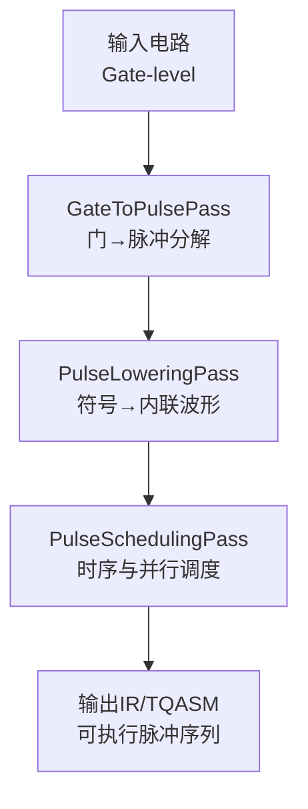
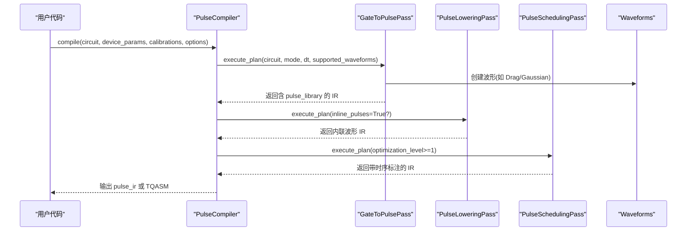
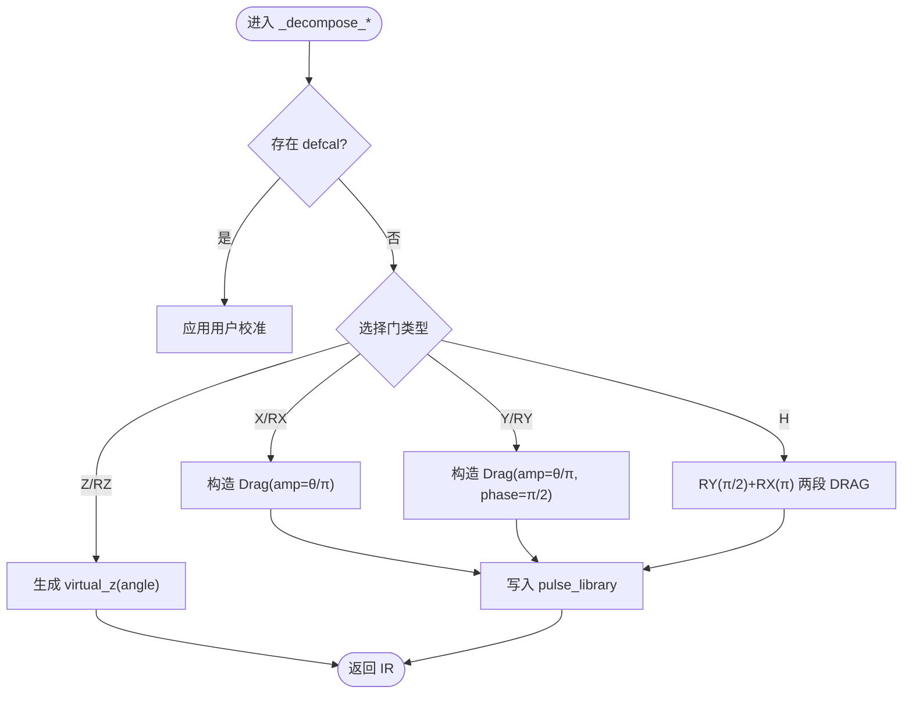
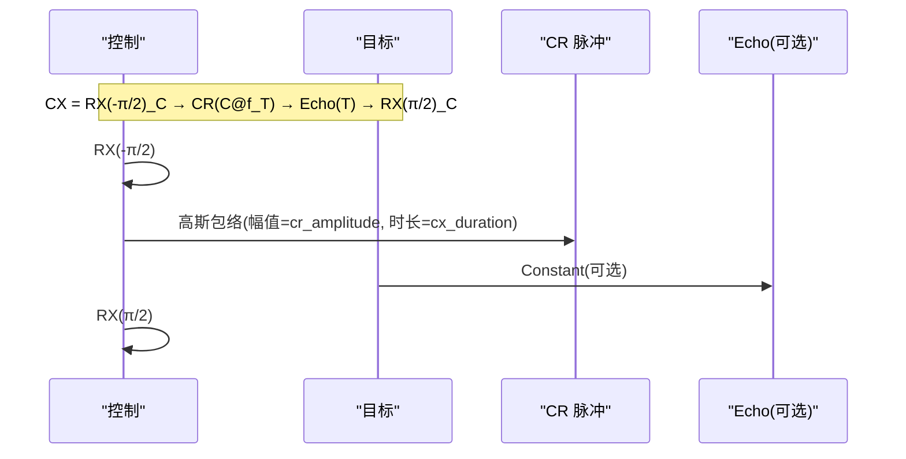
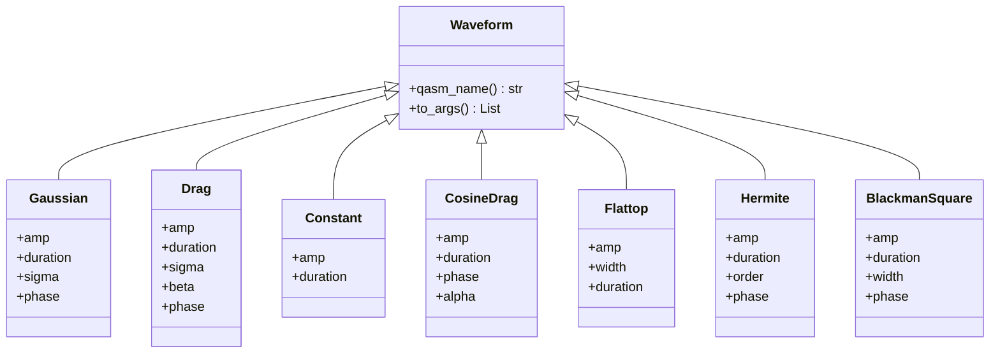
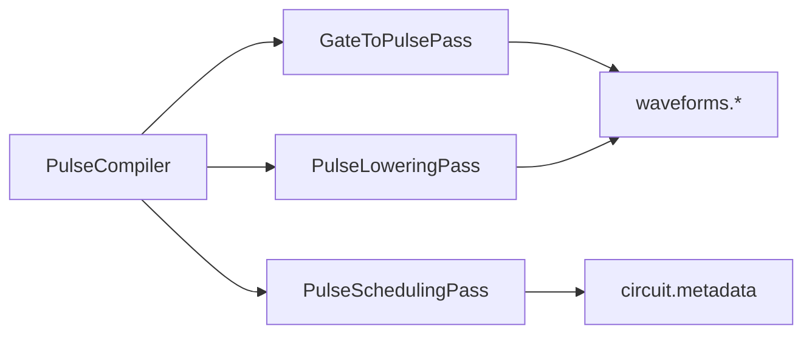

# 门到脉冲转换

<cite>
**本文引用的文件**
- [gate_to_pulse.py](file://src/tyxonq/compiler/pulse_compiler/native/gate_to_pulse.py)
- [pulse_compiler.py](file://src/tyxonq/compiler/pulse_compiler/native/pulse_compiler.py)
- [pulse_lowering.py](file://src/tyxonq/compiler/pulse_compiler/native/pulse_lowering.py)
- [pulse_scheduling.py](file://src/tyxonq/compiler/pulse_compiler/native/pulse_scheduling.py)
- [waveforms.py](file://src/tyxonq/waveforms.py)
- [pulse_waveforms.py](file://examples/pulse_waveforms.py)
</cite>

## 目录
1. [简介](#简介)
2. [项目结构](#项目结构)
3. [核心组件](#核心组件)
4. [架构总览](#架构总览)
5. [详细组件分析](#详细组件分析)
6. [依赖关系分析](#依赖关系分析)
7. [性能考量](#性能考量)
8. [故障排查指南](#故障排查指南)
9. [结论](#结论)
10. [附录](#附录)

## 简介
本技术文档系统性阐述 TyxonQ 中“量子门到物理脉冲”的编译与实现机制，覆盖：
- 单量子比特门（X、Y、Z、H）与双量子比特门（CNOT/CX、iSWAP、SWAP）的脉冲级实现原理
- 波形生成算法：DRAG、Gaussian、自定义波形的数学含义与参数调节
- 相位控制与频率调制：载波频率偏移、相位累积、包络调制
- 硬件约束与限制：最大振幅、带宽与时序要求
- 端到端示例路径与优化技巧

## 项目结构
TyxonQ 的门到脉冲转换位于编译器子系统的“原生脉冲编译器”模块，采用三段式流水线：
- GateToPulsePass：将抽象门操作分解为脉冲原语（参考 defcal 或默认物理分解）
- PulseLoweringPass：将符号化的脉冲引用内联为可执行的波形定义
- PulseSchedulingPass：进行时间槽分配、并行调度与资源冲突消解

图表来源
- [pulse_compiler.py:24-197](file://src/tyxonq/compiler/pulse_compiler/native/pulse_compiler.py#L24-L197)
- [gate_to_pulse.py:38-115](file://src/tyxonq/compiler/pulse_compiler/native/gate_to_pulse.py#L38-L115)
- [pulse_lowering.py:22-75](file://src/tyxonq/compiler/pulse_compiler/native/pulse_lowering.py#L22-L75)
- [pulse_scheduling.py:24-86](file://src/tyxonq/compiler/pulse_compiler/native/pulse_scheduling.py#L24-L86)

章节来源
- [pulse_compiler.py:24-197](file://src/tyxonq/compiler/pulse_compiler/native/pulse_compiler.py#L24-L197)

## 核心组件
- 门到脉冲分解器（GateToPulsePass）
  - 支持 X/RX、Y/RY、Z/RZ、H、CX、CZ、iSWAP、SWAP 等门的脉冲级分解
  - 优先使用用户提供的 defcal 校准；否则回退到内置物理分解
  - 通过 circuit.metadata 维护 pulse_library，避免重复构造波形
- 脉冲下推器（PulseLoweringPass）
  - 将 ("pulse", qubit, key, params) 展开为 ("pulse_inline", qubit, waveform_dict, params)
  - 序列化波形对象以支持云端提交与持久化
- 脉冲调度器（PulseSchedulingPass）
  - 基于估计时长构建时间槽，标注 start_time/duration
  - 支持不同优化级别（顺序/并行/合并）
- 波形库（waveforms.py）
  - 提供 Gaussian、Drag、Constant、CosineDrag、Flattop、Hermite、BlackmanSquare 等标准波形类
  - 统一接口 qasm_name() 与 to_args() 便于序列化与导出

章节来源
- [gate_to_pulse.py:38-192](file://src/tyxonq/compiler/pulse_compiler/native/gate_to_pulse.py#L38-L192)
- [pulse_lowering.py:22-151](file://src/tyxonq/compiler/pulse_compiler/native/pulse_lowering.py#L22-L151)
- [pulse_scheduling.py:24-238](file://src/tyxonq/compiler/pulse_compiler/native/pulse_scheduling.py#L24-L238)
- [waveforms.py:1-157](file://src/tyxonq/waveforms.py#L1-L157)

## 架构总览
下图展示从门到脉冲的完整编译流程，包括关键数据流与元信息传递。

图表来源
- [pulse_compiler.py:81-197](file://src/tyxonq/compiler/pulse_compiler/native/pulse_compiler.py#L81-L197)
- [gate_to_pulse.py:64-115](file://src/tyxonq/compiler/pulse_compiler/native/gate_to_pulse.py#L64-L115)
- [pulse_lowering.py:37-75](file://src/tyxonq/compiler/pulse_compiler/native/pulse_lowering.py#L37-L75)
- [pulse_scheduling.py:43-86](file://src/tyxonq/compiler/pulse_compiler/native/pulse_scheduling.py#L43-L86)

## 详细组件分析

### 单量子比特门脉冲实现
- X/RX：使用 DRAG 脉冲，幅度按旋转角度缩放，驱动频率等于量子比特频率
- Y/RY：在 X 基础上增加 π/2 相位偏移（通过 metadata 中的 phase 字段体现）
- Z/RZ：虚拟-Z（frame update），不产生物理脉冲，零耗时
- H：分解为 RY(π/2) + RX(π)，分别对应相位 π/2 与 0 的 DRAG 脉冲

图表来源
- [gate_to_pulse.py:137-379](file://src/tyxonq/compiler/pulse_compiler/native/gate_to_pulse.py#L137-L379)

章节来源
- [gate_to_pulse.py:194-379](file://src/tyxonq/compiler/pulse_compiler/native/gate_to_pulse.py#L194-L379)

### 双量子比特门脉冲实现
- CX（CNOT）：交叉共振（Cross-Resonance）序列
  - 控制量子比特预旋转 RX(-π/2)
  - 对控制量子比特施加高斯包络脉冲，驱动频率为目标量子比特频率
  - 可选目标量子比特上的旋转回波（抑制 ZI/IX 项）
  - 控制量子比特后旋转 RX(π/2)
- CZ：通过 H_target · CX · H_target 分解
- iSWAP/SWAP：通过 CX 链分解（三次 CX），相对相位差异由软件处理

图表来源
- [gate_to_pulse.py:381-495](file://src/tyxonq/compiler/pulse_compiler/native/gate_to_pulse.py#L381-L495)

章节来源
- [gate_to_pulse.py:497-730](file://src/tyxonq/compiler/pulse_compiler/native/gate_to_pulse.py#L497-L730)

### 波形生成算法与参数调节
- DRAG（Derivative Removal by Adiabatic Gate）
  - 目的：抑制向 |2⟩ 能级的泄漏，提升保真度
  - 参数：amp（幅度）、duration（时长）、sigma（包络宽度）、beta（导数修正系数）、phase（相位偏移）
  - 典型用法：单量子比特旋转（X/Y/H）
- Gaussian
  - 平滑包络，降低频谱旁瓣，常用于 CR 主脉冲
  - 参数：amp、duration、sigma
- Constant
  - 矩形脉冲，常用于 echo 或简单驱动
- CosineDrag、Flattop、Hermite、BlackmanSquare
  - 高级包络与窗口函数，用于特定硬件特性与频谱优化

图表来源
- [waveforms.py:19-157](file://src/tyxonq/waveforms.py#L19-L157)

章节来源
- [waveforms.py:1-157](file://src/tyxonq/waveforms.py#L1-L157)
- [pulse_waveforms.py:40-108](file://examples/pulse_waveforms.py#L40-L108)

### 相位控制与频率调制
- 载波频率偏移
  - 单量子比特：drive_freq 通常等于 qubit_freq
  - 双量子比特（CR）：control 上施加脉冲时，drive_freq 设为 target_freq，以实现 ZX 相互作用
- 相位累积
  - 通过 metadata 中的 phase 字段实现 Y 旋转（π/2 相移）
  - 虚拟-Z 通过后续脉冲的相位累积实现，无需物理脉冲
- 包络调制
  - 使用 Gaussian/DRAG 等包络函数控制上升/下降沿，减少频谱泄漏
  - 通过 sigma、beta 等参数平衡速度与泄漏抑制

章节来源
- [gate_to_pulse.py:227-274](file://src/tyxonq/compiler/pulse_compiler/native/gate_to_pulse.py#L227-L274)
- [gate_to_pulse.py:381-495](file://src/tyxonq/compiler/pulse_compiler/native/gate_to_pulse.py#L381-L495)

### 端到端示例与优化技巧
- 单量子比特门
  - X：DRAG(amp≈0.8, duration=160ns, sigma=40, beta=0.2)
  - Y：同上，附加 phase=π/2
  - Z：virtual_z(angle)，零耗时
  - H：RY(π/2)+RX(π) 两段 DRAG
- 双量子比特门
  - CX：预旋转+CR高斯脉冲+可选echo+后旋转
  - iSWAP/SWAP：三次 CX 链
- 优化技巧
  - 幅度扫描：寻找最佳 amp 使目标态布居接近期望
  - Beta 扫描：根据非谐性调整泄漏抑制强度
  - 时长权衡：更长的 duration 可降低误差但增加退相干影响
  - 波形选择：默认 DRAG；若硬件受限可用 Gaussian；高阶校正可用 Hermite/BlackmanSquare

章节来源
- [pulse_waveforms.py:176-322](file://examples/pulse_waveforms.py#L176-L322)
- [pulse_waveforms.py:329-470](file://examples/pulse_waveforms.py#L329-L470)

## 依赖关系分析
- 模块耦合
  - PulseCompiler 组合三个 Pass，形成清晰的分层依赖
  - GateToPulsePass 依赖 waveforms 模块生成具体波形
  - PulseLoweringPass 负责序列化波形，便于跨进程/云端传输
  - PulseSchedulingPass 仅读取 ops 与 metadata，低耦合
- 外部依赖
  - 设备参数（qubit_freq、anharmonicity、T1/T2、coupling_map）通过 metadata 注入
  - 支持多种输出格式（pulse_ir、tqasm/openqasm3）

图表来源
- [pulse_compiler.py:24-197](file://src/tyxonq/compiler/pulse_compiler/native/pulse_compiler.py#L24-L197)
- [gate_to_pulse.py:38-115](file://src/tyxonq/compiler/pulse_compiler/native/gate_to_pulse.py#L38-L115)
- [pulse_lowering.py:22-75](file://src/tyxonq/compiler/pulse_compiler/native/pulse_lowering.py#L22-L75)
- [pulse_scheduling.py:24-86](file://src/tyxonq/compiler/pulse_compiler/native/pulse_scheduling.py#L24-L86)

章节来源
- [pulse_compiler.py:24-197](file://src/tyxonq/compiler/pulse_compiler/native/pulse_compiler.py#L24-L197)

## 性能考量
- 时间复杂度
  - GateToPulsePass：O(N) 遍历门操作，N 为门数量
  - PulseLoweringPass：O(M) 遍历脉冲操作，M 为脉冲数量
  - PulseSchedulingPass：O(M log M) 或 O(M) 取决于调度策略
- 空间复杂度
  - pulse_library 缓存波形对象，避免重复构造
  - 内联模式会增加 IR 体积，但利于序列化
- 优化建议
  - 合理设置 duration/sigma/beta，平衡速度与泄漏
  - 使用虚拟-Z 减少不必要的物理脉冲
  - 利用并行调度缩短总执行时间
  - 针对硬件支持的波形集合进行验证与过滤

[本节为通用指导，不直接分析具体文件]

## 故障排查指南
- 波形不支持
  - 现象：validate_waveforms 报告 unsupported_waveforms
  - 处理：限制 supported_waveforms 列表，或使用兼容波形
- 脉冲未找到
  - 现象：PulseLoweringPass 无法解析 pulse_key
  - 处理：确保 GateToPulsePass 已将波形写入 circuit.metadata["pulse_library"]
- 时序异常
  - 现象：总时长不符合预期
  - 处理：检查 PulseSchedulingPass 的估计时长逻辑与 max_parallel 设置
- 相位错误
  - 现象：Y 旋转结果不正确
  - 处理：确认 phase=π/2 是否正确传入 metadata

章节来源
- [pulse_compiler.py:250-317](file://src/tyxonq/compiler/pulse_compiler/native/pulse_compiler.py#L250-L317)
- [pulse_lowering.py:77-151](file://src/tyxonq/compiler/pulse_compiler/native/pulse_lowering.py#L77-L151)
- [pulse_scheduling.py:150-238](file://src/tyxonq/compiler/pulse_compiler/native/pulse_scheduling.py#L150-L238)

## 结论
TyxonQ 的门到脉冲转换提供了从抽象门到物理脉冲的完整编译链路，具备：
- 清晰的三段式流水线（分解→下推→调度）
- 丰富的波形库与灵活的参数调节
- 对相位与频率调制的精细控制
- 可扩展的用户校准（defcal）机制
通过合理配置设备参数与波形参数，可在不同硬件平台上实现高保真度的量子门操作。

[本节为总结性内容，不直接分析具体文件]

## 附录
- 常用参数参考
  - 单量子比特：DRAG(amp∈[0.6,1.0], duration≈160ns, sigma≈40ns, beta≈0.2)
  - 双量子比特：CR 高斯脉冲(amp≈0.3, duration≈400ns, sigma≈duration/4)
  - 虚拟-Z：零耗时，仅更新相位
- 推荐工作流
  - 先使用默认分解获得基线
  - 通过幅度/Beta 扫描优化单量子比特门
  - 对双量子比特门启用 echo 并微调 cr_amplitude/cx_duration
  - 使用 validate_waveforms 校验硬件兼容性
  - 开启调度优化以降低总时长

[本节为补充说明，不直接分析具体文件]