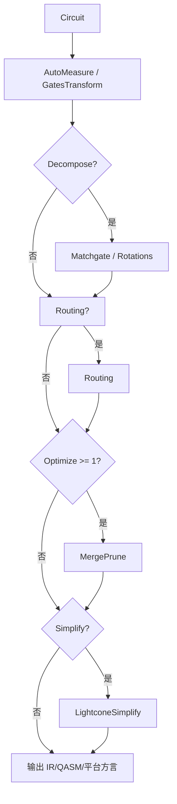
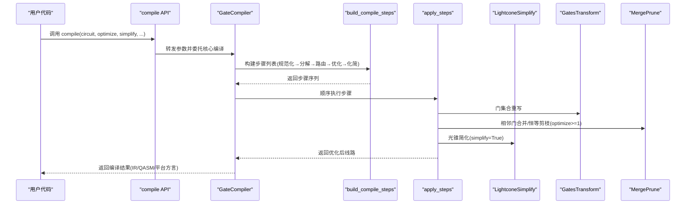
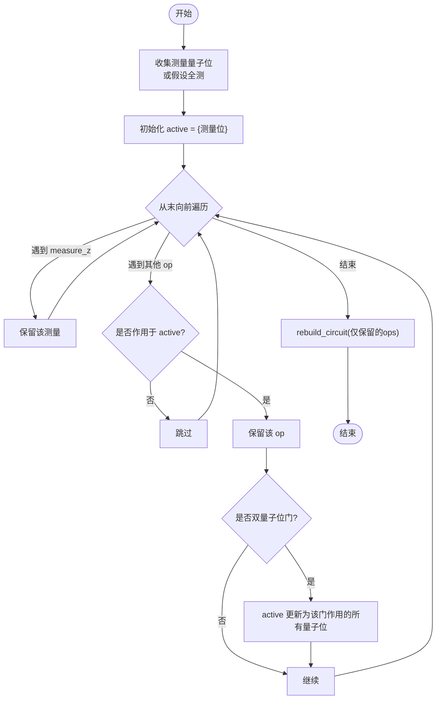
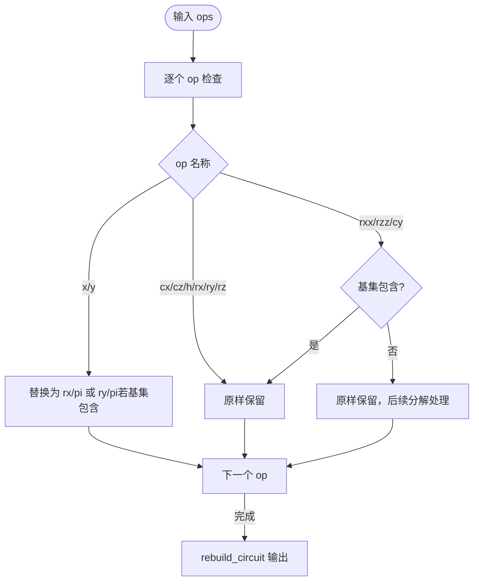
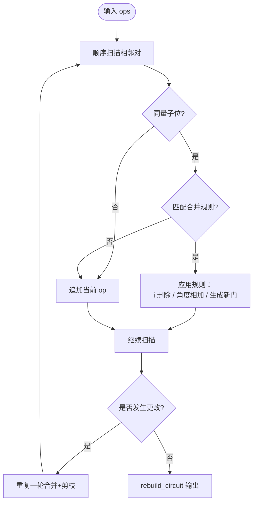
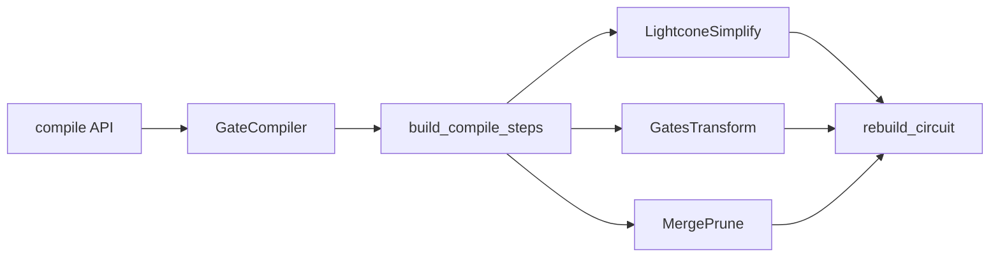

# 优化技术

<cite>
**本文引用的文件**
- [lightcone.py](file://src/tyxonq/compiler/gate_compiler/stages/simplify/lightcone.py)
- [gates_transform.py](file://src/tyxonq/compiler/gate_compiler/stages/rewrite/gates_transform.py)
- [merge_prune.py](file://src/tyxonq/compiler/gate_compiler/stages/rewrite/merge_prune.py)
- [steps.py](file://src/tyxonq/compiler/gate_compiler/steps.py)
- [compiler.py](file://src/tyxonq/compiler/gate_compiler/compiler.py)
- [api.py](file://src/tyxonq/compiler/api.py)
- [__init__.py](file://src/tyxonq/compiler/gate_compiler/stages/__init__.py)
- [compiler_lightcone_optimization.py](file://examples/compiler_lightcone_optimization.py)
</cite>

## 目录
1. [简介](#简介)
2. [项目结构](#项目结构)
3. [核心组件](#核心组件)
4. [架构总览](#架构总览)
5. [详细组件分析](#详细组件分析)
6. [依赖关系分析](#依赖关系分析)
7. [性能考量](#性能考量)
8. [故障排查指南](#故障排查指南)
9. [结论](#结论)
10. [附录：使用示例与配置](#附录使用示例与配置)

## 简介
本文件聚焦 TyxonQ 门级编译器的优化技术，系统性阐述以下主题：
- 光锥简化（Lightcone Simplification）：基于测量依赖的向后切片，裁剪不影响测量结果的算符。
- 门变换（Gates Transform）：按目标基集重写门，保留必要等价门，为后续分解/路由做准备。
- 合并剪枝（Merge Prune）：相邻相同门的恒等合并、旋转角相加、恒等操作剪除。
- 优化级别（optimization_level）：从轻量到深度的渐进式策略组合。
- 使用方式：如何启用不同优化、添加自定义规则，以及优化前后复杂度对比与性能提升分析。

## 项目结构
TyxonQ 的门级编译器采用“步骤化”管线设计，将复杂编译任务拆分为可插拔的 CompileStep，按固定顺序执行：
- 规范化：自动补测量、门集合重写
- 分解：matchgate/旋转门分解
- 路由：拓扑布局（可选）
- 优化：相邻门合并与恒等剪枝（optimize>=1）
- 化简：光锥简化（simplify=True）

图表来源
- [steps.py:27-91](file://src/tyxonq/compiler/gate_compiler/steps.py#L27-L91)
- [compiler.py:27-73](file://src/tyxonq/compiler/gate_compiler/compiler.py#L27-L73)

章节来源
- [__init__.py:1-14](file://src/tyxonq/compiler/gate_compiler/stages/__init__.py#L1-L14)
- [steps.py:27-91](file://src/tyxonq/compiler/gate_compiler/steps.py#L27-L91)
- [compiler.py:27-73](file://src/tyxonq/compiler/gate_compiler/compiler.py#L27-L73)

## 核心组件
- 光锥简化 LightconeSimplify：根据测量位置反向追踪依赖，仅保留影响测量结果的操作，显著降低期望值计算开销。
- 门变换 GatesTransform：将非目标基集门替换为等价形式，或保留受控门以利于后续处理。
- 合并剪枝 MergePrune：对相邻同线门应用恒等合并、角度相加、恒等删除等规则。
- 编译步骤装配 build_compile_steps：依据 optimize/simplify 等参数动态组装步骤序列。
- GateCompiler 与 compile API：统一入口，负责参数归一、步骤装配与执行、输出格式选择。

章节来源
- [lightcone.py:12-97](file://src/tyxonq/compiler/gate_compiler/stages/simplify/lightcone.py#L12-L97)
- [gates_transform.py:12-50](file://src/tyxonq/compiler/gate_compiler/stages/rewrite/gates_transform.py#L12-L50)
- [merge_prune.py:12-85](file://src/tyxonq/compiler/gate_compiler/stages/rewrite/merge_prune.py#L12-L85)
- [steps.py:27-91](file://src/tyxonq/compiler/gate_compiler/steps.py#L27-L91)
- [compiler.py:27-109](file://src/tyxonq/compiler/gate_compiler/compiler.py#L27-L109)
- [api.py:39-98](file://src/tyxonq/compiler/api.py#L39-L98)

## 架构总览
TyxonQ 门级编译器通过类型化参数驱动步骤装配，形成稳定且可扩展的编译流水线。GateCompiler 负责统一入口，compile API 提供高层封装，支持多平台输出（IR、QASM2/3、qiskit）。

图表来源
- [api.py:39-98](file://src/tyxonq/compiler/api.py#L39-L98)
- [compiler.py:27-73](file://src/tyxonq/compiler/gate_compiler/compiler.py#L27-L73)
- [steps.py:27-91](file://src/tyxonq/compiler/gate_compiler/steps.py#L27-L91)

## 详细组件分析

### 光锥简化（LightconeSimplify）
工作原理
- 输入：Circuit 及其 ops；可选 assume_measure_all。
- 测量收集：扫描 ops，收集所有 measure_z 的目标量子位；若未显式测量但开启 assume_measure_all，则视为全部 qubit 被测量。
- 反向切片：从末尾向前遍历，维护 active 集合（受影响的量子位），遇到作用于 active 的 op 即保留，并根据是否为双量子位门传播依赖。
- 重建电路：仅保留被标记的 op，并通过 rebuild_circuit 保持 metadata/instructions/_unitary_cache。

复杂度与特性
- 时间复杂度 O(N)，N 为操作数；空间复杂度 O(N) 用于 keep_indices。
- 数学精确：不改变任何物理语义，仅裁剪无关操作。
- 适用场景：期望值计算、部分测量、大规模变分算法。

图表来源
- [lightcone.py:15-97](file://src/tyxonq/compiler/gate_compiler/stages/simplify/lightcone.py#L15-L97)

章节来源
- [lightcone.py:12-97](file://src/tyxonq/compiler/gate_compiler/stages/simplify/lightcone.py#L12-L97)

### 门变换（GatesTransform）
机制说明
- 目标：将输入电路中的门转换为指定的 basis_gates（默认 ["h","rx","rz","cx","cz"]）。
- 规则：
  - x → rx(pi)、y → ry(pi)（当对应旋转门在基集中）
  - 原样保留 cx、cz、h、rx、ry、rz
  - rxx/rzz/cy 仅在基集显式包含时原样保留
  - 其余门（含 unitary）原样保留，交由后续分解/下转换处理
- 注意：此步骤在 Matchgate 分解之前运行，需通过 rebuild_circuit 保留 _unitary_cache，避免后续分解报错。

图表来源
- [gates_transform.py:12-50](file://src/tyxonq/compiler/gate_compiler/stages/rewrite/gates_transform.py#L12-L50)

章节来源
- [gates_transform.py:12-50](file://src/tyxonq/compiler/gate_compiler/stages/rewrite/gates_transform.py#L12-L50)

### 合并剪枝（MergePrune）
策略与应用
- 相邻相同门合并：如 s·s → z、t·t → s、x·x → i、h·h → i 等。
- 旋转门角度相加：rz(a)·rz(b) → rz(a+b)，rx/ry 同理。
- 恒等操作剪除：移除 i 操作。
- 迭代收敛：反复合并直至无变化，确保局部最优。

图表来源
- [merge_prune.py:27-85](file://src/tyxonq/compiler/gate_compiler/stages/rewrite/merge_prune.py#L27-L85)

章节来源
- [merge_prune.py:12-85](file://src/tyxonq/compiler/gate_compiler/stages/rewrite/merge_prune.py#L12-L85)

### 优化级别（optimization_level）与策略组合
- Level 0：仅规范化（AutoMeasure + GatesTransform），不进行额外优化。
- Level 1：在 Level 0 基础上增加 MergePrune（相邻门合并与恒等剪枝）。
- Level 2/3：在当前实现中仍等价于 Level 1（预留扩展点，未来可增加更多优化阶段）。
- simplify：独立开关，决定是否加入 LightconeSimplify。

装配逻辑
- build_compile_steps 根据 optimize 与 simplify 动态追加步骤。
- GateCompiler 将 optimize 与 options.optimization_level 归一，传递给 steps 装配器。

章节来源
- [steps.py:27-91](file://src/tyxonq/compiler/gate_compiler/steps.py#L27-L91)
- [compiler.py:57-73](file://src/tyxonq/compiler/gate_compiler/compiler.py#L57-L73)

## 依赖关系分析
- LightconeSimplify 依赖 Circuit 的 ops 结构与 rebuild_circuit，不引入外部库。
- GatesTransform 依赖 rebuild_circuit 以保持元数据一致性。
- MergePrune 依赖内置合并规则字典，可通过构造参数注入自定义规则。
- 步骤装配器解耦各优化阶段，便于扩展与维护。

图表来源
- [lightcone.py:94-97](file://src/tyxonq/compiler/gate_compiler/stages/simplify/lightcone.py#L94-L97)
- [gates_transform.py:49-50](file://src/tyxonq/compiler/gate_compiler/stages/rewrite/gates_transform.py#L49-L50)
- [merge_prune.py:40-46](file://src/tyxonq/compiler/gate_compiler/stages/rewrite/merge_prune.py#L40-L46)
- [steps.py:27-91](file://src/tyxonq/compiler/gate_compiler/steps.py#L27-L91)
- [compiler.py:27-73](file://src/tyxonq/compiler/gate_compiler/compiler.py#L27-L73)
- [api.py:39-98](file://src/tyxonq/compiler/api.py#L39-L98)

章节来源
- [steps.py:27-91](file://src/tyxonq/compiler/gate_compiler/steps.py#L27-L91)
- [compiler.py:27-73](file://src/tyxonq/compiler/gate_compiler/compiler.py#L27-L73)
- [api.py:39-98](file://src/tyxonq/compiler/api.py#L39-L98)

## 性能考量
- 光锥简化在部分测量场景下带来指数级加速：仅模拟受测量影响的子图，避免全态矢量演化。
- 门变换减少后续分解成本，提高兼容性。
- 合并剪枝降低门数量与深度，减少噪声累积与执行时间。
- 整体收益随问题规模增大而更显著，尤其在 10+ 量子位、浅层/深层 ansatz 的组合中。

[本节为通用性能讨论，不直接分析具体文件]

## 故障排查指南
- 光锥简化未生效：
  - 确认是否存在 measure_z 或设置 assume_measure_all。
  - 检查 ops 中是否有非法条目导致 op_qubits 回退分支。
- 门变换后分解报错：
  - 确保 GatesTransform 在 Matchgate 分解前运行，且通过 rebuild_circuit 保留 _unitary_cache。
- 合并剪枝未合并：
  - 检查相邻门是否在同一量子位上，规则字典是否覆盖目标门对。
- 优化级别无效：
  - 确认 optimize 参数已正确传入，且未被 options 覆盖。

章节来源
- [lightcone.py:15-97](file://src/tyxonq/compiler/gate_compiler/stages/simplify/lightcone.py#L15-L97)
- [gates_transform.py:12-50](file://src/tyxonq/compiler/gate_compiler/stages/rewrite/gates_transform.py#L12-L50)
- [merge_prune.py:27-85](file://src/tyxonq/compiler/gate_compiler/stages/rewrite/merge_prune.py#L27-L85)
- [steps.py:27-91](file://src/tyxonq/compiler/gate_compiler/steps.py#L27-L91)

## 结论
TyxonQ 的门级编译器通过模块化步骤实现了高效、可扩展的优化流程。光锥简化、门变换与合并剪枝三者协同，可在保证数学精确性的前提下显著降低电路复杂度与执行成本。优化级别提供了从轻量到深度的渐进式策略，满足多样化应用场景需求。

[本节为总结性内容，不直接分析具体文件]

## 附录：使用示例与配置
- 启用光锥简化：
  - 在期望值计算前调用 LightconeSimplify().apply(circuit, device_rule={}, assume_measure_all=True)。
  - 或在 compile 中设置 simplify=True。
- 启用合并剪枝：
  - 设置 optimize=1（或更高）以启用 MergePrune。
- 自定义合并规则：
  - 通过 MergePrune(rules={...}) 注入自定义映射，例如添加新的相邻门合并策略。
- 参考示例：
  - 完整演示与基准测试见示例脚本，展示不同问题规模下的加速效果与正确性验证。

章节来源
- [compiler_lightcone_optimization.py:61-94](file://examples/compiler_lightcone_optimization.py#L61-L94)
- [compiler_lightcone_optimization.py:97-159](file://examples/compiler_lightcone_optimization.py#L97-L159)
- [compiler_lightcone_optimization.py:201-255](file://examples/compiler_lightcone_optimization.py#L201-L255)
- [merge_prune.py:35-38](file://src/tyxonq/compiler/gate_compiler/stages/rewrite/merge_prune.py#L35-L38)
- [steps.py:81-89](file://src/tyxonq/compiler/gate_compiler/steps.py#L81-L89)
- [compiler.py:57-73](file://src/tyxonq/compiler/gate_compiler/compiler.py#L57-L73)