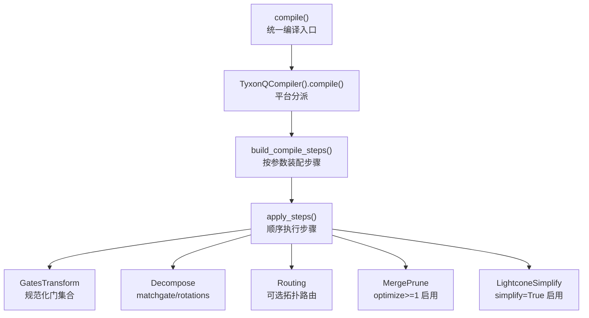
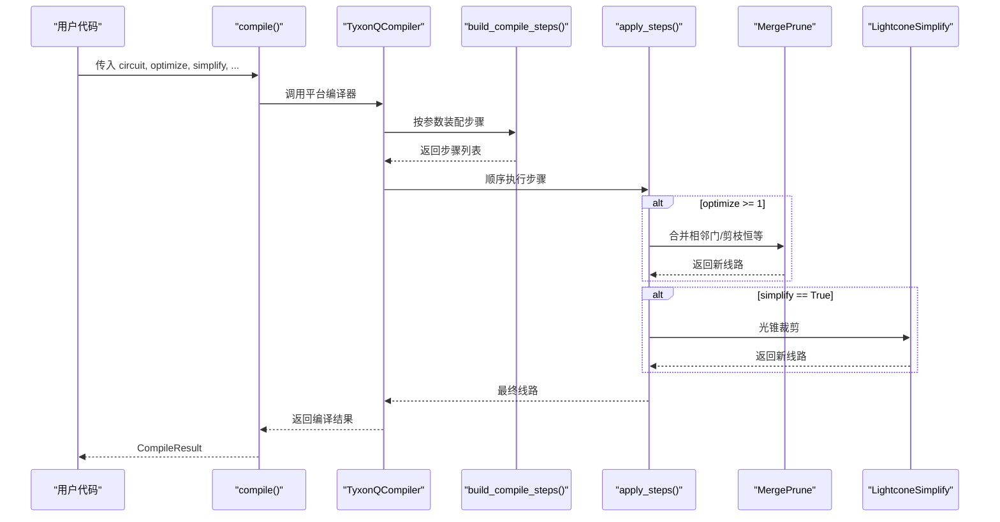
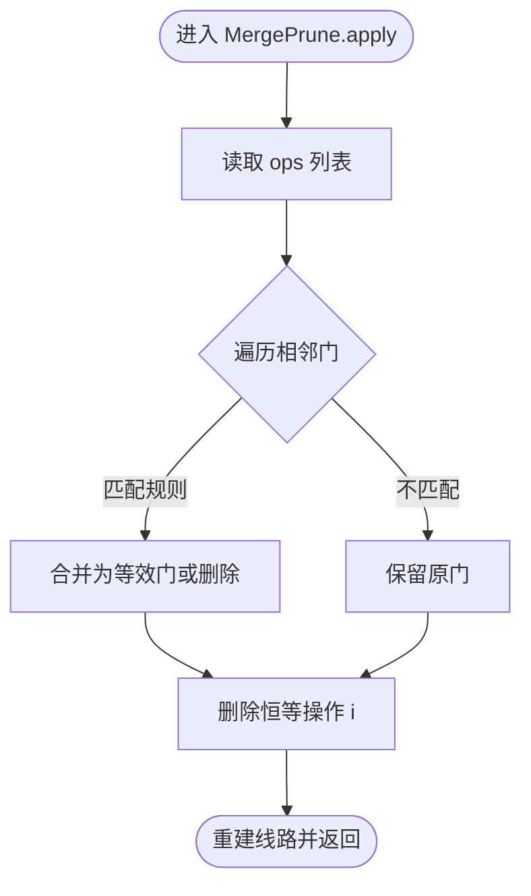
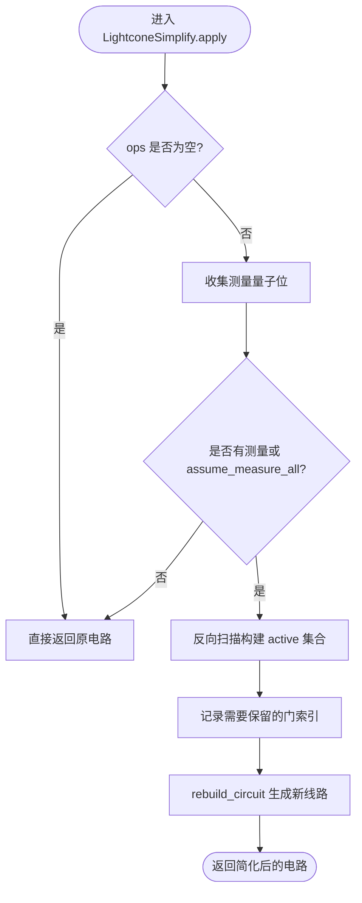
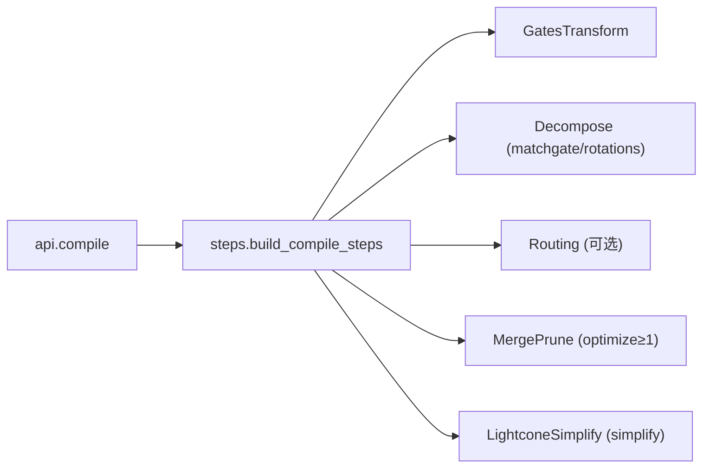

# 优化级别配置

<cite>
**本文引用的文件**
- [src/tyxonq/compiler/api.py](file://src/tyxonq/compiler/api.py)
- [src/tyxonq/compiler/gate_compiler/steps.py](file://src/tyxonq/compiler/gate_compiler/steps.py)
- [src/tyxonq/compiler/gate_compiler/stages/rewrite/merge_prune.py](file://src/tyxonq/compiler/gate_compiler/stages/rewrite/merge_prune.py)
- [src/tyxonq/compiler/gate_compiler/stages/simplify/lightcone.py](file://src/tyxonq/compiler/gate_compiler/stages/simplify/lightcone.py)
- [src/tyxonq/compiler/gate_compiler/stages/rewrite/gates_transform.py](file://src/tyxonq/compiler/gate_compiler/stages/rewrite/gates_transform.py)
- [examples/compiler_lightcone_optimization.py](file://examples/compiler_lightcone_optimization.py)
</cite>

## 目录
1. [简介](#简介)
2. [项目结构](#项目结构)
3. [核心组件](#核心组件)
4. [架构总览](#架构总览)
5. [详细组件分析](#详细组件分析)
6. [依赖关系分析](#依赖关系分析)
7. [性能考量](#性能考量)
8. [故障排查指南](#故障排查指南)
9. [结论](#结论)
10. [附录：配置示例与基准建议](#附录：配置示例与基准建议)

## 简介
本文件聚焦 TyxonQ 编译器的“优化级别”配置，系统说明从轻量到深度的渐进式优化策略。TyxonQ 的核心编译器通过类型化参数装配一系列编译步骤（分解、路由、合并剪枝、光锥简化等），并以固定顺序执行。优化级别 optimize 控制是否启用相邻门合并与恒等剪枝；simplify 控制是否启用光锥简化以裁剪不影响测量结果的算符。本文还将解释如何自定义优化流程、不同优化级别对编译时间与电路质量的影响权衡，并给出可复用的配置思路与基准测试建议。

## 项目结构
TyxonQ 的编译入口位于统一 API，内部根据平台与输出格式分派到具体编译器。核心 gate compiler 负责将类型化参数转换为编译步骤序列并顺序执行。关键路径如下：
- 统一编译入口：compile()
- 步骤装配与执行：build_compile_steps() / apply_steps()
- 各阶段实现：GatesTransform、MatchgateDecompose/RotationsDecompose、Routing、MergePrune、LightconeSimplify

图表来源
- [src/tyxonq/compiler/api.py:39-98](file://src/tyxonq/compiler/api.py#L39-L98)
- [src/tyxonq/compiler/gate_compiler/steps.py:27-91](file://src/tyxonq/compiler/gate_compiler/steps.py#L27-L91)

章节来源
- [src/tyxonq/compiler/api.py:39-98](file://src/tyxonq/compiler/api.py#L39-L98)
- [src/tyxonq/compiler/gate_compiler/steps.py:27-91](file://src/tyxonq/compiler/gate_compiler/steps.py#L27-L91)

## 核心组件
- 统一编译接口 compile()
  - 接收 platform、output、basis_gates、decompose、route、optimize、simplify、device_rule、options 等类型化参数。
  - 将 optimize 与 simplify 映射为编译步骤开关；platform="pulse" 时走脉冲编译分支。
- 步骤装配器 build_compile_steps()
  - 固定顺序：AutoMeasure → GatesTransform → Decompose → Routing → MergePrune(optimize≥1) → LightconeSimplify(simplify)。
  - 未启用的能力不追加占位步骤，保持链路精简。
- 合并剪枝 MergePrune
  - 基于规则表合并相邻同线单量子位门，并删除恒等操作 i。
- 光锥简化 LightconeSimplify
  - 自后向前回溯受测量影响的“光锥”，仅保留影响测量结果的操作，支持 assume_measure_all 模式。
- 门变换 GatesTransform
  - 按 basis_gates 重写部分门（如 x→rx(π)、y→ry(π)），保留指定基集或原样传递至后续分解。

章节来源
- [src/tyxonq/compiler/api.py:39-98](file://src/tyxonq/compiler/api.py#L39-L98)
- [src/tyxonq/compiler/gate_compiler/steps.py:27-91](file://src/tyxonq/compiler/gate_compiler/steps.py#L27-L91)
- [src/tyxonq/compiler/gate_compiler/stages/rewrite/merge_prune.py:27-88](file://src/tyxonq/compiler/gate_compiler/stages/rewrite/merge_prune.py#L27-L88)
- [src/tyxonq/compiler/gate_compiler/stages/simplify/lightcone.py:12-100](file://src/tyxonq/compiler/gate_compiler/stages/simplify/lightcone.py#L12-L100)
- [src/tyxonq/compiler/gate_compiler/stages/rewrite/gates_transform.py:12-53](file://src/tyxonq/compiler/gate_compiler/stages/rewrite/gates_transform.py#L12-L53)

## 架构总览
TyxonQ 的优化级别并非单一开关，而是由“步骤装配 + 条件启用”构成的组合策略。optimize 控制是否加入 MergePrune；simplify 控制是否加入 LightconeSimplify。两者可独立开启，形成从轻到深的优化阶梯。

图表来源
- [src/tyxonq/compiler/api.py:39-98](file://src/tyxonq/compiler/api.py#L39-L98)
- [src/tyxonq/compiler/gate_compiler/steps.py:27-91](file://src/tyxonq/compiler/gate_compiler/steps.py#L27-L91)
- [src/tyxonq/compiler/gate_compiler/stages/rewrite/merge_prune.py:27-88](file://src/tyxonq/compiler/gate_compiler/stages/rewrite/merge_prune.py#L27-L88)
- [src/tyxonq/compiler/gate_compiler/stages/simplify/lightcone.py:12-100](file://src/tyxonq/compiler/gate_compiler/stages/simplify/lightcone.py#L12-L100)

## 详细组件分析

### 优化级别与策略组合
- 优化级别 define
  - optimize 取值 0–3。当前实现中，optimize ≥ 1 即启用 MergePrune（相邻门合并与恒等剪枝）。
  - simplify 为布尔开关，true 时启用 LightconeSimplify（光锥简化）。
- 渐进式方案
  - 轻量级（optimize=0, simplify=False）：无额外优化，适合快速验证与最小开销。
  - 基础优化（optimize≥1, simplify=False）：启用 MergePrune，减少冗余门与恒等操作。
  - 深度优化（optimize≥1, simplify=True）：在基础优化之上进行光锥裁剪，显著降低期望值计算成本。
- 执行顺序
  - 固定顺序保证正确性：先规范化与分解，再路由（可选），然后合并剪枝，最后光锥简化。

章节来源
- [src/tyxonq/compiler/api.py:39-98](file://src/tyxonq/compiler/api.py#L39-L98)
- [src/tyxonq/compiler/gate_compiler/steps.py:27-91](file://src/tyxonq/compiler/gate_compiler/steps.py#L27-L91)

### 合并剪枝 MergePrune
- 功能
  - 合并相邻同线单量子位门（如旋转角相加、H/H→I 等），并删除恒等操作 i。
  - 使用内置规则表，可按需扩展 rules。
- 复杂度
  - 线性扫描 ops，最坏 O(N)，多次迭代直到不变。
- 适用场景
  - 任意电路均可受益；尤其对含大量连续单量子位门的变分电路效果明显。

图表来源
- [src/tyxonq/compiler/gate_compiler/stages/rewrite/merge_prune.py:27-88](file://src/tyxonq/compiler/gate_compiler/stages/rewrite/merge_prune.py#L27-L88)

章节来源
- [src/tyxonq/compiler/gate_compiler/stages/rewrite/merge_prune.py:27-88](file://src/tyxonq/compiler/gate_compiler/stages/rewrite/merge_prune.py#L27-L88)

### 光锥简化 LightconeSimplify
- 功能
  - 自后向前回溯受测量影响的“光锥”，仅保留影响测量结果的操作。
  - 支持 assume_measure_all：当没有显式测量时，将所有量子位视为测量目标。
- 复杂度
  - 单次反向扫描 O(N)，构建 keep_indices 后重建线路。
- 适用场景
  - 期望值计算、部分测量场景收益巨大；全测量时等价于恒等变换（数学精确）。

图表来源
- [src/tyxonq/compiler/gate_compiler/stages/simplify/lightcone.py:12-100](file://src/tyxonq/compiler/gate_compiler/stages/simplify/lightcone.py#L12-L100)

章节来源
- [src/tyxonq/compiler/gate_compiler/stages/simplify/lightcone.py:12-100](file://src/tyxonq/compiler/gate_compiler/stages/simplify/lightcone.py#L12-L100)

### 门变换 GatesTransform
- 功能
  - 按 basis_gates 重写部分门（如 x→rx(π)、y→ry(π)），保留指定基集或原样传递。
  - 运行在分解之前，确保后续分解能正确处理矩阵缓存。
- 适用场景
  - 目标平台基集受限或希望标准化中间表示时使用。

章节来源
- [src/tyxonq/compiler/gate_compiler/stages/rewrite/gates_transform.py:12-53](file://src/tyxonq/compiler/gate_compiler/stages/rewrite/gates_transform.py#L12-L53)

### 自定义优化流程
- 通过 build_compile_steps 与 apply_steps 自由拼装步骤序列，实现定制化的优化流水线。
- 典型做法：
  - 选择是否需要分解（DecomposeSpec）、路由（RoutingSpec）。
  - 按需插入 MergePrune（optimize≥1）与 LightconeSimplify（simplify=True）。
  - 通过 device_rule 提供耦合图等信息给路由步骤。

章节来源
- [src/tyxonq/compiler/gate_compiler/steps.py:27-91](file://src/tyxonq/compiler/gate_compiler/steps.py#L27-L91)

## 依赖关系分析
- 模块耦合
  - api.compile 依赖平台编译器（TyxonQCompiler/PulseCompiler 等）。
  - steps.build_compile_steps 依赖各 stages 的具体实现，但仅在启用时导入，避免无关依赖。
- 外部依赖
  - 路由步骤可能委托 qiskit.transpile（当 route=True 或 RoutingSpec 启用）。
- 潜在循环
  - 通过延迟导入与分层设计避免循环依赖。

图表来源
- [src/tyxonq/compiler/api.py:39-98](file://src/tyxonq/compiler/api.py#L39-L98)
- [src/tyxonq/compiler/gate_compiler/steps.py:27-91](file://src/tyxonq/compiler/gate_compiler/steps.py#L27-L91)

章节来源
- [src/tyxonq/compiler/api.py:39-98](file://src/tyxonq/compiler/api.py#L39-L98)
- [src/tyxonq/compiler/gate_compiler/steps.py:27-91](file://src/tyxonq/compiler/gate_compiler/steps.py#L27-L91)

## 性能考量
- 编译时间
  - optimize≥1 引入 MergePrune，通常带来小幅额外开销，但可减少后续模拟/下发成本。
  - simplify=True 引入 LightconeSimplify，在期望值计算中显著降低仿真时间，尤其在部分测量场景。
- 电路质量
  - MergePrune 减少冗余门，提升可执行性与稳定性。
  - LightconeSimplify 数学精确，不会引入近似误差。
- 权衡建议
  - 快速原型：optimize=0, simplify=False。
  - 常规优化：optimize≥1, simplify=False。
  - 期望值/变分算法：optimize≥1, simplify=True。
  - 深度噪声电路：结合分层状态计算技巧以减少 JIT 编译时间（参考示例）。

[本节为通用指导，无需特定文件引用]

## 故障排查指南
- 问题：光锥简化未生效
  - 检查是否设置 simplify=True；若没有显式测量且未设置 assume_measure_all，则不会裁剪任何操作。
  - 确认输入电路确实包含测量或已启用 assume_measure_all。
- 问题：合并剪枝无效
  - 检查相邻门是否在同一量子位上且名称匹配规则；非单量子位门或跨量子位门不会被合并。
  - 如需更多规则，可通过 rules 参数扩展 MergePrune。
- 问题：路由未应用
  - 确认 route 为 True 或提供了 RoutingSpec；否则不会插入 Routing 步骤。
- 问题：平台自动切换导致意外行为
  - 检测到脉冲操作或显式脉冲模式时，platform=tyxonq 会自动切换到 pulse 编译；如需稳定行为，请显式指定 platform 与 output。

章节来源
- [src/tyxonq/compiler/gate_compiler/stages/simplify/lightcone.py:12-100](file://src/tyxonq/compiler/gate_compiler/stages/simplify/lightcone.py#L12-L100)
- [src/tyxonq/compiler/gate_compiler/stages/rewrite/merge_prune.py:27-88](file://src/tyxonq/compiler/gate_compiler/stages/rewrite/merge_prune.py#L27-L88)
- [src/tyxonq/compiler/api.py:149-217](file://src/tyxonq/compiler/api.py#L149-L217)

## 结论
TyxonQ 的优化级别通过“步骤装配 + 条件启用”的组合方式实现从轻量到深度的渐进式优化。optimize 控制合并剪枝，simplify 控制光锥简化。二者可独立启用，灵活适配不同场景。对于期望值计算与变分算法，强烈建议启用 simplify；对于一般电路，启用 optimize≥1 可获得更紧凑的可执行电路。通过自定义步骤序列，还可进一步精细化控制编译流程。

[本节为总结性内容，无需特定文件引用]

## 附录：配置示例与基准建议

### 配置方法
- 使用统一编译接口
  - 通过 optimize 与 simplify 控制优化级别与光锥简化。
  - 通过 decompose 与 route 控制分解与路由。
  - 通过 basis_gates 控制目标基集。
- 自定义流程
  - 直接调用 build_compile_steps 与 apply_steps，组装所需步骤序列。

章节来源
- [src/tyxonq/compiler/api.py:39-98](file://src/tyxonq/compiler/api.py#L39-L98)
- [src/tyxonq/compiler/gate_compiler/steps.py:27-91](file://src/tyxonq/compiler/gate_compiler/steps.py#L27-L91)

### 不同场景下的推荐配置
- 快速验证/调试
  - optimize=0, simplify=False
- 常规优化
  - optimize≥1, simplify=False
- 期望值计算/变分算法
  - optimize≥1, simplify=True
- 深度噪声电路
  - 结合分层状态计算技巧，减少 JIT 编译时间（参考示例）

章节来源
- [examples/compiler_lightcone_optimization.py:61-94](file://examples/compiler_lightcone_optimization.py#L61-L94)
- [examples/performance_layerwise_optimization.py:108-184](file://examples/performance_layerwise_optimization.py#L108-L184)

### 基准测试建议
- 光锥简化的有效性
  - 对比 enable_lightcone=True 与 False 的执行时间，验证加速比与数值一致性。
  - 关注部分测量场景的加速效果。
- 合并剪枝的收益
  - 统计门数变化与运行时间改善，评估对后续仿真/下发的影响。
- 分层状态计算的编译时间
  - 对比标准方法与分层方法的首次编译时间与重复运行时间，评估权衡。

章节来源
- [examples/compiler_lightcone_optimization.py:97-159](file://examples/compiler_lightcone_optimization.py#L97-L159)
- [examples/performance_layerwise_optimization.py:187-227](file://examples/performance_layerwise_optimization.py#L187-L227)