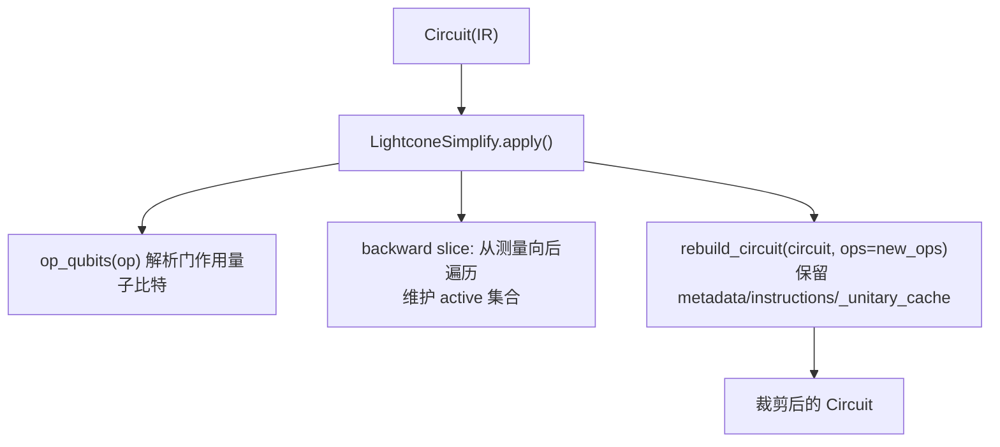
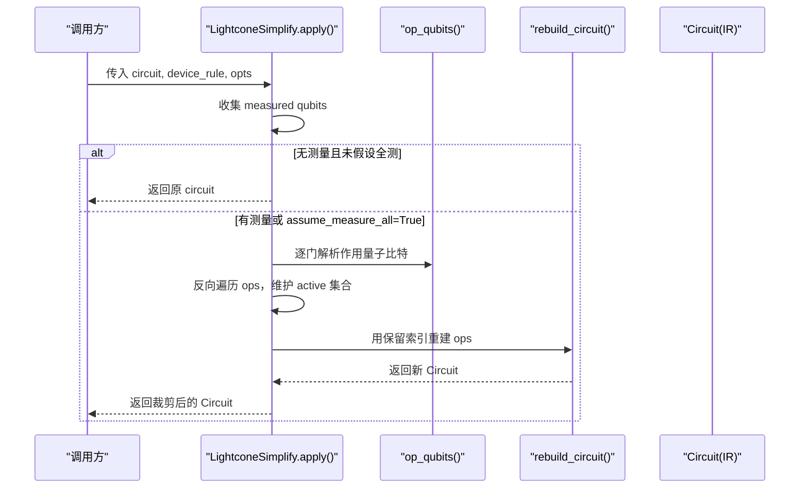
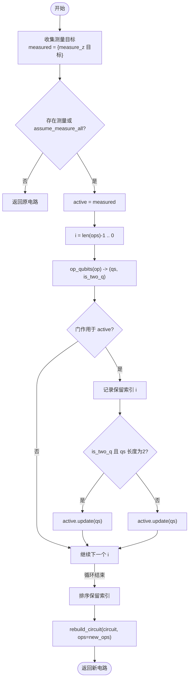
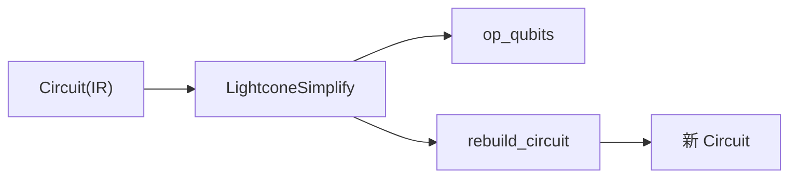

# 光锥简化算法

<cite>
**本文引用的文件**
- [lightcone.py](file://src/tyxonq/compiler/gate_compiler/stages/simplify/lightcone.py)
- [_circuit_utils.py](file://src/tyxonq/compiler/gate_compiler/_circuit_utils.py)
- [circuit.py](file://src/tyxonq/core/ir/circuit.py)
- [compiler_lightcone_optimization.py](file://examples/compiler_lightcone_optimization.py)
- [test_compiler_simplify_lightcone.py](file://tests_core_module/test_compiler_simplify_lightcone.py)
</cite>

## 目录
1. [简介](#简介)
2. [项目结构](#项目结构)
3. [核心组件](#核心组件)
4. [架构总览](#架构总览)
5. [详细组件分析](#详细组件分析)
6. [依赖关系分析](#依赖关系分析)
7. [性能考量](#性能考量)
8. [故障排查指南](#故障排查指南)
9. [结论](#结论)
10. [附录：示例与最佳实践](#附录示例与最佳实践)

## 简介
本技术文档聚焦 TyxonQ 的光锥简化（Lightcone Simplify）算法，系统阐述其核心原理、实现细节与使用方式。光锥简化的思想是“从测量出发反向追溯影响”，仅保留对最终测量结果有贡献的量子比特与门操作，从而显著降低期望值计算和模拟开销。文档将深入解释：
- 测量依赖关系的反向分析算法
- 活跃量子比特集合的维护机制
- op_qubits 函数如何识别不同门类型对量子比特的影响及依赖传播规则
- backward slice 的实现细节
- assume_measure_all 选项在无显式测量场景下的工作机制
- 优化前后电路对比与复杂度分析
- 性能优化效果与适用场景的最佳实践

## 项目结构
TyxonQ 的光锥简化位于编译器的简化阶段，作为独立的可插拔步骤参与编译流水线。关键文件与职责如下：
- 光锥简化实现：src/tyxonq/compiler/gate_compiler/stages/simplify/lightcone.py
- 电路重建工具：src/tyxonq/compiler/gate_compiler/_circuit_utils.py
- 量子线路 IR：src/tyxonq/core/ir/circuit.py
- 示例与基准：examples/compiler_lightcone_optimization.py
- 单元测试：tests_core_module/test_compiler_simplify_lightcone.py

图表来源
- [lightcone.py:12-97](file://src/tyxonq/compiler/gate_compiler/stages/simplify/lightcone.py#L12-L97)
- [_circuit_utils.py:28-72](file://src/tyxonq/compiler/gate_compiler/_circuit_utils.py#L28-L72)
- [circuit.py:48-183](file://src/tyxonq/core/ir/circuit.py#L48-L183)

章节来源
- [lightcone.py:12-97](file://src/tyxonq/compiler/gate_compiler/stages/simplify/lightcone.py#L12-L97)
- [_circuit_utils.py:28-72](file://src/tyxonq/compiler/gate_compiler/_circuit_utils.py#L28-L72)
- [circuit.py:48-183](file://src/tyxonq/core/ir/circuit.py#L48-L183)

## 核心组件
- LightconeSimplify：光锥简化步骤，负责收集测量目标、执行反向切片、维护活跃集并重建电路。
- op_qubits：门级依赖分析器，根据门名称判断其作用的量子比特以及是否为双量子比特纠缠门，用于依赖传播。
- rebuild_circuit：电路重建工具，在不丢失元数据与缓存的前提下生成新电路。

章节来源
- [lightcone.py:12-97](file://src/tyxonq/compiler/gate_compiler/stages/simplify/lightcone.py#L12-L97)
- [_circuit_utils.py:28-72](file://src/tyxonq/compiler/gate_compiler/_circuit_utils.py#L28-L72)

## 架构总览
光锥简化在编译器中作为“simplify”阶段的子步骤被调用。输入为 Circuit IR，输出为经过裁剪的 Circuit。整体流程：
1. 收集测量目标：扫描 ops，提取所有 measure_z 的目标量子比特；若无测量且未开启 assume_measure_all，则直接返回原电路。
2. 初始化活跃集：以测量目标为起点。
3. 反向遍历 ops：从末尾到开头，若门作用于当前活跃集，则保留该门；若是双量子比特纠缠门，则将两个量子比特都加入活跃集（依赖传播）。
4. 重建电路：按保留索引构建新的 ops，并通过 rebuild_circuit 生成新 Circuit，保留 metadata/instructions/_unitary_cache。

图表来源
- [lightcone.py:15-97](file://src/tyxonq/compiler/gate_compiler/stages/simplify/lightcone.py#L15-L97)
- [_circuit_utils.py:28-72](file://src/tyxonq/compiler/gate_compiler/_circuit_utils.py#L28-L72)

## 详细组件分析

### LightconeSimplify 类
- 功能：实现光锥简化，支持 assume_measure_all 选项。
- 关键点：
  - 测量收集：扫描 ops，识别 measure_z 目标。
  - 反向切片：从末尾向前遍历，维护 active 集合，决定保留哪些门。
  - 依赖传播：遇到双量子比特纠缠门时，将两端量子比特均纳入活跃集。
  - 电路重建：通过 rebuild_circuit 生成新电路，避免丢失元数据与缓存。

图表来源
- [lightcone.py:15-97](file://src/tyxonq/compiler/gate_compiler/stages/simplify/lightcone.py#L15-L97)

章节来源
- [lightcone.py:15-97](file://src/tyxonq/compiler/gate_compiler/stages/simplify/lightcone.py#L15-L97)

### op_qubits 函数：门类型与依赖传播规则
- 单量子比特门：如 h、rx、ry、rz、phase、s、t、sd、td、x、y、z、i，返回单个量子比特，非纠缠。
- 双量子比特纠缠门：如 cx、cz、swap、rxx、ryy、rzz，返回两个量子比特，标记为纠缠，触发依赖传播。
- 投影/重置：project_z、reset，视为单量子比特操作，不传播依赖。
- Barrier：不影响依赖，视为无量子比特操作。
- measure_z：返回测量目标量子比特，不参与依赖传播（但会被无条件保留）。
- 兜底策略：若未知门名，收集参数中的整数作为量子比特，并按数量判断是否纠缠。

依赖传播规则总结：
- 单量子比特门：仅影响自身量子比特，不改变活跃集范围。
- 双量子比特纠缠门：将两端量子比特同时纳入活跃集，体现纠缠导致的依赖扩散。
- 测量：始终保留，但不主动传播依赖（由后续反向遍历决定是否保留前序门）。

章节来源
- [lightcone.py:43-66](file://src/tyxonq/compiler/gate_compiler/stages/simplify/lightcone.py#L43-L66)

### backward slice 算法：从测量向后遍历构建依赖图
- 起点：measured 集合（或 assume_measure_all 时的全部量子比特）。
- 遍历方向：从 ops 末尾到开头。
- 决策逻辑：
  - 若门作用于 active 集合，则保留该门。
  - 若为双量子比特纠缠门，则将两端量子比特加入 active，扩展依赖范围。
  - 若为单量子比特门，仅更新 active 集合（通常不变）。
  - measure_z 总是保留。
- 输出：按原始顺序保留的门索引列表，用于重建电路。

复杂度分析：
- 时间复杂度：O(N)，N 为 ops 数量；每步常数时间判断与集合操作。
- 空间复杂度：O(Q)，Q 为量子比特数，用于维护 active 集合与保留索引。

章节来源
- [lightcone.py:68-90](file://src/tyxonq/compiler/gate_compiler/stages/simplify/lightcone.py#L68-L90)

### assume_measure_all 选项：无显式测量场景的工作机制
- 默认行为：若无 measure_z 且未开启 assume_measure_all，直接返回原电路（不进行裁剪）。
- 开启后：将所有量子比特视为测量目标，即 measured = {0..num_qubits-1}，此时 active 初始包含全部量子比特，因此不会裁剪任何门（数学等价于不优化），用于验证正确性或在全量测量场景下保持行为一致。

章节来源
- [lightcone.py:17-37](file://src/tyxonq/compiler/gate_compiler/stages/simplify/lightcone.py#L17-L37)

### 电路重建：rebuild_circuit 的作用与优势
- 作用：基于新的 ops 或 metadata 重建 Circuit，保留 _unitary_cache 等非 dataclass 字段。
- 优势：避免丢失编译链所需的缓存与指令信息，确保后续分解与匹配过程稳定。
- 实现要点：
  - 对 dataclass 电路使用 replace 更新字段。
  - 对非 dataclass 测试替身使用构造器重建。
  - 显式复制 _unitary_cache 到新电路。

章节来源
- [_circuit_utils.py:28-72](file://src/tyxonq/compiler/gate_compiler/_circuit_utils.py#L28-L72)

## 依赖关系分析
- LightconeSimplify 依赖：
  - Circuit IR：提供 num_qubits、ops、metadata、instructions 等。
  - op_qubits：门级依赖分析，决定活跃集更新策略。
  - rebuild_circuit：安全重建电路，保留元数据与缓存。
- 外部耦合：
  - 编译器管线：作为 simplify 阶段的一个步骤，可与其他简化步骤组合。
  - 设备规则：当前实现未使用 device_rule，但接口预留以便未来扩展。

图表来源
- [lightcone.py:12-97](file://src/tyxonq/compiler/gate_compiler/stages/simplify/lightcone.py#L12-L97)
- [_circuit_utils.py:28-72](file://src/tyxonq/compiler/gate_compiler/_circuit_utils.py#L28-L72)
- [circuit.py:48-183](file://src/tyxonq/core/ir/circuit.py#L48-L183)

章节来源
- [lightcone.py:12-97](file://src/tyxonq/compiler/gate_compiler/stages/simplify/lightcone.py#L12-L97)
- [_circuit_utils.py:28-72](file://src/tyxonq/compiler/gate_compiler/_circuit_utils.py#L28-L72)
- [circuit.py:48-183](file://src/tyxonq/core/ir/circuit.py#L48-L183)

## 性能考量
- 裁剪收益：当仅测量部分量子比特时，光锥简化可大幅减少需模拟的门数量，带来指数级加速潜力。
- 时间复杂度：线性于 ops 数量，适合大规模电路。
- 内存占用：活跃集与保留索引占用与量子比特数和门数相关，整体开销低。
- 适用场景：
  - VQE、QAOA 等变分算法中仅测量少量可观测量。
  - 大电路局部观测值计算。
  - 需要快速梯度计算的训练循环。

[本节为通用性能讨论，无需特定文件引用]

## 故障排查指南
- 问题：未进行任何裁剪
  - 可能原因：无 measure_z 且未设置 assume_measure_all。
  - 解决：添加测量或使用 assume_measure_all=True。
- 问题：裁剪过度导致结果错误
  - 可能原因：误判门类型或未覆盖自定义门。
  - 解决：检查 op_qubits 的兜底逻辑，必要时扩展门名映射。
- 问题：重建后丢失缓存或元数据
  - 可能原因：未使用 rebuild_circuit。
  - 解决：确保通过 rebuild_circuit 重建电路。

章节来源
- [lightcone.py:17-37](file://src/tyxonq/compiler/gate_compiler/stages/simplify/lightcone.py#L17-L37)
- [lightcone.py:43-66](file://src/tyxonq/compiler/gate_compiler/stages/simplify/lightcone.py#L43-L66)
- [_circuit_utils.py:28-72](file://src/tyxonq/compiler/gate_compiler/_circuit_utils.py#L28-L72)

## 结论
TyxonQ 的光锥简化算法通过从测量出发的反向依赖分析，精准识别并保留对最终结果有贡献的门操作，实现了零近似误差的电路裁剪。其核心在于 op_qubits 的门类型识别与依赖传播规则，以及高效的 backward slice 实现。配合 assume_measure_all 选项，可在无显式测量场景中保持一致性。该优化在部分测量场景下尤为有效，是扩展变分算法规模的关键技术之一。

[本节为总结性内容，无需特定文件引用]

## 附录：示例与最佳实践

### 示例：光锥优化的效果展示
- 全测量场景：使用 assume_measure_all=True 时，电路不被裁剪，结果与关闭优化完全一致，用于验证正确性。
- 部分测量场景：仅对少数量子比特测量，光锥简化会裁剪大量无关门，显著提升速度。

参考路径
- [compiler_lightcone_optimization.py:61-94](file://examples/compiler_lightcone_optimization.py#L61-L94)
- [compiler_lightcone_optimization.py:201-255](file://examples/compiler_lightcone_optimization.py#L201-L255)

章节来源
- [compiler_lightcone_optimization.py:61-94](file://examples/compiler_lightcone_optimization.py#L61-L94)
- [compiler_lightcone_optimization.py:201-255](file://examples/compiler_lightcone_optimization.py#L201-L255)

### 单元测试：验证裁剪行为
- 仅测量部分量子比特时，无关门被裁剪。
- assume_measure_all 行为：无测量时默认不裁剪，开启后也不裁剪（全量测量等价）。
- 多测量点与纠缠传播：链式纠缠会扩展活跃集。
- reset/project 指令保留规则：与测量相关的指令应保留。

参考路径
- [test_compiler_simplify_lightcone.py:8-23](file://tests_core_module/test_compiler_simplify_lightcone.py#L8-L23)
- [test_compiler_simplify_lightcone.py:25-36](file://tests_core_module/test_compiler_simplify_lightcone.py#L25-L36)
- [test_compiler_simplify_lightcone.py:38-57](file://tests_core_module/test_compiler_simplify_lightcone.py#L38-L57)
- [test_compiler_simplify_lightcone.py:59-76](file://tests_core_module/test_compiler_simplify_lightcone.py#L59-L76)

章节来源
- [test_compiler_simplify_lightcone.py:8-76](file://tests_core_module/test_compiler_simplify_lightcone.py#L8-L76)

### 最佳实践指导
- 优先在期望值计算前应用 LightconeSimplify，以减少模拟开销。
- 对于无显式测量的电路，若需验证或全量测量等价性，可使用 assume_measure_all=True。
- 自定义门需在 op_qubits 中明确映射，以确保依赖传播正确。
- 结合后端自动微分（如 value_and_grad）使用时，注意 JIT 回退行为，示例中已处理兼容。

[本节为通用实践建议，无需特定文件引用]