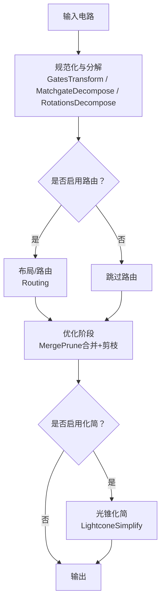
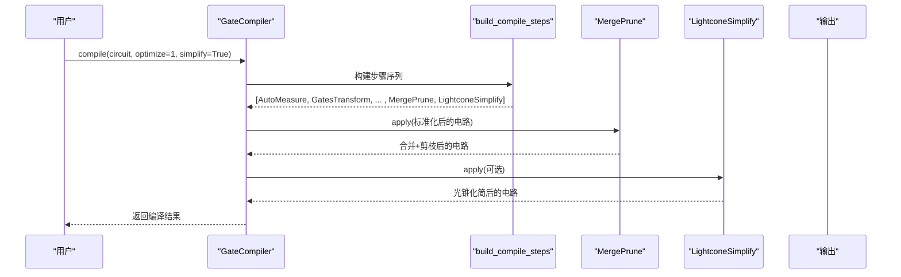
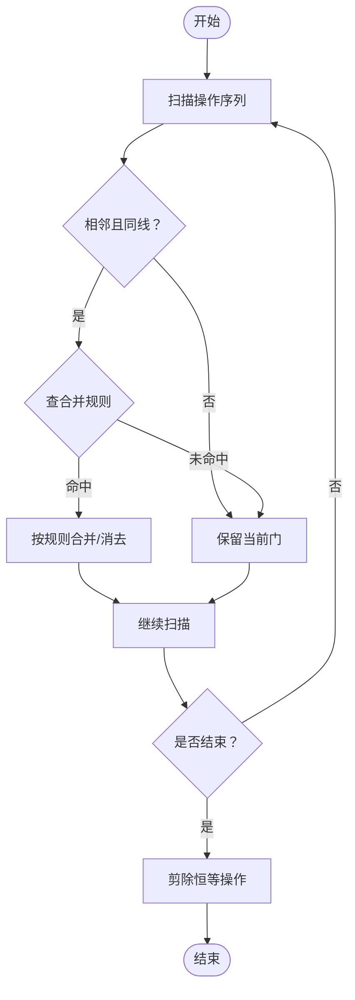
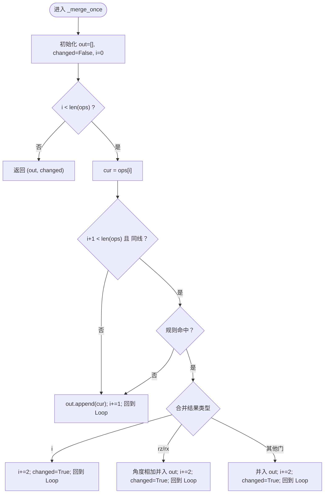

# 合并剪枝策略

<cite>
**本文引用的文件**
- [merge_prune.py](file://src/tyxonq/compiler/gate_compiler/stages/rewrite/merge_prune.py)
- [gates_transform.py](file://src/tyxonq/compiler/gate_compiler/stages/rewrite/gates_transform.py)
- [lightcone.py](file://src/tyxonq/compiler/gate_compiler/stages/simplify/lightcone.py)
- [steps.py](file://src/tyxonq/compiler/gate_compiler/steps.py)
- [compiler.py](file://src/tyxonq/compiler/gate_compiler/compiler.py)
</cite>

## 目录
1. [简介](#简介)
2. [项目结构](#项目结构)
3. [核心组件](#核心组件)
4. [架构总览](#架构总览)
5. [详细组件分析](#详细组件分析)
6. [依赖关系分析](#依赖关系分析)
7. [性能考量](#性能考量)
8. [故障排查指南](#故障排查指南)
9. [结论](#结论)
10. [附录](#附录)

## 简介
本技术文档聚焦 TyxonQ 门级编译中的“合并剪枝”策略，系统性阐述相邻相同门的合并算法、冗余操作的剪除机制、门操作的可交换性分析与局部重排序策略、不同级别的操作合并规则、无效操作的识别标准（零操作、抵消操作、可忽略操作），以及与其他优化技术的集成方式与配置选项。目标是帮助读者在保持电路语义正确性的前提下，理解并有效利用合并剪枝进行电路优化。

## 项目结构
TyxonQ 的门级编译器采用“步骤化”管线：先规范化与分解，再可选路由，随后执行优化（包含合并剪枝），最后进行光锥化简等。合并剪枝作为优化阶段的关键一步，通过相邻门合并与恒等操作剪除，显著降低门数与深度。

图表来源
- [steps.py:27-91](file://src/tyxonq/compiler/gate_compiler/steps.py#L27-L91)
- [compiler.py:27-73](file://src/tyxonq/compiler/gate_compiler/compiler.py#L27-L73)

章节来源
- [steps.py:27-91](file://src/tyxonq/compiler/gate_compiler/steps.py#L27-L91)
- [compiler.py:27-73](file://src/tyxonq/compiler/gate_compiler/compiler.py#L27-L73)

## 核心组件
- MergePrune：实现相邻门合并与恒等操作剪枝的核心类，支持自定义合并规则，迭代至不动点。
- GatesTransform：将门重写为目标基集（如 rx/rz/cx/cz/h），为后续合并提供统一表示。
- LightconeSimplify：基于测量反向切片的光锥化简，移除不影响观测的无关操作。
- steps/build_compile_steps：装配编译步骤序列，控制优化级别与开关。
- GateCompiler.compile：统一入口，收集参数、装配步骤、顺序执行并返回结果。

章节来源
- [merge_prune.py:27-86](file://src/tyxonq/compiler/gate_compiler/stages/rewrite/merge_prune.py#L27-L86)
- [gates_transform.py:12-50](file://src/tyxonq/compiler/gate_compiler/stages/rewrite/gates_transform.py#L12-L50)
- [lightcone.py:12-97](file://src/tyxonq/compiler/gate_compiler/stages/simplify/lightcone.py#L12-L97)
- [steps.py:27-91](file://src/tyxonq/compiler/gate_compiler/steps.py#L27-L91)
- [compiler.py:27-109](file://src/tyxonq/compiler/gate_compiler/compiler.py#L27-L109)

## 架构总览
合并剪枝位于优化阶段，依赖前置步骤提供的标准化门表示；其输出可作为后续光锥化简的输入，进一步剔除无关操作。整体流程如下：

图表来源
- [compiler.py:27-73](file://src/tyxonq/compiler/gate_compiler/compiler.py#L27-L73)
- [steps.py:27-91](file://src/tyxonq/compiler/gate_compiler/steps.py#L27-L91)

## 详细组件分析

### MergePrune：相邻门合并与恒等操作剪枝
- 合并思想：对相邻且作用在同一量子比特上的门，依据合并规则表进行代数合并。例如相同单比特门连续两次等于恒等，或旋转角相加合并为一次旋转。
- 剪枝机制：合并后若产生恒等操作（标识为 i），直接删除，避免无意义开销。
- 可交换性与局部重排：当前实现仅对严格相邻的同线门进行合并，不跨位置重排，保证语义安全；如需更激进的交换律应用，可在上层扩展。
- 复杂度：单次扫描 O(n)，循环直至不变，最坏情况仍线性；空间 O(n)。
- 可扩展性：通过 rules 字典注入新规则，支持任意门对的合并映射。

图表来源
- [merge_prune.py:40-86](file://src/tyxonq/compiler/gate_compiler/stages/rewrite/merge_prune.py#L40-L86)

章节来源
- [merge_prune.py:12-86](file://src/tyxonq/compiler/gate_compiler/stages/rewrite/merge_prune.py#L12-L86)

### GatesTransform：基集归一化（为合并提供统一表示）
- 目的：将 x/y 等门转换为 rx/ry(pi)，保留 cx/cz/h/rx/ry/rz 等基础门，其他门原样保留交由后续分解处理。
- 与合并的关系：统一表示有助于提高合并命中率（如将 x/x 转化为 rx(pi)/rx(pi) 后可被合并规则覆盖）。
- 注意：该步骤在 MatchgateDecompose 之前运行，重建电路时保留 _unitary_cache，确保后续分解可用。

章节来源
- [gates_transform.py:12-50](file://src/tyxonq/compiler/gate_compiler/stages/rewrite/gates_transform.py#L12-L50)

### LightconeSimplify：光锥化简（与合并剪枝协同）
- 原理：从测量位反向追踪受影响的量子比特集合，仅保留影响测量的操作，剔除无关分支。
- 与合并剪枝的配合：合并减少门数，光锥化简进一步裁剪无关区域，二者叠加效果显著。
- 适用场景：存在大量未参与测量的子电路时尤为有效。

章节来源
- [lightcone.py:12-97](file://src/tyxonq/compiler/gate_compiler/stages/simplify/lightcone.py#L12-L97)

### 编译步骤装配与执行：optimize 级别控制
- build_compile_steps：根据 optimize 级别决定是否插入 MergePrune；simplify 控制是否插入 LightconeSimplify。
- apply_steps：顺序执行各步骤，保证合并发生在标准化与分解之后、光锥化简之前。
- GateCompiler.compile：统一入口，整合 options 与显式参数，最终调用上述装配与执行逻辑。

章节来源
- [steps.py:27-91](file://src/tyxonq/compiler/gate_compiler/steps.py#L27-L91)
- [compiler.py:27-109](file://src/tyxonq/compiler/gate_compiler/compiler.py#L27-L109)

## 依赖关系分析
- MergePrune 依赖 Circuit 的 ops 列表与 rebuild_circuit 工具，用于重建电路并保持元数据。
- 与 GatesTransform 的耦合：后者提供统一的基集表示，提升前者合并命中率。
- 与 LightconeSimplify 的顺序依赖：合并在前，化简在后，形成互补优化链。
- 与编译管线的集成：由 steps.py 装配，compiler.py 驱动执行。

图表来源
- [steps.py:27-91](file://src/tyxonq/compiler/gate_compiler/steps.py#L27-L91)
- [compiler.py:27-73](file://src/tyxonq/compiler/gate_compiler/compiler.py#L27-L73)

章节来源
- [steps.py:27-91](file://src/tyxonq/compiler/gate_compiler/steps.py#L27-L91)
- [compiler.py:27-73](file://src/tyxonq/compiler/gate_compiler/compiler.py#L27-L73)

## 性能考量
- 时间复杂度：MergePrune 单次扫描 O(n)，多次迭代直至不变；总体近似线性。
- 空间复杂度：O(n) 存储中间操作序列。
- 合并收益：相邻相同门合并可减少门数与深度；旋转角合并减少重复旋转。
- 剪枝收益：恒等操作删除降低执行成本。
- 与光锥化简协同：在大规模电路中，光锥化简可大幅缩小需处理的子图规模。

[本节为通用性能讨论，无需特定文件引用]

## 故障排查指南
- 合并未生效
  - 检查是否已启用 optimize>=1，确保 MergePrune 被加入步骤序列。
  - 确认 GatesTransform 已将门归一化为基集，便于规则匹配。
  - 查看合并规则表是否覆盖目标门对。
- 电路语义变化
  - 当前实现仅对相邻同线门合并，不跨位置重排；如需交换律优化，应在上层扩展并确保等价性。
- 恒等操作残留
  - 确认 _prune_identities 是否被执行（默认会删除 i）。
- 光锥化简误删
  - 检查测量声明与 assume_measure_all 设置，确保只保留真正影响测量的操作。

章节来源
- [steps.py:27-91](file://src/tyxonq/compiler/gate_compiler/steps.py#L27-L91)
- [merge_prune.py:40-86](file://src/tyxonq/compiler/gate_compiler/stages/rewrite/merge_prune.py#L40-L86)
- [lightcone.py:12-97](file://src/tyxonq/compiler/gate_compiler/stages/simplify/lightcone.py#L12-L97)

## 结论
TyxonQ 的合并剪枝策略以轻量、安全、可扩展为核心设计原则：通过相邻门合并与恒等操作剪枝，结合基集归一化与光锥化简，在不改变电路语义的前提下显著提升效率。通过 optimize 级别与 simplify 开关，用户可灵活控制优化强度与范围。未来可通过扩展合并规则与引入安全的交换律重排进一步提升优化潜力。

[本节为总结性内容，无需特定文件引用]

## 附录

### 合并规则与无效操作识别
- 相邻相同门合并规则（示例）
  - s·s → z；sd·sd → z
  - t·t → s；td·td → sd
  - x·x → i；y·y → i；z·z → i；h·h → i
  - rz·rz → rz（角度相加）；rx·rx → rx（角度相加）；ry·ry → rx（角度合并）
- 无效操作识别
  - 零操作：恒等操作 i，直接剪除。
  - 抵消操作：同一门连续两次（如 x·x）等效于 i，合并后剪除。
  - 可忽略操作：不在测量光锥内的操作，可由 LightconeSimplify 剔除。

章节来源
- [merge_prune.py:12-24](file://src/tyxonq/compiler/gate_compiler/stages/rewrite/merge_prune.py#L12-L24)
- [merge_prune.py:48-86](file://src/tyxonq/compiler/gate_compiler/stages/rewrite/merge_prune.py#L48-L86)
- [lightcone.py:12-97](file://src/tyxonq/compiler/gate_compiler/stages/simplify/lightcone.py#L12-L97)

### 配置选项说明
- optimize：整数级别，≥1 时启用 MergePrune。
- simplify：布尔开关，启用 LightconeSimplify。
- basis_gates：目标基集，影响 GatesTransform 的重写行为，间接影响合并命中率。
- output：输出格式（ir/qasm2/qasm3/qiskit），影响后续导出但不影响合并剪枝本身。
- device_rule：设备能力描述，供路由等步骤使用，与合并剪枝无直接耦合。

章节来源
- [steps.py:27-91](file://src/tyxonq/compiler/gate_compiler/steps.py#L27-L91)
- [compiler.py:27-109](file://src/tyxonq/compiler/gate_compiler/compiler.py#L27-L109)

### 代码级流程图：合并一次扫描

图表来源
- [merge_prune.py:48-76](file://src/tyxonq/compiler/gate_compiler/stages/rewrite/merge_prune.py#L48-L76)